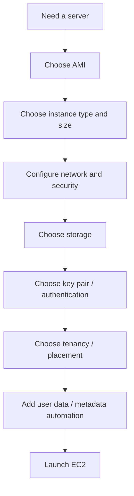
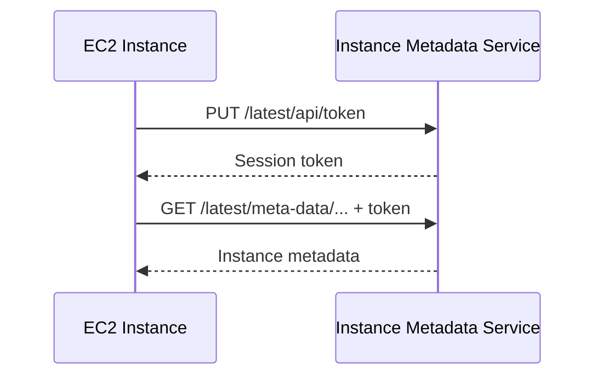
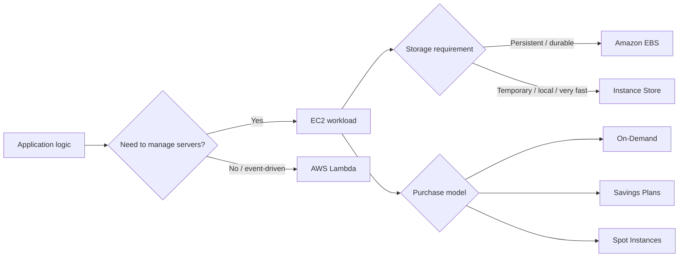
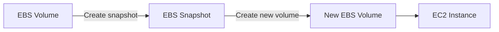
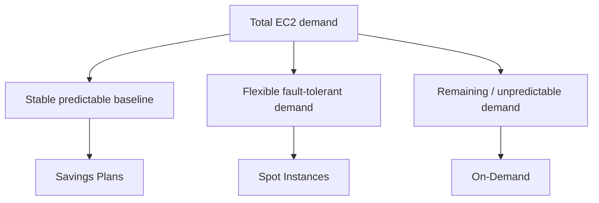
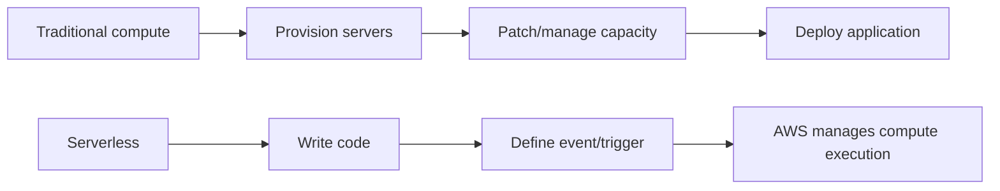
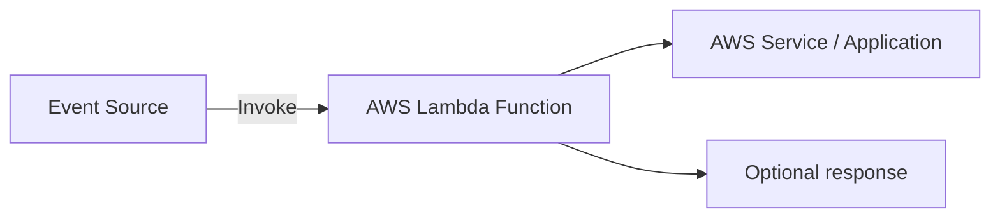
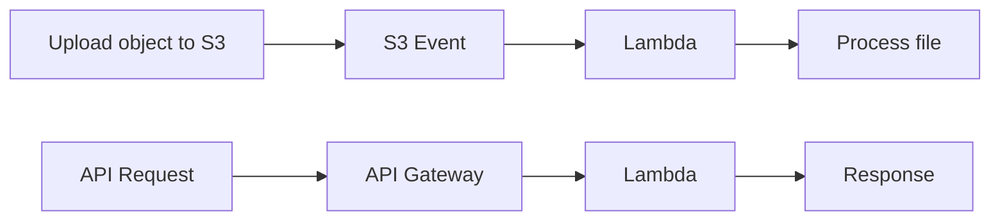
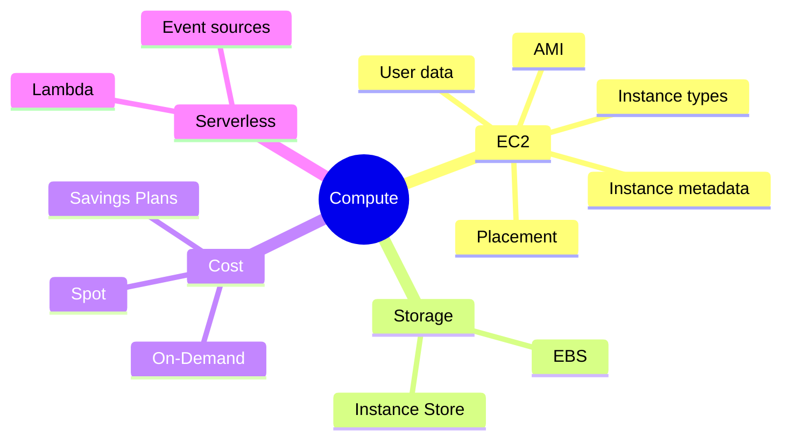
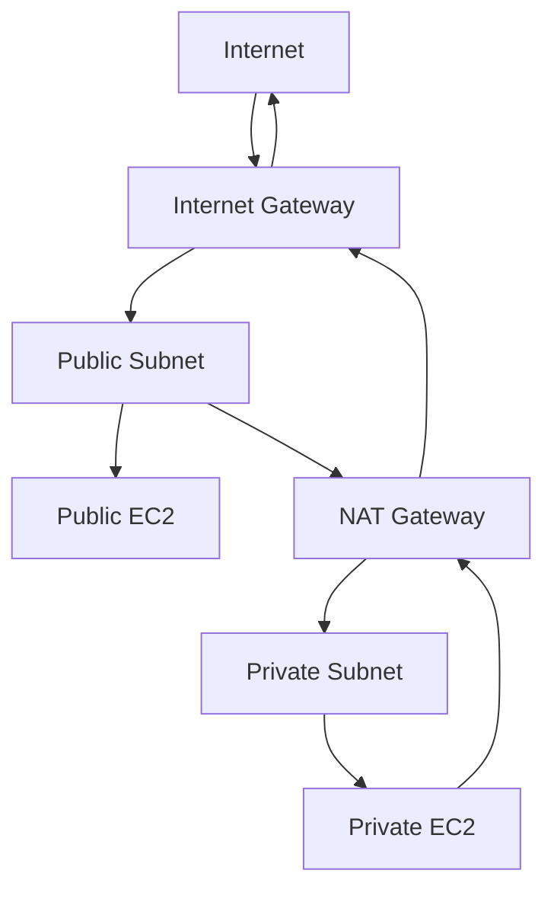

# Module 4 — Compute

> Mobile reader copy combined from Part 1 + Part 2. Full source screenshots remain in Google Drive master.

# Architecting on AWS 7.12.4 — Module 4: Compute (Part 1)

> **Source:** VitalSource Bookshelf — *Architecting on AWS 7.12.4 (EN), Student Guide*  
> **PDF pages:** 160–183  
> **Focus:** Compute options, Amazon EC2 fundamentals, AMIs, instance types, key pairs, tenancy, placement groups, user data, and instance metadata

---

# 1. Module 4 Overview

Module 4 ถามคำถามหลักเกี่ยวกับ compute หลายเรื่อง เช่น:

- AWS มี compute services อะไรให้เลือก?
- เวลา deploy server ไป Amazon EC2 ต้องพิจารณาอะไรบ้าง?
- ควรใช้ instance type แบบไหน?
- จะเลือก storage สำหรับ EC2 อย่างไร?
- จะ optimize cost ของ compute อย่างไร?
- จะเริ่มใช้ serverless compute อย่างไร?

ใน Part 1 นี้จะหยุดก่อนหัวข้อ storage และเน้น **การเลือก/ออกแบบ EC2 instance ให้เหมาะกับ workload**

---

# 2. Evolution of AWS Compute

Student Guide แสดงวิวัฒนาการของ AWS compute จาก virtual machines ไปสู่ containers, serverless และ custom processors

> 🖼️ *Source figure — Student Guide p.165; full screenshot is kept in the Google Drive master copy.*

Timeline ในเอกสาร:

```text
2006  Amazon EC2
2014  Amazon ECS
2014  AWS Lambda
2017  AWS Fargate
2018  AWS Graviton processors
2021  AWS Inferentia and Trainium processors
```

## 2.1 Virtual machines

ประโยชน์ที่ Student Guide ระบุ ได้แก่:

- Hardware independence
- Provision ได้เร็วกว่า physical hardware
- Pay-as-you-go แทนการซื้อ hardware ล่วงหน้า
- Scale ได้ง่ายขึ้น
- Elastic resources
- Agility สูงขึ้น
- ลด maintenance

Amazon EC2 เป็นหนึ่งในบริการยุคแรกของ AWS และยังเป็นแกนสำคัญของ cloud computing

---

## 2.2 Containers

ประโยชน์ของ containerization ตามเอกสาร:

- Platform independence
- Runtime environment คงที่
- ใช้ resource ได้หนาแน่นกว่า
- Deployment เร็วและง่ายขึ้น
- Isolation และ sandboxing
- Startup เร็วมาก

ตัวอย่างบริการที่เอกสารกล่าวถึง:

- Amazon ECS
- Amazon EKS

---

## 2.3 Serverless computing

Serverless computing มีประโยชน์ เช่น:

- Continuous scaling
- Built-in fault tolerance
- Pay for value
- Zero maintenance

AWS Lambda ทำให้รัน code โดยไม่ต้อง provision หรือ manage EC2 instance โดยตรง

AWS Fargate ใช้แนวคิด serverless compute สำหรับ containers และทำงานร่วมกับ Amazon ECS และ Amazon EKS

---

## 2.4 AWS custom processors

Student Guide กล่าวถึง processor ที่ AWS ออกแบบเอง เช่น:

- **AWS Graviton** — ARM-based processors สำหรับ workload บน EC2
- **AWS Inferentia** — ออกแบบมาสำหรับ machine learning inference
- **AWS Trainium** — ออกแบบมาสำหรับ deep learning training

แนวคิดที่ควรจำคือ AWS ไม่ได้มีแค่ “เลือกจำนวน CPU/RAM” แต่ยังมี hardware family ที่ออกแบบให้เหมาะกับ workload บางประเภทด้วย

---

# 3. Compute Services ที่เน้นใน Module นี้

Student Guide ระบุบริการหลักของ Module 4 คือ:

- **Amazon EC2**
- **Amazon EBS**
- **AWS Lambda**

Part 1 นี้โฟกัส Amazon EC2 ก่อน ส่วน EBS และ Lambda จะอยู่ Part ถัดไป

---

# 4. Amazon EC2 คืออะไร

Amazon Elastic Compute Cloud (Amazon EC2) ใช้สำหรับสร้างและรัน virtual machines บน AWS

EC2 instance เปรียบได้กับ traditional server แต่ทำงานอยู่ใน cloud และสามารถ provision / resize / remove ได้ตามต้องการ

Student Guide เน้นแนวคิดว่า compute บน AWS เป็น resource ที่:

- temporary ได้
- disposable ได้
- scale ได้
- provision ใหม่ได้เร็ว

ดังนั้นการออกแบบบน cloud ไม่จำเป็นต้องมอง server ทุกเครื่องว่าเป็น hardware ถาวรแบบ on-premises

---

# 5. EC2 Instance Launch Considerations

ก่อน launch EC2 instance มีหลายอย่างที่ต้องตัดสินใจ

> 🖼️ *Source figure — Student Guide p.170; full screenshot is kept in the Google Drive master copy.*

Student Guide แบ่งเป็นหัวข้อดังนี้:

1. **Name and tags**
2. **Application and operating system (OS) image**
3. **Instance type and size**
4. **Authentication and key pair**
5. **Network settings and security**
6. **Storage**
7. **Placement and tenancy**
8. **Scripts and metadata**

ลองคิดเป็น flow:



---

# 6. Tags in Amazon EC2

AWS tags เป็น metadata แบบ key-value ที่ผูกกับ resource

ตัวอย่าง:

```text
Owner = Dev1
Owner = Dev2
Owner = Dev3
```

Tags ใช้เพื่อ:

- Manage resources
- Search / filter
- Organize resources
- Track cost
- Support automation
- แบ่งตาม purpose / owner / environment / criteria อื่น ๆ

### สิ่งที่ต้องจำ

- Tag key/value เป็น **case-sensitive**
- การตั้ง tag ที่ดีช่วยเรื่อง automation และ operation ระยะยาว

ตัวอย่างใน Student Guide แสดงการใช้ AWS CLI เลือก stop EC2 instances ที่ tag `Owner=Dev2`

---

# 7. Amazon Machine Image (AMI)

AMI คือข้อมูล/template ที่ใช้ launch EC2 instance

> 🖼️ *Source figure — Student Guide p.172; full screenshot is kept in the Google Drive master copy.*

Student Guide อธิบาย AMI ว่ามีองค์ประกอบหลัก เช่น:

- Template สำหรับ root volume ของ instance
- Launch permissions
- Block device mapping

แนวคิดสำคัญคือ:

```text
One AMI
   |
   +--> EC2 instance 1
   +--> EC2 instance 2
   +--> EC2 instance 3
```

จึงสามารถสร้างหลาย instance ที่ configuration ใกล้เคียงกันจาก AMI เดียวได้

---

## 7.1 AMI ช่วยเรื่อง repeatability

AMI มีประโยชน์เชิง architecture เพราะ configuration สามารถ:

- Repeat ได้
- Reuse ได้
- Recover ได้ง่ายขึ้น

แทนการ build server ใหม่ทุกเครื่องแบบ manual

---

# 8. Where to Get an AMI

Student Guide ให้ตัวเลือกหลัก ได้แก่:

### 1. Prebuilt AMIs from AWS

ใช้ AMI ที่ AWS มีให้

### 2. AWS Marketplace

หา AMI / solution จาก AWS Marketplace

### 3. Create your own AMI

สร้าง custom AMI จาก EC2 instance ที่ปรับแต่งไว้แล้ว

custom AMI สามารถใช้:

- ภายใน account เดียว
- share กับ account อื่น
- publish แบบ private หรือ public ตามกรณี

Student Guide ยกตัวอย่าง tooling ที่ใช้ custom image เช่น Chef, Puppet และ cloud-init

---

# 9. Understanding EC2 Instance Type Names

EC2 instance type มี naming convention ที่บอกคุณสมบัติต่าง ๆ

> 🖼️ *Source figure — Student Guide p.174; full screenshot is kept in the Google Drive master copy.*

ตัวอย่างใน Student Guide:

```text
c7gn.2xlarge
```

แยกได้ดังนี้:

```text
c     = series / instance family
7     = generation
g     = additional property (Graviton)
n     = additional option (network / EBS optimized)
2xlarge = instance size
```

ชื่อ instance type จึงไม่ได้สุ่ม แต่ encode ข้อมูลของ family, generation, options และ size อยู่ในชื่อ

---

# 10. EC2 Instance Families

AWS มีหลาย instance family เพื่อรองรับ workload ต่างกัน

> 🖼️ *Source figure — Student Guide p.175; full screenshot is kept in the Google Drive master copy.*

Student Guide จัดกลุ่มหลัก ๆ ดังนี้:

## 10.1 General purpose

เหมาะกับ workload ที่ต้อง balance:

- Compute
- Memory
- Networking

ตัวอย่าง use cases:

- Diverse workloads
- Web applications

---

## 10.2 Memory optimized

เหมาะกับ workload ที่ต้องใช้ memory สูง เช่น:

- Large in-memory datasets
- Database servers
- Web caches
- Data analytics

---

## 10.3 Storage optimized

เหมาะกับ workload ที่ต้องการ high sequential read/write หรือ dataset ขนาดใหญ่ เช่น:

- Large datasets
- NoSQL databases
- Amazon OpenSearch Service

---

## 10.4 Compute optimized

เหมาะกับ compute-bound workloads เช่น:

- High-performance processors
- Media transcoding
- Scientific modeling
- Machine learning

---

## 10.5 Accelerated computing

เหมาะกับ workload เช่น:

- High-graphics processing
- GPU-bound applications
- Machine learning
- High-performance computing
- Autonomous vehicles

---

## 10.6 HPC optimized

เหมาะกับ:

- Large, complex simulations
- Deep learning workloads

---

# 11. Newer-Generation Instance Types

Student Guide แนะนำให้พิจารณา instance generation ใหม่ เพราะโดยทั่วไปช่วยเรื่อง:

- Improved performance
- Cost efficiency
- Scalability

เหตุผลที่ระบุไว้ เช่น:

### Performance

- Newer hardware
- Better CPU performance
- Faster memory
- Better storage options
- Improved networking

### Cost efficiency

- Better price-to-performance
- Potentially lower power consumption

### Scalability

- มี configuration ให้เลือกมากขึ้น
- เหมาะกับ future-proofing และการเติบโตของ workload

จุดสำคัญคืออย่าเลือก instance เพียงเพราะ “เคยใช้รุ่นนี้มาก่อน” ควรดู generation และความเหมาะสมกับ workload ด้วย

---

# 12. AWS Compute Optimizer

AWS Compute Optimizer ใช้ historical utilization metrics และ machine learning เพื่อแนะนำ resource ที่เหมาะสมขึ้น

> 🖼️ *Source figure — Student Guide p.178; full screenshot is kept in the Google Drive master copy.*

Student Guide ระบุ resource ที่ Compute Optimizer สามารถให้ recommendation ได้ เช่น:

- EC2 instances
- EC2 Auto Scaling groups
- Amazon EBS volumes
- AWS Lambda functions
- Amazon ECS services on AWS Fargate
- Amazon RDS DB instance classes

แนวคิดหลัก:

```text
Over-provisioning
-> cost สูงเกินจำเป็น

Under-provisioning
-> performance อาจไม่พอ
```

Compute Optimizer ช่วยหา balance ระหว่างสองฝั่ง

---

# 13. Amazon EC2 Key Pairs

EC2 key pair ประกอบด้วย:

- Public key
- Private key

AWS เก็บ public key ส่วน private key ผู้ใช้ต้องเก็บรักษาเองอย่างปลอดภัย

Student Guide อธิบายว่า key pair ใช้พิสูจน์ identity ตอนเชื่อมต่อ instance

สิ่งสำคัญ:

> ผู้ที่ถือ private key สามารถใช้ key นั้นเชื่อมต่อ instance ได้ตามสิทธิ์ที่เกี่ยวข้อง ดังนั้น private key ต้องเก็บให้ปลอดภัย

---

# 14. EC2 Tenancy

EC2 มี tenancy options หลักใน Student Guide:

| Tenancy | แนวคิด |
|---|---|
| Shared tenancy | แชร์ physical hardware กับ workload อื่นตามระบบ AWS |
| Dedicated Instance | Instance ถูก isolate ที่ระดับ host hardware |
| Dedicated Host | ใช้ physical server ที่ dedicated ให้ account โดยเฉพาะ |

### Shared tenancy

เป็นค่า default

### Dedicated Instance

instance ถูกแยกจาก instance ของ account อื่นในระดับ host hardware

### Dedicated Host

ได้ physical server แบบ dedicated และสามารถควบคุมการวาง instance บน host ได้มากขึ้น

Student Guide ยังกล่าวถึง use case ด้าน licensing เช่น software license แบบ per-socket / per-core / per-VM

---

# 15. Placement Groups

Placement group ใช้ควบคุมว่า instances ควรอยู่ใกล้หรือห่างกันแค่ไหนบน underlying infrastructure

> 🖼️ *Source figure — Student Guide p.181; full screenshot is kept in the Google Drive master copy.*

Student Guide แบ่ง 3 แบบ:

## 15.1 Cluster

เหมาะกับ:

- Low network latency
- High network throughput
- HPC workloads

แนวคิดคือวาง instances ใกล้กัน

---

## 15.2 Spread

เหมาะกับ workload ที่ต้องลดโอกาส correlated failure

ตัวอย่างใน Student Guide:

- Critical instances
- Medical health record system

instances ถูกกระจายออกจากกันมากขึ้น

---

## 15.3 Partition

เหมาะกับ distributed / replicated workloads ขนาดใหญ่

ตัวอย่าง:

- Apache Kafka
- Apache Hadoop
- Apache Cassandra

ใช้ partition เพื่อลดความเสี่ยงที่หลาย component จะได้รับผลจาก hardware failure เดียวกันพร้อมกัน

---

# 16. User Data

EC2 user data ใช้รัน script ตอน instance launch

Student Guide ยกตัวอย่างทั้ง Linux และ Windows

### Linux

ตัวอย่าง shell script:

```bash
#!/bin/bash
yum update -y
yum install -y httpd
service httpd start
chkconfig httpd on
```

### Windows

ตัวอย่าง PowerShell ใช้ติดตั้ง Web Server feature

แนวคิดหลักคือ user data ช่วย automate task หลัง launch เช่น:

- Patch/update instance
- Install software
- Configure server
- Run bootstrap script

Student Guide ระบุว่า:

- Linux ใช้ `cloud-init`
- Windows ใช้ `EC2Launch`

---

# 17. Instance Metadata

Instance metadata คือข้อมูลเกี่ยวกับ EC2 instance ที่กำลังรันอยู่ และใช้สำหรับ automation / configuration ได้

> 🖼️ *Source figure — Student Guide p.183; full screenshot is kept in the Google Drive master copy.*

ตัวอย่าง metadata ใน Student Guide:

- instance-id
- MAC address
- public-hostname
- public-ipv4
- local-hostname
- local-ipv4

---

## 17.1 Metadata Endpoint

EC2 instance สามารถเข้าถึง metadata endpoint ที่:

```text
169.254.169.254
```

ตัวอย่าง path:

```text
/latest/meta-data/public-hostname
```

---

## 17.2 ทำไมต้องขอ Token ก่อนอ่าน Metadata?

Student Guide แสดง flow แบบนี้:

### Step 1 — ขอ session token

```bash
TOKEN=`curl -X PUT "http://169.254.169.254/latest/api/token" \
  -H "X-aws-ec2-metadata-token-ttl-seconds: 21600"`
```

### Step 2 — ใช้ token ขอ metadata

```bash
curl http://169.254.169.254/latest/meta-data/public-hostname \
  -H "X-aws-ec2-metadata-token: $TOKEN"
```

flow คือ:



ดังนั้น token ไม่ได้มีไว้ “ยืนยันว่าเราเป็นเจ้าของเครื่อง” ในความหมายของ login แต่เป็นส่วนหนึ่งของวิธีเข้าถึง metadata service ตาม flow ที่ Student Guide แสดง

---

# 18. User Data vs Instance Metadata

สองอย่างนี้มักสับสนกัน

| หัวข้อ | User Data | Instance Metadata |
|---|---|---|
| จุดประสงค์ | ส่ง script/config เข้า instance | อ่านข้อมูลเกี่ยวกับ instance |
| ใช้เมื่อ | ตอน bootstrap / launch | ตอน instance กำลังรัน |
| ตัวอย่าง | install web server | instance-id, IP, hostname |

จำง่าย ๆ:

```text
User Data       = สิ่งที่เรา “ส่งเข้า” instance
Instance Metadata = ข้อมูลที่ instance “อ่านเกี่ยวกับตัวเอง”
```

---

# 19. EC2 Launch Mental Model

เวลาออกแบบ EC2 instance ให้คิดตามลำดับนี้:

```text
1. Workload ต้องการ compute แบบไหน?
2. เลือก AMI อะไร?
3. เลือก instance family / generation / size อะไร?
4. ต้องใช้ key pair หรือ authentication แบบไหน?
5. Network / subnet / security group เป็นอย่างไร?
6. Shared / Dedicated / Dedicated Host?
7. ต้องใช้ placement group หรือไม่?
8. ต้อง bootstrap ด้วย user data อะไร?
9. Automation ต้องอ่าน metadata อะไรจาก instance?
```

---

# 20. Cheat Sheet — Compute Part 1

```text
AMI
= Template used to launch EC2 instances

Instance family
= Workload-oriented hardware profile

Instance size
= Capacity level inside a family

Compute Optimizer
= Uses utilization metrics + ML to recommend sizing

Key Pair
= Public key in AWS + private key protected by user

Shared tenancy
= Default shared hardware model

Dedicated Instance
= Host-level isolation

Dedicated Host
= Dedicated physical host

Cluster placement group
= Close together / low latency / high throughput

Spread placement group
= Separate critical instances

Partition placement group
= Separate distributed workload partitions

User Data
= Bootstrap script at launch

Instance Metadata
= Information about the running instance
```

---

## End of Module 4 — Part 1

**Covered PDF pages:** 160–183  
**Next section starts at page 184:** Storage for EC2 instances


---

# Architecting on AWS 7.12.4 — Module 4: Compute (Part 2)

> **Source:** VitalSource Bookshelf — *Architecting on AWS 7.12.4 (EN) Student Guide*  
> **PDF pages covered:** 184–217  
> **Scope:** Storage for EC2, EC2 pricing options, AWS Lambda/serverless, module review, capstone check-in, knowledge check, and Lab 2 introduction.

---

## 0. ภาพรวมของ Part 2

Part นี้ต่อจากการเลือกและเปิดใช้งาน EC2 ใน Part 1 แล้วตอบคำถามต่อว่า:

1. EC2 ควรใช้ storage แบบไหน?
2. EBS ต่างจาก Instance Store อย่างไร?
3. จะเลือกวิธีจ่ายค่า EC2 แบบไหนให้เหมาะกับ workload?
4. เมื่อไรควรใช้ Serverless แทน virtual server?
5. AWS Lambda ทำงานอย่างไรและถูก trigger จากอะไรได้บ้าง?

Flow ใหญ่ของบทนี้คือ:



---

# 1. Storage for EC2 instances

AWS แยก storage สำหรับ EC2 ออกเป็นหลายแบบ เพราะ workload แต่ละชนิดต้องการคุณสมบัติไม่เหมือนกัน เช่น:

- ต้องการข้อมูลคงอยู่แม้ instance ถูกหยุด
- ต้องการ throughput สูงสำหรับ sequential workload
- ต้องการ IOPS สูงสำหรับ transaction workload
- ต้องการ temporary storage ที่เร็วและอยู่ติดกับ host

ใน Module 4 ช่วงนี้เน้น 2 กลุ่มหลัก:

- **Amazon Elastic Block Store (Amazon EBS)**
- **EC2 Instance Store**

---

# 2. Amazon Elastic Block Store (Amazon EBS)

> 🖼️ *Source figure — Student Guide p.185; full screenshot is kept in the Google Drive master copy.*

Amazon EBS เป็น **durable, detachable, block-level storage** สำหรับ EC2

คำสำคัญมี 3 คำ:

### Durable
ข้อมูลถูกออกแบบให้คงอยู่ ไม่ได้ผูกกับอายุของ process หรือ temporary cache ของ instance

### Detachable
Volume สามารถถอดออกจาก EC2 แล้วนำไป attach กับ instance อื่นได้ตามข้อจำกัดของบริการ

### Block-level storage
ระบบปฏิบัติการมอง EBS คล้าย disk/block device ซึ่งสามารถนำไปสร้าง filesystem หรือใช้กับ workload ที่ต้องการ block storage ได้

Student Guide ระบุว่า EBS volume ถูกสร้างภายใน **Availability Zone** และสามารถย้าย/attach ระหว่าง EC2 ที่อยู่ใน Availability Zone เดียวกันได้ตามต้องการ

ตัวอย่างแนวคิด:

```text
Availability Zone A

EC2 Instance A
      │
      ├──── EBS Volume 1
      └──── EBS Volume 2

ถ้าต้องเปลี่ยนเครื่อง:

EC2 Instance A  --detach-->  EBS Volume 1  --attach-->  EC2 Instance B
```

นี่ทำให้ compute และ storage แยก lifecycle ออกจากกันได้มากกว่า local disk ที่ติดกับ host

---

## 2.1 EBS Snapshots

EBS สามารถสร้าง **snapshot** เพื่อเก็บสำเนาข้อมูลแบบ point-in-time ได้

แนวคิดจากบทเรียน:



Snapshot สามารถนำกลับมาใช้สร้าง EBS volume ใหม่ได้ จึงเหมาะกับงานอย่าง:

- สำรองข้อมูล
- เตรียม volume สำหรับ instance ใหม่
- เก็บ state ก่อนเปลี่ยนแปลงระบบ

> **จำ:** EBS Snapshot กับ AMI ไม่ใช่สิ่งเดียวกัน แต่ AMI สามารถมี block device mapping ที่บอกว่า instance ตอน launch จะมี volume อะไรบ้าง

---

# 3. Amazon EBS volume types

> 🖼️ *Source figure — Student Guide p.186; full screenshot is kept in the Google Drive master copy.*

Student Guide แบ่งประเภทหลักเป็น SSD-backed และ HDD-backed

| กลุ่ม | Volume types ในบทเรียน | ลักษณะหลัก |
|---|---|---|
| General Purpose SSD | `gp2`, `gp3` | สมดุลด้านราคาและ performance สำหรับ workload ทั่วไป |
| Provisioned IOPS SSD | `io1`, `io2 Block Express` | สำหรับ workload ที่ต้องการ IOPS สูงและสม่ำเสมอ |
| Throughput Optimized HDD | `st1` | เหมาะกับ large sequential workload ที่ throughput สำคัญกว่า IOPS |
| Cold HDD | `sc1` | low-cost สำหรับข้อมูลที่เข้าถึงไม่บ่อย |

วิธีคิดที่ง่ายคืออย่าเลือกจากคำว่า “SSD ดีกว่า HDD” อย่างเดียว แต่เลือกจาก **access pattern** ของ workload

---

## 3.1 General Purpose SSD — gp2 / gp3

General Purpose SSD เหมาะกับ workload ทั่วไปที่ต้องการสมดุลของ cost/performance

ตัวอย่าง use case ที่ Student Guide ยกมา:

- Transactional workloads
- Virtual desktops
- Medium-sized single-instance databases
- Low-latency interactive applications
- Boot volumes
- Development and test environments

ภาพจำ:

```text
Workload ทั่วไป
   ↓
ต้องการ latency ต่ำ + performance ดีพอ + ไม่ต้อง provision IOPS สูงมาก
   ↓
General Purpose SSD
```

---

## 3.2 Provisioned IOPS SSD — io1 / io2

Provisioned IOPS SSD ออกแบบมาสำหรับ workload ที่ต้องการ **IOPS performance สูงและมีความสม่ำเสมอ**

ในบทเรียนยกตัวอย่าง:

- Workloads ที่ต้องการ sustained IOPS performance สูง
- I/O-intensive database workloads
- Mission-critical workloads

จุดต่างจาก General Purpose คือผู้ใช้กำหนดระดับ IOPS ที่ต้องการให้เหมาะกับ workload ได้มากกว่า

---

## 3.3 Throughput Optimized HDD — st1

`st1` เน้น **throughput** มากกว่า random IOPS

เหมาะกับ large sequential workloads เช่น:

- Big data
- Data warehouses
- Log processing

ภาพจำ:

```text
ไฟล์/ข้อมูลขนาดใหญ่
อ่านเขียนต่อเนื่องเป็น stream
        ↓
Throughput สำคัญกว่า random IOPS
        ↓
             st1
```

---

## 3.4 Cold HDD — sc1

`sc1` เป็น low-cost HDD สำหรับข้อมูลที่เข้าถึงไม่บ่อย

use case ใน Student Guide:

- Throughput-oriented data ที่ไม่ได้ถูก access บ่อย
- กรณีที่ storage cost สำคัญที่สุด

ดังนั้นถ้าข้อมูลเยอะ แต่ไม่ได้เปิดอ่านตลอดเวลา และไม่ได้ต้องการ IOPS สูง `sc1` คือแนวคิดที่ต้องนึกถึง

---

# 4. EC2 Instance Store

> 🖼️ *Source figure — Student Guide p.189; full screenshot is kept in the Google Drive master copy.*

Instance Store เป็น **temporary block-level storage** ที่อยู่บน disk ซึ่ง physically attached กับ host computer ที่ EC2 instance กำลังทำงานอยู่

ต่างจาก EBS ตรงที่ Instance Store ผูกกับ host และ lifecycle ของ instance มากกว่า

คุณสมบัติที่ Student Guide เน้น:

- Directly attached block-level storage
- Low latency
- High IOPS and throughput
- Reclaimed เมื่อ instance ถูก stop หรือ terminate
- ไม่รองรับ snapshots แบบ EBS
- มีได้ทั้ง HDD, SSD และ NVMe SSD ตาม instance type

ภาพในบทเรียนแสดงชัดว่าเมื่อ instance หยุด ข้อมูลใน Instance Store สามารถถูกลบ/หายไปได้

---

## 4.1 Use cases ของ Instance Store

เหมาะกับข้อมูลที่สร้างใหม่ได้หรือไม่จำเป็นต้องเก็บถาวร เช่น:

- Buffers
- Caches
- Temporary data

ตัวอย่าง mindset:

```text
Redis-like cache / processing temp files / intermediate results
                    ↓
ถ้าหายแล้วสร้างใหม่ได้
                    ↓
           Instance Store เหมาะกว่า
```

แต่ถ้าเป็นข้อมูลธุรกิจที่ต้องอยู่ต่อ เช่น database data หรือ application state ที่ห้ามหาย ไม่ควรพึ่ง Instance Store เป็น storage หลัก

---

# 5. EBS vs Instance Store

| ประเด็น | Amazon EBS | Instance Store |
|---|---|---|
| ลักษณะ | Network-attached block storage | Local storage ที่ติดกับ host |
| Persistence | เหมาะกับข้อมูลที่ต้องการเก็บต่อ | Temporary / ephemeral |
| Detach/attach | ทำได้ตามข้อจำกัดของ EBS | ไม่ได้ออกแบบมาให้ย้ายเป็น volume แบบ EBS |
| Snapshot | รองรับ EBS Snapshot | ไม่รองรับแบบเดียวกับ EBS |
| Latency | ผ่าน storage service | Local to host จึงเหมาะกับ low-latency use case |
| เหมาะกับ | OS, application data, database, persistent data | Cache, buffer, temporary data |

### จำแบบสั้น

> **EBS = ข้อมูลต้องอยู่**  
> **Instance Store = ข้อมูลหายได้ แต่ต้องการ local performance**

---

# 6. Amazon EC2 pricing options

หลังจากเลือก compute และ storage แล้ว คำถามถัดไปคือ **จะจ่ายค่า compute แบบไหน**

Student Guide แบ่งตัวเลือกหลักในส่วนนี้เป็น:

1. **On-Demand Instances**
2. **Savings Plans**
3. **Spot Instances**

> 🖼️ *Source figure — Student Guide p.191; full screenshot is kept in the Google Drive master copy.*

---

# 7. On-Demand Instances

On-Demand เหมาะกับการใช้ compute โดยไม่ต้อง commit ระยะยาว

ประเด็นจากบทเรียน:

- จ่ายสำหรับ compute capacity ตามการใช้งาน
- ไม่มี long-term commitment
- ไม่มี upfront payment
- เพิ่มหรือลด compute capacity ตามความต้องการของ application ได้

เหมาะกับ workload ที่:

- ยังไม่รู้ usage pattern ชัดเจน
- ใช้ชั่วคราว
- ไม่สามารถยอมรับการ interruption แบบ Spot ได้

ภาพจำ:

```text
ต้องการ EC2 ตอนนี้
ไม่อยาก commit ระยะยาว
ต้องการให้ instance อยู่ต่อเนื่อง
        ↓
     On-Demand
```

---

# 8. Savings Plans

Savings Plans ให้ส่วนลดเมื่อแลกกับ **usage commitment** ตามเงื่อนไขของแผน

Student Guide ระบุ 2 ประเภทสำคัญ:

> 🖼️ *Source figure — Student Guide p.192; full screenshot is kept in the Google Drive master copy.*

## 8.1 Compute Savings Plans

จุดเด่นคือ **flexibility สูงที่สุด**

สามารถยืดหยุ่นข้ามสิ่งต่าง ๆ ได้มากกว่า เช่น:

- Instance family
- Size
- OS
- Tenancy
- Availability Zone
- Region

ในบทเรียนระบุว่าส่วนลดสามารถสูงได้ถึงประมาณ **66% เมื่อเทียบกับ On-Demand rates** ตามเงื่อนไขของแผน

เหมาะเมื่อองค์กรมี compute usage ค่อนข้างแน่นอน แต่ architecture อาจเปลี่ยน instance family, size หรือ Region ได้

---

## 8.2 EC2 Instance Savings Plans

ให้ส่วนลดสูงกว่าในบางกรณี แต่ flexibility น้อยกว่า Compute Savings Plans

แนวคิดคือ commit กับ **specific instance family ใน AWS Region**

ยังยืดหยุ่นได้ในบางมิติ เช่น:

- Availability Zone
- Size
- OS
- Tenancy

Student Guide ระบุว่าส่วนลดสามารถสูงได้ถึงประมาณ **72%** ตามเงื่อนไขของแผน

---

## 8.3 วิธีคิด Savings Plans

```text
Usage predictable และมี baseline ค่อนข้างแน่นอน
                  ↓
      ยอม commit การใช้งานได้
                  ↓
            Savings Plans
```

ถ้าต้องการ flexibility มาก → Compute Savings Plans  
ถ้า workload EC2 family ค่อนข้างคงที่ → EC2 Instance Savings Plans

---

# 9. EC2 Spot Instances

> 🖼️ *Source figure — Student Guide p.193; full screenshot is kept in the Google Drive master copy.*

Spot Instances ใช้ **spare EC2 capacity** ของ AWS

จุดเด่นคือราคาถูกกว่า On-Demand อย่างมาก แต่ต้องแลกกับความเสี่ยงที่ capacity จะถูกเรียกคืน

Student Guide ระบุแนวคิดสำคัญ:

- ใช้ spare EC2 host capacity
- สามารถประหยัดได้สูงถึงประมาณ **90% เมื่อเทียบกับ On-Demand**
- AWS สามารถ interrupt Spot Instance เมื่อ capacity นั้นจำเป็นต้องนำไปใช้ที่อื่น
- มี interruption notification ก่อนเหตุการณ์ประมาณ 2 นาที
- ควร diversify fleet โดยใช้ instance types, sizes และ Availability Zones หลายแบบ

---

## 9.1 Workload ที่เหมาะกับ Spot

Student Guide ยก use cases เช่น:

- Image and media rendering
- Web services ที่ออกแบบให้ scale/fault tolerant
- Big data and analytics
- Containerized workloads
- CI/CD and testing
- HPC

แก่นสำคัญคือ workload ต้อง **fault-tolerant, flexible, loosely coupled หรือ stateless** มากพอที่จะรับ interruption ได้

ไม่ใช่แค่เห็นว่า Spot ถูกแล้วเอา production database ไปวางตรง ๆ

---

# 10. Combining EC2 purchase options

AWS ไม่ได้บังคับให้เลือกเพียงแบบเดียว

Student Guide แนะนำแนวคิดให้ใช้ purchase options ผสมกันตาม workload



แนวคิดจากบทเรียน:

- **Savings Plans** สำหรับ budget/usage ที่คาดการณ์ได้
- **Spot Instances** สำหรับ flexible workloads ที่รับ failure/interruption ได้
- **On-Demand** สำหรับส่วนที่เหลือหรือ workload ที่ไม่เหมาะกับ Spot/commitment

นี่คือแนวคิด cost optimization ที่สำคัญ: ไม่จำเป็นต้องใช้ pricing model เดียวกับทุก instance

---

# 11. AWS Lambda overview

หลังจาก EC2 บทเรียนเปลี่ยนมาถามว่า:

> ถ้าเราไม่อยาก manage server เองล่ะ?

คำตอบใน Module 4 คือ **Serverless computing** และตัวอย่างหลักคือ **AWS Lambda**

---

# 12. Serverless computing

Serverless ไม่ได้หมายความว่า “ไม่มี server” แต่หมายถึง developer ไม่ต้อง provision, scale และ manage server infrastructure โดยตรง

แนวคิดใน Student Guide:

- ไม่ต้อง provision servers
- ไม่ต้อง scale servers เอง
- ไม่ต้อง manage servers
- Infrastructure availability และการจัดการ compute ถูกบริการดูแลให้
- Developer สามารถ focus ที่ application logic/code ได้มากขึ้น



---

# 13. AWS Lambda

> 🖼️ *Source figure — Student Guide p.198; full screenshot is kept in the Google Drive master copy.*

AWS Lambda เป็น serverless compute service ที่รัน code เมื่อถูก invoke

โครงสร้างพื้นฐาน:



Student Guide ระบุว่า Lambda รองรับภาษา runtime หลายแบบ เช่น:

- Node.js
- Java
- C#
- Python
- Go
- Ruby
- PowerShell
- และ runtime อื่นตามที่บริการรองรับ

ในเวอร์ชัน Student Guide นี้ Lambda function:

- รันได้สูงสุด **15 minutes**
- จัดสรร memory ได้สูงสุด **10 GB**

---

## 13.1 Lambda function configuration

Lambda function ไม่ใช่แค่ code อย่างเดียว ยังมี configuration ที่เกี่ยวข้อง เช่น:

- Handler ที่รับ event
- IAM role ที่ Lambda ใช้ตอนทำงาน
- Compute resource allocation
- Delivery timeout / execution timeout
- Dependencies ของ function

จุดสำคัญคือ Lambda ยังต้องใช้ **IAM permissions** เพื่อไปเรียก AWS resources อื่น

---

# 14. Lambda event sources

> 🖼️ *Source figure — Student Guide p.200; full screenshot is kept in the Google Drive master copy.*

Lambda สามารถถูก invoke โดย AWS services ได้หลายประเภท

ตัวอย่างใน Student Guide ได้แก่:

- Amazon CloudWatch
- AWS CloudFormation
- Amazon Simple Queue Service (Amazon SQS)
- Amazon S3
- Amazon DynamoDB
- AWS Config
- Amazon EventBridge
- AWS Step Functions
- Application Load Balancer
- Amazon API Gateway
- Amazon SNS
- Amazon Kinesis
- Amazon Data Firehose

ดังนั้น Lambda เหมาะกับ **event-driven architecture** มาก

ตัวอย่าง:



Student Guide ยังกล่าวถึง **Lambda Function URLs** สำหรับกรณีต้องการ HTTPS endpoint หน้า function

---

# 15. AWS Lambda use cases

Student Guide ยกกลุ่ม use case หลักดังนี้

## Web applications

- Static websites
- Complex web applications
- Packages/frameworks เช่น Flask และ Express

## Backends

- Applications and services
- Mobile
- Internet of Things (IoT)

## Data processing

- Real-time processing
- Amazon EMR
- AWS Batch

## AI assistants

- Chat/assistant logic
- Amazon Alexa

## IT automation

- Policy engines
- Extending AWS services
- Infrastructure management

สำหรับสาย System/Automation จะเห็นว่า Lambda เหมาะกับงาน event-driven automation มาก เช่น เมื่อ resource เปลี่ยนสถานะแล้วให้ trigger logic บางอย่างโดยไม่ต้องเปิด server รอไว้ตลอดเวลา

---

# 16. EC2 vs Lambda — เลือกแนวคิดอย่างไร

ตารางนี้สรุปจากแนวคิดใน Module 4:

| ประเด็น | EC2 | Lambda |
|---|---|---|
| Server management | ผู้ใช้ยังจัดการ instance | AWS จัดการ compute infrastructure |
| Execution model | Server/process ทำงานต่อเนื่องได้ | Function invoked ตาม event/request |
| Runtime duration | เหมาะกับ long-running workloads | ในบทเรียนสูงสุด 15 นาทีต่อ invocation |
| Scaling | ต้องออกแบบ scaling ของ EC2 | Service จัดการ execution scaling |
| เหมาะกับ | OS-level control, long-running app, custom server | Event-driven, automation, APIs, processing |

คำถามที่ควรถามคือ:

> “ฉันต้องการ control เครื่อง/OS จริง ๆ หรือแค่ต้องการให้ code ทำงานเมื่อมี event?”

ถ้าต้องการ OS-level control → EC2 มีความเหมาะสมมากกว่า  
ถ้าต้องการ event-driven code และไม่อยาก manage server → Lambda เป็นตัวเลือกที่ควรพิจารณา

---

# 17. Module 4 Review

Student Guide สรุปหัวข้อของ Module 4 ไว้ดังนี้:

- Compute services
- EC2 instances
- Instance storage
- Amazon EC2 pricing options
- AWS Lambda

ภาพรวม Module 4 ตั้งแต่ Part 1 + Part 2 จึงเป็น:



---

# 18. Capstone architecture check-in

> 🖼️ *Source figure — Student Guide p.206; full screenshot is kept in the Google Drive master copy.*

Capstone ในส่วนนี้นำ compute concepts เข้าไปเติม architecture ที่สร้างมาตั้งแต่ Module ก่อน ๆ

Student Guide ชี้ให้เห็นแนวทางสำคัญ เช่น:

- สามารถสร้าง EC2 สำหรับ WordPress โดยใช้ AWS Marketplace AMI หรือ WordPress.org แล้วติดตั้งผ่าน EC2 launch process
- NAT Gateway ช่วยให้ EC2 ที่อยู่ใน private subnet เริ่ม outbound connection ไป Internet ได้
- Application EC2 instances ใน architecture ยังต้องมีการจัดการแบบ manual ณ จุดนี้ของ course
- การ scale EC2 อัตโนมัติจะถูกต่อยอดภายหลังด้วย services เช่น monitoring, load balancing และ scaling mechanisms ใน module ถัด ๆ ไป

ภาพ architecture ทำให้เห็น separation ระหว่าง:

```text
Internet
   │
Internet Gateway
   │
Public Subnet
   ├── NAT Gateway
   └── Public-facing resources
          │
          ▼
Private/App Subnet
   └── EC2 App Servers
          │
          ▼
Database Subnet
```

Module 4 จึงเพิ่ม “compute” เข้าไปใน network foundation ที่สร้างไว้ใน Module 3

---

# 19. Knowledge Check

## Question 1 — AMI

คำถาม: ข้อใดเป็นจริงเกี่ยวกับ Amazon Machine Images (AMIs)? **เลือก 2 ข้อ**

คำตอบใน Student Guide:

- **B — AMIs can include block device mapping that specifies the volumes to attach to the Amazon EC2 instance when it is launched.**
- **D — You can launch multiple instances from a single AMI.**

### สิ่งที่ควรจำ

AMI เป็น information/template ที่จำเป็นต่อการ launch instance และสามารถ reuse AMI เดียวเพื่อสร้างหลาย EC2 instances ที่ configuration คล้ายกันได้

---

## Question 2 — Instance type naming

ตัวอย่าง instance type:

`m8g.2xlarge`

คำถามถามว่าส่วนใดบอก **generation ของ instance family**

คำตอบ:

- **8**

จำโครงสร้างแบบง่าย:

```text
m 8 g . 2xlarge
│ │ │    │
│ │ │    └─ size
│ │ └──── processor / additional capability indicator
│ └────── generation
└──────── family
```

---

## Question 3 — Lambda

คำถาม: ข้อใดเป็นจริงเกี่ยวกับ Lambda? **เลือก 2 ข้อ**

คำตอบใน Student Guide:

- **C — Functions can be allocated up to 10 GB of memory.**
- **D — Functions can run for a maximum of 15 minutes.**

### สิ่งที่ควรจำ

ใน course version นี้ ตัวเลขที่ต้องจำคือ:

- Memory สูงสุด: **10 GB**
- Maximum execution duration: **15 minutes**

---

# 20. Lab 2 — Build Your Amazon VPC Infrastructure

> 🖼️ *Source figure — Student Guide p.215; full screenshot is kept in the Google Drive master copy.*

แม้ Lab 2 จะอยู่ท้าย Module 4 แต่เนื้อหา Lab เป็นการนำ VPC + EC2 concepts มาประกอบกัน

Architecture ใน Lab ประกอบด้วย:

- 1 VPC
- 1 Availability Zone
- Public subnet
- Private subnet
- EC2 instance ใน public subnet
- EC2 instance ใน private subnet
- Public route table
- Private route table
- Internet Gateway
- NAT Gateway
- Security groups

แนวคิด traffic:



Private EC2 จึงสามารถเริ่ม outbound connection ไป Internet ผ่าน NAT Gateway ได้ โดยไม่ต้อง expose instance โดยตรงเหมือน public instance

---

# 21. Lab tasks ที่ Student Guide แสดง

ลำดับงานหลักใน Lab มีแนวคิดประมาณนี้:

1. Create an Amazon VPC in a Region
2. Create public and private subnets
3. Create an internet gateway
4. Route internet traffic in the public subnet to the internet gateway
5. Create a public security group
6. Launch an Amazon EC2 instance in a public subnet
7. Connect to the public instance through HTTP
8. Connect to an EC2 instance in the public subnet
9. Create a NAT gateway and configure routing in the private subnet
10. Create a security group for private resources
11. Launch an Amazon EC2 instance in a private subnet
12. Connect to the private EC2 instance through the public instance

Lab นี้จึงเป็นการรวมสิ่งที่เรียนมาแล้ว:

**VPC + subnet + route table + IGW + NAT Gateway + Security Group + EC2**

---

# 22. สรุป Module 4 แบบใช้งานจริง

## ถ้าต้องสร้าง VM/Server

ใช้ **EC2**

ต้องตัดสินใจ:

```text
AMI
 ↓
Instance family + size
 ↓
Placement / networking
 ↓
Storage
 ↓
Pricing model
```

## ถ้าต้องเลือก storage

```text
ข้อมูลต้องอยู่หลัง instance lifecycle?
  ├─ Yes → EBS
  └─ No / temporary + local performance → Instance Store
```

## ถ้าต้องเลือก EBS

```text
General workload       → gp2 / gp3
High consistent IOPS   → io1 / io2
Large sequential data  → st1
Infrequent low-cost    → sc1
```

## ถ้าต้อง optimize ค่า EC2

```text
Predictable baseline → Savings Plans
Flexible/fault-tolerant → Spot
Unpredictable / no commitment → On-Demand
```

## ถ้าไม่อยาก manage server

พิจารณา **AWS Lambda** สำหรับ event-driven workload

```text
Event
 ↓
Lambda Function
 ↓
Process / call AWS service
 ↓
Optional response
```

---

# 23. สิ่งที่ควรจำก่อนขึ้น Module 5

- **EBS** เป็น persistent/durable block storage สำหรับ EC2
- EBS volume types ต้องเลือกตาม workload pattern ไม่ใช่เลือกจากขนาดอย่างเดียว
- **Instance Store** เหมาะกับ temporary data ที่หายได้
- On-Demand, Savings Plans และ Spot สามารถนำมาผสมกันได้
- Spot ราคาประหยัดแต่ workload ต้องรับ interruption ได้
- Serverless ลดภาระการ provision/scale/manage server
- Lambda ถูก invoke จาก event sources ได้หลากหลาย
- Lambda ยังต้องใช้ IAM role/permissions เมื่อต้อง access AWS resources
- Module 4 นำ compute ใส่ลงบน VPC architecture จาก Module 3

---

## ต่อไป

**Module 5: Storage** เริ่มที่ PDF หน้า **218**

หัวข้อใน Module overview (หน้า 220):

- Business request
- Storage services
- Amazon Simple Storage Service (Amazon S3)
- Shared file systems
- Data migration tools
- Present solutions
- Capstone check-in
- Knowledge check
