# Module 6 — Database Services

## 🧭 Visual architecture

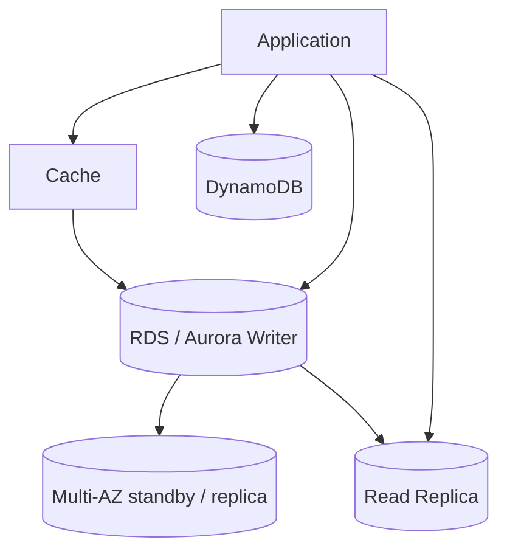

### ภาพ Diagram


### Source diagram จาก Student Guide

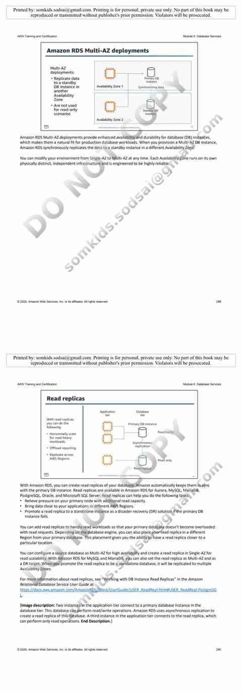


> Diagram นี้เป็นภาพสรุปเพื่อช่วยทำความเข้าใจโครงสร้างของบท/แล็บ โดยยึดแนวคิดจากคู่มือต้นฉบับ
> Mobile reader copy combined from Part 1 + Part 2. Full source screenshots remain in Google Drive master.

# Architecting on AWS 7.12.4 — Module 6: Database Services — Part 1

> ช่วงเนื้อหา: PDF หน้า 276–294  
> หัวข้อหลัก: Database landscape, Amazon RDS, Multi-AZ, Read Replicas, Encryption, Amazon Aurora, Aurora Serverless v2

---

# 1. Module Overview

Module 6 เริ่มจากคำถามสำคัญว่า **AWS มี database แบบไหนบ้าง และควรเลือกอย่างไรให้เหมาะกับ workload**

หัวข้อของ Module ตาม Student Guide ได้แก่:

- Database services
- Amazon Relational Database Service (Amazon RDS)
- Amazon DynamoDB
- Database caching
- Database migration tools
- Review / Knowledge Check
- Lab 3: Create a Database Layer in Your Amazon VPC Infrastructure

Part 1 นี้จะเน้นเฉพาะส่วนแรกจนจบ Amazon Aurora ก่อนเข้าสู่ DynamoDB

---

# 2. AWS Database Services

AWS ไม่ได้มี database แค่แบบเดียว แต่มี database engines หลายประเภทที่ออกแบบมาให้เหมาะกับ data model และ workload ต่างกัน

> 🖼️ *Source figure — Student Guide p.281; full screenshot is kept in the Google Drive master copy.*

Student Guide แสดงตัวอย่าง services เช่น:

- Amazon RDS
- Amazon Aurora
- Amazon Redshift
- Amazon DocumentDB
- Amazon DynamoDB
- Amazon ElastiCache
- Amazon MemoryDB
- Amazon Keyspaces
- Amazon Timestream
- Amazon Neptune

แนวคิดสำคัญคือ **เลือก database ตามรูปแบบข้อมูลและ access pattern** ไม่ใช่เลือกจากความคุ้นเคยอย่างเดียว

---

# 3. Relational vs Nonrelational Databases

> 🖼️ *Source figure — Student Guide p.282; full screenshot is kept in the Google Drive master copy.*

Student Guide แบ่ง database ออกเป็น 2 กลุ่มใหญ่:

## 3.1 Relational Database

ลักษณะสำคัญ:

- ข้อมูลอยู่ใน tables
- มี rows และ columns
- schema ค่อนข้างชัดเจน
- ใช้ SQL
- เหมาะกับข้อมูลที่มีความสัมพันธ์ระหว่าง entities

ตัวอย่าง services ในบท:

- Amazon RDS
- Amazon Aurora

## 3.2 Nonrelational / NoSQL Database

ลักษณะสำคัญ:

- data model ยืดหยุ่นกว่า
- อาจใช้ key-value, document, graph หรือรูปแบบอื่น
- schema ไม่จำเป็นต้อง fixed แบบ relational database
- เหมาะกับ workload ที่ต้องการ scale สูงและ access pattern เฉพาะ

ตัวอย่าง:

- Amazon DynamoDB
- Amazon ElastiCache

---

# 4. Choosing the Right Database

Student Guide เปรียบเทียบ relational และ nonrelational โดยเน้น requirement ของ workload

## เลือก Relational Database เมื่อ

- ต้องการ strict schema rules
- ต้องการ data quality enforcement
- ข้อมูลมีความสัมพันธ์ชัดเจน
- workload เหมาะกับ SQL model
- ต้องการ transaction-oriented design

## เลือก Nonrelational Database เมื่อ

- ต้องการ scale horizontal สูง
- data structure ไม่เหมาะกับ traditional schema
- read/write rate สูงมาก
- access pattern ค่อนข้างชัดเจนและไม่ต้อง join แบบ relational

### Decision Flow

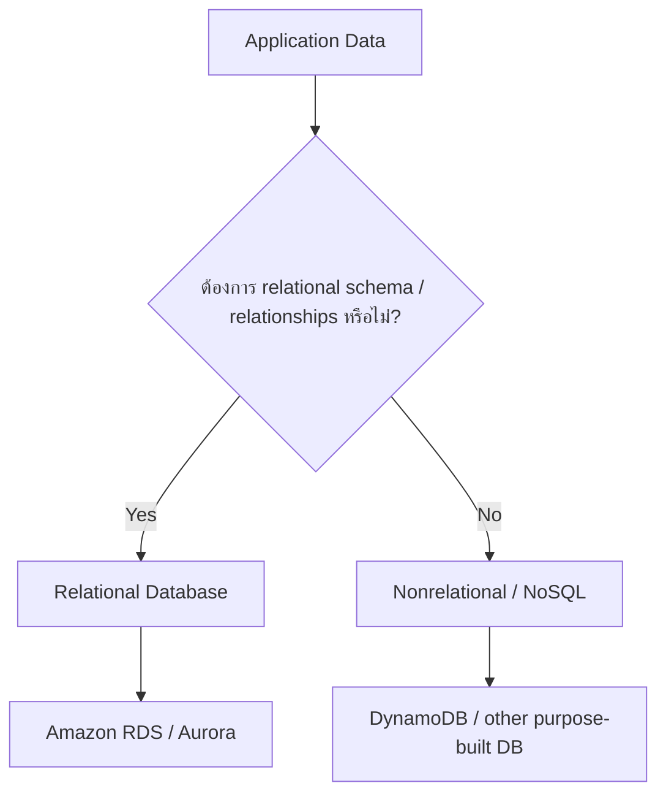

---

# 5. Managed vs Unmanaged Database Services

คุณสามารถ run database บน EC2 เอง หรือใช้ managed database service ของ AWS

> 🖼️ *Source figure — Student Guide p.284; full screenshot is kept in the Google Drive master copy.*

## 5.1 Database on EC2

หากติดตั้ง database เองบน EC2 คุณจะมี control สูง แต่ต้องรับผิดชอบงานจำนวนมาก เช่น:

- OS maintenance
- server maintenance
- patching
- database installation
- backup / recovery
- scaling
- high availability design

## 5.2 Managed Database

เมื่อใช้ managed database เช่น Amazon RDS งาน infrastructure หลายอย่างจะถูก AWS จัดการให้

คุณยังรับผิดชอบด้าน application และ logical database usage แต่ operational burden จะลดลง

### ภาพจำ

```text
Self-managed on EC2
You manage: Hardware → OS → DB software → Backup → HA → Scaling → App

Managed RDS
AWS manages: Hardware / OS / DB infrastructure / backup mechanisms
You focus: Schema / Query / Data / Application
```

### หลักคิด

> **Control มากขึ้น = Operational responsibility มากขึ้น**

---

# 6. Amazon RDS

Amazon Relational Database Service (Amazon RDS) คือ managed relational database service

> 🖼️ *Source figure — Student Guide p.286; full screenshot is kept in the Google Drive master copy.*

Student Guide อธิบายว่า RDS ช่วยลดงาน administrative เช่น:

- setup
- operate
- scale relational databases
- hardware / OS management
- patching
- backups
- high availability mechanisms

เป้าหมายคือให้ทีมใช้เวลากับ application และ database design มากกว่าดูแล infrastructure

---

# 7. Amazon RDS Features

คุณสมบัติที่ Student Guide เน้น:

## 7.1 Hardware, OS, and database software management

AWS ดูแล infrastructure และ software layer หลายส่วนให้

## 7.2 Data encryption at rest and in transit

สามารถใช้ encryption เพื่อป้องกันข้อมูล

## 7.3 Automated backups

RDS รองรับ backup แบบ automated ตาม retention period

## 7.4 Multi-AZ replication

ช่วยออกแบบ high availability และ failover

## 7.5 Compute and storage scaling

สามารถปรับ capacity ให้เหมาะกับ workload

---

# 8. Amazon RDS Database Engines

> 🖼️ *Source figure — Student Guide p.287; full screenshot is kept in the Google Drive master copy.*

Student Guide แสดง database engines ที่ Amazon RDS รองรับ ได้แก่:

- Amazon Aurora
- PostgreSQL
- MySQL
- MariaDB
- Oracle Database
- SQL Server
- IBM Db2

ข้อดีสำคัญคือ application ที่ใช้ engine เดิมอยู่แล้วสามารถย้ายมาใช้ RDS โดยยังใช้ ecosystem และ tooling เดิมได้ในหลายกรณี

---

# 9. Amazon RDS Multi-AZ Deployment

Multi-AZ ออกแบบมาเพื่อ **high availability และ disaster recovery สำหรับ database instance**

> 🖼️ *Source figure — Student Guide p.288; full screenshot is kept in the Google Drive master copy.*

Architecture โดยทั่วไป:

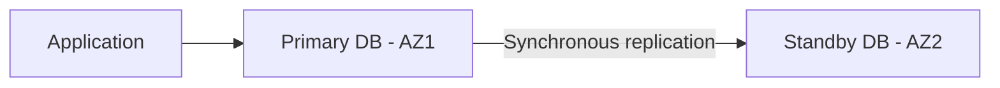

Student Guide ระบุว่า:

- Primary DB อยู่ใน AZ หนึ่ง
- Standby DB อยู่คนละ AZ
- replication เป็น synchronous
- standby ไม่ได้มีไว้รองรับ read-only workload หลัก

### จุดสำคัญ

> **Multi-AZ = Availability / Failover** ไม่ใช่ read scaling

---

# 10. Amazon RDS Multi-AZ Failover

> 🖼️ *Source figure — Student Guide p.289; full screenshot is kept in the Google Drive master copy.*

เมื่อ Primary DB มีปัญหา:

1. RDS ตรวจพบ failure
2. Standby instance ถูก promote เป็น primary
3. endpoint ของ database ชี้ไปยัง primary ใหม่
4. AWS สร้าง standby ใหม่เพื่อกลับสู่ architecture แบบ Multi-AZ

### Flow

```text
Before failure:
Application → Primary AZ1
                  │
                  └─ Sync → Standby AZ2

After failure:
Primary AZ1 ✖
Application → Promoted Primary AZ2
                         │
                         └─ New Standby created
```

เป้าหมายคือให้ application ไม่ต้องเปลี่ยน connection endpoint ด้วยตัวเองใน failover ปกติ

---

# 11. Read Replicas

Read Replicas ใช้สำหรับ **read scaling** ต่างจาก Multi-AZ ซึ่งเน้น high availability

> 🖼️ *Source figure — Student Guide p.290; full screenshot is kept in the Google Drive master copy.*

หลักการ:

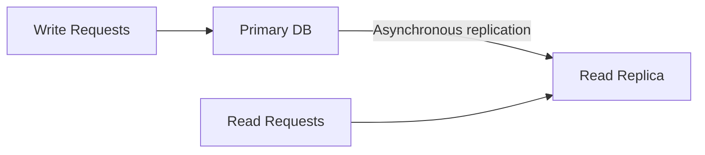

Student Guide ระบุ use cases ของ read replica เช่น:

- ลด load ของ primary database
- กระจาย read-intensive workload
- วาง read replica ใกล้ application ใน Region อื่น
- ใช้เป็นส่วนหนึ่งของ disaster recovery strategy ในบางกรณี

### Multi-AZ vs Read Replica

| Feature | Multi-AZ | Read Replica |
|---|---|---|
| เป้าหมายหลัก | High Availability | Read Scaling |
| Replication | Synchronous | Asynchronous |
| Standby รับ read? | ไม่ใช่ use case หลัก | ใช่ |
| Failover | Automatic | ไม่ใช่หน้าที่หลัก |

### จำง่าย

> **Multi-AZ = ป้องกันล่ม**  
> **Read Replica = ช่วยอ่าน**

---

# 12. Data Encryption at Rest

Amazon RDS สามารถ encrypt data at rest โดยใช้ AWS Key Management Service (AWS KMS)

> 🖼️ *Source figure — Student Guide p.291; full screenshot is kept in the Google Drive master copy.*

Student Guide ระบุว่า AWS KMS ช่วยสร้างและจัดการ encryption keys

ข้อมูลที่ถูก encrypt สามารถรวมถึง:

- database storage
- snapshots
- automated backups
- replicas ที่เกี่ยวข้อง

แนวคิดคือ encryption อยู่ใน infrastructure layer โดย application ไม่ต้อง implement storage encryption เองทั้งหมด

---

# 13. Amazon Aurora

Amazon Aurora เป็น relational database ที่สร้างสำหรับ cloud

> 🖼️ *Source figure — Student Guide p.292; full screenshot is kept in the Google Drive master copy.*

Student Guide ระบุว่า Aurora:

- compatible กับ MySQL และ PostgreSQL
- high performance
- scalable
- highly available
- durable
- secure
- fully managed

Aurora ถูกออกแบบให้ใช้ distributed storage architecture และรองรับ multi-AZ design

---

# 14. Aurora DB Clusters

> 🖼️ *Source figure — Student Guide p.293; full screenshot is kept in the Google Drive master copy.*

Aurora cluster ประกอบด้วย:

- หนึ่งหรือหลาย DB instances
- shared cluster volume

DB instances มีบทบาทหลัก:

## Primary Instance

- รับ read/write
- ทำ data modification

## Aurora Replicas

- รองรับ read workload
- ใช้ช่วย scale read traffic

Student Guide ระบุว่าสามารถมี Aurora Replicas หลายตัว และวางข้าม Availability Zones ได้

### Shared Cluster Storage

Aurora ใช้ storage layer ที่ replicate data ข้ามหลาย Availability Zones

จุดสำคัญคือ compute instance และ storage architecture ถูกแยกจากกันมากกว่า traditional single-server database design

### ภาพจำ

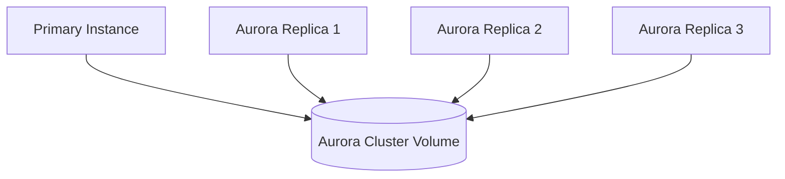

---

# 15. Aurora Serverless v2

> 🖼️ *Source figure — Student Guide p.294; full screenshot is kept in the Google Drive master copy.*

Aurora Serverless v2 เป็น configuration ที่ capacity สามารถ scale อัตโนมัติตาม workload

Student Guide เน้น 3 ประเด็น:

- Start up on demand
- Pay for only what you use
- Scale with minimal impact to applications

Aurora Serverless v2 เหมาะกับ workload ที่:

- traffic ไม่แน่นอน
- workload ขึ้นลงเร็ว
- ไม่ต้องการ provision fixed capacity มากเกินไป

ระบบจะปรับ capacity ตาม demand ภายในช่วง minimum / maximum ที่กำหนด

### แนวคิด

```text
Low Load  → Capacity ลดลง
High Load → Capacity เพิ่มขึ้น
```

---

# 16. Decision Guide — RDS / Aurora

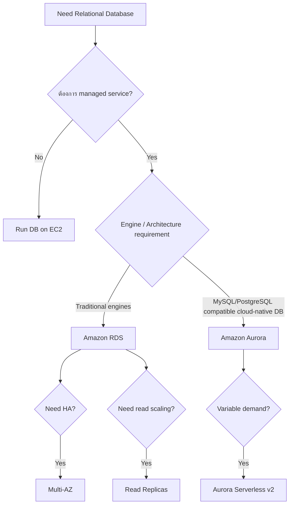

---

# 17. สิ่งที่ควรจำจาก Part 1

1. AWS มี purpose-built database หลายแบบ
2. Relational database ใช้ schema/table/relationships ชัดเจน
3. Nonrelational database เหมาะกับ flexible data model และ scale สูง
4. Database บน EC2 ให้ control สูง แต่ operational responsibility สูงตาม
5. Amazon RDS เป็น managed relational database service
6. RDS รองรับหลาย database engines
7. **Multi-AZ = High Availability / Failover**
8. **Read Replica = Read Scaling**
9. RDS encryption at rest ใช้ AWS KMS
10. Amazon Aurora compatible กับ MySQL/PostgreSQL
11. Aurora ใช้ cluster architecture แยก compute instances กับ shared cluster volume
12. Aurora Serverless v2 scale capacity ตาม workload

---

# 18. Quick Comparison

| Topic | Use case หลัก |
|---|---|
| DB on EC2 | ต้องการ control สูงสุด |
| Amazon RDS | Managed relational DB |
| RDS Multi-AZ | HA / failover |
| RDS Read Replica | Read scaling |
| Amazon Aurora | Cloud-native relational DB |
| Aurora Replica | Scale reads / HA support |
| Aurora Serverless v2 | Variable / unpredictable demand |

---

## End of Module 6 — Part 1

หน้าถัดไปของ Student Guide คือ **Amazon DynamoDB** ซึ่งจะเป็น Part 2 ของ Module 6


---

# Module 6: Database Services — Part 2

> **Source:** *Architecting on AWS 7.12.4 (EN) — Student Guide*  
> **ช่วงหน้า:** 295–330  
> **หัวข้อหลัก:** Amazon DynamoDB, Database caching, Amazon ElastiCache, DynamoDB Accelerator (DAX), Database migration tools, Module review, Knowledge Check และ Lab 3

---

## เป้าหมายของ Part นี้

Part 1 ของ Module 6 ปูพื้นเรื่อง database services, relational vs nonrelational, Amazon RDS, Multi-AZ, Read Replicas, Amazon Aurora และ Aurora Serverless v2 แล้ว

Part 2 จะตอบคำถามต่อไปนี้:

1. ถ้า workload ต้องการ **NoSQL แบบ key-value ที่ scale สูง** ควรใช้บริการอะไร?
2. DynamoDB เก็บข้อมูลแบบไหน และออกแบบ key อย่างไร?
3. DynamoDB จัดการ capacity และ consistency อย่างไร?
4. ถ้าต้องการฐานข้อมูลหลาย Region ต้องทำอย่างไร?
5. เมื่อ database ช้าเพราะอ่านข้อมูลเดิมซ้ำ ๆ ควรใช้ cache ตรงไหน?
6. Lazy loading และ Write-through ต่างกันอย่างไร?
7. ElastiCache และ DAX เหมาะกับสถานการณ์แบบไหน?
8. ถ้าต้องย้าย database เดิมขึ้น AWS ควรใช้ AWS DMS และ AWS SCT อย่างไร?

---

# 1. Amazon DynamoDB

## 1.1 DynamoDB คืออะไร?

Amazon DynamoDB เป็น **fully managed NoSQL database service** ของ AWS ที่ออกแบบมาให้รองรับ workload ที่ต้องการ scalability สูงและตอบสนองรวดเร็ว

> 🖼️ *Source figure — Student Guide p.296; full screenshot is kept in the Google Drive master copy.*

แนวคิดสำคัญจาก Student Guide:

- เป็น **NoSQL database**
- AWS ดูแล infrastructure ที่อยู่เบื้องหลังให้
- ไม่ต้องจัดการ database server เอง
- ออกแบบมาสำหรับงานที่ต้องการ performance at scale
- รองรับการ scale ขึ้นเมื่อ traffic เพิ่ม
- รองรับ encryption แบบ end-to-end และ fine-grained access control

### ภาพจำ

```text
Application
    |
    v
DynamoDB API
    |
    v
Amazon DynamoDB
    |
    +--> AWS ดูแล server / infrastructure / scaling ส่วนใหญ่ให้
```

สิ่งที่ developer ต้องโฟกัสจึงเปลี่ยนจาก

> "ต้องดูแล database server ยังไง?"

ไปเป็น

> "ควรออกแบบ data model และ access pattern ยังไง?"

---

# 2. Key-value data

DynamoDB ใช้ data model แบบ NoSQL โดยหนึ่งในรูปแบบสำคัญคือ **key-value**

ตัวอย่างใน Student Guide ใช้ข้อมูลผู้เล่นเกม เช่น:

| GamerTag | UserId | Level | Point | TopScore | Plays |
|---|---:|---:|---:|---:|---:|
| Hammer57 | 107 | 21 | 4,056 | 488,610 | 1,722 |
| FluffyDuffy | 285 | 9 | 3,123 | 10,863 | 43 |

แนวคิดสำคัญ:

- ข้อมูลถูกระบุผ่าน **key**
- value สามารถมี attribute หลายตัว
- เหมาะกับข้อมูลที่ต้องการ lookup ด้วย key ได้เร็ว
- ไม่ได้ออกแบบมาให้คิด schema แบบ relational table ที่มี join ซับซ้อนเป็นหลัก

### ตัวอย่าง

ถ้า `GamerTag` เป็น primary key:

```text
Key: Hammer57

Value / Attributes:
  UserId   = 107
  Level    = 21
  Point    = 4056
  TopScore = 488610
  Plays    = 1722
```

Application สามารถขอข้อมูลด้วย `GamerTag=Hammer57` โดยตรง

---

# 3. DynamoDB use cases จาก Student Guide

## 3.1 Use case 1 — Player profile

Student Guide ยกตัวอย่าง game application ที่ต้องเปิด player profile page

Application ใช้ `GamerTag` เป็น key เพื่อค้น profile ของผู้เล่น

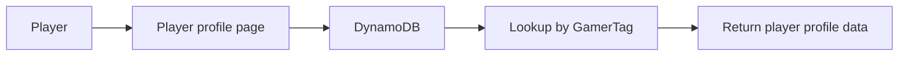

แนวคิดสำคัญคือเมื่อโหลด profile หนึ่งครั้ง Application สามารถดึงข้อมูลของผู้เล่นจาก key โดยตรง

---

## 3.2 Use case 2 — E-commerce inventory

อีก use case คือ inventory ของ e-commerce

```text
Customer requests
       |
       v
   Web store
       |
       v
Product inventory
       |
       v
Order processing
```

ในช่วง holiday sale traffic อาจเพิ่มขึ้นมาก ทำให้ระบบต้องรองรับ concurrent read/write operations จำนวนสูง

DynamoDB ถูกนำเสนอใน Student Guide ว่าเหมาะกับ workload ลักษณะนี้ เพราะสามารถ scale เพื่อรองรับ traffic ที่เพิ่มขึ้น

---

# 4. DynamoDB tables

DynamoDB เก็บข้อมูลใน **tables**

> 🖼️ *Source figure — Student Guide p.300; full screenshot is kept in the Google Drive master copy.*

องค์ประกอบพื้นฐาน:

```text
Table
 └── Item
      └── Attributes
```

ตัวอย่าง:

```text
Table: Games

Item 1
  GamerTag     = Hammer57
  GameID       = PuzzleGamer
  TopScore     = 488610
  Genre        = puzzle
  Subscription = true
```

---

# 5. Primary key

เมื่อสร้าง DynamoDB table ต้องระบุ primary key

Student Guide อธิบาย 2 รูปแบบหลัก

## 5.1 Simple primary key

มีเพียง **partition key**

```text
Primary Key = Partition Key
```

ตัวอย่าง:

```text
GamerTag = Hammer57
```

ค่า partition key ของแต่ละ item ต้องช่วยระบุ item ได้

---

## 5.2 Composite primary key

ประกอบด้วย:

```text
Partition Key + Sort Key
```

ตัวอย่าง:

```text
Partition Key = GamerTag
Sort Key      = GameID
```

ทำให้ผู้เล่นหนึ่งคนสามารถมีหลายรายการได้ เช่นหลายเกม โดยใช้ GamerTag เดิมแต่ GameID ต่างกัน

```text
Hammer57 + PuzzleGamer
Hammer57 + RacingGame
Hammer57 + StrategyGame
```

### ภาพจำ

```text
Partition Key
   |
   +-- Sort Key A
   +-- Sort Key B
   +-- Sort Key C
```

---

# 6. DynamoDB capacity and scaling

Student Guide อธิบาย capacity mode สองแบบหลัก

> 🖼️ *Source figure — Student Guide p.301; full screenshot is kept in the Google Drive master copy.*

## 6.1 On-demand capacity

แนวคิดคือ **pay per request**

เหมาะกับกรณี:

- workload ใหม่ที่ยังคาด traffic ยาก
- traffic ไม่แน่นอน
- traffic เปลี่ยนแปลงมาก
- ต้องการลดงานด้าน capacity planning

ภาพจำ:

```text
Traffic ต่ำ -> ใช้น้อย -> จ่ายน้อย
Traffic สูง -> ระบบรองรับเพิ่ม -> จ่ายตาม usage
```

---

## 6.2 Provisioned capacity

ผู้ใช้งานกำหนด capacity ที่ต้องการล่วงหน้า

ประกอบด้วยแนวคิดเช่น:

- read capacity
- write capacity
- auto scaling เพื่อปรับ capacity ตาม utilization

เหมาะกับ workload ที่ traffic ค่อนข้างคาดการณ์ได้

### เปรียบเทียบง่าย ๆ

| ประเด็น | On-demand | Provisioned |
|---|---|---|
| ต้องวาง capacity ล่วงหน้า | น้อย | มากกว่า |
| Traffic คาดเดาไม่ได้ | เหมาะ | ต้องวางแผนมากกว่า |
| Traffic คงที่/คาดการณ์ได้ | ใช้ได้ | เหมาะ |
| แนวคิดการคิดค่าใช้จ่าย | ตาม request | ตาม capacity ที่ provision |

---

# 7. DynamoDB consistency options

> 🖼️ *Source figure — Student Guide p.302; full screenshot is kept in the Google Drive master copy.*

DynamoDB รองรับ read consistency สองแนวทางหลักในบทนี้

## 7.1 Eventually consistent read

เป็น default behavior สำหรับ read operations ตามที่ Student Guide อธิบาย

หลัง write สำเร็จ replica อื่นอาจใช้เวลาสั้น ๆ ก่อนจะเห็นข้อมูลล่าสุด

```text
Write
 |
 v
Replica A updated
 |
 +--> Replica B / C กำลังตามให้ทัน
```

เหมาะเมื่อ Application รับได้ว่าบางครั้ง read หลัง write ทันทีอาจเห็นข้อมูลเก่าชั่วคราว

---

## 7.2 Strongly consistent read

Application สามารถร้องขอ strongly consistent read ได้ในกรณีที่ต้องการข้อมูลที่สะท้อน successful writes ก่อนหน้า

ภาพจำ:

```text
Eventually consistent
= เร็วและยืดหยุ่น แต่บางช่วงอาจยังไม่เห็นข้อมูลล่าสุด

Strongly consistent
= ต้องการ latest committed result
```

Student Guide ยังระบุว่า strongly consistent read อาจไม่พร้อมใช้งานเมื่อเกิด network delay หรือ outage ในบางสถานการณ์

---

# 8. DynamoDB global tables

DynamoDB Global Tables ใช้สำหรับสร้างตารางที่ทำ replication ข้าม AWS Regions

> 🖼️ *Source figure — Student Guide p.303; full screenshot is kept in the Google Drive master copy.*

แนวคิด:

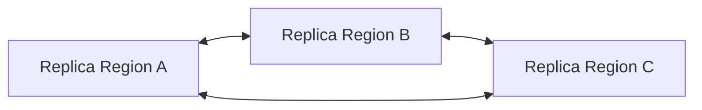

แต่ละ replica ใช้ table name และ primary key schema เดียวกัน

เมื่อ Application เขียนข้อมูลใน Region หนึ่ง DynamoDB จะ propagate การเปลี่ยนแปลงไปยัง replica อื่น

ประโยชน์ที่ Student Guide เน้น:

- multi-Region
- multi-active
- AWS จัดการ replication ให้
- เหมาะกับ application ที่ต้องการให้ข้อมูลอยู่ใกล้ผู้ใช้ในหลาย Region

---

# 9. Database caching

หลัง DynamoDB Student Guide เปลี่ยนไปตอบคำถาม:

> เราจะ cache database ใน cloud เพื่อเพิ่ม performance ได้อย่างไร?

Cache คือชั้นเก็บข้อมูลที่เข้าถึงบ่อยไว้ใกล้ Application และมักใช้ memory เพื่อให้ retrieval เร็วกว่าการไป database ทุกครั้ง

---

# 10. ควร cache ข้อมูลแบบไหน?

Student Guide ให้หลักคิด 3 เรื่อง

## 10.1 Slow and expensive query

ถ้า query:

- ใช้เวลานาน
- consume resource สูง
- เรียกซ้ำบ่อย

การเก็บผลลัพธ์ไว้ใน cache สามารถช่วยลด load บน database ได้

---

## 10.2 Frequently accessed data

ข้อมูลที่อ่านซ้ำบ่อยเหมาะกับ cache

เช่นข้อมูลที่ user จำนวนมากเรียกดูซ้ำ

---

## 10.3 Relatively static information

ข้อมูลที่ไม่เปลี่ยนบ่อยเหมาะกับ cache เพราะความเสี่ยงเรื่อง stale data ต่ำกว่า

### หลักคิดรวม

```text
ข้อมูลอ่านบ่อย
+ query แพง
+ เปลี่ยนไม่บ่อย
= candidate ที่ดีสำหรับ caching
```

---

# 11. Caching architecture

> 🖼️ *Source figure — Student Guide p.306; full screenshot is kept in the Google Drive master copy.*

Student Guide แสดง architecture ที่มี Application servers, cache cluster และ database

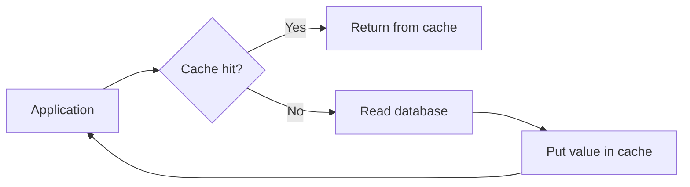

ประโยชน์หลัก:

- ลดจำนวน read ที่เข้า database
- ลด latency สำหรับข้อมูลที่ cache ไว้
- ลด load บน primary database

---

# 12. Common caching strategy — Lazy loading

> 🖼️ *Source figure — Student Guide p.307; full screenshot is kept in the Google Drive master copy.*

Lazy loading เป็นแนวทางที่ cache จะถูกเติม **เมื่อมี request แล้วพบว่าไม่มีข้อมูลใน cache**

Flow:

```text
1. Application asks cache
2. Cache miss
3. Application reads database
4. Database returns data
5. Application writes data to cache
6. Application returns result
```

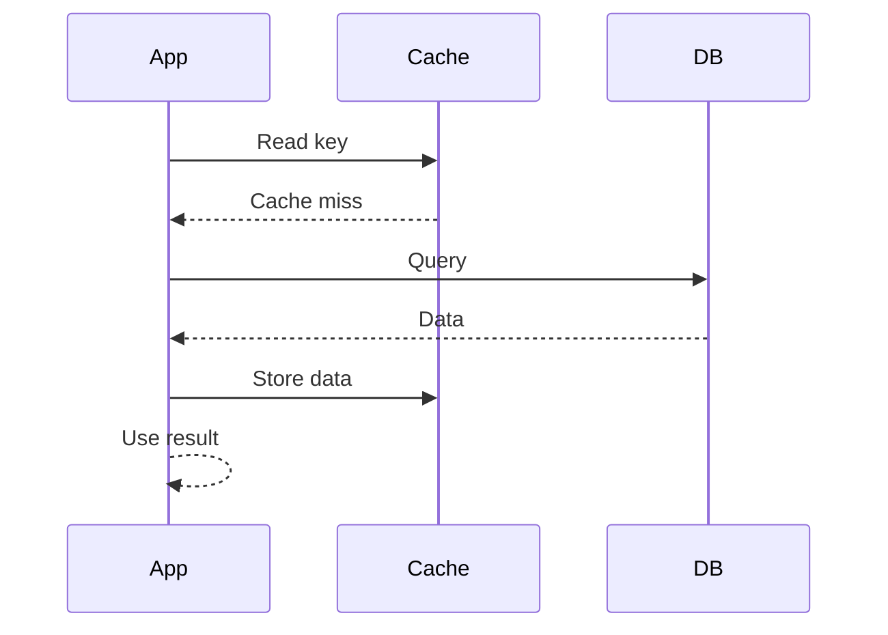

### จุดเด่น

- cache เฉพาะสิ่งที่มีคน request จริง
- ไม่ต้อง preload ทุกข้อมูล

### จุดที่ต้องคิด

ครั้งแรกที่ cache miss จะยังต้อง query database

---

# 13. Common caching strategy — Write-through

> 🖼️ *Source figure — Student Guide p.308; full screenshot is kept in the Google Drive master copy.*

Write-through เป็น strategy ที่เมื่อ Application update data จะ update cache ด้วย

แนวคิด:

```text
Application write
      |
      +--> Database
      |
      +--> Cache
```

ข้อดีคือ cache มีแนวโน้มสดกว่า lazy loading เพียงอย่างเดียว

แต่ Student Guide เตือนว่าการเก็บข้อมูลใน cache มากขึ้นอาจมีค่าใช้จ่ายเพิ่ม และอาจ cache ข้อมูลที่ไม่ถูกเรียกใช้

---

# 14. Lazy loading vs Write-through

| ประเด็น | Lazy loading | Write-through |
|---|---|---|
| เติม cache เมื่อใด | ตอน cache miss | ตอน write/update |
| Cache มีเฉพาะข้อมูลที่ถูกอ่าน | ใช่ | ไม่จำเป็น |
| First read หลัง cache miss | ช้ากว่า | มีโอกาสเร็วกว่า |
| ความสดของข้อมูล | อาจ stale | สดกว่าเมื่อ update ถูกต้อง |
| Resource ใน cache | ใช้เฉพาะข้อมูลที่ถูกเรียก | อาจเก็บข้อมูลที่ไม่ถูกอ่าน |

Student Guide เน้นว่าการเลือก strategy ต้องดู **use case และ tolerance ต่อ stale data**

---

# 15. Managing your cache

มีสองเรื่องสำคัญ

## 15.1 Cache validity — TTL

TTL = Time To Live

กำหนดอายุของข้อมูลใน cache

```text
Value cached
   |
   +--> TTL = X seconds
             |
             +--> หมดเวลา -> ต้อง refresh / reload
```

TTL ช่วยลดความเสี่ยงที่ cache จะเก็บข้อมูลเก่านานเกินไป

แต่ถ้าตั้ง TTL สั้นเกินไป ก็จะเกิด cache miss มากขึ้น

---

## 15.2 Managing memory — Eviction

เมื่อ cache memory เต็ม ระบบต้องเลือกว่าจะเอาข้อมูลใดออก

Student Guide อธิบายว่าการเลือก eviction policy เกี่ยวข้องกับลักษณะ เช่น:

- ข้อมูลใดถูก access ล่าสุด
- ข้อมูลใดถูกใช้บ่อย
- ค่า TTL ของข้อมูล

จึงเป็นการ trade-off ระหว่าง memory, hit rate และความสดของข้อมูล

---

# 16. Amazon ElastiCache

> 🖼️ *Source figure — Student Guide p.310; full screenshot is kept in the Google Drive master copy.*

Amazon ElastiCache เป็นบริการ managed in-memory cache ของ AWS

Student Guide เน้นคุณสมบัติ:

- high performance
- fully managed
- scalable

รองรับ in-memory engines ที่ระบุในเอกสาร:

- Redis
- Memcached
- Valkey

### Architecture concept

```text
Application
    |
    v
ElastiCache
    |
    v
Database
```

Application พยายามอ่านจาก cache ก่อน และไป database เมื่อจำเป็น

---

# 17. DynamoDB Accelerator (DAX)

> 🖼️ *Source figure — Student Guide p.311; full screenshot is kept in the Google Drive master copy.*

DAX เป็น caching service ที่ออกแบบให้ทำงานร่วมกับ DynamoDB โดยเฉพาะ

Student Guide เน้นว่า DAX:

- fully managed
- highly available
- cache for DynamoDB
- ลด response time ลงถึงระดับ microseconds ในบาง use case
- สามารถ scale รองรับ requests จำนวนมาก

### Flow

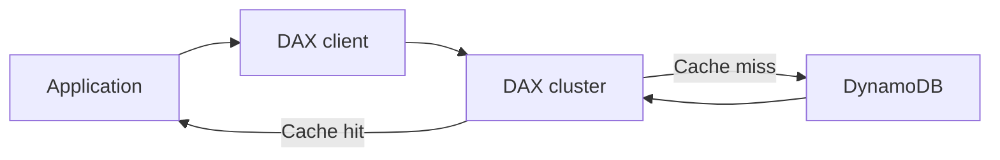

### จำง่าย

```text
ElastiCache = general-purpose in-memory caching
DAX         = DynamoDB-specific caching
```

---

# 18. Database migration tools

Student Guide เปลี่ยนโจทย์ไปที่องค์กรซึ่งมี on-premises database และต้องการย้ายขึ้น AWS

เครื่องมือหลักในส่วนนี้คือ:

1. AWS Database Migration Service (AWS DMS)
2. AWS Schema Conversion Tool (AWS SCT)

---

# 19. AWS Database Migration Service (AWS DMS)

> 🖼️ *Source figure — Student Guide p.313; full screenshot is kept in the Google Drive master copy.*

AWS DMS ใช้ replicate data จาก source database ไปยัง target database

Architecture แบบง่าย:

```text
Source Database
      |
      v
 AWS DMS
      |
      v
Target Database
```

Student Guide ระบุว่า workflow หลักคือ:

1. สร้าง source endpoint
2. สร้าง target endpoint
3. กำหนด migration / replication task
4. AWS DMS อ่านข้อมูลจาก source
5. ส่งข้อมูลไป target

---

# 20. Homogeneous vs Heterogeneous migration

## 20.1 Homogeneous migration

Database engine ต้นทางและปลายทางเป็นประเภทเดียวกันหรือ compatible กันสูง

ตัวอย่างแนวคิด:

```text
Oracle -> Oracle
MySQL  -> MySQL
```

มักไม่ต้องแปลง schema มาก

---

## 20.2 Heterogeneous migration

Engine ต้นทางกับปลายทางต่างกัน

```text
Oracle -> PostgreSQL
SQL Server -> Aurora PostgreSQL
```

กรณีนี้ data อย่างเดียวไม่พอ เพราะ schema และ database objects อาจไม่ compatible

จึงต้องใช้เครื่องมือ conversion เพิ่ม

---

# 21. AWS Schema Conversion Tool (AWS SCT)

> 🖼️ *Source figure — Student Guide p.314; full screenshot is kept in the Google Drive master copy.*

AWS SCT ช่วยแปลง schema จาก source database ไปสู่ target database ที่ต่าง engine กัน

สิ่งที่สามารถเกี่ยวข้องกับการ conversion ได้แก่:

- schema
- views
- stored procedures
- functions
- database code objects

Student Guide อธิบายว่า SCT จะพยายาม convert objects ที่แปลงอัตโนมัติได้ และระบุ objects ที่ต้องแก้เพิ่มเติมด้วยตนเอง

### Migration flow

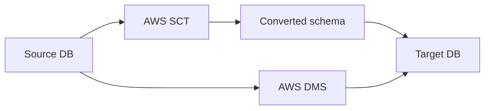

### จำง่าย

```text
SCT = แปลง schema / code
DMS = ย้ายหรือ replicate data
```

สองตัวจึงมักทำงานเสริมกันใน heterogeneous migration

---

# 22. Module 6 Review

Student Guide สรุปว่า Module 6 ครอบคลุม:

- Database services
- Amazon RDS
- DynamoDB
- Database caching
- Database migration tools

แนวทาง solution ที่สรุปกลับไปยัง business request ได้แก่:

- ใช้ AWS database services ให้เหมาะกับ database model
- ใช้ RDS และ Aurora สำหรับ relational database
- ใช้ DynamoDB สำหรับ scalable key-value NoSQL
- ใช้ ElastiCache และ DAX สำหรับ caching
- ใช้ AWS DMS สำหรับ database migration

---

# 23. Capstone architecture check-in

> 🖼️ *Source figure — Student Guide p.319; full screenshot is kept in the Google Drive master copy.*

Capstone architecture ของ Module 6 เพิ่ม database layer เข้าไปใน multi-AZ architecture ที่สร้างมาจากบทก่อน

ตัวอย่างใน Student Guide ใช้ Amazon Aurora

แนวคิด:

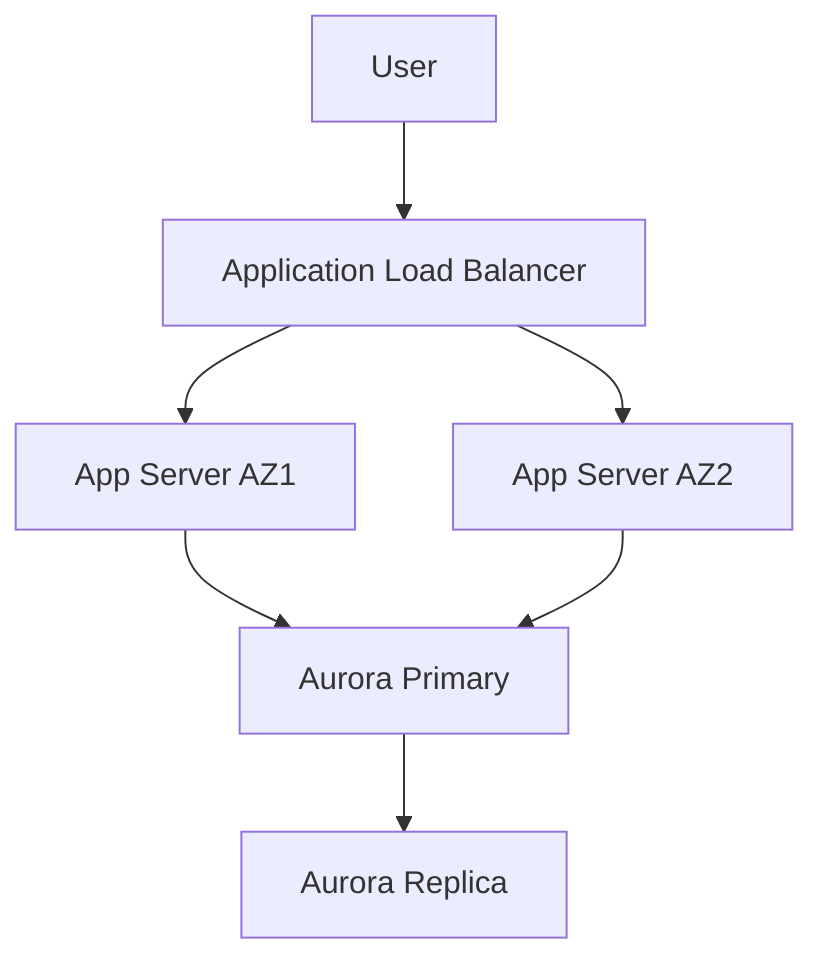

ประโยชน์ที่ Student Guide ชี้:

- database managed service ลดงานดูแล database infrastructure
- Aurora กระจาย storage หลาย Availability Zones
- Aurora replica ช่วยรองรับ availability และ read workloads

---

# 24. Knowledge Check

## Question 1

**ถาม:** ประโยชน์ของ Amazon RDS Multi-AZ configuration คืออะไร?

**คำตอบ:**

> **Automatic failover across Availability Zones**

แนวคิด:

- RDS replicate ไป standby instance ในอีก AZ
- เมื่อ primary มีปัญหา RDS สามารถ failover ไป standby
- endpoint ยังคงใช้สำหรับ Application ได้หลัง failover

### สิ่งที่อย่าสับสน

```text
Multi-AZ    -> High availability / failover
Read Replica -> Read scaling
```

---

## Question 2

**ถาม:** ข้อใดถูกต้องเกี่ยวกับ DynamoDB Global Tables?

**คำตอบ:**

> **Tables can be in different AWS Regions.**

Global Tables คือ multi-Region replication ของ DynamoDB

---

## Question 3

**ถาม:** ข้อใดถูกต้องเกี่ยวกับ Amazon Aurora?

**คำตอบ:**

> **Aurora is compatible with MySQL or PostgreSQL.**

Student Guide ย้ำว่า Aurora เป็น relational database ที่ compatible กับ MySQL หรือ PostgreSQL

---

# 25. Lab 3 — Create a Database Layer in Your Amazon VPC Infrastructure

> 🖼️ *Source figure — Student Guide p.328; full screenshot is kept in the Google Drive master copy.*

Lab 3 ใช้ VPC ที่มีสอง Availability Zones

Architecture มี:

- public subnet
- private subnet
- NAT gateway
- Application Load Balancer
- EC2 instances
- Amazon Aurora DB instance

### Architecture concept

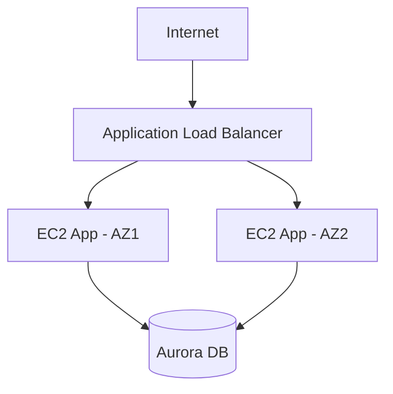

Database อยู่ใน private subnet เพื่อไม่ expose โดยตรงกับ Internet

---

# 26. Lab 3 tasks

Student Guide ระบุ tasks หลักดังนี้:

1. **Create an Amazon RDS database**
2. **Create and configure an Application Load Balancer**
3. **Review the Amazon RDS DB instance metadata through the console**
4. **Test the application connectivity to the database**
5. **Optional:** Create an Amazon RDS read replica in a different AWS Region

แนวคิดของ Lab คือเชื่อมเนื้อหาหลาย Module เข้าด้วยกัน:

```text
Networking
   +
Compute
   +
Database
   =
Multi-tier AWS Architecture
```

---

# 27. Decision flow — เลือก database จากเนื้อหา Module 6

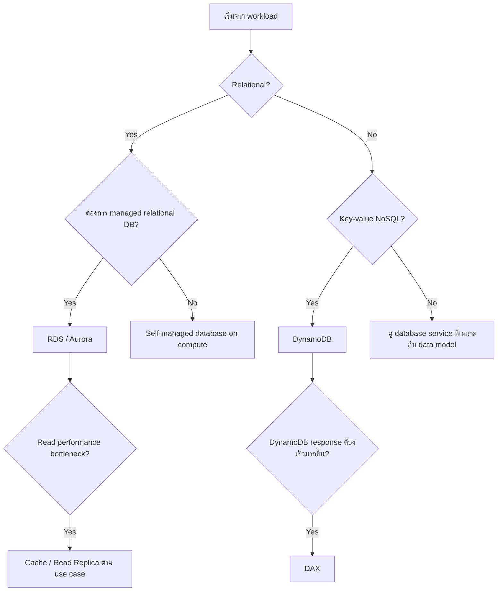

> Decision flow นี้เป็นการจัดโครงจากหัวข้อที่ Student Guide สอนใน Module 6 เพื่อช่วยทบทวน ไม่ได้เพิ่ม database service นอกขอบเขตบท

---

# 28. Decision flow — เลือก caching approach

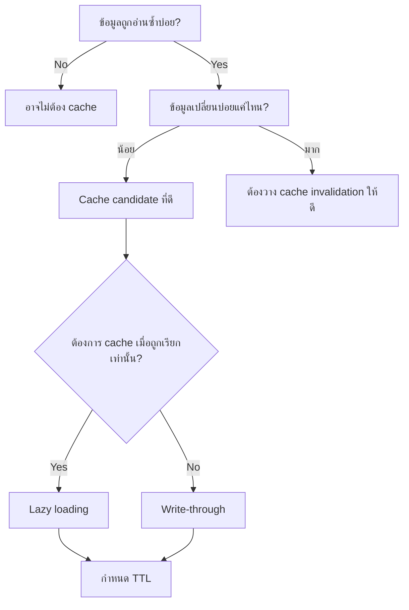

---

# 29. ตารางสรุปบริการสำคัญใน Module 6

| Service / Concept | ใช้ทำอะไร | จุดจำ |
|---|---|---|
| Amazon RDS | Managed relational database | ลดภาระดูแล DB infrastructure |
| RDS Multi-AZ | High availability | Automatic failover |
| RDS Read Replica | Read scaling | แยก read workload |
| Amazon Aurora | AWS relational database | MySQL/PostgreSQL compatible |
| Aurora Serverless v2 | Aurora capacity scaling | scale capacity ตาม workload |
| DynamoDB | Managed NoSQL key-value database | scale สูง, low-latency workload |
| DynamoDB Global Tables | Multi-Region DynamoDB | replica หลาย Regions |
| ElastiCache | Managed in-memory cache | Redis / Memcached / Valkey |
| DAX | DynamoDB cache | DynamoDB-specific caching |
| AWS DMS | Database migration | ย้าย / replicate data |
| AWS SCT | Schema conversion | heterogeneous migration |

---

# 30. สิ่งที่ควรจำมากที่สุดจาก Part 2

## DynamoDB

```text
DynamoDB
= fully managed
+ NoSQL
+ key-value
+ scalable
```

Primary key:

```text
Simple    = Partition Key
Composite = Partition Key + Sort Key
```

Capacity:

```text
On-demand  = pay per request
Provisioned = กำหนด capacity และใช้ auto scaling ได้
```

Consistency:

```text
Eventually consistent
Strongly consistent
```

Global Tables:

```text
DynamoDB across multiple AWS Regions
```

---

## Caching

เหมาะกับ:

```text
Slow query
Frequently accessed data
Relatively static data
```

Strategies:

```text
Lazy loading  = เติม cache ตอน miss
Write-through = update cache ตอน write
```

Cache management:

```text
TTL
Eviction policy
```

AWS services:

```text
ElastiCache = general caching
DAX         = DynamoDB caching
```

---

## Migration

```text
AWS DMS = move / replicate data
AWS SCT = convert schema / database code
```

### Heterogeneous migration

```text
Source DB
   |
   +--> SCT -> convert schema
   |
   +--> DMS -> migrate data
                |
                v
             Target DB
```

---

# 31. Exam / Review traps จากเนื้อหาในบท

### Trap 1

**Multi-AZ ไม่ใช่ Read Replica**

```text
Multi-AZ     = availability / failover
Read Replica = read scaling
```

### Trap 2

**DAX ไม่ใช่ general-purpose cache**

```text
DAX = DynamoDB-specific
```

### Trap 3

**AWS SCT ไม่ได้ทำหน้าที่หลักเป็น data mover**

```text
SCT = schema conversion
DMS = data migration / replication
```

### Trap 4

DynamoDB Global Tables หมายถึงการมี replica ใน **หลาย AWS Regions**

---

# 32. สรุป Module 6 ทั้งบท

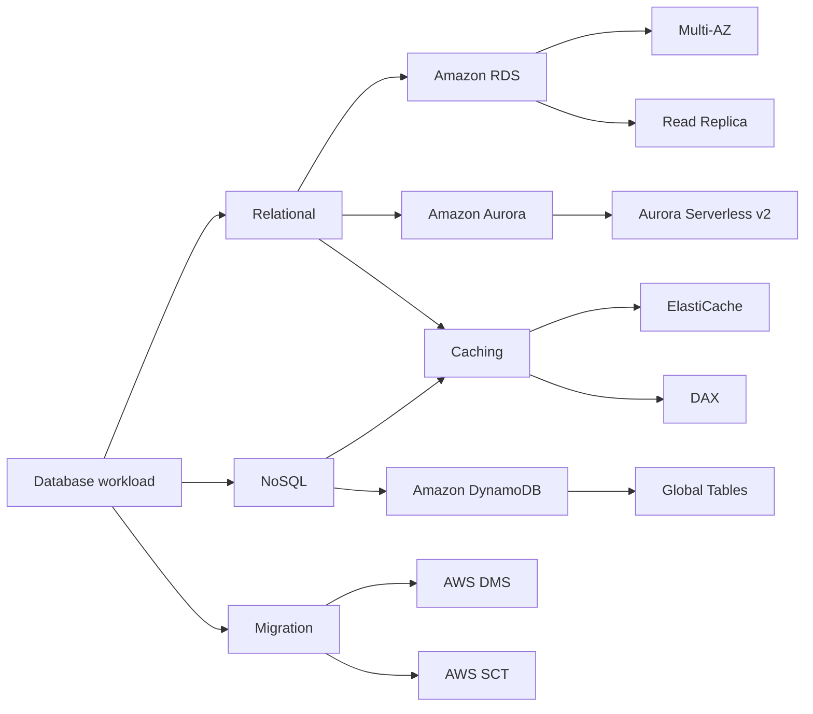

Module 6 จึงไม่ได้สอนเพียง "บริการ database มีอะไรบ้าง" แต่สอนวิธีคิดตั้งแต่:

```text
เลือก data model
    -> เลือก database service
    -> วาง high availability
    -> scale read / capacity
    -> เพิ่ม cache
    -> วาง migration path
```

---

# End of Module 6

Student Guide จบ Module 6 ที่หน้า **330**

หัวข้อถัดไปของคอร์สจะเริ่ม Module ใหม่ในหน้าถัดไป
