# Module 7 — Monitoring and Scaling

## 🧭 Visual architecture

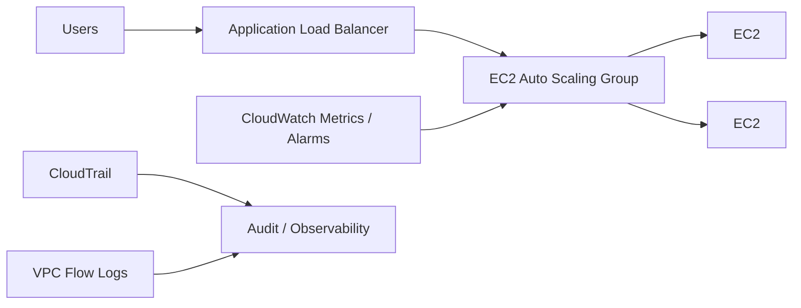

### ภาพ Diagram


### Source diagram จาก Student Guide

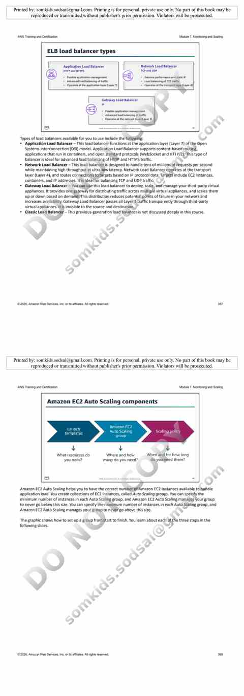


> Diagram นี้เป็นภาพสรุปเพื่อช่วยทำความเข้าใจโครงสร้างของบท/แล็บ โดยยึดแนวคิดจากคู่มือต้นฉบับ
> Mobile reader copy combined from Part 1 + Part 2. Full source screenshots remain in Google Drive master.

# Module 7: Monitoring and Scaling — Part 1

> **Source:** *Architecting on AWS 7.12.4 (EN) — Student Guide*  
> **ช่วงหน้า:** 331–348  
> **หัวข้อหลัก:** Monitoring, Amazon CloudWatch, CloudWatch metrics, logging, CloudWatch Logs, AWS CloudTrail และ VPC Flow Logs

---

## 1. ภาพรวม Module 7

Module 7 ชื่อ **Monitoring and Scaling** และใน Student Guide แบ่งหัวข้อใหญ่ไว้ดังนี้:

- Business request
- Monitoring
- Alarms and events
- Load balancing
- Auto scaling
- Present solutions
- Capstone check-in
- Knowledge check
- Lab 4: Configure High Availability in Your Amazon VPC

Part 1 นี้จะโฟกัสเฉพาะก้อน **Monitoring** ก่อน

คำถามสำคัญจาก operations manager คือ:

- ใช้ tools/services อะไรในการ monitor และ log activity ใน AWS accounts?
- จะตั้ง threshold และ alert เมื่อ infrastructure เปลี่ยนแปลงได้อย่างไร?
- จะเพิ่ม high availability และกระจาย traffic อย่างไร?
- จะเพิ่ม/ลด capacity ตาม demand อย่างไร?

Part 1 ตอบคำถามข้อแรกเป็นหลัก

---

# 2. ทำไม Monitoring ถึงสำคัญ?

> 🖼️ *Source figure — Student Guide p.336; full screenshot is kept in the Google Drive master copy.*

Student Guide แบ่งเหตุผลสำคัญของ monitoring ออกเป็น 4 กลุ่ม

## 2.1 Operational health

ใช้ monitoring เพื่อมองเห็นว่า infrastructure และ services ทำงานปกติหรือไม่

ตัวอย่างคำถาม:

```text
EC2 ยังทำงานไหม?
CPU สูงผิดปกติหรือไม่?
Service ตอบสนองหรือไม่?
มี resource ใดเกิดปัญหาหรือไม่?
```

Monitoring จึงช่วยให้ operations team มี visibility และ insight ต่อระบบ

---

## 2.2 Application performance

Monitoring ช่วยเก็บข้อมูลในแต่ละ layer ของ application เพื่อดู performance

```text
User
  |
  v
Load Balancer
  |
  v
Application
  |
  v
Database
```

ถ้า application ช้า เราต้องรู้ว่า bottleneck อยู่ layer ไหน

ไม่ใช่ดู CPU ของ VM อย่างเดียวแล้วสรุปว่าระบบปกติ

---

## 2.3 Resource utilization

Monitoring ทำให้รู้ว่า resource ถูกใช้งานมากน้อยแค่ไหน

ตัวอย่าง:

- CPU utilization
- Network activity
- Disk operations
- Database metrics

ข้อมูลเหล่านี้ช่วยตัดสินใจเรื่อง:

- เพิ่ม capacity
- ลด capacity
- scale architecture
- optimize cost

---

## 2.4 Security auditing

Monitoring และ logging ยังใช้ด้าน security

ช่วยตอบคำถาม เช่น:

```text
ใครเข้าใช้ระบบ?
ใครเปลี่ยน configuration?
ใครเรียก API?
มี traffic แปลก ๆ หรือไม่?
```

จึงไม่ได้ใช้เฉพาะ performance monitoring เท่านั้น

---

# 3. Monitoring architecture mindset

จากเนื้อหาใน Student Guide เราสามารถจัดข้อมูล monitoring เป็น 3 กลุ่มใหญ่ได้

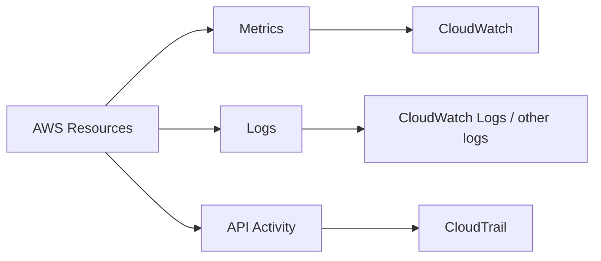

จำง่าย ๆ:

```text
Metrics = ระบบเป็นอย่างไร
Logs    = เกิดอะไรขึ้นในระบบ
Trail   = ใครทำอะไรกับ AWS
```

---

# 4. Amazon CloudWatch

> 🖼️ *Source figure — Student Guide p.337; full screenshot is kept in the Google Drive master copy.*

Amazon CloudWatch เป็น AWS service สำหรับรวบรวมและ monitor operational data

Student Guide แสดงวงจรหลักเป็น:

```text
Collect
  -> Monitor
      -> Respond
          -> Analyze
```

## 4.1 Collect

รวบรวมข้อมูล เช่น:

- metrics
- logs
- events

จาก AWS resources และ applications

---

## 4.2 Monitor

นำข้อมูลที่เก็บมาใช้ติดตาม resource และ application

เช่น CPU utilization ของ EC2

---

## 4.3 Respond

เมื่อ metric หรือ event เกิดเงื่อนไขบางอย่าง เราสามารถตอบสนองต่อเหตุการณ์ได้

หัวข้อ alarms และ automated response จะอยู่ใน Part ถัดไป

---

## 4.4 Analyze

ใช้ข้อมูล monitoring เพื่อ:

- หา trend
- วิเคราะห์ performance
- หา bottleneck
- ตรวจ resource utilization
- วาง capacity

---

# 5. CloudWatch metrics

> 🖼️ *Source figure — Student Guide p.338; full screenshot is kept in the Google Drive master copy.*

**Metric** คือข้อมูลเชิงเวลาเกี่ยวกับ performance หรือสถานะของระบบ

ตัวอย่างจาก Student Guide:

```text
Metric:
AWS/EC2 CPUUtilization

Dimension:
Instance ID

Value:
CPU percentage over time
```

Metric จึงมีลักษณะเป็น time series

```text
Time -> Value
```

ตัวอย่าง:

```text
10:00  CPU = 20%
10:05  CPU = 40%
10:10  CPU = 80%
10:15  CPU = 50%
```

---

# 6. ส่วนประกอบของ CloudWatch Metric

Student Guide อธิบายองค์ประกอบสำคัญหลายส่วน

## 6.1 Namespace

ใช้จัดกลุ่ม metrics

เช่น metrics ของ service หนึ่งจะอยู่ใน namespace ของ service นั้น

แนวคิด:

```text
Namespace
  └── Metrics
       └── Dimensions
```

---

## 6.2 Metric

Metric เป็นชุดข้อมูลตามเวลา

เช่น:

```text
CPUUtilization
```

แต่ละ data point มี value และ timestamp

---

## 6.3 Dimension

Dimension ใช้ระบุว่า metric นี้เป็นของ resource หรือ context ใด

ตัวอย่าง:

```text
Metric: CPUUtilization
Dimension: InstanceId = i-xxxxxxxx
```

ทำให้ CPUUtilization ของ EC2 แต่ละเครื่องแยกออกจากกัน

---

# 7. Built-in metrics และ custom metrics

AWS services หลายตัวส่ง metrics เข้า CloudWatch ให้โดยอัตโนมัติ

แต่ application ของเราเองก็สามารถ publish custom metrics ได้

แนวคิด:

```text
AWS service metrics
        +
Application custom metrics
        |
        v
    CloudWatch
```

ตัวอย่าง custom metric ในเชิงแนวคิด:

```text
OrdersPerMinute
LoginFailures
QueueDepth
ApplicationResponseTime
```

> ชื่อข้างต้นเป็นตัวอย่างเพื่ออธิบายแนวคิด custom metrics ไม่ใช่รายการจาก Student Guide

---

# 8. Logs ต่างจาก Metrics อย่างไร?

Metric เหมาะกับการดูค่าตัวเลขตามเวลา

Log เหมาะกับรายละเอียดของเหตุการณ์

ตัวอย่าง:

```text
Metric:
ErrorCount = 30

Log:
2026-09-30 10:20:01 ERROR Connection refused to database
2026-09-30 10:20:02 ERROR Connection refused to database
```

จึงมักใช้ร่วมกัน

```text
Metric บอกว่า "มีปัญหา"
Log ช่วยบอกว่า "ปัญหาคืออะไร"
```

---

# 9. Types of logs ใน AWS architecture

> 🖼️ *Source figure — Student Guide p.339; full screenshot is kept in the Google Drive master copy.*

Student Guide ยกตัวอย่าง log sources หลัก 4 กลุ่ม

## 9.1 Amazon CloudWatch Logs

ใช้ monitor, store และ access log files

ตัวอย่าง source:

- Amazon EC2 instances
- applications
- other systems ที่ส่ง log เข้า CloudWatch Logs

---

## 9.2 AWS CloudTrail

ใช้ track user activity และ API usage

ตอบคำถามเช่น:

```text
ใครเรียก API?
เรียกเมื่อไร?
เรียก API อะไร?
request มาจากไหน?
```

---

## 9.3 VPC Flow Logs

เก็บข้อมูลเกี่ยวกับ IP traffic ที่เข้าและออกจาก network interfaces ใน VPC

ใช้วิเคราะห์ network traffic

---

## 9.4 Custom logs

Application ของเราสามารถสร้าง custom logs เองได้

ตัวอย่างแนวคิด:

```text
Application log
Web server log
Business transaction log
Custom service log
```

---

# 10. CloudWatch Logs

> 🖼️ *Source figure — Student Guide p.340; full screenshot is kept in the Google Drive master copy.*

CloudWatch Logs จัดข้อมูลเป็น hierarchy หลัก:

```text
Log Group
  ├── Log Stream 1
  ├── Log Stream 2
  └── Log Stream 3
```

## 10.1 Log group

ใช้รวม log streams ที่มีลักษณะเดียวกัน

ตัวอย่างใน Student Guide มี servers หลายตัวส่ง log เข้ากลุ่มเดียวกัน

---

## 10.2 Log stream

Log stream คือ sequence ของ log events จาก source หนึ่ง

ตัวอย่าง:

```text
Log Group: server-logs

Log Stream: server-a
Log Stream: server-b
```

---

# 11. Metric filters จาก Logs

จุดที่สำคัญมากคือ CloudWatch Logs สามารถใช้ **metric filter** เพื่อค้น pattern ใน logs แล้วเปลี่ยนเป็น metric ได้

ตัวอย่างใน Student Guide:

```text
Log events
  |
  | search "ERROR"
  v
Metric Filter
  |
  v
Metric: ErrorCount
```

นี่ทำให้เราสามารถเปลี่ยนข้อมูล textual log เป็นข้อมูลที่นำไปทำ graph หรือ alarm ได้

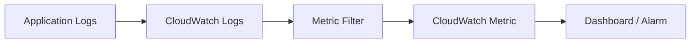

---

# 12. AWS CloudTrail

> 🖼️ *Source figure — Student Guide p.341; full screenshot is kept in the Google Drive master copy.*

CloudTrail ใช้บันทึก user activity และ API calls ใน AWS account

Student Guide อธิบายว่า CloudTrail ช่วยตอบคำถามสำคัญ เช่น:

```text
Who?
What?
When?
Where from?
What changed?
```

---

# 13. CloudTrail ใช้ทำอะไร?

CloudTrail สามารถช่วยในเรื่อง:

- security analysis
- resource change tracking
- compliance auditing
- operational troubleshooting

ตัวอย่างคำถามที่สามารถค้นจาก CloudTrail:

```text
ใคร terminate EC2 instance?
ใครแก้ security group?
ใครถูก deny เพราะไม่มี permission?
API call เกิดขึ้นเวลาไหน?
```

---

# 14. Anatomy ของ CloudTrail Event

Student Guide ใช้ตัวอย่าง API call สำหรับหยุด EC2 instance

CloudTrail record มีข้อมูลที่ช่วยตอบคำถามเป็นส่วน ๆ

## 14.1 userIdentity

บอกว่า **ใครเป็นผู้ทำ request**

แนวคิด:

```text
userIdentity
  -> principal
  -> user / role information
```

---

## 14.2 requestParameters

บอกว่า request ต้องการทำอะไรกับ resource ใด

ตัวอย่างจากบท:

```text
instancesSet
  -> instanceId
```

---

## 14.3 eventTime

บอกว่า API call เกิดขึ้นเมื่อใด

---

## 14.4 eventName

บอกว่า API operation คืออะไร

ตัวอย่างใน Student Guide:

```text
StopInstances
```

---

## 14.5 awsRegion

บอกว่า event เกิดใน AWS Region ใด

---

## 14.6 sourceIPAddress

ช่วยระบุ source ของ request

---

## 14.7 responseElements

บันทึก response ที่ service ส่งกลับ

ตัวอย่างในบทแสดง state ของ EC2 หลังคำสั่งหยุด instance

---

# 15. CloudTrail mental model

จำง่าย ๆ:

```text
User / Role
    |
    v
AWS API Call
    |
    v
AWS Service
    |
    v
CloudTrail Event
```

CloudTrail จึงไม่ใช่ตัววัด CPU หรือ RAM

มันเน้น **activity trail**

---

# 16. CloudWatch vs CloudTrail

| ประเด็น | CloudWatch | CloudTrail |
|---|---|---|
| โฟกัส | Operational monitoring | API/user activity auditing |
| ข้อมูลหลัก | Metrics / Logs | API events |
| ใช้ดู performance | ใช่ | ไม่ใช่หน้าที่หลัก |
| ใช้ดูว่าใครแก้ resource | ไม่ใช่จุดหลัก | ใช่ |
| ตัวอย่าง | CPUUtilization | StopInstances API call |

### จำสั้น ๆ

```text
CloudWatch = ระบบกำลังเป็นอย่างไร?
CloudTrail = ใครทำอะไรกับ AWS?
```

---

# 17. VPC Flow Logs

> 🖼️ *Source figure — Student Guide p.346; full screenshot is kept in the Google Drive master copy.*

VPC Flow Logs ใช้ capture IP traffic information ที่เข้าและออกจาก VPC network interfaces

สามารถกำหนด flow logs ในระดับที่ Student Guide ระบุ เช่น:

- VPC
- Subnet
- Network Interface

Flow Logs ไม่ได้ capture packet payload แบบ packet capture แต่เป็น metadata เกี่ยวกับ traffic flow

---

# 18. Flow Logs ส่งไปที่ไหนได้?

Student Guide แสดง destinations เช่น:

- Amazon CloudWatch Logs
- Amazon S3
- Amazon Data Firehose delivery stream

Architecture concept:

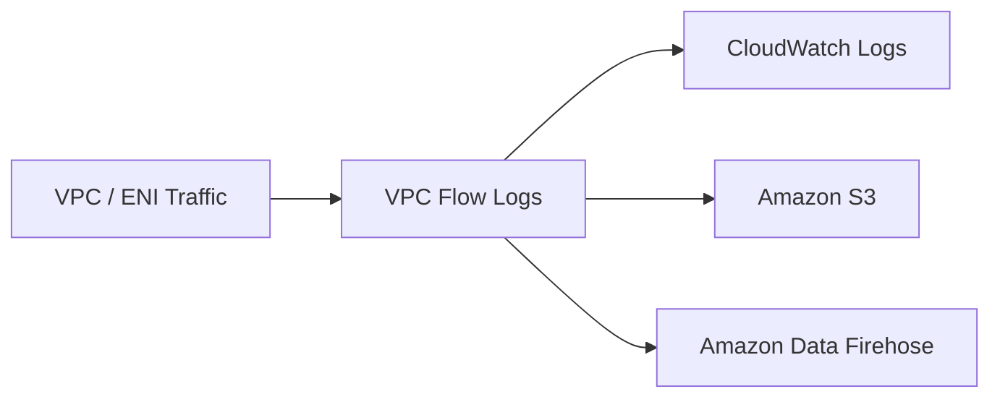

---

# 19. Use cases ของ VPC Flow Logs

Student Guide ยก use cases เช่น:

- diagnose overly restrictive security group rules
- monitor traffic reaching an instance
- determine traffic direction to/from network interfaces

จึงมีประโยชน์มากเวลา troubleshoot network

ตัวอย่างคำถาม:

```text
Traffic มาถึง ENI หรือยัง?
ถูก ACCEPT หรือ REJECT?
Source IP คืออะไร?
Destination port คืออะไร?
```

---

# 20. Contents of a Flow Log Record

> 🖼️ *Source figure — Student Guide p.348; full screenshot is kept in the Google Drive master copy.*

หนึ่ง flow log record มี fields หลายตัว

Student Guide แสดงตัวอย่างข้อมูล เช่น:

- version
- account ID
- interface ID
- source address
- destination address
- source port
- destination port
- protocol
- packets
- bytes
- start
- end
- action
- log status

---

# 21. ACCEPT และ REJECT

หนึ่ง field ที่สำคัญคือ `action`

```text
ACCEPT
REJECT
```

ข้อมูลนี้ช่วยวิเคราะห์ว่า traffic ได้รับอนุญาตหรือถูกปฏิเสธตาม network/security controls หรือไม่

### ตัวอย่างแนวคิด

```text
Source IP 10.0.1.10
Destination IP 10.0.2.20
Destination Port 443
Action REJECT
```

สิ่งที่ operations team ควรตรวจต่อคือ:

- Security Group
- Network ACL
- route/network design

> รายการนี้เป็นแนวทางตีความจากหัวข้อ network controls ที่ Student Guide เชื่อมโยงกับ VPC Flow Logs

---

# 22. สิ่งที่ VPC Flow Logs ไม่ได้เก็บทั้งหมด

Student Guide ระบุว่า Flow Logs ไม่ capture traffic บางประเภท

ตัวอย่างที่กล่าวถึง:

- DNS traffic บางกรณี
- DHCP requests/responses

ดังนั้นอย่าคิดว่า VPC Flow Logs คือ packet capture ทุก packet

---

# 23. Monitoring stack จากเนื้อหา Part 1

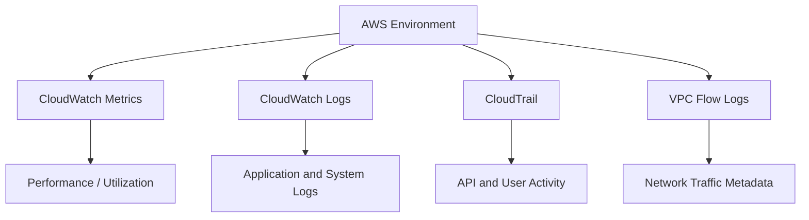

---

# 24. เลือกข้อมูล Monitoring ให้ตรงคำถาม

| คำถาม | ควรดูอะไรตามบท |
|---|---|
| CPU EC2 สูงไหม? | CloudWatch Metric |
| Application error เกิดอะไรขึ้น? | CloudWatch Logs / app logs |
| ใคร Stop EC2? | CloudTrail |
| ใครแก้ security configuration? | CloudTrail |
| Traffic ไปถึง ENI หรือไม่? | VPC Flow Logs |
| Traffic ถูก ACCEPT/REJECT? | VPC Flow Logs |
| ต้องนับ ERROR จาก log เป็น metric | CloudWatch Logs + Metric Filter |

---

# 25. Troubleshooting flow แบบง่าย

จาก tools ที่ Student Guide สอนใน Part นี้ สามารถจัดขั้นตอนตรวจสอบได้แบบนี้

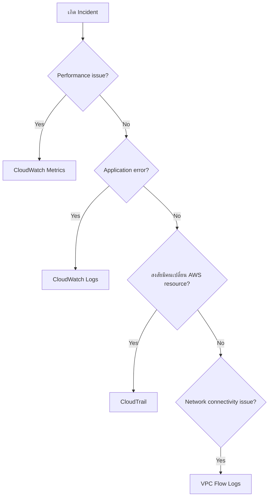

---

# 26. ตัวอย่าง Incident 1 — EC2 ช้า

```text
User: ระบบช้า
```

ลำดับคิดจากเนื้อหาในบท:

1. CloudWatch metrics
2. ดู CPU / resource metrics
3. ถ้า application error ให้เปิด logs
4. correlate metric กับเวลาใน logs

แนวคิดสำคัญคือ monitoring ไม่ควรดู metric เดียวแยกขาดจาก context

---

# 27. ตัวอย่าง Incident 2 — EC2 ถูก Stop โดยไม่ทราบสาเหตุ

CloudWatch อาจบอกว่า instance หยุดทำงาน

แต่ถ้าต้องการตอบคำถามว่า:

> ใคร Stop instance?

ให้ไป CloudTrail

CloudTrail event สามารถบอก:

```text
userIdentity
requestParameters
instanceId
eventTime
eventName
sourceIPAddress
responseElements
```

---

# 28. ตัวอย่าง Incident 3 — Network connection ไม่ผ่าน

ใช้ VPC Flow Logs เพื่อดูว่า traffic:

```text
มาจากไหน
ไปที่ไหน
ใช้ port อะไร
protocol อะไร
ACCEPT หรือ REJECT
```

จากนั้นจึงไปตรวจ network controls ต่อ

---

# 29. Monitoring vs Logging vs Auditing

สามคำนี้ใกล้กันแต่ไม่เหมือนกัน

## Monitoring

ดูสถานะ/performance ของระบบต่อเนื่อง

```text
CPU
Request count
Latency
Resource utilization
```

## Logging

เก็บรายละเอียด events/messages จาก system หรือ application

```text
ERROR
WARN
INFO
Request details
```

## Auditing

ตรวจว่า actor ใดทำ action ใด

```text
Who
What
When
Where
```

CloudTrail เป็นตัวอย่างสำคัญของ audit trail ในบทนี้

---

# 30. สิ่งที่ควรจำจาก Part 1

```text
CloudWatch
  = metrics + monitoring + logs
```

```text
CloudTrail
  = AWS API/user activity history
```

```text
VPC Flow Logs
  = IP traffic metadata ของ VPC network interfaces
```

```text
Metric Filter
  = แปลง pattern จาก log ให้เป็น metric
```

---

# 31. จุดที่มักสับสน

## CloudWatch vs CloudTrail

อย่าจำสลับ:

```text
CPU สูง?        -> CloudWatch
ใคร Stop EC2?   -> CloudTrail
```

## Logs vs Metrics

```text
Metrics = ตัวเลขและ time series
Logs    = รายละเอียด event
```

## Flow Logs vs Packet Capture

VPC Flow Logs เป็นข้อมูล flow metadata ไม่ใช่ full packet payload capture

---

# 32. สรุป Part 1 แบบภาพเดียว

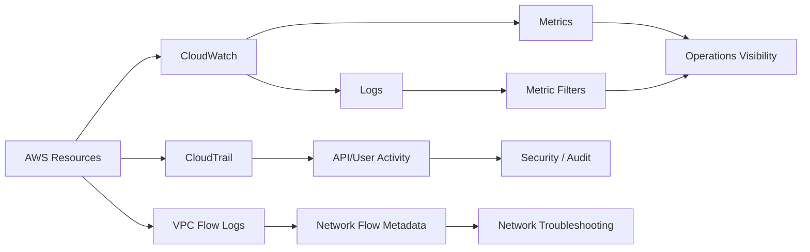

---

# Next: Part 2

หน้า **349** เริ่มหัวข้อ **Alarms and events**

Part ถัดไปจะต่อจาก:

- CloudWatch alarms
- events / automated response
- แล้วเข้าสู่หัวข้อ Load balancing และ scaling ตามลำดับของ Student Guide


---

# Module 7: Monitoring and Scaling — Part 2

> Source: **Architecting on AWS 7.12.4 (EN) — Student Guide**  
> PDF pages: **349–394**  
> Scope: **Alarms and events → Load balancing → Auto scaling → Review → Knowledge Check → Lab 4**

---

## เป้าหมายของ Part นี้

ช่วงนี้ของ Module 7 ต่อยอดจากการ “มองเห็นระบบ” ใน Part 1 ไปสู่การ “ตอบสนองต่อสิ่งที่เกิดขึ้น” และ “ปรับ capacity อัตโนมัติ”

แนวคิดหลักของบทสามารถมองเป็น flow ได้ดังนี้

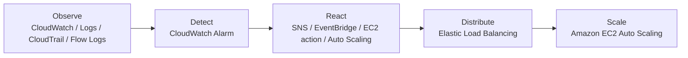

จุดสำคัญคือ AWS ไม่ได้มอง monitoring เป็นแค่ “เปิดกราฟดู” แต่เชื่อม monitoring เข้ากับ automation เพื่อให้ infrastructure ตอบสนองต่อภาวะต่าง ๆ ได้

---

# 1. Alarms and events

หน้า 349 เริ่มด้วยคำถามของ operations manager ว่าเราจะตั้ง threshold และรับการแจ้งเตือนเมื่อ infrastructure เปลี่ยนแปลงได้อย่างไร คำตอบในส่วนนี้คือการใช้ **Amazon CloudWatch alarms** และ event-driven services เพื่อทำ automation ตามเหตุการณ์

## 1.1 CloudWatch alarms

CloudWatch alarm เฝ้าดู **CloudWatch metric หนึ่งตัว** แล้วประเมินค่าเทียบกับ threshold ตามช่วงเวลาที่กำหนด

ลำดับการใช้งานใน Student Guide คือ

1. ระบุ CloudWatch metric ที่ต้องการดู
2. สร้าง alarm จาก metric นั้น
3. กำหนด action เมื่อ metric เกิน threshold

> 🖼️ *Source figure — Student Guide p.350; full screenshot is kept in the Google Drive master copy.*

ตัวอย่าง action ที่หนังสือระบุ ได้แก่ Amazon EC2 action, Auto Scaling action และการส่ง notification ผ่าน Amazon SNS ดังนั้น alarm ไม่ได้มีหน้าที่แค่ “เตือน” แต่สามารถเป็น trigger ของ action อัตโนมัติได้

## 1.2 Alarm states

CloudWatch alarm มี 3 state หลัก

| State | ความหมาย |
|---|---|
| `OK` | metric ยังอยู่ภายใน threshold ที่กำหนด |
| `ALARM` | threshold ถูกเกินตามเงื่อนไขของ alarm |
| `INSUFFICIENT_DATA` | ไม่มีข้อมูลเพียงพอที่จะตัดสินสถานะ |

สิ่งที่ต้องจำคือ `ALARM` เป็นเพียงชื่อ state ไม่ได้แปลว่าเกิดเหตุฉุกเฉินเสมอไป ขึ้นกับว่าเราออกแบบ alarm ไว้ตรวจอะไร

ตัวอย่างใน Student Guide ใช้ CPU utilization และกำหนดว่าต้อง breach threshold ตามจำนวนช่วงที่ตั้งไว้ก่อนจึงเข้าสู่ `ALARM`

`INSUFFICIENT_DATA` สามารถเกิดขึ้นเมื่อไม่มี metric data ส่งมา หรือมีข้อมูลไม่พอสำหรับการประเมินตาม evaluation period

## 1.3 Alarm components

> 🖼️ *Source figure — Student Guide p.352; full screenshot is kept in the Google Drive master copy.*

องค์ประกอบหลักตาม Student Guide ได้แก่

- **Metric name** — metric ที่จะตรวจ
- **Dimension / resource identifier** — เช่น Instance ID
- **Statistic** — วิธีรวมข้อมูล เช่น Average
- **Period** — ระยะเวลาที่รวม metric ต่อหนึ่ง data point
- **Threshold** — ค่าที่ใช้ตัดสินว่าเกินเกณฑ์หรือไม่
- **Evaluation periods** — จำนวนช่วงเวลาที่นำมาพิจารณา
- **Datapoints to alarm** — จำนวน data point ที่ต้อง breach threshold จึงเปลี่ยนเป็น `ALARM`

ตัวอย่างแนวคิด:

```text
Metric: CPUUtilization
Statistic: Average
Period: 5 minutes
Evaluation periods: 3
Datapoints to alarm: 2
Threshold: > 80%
```

หมายความว่า CloudWatch จะดู 3 ช่วงล่าสุด และถ้ามีอย่างน้อย 2 ช่วงที่เกิน 80% ก็เข้า `ALARM`

---

# 2. Amazon EventBridge

Amazon EventBridge เป็น service สำหรับสร้าง **event-driven architecture**

> 🖼️ *Source figure — Student Guide p.353; full screenshot is kept in the Google Drive master copy.*

Student Guide อธิบายว่า EventBridge ช่วยลดการเขียน point-to-point integration โดยสามารถรับ changes/data ที่เกิดขึ้นใน AWS และ supported SaaS applications แล้วตอบสนองตาม rule ที่กำหนด

EventBridge สามารถใช้เพื่อส่ง message ให้ระบบตอบสนองต่อ environment, activate function หรือ initiate action และ capture state information ตัว service เป็น serverless จึงไม่ต้อง provision infrastructure เพื่อจัดการ event bus เอง

## 2.1 Event-driven response

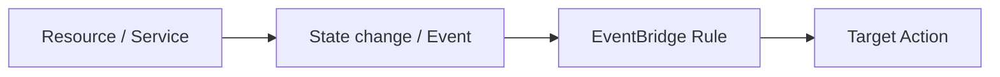

แนวคิดคือรอให้ event เกิด แล้วจึง route event ไปยัง target ที่ต้องการ

## 2.2 ตัวอย่าง CloudWatch alarm + EventBridge

> 🖼️ *Source figure — Student Guide p.354; full screenshot is kept in the Google Drive master copy.*

Student Guide ใช้ตัวอย่าง EC2 ส่ง `CPUUtilization` ไป CloudWatch แล้ว alarm `CPUAbove90Percent` เปลี่ยนเป็น `ALARM` จากนั้น EventBridge rule สามารถตอบสนอง เช่น ส่ง notification ผ่าน Amazon SNS ไป support team หรือส่ง event ไป third-party monitoring tool

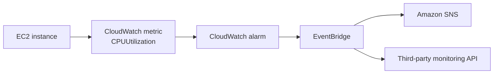

---

# 3. Load balancing

คำถามของ operations manager คือจะเพิ่ม high availability ให้ EC2 workload และกระจาย traffic ข้ามหลาย target ได้อย่างไร AWS service ที่ใช้คือ **Elastic Load Balancing (ELB)**

## 3.1 Elastic Load Balancing (ELB)

ELB ทำหน้าที่กระจาย incoming application traffic ไปยัง multiple targets เช่น EC2 instances

> 🖼️ *Source figure — Student Guide p.356; full screenshot is kept in the Google Drive master copy.*

คุณสมบัติที่ Student Guide เน้น ได้แก่การกระจาย traffic อัตโนมัติไปหลาย target, high availability, security features, health checks และ integration กับ monitoring

## 3.2 ELB load balancer types

> 🖼️ *Source figure — Student Guide p.357; full screenshot is kept in the Google Drive master copy.*

### Application Load Balancer (ALB)

ทำงานระดับ application layer เหมาะกับ HTTP/HTTPS และรองรับ advanced Layer 7 routing

### Network Load Balancer (NLB)

ทำงานระดับ transport layer เหมาะกับ TCP/UDP, low latency และ extreme performance use cases

### Gateway Load Balancer (GWLB)

เหมาะกับการ deploy, scale และ manage third-party virtual network appliances

> Student Guide กล่าวถึง Classic Load Balancer แต่ระบุว่าไม่ได้ลงรายละเอียดใน course นี้

## 3.3 ELB components

> 🖼️ *Source figure — Student Guide p.358; full screenshot is kept in the Google Drive master copy.*

องค์ประกอบหลักคือ

- **Load balancer** — รับ incoming requests
- **Listener** — ตรวจ request ตาม protocol/port ที่กำหนด
- **Target group** — กลุ่ม target ที่จะรับ traffic เช่น EC2 instances

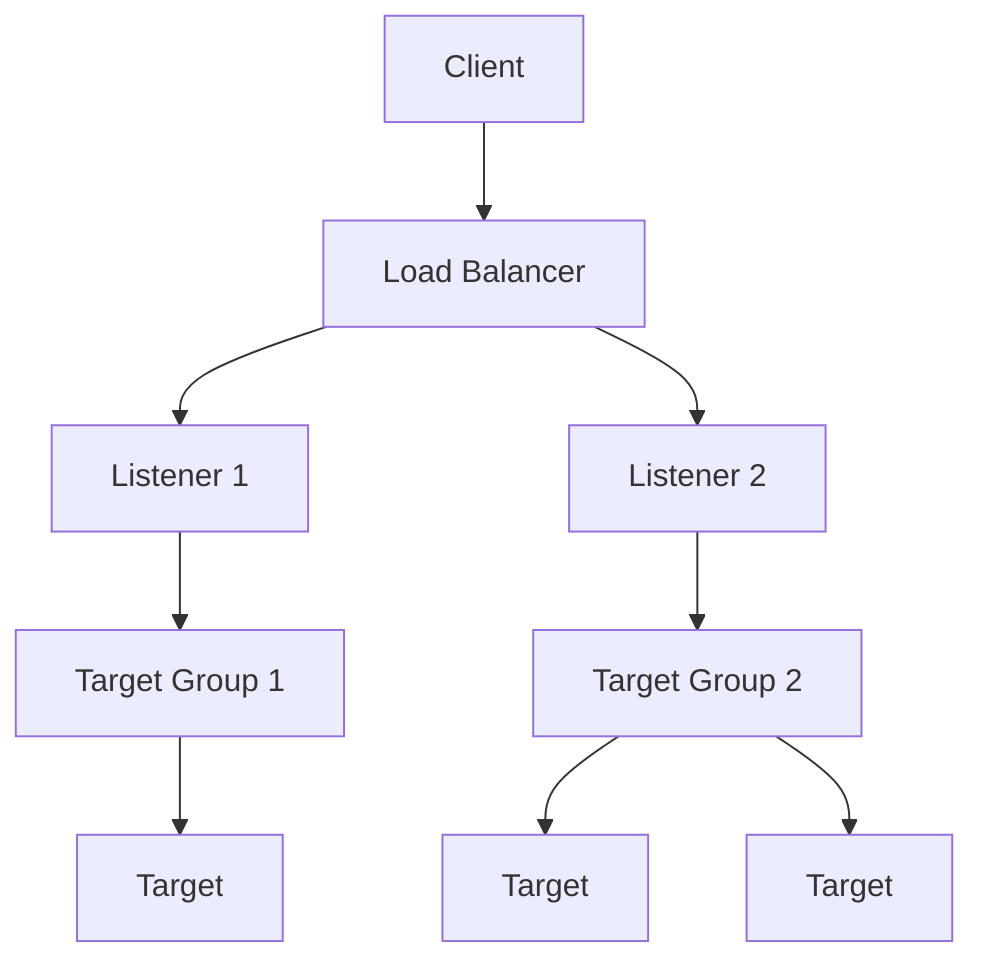

## 3.4 Health checks

ELB สามารถตรวจ health ของ target ได้ หาก target unhealthy จะหยุดส่ง request ใหม่ไป target นั้นและกระจาย traffic ไป healthy targets แทน

---

# 4. Auto scaling

หน้า 360 เปลี่ยนเข้าส่วน **Auto scaling** โดยถามว่าจะเพิ่มและลด capacity แบบ dynamic เพื่อรองรับ changing demand ได้อย่างไร

## 4.1 AWS Auto Scaling

AWS Auto Scaling สามารถ monitor application และปรับ capacity เพื่อรักษา performance พร้อมควบคุม cost Student Guide ระบุว่าสามารถใช้ scaling plan กับหลาย resources/services เช่น Amazon EC2, Amazon DynamoDB และ Amazon Aurora

## 4.2 Amazon EC2 Auto Scaling

Amazon EC2 Auto Scaling ทำให้เรามีจำนวน EC2 instance ที่เหมาะสมกับ workload และ application demand

> 🖼️ *Source figure — Student Guide p.362; full screenshot is kept in the Google Drive master copy.*

ตัวอย่าง architecture วาง EC2 instances ไว้หลาย Availability Zones ภายใน Auto Scaling group เมื่อ demand เพิ่มสามารถ launch instance เพิ่ม และเมื่อ demand ลดสามารถ terminate instance เพื่อลด capacity ได้

---

# 5. Elasticity: Scaling in and out

Student Guide ใช้ภาพต่อเนื่องอธิบาย contrast ระหว่าง traditional infrastructure กับ elastic cloud resources

- ถ้า provision มากเกินไป จะมี infrastructure ที่ไม่ได้ใช้งานเต็มที่และเกิด **opportunity cost**
- ถ้า provision น้อยเกินไป เมื่อ demand spike จะเกิด **lost opportunity** เพราะ capacity ไม่พอ
- cloud elasticity พยายามทำให้ supply เข้าใกล้ actual demand มากขึ้น

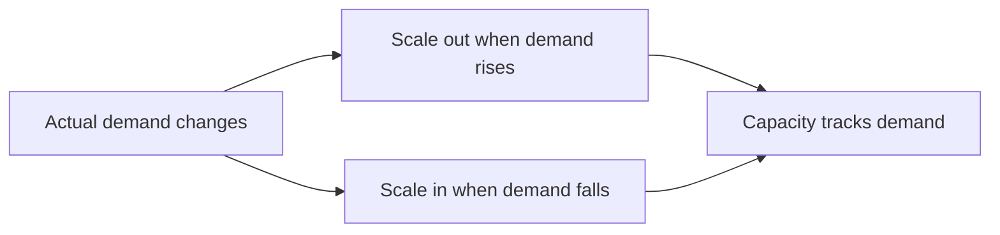

แนวคิดสำคัญคือไม่ต้องซื้อ/provision capacity ล่วงหน้ามากเกินไป และไม่ต้องเก็บ resource ที่ไม่ได้ใช้ไว้ตลอดเวลา

---

# 6. Amazon EC2 Auto Scaling components

> 🖼️ *Source figure — Student Guide p.369; full screenshot is kept in the Google Drive master copy.*

Student Guide สรุป 3 ส่วนหลัก

1. **Launch template** — ต้องการ resource แบบไหน
2. **Auto Scaling group** — จะวาง instance ที่ไหนและต้องการกี่ตัว
3. **Scaling policy** — เมื่อไรจึง scale

## 6.1 Launch template

> 🖼️ *Source figure — Student Guide p.370; full screenshot is kept in the Google Drive master copy.*

launch template เก็บ launch parameters สำหรับ instance ใหม่ เช่น instance type, EBS volume, AMI, elastic network interfaces และ user data เพื่อให้ Auto Scaling สามารถสร้าง EC2 instance ด้วย configuration ที่สม่ำเสมอ

## 6.2 Auto Scaling group capacity

> 🖼️ *Source figure — Student Guide p.371; full screenshot is kept in the Google Drive master copy.*

Auto Scaling group มีค่าหลัก 3 ค่า

- **Minimum capacity** — จำนวน instance ต่ำสุด
- **Desired capacity** — จำนวน instance เป้าหมายปัจจุบัน
- **Maximum capacity** — จำนวน instance สูงสุด

ตัวอย่าง `Minimum=2`, `Desired=3`, `Maximum=5` หมายถึง group พยายามมี 3 instances และ scale ได้ในขอบเขต 2–5 instances

---

# 7. Scaling methods

Student Guide ระบุ scaling methods ได้แก่ Fixed, Manual, Scheduled, Dynamic และ Predictive

> 🖼️ *Source figure — Student Guide p.373; full screenshot is kept in the Google Drive master copy.*

## 7.1 Fixed capacity

รักษาจำนวน instances ไว้ที่ค่าคงที่

## 7.2 Manual scaling

operator เป็นผู้เพิ่มหรือลด capacity เอง

## 7.3 Scheduled scaling

เหมาะกับ workload ที่รู้ pattern ล่วงหน้า สามารถ schedule ให้ scale ก่อนช่วง peak และ scale down หลังช่วง peak

## 7.4 Dynamic scaling

ปรับ capacity ตาม changing demand โดยใช้ scaling policy และ CloudWatch metrics

## 7.5 Predictive scaling

ใช้ historical pattern เพื่อ forecast demand และเตรียม capacity ล่วงหน้า Student Guide ระบุว่าเหมาะกับ cyclical traffic, recurring on-and-off workload patterns และ application ที่ใช้เวลานานในการ initialize

Student Guide แนะนำว่า **scale out early and fast; scale in slowly over time**

---

# 8. Optimize cost with EC2 Auto Scaling

> 🖼️ *Source figure — Student Guide p.374; full screenshot is kept in the Google Drive master copy.*

Auto Scaling group สามารถใช้หลาย EC2 purchasing options ร่วมกันได้ เช่น On-Demand Instances, Savings Plans และ Spot Instances และยังสามารถใช้หลาย instance types เพื่อเพิ่ม flexibility ในการหา capacity

---

# 9. Module 7 capstone update

> 🖼️ *Source figure — Student Guide p.379; full screenshot is kept in the Google Drive master copy.*

capstone architecture เพิ่ม Application Load Balancer เพื่อกระจาย WordPress traffic ไปหลาย EC2 instances และเพิ่ม Amazon EC2 Auto Scaling group เพื่อปรับจำนวน application servers ตาม demand โดยใช้ launch template กำหนด AMI/configuration สำหรับ instance ใหม่

ภาพรวมจึงรองรับ load distribution, instance failure และ changing demand มากขึ้น

---

# 10. Knowledge Check

## Question 1

**Which option is a valid target for an Application Load Balancer?**

คำตอบ: **An Amazon EC2 instance**

## Question 2

application มี unpredictable traffic และต้องการให้ CPU utilization อยู่ประมาณ 75% ควรใช้ EC2 Auto Scaling strategy ใด?

คำตอบ: **Dynamic**

## Question 3

service ใดสามารถ invoke actions จาก data ของ account resources และ supported third-party management services?

คำตอบ: **Amazon EventBridge**

## Question 4

Alarm states ที่ถูกต้องใน Amazon CloudWatch (เลือก 2)

คำตอบ: **`ALARM` และ `INSUFFICIENT_DATA`**

Student Guide ยืนยันว่า CloudWatch alarm มี 3 possible states คือ `OK`, `ALARM`, และ `INSUFFICIENT_DATA`

## Question 5

use cases ของ AWS CloudTrail data (เลือก 2)

คำตอบตาม Student Guide:

- **Store log data as a record of account usage**
- **Capture root login failures**

---

# 11. Lab 4 — Configure High Availability in Your Amazon VPC

> 🖼️ *Source figure — Student Guide p.392; full screenshot is kept in the Google Drive master copy.*

Lab 4 ใช้ VPC ข้าม 2 Availability Zones มี public/private subnet, NAT gateway, Application Load Balancer, Auto Scaling group, application servers และ Amazon Aurora primary/replica

## Lab tasks

1. Inspect your existing lab environment
2. Create a launch template
3. Create an Auto Scaling group
4. Test your application
5. Test high availability of your application tier
6. Configure high availability of the database tier
7. Make the NAT gateway highly available
8. Test the high availability of the Aurora database

Lab นี้เชื่อม high availability ของ application, network และ database เข้าด้วยกัน

---

# 12. Mental model ของ Module 7

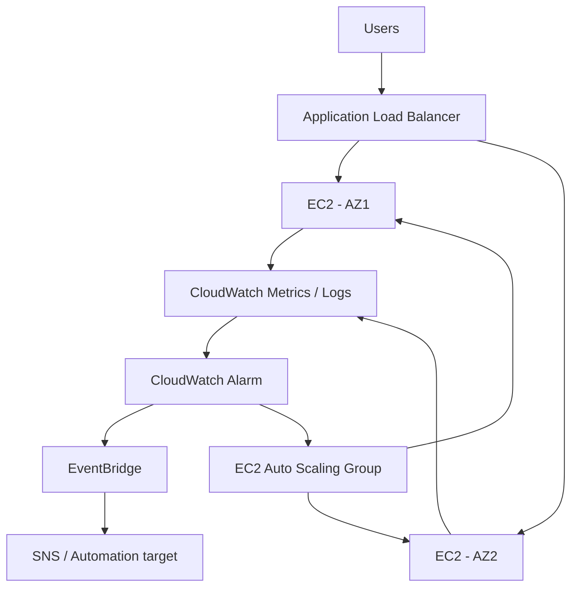

สรุป flow: user เข้า application ผ่าน load balancer → load balancer ส่งไป healthy instances → Auto Scaling group รักษา capacity → CloudWatch monitor → alarm ตรวจ threshold → EventBridge/Auto Scaling ตอบสนอง

นี่คือวงจร **observe → detect → respond → scale** ที่เป็นแกนของ Module 7

---

# 13. สิ่งที่ควรจำจาก Part 2

| Topic | Key idea |
|---|---|
| CloudWatch Alarm | ตรวจ metric เทียบ threshold แล้ว trigger action |
| Alarm states | `OK`, `ALARM`, `INSUFFICIENT_DATA` |
| Evaluation periods | จำนวนช่วงเวลาที่ใช้ตัดสิน alarm |
| Datapoints to alarm | จำนวน breached data points ที่ต้องมีเพื่อเข้า ALARM |
| EventBridge | event-driven routing และ automation |
| ELB | กระจาย traffic ไปหลาย healthy targets |
| ALB | Layer 7, HTTP/HTTPS |
| NLB | Layer 4, TCP/UDP, high performance |
| GWLB | third-party virtual network appliances |
| Listener | รับ connection ตาม protocol/port |
| Target group | กลุ่ม targets ที่ load balancer forward traffic ไป |
| EC2 Auto Scaling | เพิ่ม/ลดจำนวน EC2 ตาม demand |
| Launch template | blueprint สำหรับ instance ใหม่ |
| Minimum | capacity ต่ำสุด |
| Desired | capacity เป้าหมายปัจจุบัน |
| Maximum | capacity สูงสุด |
| Scheduled scaling | scale ตามเวลาที่รู้ล่วงหน้า |
| Dynamic scaling | scale ตาม changing demand |
| Predictive scaling | forecast demand แล้วเตรียม capacity |
| Cost optimization | ใช้ purchasing options และ instance types หลายแบบได้ |

---

# 14. สรุป Module 7

```text
Monitoring
   ↓
Alarms and Events
   ↓
Load Balancing
   ↓
Auto Scaling
```

ถ้าจำเพียงประโยคเดียว:

> **CloudWatch บอกว่าเกิดอะไรขึ้น → Alarm/EventBridge ตอบสนอง → ELB กระจาย traffic → Auto Scaling ปรับ capacity ให้ทัน demand**

จบ Module 7 ที่หน้า **394** และหน้า **395** เริ่ม **Module 8: Automation**
