# Module 10 — Networking 2

## 🧭 Visual architecture

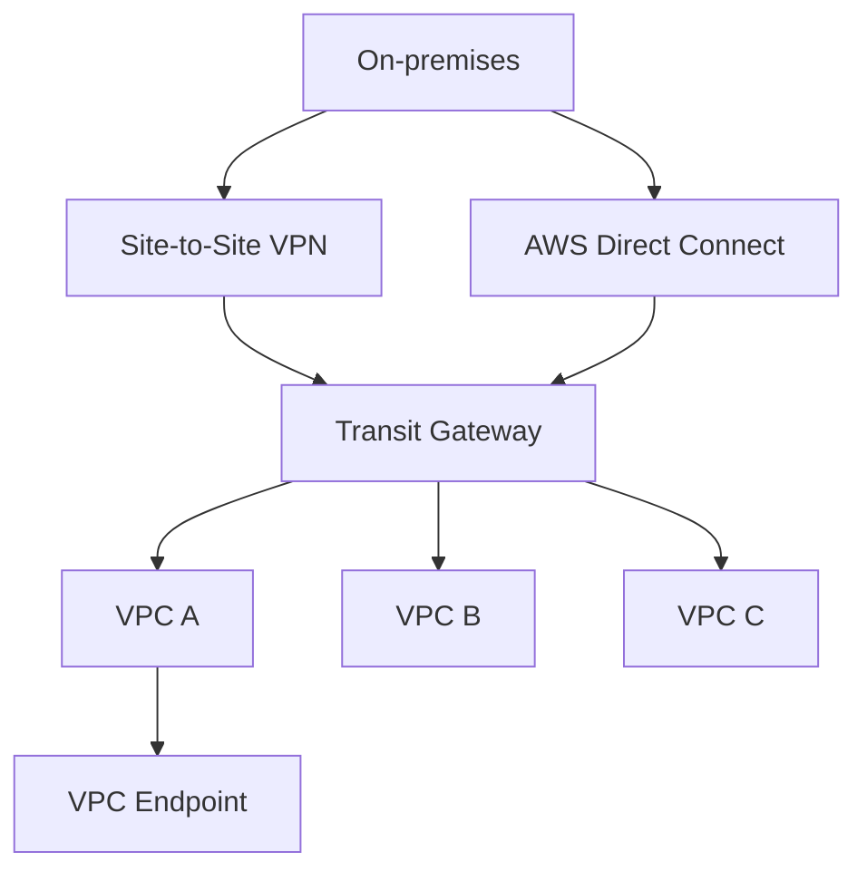

> Diagram นี้เป็นภาพสรุปเพื่อช่วยทำความเข้าใจโครงสร้างของบท/แล็บ โดยยึดแนวคิดจากคู่มือต้นฉบับ
> Mobile reader copy combined from Part 1 + Part 2. Full source screenshots remain in Google Drive master.

# Module 10: Networking 2 — Part 1

> Source: **Architecting on AWS 7.12.4 (EN) — Student Guide**  
> PDF pages: **462–475**  
> Scope: **VPC endpoints → Interface endpoints → VPC peering → Shared services → Full-mesh peering**

---

## เป้าหมายของ Part นี้

Module 10 ขยับจากพื้นฐาน VPC ใน Networking 1 ไปสู่การเชื่อมต่อระบบที่ซับซ้อนขึ้น โดย Part 1 ตอบคำถามสำคัญ 2 ข้อของ network engineer ใน Student Guide:

1. **เราจะเชื่อมจาก VPC ไปยัง AWS services โดยไม่ต้องวิ่งออก public internet ได้อย่างไร?**
2. **เราจะ route traffic ระหว่างหลาย VPC แบบ private ได้อย่างไร?**

แนวคิดหลักสามารถมองเป็นภาพนี้:

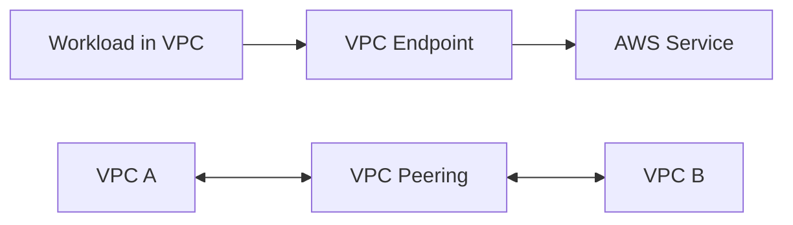

Part นี้เน้น 2 เครื่องมือหลัก:

- **VPC Endpoint** — private access จาก VPC ไป AWS services
- **VPC Peering** — private routing ระหว่าง VPC แบบ one-to-one

---

# 1. Business request ของ Module 10

Student Guide ตั้งสถานการณ์ว่า network engineer ต้องออกแบบ network ที่เชื่อมหลาย environment เข้าด้วยกัน และต้องตอบคำถามต่อไปนี้:

- ทำอย่างไรให้ connection ไป AWS services เป็น private
- ทำอย่างไรให้ traffic ระหว่าง VPC route แบบ private
- จะเชื่อม on-premises เข้ากับ AWS Cloud อย่างไร
- จะลดจำนวน route tables / network connections ที่ต้องดูแลใน global network อย่างไร

Part 1 จะตอบสองข้อแรก ส่วน Hybrid networking และ Transit Gateway จะอยู่ใน Part 2

---

# 2. VPC endpoints

หน้า 466 เริ่มหัวข้อ **VPC endpoints** ด้วยคำถามว่า

> ทำอย่างไรให้ connection ไป AWS services เป็น private?

## 2.1 ปัญหาเมื่อไม่มี VPC endpoint

ถ้า workload อยู่ใน private subnet และต้อง access AWS service แบบ public endpoint เช่น service ที่อยู่นอก VPC ของเรา การเชื่อมต่ออาจต้องอาศัยองค์ประกอบอย่าง:

- Internet Gateway
- NAT Gateway
- Public IP path

> 🖼️ *Source figure — Student Guide p.467; full screenshot is kept in the Google Drive master copy.*

ภาพใน Student Guide แสดง EC2 instance ใน private subnet ที่ต้องออกผ่าน NAT Gateway และ Internet Gateway เพื่อไปถึง service endpoint

แนวคิดคือ ถึง traffic จะเป็นการคุยกับ AWS service แต่ network path เดิมอาจพึ่ง public addressing หรือ internet-facing infrastructure

## 2.2 VPC endpoint แก้ปัญหาอะไร

VPC endpoint สร้างเส้นทาง private ระหว่าง VPC กับ supported AWS services โดยไม่ต้องให้ workload ใช้ public IP เพื่อออกไปหา service นั้น

ภาพจำ:

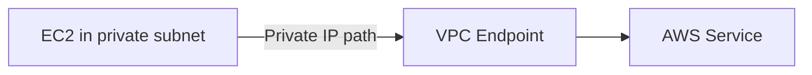

สิ่งที่ควรจำคือ **VPC endpoint เป็น entry point ภายใน VPC สำหรับไปยัง supported service**

ผลลัพธ์คือเราสามารถลด dependency ต่อ:

- NAT Gateway
- Internet Gateway
- Public IP address

สำหรับ traffic ที่สามารถใช้ endpoint ได้

---

# 3. Interface VPC endpoints

Student Guide เน้น **Interface VPC Endpoint** ซึ่งใช้ AWS PrivateLink

> 🖼️ *Source figure — Student Guide p.468; full screenshot is kept in the Google Drive master copy.*

คุณสมบัติที่ระบุในหนังสือ:

- รองรับ AWS services จำนวนมาก
- เป็น Elastic Network Interface (ENI)
- ENI มี private IP address
- horizontally scaled
- redundant
- highly available
- powered by **AWS PrivateLink**

## 3.1 ทำความเข้าใจ Interface Endpoint แบบง่าย

เมื่อสร้าง interface endpoint เราจะได้ network interface ภายใน subnet และ interface นั้นมี private IP

application ภายใน VPC จึงสามารถส่ง traffic ไปที่ private IP ของ endpoint แล้ว AWS route traffic ต่อไปยัง service ที่รองรับ

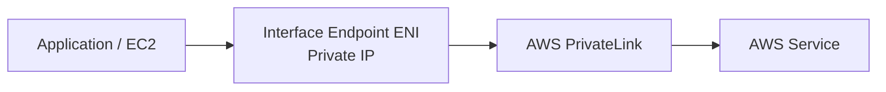

จุดที่สำคัญคือ application ไม่จำเป็นต้อง expose ตัวเองออก internet เพื่อคุยกับ service

---

# 4. ตัวอย่าง Interface VPC Endpoint

> 🖼️ *Source figure — Student Guide p.469; full screenshot is kept in the Google Drive master copy.*

ตัวอย่างใน Student Guide ใช้ Amazon DynamoDB อยู่ภายนอก VPC และมี EC2 instance อยู่ภายใน private subnet

เมื่อสร้าง interface endpoint:

1. Endpoint ถูกสร้างใน VPC
2. Endpoint มี private IP
3. EC2 ส่ง traffic ไป private IP ของ endpoint
4. Endpoint ส่งต่อไปยัง AWS service

ความแตกต่างจากแบบไม่มี endpoint คือ traffic ไม่จำเป็นต้องออกผ่าน NAT Gateway/Internet Gateway เพื่อไปยัง service

## 4.1 วิธีคิดสำหรับงานจริง

ถ้า workload มี requirement ว่า:

> “EC2 อยู่ private subnet และไม่ควรมี internet path แต่ยังต้องเรียก AWS service”

สิ่งแรกที่ควรตรวจคือ service นั้นรองรับ VPC endpoint / PrivateLink หรือไม่

---

# 5. VPC Peering

หน้า 470 เปลี่ยนคำถามเป็น:

> เราจะ privately route traffic ระหว่าง VPC ได้อย่างไร?

คำตอบคือ **VPC Peering**

VPC Peering เชื่อม network ระหว่าง VPC สองตัวโดยตรงแบบ private

> 🖼️ *Source figure — Student Guide p.471; full screenshot is kept in the Google Drive master copy.*

## 5.1 คุณสมบัติหลัก

Student Guide เน้นว่า VPC Peering รองรับ:

- Inter-Region
- Intra-Region
- Cross-account

และ IP ranges ของ VPC ที่ peering กัน **ห้าม overlap**

## 5.2 Route table ยังสำคัญ

สร้าง peering connection อย่างเดียวไม่พอ แต่ต้องเพิ่ม route ใน route table ให้รู้ว่า CIDR ของปลายทางต้องส่งผ่าน peering connection

ตัวอย่างแนวคิด:

```text
VPC A CIDR: 10.1.0.0/16
VPC B CIDR: 10.2.0.0/16

Route Table A:
10.2.0.0/16 -> Peering Connection

Route Table B:
10.1.0.0/16 -> Peering Connection
```

ภาพจำ:

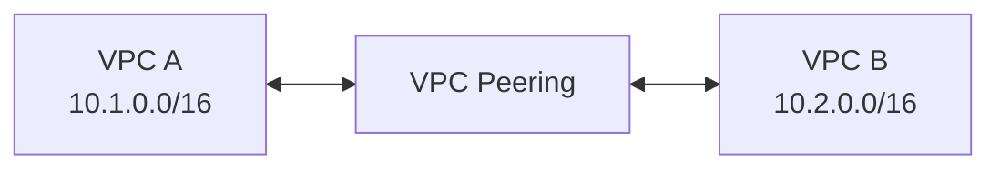

---

# 6. ข้อจำกัดสำคัญ: VPC Peering ไม่ Transitive

นี่เป็นหนึ่งในจุดสำคัญที่สุดของ Module 10

> 🖼️ *Source figure — Student Guide p.472; full screenshot is kept in the Google Drive master copy.*

สมมติว่า:

```text
VPC A <--peering--> VPC B <--peering--> VPC C
```

สิ่งนี้ **ไม่ได้หมายความว่า VPC A จะคุยกับ VPC C ได้ผ่าน VPC B**

ถ้า A ต้องคุยกับ C จะต้องมี peering connection ระหว่าง A กับ C โดยตรง

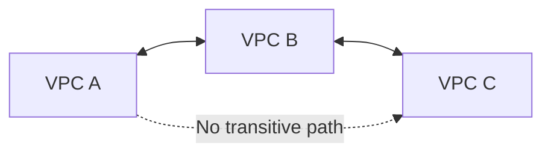

จำง่าย ๆ:

> **VPC Peering = one-to-one relationship และไม่ทำ transit routing**

นี่เป็นเหตุผลสำคัญว่าทำไมเมื่อมี VPC เยอะมาก architecture แบบ peering อย่างเดียวจะเริ่มบริหารยาก

---

# 7. Benefits of VPC Peering

Student Guide ยกประโยชน์ของ VPC peering ไว้หลายข้อ เช่น:

- ไม่ต้อง route traffic ผ่าน Internet Gateway หรือ Virtual Private Gateway
- ไม่มี single point of failure ในลักษณะที่ต้องวาง gateway appliance เองเพื่อเป็น transit
- ลด bandwidth bottleneck จากการบังคับให้ทุก traffic ผ่าน gateway กลางที่เราเป็นคนดูแล
- ใช้ private IP addresses สำหรับ direct traffic ระหว่าง VPC

แนวคิดคือ VPC peering ทำให้สอง VPC ติดต่อกันเหมือนมี private network path เชื่อมโดยตรง

---

# 8. Shared Services VPC

หนึ่งใน pattern ที่ Student Guide แสดงคือ **Shared Services VPC**

> 🖼️ *Source figure — Student Guide p.474; full screenshot is kept in the Google Drive master copy.*

ตัวอย่าง architecture มี:

- App 1 VPC
- App 2 VPC
- App 3 VPC
- Shared Services VPC

แต่ละ application VPC peer เข้าหา Shared Services VPC เพื่อใช้บริการส่วนกลาง เช่น shared directory, security tooling, monitoring หรือ logging tools ตามตัวอย่างของหนังสือ

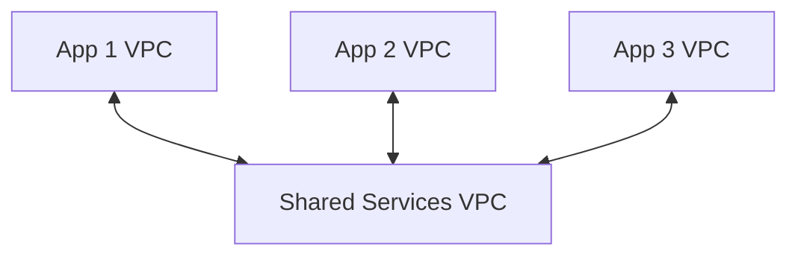

อย่างไรก็ตาม ต้องระวังหลัก non-transitive เหมือนเดิม

ถ้า App 1 VPC และ App 2 VPC ต้องคุยกันโดยตรง การที่ทั้งคู่ peer กับ Shared Services VPC ไม่ได้ทำให้ App 1 วิ่งผ่าน Shared Services VPC ไป App 2 ได้โดยอัตโนมัติ

---

# 9. Inter-Region VPC Peering

Student Guide ระบุว่า VPC peering สามารถเชื่อม VPC ที่อยู่คนละ AWS Region ได้

traffic ระหว่าง VPC ยังใช้ private IP address และไม่จำเป็นต้องวาง VPN gateway หรือ physical hardware เพิ่มเพื่อเชื่อมสอง Region ในรูปแบบ peering

Use case ที่เห็นได้จากภาพ shared-services คือ application VPC ใน Region หนึ่งสามารถ peer กับ VPC ในอีก Region ได้

---

# 10. Full-mesh VPC Peering

เมื่อมี VPC จำนวนมากและทุก VPC ต้องคุยกัน เราอาจสร้าง **full mesh peering**

> 🖼️ *Source figure — Student Guide p.475; full screenshot is kept in the Google Drive master copy.*

เช่นมี VPC A, B, C, D, E และทุกตัวต้องคุยกัน จะต้องสร้าง peering connection โดยตรงระหว่างคู่ที่ต้องการ

ลักษณะนี้เพิ่มจำนวน connection อย่างรวดเร็ว

```text
VPC A <-> B
VPC A <-> C
VPC A <-> D
VPC A <-> E
VPC B <-> C
VPC B <-> D
...
```

ผลกระทบคือ:

- จำนวน peering connections เพิ่ม
- จำนวน routes เพิ่ม
- monitoring ซับซ้อนขึ้น
- การเปลี่ยนแปลง network ทำได้ยากขึ้น

Student Guide ปูประเด็นนี้ไว้เพื่อไปสู่ **AWS Transit Gateway** ใน Part 2 ซึ่งเป็นแนวคิด hub-and-spoke แทน full mesh

---

# 11. VPC Endpoint vs VPC Peering

| เรื่อง | VPC Endpoint | VPC Peering |
|---|---|---|
| เป้าหมาย | เชื่อม VPC ไป AWS service แบบ private | เชื่อม VPC สองตัวเข้าหากัน |
| Traffic | VPC → AWS Service | VPC ↔ VPC |
| Public IP | ไม่จำเป็นสำหรับ endpoint path | ใช้ private IP ระหว่าง VPC |
| Routing | ผ่าน endpoint | ต้องมี route ไป peering connection |
| Scale issue | ขึ้นกับจำนวน endpoint/service | peering จำนวนมากทำให้ mesh ซับซ้อน |
| Transitive routing | ไม่ใช่ use case ของ endpoint | **ไม่รองรับ** |

---

# 12. Decision Flow

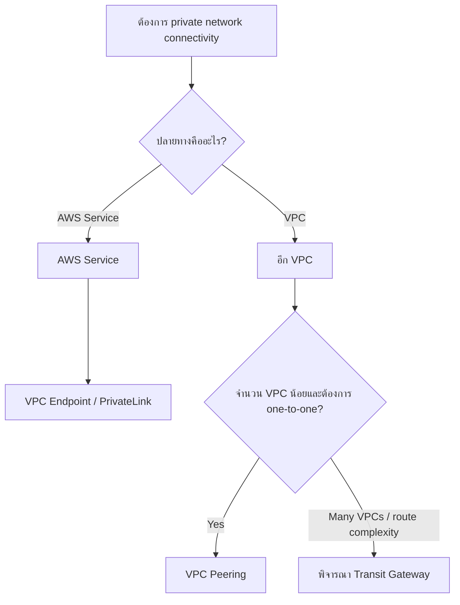

---

# 13. สิ่งที่ควรจำจาก Part 1

1. **VPC Endpoint** ช่วยให้ workload ใน VPC เข้าถึง supported AWS service แบบ private
2. Interface endpoint เป็น ENI ที่มี private IP และใช้ AWS PrivateLink
3. VPC Peering เชื่อม **VPC สองตัวแบบ one-to-one**
4. Peering รองรับ intra-Region, inter-Region และ cross-account
5. CIDR ของ VPC ที่ peer กันห้าม overlap
6. ต้องแก้ route table เพื่อ route traffic ผ่าน peering connection
7. **VPC Peering ไม่ transitive**
8. Shared Services VPC เป็น pattern ที่ใช้ peering ได้ แต่ไม่ได้ทำให้ application VPC transit ผ่าน shared VPC
9. Full-mesh peering เริ่มซับซ้อนเมื่อจำนวน VPC เพิ่ม
10. ถ้า route/connection เริ่มเยอะมาก ให้คิดถึง **Transit Gateway** ซึ่งจะต่อใน Part 2

---

## Mini recap

```text
Private access to AWS service
        -> VPC Endpoint

Private VPC-to-VPC, one-to-one
        -> VPC Peering

Many VPCs + mesh complexity
        -> Transit Gateway (Part 2)
```

---

# Module 10: Networking 2 — Part 2

> Source: **Architecting on AWS 7.12.4 (EN) — Student Guide**  
> PDF pages: **476–499**  
> Scope: **Hybrid networking → Site-to-Site VPN → Direct Connect → Transit Gateway → Review → Knowledge Check**

---

## เป้าหมายของ Part นี้

Part 2 ตอบคำถามอีกสองข้อของ network engineer:

1. **เราจะเชื่อม on-premises network เข้ากับ AWS Cloud อย่างไร?**
2. **เมื่อมี VPC และ network connections จำนวนมาก จะลดจำนวน routes/connections ที่ต้องจัดการอย่างไร?**

คำตอบหลักของบทคือ:

- **AWS Site-to-Site VPN**
- **AWS Direct Connect**
- **AWS Transit Gateway**

ภาพรวม:

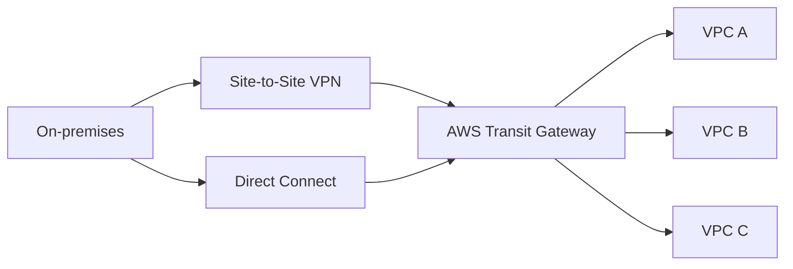

---

# 1. Hybrid Networking

Hybrid networking คือการเชื่อม network ภายในองค์กรหรือ data center เข้ากับ AWS Cloud เพื่อให้ระบบ on-premises และ cloud ติดต่อกันได้

Student Guide เสนอ 2 ตัวเลือกหลักในช่วงนี้:

- AWS Site-to-Site VPN
- AWS Direct Connect

---

# 2. AWS Site-to-Site VPN

> 🖼️ *Source figure — Student Guide p.477; full screenshot is kept in the Google Drive master copy.*

Student Guide อธิบายว่า Site-to-Site VPN มี **สอง VPN tunnels** เพื่อเชื่อมระหว่างฝั่ง customer network กับ AWS

องค์ประกอบสำคัญในภาพ ได้แก่:

- **Customer gateway device** ฝั่ง on-premises
- VPN connection
- **Virtual Private Gateway** หรือ transit gateway ฝั่ง AWS ตาม architecture ที่เลือก
- VPC และ subnet ใน AWS

แนวคิดคือสร้าง encrypted network connection ผ่าน internet ระหว่าง on-premises และ AWS

## 2.1 Components

จำภาพพื้นฐาน:

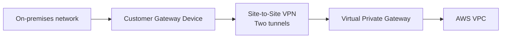

Student Guide ระบุว่า customer gateway device อาจเป็น physical device หรือ software appliance ที่ฝั่ง customer

ส่วน virtual private gateway เป็น VPN concentrator ฝั่ง AWS ที่ใช้กับ Site-to-Site VPN connection

## 2.2 Routing

Site-to-Site VPN รองรับทั้ง static routing และ dynamic routing โดย dynamic route สามารถใช้ Border Gateway Protocol (BGP) เพื่อแลกเปลี่ยน route

ดังนั้นถ้า architecture มีหลาย network prefixes dynamic routing จะช่วยลดการจัด route แบบ manual

---

# 3. AWS Direct Connect

> 🖼️ *Source figure — Student Guide p.478; full screenshot is kept in the Google Drive master copy.*

AWS Direct Connect ใช้การเชื่อมต่อ dedicated/private network จาก network ของลูกค้าไปยัง AWS Direct Connect location

Student Guide อธิบายแนวคิดว่า traffic จาก on-premises วิ่งผ่าน customer router ไป Direct Connect connection และเข้าสู่ AWS โดยไม่จำเป็นต้องใช้ public internet เป็น data path หลัก

## 3.1 จุดเด่นของ Direct Connect

- Private/dedicated connectivity
- เหมาะกับ network ที่ต้องการ connection capacity สูงกว่า VPN
- ไม่ต้องพึ่ง public internet สำหรับ data path หลัก
- เชื่อมผ่าน Direct Connect location

Student Guide ระบุ connection options ในระดับ capacity เช่น sub-1, 1, 10 และ 100 Gbps options ตามบริการที่รองรับ

## 3.2 Virtual interface

Direct Connect ใช้ virtual interfaces เพื่อเข้าถึง AWS resources/services ตามรูปแบบ connection

ในภาพตัวอย่าง เส้นทางจาก data center เข้าสู่ VPC ผ่าน private connectivity โดยมี VPC และ virtual private gateway อยู่ฝั่ง AWS

---

# 4. Pricing considerations: VPN vs Direct Connect

หน้า 479 เปรียบเทียบ pricing factors ของ Site-to-Site VPN กับ Direct Connect

แนวคิดหลักคือค่าใช้จ่ายไม่ได้คิดจาก connection อย่างเดียว แต่มีหลายองค์ประกอบ

### Site-to-Site VPN

Student Guide ระบุปัจจัยอย่าง:

- connection fee ต่อชั่วโมง
- data transfer out (DTO)

### Direct Connect

Student Guide ระบุปัจจัยอย่าง:

- capacity ของ connection
- port hours
- data transfer out (DTO)

ดังนั้นก่อนเลือก solution ต้องดูทั้ง architecture requirement และ cost model

---

# 5. Choosing Site-to-Site VPN or Direct Connect

> 🖼️ *Source figure — Student Guide p.480; full screenshot is kept in the Google Drive master copy.*

ตารางใน Student Guide เปรียบเทียบแนวคิดหลักดังนี้

| Site-to-Site VPN | Direct Connect |
|---|---|
| เร็วกว่าในการเริ่ม setup | ต้องมี setup/connection process มากกว่า |
| เหมาะกับ bandwidth requirement ไม่สูงมาก | มี connection options ที่สูงกว่า |
| ไม่ต้องจ่าย connection ที่ idle แบบ dedicated port | มี port-hour pricing |
| encrypted in transit โดย VPN | private dedicated connectivity แต่ encryption requirement ต้องออกแบบเพิ่มเติมตาม use case |
| traffic วิ่งผ่าน public internet ในฐานะ transport | data path ไม่พึ่ง public internet |

## 5.1 เลือก VPN เมื่อ

ตาม framing ของ Student Guide:

- ต้องการเริ่ม connection ได้เร็ว
- workload/network requirement อยู่ใน capacity ของ VPN
- ต้องการ encryption in transit ผ่าน VPN

## 5.2 เลือก Direct Connect เมื่อ

- ต้องการ connectivity capacity สูงกว่า Site-to-Site VPN
- มี Direct Connect-supported location / provider
- ต้องการ dedicated/private network path

หลาย architecture สามารถใช้ทั้งสองอย่างร่วมกันได้ตาม requirement

---

# 6. ปัญหาเมื่อ network โต: Full mesh ไม่ scale

Part 1 แสดงว่า VPC peering แบบ full mesh ทำให้จำนวน connection เพิ่มเร็วมาก

ถ้ามีหลาย VPC + on-premises + VPN + Direct Connect การบริหาร route แบบ point-to-point จะยิ่งซับซ้อน

ตรงนี้ Student Guide นำเข้าสู่ **AWS Transit Gateway**

---

# 7. AWS Transit Gateway

หน้า 481 เริ่ม Transit Gateway ด้วยคำถามว่า:

> Service ใดช่วยลดจำนวน route tables/connections ที่ต้องจัดการใน global network?

คำตอบคือ **AWS Transit Gateway**

> 🖼️ *Source figure — Student Guide p.482; full screenshot is kept in the Google Drive master copy.*

Transit Gateway ทำหน้าที่เป็น **hub** สำหรับเชื่อม network หลายตัว เช่น:

- VPC
- VPN connection
- Direct Connect gateway
- Transit Gateway peering

Student Guide ระบุว่า Transit Gateway สามารถเชื่อม VPC และ on-premises environments จำนวนมาก และช่วยลด operation cost/complexity เมื่อเทียบกับ architecture ที่เป็น mesh

## 7.1 Hub-and-Spoke

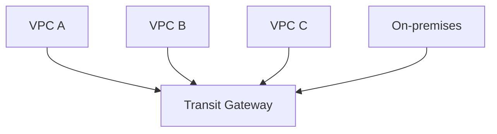

แทนที่จะให้ A peer กับ B, C และทุก VPC peer กันเอง ทุก network attach มาที่ hub

---

# 8. Scaling network with Transit Gateway

> 🖼️ *Source figure — Student Guide p.483; full screenshot is kept in the Google Drive master copy.*

Student Guide เน้นคุณสมบัติ:

- attachment-based
- flexible routing and segmentation
- simplified connections
- highly available and scalable

เมื่อจำนวน VPC เพิ่ม เราเพิ่ม attachment เข้าหา Transit Gateway แทนการสร้าง mesh connection ใหม่ระหว่างทุกคู่

ตัวอย่างในภาพมีหลาย Dev/Prod VPC ที่เชื่อมเข้าหา Transit Gateway และยังเชื่อมกลับ on-premises ผ่าน VPN / Direct Connect gateway

---

# 9. Transit Gateway Components

> 🖼️ *Source figure — Student Guide p.484; full screenshot is kept in the Google Drive master copy.*

Student Guide แบ่งส่วนสำคัญเป็น 2 กลุ่ม:

1. **Attachments**
2. **Transit Gateway Route Tables**

## 9.1 Attachments

Attachment คือ connection จาก resource/network เข้าหา Transit Gateway

ตัวอย่าง attachment ใน Student Guide:

- VPC
- VPN connection
- Direct Connect gateway
- Transit Gateway Connect
- Transit Gateway peering connection

จำง่าย ๆ:

> **Network ต่อเข้า Transit Gateway ผ่าน Attachment**

## 9.2 Transit Gateway Route Tables

Transit Gateway มี route tables ของตัวเองเพื่อควบคุมว่า traffic จาก attachment หนึ่งจะไป attachment ใด

นี่เป็นจุดสำคัญเพราะเราสามารถใช้ route table แยก connectivity ตาม environment ได้ เช่น Dev, Prod หรือ isolated network

---

# 10. Transit Gateway Setup

> 🖼️ *Source figure — Student Guide p.485; full screenshot is kept in the Google Drive master copy.*

Student Guide แสดงว่า Transit Gateway สามารถ attach ได้กับหลาย network resources

แนวคิด setup คือ:

1. สร้าง Transit Gateway
2. สร้าง attachments จาก network ที่ต้องการ
3. associate attachment กับ route table
4. propagate หรือกำหนด route ตาม connectivity requirement

หนังสือยังระบุว่าสามารถ share Transit Gateway ข้าม AWS accounts ได้ โดยใช้ AWS Resource Access Manager (RAM)

---

# 11. Transit Gateway Routing Patterns

จุดเด่นของ Transit Gateway ไม่ใช่แค่ “ทุกอย่างคุยกันได้” แต่เราสามารถออกแบบ segmentation ได้ด้วย route tables

## 11.1 Full Connectivity

> 🖼️ *Source figure — Student Guide p.486; full screenshot is kept in the Google Drive master copy.*

VPC A, B, C, D และ hybrid connections attach เข้า Transit Gateway และสามารถ communicate กันได้ตาม routes ที่กำหนด

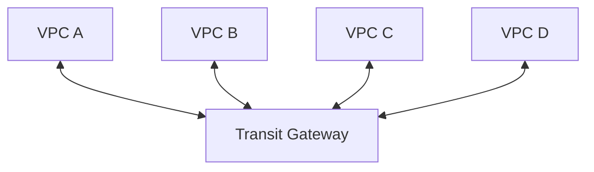

เหมาะกับ environment ที่ทุก network ต้องการ full connectivity

## 11.2 Partial Connectivity

> 🖼️ *Source figure — Student Guide p.487; full screenshot is kept in the Google Drive master copy.*

ตัวอย่าง Student Guide แยก VPC ออกเป็นกลุ่ม เช่น:

- VPC A และ C ติดต่อกันได้
- VPC B และ D ติดต่อกันได้
- แต่สองกลุ่มไม่สามารถข้ามไปคุยกัน

นี่เกิดจากการออกแบบ route tables / associations ให้แยกกัน

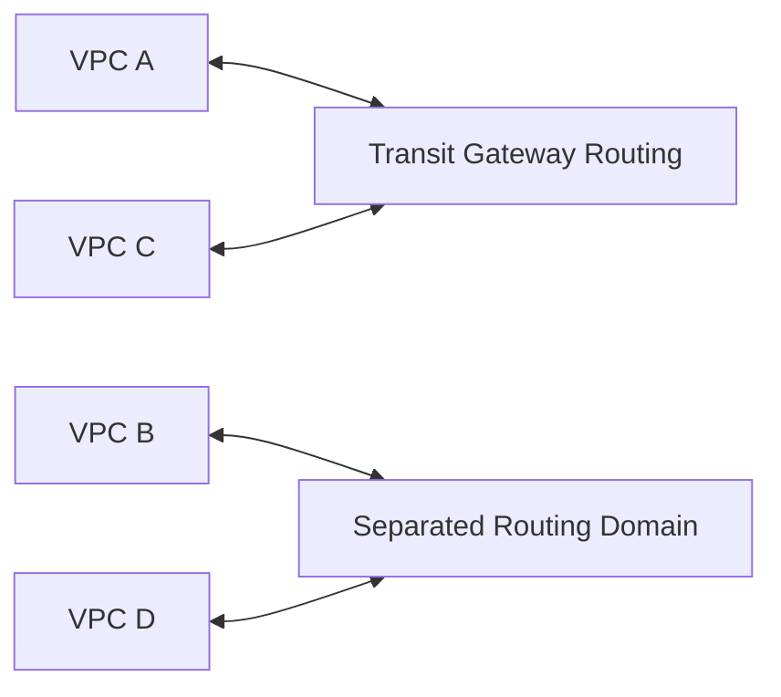

## 11.3 Isolation with full access from VPN

> 🖼️ *Source figure — Student Guide p.488; full screenshot is kept in the Google Drive master copy.*

Student Guide แสดง pattern ที่ VPC หลายตัว **ไม่สามารถคุยกันเอง** แต่ VPN connection สามารถเข้าถึงทุก VPC ได้

Use case ลักษณะนี้เหมาะกับ central administration หรือ management network ที่ต้องเข้าแต่ละ environment ได้ โดย application networks ถูก isolate ออกจากกัน

---

# 12. VPC Peering vs Transit Gateway

| ประเด็น | VPC Peering | Transit Gateway |
|---|---|---|
| Model | One-to-one | Hub-and-spoke |
| Transitive routing | ไม่รองรับ | ออกแบบ routing ผ่าน hub ได้ |
| จำนวน VPC น้อย | เรียบง่าย | อาจเกินความจำเป็น |
| จำนวน VPC มาก | mesh ซับซ้อน | scale ง่ายกว่า |
| Central route control | จำกัด | มี Transit Gateway route tables |
| Hybrid connectivity | ต้องต่อแต่ละ architecture | รวม VPN/DX/VPC เข้า hub ได้ |
| Segmentation | peer-by-peer | route-table based segmentation |

---

# 13. Business Request — Present Solutions

> 🖼️ *Source figure — Student Guide p.490; full screenshot is kept in the Google Drive master copy.*

หน้า 490 สรุปคำตอบให้ network engineer ดังนี้

### Question 1: ทำอย่างไรให้ connection ไป AWS services เป็น private?

ใช้ **VPC endpoints** เช่น interface endpoints

### Question 2: ทำอย่างไรให้ traffic ระหว่าง VPC route แบบ private?

ใช้ **VPC Peering** สำหรับ one-to-one VPC connectivity

### Question 3: เชื่อม on-premises เข้ากับ AWS อย่างไร?

ใช้:

- AWS Site-to-Site VPN
- AWS Direct Connect

### Question 4: ลดจำนวน route tables / connections ใน global network อย่างไร?

ใช้ **AWS Transit Gateway** และ Transit Gateway route tables เพื่อ centralize network connectivity และ routing

---

# 14. Module Review

Student Guide สรุป Module 10 ว่าครอบคลุม:

- VPC endpoints
- VPC peering
- Hybrid networking
- Transit Gateway

จากนั้นเข้าสู่ Knowledge Check

---

# 15. Knowledge Check

## Question 1

**What is a connection to a transit gateway called?**

ตัวเลือก:

- VPN
- Attachment
- Route
- VPC

**คำตอบ: Attachment**

เหตุผล: connection ระหว่าง resource/network กับ Transit Gateway เรียกว่า Transit Gateway attachment

---

## Question 2

**What are the components of an AWS Site-to-Site VPN connection? (Select TWO.)**

ตัวเลือกในหนังสือประกอบด้วย customer gateway device, interface endpoint, virtual private gateway, VPC peering connection และ gateway endpoint

**คำตอบ:**

- Customer gateway device
- Virtual private gateway

ภาพจำ:

```text
On-premises
    |
Customer Gateway Device
    |
Site-to-Site VPN
    |
Virtual Private Gateway
    |
AWS VPC
```

---

## Question 3

**Which statements are true of VPC peering connections? (Select TWO.)**

**คำตอบ:**

- Connections are **one-to-one**
- Connections can **span accounts**

Student Guide ย้ำอีกครั้งว่า transitive peering relationships **ไม่รองรับ**

---

# 16. Decision Guide ของ Module 10

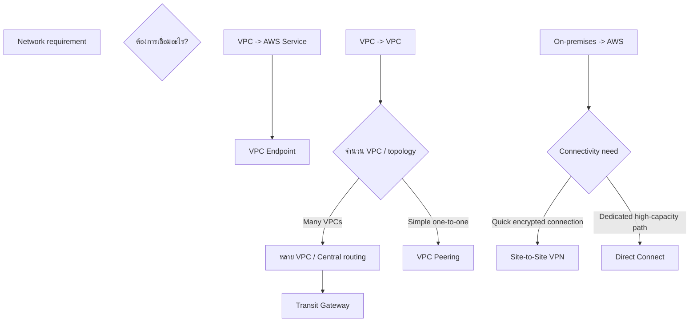

---

# 17. สิ่งที่ควรจำจาก Module 10

1. **VPC Endpoint** = private access จาก VPC ไป AWS service
2. **Interface endpoint** ใช้ ENI + private IP + AWS PrivateLink
3. **VPC Peering** = VPC-to-VPC แบบ one-to-one
4. VPC Peering **ไม่ transitive**
5. Site-to-Site VPN ใช้ encrypted tunnels เชื่อม on-premises กับ AWS
6. Direct Connect ให้ dedicated/private connectivity และ capacity options ที่สูงกว่า VPN
7. Hybrid architecture สามารถใช้ VPN และ Direct Connect ตาม requirement
8. **Transit Gateway** = central hub สำหรับ VPC + VPN + Direct Connect-related connectivity
9. การต่อ network เข้าหา Transit Gateway เรียกว่า **Attachment**
10. Transit Gateway route tables ใช้ทำ full connectivity, partial connectivity และ isolation ได้
11. Transit Gateway เหมาะเมื่อ full-mesh peering เริ่มซับซ้อน

---

## Final Mental Model

```text
AWS Service แบบ private
        -> VPC Endpoint

VPC <-> VPC แบบ simple one-to-one
        -> VPC Peering

On-premises <-> AWS แบบเร็ว/ผ่าน VPN
        -> Site-to-Site VPN

On-premises <-> AWS แบบ dedicated
        -> Direct Connect

หลาย VPC + Hybrid + Central routing
        -> Transit Gateway
```

---

> **End of Module 10 — Networking 2**
