# Module 11 — Serverless

> Mobile reader copy combined from Part 1 + Part 2. Full source screenshots remain in Google Drive master.

# Module 11: Serverless — Part 1

> Source: **Architecting on AWS 7.12.4 (EN) — Student Guide**  
> PDF pages: **500–518**  
> Scope: **What is serverless? → API Gateway → Amazon SQS**

---

## เป้าหมายของ Part นี้

Module 11 เริ่มจากโจทย์ของ application development manager ที่ต้องการลด operational overhead, ลดการดูแล infrastructure และสร้างระบบที่ scale ได้ง่ายขึ้น

Part 1 ตอบคำถามหลัก 3 ข้อ:

1. Serverless architecture คืออะไร และช่วยลดภาระดูแลระบบได้อย่างไร?
2. จะ expose backend services ผ่าน API แบบ secure และ managed ได้อย่างไร?
3. จะสร้าง message queue เพื่อ decouple service-to-service communication ได้อย่างไร?

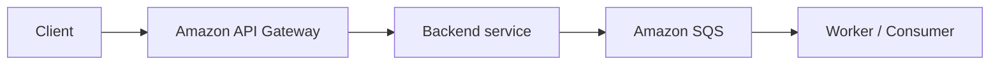

---

# 1. What is serverless?

หน้า 504 เปิดหัวข้อ serverless ด้วยคำถามว่าเราจะลด operational overhead และ optimize resource costs ได้อย่างไร

## 1.1 แนวคิด Serverless

> 🖼️ *Source figure — Student Guide p.505; full screenshot is kept in the Google Drive master copy.*

Student Guide สรุปคุณลักษณะหลักของ serverless ไว้ว่า:

- ไม่ต้อง provision หรือ manage infrastructure เอง
- automatic scaling ตามหน่วยของการใช้งาน
- consumption-based pricing
- มี built-in security และ high availability ในบริการที่รองรับ

แนวคิดสำคัญคือ developer โฟกัสกับ application logic มากกว่า server management

### Mental model

```text
Traditional:
Application -> VM/Server -> Patch -> Scale -> Capacity planning -> Monitoring

Serverless:
Application logic -> Managed service -> AWS handles infrastructure layer
```

Serverless ไม่ได้แปลว่า "ไม่มี server" แต่หมายถึงผู้ใช้ไม่ต้องบริหาร server infrastructure โดยตรง

---

# 2. AWS Serverless Portfolio

> 🖼️ *Source figure — Student Guide p.506; full screenshot is kept in the Google Drive master copy.*

Student Guide แสดง serverless services หลายหมวด เช่น:

- Compute — AWS Lambda, AWS Fargate
- API proxy — Amazon API Gateway
- Storage — Amazon S3
- Database — Amazon DynamoDB, Amazon Aurora Serverless
- Authentication — Amazon Cognito
- Inter-process messaging — Amazon SNS, Amazon SQS
- Orchestration — AWS Step Functions
- Analytics — Amazon Kinesis, Amazon Athena

บทนี้เจาะ service หลักต่อไปนี้:

- API Gateway
- SQS
- SNS
- Kinesis
- Step Functions

---

# 3. Example Serverless Architecture

> 🖼️ *Source figure — Student Guide p.507; full screenshot is kept in the Google Drive master copy.*

Student Guide ใช้ตัวอย่าง messaging application ที่มี flow โดยประมาณ:

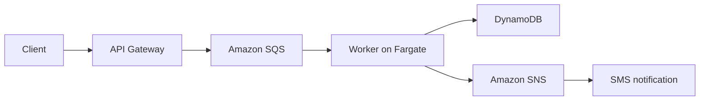

แนวคิดสำคัญคือแต่ละ service รับผิดชอบหน้าที่เฉพาะ และ application ไม่ต้องผูกทุก component เข้าหากันแบบ synchronous ทั้งหมด

---

# 4. Amazon API Gateway

หน้า 508 เปลี่ยนโจทย์เป็น:

> วิธีใดช่วย expose backend services ผ่าน API ได้อย่าง secure โดยลด operational overhead?

คำตอบคือ **Amazon API Gateway**

## 4.1 API Gateway ทำอะไร

> 🖼️ *Source figure — Student Guide p.509; full screenshot is kept in the Google Drive master copy.*

API Gateway เป็น managed service สำหรับสร้าง, publish, maintain, monitor และ secure APIs

Student Guide แสดงว่า API Gateway สามารถเชื่อม client หลายประเภทไปยัง backend ได้ เช่น:

- Lambda functions
- AWS services
- public endpoints
- private endpoints ใน VPC
- on-premises resources ผ่าน connectivity ที่เหมาะสม

นอกจากนี้ยังช่วยจัดการงานอย่าง:

- traffic management
- authorization / access control
- monitoring
- API version management

## 4.2 API Gateway Features

> 🖼️ *Source figure — Student Guide p.510; full screenshot is kept in the Google Drive master copy.*

Student Guide เน้นความสามารถ เช่น:

- สร้าง unified API frontend สำหรับหลาย microservices
- ช่วยป้องกัน backend ด้วย DDoS protection / throttling-related controls
- authenticate และ authorize requests
- throttle / meter / monetize API usage
- รองรับ RESTful หรือ WebSocket APIs ตาม use case

## 4.3 Sample Architecture

> 🖼️ *Source figure — Student Guide p.511; full screenshot is kept in the Google Drive master copy.*

ตัวอย่าง flow:

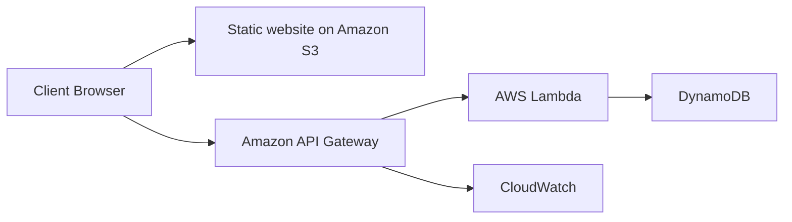

Student Guide แสดงว่า API Gateway สามารถส่ง logs/metrics ไป CloudWatch เพื่อ monitor เช่น:

- จำนวน API calls
- latency
- integration latency
- HTTP 4xx / 5xx errors

ดังนั้น API Gateway ไม่ได้เป็นแค่ "proxy" แต่เป็น managed control point ของ API layer

---

# 5. Amazon Simple Queue Service (Amazon SQS)

หน้า 512 เปิดหัวข้อ SQS เพื่อแก้โจทย์ reliable service-to-service communication

## 5.1 SQS คืออะไร

> 🖼️ *Source figure — Student Guide p.513; full screenshot is kept in the Google Drive master copy.*

Amazon SQS เป็น fully managed message queuing service

Student Guide เน้นว่า SQS:

- stores messages จนกว่าจะถูกประมวลผลและลบ
- ทำหน้าที่เป็น buffer ระหว่าง sender และ receiver
- ช่วย decouple application components

ภาพจำ:

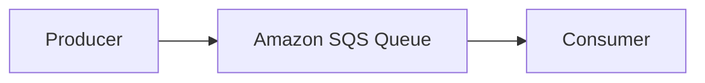

ข้อดีคือ producer ไม่ต้องรู้ว่า consumer พร้อมทำงานอยู่หรือไม่ในขณะนั้น

---

# 6. Loose Coupling with Amazon SQS

> 🖼️ *Source figure — Student Guide p.514; full screenshot is kept in the Google Drive master copy.*

Student Guide ใช้ตัวอย่าง producer application รับ order แล้วส่ง message เข้า SQS queue จากนั้น consumer tier ค่อยดึง message ไปประมวลผล

ประโยชน์ที่เน้น:

### Loose coupling

Producer และ consumer แยกจากกัน หาก consumer ช้าหรือหยุดชั่วคราว message ยังอยู่ใน queue

### Failure tolerance

ถ้าประมวลผลไม่สำเร็จ สามารถ retry ได้ และใช้ dead-letter queue สำหรับ message ที่ล้มเหลวซ้ำ ๆ

### Absorb spikes

Queue ช่วยดูดซับ traffic spikes ทำให้ backend ไม่จำเป็นต้อง scale ทันทีตามทุก request ที่เข้ามา

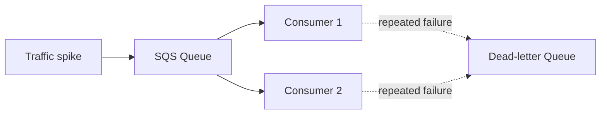

---

# 7. Amazon SQS Use Cases

> 🖼️ *Source figure — Student Guide p.515; full screenshot is kept in the Google Drive master copy.*

Student Guide ยก use cases หลัก เช่น:

- Work queues
- Buffering and batch operations
- Request offloading
- Auto scaling based on queue depth / backlog

แนวคิดคือ queue ทำให้ระบบรับ request ได้ต่อเนื่องแม้ downstream จะประมวลผลช้ากว่า

---

# 8. SQS Queue Types

> 🖼️ *Source figure — Student Guide p.516; full screenshot is kept in the Google Drive master copy.*

SQS มี queue types หลัก 2 แบบ:

## 8.1 Standard Queue

คุณสมบัติหลักใน Student Guide:

- at-least-once message delivery
- best-effort ordering
- scale สูง

ดังนั้นอาจมี duplicate message และลำดับอาจไม่ตรง 100%

เหมาะเมื่อ throughput และ scale สำคัญกว่า strict ordering

## 8.2 FIFO Queue

FIFO = First-In-First-Out

Student Guide เน้นว่า:

- preserves ordering
- รองรับ exactly-once processing semantics ตามที่บริการออกแบบไว้
- throughput มีข้อจำกัดมากกว่า Standard queue

เหมาะกับ use case ที่ลำดับ transaction สำคัญ

## 8.3 Standard vs FIFO

| ประเด็น | Standard | FIFO |
|---|---|---|
| Delivery | At least once | Exactly-once processing behavior ตาม service design |
| Ordering | Best effort | Preserved ordering |
| Throughput | สูงมาก | ต่ำกว่า Standard |
| Use case | General distributed workloads | Order-sensitive workloads |

---

# 9. Optimizing SQS Queue Configuration

> 🖼️ *Source figure — Student Guide p.517; full screenshot is kept in the Google Drive master copy.*

Student Guide เน้น 2 เรื่อง:

- Visibility timeout
- Polling type

## 9.1 Visibility Timeout

เมื่อ consumer receive message แล้ว message จะถูกซ่อนจาก consumer อื่นชั่วคราวตาม visibility timeout

ถ้า consumer ประมวลผลเสร็จและ delete message ก่อน timeout ก็จบ

ถ้า timeout หมดก่อน message ถูก delete message จะกลับมา visible และ consumer อื่นสามารถรับไปประมวลผลได้

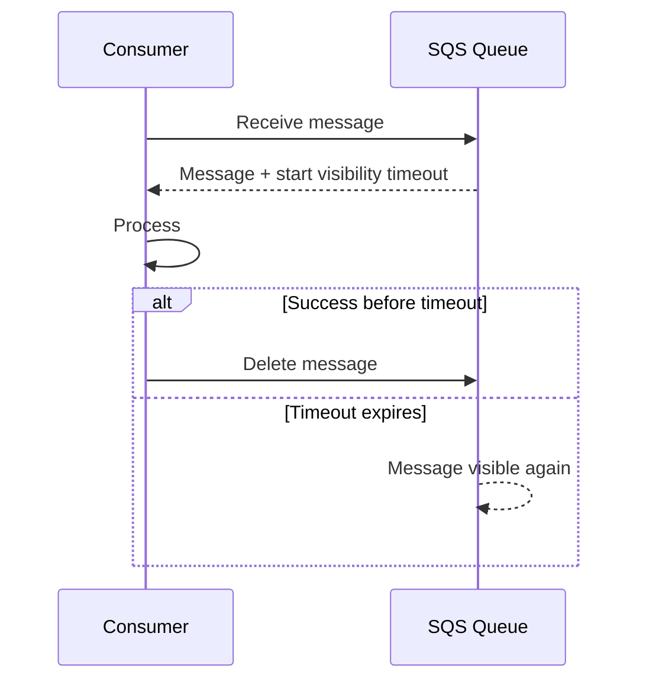

ดังนั้น visibility timeout ควรสัมพันธ์กับเวลาประมวลผลจริงของ application

## 9.2 Short Polling vs Long Polling

Student Guide เปรียบเทียบ:

### Short polling

- response เร็ว
- อาจได้ empty response มากกว่า
- ทำให้จำนวน requests เพิ่ม

### Long polling

- รอจนมี message หรือ timeout
- ลด empty responses
- ลดจำนวน polling requests และลด cost ได้

---

# 10. When to Use Message Queues

> 🖼️ *Source figure — Student Guide p.518; full screenshot is kept in the Google Drive master copy.*

Student Guide ระบุ use cases ที่เหมาะกับ message queue เช่น:

- service-to-service communication
- asynchronous work items
- state change notifications

และยก anti-pattern เช่น:

- selecting specific messages ด้วย query logic ซับซ้อน
- large messages

แนวคิดคือ queue เหมาะกับการส่ง message เพื่อให้ consumer ประมวลผล ไม่ใช่ database query engine หรือ object storage

---

# 11. Decision Guide: API Gateway vs SQS

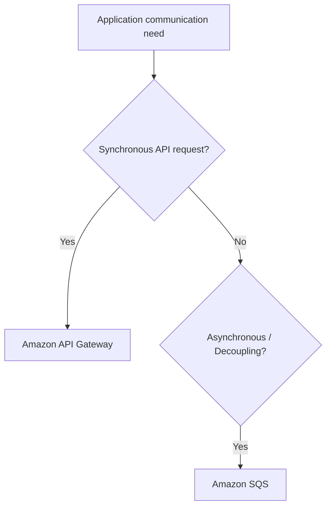

### ใช้ API Gateway เมื่อ

- ต้อง expose API ให้ client หรือ service
- ต้องการ authentication/authorization/throttling/monitoring ที่ API layer
- request-response communication เป็นหลัก

### ใช้ SQS เมื่อ

- ต้อง decouple producer/consumer
- งานประมวลผลเป็น asynchronous
- ต้อง buffer traffic spikes
- ต้องการ retry / DLQ pattern

---

# 12. สิ่งที่ควรจำจาก Part 1

1. Serverless = ลด infrastructure management และ scale แบบ managed
2. API Gateway = managed API frontend
3. SQS = durable message queue สำหรับ decoupling
4. Standard Queue = at-least-once + best-effort order
5. FIFO Queue = ordered + exactly-once processing behavior ตาม service design
6. Visibility timeout ป้องกัน consumer หลายตัวประมวลผล message เดียวพร้อมกันในช่วงเวลาหนึ่ง
7. Long polling ลด empty responses และ request cost
8. Queue เหมาะกับ async communication ไม่ใช่ query engine หรือ object storage

---

## Mini recap

```text
Expose backend API
      -> API Gateway

Decouple asynchronous workloads
      -> Amazon SQS
```

---

# Module 11: Serverless — Part 2

> Source: **Architecting on AWS 7.12.4 (EN) — Student Guide**  
> PDF pages: **519–546**  
> Scope: **Amazon SNS → Amazon Kinesis → AWS Step Functions → Review → Knowledge Check → Lab 5**

---

# 1. Amazon Simple Notification Service (Amazon SNS)

หน้า 519 เริ่มโจทย์ว่า service ใดเหมาะกับ push notifications ผ่าน email หรือ SMS

คำตอบคือ **Amazon SNS**

## 1.1 SNS Architecture

> 🖼️ *Source figure — Student Guide p.520; full screenshot is kept in the Google Drive master copy.*

SNS ใช้ publish-subscribe model

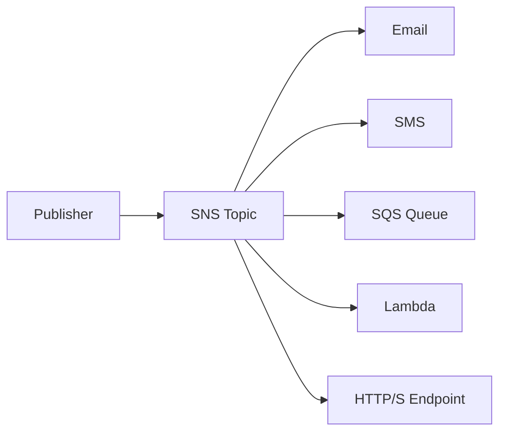

publisher ส่ง message ไป topic แล้ว SNS push message ไปยัง subscribers

จึงเหมาะกับ **one-to-many** notification pattern

---

# 2. SNS Use Cases

> 🖼️ *Source figure — Student Guide p.521; full screenshot is kept in the Google Drive master copy.*

ตัวอย่างที่ Student Guide ยก ได้แก่:

- CloudWatch alarm notifications
- Email/SMS สำหรับ mailing list
- push notifications สำหรับ application updates

จุดสำคัญคือ SNS push message ออกไปยัง subscriber หลายปลายทางได้จาก publish event เดียว

---

# 3. Characteristics of Amazon SNS

> 🖼️ *Source figure — Student Guide p.522; full screenshot is kept in the Google Drive master copy.*

Student Guide เน้นแนวคิด เช่น:

- single published message
- ไม่มี recall option หลัง publish แล้ว
- retry behavior สำหรับ HTTP/HTTPS delivery
- รองรับ Standard และ FIFO topics

โดยปกติ SNS เป็น push-based messaging service ต่างจาก SQS ที่ consumer poll message เอง

---

# 4. SNS Fan-out to Multiple SQS Queues

> 🖼️ *Source figure — Student Guide p.523; full screenshot is kept in the Google Drive master copy.*

หนึ่งใน architecture pattern สำคัญคือ:

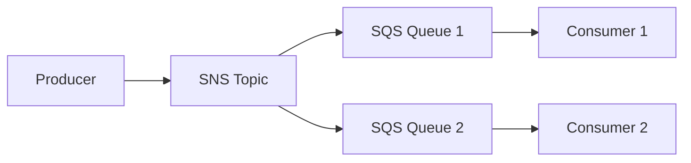

SNS ทำ fan-out และ SQS ทำ durable buffering ให้แต่ละ downstream consumer

pattern นี้เหมาะเมื่อ event เดียวต้องกระจายไปหลาย processing path

---

# 5. Amazon SNS vs Amazon SQS

> 🖼️ *Source figure — Student Guide p.524; full screenshot is kept in the Google Drive master copy.*

Student Guide เปรียบเทียบแนวคิดหลัก:

| ประเด็น | Amazon SNS | Amazon SQS |
|---|---|---|
| Message persistence | ไม่ใช่ queue storage แบบ SQS | เก็บ message จน processed/deleted |
| Delivery mechanism | Push | Poll |
| Producer/consumer model | Publisher/subscriber | Sender/receiver |
| Distribution | One-to-many | One-to-one processing flow |

จำง่าย:

> **SNS = กระจาย**  
> **SQS = คิวงาน**

---

# 6. Amazon Kinesis

หน้า 525 เปิดโจทย์ real-time streaming applications

## 6.1 Collecting and Analyzing Streaming Data

> 🖼️ *Source figure — Student Guide p.526; full screenshot is kept in the Google Drive master copy.*

Student Guide แสดง services ใน Kinesis family เช่น:

- Amazon Kinesis Data Streams
- Amazon Data Firehose
- Managed Service for Apache Flink
- Amazon Kinesis Video Streams

แนวคิดคือรับข้อมูล streaming ที่เข้ามาต่อเนื่อง เช่น:

- logs
- events
- telemetry
- clickstreams
- IoT data
- video streams

แล้ว process/analyze แบบ near-real-time หรือ real-time

---

# 7. Kinesis Data Streams

> 🖼️ *Source figure — Student Guide p.527; full screenshot is kept in the Google Drive master copy.*

Flow หลัก:

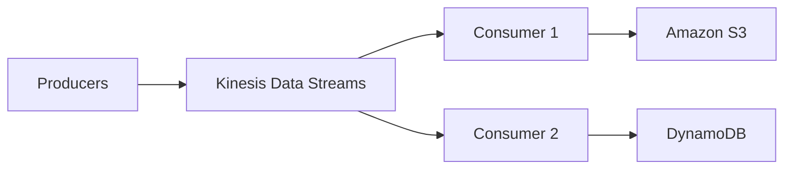

Student Guide อธิบายว่า stream ถูกแบ่งเป็น **shards** และ producer ใส่ records เข้า stream ขณะที่ consumers อ่าน records ไปประมวลผล

แนวคิดสำคัญคือ Kinesis Data Streams รองรับ continuous streaming workload ที่ต้องการ consumer processing

---

# 8. Amazon Data Firehose

> 🖼️ *Source figure — Student Guide p.528; full screenshot is kept in the Google Drive master copy.*

Data Firehose ใช้สำหรับ ingest streaming data และส่งต่อไปปลายทาง managed destinations

Student Guide แสดง flow เช่น:

```text
Producer
  -> Firehose buffering/transformation
  -> Amazon S3 / Amazon Redshift / Amazon OpenSearch Service / HTTP endpoint
```

จุดเด่นคือช่วยลดภาระดูแล consumer pipeline เองเมื่อเป้าหมายหลักคือ delivery ของ streaming data ไปยัง analytics/storage destination

---

# 9. AWS Step Functions

หน้า 529 เปิดโจทย์:

> วิธีง่ายในการ orchestrate multi-step workflows คืออะไร?

คำตอบคือ **AWS Step Functions**

## 9.1 Step Functions ทำอะไร

> 🖼️ *Source figure — Student Guide p.530; full screenshot is kept in the Google Drive master copy.*

Student Guide เน้นว่า Step Functions:

- coordinates microservices ผ่าน visual workflows
- ช่วยเดิน application ผ่านหลาย functions/steps
- automatically initiates and tracks each step
- มี error catching/logging ใน workflow

ดังนั้น Step Functions เหมาะกับ process ที่มีหลายขั้นตอนและต้องควบคุมลำดับ/branch/retry/error handling

---

# 10. State Machine

> 🖼️ *Source figure — Student Guide p.531; full screenshot is kept in the Google Drive master copy.*

Workflow ใน Step Functions ถูกนิยามเป็น **state machine**

state machine มี states หลายแบบเพื่อควบคุม flow เช่น:

- Task
- Choice
- Fail / Succeed
- Pass
- Wait
- Parallel
- Map

ภาพตัวอย่างในหนังสือใช้ vending machine ซึ่งเปลี่ยน state ตาม condition ของ transaction

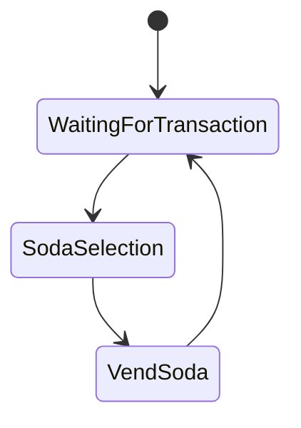

---

# 11. Orchestration of Complex Distributed Workflows

> 🖼️ *Source figure — Student Guide p.532; full screenshot is kept in the Google Drive master copy.*

Student Guide แสดง workflow ที่ Step Functions ประสานหลาย AWS services เช่น API Gateway, Lambda, DynamoDB และ SNS

ตัวอย่าง state flow ประมาณ:

```text
Start
 -> Lookup customer
 -> Generate reference
 -> Record transaction
 -> Choice
    -> Success path
    -> Failure path
 -> Notify admin
 -> End
```

ประโยชน์คือ business process ถูกมองเห็นเป็น workflow แทนที่จะซ่อนอยู่ใน code หลาย service ที่ผูกกันแน่น

---

# 12. Present Solutions — สรุป Business Request

> 🖼️ *Source figure — Student Guide p.534; full screenshot is kept in the Google Drive master copy.*

Student Guide สรุปคำตอบของ Module 11 ดังนี้:

### ลด operational overhead / optimize costs

ใช้ serverless services เพื่อไม่ต้อง manage infrastructure โดยตรง

### Secure APIs to backend services

ใช้ **Amazon API Gateway**

### Reliable service-to-service queue

ใช้ **Amazon SQS**

### Push notifications

ใช้ **Amazon SNS**

### Streaming data

ใช้ **Amazon Kinesis**

### Multi-step workflow orchestration

ใช้ **AWS Step Functions**

---

# 13. Module Review

Module 11 ครอบคลุม:

- What is serverless?
- API Gateway
- Amazon SQS
- Amazon SNS
- Amazon Kinesis
- AWS Step Functions

จากนั้นเข้าสู่ Knowledge Check และ Lab 5

---

# 14. Knowledge Check

## Question 1

**Which type of Amazon SQS queue provides at-least-once delivery?**

คำตอบ: **Standard queue**

เหตุผล: Standard queue รองรับ at-least-once message delivery และ best-effort ordering

---

## Question 2

**What is an advantage of long polling compared to short polling?**

คำตอบ: **Long polling reduces cost by reducing the number of empty responses and false empty responses**

แนวคิดคือ long polling รอ message จนกว่าจะมี message หรือหมด timeout จึงลด request ที่ไม่จำเป็น

---

## Question 3

**What is a feature of Amazon SNS?**

คำตอบ: **Amazon SNS can push messages to multiple subscribers**

นี่คือ core publish-subscribe / fan-out behavior ของ SNS

---

# 15. Lab 5: Build a Serverless Architecture

> 🖼️ *Source figure — Student Guide p.544; full screenshot is kept in the Google Drive master copy.*

Lab 5 สร้าง serverless architecture สำหรับ image-processing workflow

องค์ประกอบใน diagram ได้แก่:

- Amazon S3
- Amazon SNS
- Amazon SQS
- AWS Lambda
- CloudWatch

Flow หลัก:

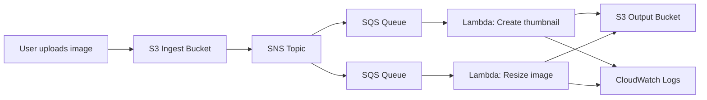

Student Guide อธิบายว่าเมื่อมี image เข้า S3 bucket จะเกิด event publish ไป SNS และ SNS fan-out ไปหลาย SQS queues แต่ละ queue trigger Lambda function ที่ทำงานต่างกัน เช่น thumbnail หรือ resize

## 15.1 Lab Tasks

> 🖼️ *Source figure — Student Guide p.545; full screenshot is kept in the Google Drive master copy.*

งานหลักใน Lab ได้แก่:

- Create standard Amazon SNS topic
- Create SQS queues
- Create event notification
- Create/configure AWS Lambda functions
- Upload object เข้า S3 bucket
- Validate expected files/output

จุดสำคัญของ Lab นี้คือเห็น architecture pattern แบบ event-driven + fan-out + asynchronous processing จริง

---

# 16. Decision Guide ของ Module 11

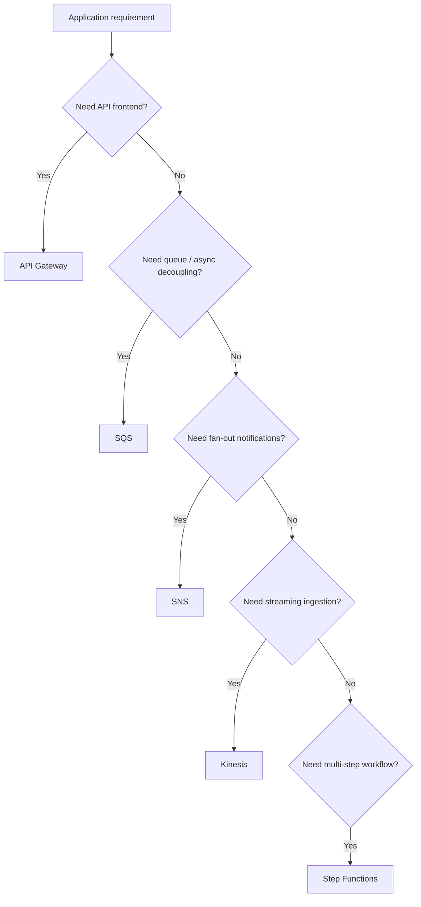

---

# 17. SNS vs SQS vs Kinesis vs Step Functions

| Service | Primary Role |
|---|---|
| SNS | Fan-out / push notifications |
| SQS | Durable message queue / decoupling |
| Kinesis | Streaming data ingestion and processing |
| Step Functions | Workflow orchestration |

จำสั้น ๆ:

```text
SNS = Broadcast
SQS = Queue
Kinesis = Stream
Step Functions = Orchestrate
```

---

# 18. สิ่งที่ควรจำจาก Module 11

1. Serverless ลดภาระ infrastructure management
2. API Gateway เป็น managed API front door
3. SQS ใช้ queue และ decouple producer/consumer
4. Standard SQS รองรับ at-least-once delivery
5. Long polling ลด empty responses
6. SNS เป็น publish-subscribe และ push ไปหลาย subscribers ได้
7. SNS + SQS เป็น fan-out + durable processing pattern ที่ใช้บ่อย
8. Kinesis ใช้กับ continuous streaming workloads
9. Data Firehose เหมาะกับ managed delivery ของ streaming data ไป destination
10. Step Functions ใช้ orchestrate multi-step workflows
11. State machine ทำให้ workflow, branching และ error handling ชัดเจนขึ้น
12. Lab 5 ผูก S3 + SNS + SQS + Lambda + CloudWatch เป็น event-driven architecture

---

## Final Mental Model

```text
Expose API
    -> API Gateway

Queue work
    -> SQS

Fan-out notification
    -> SNS

Process stream
    -> Kinesis

Coordinate workflow
    -> Step Functions
```

---

> **End of Module 11 — Serverless**
