# Module 12 — Edge Services

> Mobile reader copy combined from Part 1 + Part 2. Full source screenshots remain in Google Drive master.

# Module 12: Edge Services — Part 1

> Source: **Architecting on AWS 7.12.4 (EN) — Student Guide**  
> PDF pages: **547–570**  
> Scope: **Edge fundamentals → Amazon Route 53 → Routing policies → Amazon CloudFront fundamentals**

---

## เป้าหมายของ Part นี้

Module 12 เริ่มจากโจทย์ของ network engineer ที่ต้องการลด latency ให้ผู้ใช้ทั่วโลก, ทำ DNS ให้ highly available, ส่ง content ได้เร็วขึ้น และวางบริการไว้ใกล้ user มากขึ้นโดยไม่จำเป็นต้องย้าย workload ทั้งระบบไปทุก Region

Part 1 จึงโฟกัส 3 เรื่องหลัก:

1. AWS มี infrastructure แบบใดบ้างที่นำ compute/content เข้าใกล้ผู้ใช้
2. Amazon Route 53 ใช้จัดการ DNS และ traffic routing อย่างไร
3. Amazon CloudFront ช่วยลด latency และลด load ที่ origin อย่างไร

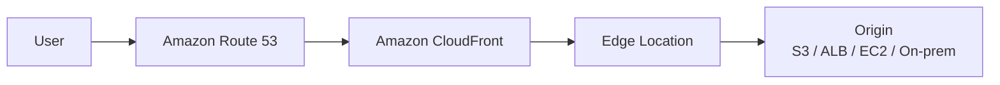

---

# 1. Edge fundamentals

## 1.1 AWS Cloud at the edge

> 🖼️ *Source figure — Student Guide p.552; full screenshot is kept in the Google Drive master copy.*

Student Guide อธิบายว่า AWS มีหลายระดับของ infrastructure ที่ช่วยนำบริการเข้าใกล้ผู้ใช้หรือข้อมูลมากขึ้น ได้แก่:

- **AWS Regions** — ศูนย์กลางหลักสำหรับ services และ workloads
- **Edge locations** — จุดให้บริการบน AWS global network สำหรับบริการอย่าง CloudFront และ Route 53
- **AWS Local Zones** — extension ของ Region ที่นำ compute/storage บางบริการเข้าใกล้ metro area
- **AWS Outposts** — นำ AWS infrastructure ไปติดตั้งใน data center ของลูกค้า
- **AWS Snow Family** — edge / disconnected / data transfer use cases บางประเภท

แนวคิดสำคัญคือ **ไม่ใช่ทุก workload ต้องย้ายไปอยู่ใกล้ user แบบเดียวกัน** แต่เลือกชั้นของ edge ให้ตรงกับ requirement เช่น latency, residency, connectivity และ operational model

### ภาพจำ

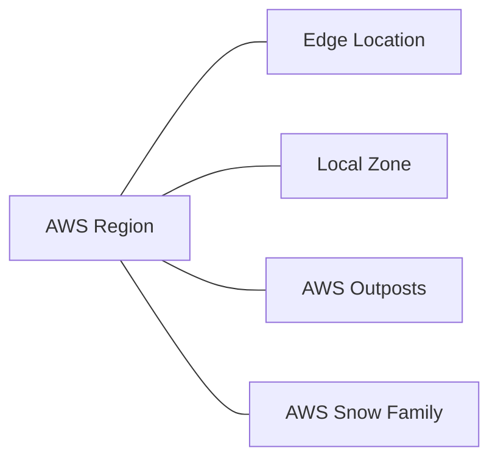

## 1.2 Edge services architecture

> 🖼️ *Source figure — Student Guide p.553; full screenshot is kept in the Google Drive master copy.*

ตัวอย่างใน Student Guide เชื่อมบริการสำคัญดังนี้:

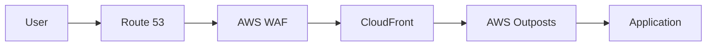

และมี **AWS Shield** ช่วยปกป้อง service ที่ public-facing ในชั้น edge

บทนี้จึงไม่ได้มอง edge แค่ในมุม “เร็วขึ้น” แต่รวมถึง:

- DNS และ traffic steering
- content delivery
- security / DDoS protection
- workload locality / data residency

---

# 2. Amazon Route 53

## 2.1 Route 53 ทำอะไร

> 🖼️ *Source figure — Student Guide p.555; full screenshot is kept in the Google Drive master copy.*

Amazon Route 53 เป็นบริการ DNS ที่ช่วย:

- resolve domain name ไปยัง IP / endpoint
- register หรือ transfer domain
- route request ตาม health check และ routing criteria
- เชื่อม user ไปยัง AWS resources หรือ external resources

Student Guide ยกตัวอย่างว่า Route 53 สามารถ route ไปยัง resource อย่าง EC2, ELB และ S3 ได้ และสามารถนำ health check มาช่วยตัดสินใจ failover ได้

ภาพจำ:

```text
example.com
   ↓ DNS query
Route 53
   ↓ routing policy + health
AWS resource / external endpoint
```

---

# 3. Public hosted zone vs Private hosted zone

> 🖼️ *Source figure — Student Guide p.556; full screenshot is kept in the Google Drive master copy.*

## Public hosted zone

ใช้กำหนดว่า traffic จาก **internet-facing DNS queries** จะถูก route ไปไหน

เหมาะกับ:

- public website
- public API
- public load balancer
- public service endpoint

## Private hosted zone

ใช้ DNS ภายใน **Amazon VPC** เพื่อ resolve private names / private resources

เหมาะกับ:

- internal application names
- private EC2 endpoints
- internal services หลาย VPC ที่มี connectivity กัน

### Mental model

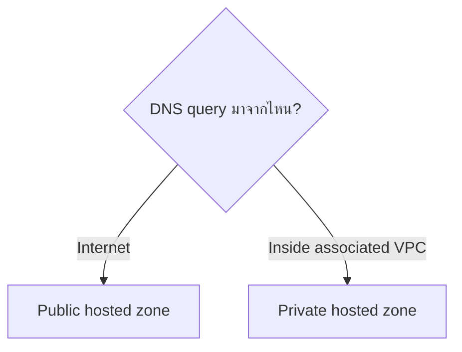

สิ่งสำคัญคือ hosted zone เป็น container ของ DNS records ที่บอก Route 53 ว่า domain/subdomain ควรตอบกลับอย่างไร

---

# 4. Route 53 routing policies

> 🖼️ *Source figure — Student Guide p.557; full screenshot is kept in the Google Drive master copy.*

Student Guide แสดง routing policies หลักดังนี้:

- Simple
- Failover
- Geolocation
- Geoproximity
- Latency-based
- Multivalue answer
- Weighted

Routing policy ไม่ได้เปลี่ยน DNS ให้กลายเป็น load balancer แต่เป็น **logic ที่กำหนดว่า Route 53 ควรตอบ DNS query ด้วย record ไหน**

---

# 5. Simple routing

Simple routing ใช้เมื่อมี resource หลักเพียงชุดเดียวและไม่ต้องตัดสินใจตาม health/location/weight

ตัวอย่าง:

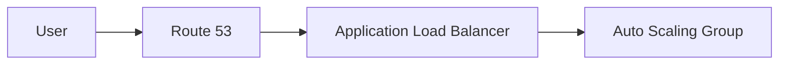

เหมาะกับ architecture ที่ routing decision ตรงไปตรงมา

---

# 6. Failover routing

> 🖼️ *Source figure — Student Guide p.559; full screenshot is kept in the Google Drive master copy.*

Failover routing ใช้สร้าง active-passive DNS failover

แนวคิด:

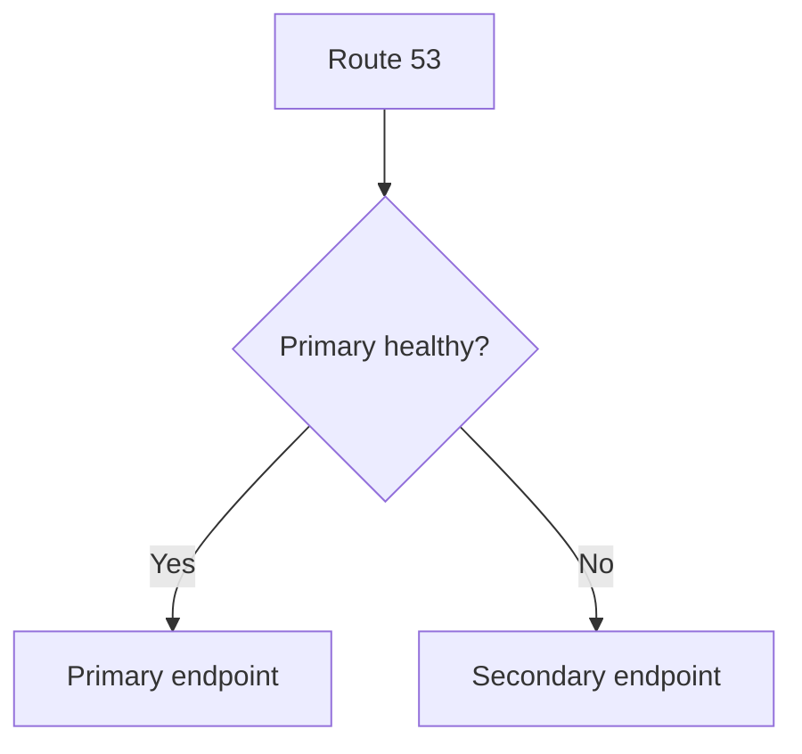

Health check สามารถ monitor เช่น:

- health ของ endpoint
- health ของ referenced health check
- CloudWatch alarm state

เมื่อ primary ไม่ healthy Route 53 สามารถตอบ DNS ด้วย secondary record แทนได้

### ใช้เมื่อ

- ต้องการ DR แบบ active-passive
- มี primary site และ recovery site
- ต้องการ DNS-level failover

---

# 7. Geolocation routing

> 🖼️ *Source figure — Student Guide p.560; full screenshot is kept in the Google Drive master copy.*

Geolocation routing เลือก resource ตาม **location ของผู้ใช้**

ตัวอย่าง:

- Europe users → Europe endpoint
- US users → US endpoint

เหมาะกับกรณีเช่น:

- localization
- regulatory/geographic constraints
- content ที่แตกต่างกันตามประเทศ/ทวีป

จำให้ชัดว่า geolocation ถามว่า:

> **“ผู้ใช้อยู่ที่ไหน?”**

---

# 8. Geoproximity routing

> 🖼️ *Source figure — Student Guide p.561; full screenshot is kept in the Google Drive master copy.*

Geoproximity routing route traffic ตามตำแหน่งทางภูมิศาสตร์ของทั้ง **users และ resources** และสามารถใช้ค่า **bias** เพื่อขยายหรือหดพื้นที่ที่ resource หนึ่งจะรับ traffic

ภาพจำ:

```text
Bias เพิ่ม   → resource นั้นดึง traffic จากพื้นที่กว้างขึ้น
Bias ลด     → resource นั้นรับ traffic จากพื้นที่แคบลง
```

เหมาะกับ architecture ที่ต้องการควบคุม traffic distribution ตาม geographic proximity มากกว่าแบ่งตาม country/continent แบบตรง ๆ

---

# 9. Latency-based routing

> 🖼️ *Source figure — Student Guide p.562; full screenshot is kept in the Google Drive master copy.*

Latency-based routing ใช้เมื่อ application deploy หลาย AWS Regions และต้องการส่ง user ไปยัง Region ที่ให้ **lowest latency** ตามข้อมูล latency ที่ AWS วัดได้

จำให้ชัดว่า latency-based routing ถามว่า:

> **“Region ไหนตอบผู้ใช้นี้ได้เร็วที่สุด?”**

ไม่ใช่ “Region ไหนอยู่ใกล้ที่สุดทางภูมิศาสตร์” เสมอไป เพราะ network path จริงอาจต่างกัน

---

# 10. Multivalue answer routing

Multivalue answer routing สามารถตอบ DNS query ด้วยหลาย IP / records และสามารถผูก health checks กับ record เหล่านั้นได้

ประโยชน์:

- กระจาย response หลาย endpoint
- ตัด unhealthy record ออกจากคำตอบได้
- เพิ่ม availability ระดับ DNS

แต่ Student Guide เน้นว่า **ไม่ใช่ตัวแทนของ load balancer**

---

# 11. Weighted routing

> 🖼️ *Source figure — Student Guide p.564; full screenshot is kept in the Google Drive master copy.*

Weighted routing แบ่ง traffic ตามสัดส่วนที่กำหนด เช่น:

```text
Production A = 90
Production B = 10
```

จึงเหมาะกับ:

- blue/green rollout
- canary-like traffic shifting
- gradual migration
- A/B style traffic distribution

ตัวอย่าง flow:

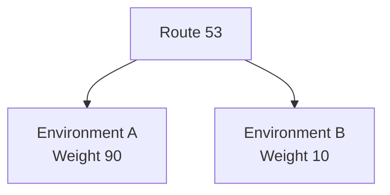

---

# 12. Routing policy decision guide

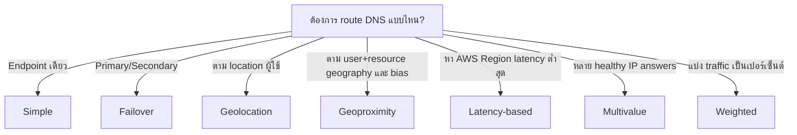

---

# 13. Amazon CloudFront

หน้า 565 เปลี่ยนจาก DNS ไปยังโจทย์ content delivery

## 13.1 Content Delivery Network (CDN)

> 🖼️ *Source figure — Student Guide p.566; full screenshot is kept in the Google Drive master copy.*

CDN ช่วย cache content ไว้ใกล้ผู้ใช้ผ่าน edge locations เพื่อลดการวิ่งกลับไป origin ทุกครั้ง

ผลลัพธ์หลัก:

- latency ต่ำลง
- response เร็วขึ้น
- origin load ลดลง
- global content delivery มีประสิทธิภาพขึ้น

---

# 14. CloudFront overview

> 🖼️ *Source figure — Student Guide p.567; full screenshot is kept in the Google Drive master copy.*

Student Guide แสดง CloudFront เป็น global CDN ที่:

- รองรับ static และ dynamic content
- integrate กับ AWS services หลายตัว
- มี security features ในตัวและ integrate กับ AWS Shield / AWS WAF
- ใช้ edge locations / Regional edge caches เพื่อลด latency

CloudFront origin สามารถเป็นได้ เช่น:

- Amazon S3 bucket
- Elastic Load Balancer
- EC2 / HTTP server
- on-premises web server

---

# 15. Edge caching

> 🖼️ *Source figure — Student Guide p.568; full screenshot is kept in the Google Drive master copy.*

หลักการ:

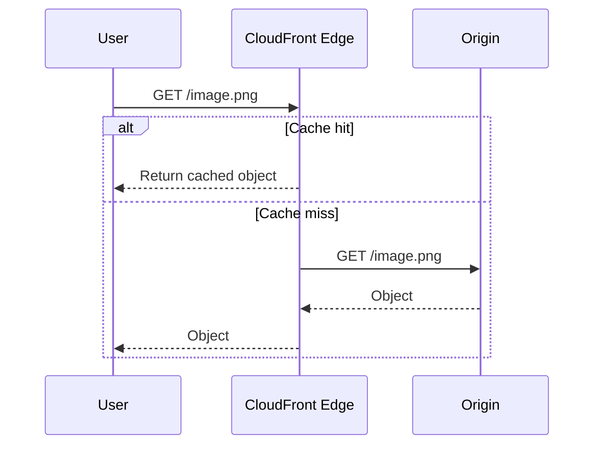

ข้อดีของ cache hit คือ request ไม่ต้องย้อนกลับไป origin จึงลดทั้ง latency และ backend load

---

# 16. CloudFront caching steps

> 🖼️ *Source figure — Student Guide p.569; full screenshot is kept in the Google Drive master copy.*

Student Guide สรุป flow ของ cache miss โดยประมาณ:

1. request ถูก route ไป edge location
2. edge ตรวจแล้วไม่พบ valid cached object
3. edge request object จาก origin
4. origin ส่ง object กลับมา
5. edge cache object และส่งต่อให้ user

ถ้า object ยังอยู่ใน TTL และ cache hit ขั้นตอนที่ต้องเรียก origin จะถูกข้าม

---

# 17. Configuring CloudFront

> 🖼️ *Source figure — Student Guide p.570; full screenshot is kept in the Google Drive master copy.*

แนวคิดการ configure distribution:

1. **Choose origin**
2. **Create distribution**
3. กำหนด cache behavior / path patterns / protocol / TTL / cache key settings
4. Optional: ผูก security และ domain-related settings เพิ่มเติม

CloudFront distribution เป็น logical configuration ที่บอก AWS ว่า content ต้องดึงจาก origin ไหนและให้ edge จัดการ request อย่างไร

---

# 18. Route 53 vs CloudFront — อย่าสับสน

| Service | หน้าที่หลัก | คำถามที่มันตอบ |
|---|---|---|
| Route 53 | DNS + routing policy | “DNS query นี้ควรตอบ endpoint ไหน?” |
| CloudFront | CDN + edge caching | “content นี้ควรส่งจาก edge ไหน และต้องกลับ origin หรือไม่?” |

Route 53 และ CloudFront จึงมักทำงาน **ร่วมกัน** ไม่ใช่แทนกัน

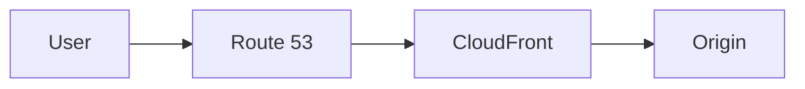

---

# 19. สิ่งที่ควรจำจาก Part 1

- Edge architecture ไม่ได้มีแค่ CloudFront; AWS มี Region, Edge Location, Local Zone, Outposts และ Snow Family
- Route 53 เป็น DNS service ที่มี routing logic หลายแบบ
- Public hosted zone ใช้กับ internet DNS; Private hosted zone ใช้ DNS ภายใน VPC
- **Failover = active/passive**
- **Geolocation = ดู location ของ user**
- **Geoproximity = user + resource geography และ bias**
- **Latency-based = เลือก Region ที่ latency ต่ำ**
- **Weighted = แบ่ง traffic ตาม weight**
- Multivalue answer ช่วยตอบหลาย healthy records แต่ไม่ใช่ load balancer
- CloudFront เป็น CDN ที่ใช้ edge cache เพื่อลด latency และ origin load
- Route 53 ตัดสินใจ “ไปไหน”; CloudFront ช่วย “ส่ง content อย่างไรให้เร็วขึ้น”

---

## End of Part 1

Part 2 จะต่อจาก **CloudFront performance optimization → DDoS protection → AWS Shield → AWS WAF → Firewall Manager → AWS Outposts → Knowledge Check → Lab 6**

---

# Module 12: Edge Services — Part 2

> Source: **Architecting on AWS 7.12.4 (EN) — Student Guide**  
> PDF pages: **571–602**  
> Scope: **CloudFront performance → DDoS protection → AWS Shield / WAF / Firewall Manager → AWS Outposts → Review → Knowledge Check → Lab 6**

---

## เป้าหมายของ Part นี้

Part 2 ขยายจาก “ส่ง traffic/content ได้เร็ว” ไปสู่ “ทำอย่างไรให้ edge architecture ปลอดภัยและรองรับ requirement ที่ต้องวาง workload ในสถานที่ขององค์กร”

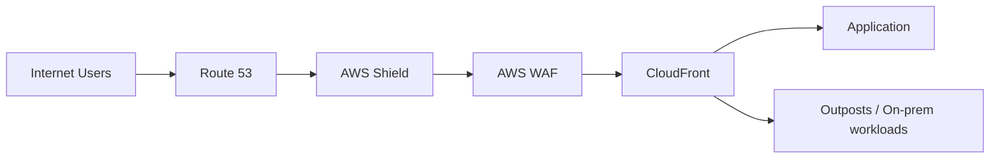

---

# 1. Improving CloudFront performance

> 🖼️ *Source figure — Student Guide p.571; full screenshot is kept in the Google Drive master copy.*

Student Guide แบ่งสิ่งที่ AWS ทำให้และสิ่งที่ architect ควรปรับเอง

## สิ่งที่ AWS/CloudFront ช่วย

- TCP optimization
- TLS 1.3 support
- dynamic content placement

## สิ่งที่เราต้องออกแบบ

- caching strategy
- cache hit ratio
- CloudFront Origin Shield

### หลักคิด

CloudFront จะคุ้มที่สุดเมื่อ cache key, TTL และ behavior ถูกออกแบบให้ตรง workload

ถ้า config cache ไม่เหมาะ:

- cache miss เยอะ
- edge ต้องกลับ origin บ่อย
- latency และ origin load สูงขึ้น

---

# 2. DDoS protection

## 2.1 DDoS คืออะไร

> 🖼️ *Source figure — Student Guide p.573; full screenshot is kept in the Google Drive master copy.*

Distributed Denial of Service (DDoS) attack ใช้หลาย compromised systems ส่ง traffic ปริมาณมากไปยัง target เพื่อทำให้ resource ถูกใช้จน legitimate users เข้าใช้งานไม่ได้

ภาพจำ:

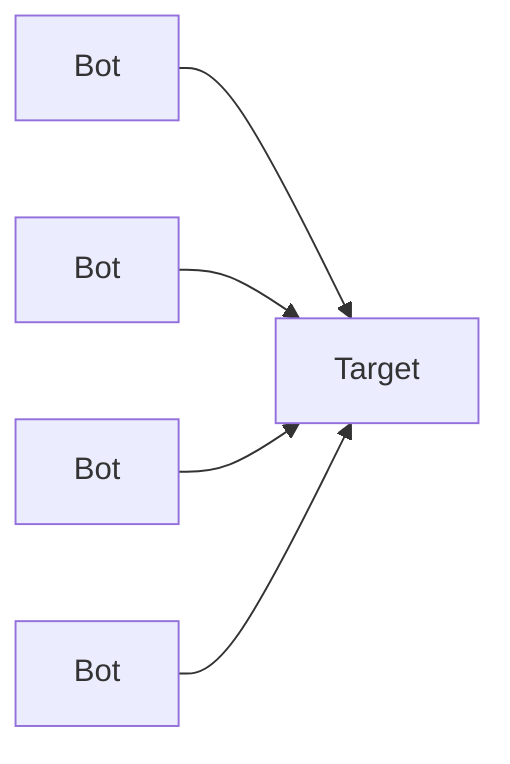

---

# 3. DDoS attacks by OSI layer

> 🖼️ *Source figure — Student Guide p.574; full screenshot is kept in the Google Drive master copy.*

Student Guide แบ่งโจมตีตาม OSI layer โดยเน้นว่า DDoS สามารถเกิดได้หลายระดับ เช่น:

- Network layer
- Transport layer
- Application layer
- Presentation layer

ตัวอย่างภาพรวม:

```text
L3/L4 → flood / protocol-level attacks
L7    → abuse application requests / HTTP-level behavior
```

เหตุผลที่ต้องเข้าใจ layer คือ protection service แต่ละตัวครอบคลุมคนละส่วน

---

# 4. AWS Shield

> 🖼️ *Source figure — Student Guide p.575; full screenshot is kept in the Google Drive master copy.*

AWS Shield เป็น managed DDoS protection service

## Shield Standard

- มี protection พื้นฐานต่อ common infrastructure attacks
- ถูกนำมาใช้กับบริการ AWS ที่รองรับโดยอัตโนมัติ
- เน้น network / transport layer protection

## Shield Advanced

ใช้เมื่อ application ต้องการ protection และ visibility มากขึ้น รวมถึง integration กับ service อย่าง AWS WAF

### Mental model

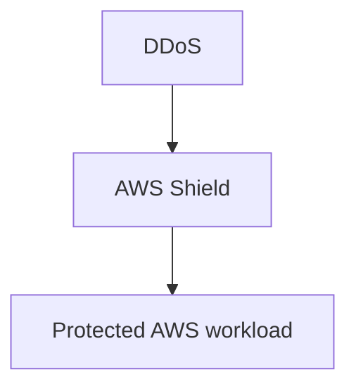

---

# 5. AWS WAF

> 🖼️ *Source figure — Student Guide p.576; full screenshot is kept in the Google Drive master copy.*

AWS WAF เป็น web application firewall สำหรับควบคุม HTTP(S) request ตาม rule ที่กำหนด

ตัวอย่าง threat/application patterns ที่ WAF ช่วยกรองได้:

- SQL injection patterns
- cross-site scripting (XSS)
- request patterns ที่ไม่ต้องการ
- IP / geographic / rate-based filtering ตาม rule

Student Guide แสดง WAF สามารถ protect services เช่น:

- CloudFront
- Application Load Balancer
- Amazon API Gateway
- AWS AppSync
- Amazon Cognito user pools

---

# 6. AWS WAF access control components

> 🖼️ *Source figure — Student Guide p.577; full screenshot is kept in the Google Drive master copy.*

องค์ประกอบสำคัญ:

- **Web ACL** — container ของ rules สำหรับ resource ที่ protect
- **Rules** — กำหนด criteria และ action
- **Rule groups** — รวมหลาย rules
- **Rule statements** — logic ที่ใช้ตรวจ request
- **IP sets** — กลุ่ม IP addresses / ranges
- **Regex pattern sets** — กลุ่ม regex patterns
- **Monitoring and logging** — integrate กับ CloudWatch และ log destinations ที่รองรับ

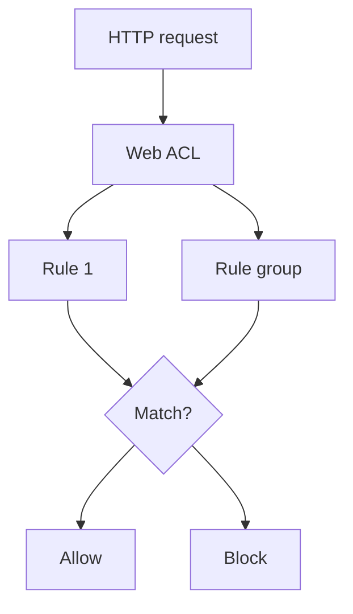

---

# 7. ACL rule statements

> 🖼️ *Source figure — Student Guide p.578; full screenshot is kept in the Google Drive master copy.*

Student Guide แสดง statement categories เช่น:

- attack prevention
- traffic filtering
- pattern matching
- logical operations

ตัวอย่าง rule logic:

```text
IF source IP in blocked-set
   OR request matches malicious regex
   OR request rate exceeds threshold
THEN block / count / challenge according to configured action
```

ข้อสำคัญคือ Web ACL ใช้ rule statements หลายแบบประกอบกันเพื่อสร้าง policy ที่ละเอียดได้

---

# 8. AWS Firewall Manager

> 🖼️ *Source figure — Student Guide p.579; full screenshot is kept in the Google Drive master copy.*

AWS Firewall Manager ช่วย centralize security policy management ใน environment ที่มีหลาย accounts/resources

Student Guide แสดงการบริหาร service เช่น:

- AWS WAF
- Amazon VPC security groups
- AWS Shield Advanced
- AWS Network Firewall
- VPC Network Access Analyzer-related controls ตาม use case ที่รองรับ

## Use cases หลัก

- มี accounts/resources จำนวนมาก
- มี applications ใหม่ถูกสร้างตลอด
- ต้องการ organization-wide visibility และ consistent protection

### ภาพจำ

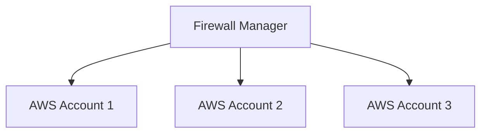

แทนที่จะ configure security policy แยกทีละ account Firewall Manager ช่วยบังคับ baseline จากศูนย์กลาง

---

# 9. DDoS-resilient reference architecture

> 🖼️ *Source figure — Student Guide p.581; full screenshot is kept in the Google Drive master copy.*

แนวคิดที่ Student Guide ต้องการให้เห็นคือ **layered defense**

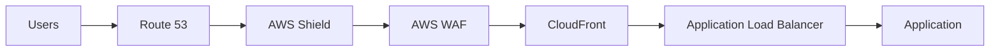

- Route 53 / CloudFront ใช้ global edge footprint
- Shield รับมือ DDoS บางประเภท
- WAF inspect application-layer request
- ALB / Auto Scaling ช่วยรับ load ตาม architecture

ไม่มี service เดียวแก้ DDoS ทุกชนิดได้ จึงต้องออกแบบหลายชั้น

---

# 10. AWS Outposts

หน้า 582 เปลี่ยนโจทย์ไปยัง requirement ที่ workload ต้องอยู่ on premises เพราะ latency / residency / local processing

## 10.1 Outposts family

> 🖼️ *Source figure — Student Guide p.583; full screenshot is kept in the Google Drive master copy.*

AWS Outposts นำ AWS infrastructure และ services บางส่วนไปติดตั้งใน customer location

เหมาะกับ:

- ultra-low latency ไปยัง on-prem systems
- data residency / local processing requirements
- workload ที่ต้องทำงานใกล้ local equipment
- hybrid architecture ที่ต้องการ AWS APIs/tooling เหมือนกับใน Region

---

# 11. Outposts rack vs Outposts servers

> 🖼️ *Source figure — Student Guide p.584; full screenshot is kept in the Google Drive master copy.*

## Outposts rack

- rack-scale deployment
- capacity และ service options มากกว่า
- เหมาะกับ site ที่มี infrastructure รองรับ rack deployment

## Outposts servers

- footprint เล็กกว่า
- ติดตั้งใน rack ที่ลูกค้ามีอยู่
- เหมาะกับสถานที่ที่มี space constraint

### Decision guide

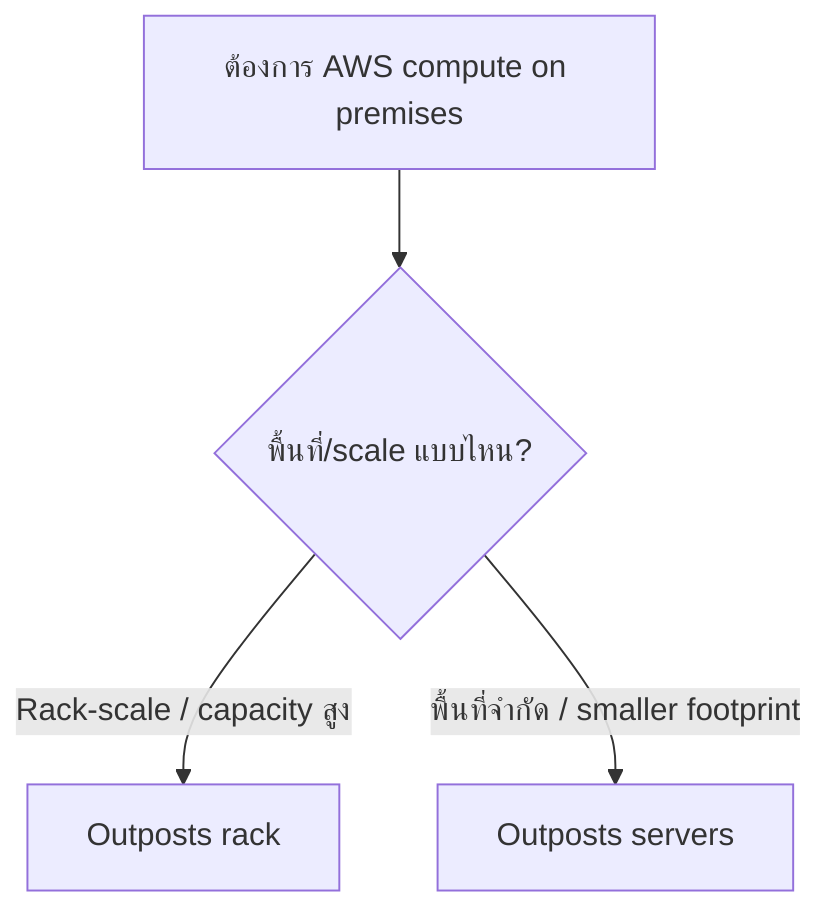

---

# 12. Outposts extend your VPC

> 🖼️ *Source figure — Student Guide p.585; full screenshot is kept in the Google Drive master copy.*

Outposts สามารถ extend VPC จาก AWS Region ลงมาที่ on-prem location ผ่าน **Outpost subnet**

แนวคิด:

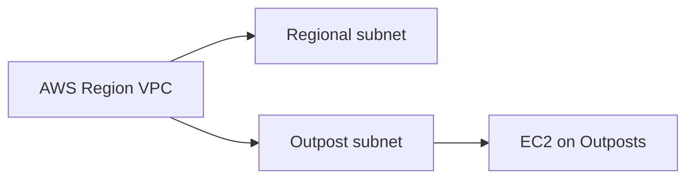

นี่ทำให้ architecture สามารถใช้ networking model เดิมของ VPC ต่อเนื่องลงมาที่ customer site

---

# 13. AWS resources on Outposts

> 🖼️ *Source figure — Student Guide p.586; full screenshot is kept in the Google Drive master copy.*

Student Guide แสดงบริการที่สามารถมี resource บน Outposts ได้บางส่วน เช่น:

- Amazon EC2
- Amazon EBS
- Amazon S3 (ตามรูปแบบ/ความพร้อมของ service)
- Amazon VPC
- Application Load Balancer
- Amazon Route 53-related integration
- Amazon RDS
- Amazon EMR
- Amazon ElastiCache
- Amazon ECS
- Amazon EKS

**Service availability ต้องตรวจตาม Outposts configuration และ Region ปัจจุบัน**; ใน Note นี้ยึดรายการตาม Student Guide เท่านั้น

---

# 14. Present solutions — สรุปโจทย์ network engineer

> 🖼️ *Source figure — Student Guide p.588; full screenshot is kept in the Google Drive master copy.*

Student Guide ให้กลับมาตอบ business request เดิม:

- DNS ที่ highly available/scalable → **Amazon Route 53**
- content delivery → **Amazon CloudFront**
- protect public-facing applications → **AWS Shield + AWS WAF**
- on-prem latency/residency needs → **AWS Outposts**

ภาพจำทั้งบท:

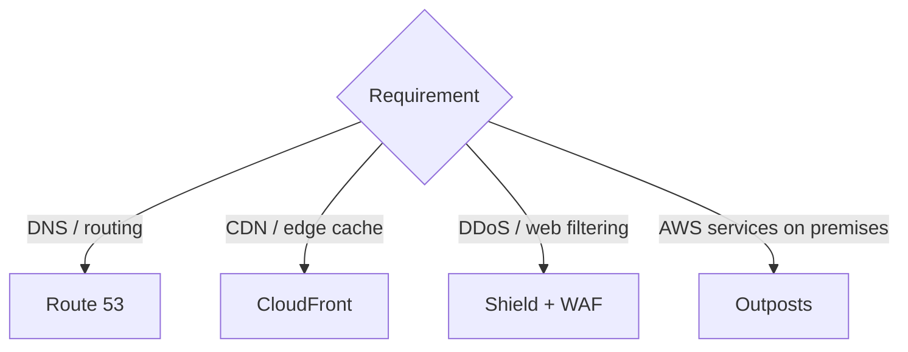

---

# 15. Module 12 Knowledge Check

## Question 1 — CloudFront benefits (Select TWO)

Student Guide เฉลย:

- **A. Increased application security**
- **D. Reduced latency for access to application content**

เหตุผล: CloudFront integrate กับ Shield/WAF และใช้ global CDN/edge caching เพื่อลด latency

## Question 2 — DDoS protection services (Select TWO)

Student Guide เฉลย:

- **D. AWS Shield**
- **E. AWS WAF**

Shield เน้น managed DDoS protection ส่วน WAF ช่วย filter web requests ตาม rule

## Question 3 — Route 80% traffic to ap-southeast-2 and 20% to eu-west-1

Student Guide เฉลย:

- **B. Weighted routing**

เพราะ weighted policy กำหนดสัดส่วน DNS responses ตาม weight ได้

## Question 4 — Benefit of Outposts servers compared with rack

Student Guide เฉลย:

- **C. A rack-mountable server is available in a location with space constraints**

---

# 16. Lab 6 — Configure CloudFront with an Amazon S3 Origin

> 🖼️ *Source figure — Student Guide p.600; full screenshot is kept in the Google Drive master copy.*

Lab 6 ใช้ architecture ที่มี VPC แบบ Multi-AZ และเพิ่ม CloudFront distributions โดยหนึ่ง origin เป็น **S3 bucket**

Student Guide ระบุ tasks หลักประมาณนี้:

1. Explore an existing CloudFront distribution
2. Create an Amazon S3 bucket
3. Configure S3 bucket for public access ตามขั้นตอน lab
4. Upload object และ test access
5. Add bucket as additional origin to distribution
6. Secure bucket with a CloudFront origin access identity / lab-specified access mechanism
7. Test direct access behavior
8. Test object through CloudFront distribution

### Lab mental model

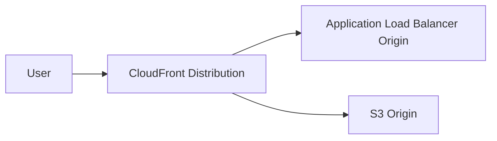

สิ่งที่ควรจับจาก lab ไม่ใช่แค่คลิก console แต่คือ:

- CloudFront หนึ่ง distribution มีหลาย origins ได้
- path / behavior สามารถเลือกว่าจะส่ง request ไป origin ไหน
- origin access ต้องออกแบบให้ user เข้าผ่าน CloudFront ตามที่ต้องการแทน direct access

---

# 17. สิ่งที่ควรจำจาก Module 12

- Route 53 = DNS + traffic steering
- CloudFront = CDN + edge cache
- Shield = managed DDoS protection
- WAF = inspect/filter HTTP(S) request ตาม rule
- Firewall Manager = centralize security policies across accounts/resources
- Outposts = AWS infrastructure/services on premises
- CloudFront performance ขึ้นกับ cache design ไม่ใช่เปิด distribution แล้วเร็วที่สุดโดยอัตโนมัติ
- DDoS protection ควรเป็น layered architecture
- Weighted Route 53 เหมาะกับ percent-based traffic split
- Outposts ใช้เมื่อ latency/residency/local processing เป็น requirement สำคัญ

---

## End of Module 12

หน้าถัดไปเริ่ม **Module 13: Backup and Recovery**
