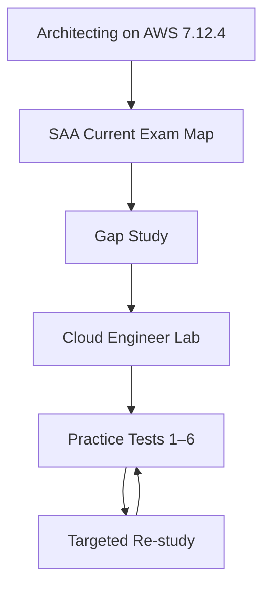

# AWS Certified Solutions Architect – Associate (SAA-C03) — Certification Hub 🌩️

> **Status:** Review — integrated study hub; current objective-level QA still pending  
> **Last repository review:** 2026-10-06  
> **Current official scope checked:** AWS SAA-C03 Exam Guide, 2026-10-06  
> **Target learner:** ผู้ที่ต้องการเรียน theory → hands-on → practice เป็นระบบเดียว  
> **Not claimed yet:** 100% current objective-level coverage

[Back to AWS Learning Library](../../README.md)

This package is now the **canonical SAA-C03 study hub** for the repository. It does not duplicate the long-form AWS course or the project track; it connects them into one certification-focused learning path.

## Start here

1. [Integrated Study Path](./STUDY-PATH.md) — ลำดับเรียนทั้งระบบ
2. [Current Exam Guide Map](./EXAM-GUIDE-MAP.md) — 4 domains → course modules → projects
3. [Architecting on AWS 7.12.4](../../Courses/Architecting-on-AWS-7.12.4/) — long-form theory foundation
4. [Cloud Engineer Lab](../../Projects/Cloud-Engineer-Lab/) — hands-on reinforcement
5. [Practice Exam Walkthroughs](./practice-exam/) — six detailed practice sets

## Current SAA-C03 domains

The current official guide uses four domains:

- **Design Secure Architectures — 30%**
- **Design Resilient Architectures — 26%**
- **Design High-Performing Architectures — 24%**
- **Design Cost-Optimized Architectures — 20%**

See [`EXAM-GUIDE-MAP.md`](./EXAM-GUIDE-MAP.md) for repository mappings.

## How the pieces fit together

### Course layer

[`../../Courses/Architecting-on-AWS-7.12.4/`](../../Courses/Architecting-on-AWS-7.12.4/) remains a versioned course package with its own source identity. It provides the strongest long-form explanation base for architecture fundamentals, security, networking, compute, storage, database, scaling, containers, serverless, edge and recovery.

### Hands-on layer

[`../../Projects/Cloud-Engineer-Lab/`](../../Projects/Cloud-Engineer-Lab/) adds real implementation, failure testing and production-oriented practice. It is broader than the SAA exam, so use the selected project mapping in `STUDY-PATH.md` rather than treating every project as exam-required.

### Practice layer

| Exam | File | Status |
| :--- | :--- | :--- |
| Practice Test 1 | [Full Explanation](./practice-exam/AWS_SAA_Test_1_Full_Explanation.md) | ✅ Completed |
| Practice Test 2 | [Full Explanation](./practice-exam/AWS_SAA_Test_2_Full_Explanation.md) | ✅ Completed |
| Practice Test 3 | [Full Explanation](./practice-exam/AWS_SAA_Test_3_Full_Explanation.md) | ✅ Completed |
| Practice Test 4 | [Full Explanation](./practice-exam/AWS_SAA_Test_4_Full_Explanation.md) | ✅ Completed |
| Practice Test 5 | [Full Explanation](./practice-exam/AWS_SAA_Test_5_Full_Explanation.md) | ✅ Completed |
| Practice Test 6 | [Full Explanation](./practice-exam/AWS_SAA_Test_6_Full_Explanation.md) | ✅ Completed |

## Why the AWS course and certification are not physically merged

They have different sources and freshness rules:

- **Architecting on AWS 7.12.4** is source-ingestion content tied to a specific course version.
- **SAA-C03** is Internet-first/current-scope certification content tied to a changing AWS exam guide.

The correct architecture is **one learner journey, separate source packages**. This preserves provenance and prevents current exam changes from silently rewriting what the older course originally taught.

## Quality / provenance note

Before any public release, review redistribution rights for third-party practice-question wording. The preferred long-term practice bank is original repository-authored scenarios mapped to the current exam guide.

## Next maturity step

To upgrade this hub to `Verified`:

1. freeze the current official SAA-C03 objective inventory,
2. map every current knowledge/skill bullet to concrete teaching content,
3. identify gaps not sufficiently covered by the 7.12.4 course,
4. write current-scope supplements without rewriting course provenance,
5. add original exam scenarios for gap areas,
6. create `QA-MATRIX.md`,
7. pass [`docs/QUALITY-GATE.md`](../../../docs/QUALITY-GATE.md).
