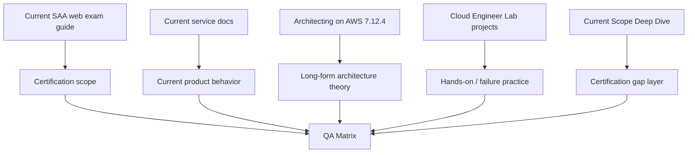

# SAA-C03 Sources & Freshness Policy

[Back to SAA Hub](./README.md) · [QA Matrix](./QA-MATRIX.md) · [Current Scope Deep Dive](./CURRENT-SCOPE-DEEP-DIVE.md)

> **Last verified:** 2026-10-06

## Primary source of truth

AWS now publishes certification exam guides as web-based AWS Documentation and explicitly positions those pages as the current guide source.

Use these pages first:

- Main SAA-C03 Exam Guide: https://docs.aws.amazon.com/aws-certification/latest/solutions-architect-associate-03.html
- Domain 1 — Secure Architectures: https://docs.aws.amazon.com/aws-certification/latest/solutions-architect-associate-03/solutions-architect-associate-03-domain1.html
- Domain 2 — Resilient Architectures: https://docs.aws.amazon.com/aws-certification/latest/solutions-architect-associate-03/solutions-architect-associate-03-domain2.html
- Domain 3 — High-Performing Architectures: https://docs.aws.amazon.com/aws-certification/latest/solutions-architect-associate-03/solutions-architect-associate-03-domain3.html
- Domain 4 — Cost-Optimized Architectures: https://docs.aws.amazon.com/aws-certification/latest/solutions-architect-associate-03/solutions-architect-associate-03-domain4.html
- In-scope services: https://docs.aws.amazon.com/aws-certification/latest/solutions-architect-associate-03/saa-03-in-scope-services.html
- Out-of-scope services: https://docs.aws.amazon.com/aws-certification/latest/solutions-architect-associate-03/saa-03-out-of-scope-services.html
- Technologies/concepts: https://docs.aws.amazon.com/aws-certification/latest/solutions-architect-associate-03/saa-technologies-concepts.html

The downloadable PDF is useful as an offline snapshot, but the web guide should be rechecked because AWS can update the guide while keeping the same exam series code.

## Scope snapshot used by this repository

On 2026-10-06 the current guide contains:

- Domain 1 — Design Secure Architectures: 30%
- Domain 2 — Design Resilient Architectures: 26%
- Domain 3 — Design High-Performing Architectures: 24%
- Domain 4 — Design Cost-Optimized Architectures: 20%
- 14 task statements total
- 189 published Knowledge/Skill bullets total

The in-scope service list is explicitly non-exhaustive and subject to change. Therefore the repository tracks objective-bullet coverage separately from “all possible service coverage.”

## Current service documentation used for gap topics

When the older Architecting course does not explain a current objective deeply enough, verify against current AWS service documentation.

### Multi-account / identity

- AWS Control Tower: https://docs.aws.amazon.com/controltower/latest/userguide/
- IAM Identity Center: https://docs.aws.amazon.com/singlesignon/latest/userguide/what-is.html
- IAM best practices: https://docs.aws.amazon.com/IAM/latest/UserGuide/best-practices.html
- AWS Organizations: https://docs.aws.amazon.com/organizations/latest/userguide/orgs_introduction.html

### Security

- Amazon Cognito: https://docs.aws.amazon.com/cognito/
- Amazon GuardDuty: https://docs.aws.amazon.com/guardduty/
- Amazon Macie: https://docs.aws.amazon.com/macie/
- AWS Secrets Manager: https://docs.aws.amazon.com/secretsmanager/
- AWS KMS: https://docs.aws.amazon.com/kms/
- AWS Certificate Manager: https://docs.aws.amazon.com/acm/
- AWS WAF / Shield: https://docs.aws.amazon.com/waf/

### Resilience / observability

- Amazon RDS Proxy: https://docs.aws.amazon.com/AmazonRDS/latest/UserGuide/rds-proxy.html
- AWS X-Ray: https://docs.aws.amazon.com/xray/
- AWS Service Quotas: https://docs.aws.amazon.com/servicequotas/

### Data / analytics

- AWS Glue: https://docs.aws.amazon.com/glue/
- AWS Lake Formation: https://docs.aws.amazon.com/lake-formation/
- Amazon Athena: https://docs.aws.amazon.com/athena/
- Amazon EMR: https://docs.aws.amazon.com/emr/
- Amazon Kinesis: https://docs.aws.amazon.com/streams/latest/dev/introduction.html
- Amazon Data Firehose: https://docs.aws.amazon.com/firehose/
- AWS DataSync: https://docs.aws.amazon.com/datasync/
- AWS Storage Gateway: https://docs.aws.amazon.com/storagegateway/
- AWS Transfer Family: https://docs.aws.amazon.com/transfer/
- Amazon Quick documentation: https://docs.aws.amazon.com/quick/

### Cost

- AWS Cost Management: https://docs.aws.amazon.com/cost-management/
- AWS Cost Explorer: https://docs.aws.amazon.com/cost-management/latest/userguide/ce-what-is.html
- AWS Budgets: https://docs.aws.amazon.com/cost-management/latest/userguide/budgets-managing-costs.html

## Source roles inside the learning system

## Revalidation rule

Re-run SAA objective QA when any of these happen:

1. AWS changes the exam series code,
2. a web-guide domain/task/Knowledge/Skill bullet changes,
3. the in-scope service list changes materially,
4. a service used by a core decision pattern is renamed/deprecated/replaced,
5. more than 90 days have passed before a serious exam-prep cycle and freshness matters.

## Copyright / exam-integrity rule

- Never store real exam dumps.
- Do not treat third-party practice-question text as repository-owned unless licensing/provenance is clear.
- Prefer original scenarios written from public exam objectives and AWS documentation.
- AWS objective wording should be paraphrased in teaching notes where practical; link to the official guide for the authoritative wording.
