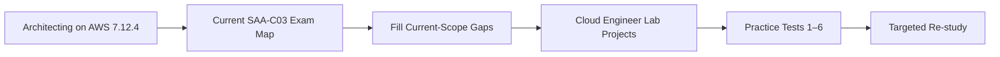

# SAA-C03 Integrated Study Path

> **Current exam guide checked:** 2026-10-06  
> **Exam:** AWS Certified Solutions Architect – Associate (SAA-C03)

This study path combines the repository's existing AWS theory course, certification practice material and hands-on project track without duplicating the same knowledge into multiple folders.

## The model



## Phase 1 — Build architecture foundations

Use [`../../Courses/Architecting-on-AWS-7.12.4/`](../../Courses/Architecting-on-AWS-7.12.4/) as the primary long-form AWS theory course.

Recommended order:

1. Architecting Fundamentals
2. Account Security
3. Networking 1
4. Compute
5. Storage
6. Database Services
7. Monitoring and Scaling
8. Automation
9. Containers
10. Networking 2
11. Serverless
12. Edge Services
13. Backup and Recovery

This course is versioned source-ingestion content, not a substitute for the current exam guide.

## Phase 2 — Map knowledge to the current exam

Read [`EXAM-GUIDE-MAP.md`](./EXAM-GUIDE-MAP.md).

The current SAA-C03 domains are:

- Design Secure Architectures — 30%
- Design Resilient Architectures — 26%
- Design High-Performing Architectures — 24%
- Design Cost-Optimized Architectures — 20%

Use the map to identify which course modules support each domain and where current-scope gap study is still required.

## Phase 3 — Reinforce with hands-on architecture

Use selected projects from [`../../Projects/Cloud-Engineer-Lab/`](../../Projects/Cloud-Engineer-Lab/).

High-value SAA reinforcement projects include:

- Project 01 — S3 + CloudFront
- Project 06 — 3-Tier Architecture
- Project 08 — Serverless App
- Project 10 — Cost Optimizer
- Project 12 — EKS Production
- Project 15 — Disaster Recovery
- Project 16 — Advanced Network
- Project 17 — Secrets Management
- Project 20 — Multi-Region
- Project 21 — Security Compliance
- Project 24 — Event-Driven Architecture
- Project 31 — Hybrid Networking
- Project 32 — Cost Optimization
- Project 34 — Full Architecture / Well-Architected Review

The project repo is broader than SAA-C03; not every project is exam-focused.

## Phase 4 — Practice exam reasoning

Complete the six walkthrough-backed practice sets in [`practice-exam/`](./practice-exam/).

Recommended loop:

```text
Attempt under exam conditions
→ mark unsure/wrong questions
→ identify architecture pattern or service decision
→ return to course / current exam map / project
→ explain why the distractors are wrong
→ retry later
```

## Phase 5 — Final review

Use the course cheat sheet and exam-mode resources as rapid review aids, but always return to the current official exam map when scope conflicts with older course material.

## Completion rule

This integrated path is a navigation and learning system. It does **not** yet claim 100% current SAA-C03 objective coverage. That claim requires an objective-level `QA-MATRIX.md` with all current guide bullets accounted for.
