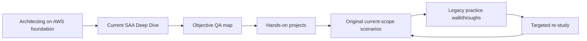

# SAA-C03 Integrated Study Path

> **Current web-based exam guide checked:** 2026-10-06  
> **Exam:** AWS Certified Solutions Architect – Associate (SAA-C03)  
> **Objective QA:** [189/189 published Knowledge/Skill bullets accounted for](./QA-MATRIX.md)

This path combines current certification scope, long-form theory, hands-on projects and original scenarios without duplicating the same material into every folder.

## Learning model



## Phase 1 — Build durable architecture foundations

Use [`../../Courses/Architecting-on-AWS-7.12.4/`](../../Courses/Architecting-on-AWS-7.12.4/) as the primary long-form architecture course.

Read in order:

1. Architecting Fundamentals
2. Account Security
3. Networking 1
4. Compute
5. Storage
6. Database Services
7. Monitoring and Scaling
8. Automation
9. Containers
10. Networking 2
11. Serverless
12. Edge Services
13. Backup and Recovery

The course is intentionally versioned. Use its [`CURRENTNESS-2026.md`](../../Courses/Architecting-on-AWS-7.12.4/CURRENTNESS-2026.md) for important modern AWS deltas.

## Phase 2 — Learn current certification-only gaps

Read [`CURRENT-SCOPE-DEEP-DIVE.md`](./CURRENT-SCOPE-DEEP-DIVE.md).

Pay special attention to topics that are easy to miss in an infrastructure-only course:

- IAM Identity Center and AWS Control Tower,
- Cognito / GuardDuty / Macie / Secrets Manager decision boundaries,
- KMS/ACM data-security decisions,
- RDS Proxy, X-Ray, quotas and throttling,
- AWS Batch and EMR,
- DataSync / Storage Gateway / Transfer Family,
- Glue / Lake Formation / Athena / Kinesis / Data Firehose / Amazon Quick analytics path,
- Cost Explorer / Budgets / detailed billing exports,
- Requester Pays, purchasing models and NAT/data-transfer cost architecture.

## Phase 3 — Verify the official objective map

Open [`QA-MATRIX.md`](./QA-MATRIX.md).

Current blueprint snapshot:

| Domain | Weight | Published objective bullets |
|---|---:|---:|
| Design Secure Architectures | 30% | 32 |
| Design Resilient Architectures | 26% | 43 |
| Design High-Performing Architectures | 24% | 50 |
| Design Cost-Optimized Architectures | 20% | 64 |
| **Total** | **100%** | **189** |

Do not memorize the counts for the exam. The purpose of the table is repository QA: if AWS changes the web guide, the matrix must be revalidated.

## Phase 4 — Reinforce with hands-on architecture

Use selected projects from [`../../Projects/Cloud-Engineer-Lab/`](../../Projects/Cloud-Engineer-Lab/).

High-value SAA projects:

- Project 01 — S3 + CloudFront
- Project 06 — 3-Tier Architecture
- Project 08 — Serverless App / X-Ray
- Project 10 — Cost Optimizer
- Project 12 — EKS Production
- Project 15 — Disaster Recovery
- Project 16 — Advanced Network
- Project 17 — Secrets Management
- Project 18 — FinOps Dashboard / CUR / Glue / Athena
- Project 20 — Multi-Region
- Project 21 — Security Compliance
- Project 24 — Event-Driven Architecture
- Project 29 — FinOps Maturity
- Project 30 — Cloud-Native SecOps / data-lake context
- Project 31 — Hybrid Networking
- Project 32 — Cost Optimization / Savings Plans
- Project 34 — Full Architecture / RDS Proxy / tracing / Well-Architected review

The project track is broader than SAA-C03. Use it to make architecture decisions concrete, not as a checklist that every project is exam-required.

## Phase 5 — Practice with repository-owned current scenarios

Do [`CURRENT-SCOPE-SCENARIOS.md`](./CURRENT-SCOPE-SCENARIOS.md) before the historical practice sets.

For every scenario explain:

1. the hard requirement,
2. the winning pattern,
3. why the closest alternative loses,
4. which Well-Architected dimension changes the decision.

If you can name the service but cannot explain the tradeoff, re-study the linked section.

## Phase 6 — Use legacy practice walkthroughs carefully

The six files in [`practice-exam/`](./practice-exam/) remain useful for reasoning practice, but their third-party wording/provenance is a separate repository-quality review item.

Use them as a secondary practice layer, not as the source of truth for current exam scope.

```text
Attempt
→ mark unsure/wrong
→ identify requirement and architecture pattern
→ compare with current objective/deep dive
→ explain distractors
→ retry later
```

## Phase 7 — Final review

1. Scan [`EXAM-GUIDE-MAP.md`](./EXAM-GUIDE-MAP.md).
2. Review the 15 self-check decisions at the end of the current-scope deep dive.
3. Revisit weak rows in [`QA-MATRIX.md`](./QA-MATRIX.md).
4. Use the Architecting course Cheat Sheet / Exam Mode for fast service comparison.
5. Recheck the live AWS SAA-C03 web guide shortly before the exam because AWS can update the guide while keeping the same exam series.

## Completion rule

The certification package can be called **Verified Current Objective Scope** when all current published Knowledge/Skill bullets are mapped to teachable repository content and the verification date is stated.

As of **2026-10-06**, that gate is **189/189 PASS**. This does not guarantee exam success and does not mean every AWS service is covered; it means the current published SAA-C03 objective inventory is accounted for.
