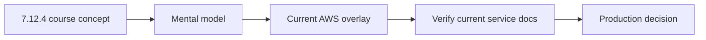
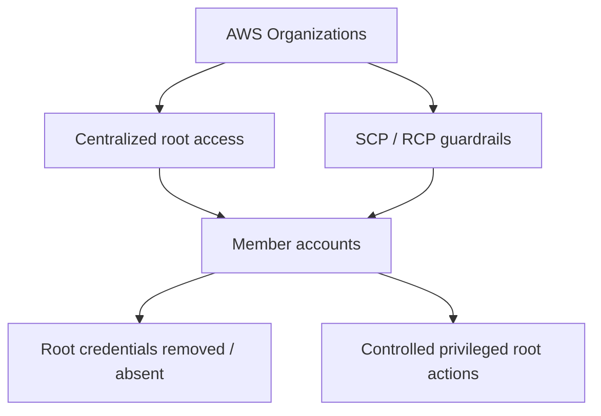

# Architecting on AWS 7.12.4 — Currentness Overlay (2026)

[Back to package README](./README.md) · [Course QA matrix](./COURSE-QA-MATRIX.md) · [Sources](./SOURCES.md)

> **Checked:** 2026-10-06  
> This file does **not** rewrite the historical 7.12.4 course. It records high-impact differences between course-era wording and current AWS guidance so the notes remain useful for modern work.

## How to read this package

Use the module files for the course's mental model and architecture sequence. Use this file whenever the exact current product name, security guidance or recommended implementation pattern matters.



## 1. Human access: prefer federation and temporary credentials

The course teaches IAM users, groups, roles and federation because those concepts are foundational. Current AWS IAM guidance is stronger about **not using long-term IAM-user credentials for routine human access**.

Current direction:

- human workforce access should normally use federation,
- AWS IAM Identity Center is the recommended central workforce-access service for multi-account environments,
- users should receive temporary credentials by assuming roles,
- IAM users remain valid for specific use cases that cannot use federation, but should not be the default human-access design.

### Practical translation

```text
Course-era mental model:
IAM User / Group / Role / Federation

Current default for workforce:
Corporate IdP / IAM Identity Center
        ↓
Permission set / role
        ↓
Temporary credentials
        ↓
AWS account resources
```

This does not make IAM users “wrong”; it changes the **default design choice** for human access.

## 2. Root user: Organizations now supports centralized root access

The course correctly teaches that the root user is highly privileged and should not be used for routine administration. Current AWS Organizations capabilities add an important modern layer:

- root credentials for member accounts can be centrally secured and removed,
- newly created member accounts in Organizations can have no root-user credentials by default,
- privileged root actions for member accounts can be centrally controlled through the supported root-access-management workflow,
- member-account root users can be affected by organization guardrails such as SCPs/RCPs; do not use the old mental shortcut that “root can never be constrained.”

### Current mental model



For standalone accounts and the Organizations management account, verify the current IAM/Organizations documentation before assuming member-account behavior applies unchanged.

## 3. CloudFront + S3: OAC is the current recommendation

Older material commonly uses **Origin Access Identity (OAI)**. Current CloudFront documentation recommends **Origin Access Control (OAC)** for S3 origins.

OAC supports modern scenarios that OAI does not fully support, including:

- all current S3 Regions,
- SSE-KMS scenarios,
- dynamic requests such as `PUT` and `DELETE` where configured,
- SigV4-based origin authentication.

### Decision

```text
New S3 origin design → prefer OAC
Existing OAI design   → still supported in legacy scenarios, evaluate migration
S3 website endpoint   → custom-origin behavior; OAC/OAI rules differ
```

When an old lab explicitly says OAI, treat that as **course/lab fidelity**, not the default modern architecture recommendation.

## 4. Amazon Data Firehose naming

**Amazon Kinesis Data Firehose** was renamed **Amazon Data Firehose** in 2024.

The package already uses the current name in most theory sections. If an older mock question or source wording says “Kinesis Firehose,” map it to the current product name:

```text
Amazon Kinesis Data Firehose (old name)
                ↓
Amazon Data Firehose (current name)
```

The API/CLI service namespace remains `firehose` in many SDK/CLI contexts, so product-name changes do not necessarily mean every API identifier changes.

## 5. AWS CLI learning baseline

For new hands-on learning and operational examples, use **AWS CLI v2** as the default baseline unless a source lab explicitly requires another version.

Why this matters:

- AWS CLI v1 entered maintenance mode in 2026,
- new service/API support should be expected first in current maintained tooling,
- authentication flows with IAM Identity Center are designed around modern CLI workflows.

Commands in the course that use stable AWS service operations may still look similar, but always verify syntax/options against the installed CLI version.

## 6. Course scope vs modern AWS scope

Do not expand every module with every AWS service launched after the course version. That would destroy the value of a course-aligned reader.

Use this rule:

| Situation | What to do |
|---|---|
| Product renamed | annotate current name |
| Security best practice changed materially | add currentness note |
| Old mechanism is now legacy/not recommended | preserve course context + show current recommendation |
| New product exists but does not change the course concept | do not force it into the module |
| Production decision depends on current limits/pricing/Region support | verify current AWS docs at decision time |

## 7. Volatile facts that should never be frozen as timeless truth

Always recheck current AWS documentation for:

- prices,
- quotas and default limits,
- Region/AZ availability,
- supported instance families,
- exact service integrations,
- deprecation/end-of-support dates,
- console navigation,
- encryption defaults,
- networking feature availability.

## 8. Currentness status by module

| Module | Currentness risk | Overlay guidance |
|---:|---|---|
| 01 Fundamentals | Low–Medium | Well-Architected concepts remain durable; verify current pillar guidance |
| 02 Account Security | **High** | Identity Center, temporary credentials and centralized root access are important modern additions |
| 03 Networking 1 | Medium | VPC fundamentals durable; verify IPv6, pricing, quotas and firewall feature specifics |
| 04 Compute | Medium | compute-selection principles durable; instance families/pricing are volatile |
| 05 Storage | Medium | object/block/file concepts durable; classes/features/pricing evolve |
| 06 Databases | Medium | selection principles durable; engine/features/HA options evolve |
| 07 Monitoring & Scaling | Medium | core concepts durable; integrations and service features evolve |
| 08 Automation | Medium | CloudFormation/Systems Manager remain core; modern IaC ecosystem is broader than course scope |
| 09 Containers | Medium | ECS/EKS/Fargate concepts durable; versions/platform capabilities evolve quickly |
| 10 Networking 2 | Medium | connectivity patterns durable; service capabilities/pricing/quotas evolve |
| 11 Serverless | Medium | concepts durable; product naming/integrations evolve; use current Data Firehose naming |
| 12 Edge Services | **High** | prefer CloudFront OAC over legacy OAI for new S3-origin designs |
| 13 Backup & Recovery | Medium | RPO/RTO strategies durable; supported resources/features evolve |

## 9. Rule before production use

The repository is a learning system, not a substitute for live service documentation.

Before applying a configuration to production:

1. identify the exact service and Region,
2. open current AWS documentation,
3. verify IAM/security implications,
4. verify pricing/quota/availability,
5. test in a non-production account,
6. record any important delta back into this overlay or the relevant module.
