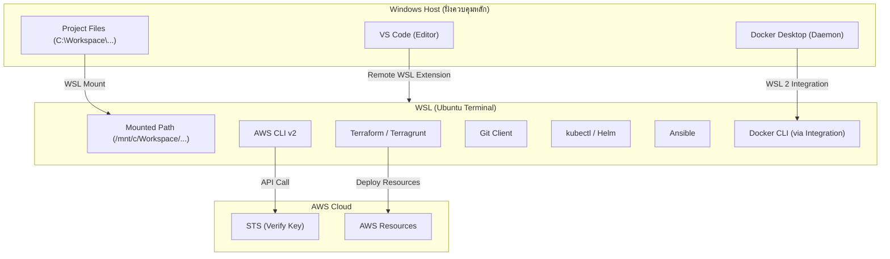

# Project 00: Preparation & WSL Setup Workbook

## 1. Scenario (สถานการณ์จำลอง)

### The Situation
วันแรกของการทำงานในฐานะ Cloud Engineer ฝึกหัด รุ่นพี่ในทีมยื่นเอกสารโปรเจกต์ให้คุณพร้อมรอยยิ้มและพูดว่า "ยินดีต้อนรับสู่ทีม ก่อนที่คุณจะเริ่มทำแล็บแรกกับระบบจริงของบริษัท คุณต้องเซ็ตอัพเครื่องของตัวเองให้พร้อมสำหรับการทำงานกับ IaC และระบบอัตโนมัติเสียก่อน"

เนื่องจากแล็บทั้งหมดในระบบนี้มีเชลล์สคริปต์ (.sh) และใช้เครื่องมือระดับ Linux-native เป็นหลัก การรันตรงบน Windows CLI มักทำให้เกิดปัญหาเรื่องสิทธิ์ของไฟล์และสัญลักษณ์สิ้นสุดบรรทัด งานของคุณในวันนี้คือติดตั้ง Windows Subsystem for Linux (WSL) และตั้งค่าพัฒนาแบบผสมผสาน (Hybrid Development) โดยใช้ Windows สำหรับเขียนโค้ดและใช้ WSL สำหรับการรันระบบจริง

### Constraints (ข้อจำกัด)
- ไฟล์งานและโค้ดทั้งหมดจะถูกเก็บไว้ฝั่ง Windows เพื่อความสะดวกในการจัดการผ่านโปรแกรมต่างๆ
- การรันคำสั่ง Terraform, AWS CLI, Bash script และ Kubernetes CLI ทั้งหมดต้องเกิดขึ้นภายในสภาพแวดล้อม WSL (Ubuntu) เท่านั้น
- ต้องไม่เก็บ AWS Credentials ไว้ในโค้ดหรือแชร์ลง GitHub

### Definition of Done (นิยามความสำเร็จ)
1. ติดตั้ง WSL (Ubuntu) สำเร็จและเข้าใช้งาน Terminal ได้
2. ติดตั้ง AWS CLI v2 และ Terraform ภายใน WSL สำเร็จ
3. ติดตั้ง Docker Desktop พร้อมเชื่อมต่อ WSL 2 integration สำเร็จ
4. ติดตั้งเครื่องมือจัดการคอนเทนเนอร์และคลัสเตอร์ (kubectl, Helm, Ansible, Terragrunt) สำเร็จ
5. เชื่อมต่อ VS Code จากฝั่ง Windows เข้าไปทำงานในสภาพแวดล้อม WSL ได้ผ่าน Extension
6. คอนฟิก AWS CLI Named Profile ใน WSL และทดสอบการดึงข้อมูล STS สำเร็จ

---

## 2. Topology Diagram (แผนผังระบบ)



---

## 3. Prerequisites & Estimated Time (สิ่งที่ต้องเตรียมและเวลาที่ใช้)

### สิ่งที่ต้องเตรียมความพร้อม
- เครื่องคอมพิวเตอร์ที่ใช้ระบบปฏิบัติการ Windows 10/11
- สิทธิ์ Administrator บนเครื่อง Windows สำหรับใช้ติดตั้ง WSL และ Docker Desktop
- บัญชีผู้ใช้งาน AWS Account (สำหรับเข้าใช้งาน Free Tier)

### เวลาที่คาดว่าจะใช้
- 3 ชั่วโมง (ครอบคลุมการติดตั้งระบบปฏิบัติการจำลอง, ดาวน์โหลดเครื่องมือ และแก้ไขสิทธิ์ไฟล์)

---

## 4. Tasks (ขั้นตอนการปฏิบัติ)

### Task 1: การติดตั้ง WSL และ Ubuntu
WSL (Windows Subsystem for Linux) ช่วยให้คุณใช้งาน Linux Terminal ได้อย่างราบรื่นบน Windows
1. เปิด PowerShell (Run as Administrator) แล้วรันคำสั่งติดตั้ง:
```powershell
wsl --install
```
2. ทำการรีสตาร์ทเครื่องคอมพิวเตอร์ตามที่ระบบแจ้งเตือน
3. หลังรีสตาร์ท หน้าจอ Ubuntu จะเปิดขึ้นมาโดยอัตโนมัติ ให้กรอก Username และ Password ใหม่เพื่อสร้างบัญชี Linux (แนะนำให้ใช้รหัสผ่านที่จำง่าย เนื่องจากต้องใช้รันคำสั่ง sudo บ่อยครั้ง)
4. อัปเดตแพ็กเกจพื้นฐานในระบบ Linux:
```bash
sudo apt update && sudo apt upgrade -y
```

### Task 2: การเชื่อมต่อ VS Code จาก Windows เข้ากับ WSL
เราจะใช้ VS Code บน Windows เขียนโค้ด แต่ให้โค้ดไปทำงานอยู่ในระบบ WSL
1. เปิด VS Code บนฝั่ง Windows
2. กดไอคอน Extensions (Ctrl+Shift+X) ค้นหาและติดตั้ง **WSL** (พัฒนาโดย Microsoft)
3. เมื่อติดตั้งเสร็จ ให้สังเกตมุมล่างซ้ายของ VS Code จะมีสัญลักษณ์สีเขียว `><` (Open a Remote Window)
4. คลิกที่สัญลักษณ์นั้นแล้วเลือก **Connect to WSL**
5. เปิด Terminal ใน VS Code (Ctrl+`) ระบบจะเรียกใช้งาน Bash ของ Ubuntu โดยอัตโนมัติ

### Task 3: การตั้งค่า Git และการแชร์ไฟล์งานฝั่ง Windows
เพื่อไม่ให้ไฟล์งานในโฟลเดอร์ฝั่ง Windows เกิดปัญหาสิทธิ์การรัน (Permissions) บน Linux เราต้องระบุการแมพไฟล์ที่ถูกต้อง
1. เปิด WSL Terminal แล้วสร้างหรืออัปเดตไฟล์คอนฟิกระบบไฟล์ของ WSL:
```bash
sudo nano /etc/wsl.conf
```
2. ใส่ค่าคอนฟิกนี้ลงไป (เพื่อจัดการเรื่องสิทธิ์อ่านเขียนไฟล์ข้ามระบบปฏิบัติการ):
```ini
[automount]
options = "metadata,umask=22,fmask=11"
```
*(กด Ctrl+O เพื่อบันทึก, กด Enter, แล้วกด Ctrl+X เพื่อออกจากโปรแกรม nano)*
3. ปิด WSL Terminal แล้วทำการรีสตาร์ทระบบ WSL ผ่าน PowerShell ฝั่ง Windows:
```powershell
wsl --shutdown
```
4. เปิด WSL Terminal ขึ้นมาใหม่ และเปลี่ยนไดเรกทอรีไปยังโฟลเดอร์โปรเจกต์ของคุณบน Windows (ปกติจะอยู่ใน `/mnt/c/`):
```bash
cd /mnt/c/Workspace/projects/personal/Github/DevOp-hands-on\ lab/Cloud\ Engineer\ Lab
```
5. ติดตั้งและตั้งค่าโปรไฟล์ Git ภายใน WSL:
```bash
sudo apt install git -y
git config --global user.name "Your Name"
git config --global user.email "your.email@example.com"
git config --global core.autocrlf input
```

### Task 4: การติดตั้ง AWS CLI v2 ใน WSL
เราต้องการติดตั้ง AWS CLI เวอร์ชันล่าสุดสำหรับระบบ Linux ภายใน WSL
1. เปิด WSL Terminal แล้วดาวน์โหลดแพ็กเกจติดตั้ง:
```bash
sudo apt install unzip curl -y
curl "https://awscli.amazonaws.com/awscli-exe-linux-x86_64.zip" -o "awscliv2.zip"
```
2. แตกไฟล์และเริ่มการติดตั้งระบบ:
```bash
unzip awscliv2.zip
sudo ./aws/install
```
3. ตรวจสอบว่าระบบใช้งานได้จริง:
```bash
aws --version
```

### Task 5: การติดตั้ง Terraform และ Terragrunt ใน WSL
เราจะติดตั้งคีย์บอร์ดทางการของ HashiCorp และตั้งค่าโปรแกรม Terragrunt เพิ่มเติมเพื่อรันแล็บ Multi-environment (Project 11)
1. ติดตั้ง Terraform คีย์บอร์ดและ repository:
```bash
wget -O- https://apt.releases.hashicorp.com/gpg | sudo gpg --dearmor -o /usr/share/keyrings/hashicorp-archive-keyring.gpg
echo "deb [signed-by=/usr/share/keyrings/hashicorp-archive-keyring.gpg] https://apt.releases.hashicorp.com/ $(lsb_release -cs) main" | sudo tee /etc/apt/sources.list.d/hashicorp.list
sudo apt update && sudo apt install terraform -y
```
2. ติดตั้ง Terragrunt (ดาวน์โหลด binary และเซ็ตสิทธิ์):
```bash
TG_VERSION=$(curl -s https://api.github.com/repos/gruntwork-io/terragrunt/releases/latest | grep tag_name | cut -d '"' -f 4)
curl -L "https://github.com/gruntwork-io/terragrunt/releases/download/${TG_VERSION}/terragrunt_linux_amd64" -o terragrunt
chmod +x terragrunt
sudo mv terragrunt /usr/local/bin/terragrunt
```

### Task 6: การติดตั้ง Docker Desktop และ WSL Integration
ใช้ในการจัดการ Docker container และเตรียมตัวรันแล็บ Kubernetes/Docker ทั้งหมด
1. ดาวน์โหลดและติดตั้ง Docker Desktop บน Windows: https://www.docker.com/products/docker-desktop/
2. ในการติดตั้ง เลือกตั้งค่าเปิดใช้งาน **Use the WSL 2 based engine**
3. เมื่อติดตั้งเสร็จ ให้เปิดโปรแกรม Docker Desktop เข้าสู่หน้า Settings (ไอคอนฟันเฟือง) -> **Resources** -> **WSL integration**
4. ติ๊กเปิดใช้งาน (Enable integration) สำหรับ Ubuntu ที่คุณใช้งาน แล้วกด Apply & restart
5. เปิด WSL Terminal ขึ้นมาใหม่แล้วทดสอบเรียกใช้คำสั่ง (ไม่ต้องใส่ sudo):
```bash
docker ps
```

### Task 7: การติดตั้งเครื่องมือฝั่ง Kubernetes (kubectl & Helm)
สำหรับการจัดการคลัสเตอร์ Kubernetes ในระดับโปรแกรม
1. ติดตั้ง kubectl (Kubernetes CLI):
```bash
curl -LO "https://dl.k8s.io/release/$(curl -L -s https://dl.k8s.io/release/stable.txt)/bin/linux/amd64/kubectl"
chmod +x kubectl
sudo mv kubectl /usr/local/bin/kubectl
```
2. ติดตั้ง Helm (Package Manager สำหรับ Kubernetes):
```bash
curl https://baltocdn.com/helm/signing.asc | gpg --dearmor | sudo tee /usr/share/keyrings/helm.gpg > /dev/null
sudo apt install apt-transport-https --y
echo "deb [arch=amd64 signed-by=/usr/share/keyrings/helm.gpg] https://baltocdn.com/helm/stable/debian/ all main" | sudo tee /etc/apt/sources.list.d/helm-stable-debian.list
sudo apt update && sudo apt install helm -y
```

### Task 8: การติดตั้ง Python, pip และ Ansible
สำหรับการทำระบบอัตโนมัติและการสร้างโปรแกรมสคริปต์เสริม
1. ติดตั้ง Python และ pip (ใช้จัดการไลบรารี boto3 ของ AWS ในแล็บประหยัดต้นทุน):
```bash
sudo apt install python3 python3-pip -y
pip3 install boto3
```
2. ติดตั้ง Ansible (ใช้ในโปรเจกต์ hardening และออโตเมชันเซิร์ฟเวอร์):
```bash
sudo apt install software-properties-common -y
sudo add-apt-repository --yes --update ppa:ansible/ansible
sudo apt install ansible -y
```

### Task 9: ตั้งค่า AWS CLI Authentication แบบ Temporary Credentials

สำหรับผู้ใช้งานที่เป็นคน (human/workforce identity) **ไม่ใช้ Root User ทำงานประจำ และไม่สร้าง IAM user + long-term access key + AdministratorAccess เป็นค่าเริ่มต้น** แนวทางปัจจุบันคือใช้ temporary credentials

#### ทางเลือก A — IAM Identity Center / Federation (แนะนำสำหรับหลาย Account/องค์กร)

1. ใช้ account/permission set ที่ผู้ดูแลกำหนดให้
2. ตั้งค่า SSO profile:

```bash
aws configure sso --profile developer-dev
```

3. ล็อกอิน:

```bash
aws sso login --profile developer-dev
```

4. ทดสอบ:

```bash
aws sts get-caller-identity --profile developer-dev
```

#### ทางเลือก B — AWS CLI local sign-in

AWS CLI v2 รุ่นที่รองรับ `aws login` สามารถใช้ browser/console sign-in เพื่อรับ temporary credentials โดยไม่ต้องเก็บ access key ระยะยาวไว้ในเครื่อง

```bash
aws login --profile developer-dev
aws sts get-caller-identity --profile developer-dev
```

ถ้า CLI ของคุณยังไม่รองรับ `aws login` ให้อัปเดต AWS CLI v2 ก่อน

#### Long-term access keys ใช้เมื่อไร

ใช้เฉพาะกรณีที่มีข้อจำกัดจริงและไม่สามารถใช้ temporary credentials ได้เท่านั้น หากจำเป็น:

- อย่าใช้ Root access keys
- ให้สิทธิ์เท่าที่ต้องใช้ (least privilege) แทน `AdministratorAccess` แบบถาวร
- เปิด MFA ตามกรณีที่รองรับ
- rotate/remove key เมื่อหมดความจำเป็น
- ห้าม commit `~/.aws/credentials`, access keys หรือ secrets ลง Git

---

## 5. Verification (การตรวจสอบความถูกต้อง)

รันคำสั่งเหล่านี้ใน WSL Terminal เพื่อยืนยันว่าการตั้งค่าทุกอย่างใช้งานได้สมบูรณ์:

1. ตรวจสอบการเชื่อมต่อไปยัง AWS API:
```bash
aws sts get-caller-identity --profile developer-dev
```
ผลลัพธ์ที่ถูกต้องต้องแสดง Account และ ARN ของ principal/role/session ที่กำลังใช้งาน เช่น:

```json
{
  "UserId": "AROA...:session-name",
  "Account": "123456789012",
  "Arn": "arn:aws:sts::123456789012:assumed-role/YourRole/session-name"
}
```

รูปแบบ ARN อาจต่างกันตามวิธี authentication; ประเด็นคือยืนยันว่าเป็น account/role ที่ตั้งใจใช้ก่อนสร้างทรัพยากร

2. ตรวจสอบเวอร์ชันของเครื่องมือทั้งหมด:
```bash
git --version
terraform -version
terragrunt -version
docker --version
kubectl version --client
helm version
ansible --version
python3 --version
```

3. ตรวจสอบความถูกต้องของสิทธิ์ไฟล์ฝั่ง Windows บน WSL:
```bash
ls -l README.md
```
สิทธิ์ที่ถูกต้องควรเป็น `-rw-r--r--` หรือ `-rwxr-xr-x` และไม่มีสัญลักษณ์แจ้งเตือนข้อผิดพลาดเกี่ยวกับการอ่านหรือเขียนไฟล์

---

## 6. Troubleshooting (การแก้ปัญหาทั่วไป)

### 1. ไฟล์สคริปต์รันไม่ได้ หรือขึ้นข้อผิดพลาด '\r': command not found
- **สาเหตุ**: บรรทัดส่งท้ายไฟล์ถูกเซฟในรูปแบบ Windows (CRLF) แทนที่จะเป็น Linux (LF)
- **แนวทางแก้ไข**: 
  - เปิดไฟล์ที่มีปัญหาใน VS Code
  - สังเกตที่มุมล่างขวาของ VS Code จะมีตัวอักษร **CRLF** ให้คลิกเลือกแล้วเปลี่ยนเป็น **LF** จากนั้นเซฟไฟล์ใหม่
  - หรือติดตั้งและใช้ยูทิลิตี้แปลงไฟล์ใน WSL:
    ```bash
    sudo apt install dos2unix -y
    dos2unix path-to-file.sh
    ```

### 2. ไม่สามารถเปิดใช้งานคำสั่ง 'wsl --install' ได้
- **สาเหตุ**: คอมพิวเตอร์ของคุณยังไม่ได้เปิดใช้งาน Virtualization ในระดับ Hardware (BIOS)
- **แนวทางแก้ไข**: รีสตาร์ทคอมพิวเตอร์ เข้าสู่หน้าการตั้งค่า BIOS/UEFI ค้นหาเมนูชื่อ "Intel Virtualization Technology" หรือ "AMD-V" แล้วตั้งค่าเป็น Enabled จากนั้นบูตเข้าระบบปฏิบัติการ Windows เพื่อทำตามขั้นตอนต่อไป

### 3. docker: command not found หรือ Cannot connect to the Docker daemon
- **สาเหตุ**: ยังไม่ได้ติดตั้ง Docker Desktop หรือยังไม่ได้เปิดใช้งาน WSL 2 integration ในการตั้งค่าของ Docker Desktop
- **แนวทางแก้ไข**: ตรวจสอบการเปิดใช้งาน WSL Integration และตรวจสอบให้แน่ใจว่าโปรแกรม Docker Desktop กำลังเปิดใช้งานอยู่ในฝั่ง Windows

---

## 7. Exercises & Solutions (แบบฝึกหัดและเฉลย)

### แบบฝึกหัด
1. ในกรณีที่รันคำสั่งเชลล์สคริปต์ในโฟลเดอร์โปรเจกต์แล้วขึ้น "Permission denied" ต้องแก้ไขอย่างไร
2. แนะนำวิธีตั้งค่าให้ Named Profile `developer-dev` เป็นโปรไฟล์หลักในการรันคำสั่ง AWS CLI ใน WSL เสมอ
3. หากรัน `git clone` หรือแก้ไขโค้ดจากฝั่ง Windows แล้วไฟล์สิทธิ์แสดงผลผิดพลาด เช่น เปลี่ยนจาก `644` เป็น `777` อัตโนมัติ ควรแก้ไขอย่างไร

### เฉลย
1. เพิ่มสิทธิ์การรันด้วยคำสั่ง `chmod +x filename.sh`
2. ใส่การประกาศตัวแปรระบบลงในโปรไฟล์เชลล์ของ WSL:
   - เปิดไฟล์เชลล์โปรไฟล์: `nano ~/.bashrc`
   - เพิ่มคำสั่งไว้ท้ายไฟล์: `export AWS_PROFILE="developer-dev"`
   - เซฟและปิดไฟล์ จากนั้นรีเฟรชการตั้งค่าใหม่: `source ~/.bashrc`
3. เป็นผลจากการตั้งค่า metadata mounting ที่ไม่ถูกต้อง ให้ตรวจสอบไฟล์ `/etc/wsl.conf` ว่ามีส่วนของ `options = "metadata,umask=22,fmask=11"` ครบถ้วนหรือไม่ แล้วรีสตาร์ท WSL (`wsl --shutdown`)
