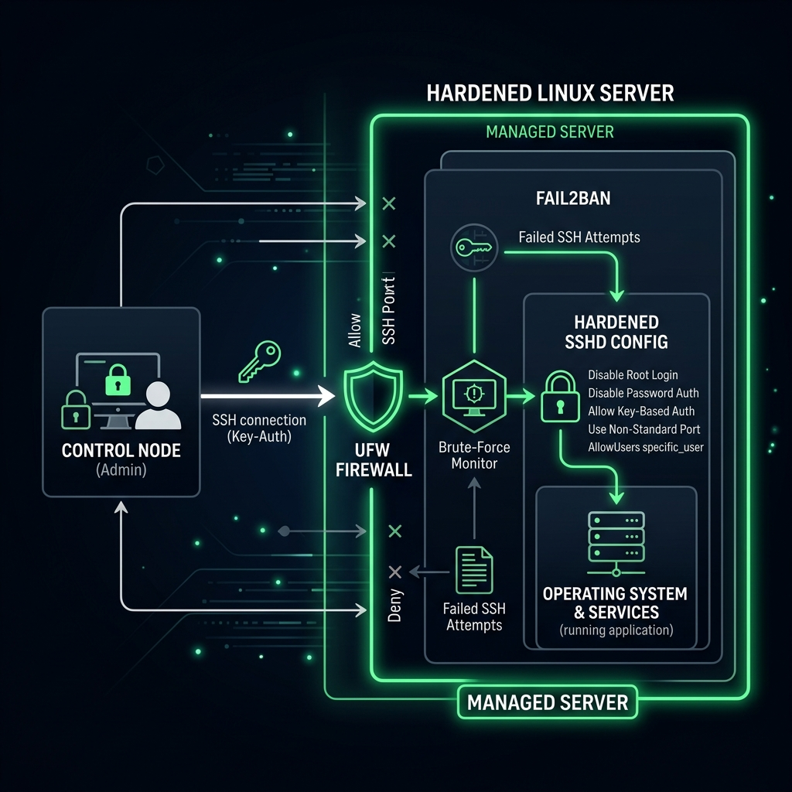

# Linux Server Hardening Workbook

## 1. Scenario (สถานการณ์จำลอง)

### ปัญหาที่พบ
- บริษัทของคุณเพิ่งเปิดตัว Marketing Portal ใหม่บน AWS EC2 Instance ตัวเดี่ยว
- Developer ที่เป็นคนตั้งระบบใช้ Ubuntu Image ค่าเริ่มต้น และเปิดพอร์ตทั้งหมด (0.0.0.0/0) เพื่อความสะดวกในการ Debug
- มีการใช้ระบบยืนยันตัวตนด้วย Password authentication ร่วมกับ User `ubuntu` แบบเดิม
- ภายในเวลาเพียง 24 ชั่วโมง ไฟล์ Log ใน `/var/log/auth.log` ถูกโจมตีด้วย Brute-force attacks จาก IP ทั่วทุกมุมโลก
- ผลการสแกนระบบพบ Nginx เวอร์ชันเก่าที่มีช่องโหว่ด้านความปลอดภัยร้ายแรง

### ภารกิจของคุณ
- คุณคือ Cloud Engineer ที่เพิ่งได้รับการจ้างเข้ามาใหม่
- หน้าที่คือการกู้สถานการณ์และอุดช่องโหว่ความปลอดภัย โดยใช้ระบบ Automation เพื่อทำ Hardening เซิร์ฟเวอร์ให้บรรลุเป้าหมายดังนี้:
  1. SSH ปลอดภัยอย่างสมบูรณ์: ปิดการใช้งาน Password authentication เปลี่ยนพอร์ตมาตรฐาน และจำกัดสิทธิ์การเข้าถึง
  2. Firewall ทำงานเต็มรูปแบบ: อนุญาตเฉพาะ Traffic ที่จำเป็นเท่านั้น (HTTP, HTTPS และ SSH)
  3. Automatic Updates: ระบบเซิร์ฟเวอร์ต้องหมั่นทำ Patch ด้วยตัวเองโดยไม่ต้องใช้คนทำ Manual
  4. ป้องกัน Brute-force: IP ใดก็ตามที่พยายามเดารหัสผ่านเข้าเครื่องจะโดนแบนโดยอัตโนมัติ
  5. Audit Trail: ระบบจะต้องบันทึก Log ไว้ครบถ้วนและค้นหาเพื่อตรวจสอบย้อนหลังได้ง่าย

### ข้อจำกัด
- ห้ามใช้วิธีคลิกตั้งค่าแบบ Manual ผ่าน AWS Console เพื่อแก้ไขปัญหานี้
- งานทุกอย่างต้องรันผ่านระบบ Automation เพื่อให้สามารถนำไปปรับใช้กับเซิร์ฟเวอร์อีก 100 เครื่องได้ทันที
- เว็บไซต์ต้องให้บริการออนไลน์ได้ตลอดกระบวนการทำ Hardening
- ต้องใช้ Ansible เพื่อรับประกันความเป็น Idempotency

### ข้อกำหนดความสำเร็จ (Definition of Done)
- SSH บังคับใช้เฉพาะ Key-auth (Ed25519) ปิดการล็อกอินด้วย Password และรันบนพอร์ตที่กำหนด
- Firewall (UFW) ถูกเปิดใช้งานและบล็อกการเชื่อมต่อขาเข้าทุกพอร์ต ยกเว้นพอร์ต HTTP (80), HTTPS (443) และ SSH
- unattended-upgrades ถูกติดตั้งและตั้งค่าให้ดาวน์โหลด/ติดตั้ง Security patches อัตโนมัติ
- Fail2Ban ตรวจสอบ `/var/log/auth.log` และแบน IP ที่ทำ Brute-force อัตโนมัติ
- ติดตั้งระบบ Audit trail บันทึก Log การรัน sudo และสามารถสแกนมาตรฐานความปลอดภัยได้ด้วย Lynis

## 2. Topology Diagram (แผนผังระบบ)



### รายละเอียดระดับความปลอดภัย (Security Hardening Layers)
- Layer 1: External (AWS SG)
  - การตั้งค่า Security Group ของผู้ให้บริการ Cloud (อยู่นอกเหนือขอบเขต Playbook นี้ แต่จำเป็นมาก)
  - กำหนดให้อนุญาตเฉพาะพอร์ต 22 (หรือพอร์ต SSH ที่กำหนด), 80, 443 เท่านั้น
- Layer 2: Network (UFW)
  - จัดการโดย Role: `firewall`
  - อนุญาตเฉพาะทราฟฟิกขาเข้าพอร์ต 22, 80, 443 และปฏิเสธ (Deny) ทราฟฟิกอื่นๆ ทั้งหมดเป็นค่าเริ่มต้น
- Layer 3: Access (SSH)
  - จัดการโดย Role: `ssh`
  - บังคับใช้ Ed25519 Keys ห้ามล็อกอินด้วยรหัสผ่าน ปิดการใช้ Root login และจำกัดผู้ใช้ที่เข้าถึงได้
- Layer 4: Active Defense
  - จัดการโดย Role: `fail2ban`
  - เฝ้าดู Log จาก `/var/log/auth.log` เพื่อค้นหาพฤติกรรมผิดปกติและแบน IP ที่ทำ Brute-force โดยอัตโนมัติ
- Layer 5: System (Updates)
  - จัดการโดย Role: `common`
  - ตั้งค่าระบบให้หมั่นอัปเดตและติดตั้ง Security patches อัตโนมัติผ่าน unattended-upgrades

### แนวคิดหลักในการออกแบบ (Security Rationale)
- Defense in Depth: เราไม่พึ่งพาความปลอดภัยเพียงชั้นเดียว หาก UFW พลาด ระบบ SSH ก็ยังคงปลอดภัย
- Principle of Least Privilege: เปิดใช้งานเฉพาะพอร์ตและบริการที่จำเป็นต้องใช้จริงๆ เท่านั้น
- Idempotency: Ansible จะตรวจสอบความปลอดภัยของเซิร์ฟเวอร์ก่อน หากปลอดภัยอยู่แล้ว จะไม่มีการแก้ไขหรือรันซ้ำโดยไม่จำเป็น
- Automation over Manual: ลดความผิดพลาดจากคน (Human error) ซึ่งเป็นสาเหตุหลักของการถูกเจาะระบบ

## 3. Prerequisites & Estimated Time (สิ่งที่ต้องเตรียมและเวลาที่ใช้)

### สิ่งที่ต้องเตรียม
- Target Server: เซิร์ฟเวอร์ Ubuntu 22.04 LTS (เช่น Instance บน AWS EC2 หรือเครื่องเสมือนใน VirtualBox)
- Control Node: เครื่องคอมพิวเตอร์หลักที่ใช้รัน Ansible และมีสิทธิ์การเข้าถึง SSH ไปยัง Target Server
- SSH Keys: ชุดกุญแจ (Key pair) สำหรับใช้ระบุตัวตนในการล็อกอิน
- สิทธิ์ในการรันคำสั่ง sudo บน Target Server
- เครื่องมือ Ansible ติดตั้งอยู่บน Control Node (สามารถติดตั้งด้วยสคริปต์ที่เตรียมไว้ให้)

### เวลาที่ใช้ในการปฏิบัติงาน
- เวลาที่ใช้โดยประมาณ: 30-45 นาที

## 4. Tasks (ขั้นตอนการปฏิบัติ)

### Task 1: เตรียมสภาพแวดล้อมและติดตั้ง Ansible (Environment Setup)
- ติดตั้ง Ansible บนเครื่องคอมพิวเตอร์ของคุณ (Control Node) โดยใช้สคริปต์ที่เตรียมไว้ให้:
  ```bash
  ./scripts/setup-ansible.sh
  ```
- ในกรณีที่ติดตั้งด้วยตนเอง ให้ใช้ Package manager ตามระบบปฏิบัติการ เช่น:
  ```bash
  sudo apt update
  sudo apt install ansible -y
  ```
- เตรียมเซิร์ฟเวอร์ปลายทาง (Target Server) ที่ติดตั้งเสร็จใหม่ๆ และทดสอบให้มั่นใจว่าสามารถใช้ SSH Key เชื่อมต่อได้

### Task 2: กำหนดค่า Inventory (Inventory Configuration)
- กำหนดค่าเป้าหมายของเซิร์ฟเวอร์ที่คุณจะทำงานด้วยในไฟล์ `ansible/inventory.ini`
- อัปเดตไฟล์โดยแทนที่ IP Address และกำหนดค่า User/Key file ที่ต้องการใช้งาน:
  ```ini
  [webservers]
  your_server_ip ansible_user=ubuntu ansible_ssh_private_key_file=~/.ssh/id_rsa
  ```

### Task 3: โครงสร้างและการเขียน Ansible Playbook (Playbook Configuration)
- จัดเตรียมโครงสร้างโฟลเดอร์สำหรับจัดการ Configuration ของระบบรักษาความปลอดภัย:
  ```text
  project-02-linux-hardening/
  ├── ansible/
  │   ├── inventory.ini
  │   ├── playbook.yml
  │   └── roles/
  │       ├── common/
  │       ├── ssh/
  │       ├── firewall/
  │       └── fail2ban/
  ```
- เขียน Playbook หลัก (`playbook.yml`) และแยกย่อยแต่ละส่วนออกเป็น Roles ตามแนวทางปฏิบัติที่ดีที่สุด (Best Practices)
- ข้อมูลและตัวอย่างโค้ดของแต่ละบทบาท สามารถอ้างอิงและคัดลอกได้ในส่วนท้ายของคู่มือนี้ (หัวข้อ Exercises & Solutions)

### Task 4: การรัน Playbook เพื่อทำ Hardening (Playbook Execution)
- รัน Ansible Playbook เพื่อทำการติดตั้งกฎความปลอดภัยทั้งหมดบน Target Server:
  ```bash
  ansible-playbook -i inventory.ini playbook.yml
  ```
- คอยสังเกตผลการรัน ระบบไม่ควรขึ้นสถานะล้มเหลว (failed) และควรเห็นการเปลี่ยนแปลง (changed) ในแต่ละส่วนของการตั้งค่า

### Task 5: การติดตั้งและใช้งานระบบตรวจสอบความปลอดภัยของไฟล์ (Audit Trail Setup)
- ตั้งระบบบันทึกความปลอดภัยเมื่อมีคนพยายามแก้ไขไฟล์ระบบที่สำคัญ
- รันคำสั่งต่อไปนี้เพื่อเฝ้าดูการเขียนหรือแก้ไขข้อมูลในไฟล์ `/etc/passwd`:
  ```bash
  sudo auditctl -w /etc/passwd -p wa -k user_modify
  ```
- หากมีการเปลี่ยนแปลงใดๆ บนไฟล์ระบบ สามารถสืบค้นข้อมูลเหตุการณ์และตรวจสอบย้อนหลังได้ด้วยคำสั่ง:
  ```bash
  ausearch -k user_modify
  ```

### Task 6: การตรวจสอบมาตรฐานความปลอดภัยด้วย Lynis (CIS Benchmark Audit)
- ใช้เครื่องมือสแกน Lynis เพื่อทดสอบประสิทธิภาพการทำ Hardening และประเมินสถานะความปลอดภัยของระบบ
- ติดตั้ง Lynis บน Ubuntu Server ปลายทาง:
  ```bash
  sudo apt update
  sudo apt install lynis -y
  ```
- รันการตรวจสอบระบบแบบเต็มรูปแบบ:
  ```bash
  sudo lynis audit system
  ```
- ตรวจเช็คคำแนะนำ (Suggestions) ในรายงานเพื่อปรับแต่งความปลอดภัยเพิ่มเติม

## 5. Verification (การตรวจสอบผลการทำงาน)

- [ ] **การควบคุมการเข้าถึงผ่าน SSH (SSH Access Control)**
  - [ ] ตรวจสอบว่าในไฟล์ `/etc/ssh/sshd_config` มีการตั้งค่า `PasswordAuthentication no`
  - [ ] ตรวจสอบว่าในไฟล์ `/etc/ssh/sshd_config` มีการตั้งค่า `PermitRootLogin no`
  - [ ] ลองล็อกอินเข้าเซิร์ฟเวอร์ด้วยรหัสผ่านจากคอมพิวเตอร์เครื่องอื่น: ต้องถูกปฏิเสธ (Permission Denied)
  - [ ] ลองล็อกอินเข้าเซิร์ฟเวอร์ด้วย SSH Key ที่ถูกต้อง: ต้องสามารถเชื่อมต่อได้ปกติ
- [ ] **การตั้งค่า Firewall (UFW Configuration)**
  - [ ] ตรวจสอบสถานะ: รันคำสั่ง `sudo ufw status` ต้องแสดงผลลัพธ์เป็น `Status: active`
  - [ ] ตรวจสอบกฎ: ต้องอนุญาตเฉพาะพอร์ต 22 (หรือพอร์ตที่กำหนดเอง), 80, และ 443 เท่านั้น
  - [ ] พอร์ตอื่นๆ ทั้งหมดที่ไม่เกี่ยวข้องต้องถูกบล็อกการเข้าถึงโดยเริ่มต้น
- [ ] **ระบบป้องกัน Brute-force (Fail2Ban Protection)**
  - [ ] ตรวจสอบสถานะ Service: รันคำสั่ง `systemctl status fail2ban` ต้องอยู่ในสถานะ `active (running)`
  - [ ] ตรวจสอบ SSH jail: คำสั่ง `sudo fail2ban-client status sshd` ต้องตอบกลับข้อมูลผู้ใช้และไอพีที่ถูกสแกน
  - [ ] ทดลอง Brute-force: ลองป้อนรหัสผ่าน SSH ผิดหลายๆ ครั้งจนกระทั่งระบบทำการแบน IP ชั่วคราวโดยอัตโนมัติ
- [ ] **การแพตช์และระบบอัปเดต (Updates and Patching)**
  - [ ] ตรวจสอบว่า Package `unattended-upgrades` ได้รับการติดตั้งแล้ว
  - [ ] ตรวจสอบการอัปเดตอัตโนมัติในไฟล์ `/etc/apt/apt.conf.d/20auto-upgrades`
- [ ] **การตรวจสอบ Log (Audit and Logging)**
  - [ ] ตรวจสอบว่าคำสั่ง `sudo` มีการบันทึก Log ลงในระบบปฏิบัติการ
  - [ ] ตรวจสอบว่า Service `logrotate` ทำงานอย่างปกติเพื่อจัดการเก็บรักษาไฟล์ Log ไม่ให้เต็มดิสก์

## 6. Troubleshooting (การแก้ไขปัญหาที่พบบ่อย)

- **ปัญหาที่ 1: Connection Refused (SSH)**
  - **อาการ:** รันคำสั่งแล้วเจอข้อความ `ssh: connect to host YOUR_IP port 22: Connection refused`
  - **สาเหตุ:**
    - มีการเปลี่ยนพอร์ต SSH เป็นพอร์ตอื่น (เช่น 2222) แต่ไม่มีการระบุพอร์ตใหม่ให้กับ Ansible หรือเครื่องคอมพิวเตอร์ของคุณ
    - UFW หรือ Cloud Security Group บล็อกการเข้าถึงพอร์ต SSH ใหม่
  - **วิธีแก้ไข:**
    - อัปเดตไฟล์ `inventory.ini` โดยเพิ่มพารามิเตอร์ `ansible_port=2222`
    - ล็อกอินผ่าน Cloud Serial Console หรือ VirtualBox GUI เพื่อปิด UFW ชั่วคราวด้วยคำสั่ง `sudo ufw disable` จากนั้นทำการแก้ไขกฎ
- **ปัญหาที่ 2: Permission Denied (Sudo)**
  - **อาการ:** ระบบฟ้องข้อผิดพลาด `Missing sudo password` หรือ `Incorrect sudo password`
  - **สาเหตุ:** Ansible ต้องได้รับสิทธิ์ระดับ root ในการปรับแต่งเครื่องปลายทาง แต่ไม่มีการส่งผ่านรหัสผ่าน
  - **วิธีแก้ไข:**
    - รันคำสั่ง Ansible Playbook ด้วย Option `-K` เพื่อระบุรหัสผ่านรัน sudo ล่วงหน้า:
      ```bash
      ansible-playbook -K playbook.yml
      ```
- **ปัญหาที่ 3: Apt Lock Error**
  - **อาการ:** ระบบขึ้นคำเตือน `Could not get lock /var/lib/dpkg/lock-frontend`
  - **สาเหตุ:** มีกระบวนการอัปเดตอัตโนมัติ (เช่น unattended-upgrades) รันอยู่ในเบื้องหลังและใช้สิทธิ์ติดตั้งแพ็คเกจอยู่
  - **วิธีแก้ไข:**
    - ปล่อยทิ้งไว้สักครู่ให้กระบวนการหลักเสร็จสิ้น
    - หากค้างนานเกินไป สามารถรันคำสั่ง Kill process ได้ดังนี้:
      ```bash
      sudo killall apt apt-get
      ```
- **ปัญหาที่ 4: SSH Key Error**
  - **อาการ:** ระบบรายงานข้อผิดพลาด `Permission denied (publickey)`
  - **สาเหตุ:**
    - ยังไม่ได้เพิ่มไฟล์ Public Key ของคุณลงใน `~/.ssh/authorized_keys` ของ Managed Server
    - เพิ่งปิด Password authentication ไปโดยที่ยังไม่มีการตั้งค่า SSH Key ที่ใช้การได้
  - **วิธีแก้ไข:**
    - ก่อนทำการปิดใช้รหัสผ่าน ให้คัดลอก Public Key ไปยังเครื่องปลายทางโดยรัน:
      ```bash
      ssh-copy-id -i ~/.ssh/id_rsa.pub ubuntu@YOUR_IP
      ```
    - ทดสอบล็อกอินเข้าเซิร์ฟเวอร์โดยตรงเพื่อตรวจเช็คความปลอดภัยก่อนที่จะเริ่มระบบทำ Hardening เสมอ
- **ปัญหาที่ 5: UFW บล็อกตัวเชื่อมต่อของ Ansible (Unstable UFW)**
  - **อาการ:** การเชื่อมต่อ SSH ของ Ansible หลุดทันทีหลังจากเปิดใช้งาน UFW
  - **สาเหตุ:** รันคำสั่งเปิดใช้งาน UFW ก่อนที่จะมีการเขียนกฎระเบียบอนุญาตให้พอร์ต SSH ผ่านเข้ามาได้
  - **วิธีแก้ไข:**
    - ตรวจสอบให้มั่นใจว่าใน Task ของ Ansible ได้รันคำสั่งกำหนดกฎระเบียบของพอร์ต SSH ก่อนที่จะเริ่ม Task สั่งเปิดใช้ UFW เสมอ
- **ปัญหาที่ 6: ไฟล์ Sudoers เสียหาย (Sudoers File Corrupted)**
  - **อาการ:** รันคำสั่ง `sudo` บนเซิร์ฟเวอร์แล้วรายงาน Syntax error ในไฟล์ `/etc/sudoers`
  - **สาเหตุ:** Ansible ปรับแต่งข้อมูลใน Sudoers ไม่สมบูรณ์หรือผิดไวยากรณ์
  - **วิธีแก้ไข:**
    - ใช้คำสั่งตรวจเช็คไวยากรณ์ก่อนการรันเขียนทับเสมอ เช่น ใน Ansible Task สามารถนำ Option `validate` ไปร่วมกำหนดค่าด้วย:
      ```yaml
      validate: 'visudo -cf %s'
      ```
- **ปัญหาที่ 7: เครื่องโฮสต์เชื่อมต่อไม่ได้ (Ansible Unreachable)**
  - **อาการ:** ระบบแจ้งสถานะ `UNREACHABLE` สำหรับบางเซิร์ฟเวอร์
  - **สาเหตุ:** Control Node ไม่มีกุญแจ Public Key ที่เหมาะสมในการเชื่อมต่อไปยังเครื่อง Managed Server
  - **วิธีแก้ไข:**
    - อัปเดตระบบจัดส่ง Public Key หรือใช้ Option `-k` ในกรณีที่รันระบบครั้งแรกสุดเพื่อใช้รหัสผ่านในการเชื่อมต่อชั่วคราว

## 7. Exercises & Solutions (แบบฝึกหัดและแนวทางการแก้ไข)

### แบบฝึกหัดเพื่อการเรียนรู้ (Exercises)

#### ระดับ 1: ผู้เริ่มต้น (Beginner)
- **แบบฝึกหัดที่ 1.1: การตรวจสอบการตั้งค่าด้วยตนเอง (Manual Check)**
  - ก่อนที่จะประยุกต์ใช้งาน Ansible ให้รันคำสั่งต่อไปนี้โดยตรงบนเซิร์ฟเวอร์เพื่อสังเกตพฤติกรรมเดิม:
    ```bash
    grep "PasswordAuthentication" /etc/ssh/sshd_config
    sudo ufw status
    ```
  - ให้ตรวจสอบว่าระบบเริ่มต้นแสดงค่าที่ยังไม่ปลอดภัยอยู่หรือไม่ (เช่น `PasswordAuthentication yes` และ `Status: inactive`)
- **แบบฝึกหัดที่ 1.2: การใช้คำสั่ง Ping ใน Ansible**
  - ตั้งค่าไฟล์ `ansible/inventory.ini` และรันคำสั่งทดสอบการเชื่อมต่อแบบพื้นฐาน:
    ```bash
    ansible -i inventory.ini all -m ping
    ```
  - *เป้าหมาย: สามารถคุยกับเซิร์ฟเวอร์ปลายทางผ่านโมดูล Ping ได้สำเร็จ*

#### ระดับ 2: ระดับกลาง (Intermediate)
- **แบบฝึกหัดที่ 2.1: การใช้พอร์ต SSH แบบกำหนดเอง (Custom SSH Port)**
  - แก้ไขการตั้งค่าเริ่มต้นในไฟล์ `ansible/roles/ssh/defaults/main.yml` เพื่อเปลี่ยนพอร์ต SSH เป็น `2222` จากนั้นทดลองรัน Playbook
  - *เป้าหมาย: ค้นหาว่าการเชื่อมต่อ SSH ปกติยังทำได้หรือไม่ และหากเชื่อมต่อใหม่จะต้องระบุพารามิเตอร์ใดเพิ่มเติม*
- **แบบฝึกหัดที่ 2.2: การบล็อกการเข้าถึงตัวเอง (The Firewall Lock-Out)**
  - ลองตัดการอนุญาตพอร์ต SSH ในไฟล์ `ansible/roles/firewall/tasks/main.yml` ออกแล้วรัน Playbook
  - *คำแนะนำ: ทำความเข้าใจวิธีกู้คืนเครื่องเซิร์ฟเวอร์เมื่อถูก UFW บล็อกไม่ให้เข้าถึงพอร์ต SSH (locked out) โดยลองกู้คืนผ่านคอนโซลหลักของผู้ให้บริการคลาวด์*

#### ระดับ 3: ระดับสูง (Advanced)
- **แบบฝึกหัดที่ 3.1: สร้างบทบาทการบันทึกเหตุการณ์แบบกำหนดเอง (New Security Role)**
  - สร้าง Ansible Role ใหม่ชื่อว่า `auditd` สำหรับจัดการการติดตั้ง Audit Daemon และกำหนดค่าเฝ้าสังเกตไฟล์ `/etc/shadow`
  - *คำใบ้: เริ่มสร้างโครงสร้างโฟลเดอร์ของ Role ได้รวดเร็วโดยใช้คำสั่ง:*
    ```bash
    ansible-galaxy init roles/auditd
    ```
- **แบบฝึกหัดที่ 3.2: เข้ารหัสข้อมูลตัวแปรความปลอดภัย (Secure Variables)**
  - ใช้โปรแกรม Ansible Vault สำหรับทำไฟล์เก็บตัวแปรที่ปลอดภัย เช่น รหัสผ่านผู้ใช้ใหม่:
    ```bash
    ansible-vault create vars/secrets.yml
    ```
  - ทำการกำหนดตัวแปรความปลอดภัยลงไป และแก้ไขให้ Playbook หลักดึงข้อมูลตัวแปรผ่านไฟล์นี้

#### ระดับ 4: ผู้เชี่ยวชาญ (Expert)
- **แบบฝึกหัดที่ 4.1: การทำ CI/CD Integration**
  - สร้างไฟล์การตั้งค่า GitHub Actions ที่ชื่อ `.github/workflows/lint.yml`
  - ตั้งให้สแกนตรวจเช็คไวยากรณ์และคุณภาพของโค้ด Ansible Playbook โดยใช้โปรแกรม `ansible-lint` ทุกครั้งที่มีการแก้ไขไฟล์และ Push Code
  - *เป้าหมาย: ป้องกันการนำโค้ดที่ไม่ได้มาตรฐานและขาดการทดสอบความปลอดภัยไปรันในระบบจริง*

---

### แนวทางและโค้ดตัวอย่างสำหรับการตั้งค่า Ansible Playbook (Playbook Solutions)

คุณสามารถนำโค้ดและโครงสร้างที่รวบรวมด้านล่างนี้ไปใช้เป็นจุดตั้งต้นในการพัฒนา Playbook สำหรับทำ Server Hardening

#### 1. Playbook หลัก (`playbook.yml`)
```yaml
---
- name: Hardening Ubuntu Servers
  hosts: webservers
  become: yes

  roles:
    - common
    - ssh
    - firewall
    - fail2ban
```

#### 2. Role: common (System Basics)
**`roles/common/tasks/main.yml`**
```yaml
- name: Update apt cache
  apt:
    update_cache: yes
    cache_valid_time: 3600

- name: Install security-related packages
  apt:
    name:
      - unattended-upgrades
      - logrotate
      - ufw
      - fail2ban
      - vim
      - curl
    state: present

- name: Enable unattended-upgrades
  copy:
    src: 20auto-upgrades
    dest: /etc/apt/apt.conf.d/20auto-upgrades
```

#### 3. Role: ssh (Access Lockdown)
**`roles/ssh/tasks/main.yml`**
```yaml
- name: Configure SSH Daemon
  lineinfile:
    path: /etc/ssh/sshd_config
    regexp: "^#?{{ item.key }}"
    line: "{{ item.key }} {{ item.value }}"
  loop:
    - { key: "PermitRootLogin", value: "no" }
    - { key: "PasswordAuthentication", value: "no" }
    - { key: "PubkeyAuthentication", value: "yes" }
    - { key: "X11Forwarding", value: "no" }
  notify: Restart SSH

- name: Add a new SSH user
  user:
    name: "admin_user"
    shell: /bin/bash
    groups: sudo
    append: yes
```

#### 4. Role: firewall (UFW)
**`roles/firewall/tasks/main.yml`**
```yaml
- name: Deny all incoming traffic
  ufw:
    policy: deny
    direction: incoming

- name: Allow SSH traffic
  ufw:
    rule: allow
    port: 22
    proto: tcp

- name: Allow HTTP and HTTPS
  ufw:
    rule: allow
    port: "{{ item }}"
    proto: tcp
  loop:
    - 80
    - 443

- name: Enable UFW
  ufw:
    state: enabled
```

#### 5. Role: fail2ban (Intrusion Prevention)
**`roles/fail2ban/tasks/main.yml`**
```yaml
- name: Ensure Fail2Ban is running
  service:
    name: fail2ban
    state: started
    enabled: yes

- name: Configure SSH jail
  copy:
    src: jail.local
    dest: /etc/fail2ban/jail.local
  notify: Restart Fail2Ban
```
