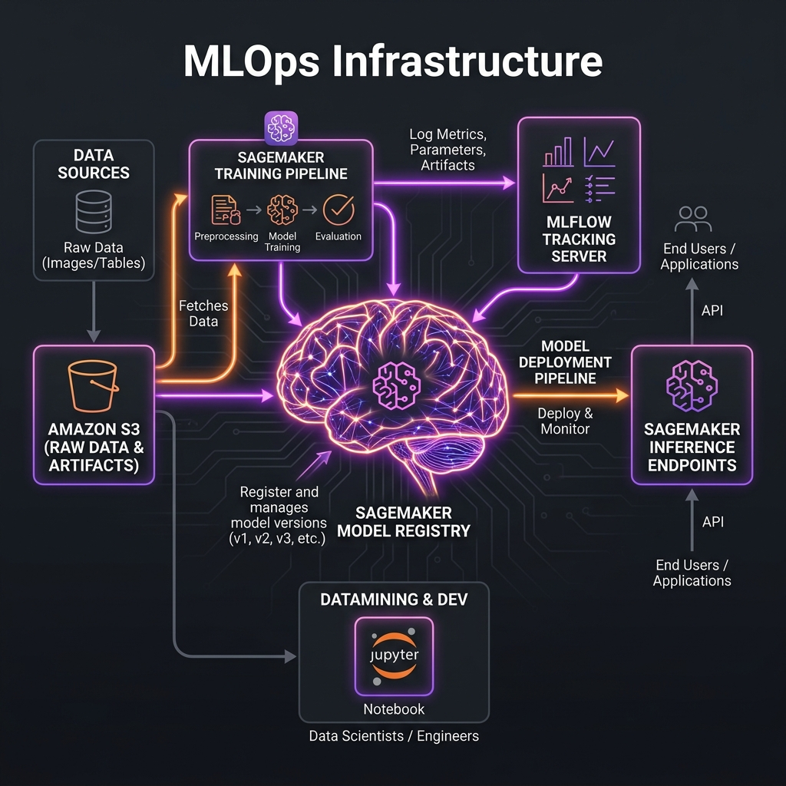
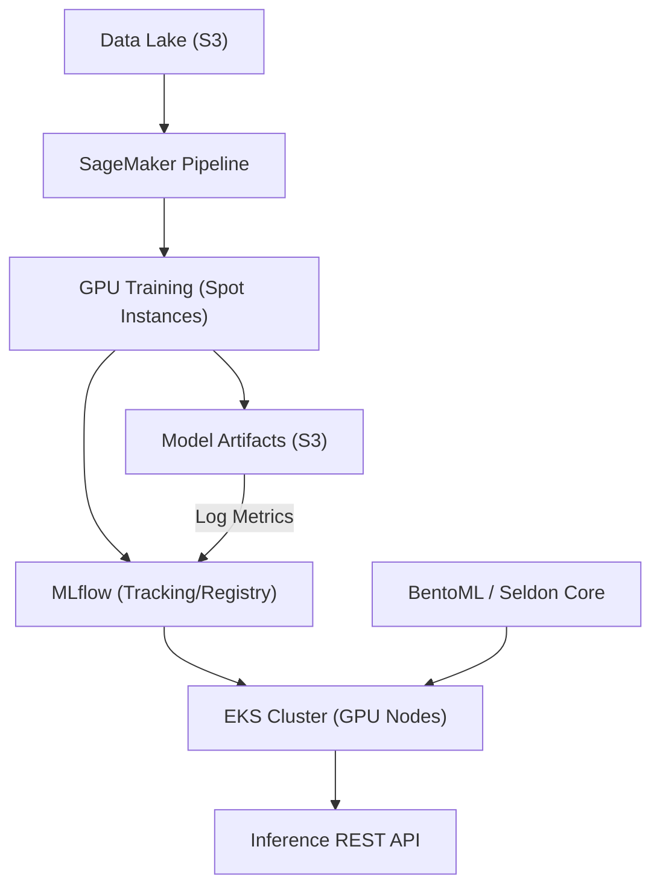

# Project 23: ML Infrastructure Workbook

## 1. Scenario (สถานการณ์จำลอง)

ทีม Data Science ของบริษัท ThaiVision กำลังพัฒนาโมเดล Computer Vision
แต่กระบวนการทำงานในปัจจุบันยังมีข้อจำกัดและปัญหาคอขวดดังนี้:
- ต้องเทรนโมเดลบน Laptop ส่วนตัวและใช้เวลานานถึง 12 ชั่วโมง
- มีการส่งไฟล์โมเดล .pkl ผ่านทาง Email ให้ทีม DevOps
- ทีม DevOps ต้องทำการอัปเดต Flask app แบบ Manual ซึ่งขยายระบบได้ยาก

CTO ของบริษัทจึงกำหนดเป้าหมายเพื่อเตรียมรองรับฟีเจอร์ Real-time Fraud Detection:
- ต้องการ Pipeline ที่สามารถเทรนโมเดลบน GPU ใน AWS
- สามารถทำ Model Tracking บน Dashboard และ Deploy ไปยัง EKS ได้ด้วยการคลิกเพียงครั้งเดียว

ข้อจำกัดของระบบ (Constraints):
- การเทรนโมเดลจะต้องใช้ Spot GPU instances เพื่อความประหยัด
- ทุกโมเดลจะต้องมี versioned URI เพื่อใช้ระบุรุ่นอย่างชัดเจน

ขอบเขตความสำเร็จ (Definition of Done):
- สามารถตั้งค่า GPU NodePool บน EKS ด้วย Karpenter ได้สำเร็จ
- สามารถเปิดใช้งาน Amazon SageMaker Domain และ Studio
- สามารถสั่งรัน Training Job บน SageMaker ด้วย Spot Instance
- สามารถทำ Model Serving และจัดสรรทรัพยากร GPU ให้กับ Container บน EKS ได้

### แนวคิดการทำงานของ ML Infrastructure
- Data Pipeline เปรียบเสมือน "สายพานลำเลียงวัตถุดิบ" เพื่อนำข้อมูลดิบมาล้างและเตรียมให้พร้อม
- Training Job เปรียบเสมือน "เตาหลอมพลังงานสูง" ที่ต้องควบคุมเวลาการเปิดปิด GPU เพื่อความประหยัด
- Model Registry (MLflow) เปรียบเสมือน "ห้องเก็บสูตรลับและตัวอย่างยา" ที่ระบุว่าโมเดลเวอร์ชันใดดีที่สุดและผ่านการทดสอบแล้ว
- Serving (BentoML) เปรียบเสมือน "ตู้ขายยาอัตโนมัติ" ที่ผู้ใช้หรือแอปพลิเคชันอื่นสามารถเข้ามาเรียกใช้งานได้ตลอดเวลา

### การนำไปใช้งานในธุรกิจจริง (Real-world Use Cases)
- Real-time Fraud Detection: ระบบตรวจจับการโกงบัตรเครดิตที่ต้องตัดสินใจในเสี้ยววินาที
- Personalized Recommendations: ระบบแนะนำสินค้าในแอป E-commerce ที่ปรับตามพฤติกรรมผู้ใช้แบบ Real-time
- AI Content Generation: ระบบสร้างรูปภาพหรือข้อความที่ต้องการสเกล GPU ตามจำนวนผู้ใช้งาน
- เพิ่มความรวดเร็วในการนำโมเดลออกสู่ตลาด: ช่วยลดภาระงานของทีมวิศวกรในบริษัทที่มีทีม AI/ML

### ประสิทธิภาพและการขยายตัว (Performance & Scaling Constraints)
- Inference Latency: การทำ Model Serving ต้องมี p99 Latency ต่ำกว่า 100ms
- GPU Utilization: ต้องบริหารจัดการ GPU ให้คุ้มค่าและมี Utilization มากกว่า 70% โดยใช้ Multi-instance GPU (MIG) หรือแชร์ GPU ระหว่าง Pods
- Scaling Approach: ใช้ Karpenter ในการเพิ่ม GPU Nodes เมื่อมีงานเทรนหรือ Traffic สูง และลดขนาดโหนดลงทันทีเพื่อประหยัดค่าใช้จ่าย

## 2. Topology Diagram (แผนผังระบบ)





## 3. Prerequisites & Estimated Time (สิ่งที่ต้องเตรียมและเวลาที่ใช้)

### เวลาที่ใช้ในการประเมิน
- ระยะเวลาประเมิน: 30 ชั่วโมง

### สิ่งที่ต้องเตรียม (Prerequisites)
- AWS Account ที่มี Service Limit สำหรับ GPU instances (ml.g4dn.xlarge) โดยควรทำเรื่องขอเพิ่ม Limit ล่วงหน้า 1-2 วัน
- S3 Bucket สำหรับจัดเก็บ Training Data และ Model Artifacts
- ECR Repository สำหรับเก็บ Training Container Images
- IAM Role สำหรับ SageMaker ที่ได้รับสิทธิ์ในการเข้าถึง S3, ECR และ CloudWatch

### การประเมินค่าใช้จ่าย (Cost Estimation)
- SageMaker Studio: $0 (เฉพาะ IDE) และคิดค่าบริการตาม Instance ที่เปิดรันจริง
- Training Job (ml.g4dn.xlarge): ประมาณ $0.90 ต่อชั่วโมง
- Inference Endpoint (ml.t2.medium): ประมาณ $0.065 ต่อชั่วโมง (ประมาณ $47 ต่อเดือนหากเปิดใช้งานตลอดเวลา)
- ข้อแนะนำในการประหยัดค่าใช้จ่าย:
  - ควรใช้ Serverless Inference สำหรับโมเดลที่มี Low-traffic
  - ใช้ Amazon SageMaker Training Jobs ร่วมกับ Spot Instances ซึ่งช่วยประหยัดค่าใช้จ่ายได้สูงสุดถึง 90%
  - สั่งลบ SageMaker Endpoints ทันทีหลังจากที่ใช้งานเสร็จ
  - ปิดฐานข้อมูลที่ใช้สำหรับ MLflow และลบ S3 Buckets ที่เก็บข้อมูลขนาดใหญ่เมื่อสิ้นสุดการใช้งาน

## 4. Tasks (ขั้นตอนการปฏิบัติ)

### Task 1: การตั้งค่า EKS GPU ด้วย Karpenter

โมเดล Machine Learning จำเป็นต้องประมวลผลผ่าน GPU
เราจะใช้ Karpenter เพื่อสร้างโหนดประเภท g4dn หรือ g5 (Spot Instance) โดยอัตโนมัติ
เมื่อมี Pod ที่ต้องการใช้งาน GPU ถูกสั่งให้ทำงานในระบบ

ขั้นตอนที่ 1: ติดตั้ง NVIDIA Device Plugin เพื่อช่วยให้ Kubernetes มองเห็น GPU บนโหนด
```bash
kubectl apply -k https://github.com/NVIDIA/k8s-device-plugin/deployments/static/overlay/debian
```

ขั้นตอนที่ 2: ตั้งค่า Karpenter GPU NodePool ผ่าน Terraform
```bash
kubectl apply -f src/terraform/karpenter_gpu.tf
```

คำแนะนำจากผู้เชี่ยวชาญ (Expert Note):
- หลีกเลี่ยงการใช้ EKS Node Groups มาตรฐานสำหรับงาน Machine Learning เนื่องจากขยายระบบได้ช้าและมีราคาแพง
- Karpenter สามารถสร้าง GPU Nodes แบบ Spot ได้ในเวลาน้อยกว่า 60 วินาที และจะปิดตัวลงทันทีหลังจากที่งานเทรนโมเดลเสร็จสิ้น

---

### Task 2: การตั้งค่า Amazon SageMaker Studio

SageMaker Studio คือเครื่องมือประเภท IDE สำหรับนักวิทยาศาสตร์ข้อมูล (Data Scientists)

ขั้นตอนที่ 1: สร้าง SageMaker Domain ผ่าน Terraform
- ตรวจสอบให้แน่ใจว่า VPC ของคุณมีการตั้งค่า S3 Gateway Endpoints
- ช่วยหลีกเลี่ยงค่าใช้จ่ายในส่วนของ Data Transfer ระหว่าง SageMaker และ S3 Bucket ของคุณ

```bash
cd src/terraform
terraform apply -target=aws_sagemaker_domain.main
```

ขั้นตอนที่ 2: เปิดใช้งาน Studio ผ่าน CLI
```bash
aws sagemaker create-presigned-domain-url \
    --user-profile-name dev-user \
    --domain-id d-xxxxxx
```

---

### Task 3: การสร้างและรัน Training Job บน SageMaker

สำหรับการรันงานเทรนโมเดลขนาดใหญ่ เราจะสั่งใช้งานผ่าน SageMaker Training Job

โค้ดสำหรับเทรนโมเดล (src/app/train.py):
```python
import torch
import torch.nn as nn

# การนิยามโมเดล (Model definition)...
# การโหลดข้อมูล (Data loading)...

print(f"CUDA Available: {torch.cuda.is_available()}")
# ลูปการเทรน (Train loop)...
```

สั่งรันงานเทรน (Training Job) ผ่าน CLI:
```bash
aws sagemaker create-training-job \
    --training-job-name thaivision-training-v1 \
    --algorithm-specification TrainingImage=763104351884.dkr.ecr.ap-southeast-1.amazonaws.com/pytorch-training:2.0.1-gpu-py310,TrainingInputMode=File \
    --role-arn <SAGEMAKER_ROLE_ARN> \
    --resource-config InstanceType=ml.g4dn.xlarge,InstanceCount=1,VolumeSizeInGB=30 \
    --input-data-config '[{"ChannelName":"training","DataSource":{"S3DataSource":{"S3DataType":"S3Prefix","S3Uri":"s3://my-data/train/"}}}]' \
    --output-data-config '{"S3OutputPath":"s3://my-models/output/"}' \
    --stopping-condition MaxRuntimeInSeconds=3600
```

---

### Task 4: การติดตั้งโมเดลบน EKS (GPU)

หลังจากเทรนโมเดลเรียบร้อย เราจะทำการ Deploy โมเดลบน EKS เพื่อให้บริการ Inference แบบ Real-time

ตั้งค่าการจองหน่วยความจำ GPU ใน Kubernetes Deployment (src/app/deployment.yaml):
```yaml
spec:
  containers:
  - name: model-server
    image: my-registry/vision-model:latest
    resources:
      limits:
        nvidia.com/gpu: 1 # ร้องขอ GPU 1 ตัว
```

---

### Task 5: การทดสอบระบบและการทำ Model Rollback (Failure Injection)

การทดลองสร้างสถานการณ์จำลองเพื่อให้ระบบทำงานผิดพลาดและศึกษาการรับมือ:
- การรัน Training Job โดยลืมปิดเครื่อง: ให้ศึกษาการใช้งาน Spot Instances และการตั้งค่า Managed Warm Pools ใน SageMaker เพื่อให้ระบบปิดการทำงานของตัวเองโดยอัตโนมัติหลังจากการเทรนเสร็จสิ้น เพื่อหลีกเลี่ยงปัญหาค่าใช้จ่ายบานปลาย (Bill Shock)
- การทำ Model Rollback: จำลองสถานการณ์เมื่อโมเดลเวอร์ชันใหม่ทำงานผิดพลาดในระดับ Production โดยทดลองใช้ MLflow และระบบ Serving เพื่อสลับการทำงานกลับไปใช้โมเดลเวอร์ชันก่อนหน้า (Model Lifecycle Management) ภายในเวลาไม่กี่วินาที

## 5. Verification (การตรวจสอบผลการทำงาน)

- [ ] บัญชี AWS Account มี Service Limit สำหรับ GPU instances (ml.g4dn.xlarge) ที่พร้อมใช้งาน
- [ ] S3 Bucket สำหรับจัดเก็บ Training Data และ Model Artifacts ถูกสร้างขึ้นเรียบร้อย
- [ ] ECR Repository สำหรับจัดเก็บ Training Container Images พร้อมใช้งาน
- [ ] IAM Role สำหรับ SageMaker มีสิทธิ์เข้าถึงทรัพยากร S3, ECR และ CloudWatch ครบถ้วน
- [ ] Amazon SageMaker Domain ถูกสร้างสำเร็จและสามารถเข้าใช้งาน Studio ได้
- [ ] MLflow Tracking Server ทำงานปกติและสามารถเชื่อมต่อได้จาก Training Script
- [ ] Training Job รันสำเร็จเสร็จสิ้นและจัดเก็บไฟล์ Model Artifact ลงใน S3 Bucket ได้อย่างถูกต้อง
- [ ] Model ได้รับการลงทะเบียนใน SageMaker Model Registry
- [ ] Inference Endpoint ทำงานอยู่และสามารถตอบสนองต่อการทำนายผล (Prediction) ได้อย่างถูกต้อง
- [ ] ระบบ Model Monitoring ได้รับการติดตั้งเพื่อใช้ตรวจจับสัญญาณของ Data Drift

## 6. Troubleshooting (การแก้ไขปัญหาที่พบบ่อย)

### เคสที่ 1: เกิดข้อผิดพลาด ResourceLimitExceeded เมื่อเริ่มรัน Training Job
- **สาเหตุ:** บัญชี AWS Account ยังไม่มีสิทธิ์เข้าถึงหรือขอ Service Limit สำหรับ GPU instances ที่ต้องการใช้งาน
- **วิธีแก้ไข:** ให้เข้าไปที่ AWS Console > Service Quotas > SageMaker > ค้นหาหัวข้อ "ml.g4dn.xlarge for training job usage" จากนั้นส่งคำขอเพิ่ม Quota ล่วงหน้า (แนะนำให้ส่งคำขอล่วงหน้าประมาณ 1-3 วัน)

### เคสที่ 2: Karpenter พยายามสร้าง Spot Instance แต่ล้มเหลวด้วยข้อความ InsufficientInstanceCapacity
- **สาเหตุ:** ทรัพยากรสำหรับ GPU instance ประเภทที่ระบุ (เช่น g4dn.xlarge) บนโหมด Spot ใน Availability Zone (AZ) ปัจจุบันมีไม่เพียงพอต่อความต้องการของระบบ AWS
- **วิธีแก้ไข:** อัปเดตไฟล์กำหนดค่า NodePool ให้สามารถเลือกใช้งานอินสแตนซ์ได้หลากหลายตระกูลมากขึ้น เช่น `["g4dn.xlarge", "g5.xlarge", "p3.2xlarge"]` และตั้งค่าให้กระจายไปหลาย Availability Zones

### เคสที่ 3: กระบวนการเทรนช้ากว่าปกติ แม้จะเปิดใช้งาน GPU แล้ว
- **สาเหตุ:** S3 Bucket และ SageMaker Instance อยู่คนละ Region ส่งผลให้เกิดความล่าช้าในการดึงข้อมูลข้าม Region (Data Transfer Latency)
- **วิธีแก้ไข:**
  - ตรวจสอบให้มั่นใจว่า S3 Bucket อยู่ใน Region เดียวกันกับ SageMaker Instance
  - ปรับเปลี่ยนโหมดการดึงข้อมูลมาใช้ Pipe Mode แทน File Mode เพื่อ Stream ข้อมูลตรงไปยัง Container โดยไม่ต้องดาวน์โหลดข้อมูลทั้งหมดมาเก็บล่วงหน้า
  - ตัวอย่างการเขียนโค้ดปรับปรุงโหมดการนำเข้าข้อมูล:
    ```python
    estimator = Estimator(..., input_mode="Pipe")
    ```

### เคสที่ 4: เกิดข้อผิดพลาด CUDA-Not-Found หรือ torch.cuda.is_available() ส่งกลับค่าเป็น False ใน EKS Cluster
- **สาเหตุ:** ปลั๊กอิน NVIDIA Device Plugin มีการทำงานที่ขัดข้อง ไม่ได้ติดตั้ง หรือโหนดของ EKS ไม่ได้ระบุ Label อย่างถูกต้อง
- **วิธีตรวจสอบ:** รันคำสั่งนี้เพื่อตรวจจับจำนวน GPU บนโหนด:
  ```bash
  kubectl describe node <node-name> | grep nvidia.com/gpu
  ```
  หากค่าเป็น `0` แสดงว่า Plugin ไม่ทำงาน
- **วิธีแก้ไข:** ดำเนินการติดตั้ง `k8s-device-plugin` ใหม่อีกครั้ง และตรวจสอบการใช้งาน EKS-Optimized (Accelerated) AMI สำหรับระบบปฏิบัติการของโหนด

### เคสที่ 5: งานเทรนบน SageMaker ล้มเหลวทันทีและแจ้งข้อความ Access Denied
- **สาเหตุ:** IAM Role ที่ใช้สำหรับประมวลผลงานของ SageMaker (SageMaker Execution Role) ไม่มีสิทธิ์ในการอ่านเขียนข้อมูลกับ S3 Bucket หรือติดสิทธิ์การถอดรหัสของ KMS Key ที่ระบุ
- **วิธีแก้ไข:** ตรวจสอบและเพิ่มสิทธิ์การใช้งาน `s3:GetObject` ใน IAM Policy และตรวจสอบให้แน่ใจว่า KMS Key Policy อนุญาตให้ SageMaker Role สามารถถอดรหัส (Decrypt) ข้อมูลได้จริง

### เคสที่ 6: Inference Endpoint ตอบกลับผลลัพธ์ล่าช้า (Cold Start)
- **สาเหตุ:** แอปพลิเคชันใน Container ต้องดาวน์โหลดและโหลดโมเดลขนาดใหญ่ลงหน่วยความจำใหม่ทุกครั้งที่เกิดการเริ่มระบบหรือ Restart Instance
- **วิธีแก้ไข:**
  - เลือกใช้ SageMaker Multi-Model Endpoint เพื่อเปิดระบบการทำ Caching สำหรับโมเดลที่ใช้งานบ่อยไว้ใน Memory
  - เปลี่ยนประเภทของ Instance ให้มีขนาด RAM มากขึ้น เช่น อัปเกรดจาก `ml.m5.xlarge` เป็น `ml.m5.2xlarge`
  - ทำ Model Compilation ผ่าน AWS Neuron SDK เพื่อช่วยให้ระบบประมวลผลโมเดลได้เร็วขึ้น

### เคสที่ 7: MLflow Experiment ไม่บันทึก Metrics หรือ Parameters
- **สาเหตุ:** ขาดการตั้งค่าตัวแปรสภาพแวดล้อม `MLFLOW_TRACKING_URI` ใน Training Container ทำให้สคริปต์ส่งผลลัพธ์ไปยังเซิร์ฟเวอร์ไม่ได้
- **วิธีแก้ไข:** ทำการกำหนดตัวแปรสภาพแวดล้อมในโครงสร้างการเรียกใช้งานของ Estimator ดังนี้:
  ```python
  estimator = Estimator(
      ...
      environment={"MLFLOW_TRACKING_URI": "http://mlflow-server:5000"},
  )
  ```

## 7. Exercises & Solutions (แบบฝึกหัดและแนวทางการแก้ไข)

### แบบฝึกหัดที่ 1: การตั้งค่า MLflow (ระดับง่าย)
ทำการ Deploy MLflow ในรูปแบบ Docker Container บน ECS โดยใช้ S3 เป็น Artifact Store และใช้ RDS เป็น Backend
- ทำการส่ง Log Metric ชื่อ "accuracy" สมมติจาก Local Script ไปยัง MLflow Server

#### แนวทางการแก้ไข (Solution)
เขียนสคริปต์ Python ในการเชื่อมต่อและเก็บข้อมูลใน MLflow:
```python
import mlflow

mlflow.set_tracking_uri("http://mlflow-server:5000")
mlflow.set_experiment("fraud-detection-v2")

with mlflow.start_run():
    mlflow.log_param("learning_rate", 0.001)
    mlflow.log_param("epochs", 10)
    # ... training code ...
    mlflow.log_metric("accuracy", 0.94)
    mlflow.log_metric("f1_score", 0.92)
    mlflow.sklearn.log_model(model, "model")
```

---

### แบบฝึกหัดที่ 2: การทำ GPU Scheduling (ระดับปานกลาง)
ทำการ Deploy PyTorch Container แบบง่ายไปยัง EKS Cluster:
- ตรวจสอบให้แน่ใจว่า Container จะถูกจัดตารางเวลาให้รันบน GPU Nodes เท่านั้นโดยการใช้ nodeSelector และ tolerations
- ใช้คำสั่ง nvidia-smi เพื่อตรวจสอบสถานะและสิทธิ์การเข้าถึง GPU (GPU Visibility) จากภายใน Container

#### แนวทางการแก้ไข (Solution)
ตัวอย่างคำสั่งการส่งไฟล์ตั้งค่าและสคริปต์การทำ Training Job ของ SageMaker ด้วย Python SDK:
```python
from sagemaker.estimator import Estimator
import sagemaker

session = sagemaker.Session()
role = "arn:aws:iam::123456789:role/SageMakerExecutionRole"

estimator = Estimator(
    image_uri="123456789.dkr.ecr.ap-southeast-1.amazonaws.com/training:latest",
    role=role,
    instance_count=1,
    instance_type="ml.g4dn.xlarge",
    output_path="s3://my-bucket/model-artifacts/",
    hyperparameters={"epochs": 10, "learning-rate": 0.001},
)

estimator.fit({"train": "s3://my-bucket/training-data/"})
```

---

### แบบฝึกหัดที่ 3: A/B Model Serving (ระดับยาก)
ใช้ Seldon Core หรือ Istio เพื่อทำการแบ่งเฉลี่ยทราฟฟิก (Traffic Splitting) ระหว่างโมเดลรุ่น Model V1 และ Model V2:
- ทำการเก็บสถิติ Metric ที่สำคัญ (เช่น Inference Latency, Prediction Distribution) และทำ Visualization บนระบบ Grafana

#### แนวทางการแก้ไข (Solution)
การตรวจสอบการเก็บข้อมูลของโมเดล (Model Monitoring - Data Drift Detection):
```python
# SageMaker Model Monitor
from sagemaker.model_monitor import DataCaptureConfig, ModelMonitor

data_capture_config = DataCaptureConfig(
    enable_capture=True,
    sampling_percentage=100,
    destination_s3_uri="s3://my-bucket/data-capture/",
)
# Attach to Endpoint and schedule monitoring job daily
```

