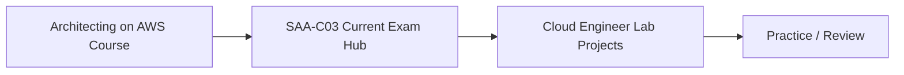

# AWS Learning Library

[Back to repository root](../README.md)

AWS content is organized as separate source-aware packages that combine into one learning system: long-form courses for theory, certification hubs for current exam scope/practice, and hands-on projects for real implementation.

## Recommended AWS path

## Courses

- [Architecting on AWS 7.12.4](./Courses/Architecting-on-AWS-7.12.4/) — **Verified Course Scope**: 13/13 module families + 7/7 companion lab guides mapped to the current AWS course outline, with a 2026 currentness overlay, source map and formal QA matrix. the known licensed source-image blocker has been removed from the current tree; Git-history caveat is documented in PROVENANCE.md.

## Certifications

- [AWS Certified Solutions Architect – Associate (SAA-C03)](./Certifications/SAA-C03/) — **Verified Current Objective Scope**: 14/14 tasks and 189/189 published Knowledge/Skill bullets mapped to teachable content as of 2026-10-06, with a current-scope deep dive, objective QA matrix, hands-on mappings and 20 original architecture scenarios. Legacy third-party practice wording still has a separate provenance review.

## Projects

- [Cloud Engineer Lab](./Projects/Cloud-Engineer-Lab/) — 34 AWS-centered hands-on projects plus preparation setup, progressing from foundation through architect-level scenarios with Terraform, Kubernetes, CI/CD, security, FinOps and observability.

## Why these stay as separate packages

The course, certification and project track have different source identities and maintenance cycles. Keeping them separate avoids duplicate theory and preserves provenance, while the certification hub connects them into a single learner experience.

## Structure for future AWS content

Use `Courses/`, `Certifications/`, `Topics/` or `Projects/` according to [`docs/REPOSITORY-ARCHITECTURE.md`](../docs/REPOSITORY-ARCHITECTURE.md).
