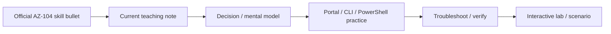

# AZ-104 Current Objectives Deep Dive — 2026

> 🧠 **ภาพจำก่อนอ่าน:** 🧠 Concept → 🗺️ Flow → 🔎 Check → ✅ Explain  
> 🎨 [Visual Guide ของวิชานี้](./VISUAL-MEMORY-GUIDE-TH.md) — ภาพช่วยจำ ไม่แทนคำอธิบายและคำสั่งจริง

[Back to AZ-104](./README.md) · [Coverage Matrix](./SOURCE-COVERAGE.md) · [Source Manifest](./SOURCE-MANIFEST.md)

> **Scope authority:** Microsoft Learn — Study guide for Exam AZ-104  
> **Skills measured:** 2026-04-17  
> **Verification date:** 2026-10-07  
> **Purpose:** current official-objective teaching layer for the repository. The imported interactive cram-book remains a practice/visual companion, not the sole source of truth.

## How to use this file

Use this as the **current exam-scope spine**. Every official skill bullet is represented here with a practical mental model, decision rule, or operational check. For deeper visual practice, use the imported interactive pages and labs under [`interactive/`](./interactive/).



---

# 1. Manage Azure identities and governance — 20–25%

## 1.1 Manage Microsoft Entra users and groups

### Create users and groups

Use **users** for identities and **groups** to manage access at scale. Prefer group-based assignment over repeatedly granting permissions to individual users.

Operational check:
- confirm the object exists in the correct tenant,
- confirm group type and membership mode,
- verify the user can authenticate before troubleshooting Azure RBAC.

### Manage user and group properties

Important properties include display name, UPN, usage location, membership, ownership, and account state. Separate **identity properties** from **Azure resource permissions**: changing a user property does not automatically change Azure RBAC.

### Manage licenses in Microsoft Entra ID

Licensing is an identity/service entitlement problem, not an Azure RBAC problem. A user can have Azure resource access but still lack a Microsoft service license, and vice versa.

Decision rule:
- access to Azure resource → inspect Azure RBAC,
- entitlement to Microsoft service → inspect license assignment.

### Manage external users

External/B2B users are identities from outside the home organization. Invite them into the tenant, then authorize them just like other principals using groups and RBAC.

Security rule: invitation does not equal permission. Authentication and authorization are separate.

### Configure self-service password reset (SSPR)

SSPR lets eligible users reset passwords without help-desk intervention. Scope it to the correct users/groups and verify authentication methods.

Troubleshoot in this order:
1. Is the user in SSPR scope?
2. Are required authentication methods registered?
3. Does the tenant/hybrid identity configuration support the intended reset/writeback behavior?

## 1.2 Manage access to Azure resources

### Manage built-in Azure roles

Azure RBAC roles define **Actions / DataActions** and the scope where they apply. Use the least-privileged built-in role that satisfies the task before creating custom roles.

### Assign roles at different scopes

Hierarchy:

```text
Management group
  → Subscription
    → Resource group
      → Resource
```

Assignments inherit downward. A broad assignment high in the hierarchy can affect many resources.

### Interpret access assignments

Effective access is the combination of:
- principal,
- role definition,
- scope,
- inheritance,
- deny assignments where applicable.

When access looks wrong, inspect **effective assignments**, not only the resource-level IAM blade.

## 1.3 Manage Azure subscriptions and governance

### Implement and manage Azure Policy

Azure Policy evaluates resource properties against rules. Use it for governance such as allowed locations, required tags, or configuration standards.

Mental model:
- **RBAC** asks “who can do it?”
- **Policy** asks “is this resource/configuration allowed or compliant?”

### Configure resource locks

Locks protect resources from accidental changes:
- **CanNotDelete**
- **ReadOnly**

Locks are management-plane controls and inherit downward. They are not a substitute for RBAC.

### Apply and manage tags on resources

Tags add metadata for ownership, environment, cost center, application, or lifecycle. Do not assume every child resource automatically inherits tags unless you explicitly implement a mechanism such as Azure Policy.

### Manage resource groups

Resource groups are lifecycle/management containers. Resources in one resource group can be in different regions, and moving resources has service-specific constraints.

### Manage subscriptions

Subscriptions are major boundaries for billing, quotas, governance, and access. Know how RBAC, Policy, management groups, and resource providers interact with subscription scope.

### Manage costs by using alerts, budgets, and Azure Advisor recommendations

- **Budgets** track spending against thresholds.
- **Cost alerts** notify on budget/credit/anomaly conditions.
- **Azure Advisor** surfaces optimization recommendations.

A budget does not automatically stop resources unless you build automation around it.

### Configure management groups

Use management groups to apply governance across multiple subscriptions. Design the hierarchy around stable governance boundaries, not short-lived org charts.

---

# 2. Implement and manage storage — 15–20%

## 2.1 Configure access to storage

### Configure Azure Storage firewalls and virtual networks

Storage network controls restrict where traffic may originate. Distinguish:
- public endpoint with firewall rules,
- service endpoint path,
- private endpoint with private IP.

Troubleshooting: validate DNS, endpoint path, subnet configuration, firewall rules, and identity separately.

### Create and use shared access signature (SAS) tokens

SAS delegates scoped, time-limited access without sharing the account key. Restrict:
- permissions,
- resource,
- start/expiry,
- protocol,
- IP where appropriate.

Prefer the narrowest SAS possible.

### Configure stored access policies

Stored access policies provide centralized control over certain service SAS settings and can help revoke/change delegated access without replacing every token.

### Manage access keys

Storage account keys are highly privileged shared secrets. Protect and rotate them; prefer Entra ID + RBAC when supported.

### Configure identity-based access for Azure Files

Azure Files can use identity-based authorization depending on protocol and identity setup. Separate:
- share/data-plane authorization,
- NTFS/file permissions where applicable,
- network reachability.

## 2.2 Configure and manage storage accounts

### Create and configure storage accounts

Choose account type, region, redundancy, network access, security settings, and data services based on workload needs.

### Configure Azure Storage redundancy

Know the resilience intent:
- LRS: copies in one datacenter scope,
- ZRS: copies across availability zones,
- GRS/RA-GRS: secondary region replication,
- GZRS/RA-GZRS: zone resilience plus regional replication.

Choose for failure domain and recovery requirements, not by acronym memorization.

### Configure object replication

Object replication asynchronously copies block blobs between storage accounts/containers. Verify prerequisites such as versioning and supported account/configuration requirements.

### Configure storage account encryption

Azure Storage encrypts data at rest. Understand Microsoft-managed keys vs customer-managed keys and the operational impact of key availability/permissions.

### Manage data by using Azure Storage Explorer and AzCopy

Use **Storage Explorer** for GUI administration and **AzCopy** for high-performance scripted data transfer. Always confirm authentication context and destination path before large copy operations.

## 2.3 Configure Azure Files and Azure Blob Storage

### Create and configure a file share in Azure Files

Choose SMB/NFS support, quota, identity model, networking, and redundancy based on application requirements.

### Create and configure a container in Azure Blob Storage

A container groups blobs inside a storage account. Configure access level carefully; private access should be the default for most enterprise workloads.

### Configure storage tiers

Use Hot/Cool/Cold/Archive based on access frequency, latency, retention, and retrieval cost. Tier choice is a cost/availability decision, not only a storage-price decision.

### Configure soft delete for blobs and containers

Soft delete provides a recovery window after deletion. Configure retention according to business recovery requirements.

### Configure snapshots and soft delete for Azure Files

Snapshots capture point-in-time share state; soft delete protects deleted shares. They solve different recovery problems and can be used together.

### Configure blob lifecycle management

Lifecycle rules automatically transition or delete blobs based on conditions such as age or access state. Validate rule scope and prefixes before enabling destructive actions.

### Configure blob versioning

Versioning retains previous blob versions after overwrite/update. Combine with lifecycle policies to control long-term cost.

---

# 3. Deploy and manage Azure compute resources — 20–25%

## 3.1 Automate deployment with ARM templates or Bicep

### Interpret an ARM template or Bicep file

Identify parameters, variables, resources, dependencies, outputs, scopes, and module/resource references. Understand the desired-state model before changing syntax.

### Modify an existing ARM template

Preserve resource IDs, dependencies, API versions, parameter semantics, and deployment scope. Use validation/what-if before applying risky changes.

### Modify an existing Bicep file

Bicep is a higher-level language that compiles to ARM JSON. Prefer readable symbolic references and modules instead of hand-building resource IDs when possible.

### Deploy resources by using ARM or Bicep

Deploy at the correct scope and inspect deployment operations on failure. Common causes include RBAC, policy denial, quota, invalid API properties, naming, and dependencies.

### Export a deployment as ARM or convert ARM to Bicep

Export/decompile is a starting point, not automatically production-quality IaC. Review generated output, remove noise, parameterize intentionally, and test idempotent redeployment.

## 3.2 Create and configure virtual machines

### Create a virtual machine

Plan image, size, region/zone, disk type, network placement, identity, security, and management access together.

### Configure encryption at host

Encryption at host protects supported VM temporary/cache data at the host layer. Verify VM size/region support and understand how it complements disk encryption.

### Move a VM to another resource group, subscription, or region

Resource-group/subscription moves and region moves have different mechanics and constraints. Check dependent resources and service support before moving.

### Manage virtual machine sizes

Resize based on CPU, memory, storage throughput/IOPS, accelerated networking, GPU, and quota—not CPU count alone.

### Manage virtual machine disks

Know OS vs data disks, managed disk types, snapshots, attachment limits, caching, and performance characteristics.

### Deploy VMs to availability zones and availability sets

- **Availability Zones** protect against datacenter/zone failure within a region.
- **Availability Sets** distribute VMs across fault/update domains where supported.

Choose based on region support and failure model.

### Deploy and configure Virtual Machine Scale Sets

VMSS provides a fleet model for homogeneous VMs with scaling and orchestration. Pair with health probes/load balancing and understand upgrade/scaling behavior.

## 3.3 Provision and manage containers in the Azure portal

### Create and manage Azure Container Registry

ACR stores container images/artifacts. Secure registry access with identity/RBAC and avoid embedding admin credentials in applications.

### Provision a container using Azure Container Instances

ACI is useful for simple, isolated container workloads without managing an orchestrator.

### Provision a container using Azure Container Apps

Container Apps provides managed application/container features such as revisions, ingress, and event/HTTP-driven scaling.

### Manage sizing and scaling for containers

Understand fixed resource allocation vs dynamic scaling. Container Apps supports richer autoscaling patterns; ACI is simpler and less orchestration-heavy.

## 3.4 Create and configure Azure App Service

### Provision an App Service plan

The plan determines region, compute tier, capacity, and many scaling capabilities for apps hosted on it.

### Configure scaling for an App Service plan

Distinguish **scale up** (bigger SKU) from **scale out** (more instances/autoscale).

### Create an App Service

Configure runtime, OS, deployment source, application settings, identity, networking, and observability.

### Configure certificates and TLS

Use managed/imported certificates as appropriate, bind certificates to custom domains, and enforce suitable TLS settings.

### Map an existing custom DNS name

Create the required DNS record, verify domain ownership, then bind hostname/certificate in App Service.

### Configure backup for App Service

Configure backup destination, schedule, retention, and app/database coverage; verify restores rather than trusting job status alone.

### Configure networking settings

Know inbound access, access restrictions/private endpoint scenarios, and outbound VNet integration. Inbound and outbound networking are not the same feature.

### Configure deployment slots

Use slots for staged releases and controlled swaps. Treat slot settings carefully so environment-specific values do not move unintentionally.

---

# 4. Implement and manage virtual networking — 15–20%

## 4.1 Configure and manage virtual networks

### Create and configure VNets and subnets

Plan non-overlapping CIDRs, subnet purpose, service delegation, NSGs, routing, DNS, and future growth.

### Create and configure VNet peering

Peering connects VNets privately over the Azure backbone. It is non-transitive by default; verify address-space overlap and routing expectations.

### Configure public IP addresses

Choose SKU/allocation and associate the IP with the correct front-end resource. Public IP presence alone does not guarantee reachability.

### Configure user-defined routes

UDRs override/shape routing, commonly toward NVAs/firewalls. Check effective routes when traffic behaves unexpectedly.

### Troubleshoot network connectivity

Use a layered method:

```text
DNS
→ route / next hop
→ NSG / security
→ endpoint / listener
→ application
```

Avoid “open everything” troubleshooting.

## 4.2 Configure secure access to virtual networks

### Create and configure NSGs and application security groups

NSGs filter network traffic. ASGs group NICs/VM workloads logically so NSG rules can refer to application roles instead of IP lists.

### Evaluate effective security rules

Effective rules combine subnet and NIC NSGs. Inspect the effective result rather than only one NSG definition.

### Implement Azure Bastion

Bastion provides browser-based RDP/SSH access without exposing VM management ports directly to the public Internet.

### Configure service endpoints for PaaS

Service endpoints extend VNet identity/routing to supported PaaS services while the service still uses its public endpoint model.

### Configure private endpoints for PaaS

Private Endpoint assigns a private IP from the VNet to access a supported PaaS resource via Private Link. DNS is a common failure point.

## 4.3 Configure name resolution and load balancing

### Configure Azure DNS

Understand public vs private DNS zones, record sets, VNet links, and name-resolution path.

### Configure an internal or public load balancer

Azure Load Balancer operates at Layer 4. Choose public vs internal frontend based on who must reach the service.

### Troubleshoot load balancing

Check:
1. frontend IP,
2. load-balancing rule,
3. backend pool,
4. health probe,
5. NSG,
6. guest OS listener/firewall,
7. return route.

---

# 5. Monitor and maintain Azure resources — 10–15%

## 5.1 Monitor resources in Azure

### Interpret metrics in Azure Monitor

Metrics are numeric time-series signals. Check namespace, aggregation, dimension, time range, and resource scope before drawing conclusions.

### Configure log settings in Azure Monitor

Diagnostic settings route platform logs/metrics to destinations such as Log Analytics, Storage, or Event Hubs. “No logs” often means the diagnostic path was never enabled.

### Query and analyze logs

Use KQL in Log Analytics. Start by identifying the correct table/time range, then filter, project, summarize, and correlate.

### Set up alert rules, action groups, and alert processing rules

- alert rule = detection condition,
- action group = notification/action target,
- alert processing rule = suppression/routing behavior.

### Configure and interpret Azure Monitor Insights

Insights provide curated monitoring for resources such as VMs, storage, and networks. Use them as a starting view, then drill into underlying metrics/logs for diagnosis.

### Use Azure Network Watcher and Connection Monitor

Use Network Watcher tooling for topology/connectivity/routing/security diagnostics. Connection Monitor continuously tests connectivity between endpoints.

## 5.2 Implement backup and recovery

### Create a Recovery Services vault

Recovery Services vault supports workloads such as Azure VM backup and Site Recovery scenarios.

### Create an Azure Backup vault

Backup vault supports newer Azure Backup workload types. Know which vault type supports the target workload before configuring protection.

### Create and configure a backup policy

A backup policy defines schedule, retention, and protection behavior. Match it to RPO/retention requirements.

### Perform backup and restore using Azure Backup

Validate restore workflows—not just successful backup jobs. Know restore granularity and recovery destination options for the workload.

### Configure Azure Site Recovery

ASR replicates supported workloads for disaster recovery. Configure source/target, replication policy, network mapping, and recovery plan as required.

### Perform failover to a secondary region

Understand test failover vs planned/unplanned failover, validation, commit, and reprotect/failback workflow.

### Configure and interpret backup reports and alerts

Use monitoring/reporting to find protection failures, unhealthy items, missed jobs, and policy drift. A green vault summary should not replace workload-level verification.

---

# Final decision maps

## RBAC vs Policy vs Lock

```text
Who may perform the action?   → Azure RBAC
Is the resource configuration allowed/compliant? → Azure Policy
Should delete/write be prevented operationally?  → Resource Lock
```

## Service Endpoint vs Private Endpoint

```text
Need PaaS reachable through its public endpoint
but restricted to selected VNets? → Service Endpoint

Need the PaaS resource represented by a private IP
inside the VNet? → Private Endpoint
```

## Backup vs Site Recovery

```text
Recover deleted/corrupted data or historical point → Azure Backup
Continue workload after site/region disaster       → Azure Site Recovery
```

## Scale up vs scale out

```text
Need stronger single instance → Scale up
Need more instances/capacity  → Scale out
```

---

# Troubleshooting discipline

For AZ-104 administration, use the same order repeatedly:

1. **Scope** — tenant/subscription/resource group/resource correct?
2. **Identity** — correct principal and authentication context?
3. **Authorization/governance** — RBAC, Policy, lock?
4. **Network path** — DNS, route, NSG, endpoint?
5. **Resource state/configuration** — SKU, region, quota, dependency?
6. **Observability** — metrics, activity log, diagnostic logs, deployment operations?
7. **Recovery** — rollback, restore, failover, redeploy?

This order prevents random changes and makes troubleshooting explainable.

# Completion check

You should be able to explain all **82 official skill bullets** without relying on a product-name list, and then use the interactive package to practice the same decisions visually.

Official scope: https://learn.microsoft.com/en-us/credentials/certifications/resources/study-guides/az-104
