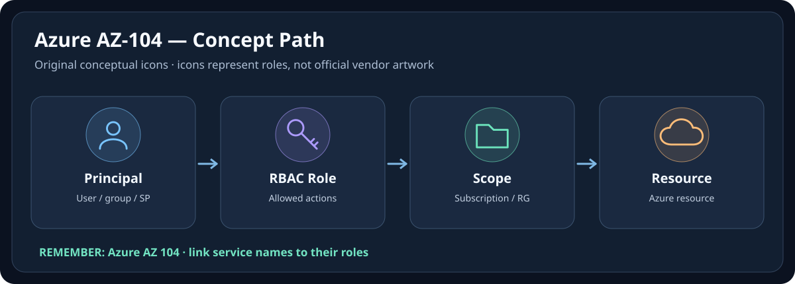
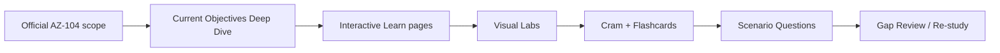

# AZ-104 — Microsoft Azure Administrator

> **Status:** **Verified Current Objective Scope** — 15/15 objective groups and 82/82 current skill bullets evidenced in the decoded interactive payload  
> **Build mode:** Hybrid — source-ingestion + current official verification  
> **Imported source repo:** `somkid-s5/az-104-master-cram-book` @ `ad6c2913af351b2b30feb29f5594999891b4d994`  
> **Current official scope:** Microsoft Learn skills measured as of **2026-04-17**  
> **Last repository verification:** 2026-10-07  
> **Canonical home:** this package in `Cloud-Engineer`

[← Repository root](../README.md)

## 🔷 Visual Memory — ดูภาพก่อนอ่านบทเต็ม

**🧠 👤 Principal → 🔑 Role → 🗂️ Scope → ☁️ Resource** — 📌 Azure RBAC ต้องมอง Principal + Role Definition + Scope + Role Assignment พร้อมกัน; PIM, Deny Assignment และเงื่อนไขอื่นอาจมีผล

[📘 เปิด Visual Guide แบบ Icon-First (Concept + Troubleshooting)](./VISUAL-MEMORY-GUIDE-TH.md) · [🎨 มาตรฐาน Visual ร่วม](../docs/ICON-FIRST-LEARNING-STANDARD.md)

## What this package is

This package consolidates the existing **AZ-104 2026 Master Cram Book** into the main personal learning knowledge base.

The imported system already provides an interactive exam-prep experience with:

- Learn/Cram pages,
- 10 visual labs,
- 103 flashcards,
- 155 original scenario questions,
- blueprint/checklist views,
- browser progress tracking,
- Playwright regression tests from the original repository.

The interactive source is preserved under [`interactive/`](./interactive/).

## Current Microsoft exam structure

The current Microsoft Learn study guide measures five skill areas:

1. Manage Azure identities and governance — 20–25%
2. Implement and manage storage — 15–20%
3. Deploy and manage Azure compute resources — 20–25%
4. Implement and manage virtual networking — 15–20%
5. Monitor and maintain Azure resources — 10–15%

The detailed mapping lives in [`SOURCE-COVERAGE.md`](./SOURCE-COVERAGE.md), with formal evidence in [`AZ104-QA-MATRIX.md`](./AZ104-QA-MATRIX.md). For a durable Thai teaching layer that follows every current objective, use [`AZ-104-CURRENT-OBJECTIVES-DEEP-DIVE-TH.md`](./AZ-104-CURRENT-OBJECTIVES-DEEP-DIVE-TH.md).

## Recommended learning flow

## Source layers

### 1. Original study source

The original interactive repository states that its Learn/Cram/Flashcard/Question Bank content was generated from the user's Google Drive document **AZ-104 2026 Complete Exam Cheat Sheet (Pass-First)**.

### 2. Imported interactive implementation

The complete source snapshot from `az-104-master-cram-book` is preserved in [`interactive/`](./interactive/).

### 3. Current official verification

Use the current Microsoft Learn AZ-104 study guide as the scope authority for exam objectives and service-name freshness.

Official guide: [Microsoft Learn — AZ-104 study guide](https://learn.microsoft.com/en-us/credentials/certifications/resources/study-guides/az-104)

## Migration policy

The old standalone repository can continue to exist as a public/live deployment mirror. New structural work, QA metadata and future long-form learning integration should happen here first so `Cloud-Engineer` remains the canonical knowledge base.

## Quality status

This package now passes the main repository's declared **current-objective scope** gate:

- 15/15 objective groups mapped,
- 82/82 current Microsoft Learn skill bullets checked against the decoded interactive payload,
- a current Thai objective teaching layer exists for all 82 bullets,
- 10 interactive visual labs, 155 scenario questions and 103 flashcards are present,
- current platform deltas are separated in [CURRENTNESS-2026.md](./CURRENTNESS-2026.md),
- source traceability and machine-readable scope inventory are recorded,
- CI guards payload coverage, repository structure and internal links.

`Verified` remains scoped to the Microsoft Learn skills measured on **2026-04-17**. It is not a claim that Azure will never change or that every Azure feature is covered.
