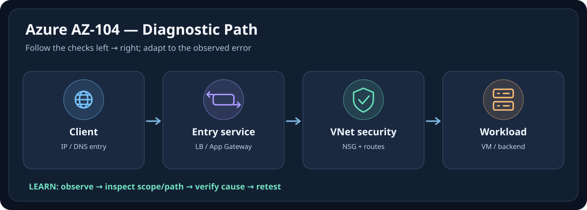

# 🔷 Azure AZ-104 — Icon-First Visual Memory Guide

[← กลับหน้าเรียน Azure AZ-104](./README.md) · [มาตรฐานการใช้ภาพร่วมกัน](../docs/ICON-FIRST-LEARNING-STANDARD.md)

> **ขอบเขต:** Visual Memory สำหรับทบทวนแนวคิด; ไม่แทน Module, Lab, Official Documentation หรือการยืนยัน Configuration จริง  
> **Icon provenance:** SVG นี้วาดไอคอนเชิงแนวคิดขึ้นใหม่ ไม่ใช่ Official Service Logo  
> **สถานะ:** Companion Visual Layer (เพิ่ม 2026-10-10); ไม่เปลี่ยนสถานะ Verified ของเนื้อหาเดิม

เชื่อมภาพของ Identity, RBAC, Scope และ Network Path เพื่อช่วยจำก่อนอ่าน Objectives ใช้สูตร **จำภาพ → รู้ชื่อ → เข้าใจหน้าที่ → อ่านเนื้อหาเต็ม → ลงมือ Lab**

## 🧠 ภาพจำใน 10 วินาที

**👤 Principal → 🔑 Role → 🗂️ Scope → ☁️ Resource**

**จำให้ขึ้นใจ:** 📌 Azure RBAC ต้องมอง Principal + Role Definition + Scope + Role Assignment พร้อมกัน; PIM, Deny Assignment และเงื่อนไขอื่นอาจมีผล

## 🩺 Troubleshooting ผ่าน Icon

**สถานการณ์ตัวอย่าง:** เมื่อเจอ AuthorizationFailed ให้เช็ก subscription/tenant context, effective role assignment, scope และการ deny/condition; ส่วน Network timeout ให้แยก DNS, route, NSG, LB/Backend และ guest firewall

> [!IMPORTANT]
> แผนภาพเป็นเพียง mental model แสดงจุดตรวจหลัก ไม่ใช่ implementation diagram ของทุกบริการ และการตรวจจริงต้องอ้างอิงเวอร์ชัน/ขอบเขต/ความเสี่ยงที่ใช้งาน

## 🎯 Icon / Emoji Legend

| ภาพจำ | คำศัพท์หลัก | ใช้แยกเรื่องอะไร |
|---|---|---|
| 🌐 | Network / Entry | Request, DNS, Endpoint, Connectivity |
| 👤 | Identity | User, Group, Service Identity, Principal |
| 🔑 | Permission | Role, Scope, Authentication/Authorization |
| 🖥️ | Compute | Server, Instance, Container, Workload |
| 🗄️ | Storage / DB | Persistent Data, Files, Database |
| 🩺 | Health / Evidence | Status, Logs, Metrics, Verification |
| 🚨 | Incident | Symptom, Fault, Failed State |
| ✅ | Validation | Verify outcome and expected behavior |

## 📚 ไปอ่านเนื้อหาเต็ม (หลักฐานและ Lab ยังอยู่ใน Note)

- [AZ-104-CURRENT-OBJECTIVES-DEEP-DIVE-TH](./AZ-104-CURRENT-OBJECTIVES-DEEP-DIVE-TH.md)
- [CURRENTNESS-2026](./CURRENTNESS-2026.md)

## ❓ ลองทดสอบความจำ

คำถาม: ถ้าเห็นภาพจำแล้ว จะเริ่มตรวจสอบอะไร และอะไรที่ยังยืนยันไม่ได้?

เมื่อเจอ AuthorizationFailed ให้เช็ก subscription/tenant context, effective role assignment, scope และการ deny/condition; ส่วน Network timeout ให้แยก DNS, route, NSG, LB/Backend และ guest firewall ภาพบอกลำดับคิดเท่านั้น; ต้องเก็บหลักฐานก่อนสรุปสาเหตุ

## 🏷️ โลโก้และไอคอนทางการ

บทเรียนใช้ **Original Pictogram** เพื่ออธิบาย Role; หากต้องการจำรูปร่าง Logo/Service Icon ของผู้ผลิต ให้ศึกษา [Azure Architecture Icons](https://learn.microsoft.com/en-us/azure/architecture/icons/) และปฏิบัติตามเงื่อนไขสิทธิ์/เครื่องหมายการค้าของเจ้าของ Logo ห้ามเรียกไอคอนที่วาดขึ้นใหม่ว่าโลโก้ทางการ
