# AZ-104 Current Scope Deep Dive — April 2026 Skills

[Back to AZ-104 Hub](./README.md) · [Objective QA Matrix](./QA-MATRIX.md) · [Sources](./SOURCES.md) · [Interactive Reader](./interactive/)

> **Official skills version:** April 17, 2026  
> **Repository verification:** 2026-10-06  
> This supplement gives the imported interactive study system a portable Markdown layer for current exam scope, mental models, decisions and troubleshooting. It does not replace Microsoft Learn or the interactive labs.

## How to think like an Azure administrator

AZ-104 is not a product-name memorization exam. Most questions become easier when you ask four questions in order:

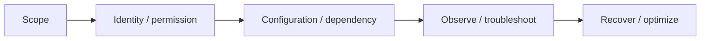

For almost every task, identify:

1. **Scope** — tenant, management group, subscription, resource group, resource, VNet/subnet or individual service.
2. **Control plane identity** — who is allowed to create/change the resource?
3. **Data plane identity** — who can actually read/write the data or application endpoint?
4. **Dependency** — DNS, route, NSG, private endpoint, identity, storage key, policy, vault or monitoring configuration.
5. **Evidence** — which metric, log, effective rule, activity log, query or recovery point proves the state?

---

# Domain 1 — Manage Azure identities and governance (20–25%)

## 1.1 Microsoft Entra users and groups

### Users, groups and external identities

Microsoft Entra ID is the identity plane for users, groups, applications and service principals used across Microsoft cloud services.

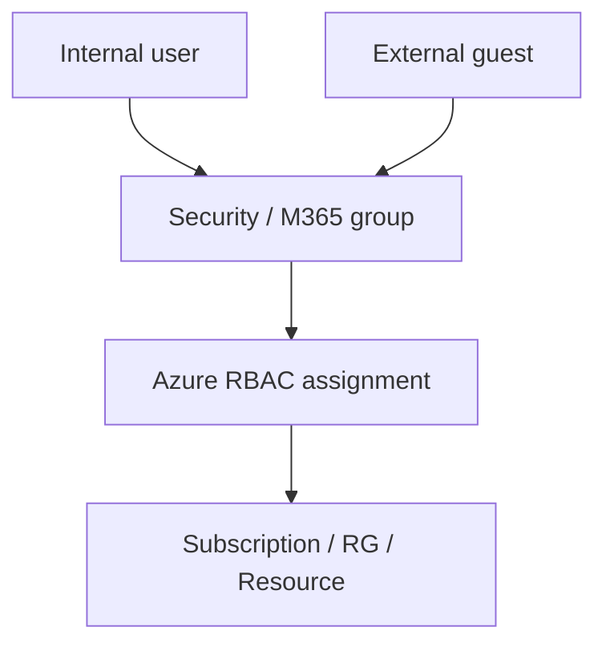

Use groups to reduce role/license assignment sprawl. Instead of assigning ten users independently, assign the group when the operational requirement and licensing model support it.

Key admin tasks:

- create and delete users/groups,
- update account and group properties,
- manage membership and ownership,
- manage external/guest users,
- assign/remove licenses according to the service licensing model.

### External users

B2B/guest access lets an external identity collaborate without turning the external person into a normal internal employee account.

Before granting access ask:

- who owns the invitation lifecycle,
- what resource scope is required,
- when access expires or should be reviewed,
- whether the guest needs Azure RBAC, application access or both.

### Self-service password reset (SSPR)

SSPR lets eligible users reset/change passwords according to configured authentication methods and policy.

Mental model:

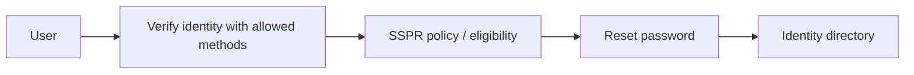

Troubleshoot SSPR in this order:

1. Is SSPR enabled for the user/group?
2. Is the account type eligible?
3. Has the user registered required authentication methods?
4. Are method/policy requirements satisfied?
5. In hybrid identity, is password writeback/configuration required and working?

The imported interactive system already contains an SSPR-focused enhancement; this Markdown section makes the reasoning portable outside the UI.

## 1.2 Azure RBAC and access assignments

Azure RBAC answers: **who can do what at which scope?**

```text
Security principal + Role definition + Scope = Role assignment
```

Scopes inherit downward:

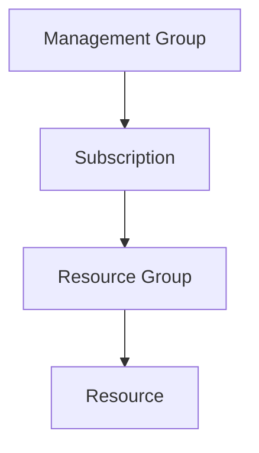

An assignment at a subscription can affect resources under its resource groups unless a more specific control changes effective access. Azure RBAC is additive in normal role assignment logic; explicit deny behavior is typically introduced through mechanisms such as deny assignments rather than a normal “Deny role.”

### Built-in roles

Common exam distinctions:

- **Owner** — full resource management plus ability to assign Azure RBAC roles.
- **Contributor** — manage resources but not grant Azure RBAC access.
- **Reader** — view control-plane resources/configuration.
- **User Access Administrator** — manage user access/RBAC without being a general resource administrator.

Do not assume Reader grants every data-plane permission. For services such as Storage, data access can require a dedicated data role.

### Interpret an access assignment

When a user says “I should have access,” check:

1. principal is the expected user/group/service principal/managed identity,
2. role actually contains required action/data action,
3. scope includes the target resource,
4. group membership is current,
5. inherited assignments apply,
6. deny assignment or policy-like constraints are not blocking the operation,
7. token/session has refreshed where needed.

## 1.3 Subscriptions and governance

### Management groups

Management groups organize subscriptions above the subscription layer and are useful for governance at scale.

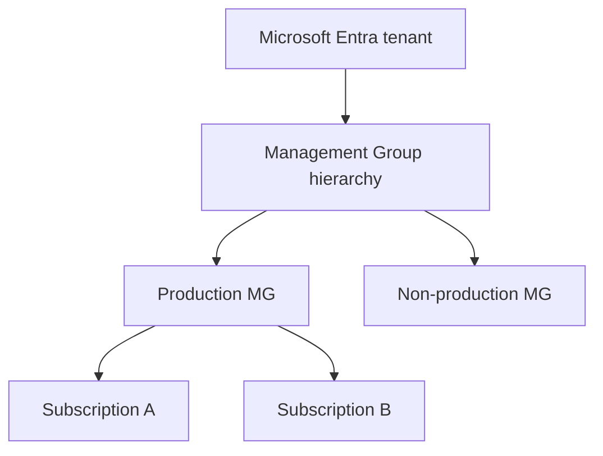

Use them when the requirement is cross-subscription governance, not merely for visual organization.

### Azure Policy vs Azure RBAC vs Resource Locks

| Control | Primary question |
|---|---|
| Azure RBAC | Who is allowed to perform actions? |
| Azure Policy | Is the resource/configuration compliant with governance rules? |
| Resource Lock | Should delete/change operations be protected at this scope? |

Azure Policy can audit, deny, modify or deploy related configuration depending on the policy effect and definition. It is not a replacement for permissions.

Resource locks commonly appear as:

- `CanNotDelete`
- `ReadOnly`

Locks inherit to child resources in relevant scenarios. A highly privileged user may have RBAC permission but still hit a lock until the lock is removed by someone with permission to manage it.

### Tags

Tags help with organization, automation and cost attribution. They are metadata, not a security boundary by themselves.

Good tag dimensions:

- application,
- owner,
- environment,
- cost center,
- lifecycle.

### Resource groups

A resource group is a management container. Resource lifecycle and RBAC/policy scope often follow it, but resources within one architecture do not all have to reside in one resource group.

When moving resources, check current move-support requirements because dependencies and resource types can impose restrictions.

### Cost governance

Three different ideas:

- **Budget** — expected spend threshold/forecast monitoring and notifications/actions according to configured capability.
- **Cost alert** — surfaces cost conditions/notifications.
- **Azure Advisor cost recommendation** — optimization recommendation based on observed configuration/utilization patterns.

A budget is not automatically a hard spending stop.

---

# Domain 2 — Implement and manage storage (15–20%)

## 2.1 Storage access

Storage security has two layers:

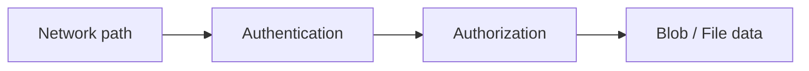

### Storage firewall and virtual networks

Use Storage networking controls when the requirement is to restrict which networks/endpoints can reach the storage service.

Check:

- public network access configuration,
- allowed VNets/subnets/IP ranges,
- service endpoint/private endpoint design,
- DNS when Private Link is involved.

### Shared Access Signature (SAS)

SAS grants delegated, time-bounded access to storage operations.

Common types:

- **User delegation SAS** — authorized using Microsoft Entra credentials and user delegation key for Blob/Data Lake scenarios; preferred when that capability fits because it avoids signing with the storage account key.
- **Service SAS** — delegates access to one storage service/resource scope.
- **Account SAS** — can span multiple storage services/resource types within the account.

Always reason about:

- permissions,
- start/expiry,
- protocol (HTTPS),
- IP restrictions if used,
- resource scope.

### Stored access policy

Stored access policies can provide a management/revocation anchor for supported service SAS scenarios. Instead of each SAS being completely independent, the SAS can reference a policy whose constraints can later be changed/revoked.

### Storage account access keys

Account keys are extremely powerful shared secrets. Prefer Microsoft Entra authorization where supported and practical. If keys are required:

- protect them as secrets,
- rotate using the two-key pattern,
- understand which applications will break during rotation.

### Identity-based access for Azure Files

Do not confuse **control-plane RBAC** with **file/share data access**.

Azure Files can use identity-based authentication for SMB in supported identity configurations. The admin must reason about:

1. identity source/domain integration,
2. share-level Azure RBAC role,
3. file/directory ACL semantics where applicable,
4. network path to the file share.

A user having Reader on the storage account does not automatically mean the user can mount/read all files.

## 2.2 Storage accounts

### Create/configure account

Key design inputs:

- Region,
- redundancy,
- performance/account type,
- public/private network access,
- data protection,
- encryption,
- access method.

### Redundancy

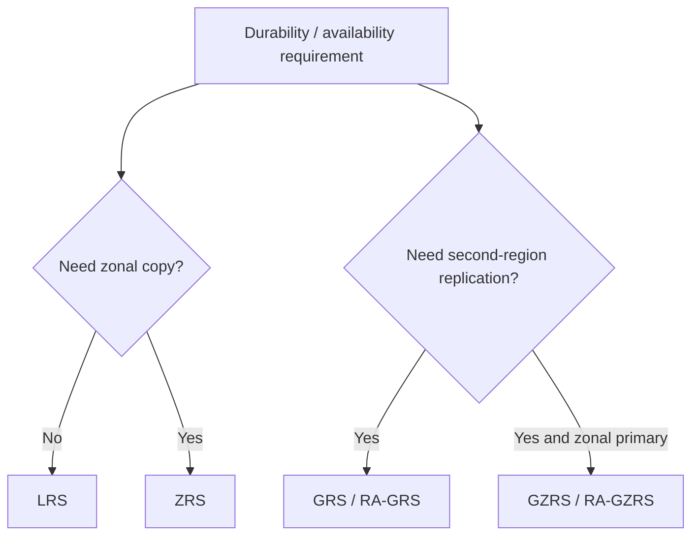

Do not memorize only acronyms. Know what failure boundary the data copies address.

### Object replication

Azure Blob object replication asynchronously copies block blobs between storage accounts according to replication policies/rules.

Mental model:

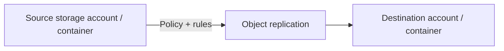

Important distinctions:

- redundancy such as GRS is an account-level durability/geo-replication feature managed by Azure,
- object replication is an application/data-distribution policy between storage accounts/containers,
- backup/versioning/soft delete solve different recovery problems.

When replication does not behave as expected, check source/destination support, versioning/change feed prerequisites where required by current feature documentation, policy scope/rules and object eligibility.

### Storage encryption

Azure Storage encrypts data at rest; current design questions may involve platform-managed keys vs customer-managed keys and key-management requirements.

Do not confuse storage encryption with:

- network isolation,
- authentication,
- backup.

### Storage Explorer and AzCopy

- **Azure Storage Explorer** — graphical administration/data transfer tool.
- **AzCopy** — command-line high-performance data transfer utility for supported Azure Storage operations.

Use the tool that matches automation/scale/user workflow.

## 2.3 Azure Files and Blob Storage

### File shares vs blobs

| Need | Better starting point |
|---|---|
| SMB/NFS-style shared file semantics | Azure Files |
| Object storage over HTTP APIs | Blob Storage |

### Access tiers

Blob access tiers are a cost/access-frequency decision, not a quality ranking. Evaluate expected access, retrieval requirements and minimum retention/cost implications.

### Soft delete and versioning

Think of data protection as layers:

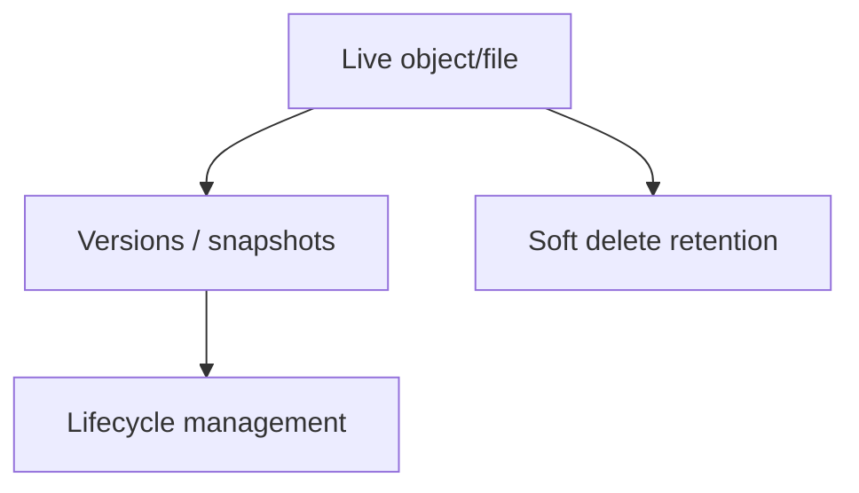

- **Blob versioning** preserves prior object versions automatically when supported/configured.
- **Blob soft delete** retains deleted/overwritten blob states for a retention period.
- **Container soft delete** protects deleted containers.
- **Azure Files snapshots** capture share state at a point in time.
- **Azure Files soft delete** protects deleted shares.

These are not substitutes for every backup/DR requirement.

### Blob lifecycle management

Lifecycle policies can transition or delete blobs/versions/snapshots according to rules. Design them from retention/access requirements; a careless delete action can defeat recovery expectations.

---

# Domain 3 — Deploy and manage Azure compute resources (20–25%)

## 3.1 ARM templates and Bicep

Azure Resource Manager (ARM) is the deployment/control plane. ARM JSON templates and Bicep describe desired Azure resources declaratively.

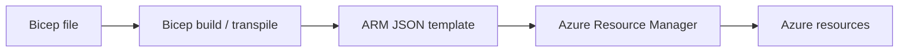

### Interpret templates

Be able to identify:

- parameters,
- variables,
- resources,
- dependencies,
- outputs,
- loops/conditions/modules where present,
- scope/location.

### Modify templates

Before editing, understand whether the change modifies an existing resource, replaces it, adds dependencies or changes scope.

### Deploy ARM/Bicep

Deployment can occur at resource-group, subscription, management-group or tenant scope depending on supported resource/template design. Always verify target scope.

### Export ARM and convert ARM → Bicep

Azure can export existing resource definitions/templates, but generated templates often need cleanup before becoming high-quality reusable IaC.

Conversion mental model:

```text
Existing resource
   ↓ export
ARM JSON
   ↓ decompile / refactor
Bicep
   ↓ validate / what-if / deploy
Managed infrastructure
```

Do not assume exported IaC is automatically idempotent, modular, secure or production-ready.

## 3.2 Virtual machines

### Create/configure VM

A VM design is a bundle:

- image/OS,
- size,
- disk types,
- NIC/subnet,
- identity,
- availability model,
- extensions/bootstrapping,
- monitoring/backup.

### Encryption at Host

Encryption at Host extends encryption coverage for supported VM scenarios so temporary disks/cache and data flowing between compute host and storage service are encrypted at the host layer according to feature support/configuration.

Do not confuse it with:

- Azure Disk Encryption inside the guest,
- server-side encryption of managed disks,
- TLS network encryption.

For exam reasoning, identify **where encryption occurs and which data path it covers**.

### Move VM

A VM move can mean:

- between resource groups,
- between subscriptions,
- between regions.

These are not identical operations. Cross-region migration commonly uses dedicated move/migration capabilities rather than a simple resource-group move. Always consider dependent resources such as NIC, disks, public IP and network dependencies.

### VM size

Choose size/family based on CPU, memory, storage/IOPS, network and workload constraints — not only vCPU count.

### VM disks

Know OS disk vs data disk and managed disk performance/redundancy options. Disk size/type can influence both performance and cost.

### Availability Sets vs Zones

- **Availability Set** spreads VMs across fault/update domains within a datacenter-based availability design.
- **Availability Zones** place resources in separate physical zones in a Region where supported.

Neither gives automatic application-level HA if the app/data layer is still a single point of failure.

### VM Scale Sets (VMSS)

VMSS manages a set of VM instances with scaling and consistent configuration.

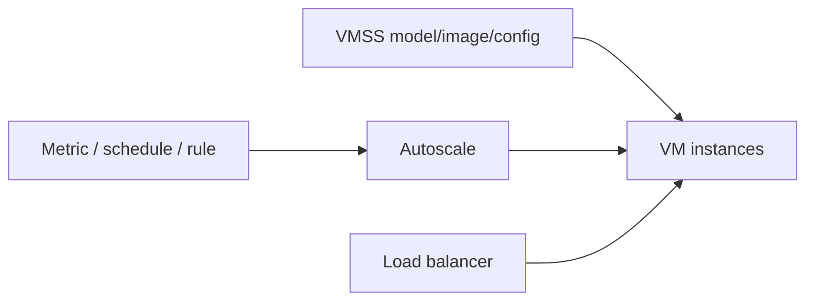

Troubleshoot scaling by checking autoscale profile/rules, metric data, instance health, image/bootstrap success and downstream capacity.

## 3.3 Containers in the Azure portal

### ACR vs ACI vs Azure Container Apps

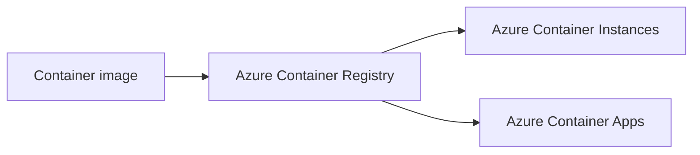

- **ACR** stores/distributes images.
- **ACI** runs containers without managing VM infrastructure; good for simple/isolated container workloads.
- **Azure Container Apps (ACA)** provides a managed application platform for containerized apps with revisions, ingress, scaling and event-driven/serverless-style capabilities.

Do not answer ACR when the requirement is to execute a container; ACR is the registry.

### Sizing and scaling

For ACI think resource requests/allocation per container group and lifecycle.

For Container Apps think:

- min/max replicas,
- scale-to-zero where supported/configured,
- HTTP/event/custom scaling triggers,
- revisions,
- ingress/traffic splitting,
- application dependencies.

The imported `containers-lab.html` already reinforces revisions, traffic and scale behavior.

## 3.4 Azure App Service

### App Service plan

The App Service plan defines underlying compute characteristics such as Region, OS and pricing/scale capabilities. Apps in the same plan can share compute capacity.

### Scale up vs scale out

- **Scale up** — larger/more capable plan tier/instance size.
- **Scale out** — more instances.

Do not scale the app tier while ignoring a database or dependency bottleneck.

### TLS certificates

For custom HTTPS:

1. custom domain/DNS resolves correctly,
2. certificate is available/valid,
3. certificate is bound to the hostname,
4. TLS/HTTPS settings are correct.

### Custom DNS

You prove domain ownership/route traffic using the required DNS records for the selected App Service configuration. DNS propagation and record type are common troubleshooting points.

### App backup

Backups depend on plan/feature support and configured application/database requirements. A deployment slot is not a backup.

### Networking

App Service networking is directional:

- inbound/private access patterns,
- outbound VNet integration,
- private endpoints/access restrictions where supported.

Always ask “is the requirement inbound to the app or outbound from the app?”

### Deployment slots

Slots provide separate deployment environments within supported tiers and can swap traffic/configuration.

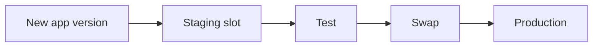

Know which settings are slot-specific/sticky before swapping.

---

# Domain 4 — Implement and manage virtual networking (15–20%)

## 4.1 VNets and connectivity

### VNet/subnet

A VNet is an Azure private network boundary; subnets segment address space and attach policies/resources.

Plan address spaces so they do not overlap with networks you expect to peer/connect.

### VNet peering

Peering provides private connectivity between VNets over Microsoft's backbone. Important exam properties:

- address spaces must not overlap,
- peering is not inherently transitive,
- gateway transit/use remote gateway have specific supported rules,
- NSGs/routes still matter.

### Public IP

A public IP exposes/reaches supported resources/services through an internet-routable address according to resource configuration. It is not required for every Azure resource and should not be added “just in case.”

### User-defined routes (UDR)

UDRs change next-hop selection for matching prefixes.

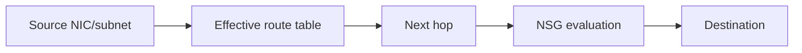

### Connectivity troubleshooting

Use a layered sequence:

1. name resolution,
2. effective route/next hop,
3. NSG/effective security rules,
4. peering/VPN/private endpoint state,
5. service listener/application health.

Do not stop at “NSG allows port 443” if DNS resolves to the wrong address or route points elsewhere.

## 4.2 Secure access to virtual networks

### NSG and ASG

NSGs filter network traffic with stateful rules at subnet/NIC associations.

Application Security Groups (ASGs) let you group VM NICs logically and reference those groups in NSG rules rather than maintaining raw IP lists.

### Effective security rules

When a VM/NIC is affected by multiple NSG associations and platform rules, effective security rules help show the resulting rule set. Use them during troubleshooting instead of reading one NSG in isolation.

### Azure Bastion

Azure Bastion provides managed RDP/SSH access to VMs through the Azure portal/client experience without requiring each target VM to expose its own public IP for administrative access.

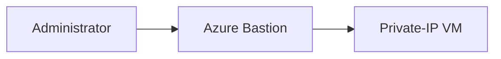

It does not replace Azure RBAC or guest OS authentication.

### Service endpoint vs private endpoint

This is a classic exam decision.

| Feature | Mental model |
|---|---|
| Service endpoint | Keeps VNet identity/path context to an Azure PaaS public endpoint and lets the service restrict access to selected VNets/subnets |
| Private endpoint | Places a private IP/ENI-like network interface for the PaaS resource into your VNet via Private Link |

For Private Endpoint troubleshooting, DNS is often the decisive layer. The client must resolve the service name to the intended private endpoint address according to the private DNS design.

## 4.3 Name resolution and load balancing

### Azure DNS

Azure DNS hosts DNS zones/records. Private DNS zones support private name resolution patterns within linked VNets.

DNS troubleshooting:

- authoritative zone correct?
- record exists/type/value correct?
- private zone linked to correct VNet?
- conditional forwarding/custom DNS involved?
- client cache stale?

### Azure Load Balancer

Azure Load Balancer is a Layer-4 load-balancing service for TCP/UDP scenarios.

Know:

- public vs internal frontend,
- backend pool,
- health probe,
- load-balancing rule,
- inbound NAT rule where used.

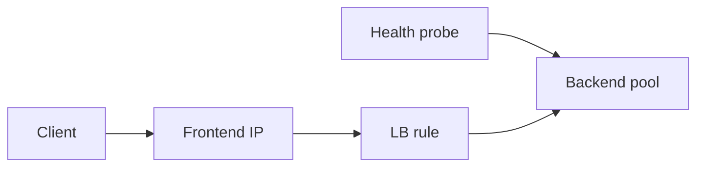

Troubleshoot in this order:

1. frontend IP/rule,
2. backend pool membership,
3. health probe success,
4. NSG/firewall/listener,
5. route/asymmetric path,
6. application service itself.

---

# Domain 5 — Monitor and maintain Azure resources (10–15%)

## 5.1 Azure Monitor and operational visibility

### Metrics vs logs

- **Metrics** — numeric time-series signals optimized for monitoring/alerting.
- **Logs** — richer records/events queried with Kusto Query Language (KQL) in Log Analytics where collected.

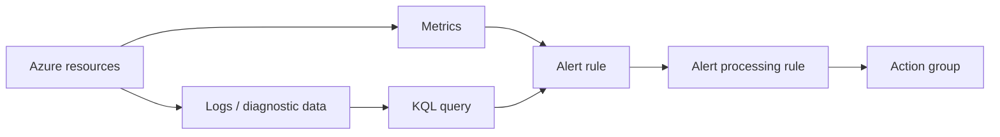

### Log settings / diagnostic settings

Diagnostic settings route supported resource logs/metrics to destinations such as Log Analytics workspace, Storage or Event Hub according to service capability.

If logs are missing:

1. did the resource produce that log category?
2. is diagnostic setting enabled?
3. destination/workspace correct?
4. ingestion delay/time range?
5. query/table correct?

### KQL queries

For AZ-104 you should be comfortable filtering, projecting, summarizing and using time ranges — not writing an entire analytics platform from memory.

Example mental pattern:

```text
Table
| where TimeGenerated > ago(1h)
| where ...
| summarize count() by ...
```

### Alert rules, action groups and alert processing rules

- **Alert rule** — evaluates a signal/condition.
- **Action group** — notification/automation destination.
- **Alert processing rule** — changes how fired alerts are processed, such as suppressing/redirecting actions during maintenance according to configured rules.

Do not edit every alert just to mute notifications for planned maintenance if a processing rule is the cleaner operational mechanism.

### Azure Monitor Insights

Insights provide curated monitoring experiences for supported resource types such as VMs, Storage and networking resources. They help operators avoid rebuilding every workbook/query from scratch.

### Network Watcher and Connection Monitor

Network Watcher contains network diagnostic capabilities. **Connection Monitor** continuously/periodically tests connection reachability/latency along configured endpoints and helps identify network-path problems.

Use it for “can A reach B reliably?” scenarios, not as a replacement for application tracing or CPU metrics.

## 5.2 Backup and recovery

### Recovery Services vault vs Backup vault

Azure Backup supports both vault types; choose based on the datasource/workload support.

Current Microsoft guidance distinguishes them broadly as:

- **Recovery Services vault** — established vault for workloads such as Azure VMs, SQL/SAP HANA in Azure VMs, Azure Files, on-premises agents/servers, and Azure Site Recovery replication scenarios.
- **Backup vault** — used for supported newer Azure Backup datasource types such as Azure Disks, Blob/PaaS workloads according to current support matrix.

Do not memorize one vault as “old and obsolete.” Both are current; supported datasources differ. Always verify the current support matrix.

### Backup policy

A backup policy answers:

- when backups occur,
- how long recovery points are retained,
- where relevant, how tiering/retention behavior works.

### Backup and restore

A complete backup design includes restore testing. “Backup job succeeded” is not equivalent to “application recovery is proven.”

### Azure Site Recovery (ASR)

ASR is disaster recovery/replication orchestration for supported workloads. It is not the same as point-in-time backup.

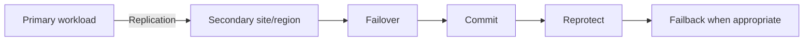

Important terms:

- test failover,
- planned/unplanned failover,
- commit,
- reprotect,
- failback.

### Reports and alerts for backups

Operational backup is observable:

- job success/failure,
- policy coverage,
- protection status,
- recovery-point health,
- alerts/reports.

A resource not protected by policy is a governance problem before an incident occurs.

---

# Cross-domain troubleshooting map

Use this generic administrator flow when a scenario says “it doesn't work”:

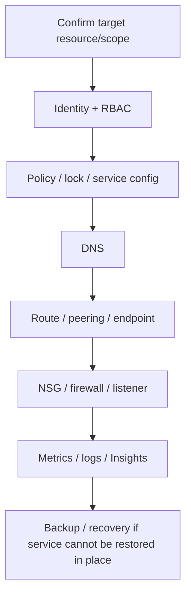

The exact path changes by service, but the habit prevents random troubleshooting.

# High-value exam distinctions

| If the question says... | Think first |
|---|---|
| “Who may change this resource?” | Azure RBAC |
| “Resources must comply with a configuration rule” | Azure Policy |
| “Prevent accidental delete/change” | Resource Lock |
| “Delegate storage access temporarily” | SAS |
| “Private IP to PaaS service” | Private Endpoint |
| “Allow a subnet to securely access supported PaaS public endpoint” | Service Endpoint |
| “Admin SSH/RDP without public IP on every VM” | Azure Bastion |
| “Run one/simple container” | ACI candidate |
| “Managed container app with revisions/ingress/scaling” | Azure Container Apps |
| “Declarative Azure IaC” | ARM/Bicep |
| “Mute alert actions during maintenance” | Alert processing rule |
| “Test network reachability/latency over time” | Connection Monitor |
| “Point-in-time recovery” | Azure Backup |
| “Replicate/fail over workload to secondary site/region” | Azure Site Recovery |

# Self-check before objective QA

You should be able to explain without opening notes:

1. Azure RBAC vs Azure Policy vs Resource Locks.
2. Management group vs subscription vs resource group scope.
3. User delegation SAS vs service/account SAS.
4. Storage redundancy vs Blob object replication vs backup.
5. Azure Files identity-based access and why control-plane Reader is insufficient.
6. ARM template vs Bicep and what export/decompile does not guarantee.
7. Encryption at Host vs managed-disk server-side encryption.
8. Availability Set vs Availability Zone vs VMSS.
9. ACR vs ACI vs Container Apps.
10. App Service scale up vs scale out, slot swap and VNet directionality.
11. UDR vs NSG and how to troubleshoot a path.
12. Service Endpoint vs Private Endpoint.
13. Azure Bastion's role.
14. Alert Rule vs Action Group vs Alert Processing Rule.
15. Metrics vs Logs/KQL vs Insights vs Connection Monitor.
16. Recovery Services vault vs Backup vault.
17. Azure Backup vs Azure Site Recovery.

If any distinction is fuzzy, use the corresponding interactive lab after this Markdown explanation.