# ACE Modern Objectives Deep Dive — หัวข้อใหม่/มักตกหล่นจากโน้ต ACE รุ่นเก่า

> 🧠 **ภาพจำก่อนอ่าน:** 🧠 Concept → 🗺️ Flow → 🔎 Check → ✅ Explain  
> 🎨 [Visual Guide ของวิชานี้](./VISUAL-STUDY-GUIDE-TH.md) — ภาพช่วยจำ ไม่แทนคำอธิบายและคำสั่งจริง

[กลับสารบัญ ACE](./README.md) · [Visual Study Guide](./VISUAL-STUDY-GUIDE-TH.md) · [Exam Map](./LEARNING-PATH.md)

> ตรวจเทียบกับ [Standard Associate Cloud Engineer Exam Guide](https://services.google.com/fh/files/misc/associate_cloud_engineer_exam_guide_english.pdf) ณ **5 ตุลาคม 2026**  
> ไฟล์นี้เน้นหัวข้อที่ Exam Guide ปัจจุบันระบุชัด แต่คอร์ส/โน้ต ACE รุ่นเก่ามักไม่มีหรือพูดบาง เช่น Cloud NGFW, secure Tags, federation, modern IaC/AI tooling, Agent Runtime, Workstations, Database Center, CMEK, Managed Prometheus, Cloud Hub ฯลฯ

---

# 1) Current Exam Guide mental map

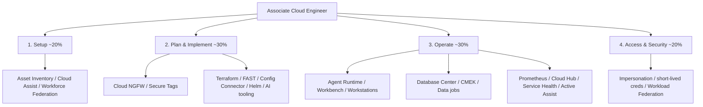

หัวข้อเหล่านี้ไม่ต้องเรียนลึกถึง Professional specialty แต่ต้องรู้ **purpose → deploy/manage path → IAM/network → failure mode** ระดับ Cloud Engineer

---

# 2) Cloud Asset Inventory

Cloud Asset Inventory ใช้สำรวจ metadata/configuration/IAM-related asset information ตาม scope และ product support

## ใช้ตอบคำถามอะไร

- มี VM/bucket/service account อะไรใน organization/project
- resource กระจาย region ไหน
- ใคร/อะไรมี IAM binding ที่เกี่ยวข้อง
- resource ใดไม่ตรง baseline
- inventory เปลี่ยนเมื่อไรตาม history/feed capability ที่รองรับ

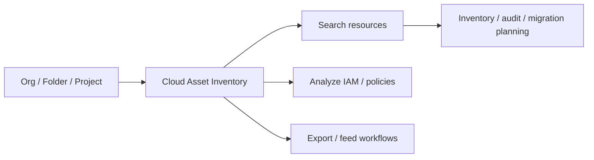

**สิ่งที่ไม่ใช่:** agent ที่ login เข้า OS ทุก VM หรืออ่านข้อมูล application ทุกตัว

### Troubleshooting

ค้น asset ไม่เจอ:
1. scope ถูกไหม
2. caller IAM พอไหม
3. asset type รองรับไหม
4. project/organization ถูกไหม
5. freshness/history requirement ตรง feature ไหม

อ่านต่อ: [Module 13](./Module-13-AI-Tooling-and-Modern-Services.md)

---

# 3) Gemini Cloud Assist ในงาน Cloud Engineer

Exam Guide ระบุทั้งการวิเคราะห์ resources และ Monitoring

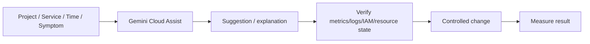

**สิ่งที่สอบอยากให้คิด:** AI เป็นตัวช่วย ไม่ใช่ source of truth

Prompt ที่ดีมี:
- project/service
- time window
- symptom
- expected behavior
- constraints
- ขอ evidence ที่ใช้สรุป

ถ้า AI แนะนำ resize VM ต้องตรวจ peak, memory, batch workload, SLO และ cost ก่อน

---

# 4) Workforce Identity Federation vs Workload Identity Federation

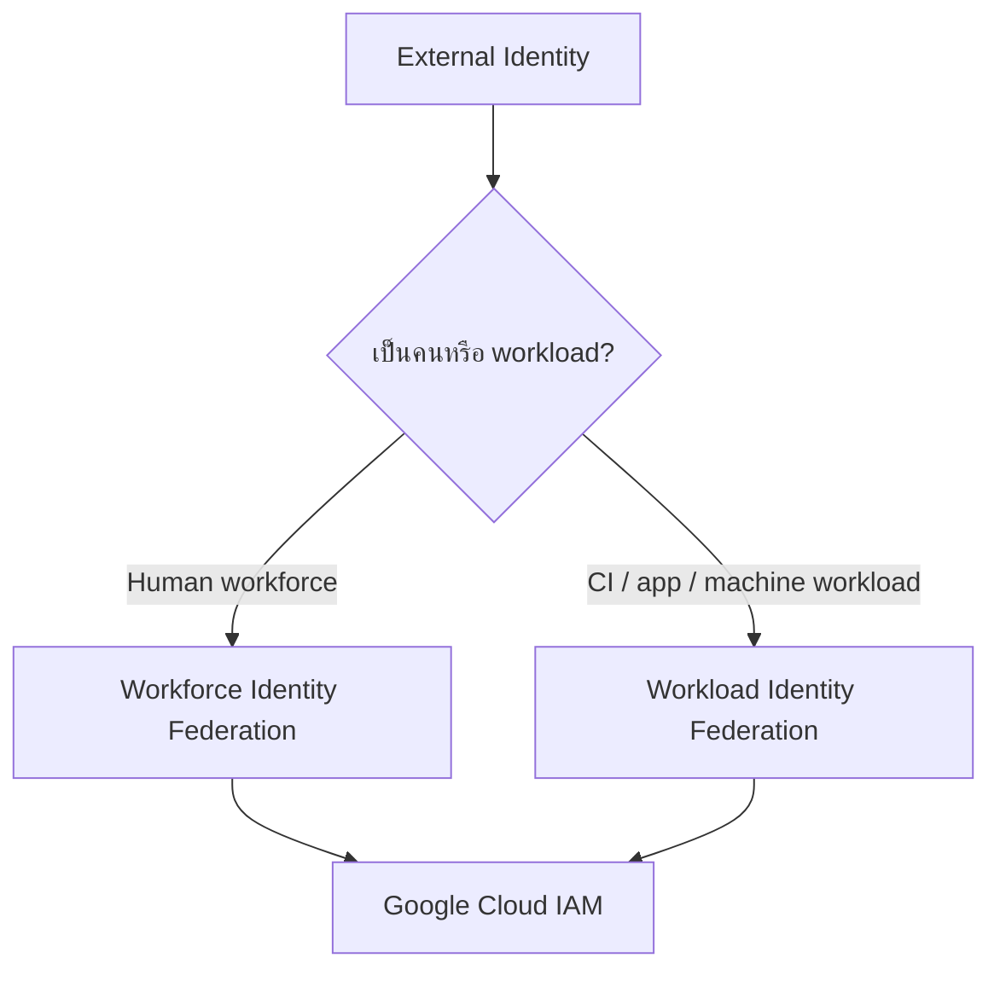

## Workforce Identity Federation

ใช้คนจาก external IdP เข้า Google Cloud โดยไม่ต้องสร้าง Google-managed user แบบเดิมทุกกรณี

คิดเรื่อง:
- workforce pool/provider
- IdP trust
- attribute mapping
- groups/conditions
- IAM role/scope

## Workload Identity Federation

ใช้ external workload เช่น CI OIDC แลก short-lived Google credentials โดยไม่เก็บ service account key ยาว ๆ

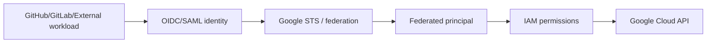

**จำ:** Federation = authentication/trust path; IAM ยังเป็นตัวกำหนด authorization

อ่านต่อ: [Module 02](./Module-02-IAM-Service-Accounts-and-Security.md)

---

# 5) Short-lived Service Account Credentials + Impersonation

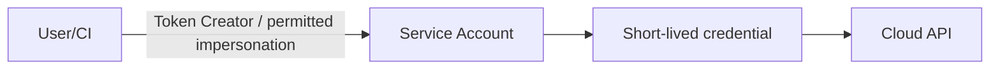

ข้อดีเมื่อเทียบ long-lived JSON key:
- อายุสั้น
- audit identity chain ได้ดีขึ้น
- ลด secret distribution

ต้องแยก:
- caller มีสิทธิ์ impersonate SA หรือไม่
- SA มีสิทธิ์ resource ปลายทางหรือไม่

มี Token Creator แต่ SA ไม่มี Storage Viewer → อ่าน bucket ไม่ได้

---

# 6) Cloud NGFW + Secure Tags

Exam Guide ปัจจุบันระบุ Cloud Next Generation Firewall policies, ingress/egress attributes, secure Tags และ service accounts

## Mental model

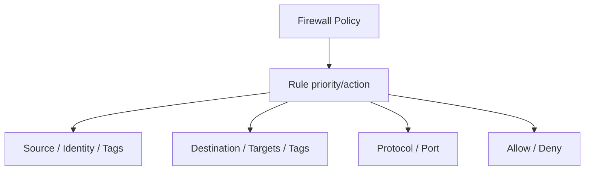

## Network Tags vs Secure Tags

| ชนิด | ใช้หลัก ๆ | Governance |
|---|---|---|
| Network tags | target VM สำหรับ VPC firewall rules บางแบบ | metadata บน instance |
| Secure Tags / Resource Manager Tags | policy targeting ที่รองรับ | มี IAM คุมการ attach/use tag |
| Labels | inventory/cost/grouping | ไม่ใช่ firewall selector โดยทั่วไป |

โจทย์ว่า “ห้าม developer attach tag เพื่อเปิด network access ให้ตัวเอง” → secure Tags + IAM-controlled tag usage มีความเหมาะสมกว่าการพึ่ง network tag อย่างเดียวใน architecture ที่รองรับ

### Firewall debugging

1. direction
2. priority
3. action
4. source/destination
5. target/tag/service account
6. protocol/port
7. higher-level policy
8. route/listener แยกจาก firewall

อ่านต่อ: [Module 04](./Module-04-VPC-Firewall-NAT-and-DNS.md)

---

# 7) Fabric FAST

Exam Guide ยก **Fabric FAST** ในกลุ่ม IaC tooling

ให้เข้าใจระดับ ACE ว่าเป็นแนวทาง/opinionated foundation automation จาก Cloud Foundation Fabric เพื่อช่วยวาง resource hierarchy, networking, security/foundation ตาม reusable IaC patterns

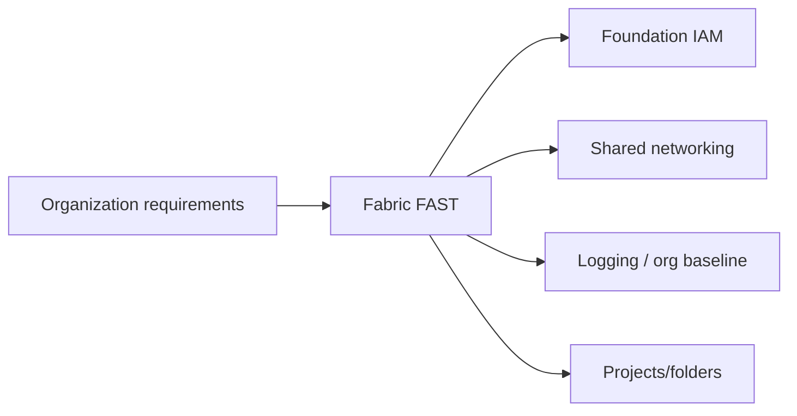

ไม่ต้องท่องทุก module แต่ต้องแยกได้จาก:
- Terraform = IaC engine/ecosystem
- Fabric modules = reusable building blocks
- FAST = opinionated foundation deployment approach

---

# 8) Config Connector

Config Connector ทำให้จัด Google Cloud resources ด้วย Kubernetes-style custom resources/controllers

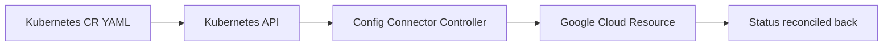

Use case:
- platform team อยากใช้ Kubernetes reconciliation model จัด cloud resources

ต้องคิด:
- controller identity/IAM
- namespace/project mapping
- ownership
- drift/reconciliation
- อย่าให้ Terraform และ Config Connector คุม field เดียวกันมั่ว ๆ

**ต่างจาก Helm:** Helm template/package Kubernetes manifests; Config Connector reconcile Google Cloud resources ผ่าน CRDs

---

# 9) Helm

Helm = package/template manager สำหรับ Kubernetes manifests

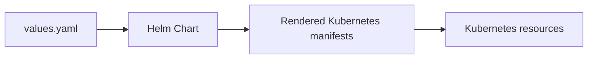

Helm ไม่ใช่ Terraform state backend และไม่ได้จัด Google Cloud IAM/network resources ทุกอย่างเอง

ระดับ ACE ควรรู้:
- chart
- values
- release
- upgrade/rollback concept
- secret/config risk

---

# 10) Gemini CLI / Google Antigravity / Application Design Center

Exam Guide ปัจจุบันใส่ AI-assisted planning and implementation โดยตรง

Mental model:

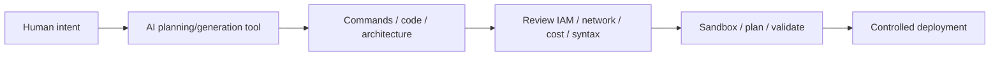

### สิ่งที่ต้องรู้ร่วมกัน

AI-generated output ต้องตรวจ:
- project/region
- IAM scope
- destructive changes
- secret leakage
- cost
- unsupported/deprecated resource
- actual deployment result

AI tool “ตอบถูก” ไม่เท่ากับ resource ถูกสร้างแล้ว

---

# 11) Agent Runtime on Gemini Enterprise Agent Platform

Exam Guide ระบุทั้ง **เลือกเป็น compute option** และ **deploy agent**

มองเป็น managed runtime สำหรับ agentic application ตาม capabilities ที่ Google Cloud รองรับ

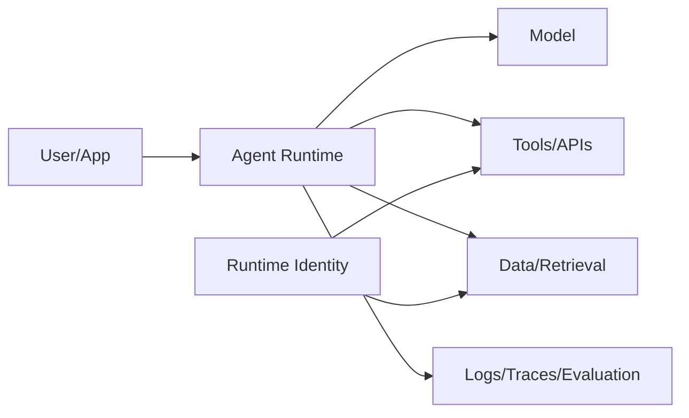

Cloud Engineer ต้องคิด:
- runtime identity
- region/API/quota
- tool/data permissions
- network path
- deployment/version
- logs/traces
- retry + side effects
- cost

**สำคัญ:** agent ที่ retry tool `create-ticket` อาจสร้าง ticket ซ้ำถ้า tool ไม่ idempotent

---

# 12) Workbench / BigQuery Notebooks

Exam Guide ระบุการจัดการ notebooks ใน Gemini Enterprise Agent Platform Workbench (ชื่อเดิม Vertex AI Workbench) และ BigQuery

ระดับ ACE ควรรู้:
- compute/runtime lifecycle
- user/IAM
- service account
- data access
- package/environment
- persistent storage
- accelerator cost
- idle shutdown/cleanup

Notebook เปิดค้าง = compute cost ตาม configuration ได้

ไม่ใช้ shared SA key ใน notebook หลายคนเป็น default design

---

# 13) Cloud Workstations

Cloud Workstations = managed developer environments

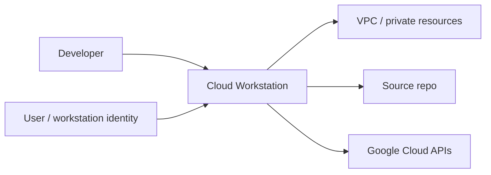

คิดเรื่อง:
- workstation cluster/configuration
- network
- IAM
- developer runtime tools
- lifecycle/idle
- cost
- access to production resources

เหมาะเมื่อองค์กรต้องการ standardized/manageable dev environment มากกว่าปล่อย laptop config ต่างกันทั้งหมด

---

# 14) Database Center

Database Center ให้ fleet view ของ database services ที่รองรับ พร้อม health/config/recommendation signals

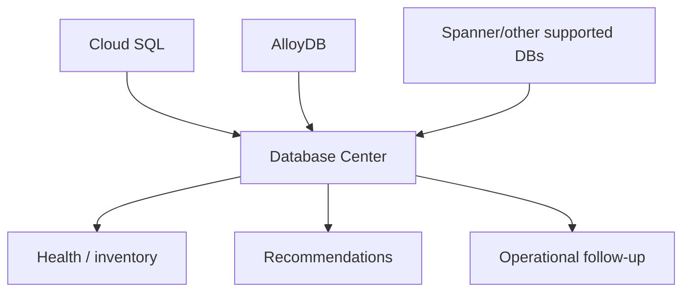

Database Center ไม่แทน engine-level troubleshooting ทั้งหมด

เห็น recommendation → ยังต้องดู query, connection, storage, failover และ workload จริง

---

# 15) CMEK — Customer-Managed Encryption Keys

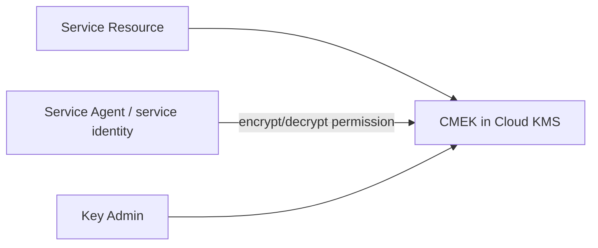

คิดเรื่อง:
- key location compatibility
- service identity permission
- rotation/version
- disable/destroy impact
- separation of duties
- backup/DR dependency on key

**CMEK ไม่ใช่:**
- IAM replacement
- firewall
- backup

ถ้า key ถูก disable resource/data อาจใช้งานไม่ได้ตาม integration

อ่านต่อ: [Module 13](./Module-13-AI-Tooling-and-Modern-Services.md)

---

# 16) Managed Service for Prometheus

Exam Guide ระบุ deploy Google Cloud Managed Service for Prometheus

เหมาะกับ Prometheus metrics ecosystem โดยให้ Google Cloud ช่วย managed backend/collection/query integration ตาม deployment model

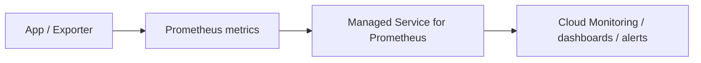

ต้องคิด:
- scrape/collection model
- target discovery
- permissions
- labels/cardinality
- retention/cost
- alerts/dashboards

High-cardinality metric ยังเป็นปัญหาแม้ backend managed

---

# 17) Personalized Service Health

ใช้ดูเหตุการณ์ Google Cloud ที่สัมพันธ์กับ environment/project ตาม feature

เวลา incident:

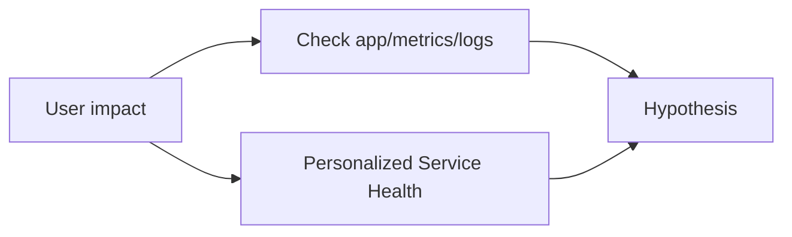

Provider incident เป็นหนึ่งใน hypothesis ไม่ควรโทษ cloud ก่อนดูหลักฐาน

---

# 18) Active Assist

Active Assist/Recommenders ช่วย optimization ด้าน utilization/cost/security ตาม product

ตัวอย่าง:
- VM rightsizing
- idle resources
- IAM-related recommendations ตาม capability

ก่อน apply recommendation:
- ดู time window
- peak/batch jobs
- memory/storage/network
- business criticality
- rollback

---

# 19) Cloud Hub

Cloud Hub รวม operations information/health/events ของ application/resources ตาม capabilities

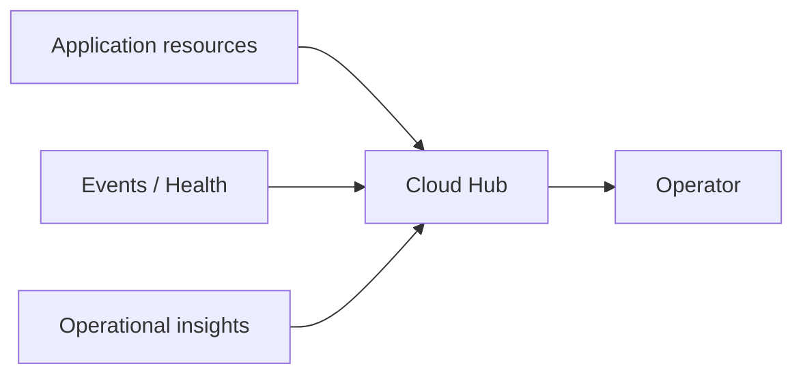

อย่าสับสนกับ **Network Connectivity Center hub** ซึ่งเป็น network concept คนละตัว

---

# 20) Newer Data/Storage Products ที่ ACE ต้องแยกได้

| Product | Mental model |
|---|---|
| AlloyDB | PostgreSQL-compatible managed relational database |
| Managed Service for Apache Kafka | managed Kafka ecosystem/API compatibility use cases |
| Memorystore | managed in-memory/cache services ตาม engine/product |
| NetApp Volumes | enterprise managed file storage |
| Managed Lustre | high-performance parallel filesystem สำหรับ HPC/AI |

ไม่ต้องจำทุก SKU แต่ต้องถาม:
- protocol/API
- workload pattern
- location
- HA/recovery
- IAM/network
- cost

---

# 21) Operations Checklist ที่ Exam Guide รุ่นปัจจุบันเน้น

## Compute

- SSH/OS Login
- snapshots/images/schedules
- GKE node pools
- HPA/VPA
- Autopilot requests
- Cloud Run revisions/traffic/autoscaling
- GPU/TPU attachment
- Agent Runtime
- Notebooks/Workstations

## Data

- query data
- backup/restore
- job status
- Database Center
- CMEK

## Network

- resize subnet
- static IP
- custom route
- DNS/NAT
- firewall/Cloud NGFW

## Observability

- alerts/custom metrics
- audit/network/firewall logs
- log router/bucket/analytics/export
- Trace/Profiler/Query Insights
- Service Health
- Ops Agent
- Managed Prometheus
- Cloud Assist
- Active Assist
- Cloud Hub

---

# 22) Mini Scenarios

### Scenario A — CI ไม่ควรเก็บ SA JSON key

เลือก Workload Identity Federation + short-lived credentials + least privilege

### Scenario B — Developer ใส่ tag เพื่อเปิด firewall ให้ VM ตัวเองได้

พิจารณา secure Tags + IAM-controlled tag usage / Cloud NGFW policy model

### Scenario C — AI generated Terraform บอกว่าจะสร้าง 2 resources แต่ plan จะ destroy 5

เชื่อ plan/output จริงและหยุด review ไม่เชื่อคำอธิบาย AI อย่างเดียว

### Scenario D — Database fleet ใหญ่ อยากหา instance มี recommendation/health issue

ใช้ Database Center เป็น fleet view แล้ว drill down engine signals

### Scenario E — Monitoring CPU ดี แต่ user p99 latency พุ่ง

ดู application/trace/queue/DB/downstream ไม่สรุปจาก CPU

### Scenario F — Notebook GPU เปิดค้างทั้งคืน

มี cost ต่อเนื่องตาม resource lifecycle; ตั้ง cleanup/idle policy ตาม requirement

---

# 23) เช็กความเข้าใจ

1. Workforce กับ Workload Identity Federation ต่างกันที่ใครเป็น identity?
2. Federation ให้ admin role อัตโนมัติไหม?
3. Secure Tags ต่างจาก labels อย่างไร?
4. Config Connector ต่างจาก Helm อย่างไร?
5. Fabric FAST อยู่ในบทบาทไหนของ IaC ecosystem?
6. AI-generated command ต้องตรวจอะไรบ้างก่อน run?
7. Agent Runtime ต้องมี runtime identity เพราะอะไร?
8. Notebook/Workstation มี cost/lifecycle concern อะไร?
9. Database Center แทน query tuning ทั้งหมดไหม?
10. CMEK แทน IAM/backup หรือไม่?
11. Managed Prometheus ยังต้องระวัง metric cardinality ไหม?
12. Cloud Hub กับ Network Connectivity Center hub คือของเดียวกันไหม?

---

## เอกสารอ้างอิงหลัก

- [Associate Cloud Engineer — Standard Exam Guide](https://services.google.com/fh/files/misc/associate_cloud_engineer_exam_guide_english.pdf)
- [Google Cloud IAM](https://cloud.google.com/iam/docs)
- [Cloud Asset Inventory](https://cloud.google.com/asset-inventory/docs)
- [Cloud NGFW](https://cloud.google.com/firewall/docs/about-firewalls)
- [Config Connector](https://cloud.google.com/config-connector/docs/overview)
- [Cloud KMS / CMEK](https://cloud.google.com/kms/docs/cmek)
- [Managed Service for Prometheus](https://cloud.google.com/stackdriver/docs/managed-prometheus)
