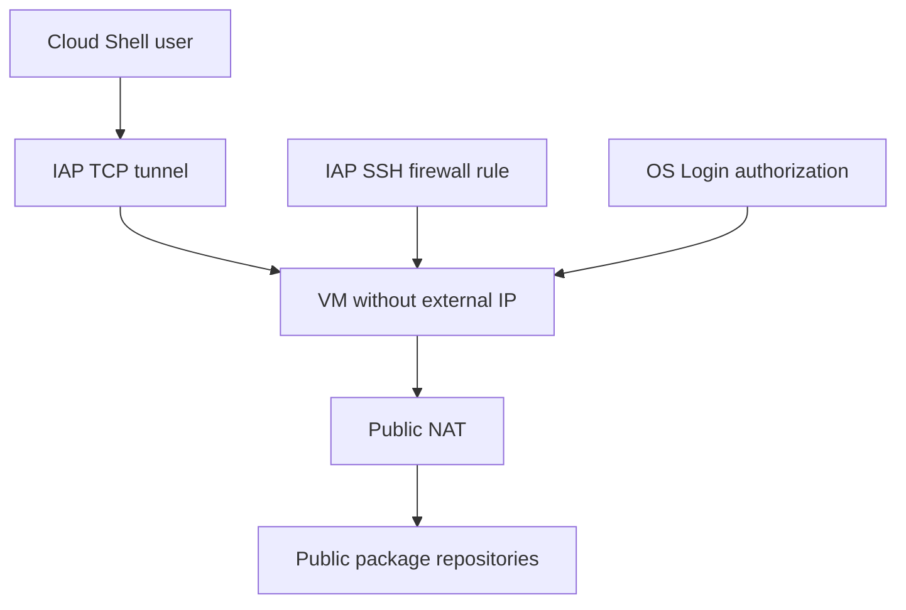

# Lab 02 — Private VM, OS Login, IAP & Cloud NAT

[Lab index](./README.md) · [Network concepts](../Module-04-VPC-Firewall-NAT-and-DNS.md)

## เป้าหมายและ prerequisites

สร้าง VM ไม่มี external IP แล้ว SSH ผ่าน IAP ใช้ OS Login จากนั้นเพิ่ม Public NAT เพื่อให้ VM ออก public internet โดยไม่ได้เปิด inbound internet ให้ VM

ต้องมีสิทธิ์จัด Compute/network/firewall/router/NAT resources ของ lab, ใช้ IAP TCP tunnel, ดู VM และ OS Admin Login เพื่อรัน `sudo apt-get update` รวมสิทธิ์เปิด APIs หากยังไม่เปิด ถ้าบัญชีไม่มีสิทธิ์ดังกล่าวให้ใช้ environment ที่เตรียมให้ ไม่เปิด SSH `0.0.0.0/0` แทนโดยเดา

มีค่าใช้จ่าย VM, disk และ Cloud NAT/network ควร cleanup ใน session เดียว



## Task 1 — ตั้งค่า context

```bash
export PROJECT_ID="your-lab-project-id"
export REGION="us-central1"
export ZONE="us-central1-a"
gcloud config set project "$PROJECT_ID"
gcloud auth list
gcloud services enable compute.googleapis.com iap.googleapis.com \
  oslogin.googleapis.com --project="$PROJECT_ID"
```

ใช้ zone ใน region เดียวกับ subnet ตรวจ quota/capacity และ policy ของ lab ถ้าเลือก location อื่นให้เปลี่ยนทุกคำสั่งให้ตรง

## Task 2 — Custom VPC และ subnet

```bash
gcloud compute networks create ace-private-vpc \
  --subnet-mode=custom --project="$PROJECT_ID"

gcloud compute networks subnets create ace-private-subnet \
  --network=ace-private-vpc \
  --region="$REGION" \
  --range=10.30.0.0/24 \
  --enable-private-ip-google-access \
  --project="$PROJECT_ID"
```

Expected: custom VPC และ regional subnet สร้างสำเร็จ Private Google Access ที่เปิดนี้ไม่ใช่ public internet NAT

## Task 3 — Firewall เฉพาะ IAP SSH

```bash
gcloud compute firewall-rules create ace-allow-iap-ssh \
  --network=ace-private-vpc \
  --direction=INGRESS \
  --action=ALLOW \
  --rules=tcp:22 \
  --source-ranges=35.235.240.0/20 \
  --target-tags=ace-iap-ssh \
  --project="$PROJECT_ID"
```

Expected: allow TCP 22 จาก IAP IPv4 range สำหรับ VM ที่มี tag นี้ ไม่ได้เปิด SSH ให้ internet ทุกต้นทาง Higher-level policies ยังอาจ deny ได้

## Task 4 — สร้าง VM แบบไม่มี SA ที่ไม่จำเป็น

```bash
gcloud compute instances create ace-private-vm \
  --project="$PROJECT_ID" \
  --zone="$ZONE" \
  --machine-type=e2-micro \
  --image-family=debian-12 \
  --image-project=debian-cloud \
  --network=ace-private-vpc \
  --subnet=ace-private-subnet \
  --no-address \
  --no-service-account \
  --no-scopes \
  --metadata=enable-oslogin=TRUE \
  --tags=ace-iap-ssh

gcloud compute instances describe ace-private-vm \
  --zone="$ZONE" \
  --format='yaml(networkInterfaces,status,metadata)'
```

Expected: `RUNNING`, internal IP ใน subnet และไม่มี external NAT IP อย่าสับสน access config/external IP ของ VM กับ Public NAT gateway ที่ยังไม่ได้สร้าง

## Task 5 — SSH ผ่าน IAP

```bash
gcloud compute ssh ace-private-vm \
  --zone="$ZONE" \
  --tunnel-through-iap \
  --command='hostname; id'
```

Expected: hostname และ OS user ของ identity ที่ login ได้ CLI อาจจัด local SSH key สำหรับ OS Login ตาม workflow แต่ไม่ได้ใช้ SA JSON key

ถ้าติด: ตรวจ IAP tunnel permission, OS Login role, VM visibility, firewall target tag/range, sshd/VM readiness และ organization policies

## Task 6 — เพิ่ม Public NAT

```bash
gcloud compute routers create ace-nat-router \
  --network=ace-private-vpc \
  --region="$REGION" \
  --project="$PROJECT_ID"

gcloud compute routers nats create ace-public-nat \
  --router=ace-nat-router \
  --region="$REGION" \
  --nat-all-subnet-ip-ranges \
  --auto-allocate-nat-external-ips \
  --project="$PROJECT_ID"
```

Expected: NAT config บน router ของ region นี้ ครอบคลุม subnet ranges ตาม config ไม่ได้เพิ่ม external IP ที่ NIC ของ VM

`--nat-all-subnet-ip-ranges` กว้างภายใน VPC/region นี้ จึงใช้กับ VPC lab เฉพาะ อย่า copy ไป network ที่มี workloads อื่นโดยไม่ review scope

## Task 7 — ทดสอบ public egress

```bash
gcloud compute ssh ace-private-vm \
  --zone="$ZONE" \
  --tunnel-through-iap \
  --command='sudo apt-get update'
```

Expected: package metadata downloads สำเร็จจาก repositories ที่ OS image ตั้งไว้ ถ้า image/env ใช้ private mirror behavior อาจต่าง ตรวจปลายทางจริงก่อนสรุป

NAT ไม่ได้พิสูจน์ว่าสามารถเข้าทุก website ถ้ามี egress deny/DNS/configuration อื่น และไม่เปิด inbound connection ใหม่จาก internet เข้าหา VM

## Cleanup

```bash
gcloud compute instances delete ace-private-vm --zone="$ZONE" --project="$PROJECT_ID"
gcloud compute routers nats delete ace-public-nat \
  --router=ace-nat-router --region="$REGION" --project="$PROJECT_ID"
gcloud compute routers delete ace-nat-router --region="$REGION" --project="$PROJECT_ID"
gcloud compute firewall-rules delete ace-allow-iap-ssh --project="$PROJECT_ID"
gcloud compute networks subnets delete ace-private-subnet --region="$REGION" --project="$PROJECT_ID"
gcloud compute networks delete ace-private-vpc --project="$PROJECT_ID"

gcloud compute disks list --project="$PROJECT_ID"
gcloud compute addresses list --project="$PROJECT_ID"
```

Expected: resources ที่สร้างหายจาก live inventory หากมี disk/IP เหลือให้ระบุว่าเป็นของ lab จริงก่อนลบ ไม่ลบทุก disk ใน project จากคำสั่ง list

## อธิบายกลับให้ได้

- IAP, OS Login และ firewall เป็นคนละเงื่อนไขอย่างไร?
- ทำไม Public NAT ไม่ได้ทำให้ VM มี public inbound endpoint?
- Private Google Access ใช้แทน internet NAT ได้ทุกปลายทางไหม?

## เอกสาร

- [IAP TCP forwarding](https://docs.cloud.google.com/iap/docs/using-tcp-forwarding)
- [OS Login](https://docs.cloud.google.com/compute/docs/oslogin)
- [NAT create](https://docs.cloud.google.com/sdk/gcloud/reference/compute/routers/nats/create)
