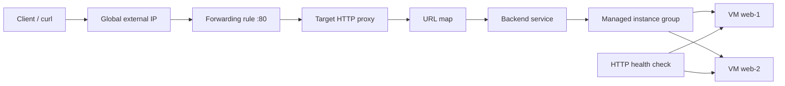

# Lab 06 — Load Balancing บน Compute Engine (Companion Lab ภาษาไทย)

> 🧠 **ภาพจำก่อนอ่าน:** 🧪 Lab → 🌐 Network → 🛡️ Rules → 🖥️ Backend → 🧹 Cleanup  
> 🎨 [Visual Guide ของวิชานี้](../VISUAL-STUDY-GUIDE-TH.md) — ภาพช่วยจำ ไม่แทนคำสั่งและเนื้อหาจริง

[กลับ Lab Guide](./README.md) · [Lab Map](./LEARNING-PATH-LAB-MAP.md) · [Activity 15](../Path-Activity-15-Load-Balancing-Skill-Badge-TH.md)

> สถานะ: **คู่มือฝึกเสริม (ยังไม่ได้รันจริง / ยังไม่ผ่าน Google Skills grader)** · จัดทำ 8 ตุลาคม 2026
> เป้าหมาย: เตรียม Activity 05 (Scaling & Automation) และ Activity 15 (Implementing Cloud Load Balancing for Compute Engine)
> ไม่ใช่สำเนาหรือเฉลย Challenge Lab และ **ไม่ได้ยืนยันว่าตรงทุก task ใน badge**.

## 1. เมื่อจบ Lab นี้ควรทำได้

- อธิบายเส้นทาง `client → forwarding rule → target proxy → URL map → backend service → instance group → VM` สำหรับ external Application Load Balancer
- แยก Application LB (HTTP/HTTPS; Layer 7) กับ passthrough Network LB (Layer 4) และ internal LB
- สร้าง **global external Application Load Balancer (HTTP สำหรับ sandbox เท่านั้น)** พร้อม Managed Instance Group (MIG) และ HTTP health check
- ยืนยันว่า healthy backend รับทราฟฟิกจริง, รู้วิธี debug 502/503/unhealthy
- ลบทรัพยากรให้ครบ ไม่ทิ้ง IP, forwarding rule, instance group หรือ disk ที่คิดค่าใช้จ่าย

## 2. Concept / Architecture



**จำให้แม่น:** health check แยกจาก traffic ของ client; `MIG` คุมจำนวน/รูปแบบ VM; `backend service` คุมการส่งคำขอไปยัง backend; `URL map` ใช้ routing HTTP; `forwarding rule` รับ IP:port. สำหรับ production ควรใช้ HTTPS พร้อม certificate และตรวจการเข้าถึง backend อย่างรอบคอบ

## 3. ก่อนเริ่ม: Cost & Safety

1. ใช้ **Google Skills temporary project** เมื่อทำ official lab แล้วปฏิบัติตามโจทย์สดเป็นหลัก หรือใช้ sandbox project ส่วนตัวที่เปิด Billing อย่างตั้งใจ
2. Lab นี้สร้าง VM อย่างน้อย 2 เครื่อง, persistent disks, load balancer, global IPv4 และ networking ซึ่ง **มีค่าใช้จ่าย**; Budget alert ไม่ใช่ hard spending cap
3. ไม่รันกับ production; ไม่ใช้ credentials ของ Google Skills นอก session ที่กำหนด
4. ตรวจ Project ID / Billing / API enablement / IAM / quota / region และทำ cleanup ทันทีเมื่อจบ
5. ตัวอย่างใช้ HTTP port 80 **เพื่อการเรียนใน sandbox** เท่านั้น ไม่ใช้กับข้อมูลสำคัญ
6. ตรวจสอบชื่อ wizard/options กับเอกสารปัจจุบันก่อนคลิก เพราะ UI และ naming อาจเปลี่ยน

## 4. Part A — Deploy global external Application Load Balancer (Console-first)

### Step 0: Preflight

- เปิด Google Cloud Console → Project selector → ยืนยัน project ของ sandbox
- ตรวจ Billing และ Budget; ตรวจ Compute Engine API enabled
- เลือก Region + Zone ที่รองรับ Compute Engine และ quota อย่างน้อย 2 VMs; จด `PROJECT_ID`, `REGION`, `ZONE`
- เปิด Cloud Shell เพื่อใช้คำสั่ง **read-only verification**:

```bash
gcloud config get-value project
gcloud auth list
gcloud compute project-info describe --format="value(name)"
```

**Expected:** project ใน CLI ตรงกับ sandbox project ใน Console ถ้าไม่ตรง หยุดก่อนสร้าง

### Step 1: Firewall สำหรับ health check / proxy

- ไปที่ **VPC network → Firewall**
- เลือก VPC สำหรับ sandbox (ใช้ default network เฉพาะถ้า sandbox มีให้และ policy อนุญาต)
- สร้าง ingress allow TCP port 80 ไปยัง **backend VMs เท่านั้น** ผ่าน target network tag เช่น `ace-lb-backend`
- สำหรับ global external Application LB ที่ใช้ instance group backend ให้อนุญาต Google health-check / GFE source ranges ที่เอกสารปัจจุบันกำหนด เช่น `35.191.0.0/16` และ `130.211.0.0/22` (ตรวจ docs อีกครั้งก่อนใช้)
- **ไม่เปิด 0.0.0.0/0 ไป backend VM เพียงเพราะ health check ไม่ผ่าน**

Expected: firewall rule จำกัด port, source และ target tag ถูกต้อง

### Step 2: สร้าง Instance Template

- ไปที่ **Compute Engine → Instance templates → Create instance template**
- Name `ace-lb-web-template`, ใช้ machine type เล็กที่ quota รองรับ และ Debian image ที่ยัง supported
- ใส่ network tag `ace-lb-backend`
- ใส่ startup script (sandbox web server):

```bash
#!/bin/bash
set -euxo pipefail
apt-get update
DEBIAN_FRONTEND=noninteractive apt-get install -y nginx
HOST="$(hostname)"
printf 'ACE Load Balancing Lab — backend: %s\n' "$HOST" > /var/www/html/index.html
systemctl enable --now nginx
```

- ตรวจ external IP / Cloud NAT / package egress ที่จำเป็นต่อการติดตั้ง: หากเครื่องไม่มี egress ดาวน์โหลด nginx จะล้มเหลว; เลือก network configuration ให้เหมาะกับ sandbox และไม่เปิด inbound SSH โดยไม่จำเป็น
- อย่าใส่ password หรือ secret ใน startup script

Expected: template ผูก image, startup script, tag และ network ถูกต้อง

### Step 3: สร้าง Managed Instance Group

- **Compute Engine → Instance groups → Create instance group**
- เลือก **Managed**, template จาก Step 2, ตั้งจำนวน instance = 2, ปิด autoscaling ก่อนเพื่อให้ดีบักง่าย
- ใช้ชื่อ `ace-lb-web-mig`; เลือก zone/region ให้สอดคล้อง backend
- รอ provisioning แล้วดู Instances รายตัว ตรวจสถานะ startup script/serial port logs ตาม permission ที่มี
- เช็กว่า web server ตอบ HTTP port 80 ได้ผ่านแนวทาง access ที่ sandbox อนุญาต (เช่น IAP/authorized test VM)

**Expected:** VM สองตัว Running, web server พร้อมตอบ `HTTP 200`

### Step 4: สร้าง Application Load Balancer

- **Network services → Load balancing → Create load balancer**
- เลือก **Application Load Balancer → Public facing → Global external**; เลือก mode ที่รองรับ **global external Application Load Balancer** ตาม current UI
- Backend configuration: สร้าง backend service แบบ instance group, protocol HTTP, port 80 / named port `http:80`; เลือก `ace-lb-web-mig`
- สร้าง HTTP health check: path `/`, port 80, protocol HTTP
- Routing rules: default route ชี้ backend service นี้
- Frontend configuration: HTTP port 80, global external IPv4 (จะ ephemeral หรือ reserved ให้จดชนิดก่อน cleanup)
- Review → Create

**Expected:** load balancer provisioning สำเร็จ; backend health = Healthy. หากไม่ healthy ให้แก้ก่อนยิง traffic

### Step 5: Verify

หลังได้ Frontend IP แล้วเปิด Cloud Shell:

```bash
LB_IP="REPLACE_WITH_ACTUAL_FRONTEND_IPV4"
curl -I "http://${LB_IP}/"
for i in 1 2 3 4 5; do curl -fsS "http://${LB_IP}/"; done
```

ผลลัพธ์ที่คาดหวัง: สถานะ `200`; ใน body มี hostname ของ VM ผู้ตอบ **การเห็น hostname สลับกันไม่ใช่สิ่งรับประกันใน 5 requests** เพราะ algorithm/connection reuse อาจทำให้ตอบตัวเดิมได้

ตรวจผ่าน Console → Load balancing → เลือก LB → Backend health; ดู Cloud Monitoring/Logging ตามบริการที่เปิดใช้

### Step 6: Fault injection (เฉพาะ sandbox)

- ลด backend capacity / ทำให้ test web server บน VM หนึ่งหยุดตอบ **เฉพาะถ้าได้รับอนุญาตและเข้าใจผล**
- ดู health check เปลี่ยนสถานะ และ HTTP traffic ไป backend ที่เหลือ
- คืนค่า MIG/VM ให้ healthy ก่อน cleanup
- อธิบายว่า **load balancing ≠ autoscaling ≠ autohealing** และเหตุใด health check จึงสำคัญ

## 5. Part B — เปรียบเทียบก่อนทำกิจกรรม 15

| หัวข้อ | Global external Application LB | Regional external passthrough Network LB | Internal LB |
|---|---|---|---|
| Request | HTTP/HTTPS (L7) | TCP/UDP และ protocol ตามชนิด LB (L4) | ภายใน network ที่รองรับ |
| Routing | URL map / HTTP rules | connection/packet ตาม protocol | ขึ้นกับ Application หรือ Network LB |
| Backend | MIG / instance groups / NEGs ตามชนิด | Instance groups / NEGs ตามชนิด | ตามประเภท internal LB |
| Health check | health check + firewall source | health check + firewall source | health check + firewall source |
| จุดที่พลาด | target proxy, URL map, named port | regional resources, forwarding rule, firewall | subnet, proxy-only subnet (บางชนิด), reachability |

**ต่อยอด (ไม่จำเป็นต้อง provision ทั้ง 3 แบบใน sandbox):** เปิดเอกสารทางการของ [regional external passthrough Network LB](https://docs.cloud.google.com/load-balancing/docs/network/setting-up-network-backend-service) และคู่มือ internal LB ตามชนิดที่โจทย์ปัจจุบันกำหนด แล้ววาด resource chain เทียบด้วยตัวเอง

## 6. Troubleshooting Worksheet

| อาการ | ตรวจเรียงลำดับ |
|---|---|
| Backend `Unhealthy` | VM startup / web server port 80 → health-check path → firewall source & target tags → named port → backend instance group |
| `502` หรือ `503` | backend health/capacity → backend service → timeout/protocol → request logs |
| IP ต่อไม่ได้ | forwarding rule IP:port → target HTTP proxy → URL map → backend service → health |
| VM มี 2 เครื่อง แต่ส่ง traffic ตัวเดียว | ดู health status, policy, session affinity, connection reuse; อย่าตัดสินจาก 2–3 ครั้ง |
| Cloud Shell รัน command ผิด project | `gcloud config get-value project` แล้วตรวจ Console project selector |
| Unexpected bill | ตรวจ VM/MIG/disks/LB/static IP และ resources ที่เหลือใน project; cleanup |

## 7. Cleanup (ต้องทำ)

ให้ลบผ่าน Console **ตาม dependency** หลัง screenshot/log ผลทดสอบแล้ว:

1. ลบ frontend / forwarding rule ของ LB, target proxy, URL map, backend service, health check (หาก wizard ให้ลบรวม ตรวจว่าทุก resource หายจริง)
2. ลบ Managed Instance Group และ instance VMs ที่มันสร้าง
3. ลบ instance template
4. ลบ firewall rule ที่สร้างเฉพาะ lab
5. ลบ reserved IP ที่ไม่ใช้แล้ว (ถ้าใช้ static); ตรวจ disks/snapshots ที่ค้าง
6. ใน Console ตรวจ Compute Engine Instances, Instance groups, Load balancing, VPC IP addresses และ Billing อีกครั้ง

**Warning:** ห้ามลบ VPC/project/shared resources ที่มีงานอื่นใช้อยู่ ระบุ ownership ของทุก resource ก่อน delete

## 8. Exit Criteria / Evidence

- [ ] ระบุ Project ID, region/zone และต้นทุนที่อาจเกิดได้
- [ ] Diagram ถูกต้อง: Forwarding Rule → Proxy → URL Map → Backend Service → MIG → VM
- [ ] MIG instances 2/2 พร้อมให้บริการ
- [ ] Backend health = Healthy
- [ ] `curl` ได้ HTTP 200 จาก frontend IP
- [ ] อธิบายความต่างของ Application LB / Network LB / Internal LB
- [ ] สาธิตหรืออธิบาย troubleshooting backend unhealthy ได้
- [ ] Cleanup แล้ว ตรวจ resource ค้าง
- [ ] ลงมือทำและผ่าน **official Google Skills lab/badge grader** (ทำแยกต่างหาก; ไม่อาจติ๊กแทนจาก Companion Lab)

## 9. References

- [Google Cloud — Set up a global external Application Load Balancer with VM instance group backends](https://docs.cloud.google.com/load-balancing/docs/https/setup-global-ext-https-compute)
- [Google Cloud — Set up a regional external passthrough Network Load Balancer with a backend service](https://docs.cloud.google.com/load-balancing/docs/network/setting-up-network-backend-service)
- [ACE Learning Path](https://www.skills.google/paths/11)
