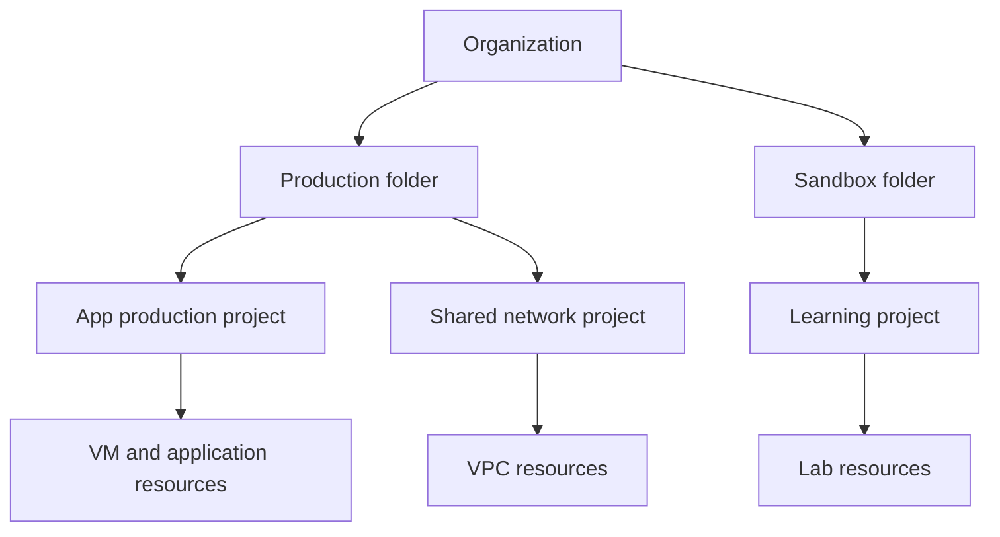

# Module 01 — Foundations & Resource Hierarchy

[สารบัญ](./README.md) · [บทถัดไป: IAM](./Module-02-IAM-Service-Accounts-and-Security.md)

## เป้าหมาย

อ่านจบแล้วควรอธิบายได้ว่าทรัพยากรอยู่ใน project ใด ใครเป็นผู้จ่ายเงิน นโยบายมาจากระดับไหน และความเสียหายใน zone/region จะกระทบอะไร

## 1. จากห้อง Server ไปสู่ Google Cloud

ใน on-prem เราสร้าง VM บน ESXi แล้วจัด vCPU/RAM/disk/network เอง บน cloud ยังมีแนวคิดเหล่านี้ แต่มีชั้น **project, IAM, API, quota และ billing** ครอบอยู่ด้วย

ตัวอย่าง: สร้าง VM ไม่ได้ ไม่ได้แปลว่า hardware เต็มเสมอไป อาจเกิดจากไม่มี permission, Compute API ยังไม่เปิด, quota vCPU ไม่พอ, organization policy ไม่อนุญาต external IP หรือ zone ไม่มี capacity สำหรับ machine type ที่เลือก

การเป็น Cloud Engineer จึงต้องตรวจทั้ง **สิทธิ์ + control plane + resource configuration + application behavior**

| รูปแบบ | สิ่งที่เราเน้นดูแล | ตัวอย่าง |
|---|---|---|
| IaaS | OS, patch, process, disk, application | Compute Engine |
| Managed container platform | container, deployment, identity, scaling; งาน node ขึ้นกับ mode | GKE |
| Serverless application platform | code/container, access, configuration, traffic | Cloud Run |
| Managed database | schema, query, connections, backup policy, access | Cloud SQL |

Managed ไม่ได้หมายความว่าไม่ต้องดูแล ถ้า app เปิด connection ไม่หยุด Cloud SQL ก็เต็มได้ ถ้าสั่ง query สแกนข้อมูลมหาศาล BigQuery ก็มีค่าใช้จ่ายได้ การย้าย platform ไม่ได้แก้ application bug โดยอัตโนมัติ

## 2. Resource hierarchy

เอกสาร [Resource hierarchy](https://docs.cloud.google.com/resource-manager/docs/cloud-platform-resource-hierarchy) อธิบายการจัดทรัพยากรเป็นลำดับชั้น สิ่งสำคัญต่อการทำงานคือ project เป็นจุดรวมทรัพยากรและการตั้งค่าหลายประเภท ส่วน folder ช่วยแบ่งนโยบาย/ทีม



**Organization** เป็นรากด้าน governance ขององค์กร ไม่ใช่ “region ของบริษัท” และไม่ใช่ billing account โดยตรง

**Folder** เป็นกลุ่มสำหรับ project/folder ย่อย เช่น Production, Nonproduction หรือแต่ละหน่วยงาน ต้องมี organization เพื่อใช้ folder

**Project** เป็นหน่วยที่เปิด APIs, อ้างอิงทรัพยากร, จัดสิทธิ์และ quota หลายประเภท รวมทั้งเชื่อมการใช้จ่ายกับ billing account

**Resource** คือ VM, bucket, database, service และอื่น ๆ บางประเภทมี IAM ระดับ resource ของตนเองด้วย

### ตัวอย่างการแบ่ง project

แอป inventory มี dev/test/prod ใช้ project แยกแต่ละ environment ช่วยแยกสิทธิ์และค่าใช้จ่าย ส่วน network กลางอาจอยู่ host project ของ Shared VPC

การตั้ง project เดียวแล้วใช้ชื่อ `prod-*` กับ `dev-*` ไม่ได้สร้าง security boundary เท่ากับแยก project และตั้ง IAM ให้เหมาะสม ชื่อมีไว้สื่อความหมาย สิทธิ์จริงขึ้นกับ policy

## 3. Name, ID, Number ต่างกันอย่างไร

| Field | ตัวอย่างสมมติ | ใช้ทำอะไร |
|---|---|---|
| Project name | `Smart ACE Lab` | ชื่อแสดงผล อ่านง่าย เปลี่ยนได้ |
| Project ID | `smart-ace-lab-12345` | ตัวระบุที่ใช้บ่อยใน CLI/API ต้องไม่ชนทั่วระบบ และแก้หลังสร้างไม่ได้ |
| Project number | `123456789012` | เลขที่ระบบสร้าง ใช้กับ resource/service identities บางชนิด |

อย่าคัดลอกชื่อแสดงผลไปแทน ID ในคำสั่งโดยคิดว่าเหมือนกัน คำสั่งต่อไปนี้ใช้ดูค่าจริง:

```bash
gcloud projects describe PROJECT_ID \
  --format='yaml(projectId,projectNumber,name,parent)'
```

`PROJECT_ID` เป็น placeholder ต้องเปลี่ยนเป็นค่าของตนเองก่อน ไม่ใช้ project number แทนทุกที่โดยอัตโนมัติ

## 4. IAM inheritance กับ Organization Policy

สองเรื่องนี้ทำหน้าที่ต่างกัน:

- **IAM** ตอบว่า principal ใดมี permission ทำ action ใด
- **Organization Policy** วาง constraint ว่าองค์กรอนุญาตรูปแบบการใช้ resource ใด เช่น จำกัด location หรือ external IP

ตัวอย่างเชิงเหตุผล: ผู้ดูแลมี role สร้าง VM แต่ถูก constraint ห้าม external IP การมี role มากขึ้นไม่ใช่คำตอบสำหรับ constraint นี้ ต้องเลือก VM ไม่มี external IP หรือให้ผู้มีหน้าที่จัดการนโยบายพิจารณาตามข้อกำหนด

สิทธิ์ allow ที่ inherited ลงมาไม่หายเพียงเพราะลบ binding ที่ project ถ้าอยากถอนสิทธิ์ต้องหาแหล่งต้นทางของ binding เรื่อง policy evaluation และ deny อยู่ในบท 02

## 5. Region, Zone และ Global scope

| Scope | ตัวอย่างทั่วไป | ผลต่อการออกแบบ |
|---|---|---|
| Global | VPC network | ใช้เป็น network เดียวข้ามหลาย region ได้ |
| Regional | subnet, Cloud Run service, regional MIG | อยู่ใน region ที่กำหนด |
| Zonal | VM, zonal disk | ต้องจัดหลาย zone หากต้องทน zone failure |

Cloud Storage มี location แบบ region, dual-region, multi-region ของตนเอง จึงไม่ควรบังคับทุกบริการเข้า 3 ช่องนี้โดยไม่อ่าน spec

**Region** คือพื้นที่ภูมิศาสตร์ที่มีหลาย zone ส่วน **zone** เป็น deployment area ภายใน region การมี VM สองตัวใน zone เดียวช่วยกรณี process/VM เสีย แต่ยังมีความเสี่ยงร่วมกันเมื่อ zone มีปัญหา

### เลือก location จากอะไร

1. ใกล้ผู้ใช้งานและ data เพื่อลด latency
2. ข้อกำหนดถิ่นที่เก็บข้อมูล
3. บริการ/machine type ที่เปิดให้ใช้จริง
4. ราคา, quota, capacity และความต้องการ DR
5. ค่า data transfer ระหว่าง location

ตัวอย่าง: app และ DB อยู่คนละทวีป ทุก SQL call ต้องข้ามระยะไกล CPU/RAM ต่ำก็ยังช้าได้ การเพิ่ม CPU ไม่แก้ round-trip latency

## 6. Identity ขององค์กร

[Cloud Identity / resource hierarchy](https://docs.cloud.google.com/resource-manager/docs/cloud-platform-resource-hierarchy) เป็นพื้นฐานจัดบัญชีผู้ใช้และ groups สำหรับองค์กร โดย Cloud IAM เป็นส่วนให้สิทธิ์บน cloud resources

ผู้มีตำแหน่ง admin ในระบบ identity ไม่ได้แปลว่ามีทุก permission บน workload ทุก project โดยอัตโนมัติ ต้องแยกหน้าที่ identity administration กับ cloud resource administration

Exam guide ปัจจุบันมี standalone organizations ด้วย [Standalone organizations](https://docs.cloud.google.com/resource-manager/docs/standalone-organization-overview) เป็นอีกเส้นทางที่เอกสารระบุสำหรับลูกค้า Free Trial ใหม่ โดยไม่ได้ใช้รูปแบบ domain-based เดิม และยังมีข้อจำกัดสำหรับบัญชีเดิม ต้องตรวจ eligibility ล่าสุดก่อนออกแบบ ไม่สรุปว่าองค์กรทุกรูปแบบต้องมี Google Workspace แบบเสียเงิน

## 7. Shared responsibility แบบใช้ทำงานจริง

ถ้ารัน Linux บน Compute Engine เราต้องดูแลแพ็กเกจ/OS/application และ permissions ที่กำหนดเอง ถ้าใช้ Cloud Run ภาระ OS host ลดลง แต่ยังต้องจัด image dependencies, secret, service account, ingress และ app logic

ถามเสมอว่า “ผู้ให้บริการจัดการ layer ไหน” และ “ทีมฉันยังรับผิดชอบอะไร” การเลือก managed service มีเหตุผลเมื่อช่วยลดภาระที่ทีมไม่อยากหรือไม่มีคนดูแล

## 8. จุดที่มักผิด

| ความเข้าใจเดิม | วิธีคิดที่ถูกต้อง |
|---|---|
| Project = folder ที่ตั้งชื่อเฉย ๆ | มี IAM/APIs/billing/quota และ lifecycle ที่เกี่ยวข้อง |
| Region บน Console เปลี่ยนทุก service | แต่ละ resource มี location/scope ของตนเอง |
| Owner แก้ได้ทุก policy | ต้องตรวจ org constraint และ permission เฉพาะด้วย |
| สอง VM = HA แล้ว | ดู zone, dependency, health checks, state และ failover |
| Managed = Google ดูแลทุกอย่าง | app/data/access/configuration ยังเป็นหน้าที่ของเรา |

## 9. ทบทวนด้วยสถานการณ์

**โจทย์:** Dev ต้องทดลองใน sandbox แต่ไม่ควรแตะ production ควรเริ่มอย่างไร?

**เหตุผล:** จัด sandbox เป็น project/folder ที่แยกจาก prod แล้วผูก group/roles ให้เฉพาะ scope ที่ต้องใช้ ตรวจว่าไม่ได้ inherit role กว้างจาก organization มาอยู่แล้ว การตั้งชื่อ VM คนละ prefix ยังไม่จำกัด permission

**โจทย์:** VM มี role ถูกต้องแต่สร้างพร้อม public IP ไม่ได้ ควรตรวจอะไร?

**เหตุผล:** อ่าน error ให้ครบ แล้วตรวจ org policy, API, quota และ config ห้ามสรุปว่าแก้ด้วยเพิ่ม Owner เสมอ

## เอกสารประกอบ

- [Resource hierarchy](https://docs.cloud.google.com/resource-manager/docs/cloud-platform-resource-hierarchy)
- [Organization policies](https://docs.cloud.google.com/resource-manager/docs/organization-policy/overview)
- [Regions and zones](https://docs.cloud.google.com/compute/docs/regions-zones)
- [Google Cloud locations](https://cloud.google.com/about/locations)
