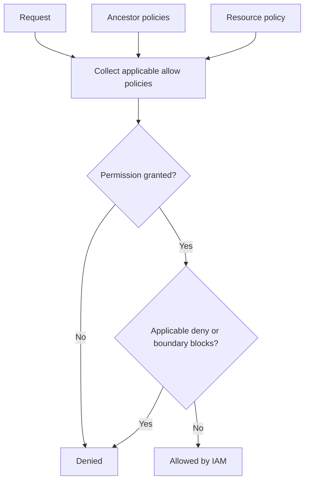

# Module 02 — IAM, Service Accounts & Security

[สารบัญ](./README.md) · [ก่อนหน้า](./Module-01-Foundations-and-Resource-Hierarchy.md) · [ถัดไป](./Module-03-Tools-Billing-and-Quotas.md)

## 1. Authentication กับ Authorization

**Authentication** พิสูจน์ว่า request มาจากใคร เช่น user login หรือ workload ใช้ token ของ service account

**Authorization** ตรวจว่าตัวตนนั้นทำ action ที่ร้องขอบน resource นี้ได้หรือไม่ Login ผ่านจึงไม่ได้แปลว่ามีสิทธิ์สร้าง VM หรือลบ bucket

โมเดล [IAM](https://docs.cloud.google.com/iam/docs/overview) ที่ใช้บ่อยคือ **principal + role + resource** เช่นให้ group ฝ่าย operation มี `roles/compute.viewer` บน project production

| ส่วน | คำถาม | ตัวอย่าง |
|---|---|---|
| Principal | ใคร? | user, group, service account, federated principal |
| Permission | ทำอะไร? | `compute.instances.list` |
| Role | รวม permission อะไร? | `roles/compute.viewer` |
| Resource/scope | ทำที่ไหน? | project หรือ bucket ที่รองรับ policy |
| Condition | เมื่อไร/ตามเงื่อนไขใด? | IAM Conditions ที่บริการ/role รองรับ |

เราให้ role แก่ principal โดยทั่วไป ไม่ผูก permission เดี่ยวตรง ๆ กับ user

## 2. Role 3 ประเภท

| Role | ใช้เมื่อไร | จุดระวัง |
|---|---|---|
| Basic | Owner/Editor/Viewer แบบกว้าง | มักกว้างเกินงาน ไม่ใช่ default สำหรับ production |
| Predefined | งานของบริการ เช่น Compute Viewer | เลือกตัวที่ตรง action และ scope |
| Custom | predefined กว้างหรือไม่ตรงจริง | ต้องดูแล permission lifecycle และชนิด permission ที่รองรับ |

**ตัวอย่าง:** คนต้องดูรายละเอียด VM เพื่อทำ inventory เริ่มจาก Compute Viewer ไม่ใช่ Editor คนต้องอัปโหลดไฟล์อย่างเดียวอาจใช้ Storage Object Creator แทน Storage Admin แต่ต้องตรวจเรื่องการ overwrite เพราะ Creator ไม่ได้มี delete/read ทุกอย่าง

Least privilege ไม่ได้หมายถึงใช้ custom role ทุกครั้ง Predefined ที่ตรงงานดูแลง่ายกว่าและลดโอกาสขาด permission ตอนระบบอัปเดต

## 3. Inheritance และ deny



Diagram เป็นภาพย่อเพื่ออธิบายการตัดสินใจด้าน IAM ไม่ใช่ลำดับ internal implementation ทั้งหมด ยังต้องผ่านบริการ/API/org constraints ที่เกี่ยวข้องด้วย

Allow bindings ที่ project รวมกับ inherited bindings ไม่ใช่แทนที่กัน หาก inherited role จาก folder ยังให้สิทธิ์อยู่ ลบ project binding ไม่ได้ถอนสิทธิ์นั้น

IAM deny สามารถบล็อก permission ที่รองรับ แม้มี allow อยู่ แต่ต้องตรวจขอบเขตและข้อยกเว้นของ deny ตาม [Deny policies](https://docs.cloud.google.com/iam/docs/deny-overview) อย่าเอากฎ evaluation ของ AWS policy มาใช้แบบตรงตัว

## 4. ให้สิทธิ์ผ่าน groups

ตัวอย่างออกแบบกลุ่ม `infra-readers`, `infra-operators`, `app-deployers` ให้ roles ตามหน้าที่ แล้วเพิ่ม/ถอนสมาชิกใน identity system

วิธีนี้ช่วย onboarding/offboarding และตรวจสิทธิ์ง่ายกว่าผูก user 50 คนทีละคน แต่ group membership เองก็เป็นส่วนของ security ถ้าใครเพิ่มตัวเองเข้ากลุ่ม privileged ได้ ก็มีผลเท่ากับเพิ่ม cloud access

ดู policy แบบ read-only:

```bash
gcloud projects get-iam-policy PROJECT_ID --format=yaml
```

คำสั่งนี้แสดง policy ที่ project ไม่ใช่รายงาน effective permissions ครบทุก ancestor/condition/deny ต้องดู inherited policy และใช้ troubleshooting tools ประกอบ

## 5. Service account เป็นทั้ง identity และ resource

[Service account](https://docs.cloud.google.com/iam/docs/service-account-overview) คือ identity สำหรับ workload/automation มี email เช่น `inventory-api@PROJECT_ID.iam.gserviceaccount.com`

**มุมที่ 1: SA เป็น principal** — ให้ SA มี Object Viewer บน bucket เพื่อให้ app อ่าน object

**มุมที่ 2: SA เป็น resource** — กำหนดว่าใคร attach, impersonate หรือจัดการ SA นี้ได้

| Role | บทบาทสำคัญ | ไม่ควรสับสนกับ |
|---|---|---|
| `roles/iam.serviceAccountUser` | ใช้ `actAs` เพื่อ attach SA ให้ resource เมื่อมี permission สร้าง resource ด้วย | ไม่ใช่การอ่านข้อมูลใน bucket |
| `roles/iam.serviceAccountTokenCreator` | สร้าง short-lived credentials / impersonate ตามสิทธิ์ที่ role ให้ | ไม่ใช่ permission สร้าง VM |
| `roles/iam.serviceAccountAdmin` | จัดการ SA resource ตาม permission ของ role | ไม่ใช่ data access ทุกบริการ |

**ตัวอย่างที่ออกสอบบ่อย:** คน deploy Cloud Run ต้องมีสิทธิ์ deploy และ `actAs` บน runtime SA ส่วน runtime SA ต้องมี permission อ่านข้อมูลที่ app ใช้ คน deploy ไม่จำเป็นต้องมี permission อ่าน data ทุกอย่างเอง

## 6. แยก service identities

- User-managed SA: เราสร้างให้ workload ตามหน้าที่
- Default SA: มีมาจากบริการ/การตั้งค่าเริ่มต้น อย่าสรุปว่าทุก project ให้ Editor เหมือนกัน
- Google-managed service agents: ใช้ทำงานเบื้องหลังของบริการ มี role เฉพาะ ไม่ควรถอนโดยไม่เข้าใจผล

แยก SA ตาม workload เช่น `inventory-api` กับ `backup-job` ถ้าใช้ SA เดียวที่มีทั้ง DB admin และ bucket admin กับทุกระบบ incident หนึ่งอาจกระทบทั้งหมด

## 7. Keyless และ impersonation

SA JSON key เป็น credential อายุยาวที่ต้องป้องกันและหมุนเวียน ทางเลือกแรกสำหรับ workload บน Google Cloud คือ attach SA และให้ platform ออก credential ตามระบบของบริการ

สำหรับ automation นอก Google Cloud พิจารณา [Workload Identity Federation](https://docs.cloud.google.com/iam/docs/workload-identity-federation) เพื่อแลก external identity เป็นสิทธิ์ชั่วคราวตาม trust configuration

สำหรับคนหรือ script ที่ได้รับอนุญาตให้ [impersonate](https://docs.cloud.google.com/iam/docs/service-account-impersonation):

```bash
gcloud storage ls gs://BUCKET_NAME \
  --impersonate-service-account=SA_EMAIL
```

ต้องมี permission ที่สร้าง token ของ SA ได้ และ **SA** ต้องมีสิทธิ์ต่อ bucket ด้วย มี Token Creator แต่ SA ไม่มี Object Viewer ก็ยังอ่านไม่ได้

## 8. Workforce vs Workload vs GKE

| กลไก | ใครใช้ | ตัวอย่าง |
|---|---|---|
| Workforce Identity Federation | คนจาก external IdP | พนักงานใช้ identity องค์กรเข้า Console/API |
| Workload Identity Federation | workload นอก cloud | CI pipeline แลก OIDC identity โดยไม่เก็บ SA key |
| Workload Identity Federation for GKE | Kubernetes workloads | Pod เข้าถึง Cloud Storage ผ่าน identity ที่กำหนด |

Federation ไม่ได้ให้ admin อัตโนมัติ ต้องตั้ง trust, attribute mapping/conditions และ IAM access ตามงาน แยก “ยืนยันตัวตนได้” กับ “ได้รับสิทธิ์อะไร” เสมอ

รายละเอียด [Workforce](https://docs.cloud.google.com/iam/docs/workforce-identity-federation) และ [GKE identity](https://docs.cloud.google.com/kubernetes-engine/docs/concepts/workload-identity) อยู่ในเอกสารทางการและบท 08

## 9. Network access ไม่ใช่ IAM access

VM ping ถึง DB ไม่ได้พิสูจน์ว่า app authenticate ผ่าน IAM แล้ว และ user มี IAM role ไม่ได้ทำให้ firewall เปิด port

แบ่งปัญหาเป็น 4 ชั้น: DNS/route → firewall/connectivity → identity/authorization → application credentials เช่น database user/password

## 10. Security essentials ที่เกี่ยวข้อง

เก็บ secret ใน Secret Manager แทน hardcode ใน image/repo แล้วให้ runtime SA เข้าถึงเฉพาะ secret ที่จำเป็น การ grant บน project อาจกว้างกว่า grant บน secret resource

CMEK ใช้ควบคุม encryption key ผ่าน Cloud KMS แต่ไม่ได้แทน IAM หรือ backup ผู้ที่มีสิทธิ์อ่านข้อมูลผ่านบริการอาจยังอ่านได้เมื่อ key ใช้งานได้ รายละเอียดอยู่บท 13

## 11. ตรวจเมื่อเจอ PERMISSION_DENIED

1. ดู active account หรือ runtime identity จริง
2. ดู resource/project ที่ error ระบุ
3. อ่าน permission ที่ขาด ไม่เดาจากชื่อเมนู
4. ตรวจ role, scope, inherited policies, condition และ deny
5. ถ้า impersonate ตรวจทั้งฝั่ง caller และฝั่ง SA
6. ถ้า attach SA ตรวจ `actAs` แยกจาก data access
7. ตรวจ policy propagation แล้วทดสอบใหม่อย่างมีขอบเขต

## ทบทวน

**app อ่าน bucket ไม่ได้ แต่คน deploy อ่านได้:** ตรวจ runtime SA เพราะ app ไม่ได้รันเป็นคน deploy โดยอัตโนมัติ

**ต้องการถอนสิทธิ์ที่มาจาก organization:** แก้ binding ต้นทางหรือออกแบบ scope ใหม่ การลบ binding ที่ไม่มีอยู่ใน project ไม่ช่วย

**CI ต้องเข้าถึง cloud โดยไม่เก็บ long-lived key:** เลือก federation ที่รองรับ CI identity และกำหนด trust/IAM ตาม repository/workflow ที่อนุญาต

## เอกสารประกอบ

- [IAM overview](https://docs.cloud.google.com/iam/docs/overview)
- [Role types](https://docs.cloud.google.com/iam/docs/roles-overview)
- [Service accounts](https://docs.cloud.google.com/iam/docs/service-account-overview)
- [Impersonation](https://docs.cloud.google.com/iam/docs/service-account-impersonation)
- [Workforce federation](https://docs.cloud.google.com/iam/docs/workforce-identity-federation)
- [Workload federation](https://docs.cloud.google.com/iam/docs/workload-identity-federation)
