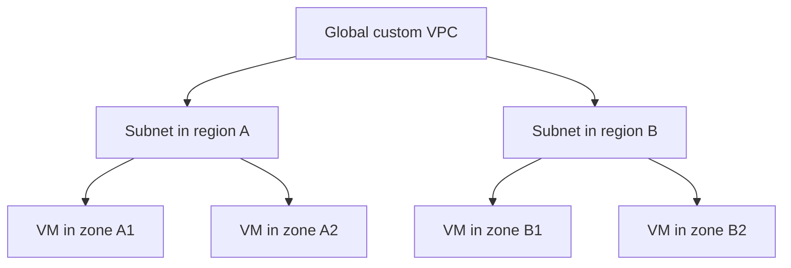

# Module 04 — VPC, Firewall, Routes, NAT & DNS

> 🧠 **ภาพจำก่อนอ่าน:** 🌐 Network → 🛡️ Rules → 🖥️ Backend  
> 🎨 [Visual Guide ของวิชานี้](./VISUAL-STUDY-GUIDE-TH.md) — ภาพช่วยจำ ไม่แทนคำสั่งและเนื้อหาจริง

[สารบัญ](./README.md) · [ก่อนหน้า](./Module-03-Tools-Billing-and-Quotas.md) · [ถัดไป](./Module-05-Compute-Engine-and-Instance-Groups.md)

## 1. จุดต่างจาก AWS ที่ต้องตั้งหลักใหม่

[VPC ของ Google Cloud](https://docs.cloud.google.com/vpc/docs/vpc) เป็น global resource ส่วน subnet เป็น regional resource ดังนั้น VPC เดียวมี subnet หลาย region ได้ และ VM หลาย zone ภายใน region สามารถใช้ subnet ของ region นั้น

ถ้าเคยเรียน AWS อย่าจำว่า VPC ต้องอยู่ region เดียวหรือ subnet ต้องผูก zone เดียวแล้วนำมาใช้ตรง ๆ บน Google Cloud



## 2. Auto mode กับ Custom mode

| Mode | ลักษณะ | เหมาะกับ |
|---|---|---|
| Auto mode | สร้าง subnet ตาม regional pattern ที่ระบบกำหนด | เริ่มทดลองที่ไม่ต้องควบคุม IP plan ละเอียด |
| Custom mode | เราเลือก region และ CIDR ของแต่ละ subnet | production, hybrid, การคุม IP ไม่ให้ชน |

Default network ที่บาง project มีให้ไม่ใช่ข้อบังคับ ถ้าสร้าง custom VPC ใหม่ อย่าสมมติว่าจะมี allow SSH/allow internal เหมือน default network

**ตัวอย่าง:** On-prem ใช้ `10.10.0.0/16` ถ้า VPC ใช้ช่วงนี้ซ้ำแล้วต่อ VPN จะเกิด routing ambiguity จึงวาง IP plan ให้ไม่ overlap ก่อนเชื่อมเครือข่าย

## 3. CIDR และ secondary ranges

`10.20.0.0/24` เป็น subnet range; ตัวเลขหลัง `/` เป็นขนาด prefix Google Cloud มี IP ที่สงวนไว้ ไม่ควรนับ usable addresses เท่ากับ 256 ตัวเต็ม

GKE แบบ VPC-native ใช้ secondary ranges สำหรับ Pod/Service ตาม configuration จึงต้องวางแผนเพิ่มจาก node IP ไม่ใช่เผื่อแค่จำนวน VM nodes

**Subnet expansion:** ขยาย primary IPv4 range ให้ใหญ่ขึ้นได้ภายใต้เงื่อนไข ไม่ใช่ shrink ได้ทุกเมื่อ และต้องไม่ชน range อื่น หาก `/24` ไม่พอ การเปลี่ยนเป็น `/23` ต้องตรวจ alignment และ overlap ก่อน

อ่าน [Subnets](https://docs.cloud.google.com/vpc/docs/subnets) ก่อนเปลี่ยน network ของระบบจริง การขยาย address range ไม่ใช่การย้ายทุก VM ไป VPC ใหม่

## 4. Internal / external / static IP

Internal IP ใช้ใน network ที่มี route ถึงกัน ส่วน external IP ช่วยการสื่อสารผ่าน public path ตามการตั้งค่าและ firewall

| แบบ | สิ่งที่ต้องรู้ |
|---|---|
| Ephemeral IP | ไม่ควรพึ่งว่าคงเดิมทุกครั้งเมื่อ resource lifecycle เปลี่ยน |
| Reserved static IP | จองไว้สำหรับ endpoint ที่ต้องคงตัว; scope ต้องตรง resource |
| VM ไม่มี external IP | ยังออก internet ได้ถ้ามี NAT/proxy ที่เหมาะ และ firewall/routes อนุญาต |

Public IP ไม่ได้แปลว่าเปิดทุก port Firewall และ process listener ยังเป็นตัวตัดสิน

## 5. Routes กับ firewall ทำคนละหน้าที่

**Route** ตอบว่าจะส่ง packet ไปทางไหน **Firewall** ตอบว่าจะยอมให้ packet นี้ผ่านหรือไม่ **Listener** ตอบว่ามี process รับ port นั้นหรือไม่

ตัวอย่าง: มี route ไป VM และ allow TCP 8080 แต่แอปฟังแค่ `127.0.0.1:8080` เครื่องอื่นก็ยังเรียกไม่ได้ สิ่งนี้ไม่ใช่ปัญหาที่เพิ่ม firewall rule จะแก้เสมอ

ตัวอย่าง read-only:

```bash
gcloud compute networks list
gcloud compute networks subnets list --network=NETWORK_NAME
gcloud compute routes list --filter='network:NETWORK_NAME'
gcloud compute firewall-rules list --filter='network:NETWORK_NAME'
```

Filter เป็นการค้นผล ไม่ใช่ security boundary หากผลไม่ตรงคาดให้ inspect network field และชื่อ resource จริง

## 6. VPC firewall rules

[VPC firewall](https://docs.cloud.google.com/firewall/docs/firewalls) เป็น stateful: return traffic ของ connection ที่อนุญาตมีการติดตามสถานะ จึงไม่ต้องคิดเหมือน stateless ACL ทุกครั้ง

สิ่งที่ต้องอ่านใน rule:

| Field | ถามอะไร |
|---|---|
| Direction | ingress หรือ egress? |
| Action | allow หรือ deny? |
| Priority | rule ไหนได้รับการประเมินก่อน? เลขน้อยมี priority สูง |
| Protocol/port | TCP 22, TCP 443, ICMP หรืออะไร? |
| Source/destination | CIDR ที่ตรงทิศทางของ rule |
| Targets | VM กลุ่มใด เช่น target network tags หรือ SA |

VPC มี implied rules เช่น ingress deny และ egress allow ที่ท้ายการประเมิน แต่ higher-level firewall policies/rules สามารถเปลี่ยนผลที่เกิดจริงได้ อย่าใช้ความรู้เรื่อง implied rule เพื่อข้ามการตรวจ effective policy

เมื่อ rule priority เท่ากันและ conflict ต้องอ่าน policy type/evaluation semantics ไม่วิเคราะห์จากลำดับที่ Console แสดง

## 7. Labels, network tags และ secure tags

| ชนิด | จุดประสงค์ | ใช้แทนกันได้ไหม? |
|---|---|---|
| Labels | ค้นหา/จัดกลุ่ม/ค่าใช้จ่าย | ไม่ได้เปิด firewall |
| Network tags | เลือก VM สำหรับ VPC firewall rules บางประเภท | ไม่ใช่ IAM-controlled secure tags |
| Resource Manager secure tags | policy/Cloud NGFW rules ที่รองรับ พร้อมสิทธิ์จัดการ tags | ต้องตรวจ support ของ rule/policy |

ถ้าโจทย์ต้องการป้องกันคน attach tag เพื่อได้ network access โดยพลการ ให้พิจารณา secure tags และ IAM ตามความสามารถของ Cloud NGFW ไม่ใช้ labels แก้โจทย์นี้

## 8. Cloud NAT

[Public NAT](https://docs.cloud.google.com/nat/docs/overview) ทำให้ resource ที่ไม่มี external IPv4 ออกไปยัง internet ได้ตาม configuration **ไม่ได้เปิดทางให้ internet เริ่ม connection ใหม่เข้าหา VM**

Cloud NAT ตั้งค่าร่วมกับ Cloud Router ใน region เดียวกัน แต่ Router ไม่ใช่ VM gateway ที่เราต้อง ssh เข้าไป patch และ NAT ไม่ได้มี user-managed VM appliance อยู่ใน data path

**ตัวอย่าง:** VM private ต้อง `apt update` → มี default route ที่เหมาะ, NAT ครอบคลุม subnet/range, egress firewall อนุญาต และ DNS resolve ได้

ถ้า package repo อยู่ private network ทางอื่น ก็อาจไม่ต้องผ่าน public NAT เช่น ใช้ internal mirror ห้ามสรุปว่า private VM ทุกตัวต้องใช้ NAT เสมอ

## 9. Private Google Access

Private Google Access ให้ VM ที่ไม่มี external IP เข้าถึง Google APIs/services ที่รองรับตาม subnet/routing/DNS configuration **ไม่ใช่ NAT สำหรับเว็บไซต์ internet ทั้งหมด**

| ต้องการ | เริ่มพิจารณา |
|---|---|
| Private VM เรียก Google APIs | Private Google Access / Private Service Connect ตามบริการและข้อกำหนด |
| Private VM ดาวน์โหลดจาก public package repo | Public NAT หรือ proxy/mirror ที่รองรับ |
| On-prem เข้า managed service แบบ private | connectivity และ private access model ของบริการนั้น |

Private Service Connect สร้าง endpoint/private connectivity ตาม service model ไม่เท่ากับ VPC Peering ทุกกรณี

## 10. DNS

Cloud DNS มี public zones สำหรับ internet และ private zones สำหรับ network ที่ผูกไว้ Record A/AAAA ชี้ IP, CNAME ชี้ชื่อ, TXT ใช้ข้อความเช่น verification

ถ้า DNS ตอบ IP เก่า แม้ server ใหม่ healthy user ก็อาจไปผิดปลายทาง ดู record, authoritative zone, resolver, TTL/cache และ visibility ของ zone ก่อน restart application

การสร้าง private zone ไม่ได้ทำให้ on-prem resolve ได้ทันที ต้องออกแบบ forwarding/peering/connector ที่เกี่ยวข้อง DNS resolution กับ network route เป็นคนละเงื่อนไข

## 11. SSH ผ่าน IAP

IAP TCP forwarding ช่วยเข้าถึง VM ไม่มี external IP โดยตรวจ IAM ก่อน tunnel แต่ยังต้องมี firewall อนุญาต traffic จาก IAP range และ OS authentication ที่เหมาะ

```bash
gcloud compute ssh VM_NAME \
  --zone=ZONE_NAME \
  --tunnel-through-iap
```

คำสั่งนี้ไม่ได้ bypass firewall หรือให้ sudo โดยอัตโนมัติ ใช้ OS Login roles ตามหน้าที่ ดู [IAP TCP forwarding](https://docs.cloud.google.com/iap/docs/using-tcp-forwarding)

## 12. Troubleshooting network path

1. ชื่อ resolve ได้หรือไม่ และได้ IP ใด?
2. Source อยู่ project/VPC/subnet ไหน?
3. Route ไป destination มีหรือไม่ และ IP overlap หรือไม่?
4. Effective firewall/NGFW policy อนุญาตหรือไม่?
5. Destination process listen address/port ที่ถูกหรือไม่?
6. ถ้าออก internet ตรวจ NAT และ port allocation/errors
7. ถ้า Google API ตรวจ private access และ authorization แยกกัน
8. ใช้ Connectivity Tests, VPC Flow Logs และ firewall logs ตามสิทธิ์/การเปิดใช้งาน

**ทบทวน:** Private VM เรียก Google Storage ได้แต่เข้า public package repo ไม่ได้ อาจมี Private Google Access แต่ไม่มี internet egress path การเพิ่ม Object Viewer ไม่ทำให้ apt เข้า internet ได้

## เอกสารประกอบ

- [VPC](https://docs.cloud.google.com/vpc/docs/vpc)
- [Subnets](https://docs.cloud.google.com/vpc/docs/subnets)
- [VPC firewall rules](https://docs.cloud.google.com/firewall/docs/firewalls)
- [Cloud NAT](https://docs.cloud.google.com/nat/docs/overview)
- [Private Google Access](https://docs.cloud.google.com/vpc/docs/private-google-access)
- [Cloud DNS](https://docs.cloud.google.com/dns/docs/overview)
