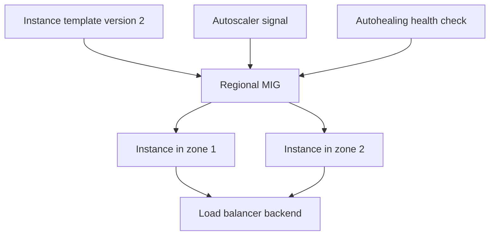

# Module 05 — Compute Engine, Disks, MIG & Recovery

[สารบัญ](./README.md) · [ก่อนหน้า](./Module-04-VPC-Firewall-NAT-and-DNS.md) · [ถัดไป](./Module-06-Storage-and-Data-Protection.md)

## 1. เมื่อไรควรใช้ VM

Compute Engine เหมาะเมื่อต้องควบคุม OS, kernel/system packages, Windows/Linux services หรือแอป legacy ที่ยังไม่เหมาะกับ container/serverless

ตัวอย่าง IIS/Tomcat เดิมที่ต้องติดตั้ง agent และจัด filesystem ตามรูปแบบเฉพาะ เริ่มที่ VM ได้ แต่ต้องวาง patching, backup, monitoring, network และ identity ไม่ใช่แค่ย้าย VM แล้วจบ

เลือก Compute Engine จาก requirement ไม่ใช่เพราะคุ้นเคยอย่างเดียว HTTP API แบบ stateless ที่แพ็กเป็น container ได้อาจลดภาระ operation ด้วย Cloud Run

## 2. Machine family และ sizing

| ลักษณะ workload | สิ่งที่ควรดู |
|---|---|
| เว็บทั่วไป | CPU utilization, memory working set, concurrency |
| Database บน VM | memory, storage latency/IOPS, backup/recovery |
| Batch | CPU throughput, interruptibility, checkpoint |
| AI/ML | GPU/TPU compatibility, memory, availability/quota |

Custom machine types รองรับใน machine series ที่กำหนด ไม่ได้ปรับ arbitrary CPU/RAM ได้ทุก series ส่วน resource availability ต่างกันตาม location

ตัวอย่างคิด: app RAM ใช้ 3 GB แต่ CPU peak 80% อย่าเพิ่มทั้ง CPU/RAM จำนวนมากโดยไม่มีข้อมูล ดู load test/metrics และข้อจำกัดของ app ก่อนเลือก

## 3. Create VM ต้องคิดอะไรบ้าง

1. Project และ zone ถูกหรือไม่
2. Image/OS และ machine type รองรับ workload หรือไม่
3. Boot disk / data disk / encryption / auto-delete
4. VPC/subnet และ external IP จำเป็นหรือไม่
5. Runtime SA และ data permissions
6. OS Login/SSH/Windows access
7. Startup script และความสามารถในการทำซ้ำ
8. Availability policy/maintenance behavior ของชนิดเครื่อง
9. Monitoring, backup, labels และ cleanup ownership

ตัวอย่าง syntax สำหรับเรียน ไม่ต้องรันหากยังไม่เตรียม network/identity:

```bash
gcloud compute instances create ace-vm \
  --project=PROJECT_ID \
  --zone=ZONE_NAME \
  --machine-type=e2-micro \
  --image-family=debian-12 \
  --image-project=debian-cloud \
  --network=NETWORK_NAME \
  --subnet=SUBNET_NAME \
  --no-address \
  --no-service-account \
  --no-scopes
```

VM ในตัวอย่างไม่มี SA จึงไม่เหมาะกับงานที่ต้องเรียก cloud APIs โดยใช้ workload identity แต่ลดสิทธิ์ส่วนที่ไม่ต้องใช้ใน lab SSH/IAP ยังต้องตั้งแยกตามบท 04

## 4. OS Login กับ SSH keys

[OS Login](https://docs.cloud.google.com/compute/docs/oslogin) ผูก Linux access เข้ากับ identity/IAM แทนการกระจาย SSH keys ผ่าน metadata แบบเดิม

| ความต้องการ | พิจารณา |
|---|---|
| Login ปกติ | OS Login role ตามสิทธิ์ที่รองรับ |
| Login พร้อม administrator privileges | OS Admin Login ตามหน้าที่ |
| เข้าจาก identity นอกองค์กร | permission/roles เพิ่มเติมตามเงื่อนไข OS Login |
| VM ไม่มี public IP | IAP/network path พร้อม firewall |

Enable OS Login แล้ว metadata SSH keys ไม่ควรถูกสมมติว่ายังเป็น auth path แบบเดิม และ OS Login ไม่ได้ทำให้ TCP 22 ผ่าน firewall เอง

## 5. Disk choices

[Disk types](https://docs.cloud.google.com/compute/docs/disks) ต้องเลือกตาม latency, throughput, IOPS, durability, scope และ machine compatibility

| Storage | ใช้กับ | ข้อควรคิด |
|---|---|---|
| Persistent Disk | boot/data ที่ต้องคงอยู่ตาม lifecycle config | zonal/regional และ performance ต่างตามชนิด |
| Hyperdisk | workload ที่ต้องกำหนด performance ตามชนิดที่รองรับ | ตรวจ machine type, provisioned performance และราคา |
| Local SSD | scratch/temp/cache ที่ทนสูญหายได้ | ไม่ใช้เป็นแหล่งข้อมูลเดียวของข้อมูลสำคัญ |
| Cloud Storage | objects, artifacts, backup | ไม่ใช่ block device ของ VM โดยธรรมชาติ |

**Regional Persistent Disk** ช่วยการทำสำเนาระดับ storage ระหว่าง zone ที่กำหนดใน region แต่ไม่ได้ทำให้ application failover พร้อมใช้อัตโนมัติ ต้องมี compute/attachment/recovery workflow ที่รองรับ

Stop/delete VM มีผลต่อ disk ไม่เหมือนกัน ตรวจ auto-delete ของ disk ที่ attach และ resource ที่สร้างแยกเสมอ

## 6. Snapshot, image และ machine image

| สิ่ง | เน้นเก็บ | เหมาะกับ |
|---|---|---|
| Disk snapshot | disk data ณ ช่วงเวลา | restore data/disk, scheduled backup |
| Custom image | boot OS/software baseline | สร้าง VM ที่มี baseline เดียวกัน |
| Machine image | VM configuration และ disk data ที่รองรับ | capture/restore/clone เครื่องตามเงื่อนไข |

Snapshot VM disk ขณะ DB เขียนงานอาจได้ crash-consistent state แต่อาจไม่ใช่ application-consistent backup ต้องใช้ DB-native backup/quiescing และทดสอบ restore ตามระบบจริง

ตัวอย่าง read-only:

```bash
gcloud compute instances list
gcloud compute disks list
gcloud compute snapshots list
gcloud compute images list --no-standard-images
```

การมี snapshot ในรายการไม่ได้พิสูจน์ว่ากู้แอปกลับมาทำงานได้ครบ ให้ทดสอบ restore ทั้ง permission/network/secrets/database dependencies

## 7. Instance template และ Managed Instance Group

**Instance template** กำหนดแบบของ VM เช่น image, machine type, metadata, network และ SA; ให้คิดเป็น versioned baseline การเปลี่ยน application release มักสร้าง template ใหม่แล้วอัปเดต group

**MIG** จัด VM จาก template และดูแลจำนวน/การเปลี่ยนรุ่น/การฟื้นตัวตาม config ใช้ได้ทั้ง zonal และ regional กลุ่ม regional ช่วยกระจายข้าม zone



Unmanaged instance group รวมเครื่องที่เราจัด lifecycle เอง ไม่ได้ให้ behavior แบบ MIG โดยอัตโนมัติ

## 8. Autoscaling, autohealing และ load balancing

| กลไก | เปลี่ยนอะไร | ตัวอย่าง |
|---|---|---|
| Autoscaling | จำนวน instances ตาม signal | เพิ่มเครื่องเมื่อ CPU/load สูง |
| Autohealing | แทนเครื่องที่ unhealthy | recreate VM เมื่อ health check fail ตาม policy |
| Load balancing | กระจาย traffic ไป backend ที่พร้อม | หยุดส่ง request ไป backend unhealthy |

คนมักตั้ง health check aggressive จน startup ช้าแล้วถูก recreate ซ้ำ Autohealing ควรเผื่อ initial delay และเลือกสัญญาณที่บอกว่า “เครื่องควรถูกแทน” ไม่ใช่ outage ของ dependency ร่วมที่ทุก instance เจอเหมือนกัน

ถ้า DB ล่มและ endpoint health ของ app fail ทุกตัว การ recreate ทั้ง MIG อาจเพิ่มความวุ่นวาย โดยไม่ได้แก้ DB จึงออกแบบ health checks ให้รู้ purpose

## 9. Stateless ก่อน autoscale

ถ้า user login session เก็บใน RAM เครื่องเดียว แล้ว request ถัดไปไปอีก VM อาจหลุด session ต้องใช้ shared/session store หรือการออกแบบที่เหมาะ

ไฟล์ upload ที่เก็บบน local disk จะไม่ตามไปทุก instance ถ้าต้องขยายกลุ่มให้เลือก external storage ตาม requirement และแยก persistent state ออกจาก VM instances

Stateful MIG มีความสามารถสำหรับ stateful workload แต่ต้องออกแบบตามข้อจำกัด ไม่ถือว่าเอา legacy DB ลงกลุ่ม autoscale แล้วจะได้ HA ที่ถูกต้องทันที

## 10. Spot VMs และ availability

[Spot VMs](https://docs.cloud.google.com/compute/docs/instances/spot) ลดค่า compute สำหรับงานที่ยอมให้เครื่องถูกหยุดได้ ใช้ checkpoint/retry/queue และไม่พึ่ง availability แบบ VM ปกติ

เหมาะกับ batch rendering/test/distributed tasks ที่ retry ได้ ไม่เหมาะเป็น instance เดียวของระบบสำคัญที่หยุดไม่ได้ และ Spot รุ่นปัจจุบันไม่ควรถูกเหมารวมกับ preemptible รุ่นเดิมเรื่องอายุสูงสุด

## 11. VM Manager

VM Manager ช่วยงาน OS inventory, patch management และ OS policies ตามระบบปฏิบัติการ/การตั้งค่าที่รองรับ โดยมี API/agent/permission prerequisites

มันไม่ได้แทน application deployment/DB backup ทั้งหมด และควรทดสอบ patch บน staging ก่อน production เช่นเดียวกับ on-prem

## 12. Mini runbook: VM unhealthy

1. ตรวจ VM state และ error events
2. ตรวจ boot/serial output และ OS Login/network path
3. ตรวจ disk full, RAM, process, listener และ startup script
4. ตรวจ app endpoint จากเครื่องเองและจากเส้นทางของ health check
5. ตรวจ firewall ที่ health checker ใช้ ตามชนิด LB
6. ตรวจ dependency เช่น DB/DNS/secret access
7. ถ้า MIG ดู template version, rollout และ autohealing events
8. แก้สาเหตุหรือ rollback แทน reboot ซ้ำโดยไม่มีหลักฐาน

## ทบทวน

**CPU ต่ำแต่เว็บช้า:** ตรวจ network/DB waits/query/connections/I/O latency ไม่ตัดปัญหา infra หรือ app จาก CPU ค่าเดียว

**ต้องใช้ Windows service เดิมที่ต้อง admin OS:** VM เป็นตัวเลือกตรงงานกว่าบังคับลง Cloud Run

**ต้องสำรอง transactional DB:** disk snapshot อย่างเดียวไม่แทนแผน DB backup + restore test

## เอกสารประกอบ

- [OS Login](https://docs.cloud.google.com/compute/docs/oslogin)
- [Disk types](https://docs.cloud.google.com/compute/docs/disks)
- [Instance groups](https://docs.cloud.google.com/compute/docs/instance-groups)
- [Snapshots](https://docs.cloud.google.com/compute/docs/disks/snapshots)
- [Spot VMs](https://docs.cloud.google.com/compute/docs/instances/spot)
- [VM Manager](https://docs.cloud.google.com/compute/vm-manager/docs)
