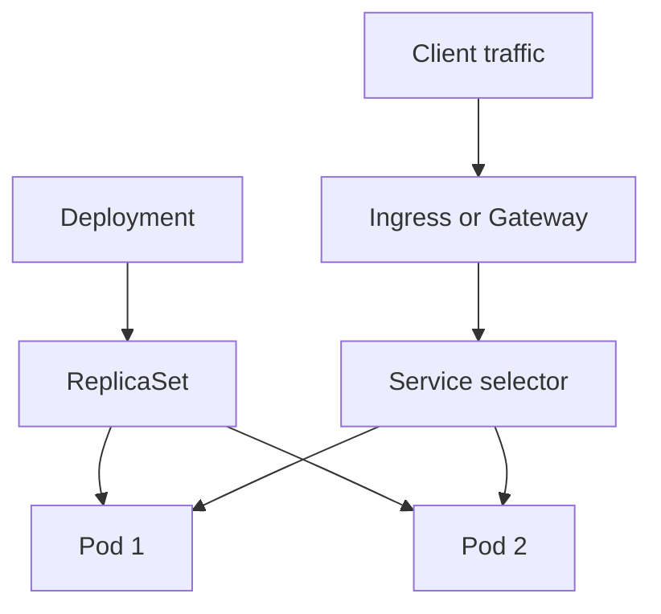

# Module 08 — GKE & Kubernetes Operations

> 🧠 **ภาพจำก่อนอ่าน:** 📦 Image → ☸️ Workload → 🩺 Health  
> 🎨 [Visual Guide ของวิชานี้](./VISUAL-STUDY-GUIDE-TH.md) — ภาพช่วยจำ ไม่แทนคำสั่งและเนื้อหาจริง

[สารบัญ](./README.md) · [ก่อนหน้า](./Module-07-Databases-and-Data-Services.md) · [ถัดไป](./Module-09-Cloud-Run-and-Event-Driven-Services.md)

## 1. Container กับ Kubernetes คนละชั้น

Container image แพ็ก application และ dependencies ส่วน Kubernetes เป็นระบบจัดการการรัน workload เช่น scheduling, desired state, service discovery และ rollout

GKE คือ managed Kubernetes ของ Google Cloud ยังต้องเข้าใจ resources ของ Kubernetes; ไม่ใช่เอา Docker image ขึ้นแล้วได้ backup/security/HA ครบอัตโนมัติ

| ชั้น | หน้าที่ |
|---|---|
| Image | application package |
| Container | process ที่รันจาก image |
| Pod | หน่วย scheduling ที่มี container หนึ่งหรือหลายตัว |
| Node | เครื่องที่รัน Pods |
| Cluster | control plane + nodes/network/configuration |

## 2. Standard vs Autopilot

ตาม [Autopilot overview](https://docs.cloud.google.com/kubernetes-engine/docs/concepts/autopilot-overview):

| ประเด็น | Standard | Autopilot |
|---|---|---|
| การดูแล nodes | ผู้ใช้กำหนด node pools/config มากกว่า | platform ดูแลส่วน infrastructure มากขึ้น |
| ความยืดหยุ่น | เหมาะ workload ที่ต้อง config ลึก | มี constraints/managed defaults ตาม workload |
| การระบุ workload resources | requests/limits ยังสำคัญ | requests มีผลต่อ scheduling และ cost model ตามชนิด workload |
| หน้าที่ของเรา | Kubernetes app + node decisions ที่เลือกเอง | Kubernetes app, access, resources, networking และ data |

อย่าตอบว่า Autopilot “ไม่ต้องคิด resources เลย” หรือ Standard “ต้องสร้าง control plane เองทั้งหมด” ทั้งสองเป็น managed GKE ต่างกันที่ขอบเขต operation

## 3. Zonal, regional และ private configuration

Regional cluster เพิ่ม control-plane availability ตาม configuration แต่ application จะ HA หรือไม่ยังขึ้นกับ replicas, topology, nodes และ dependency

Private nodes ไม่มี public node IP ส่วน control-plane endpoint access มี options ของตนเอง อย่าเหมารวม private cluster ทุกตัวว่าห้ามมี external control-plane endpoint หรือเข้าจาก Cloud Shell ได้ทันที

ก่อน create คิดเรื่อง VPC/subnet/Pod and Service ranges, endpoint access, release channel, identity, node pools/Autopilot, logging/monitoring และ quota

## 4. Kubernetes objects ที่ต้องอ่านออก

| Object | ใช้ทำอะไร | ภาพจำ |
|---|---|---|
| Deployment | stateless replicated app + rollout | อยากมี app version นี้ N replicas |
| StatefulSet | stable identity/storage patterns | workload ที่ต้อง identity/state ตามลำดับ |
| DaemonSet | workload ต่อ node ที่เข้าเงื่อนไข | node-level agent |
| Job | task จนสำเร็จ | batch ครั้งเดียว |
| CronJob | สร้าง Jobs ตามเวลา | งาน schedule |
| Service | stable endpoint ไป Pods ตาม selector | Pods เปลี่ยน IP แต่ชื่อ service คงเดิม |
| ConfigMap | config ที่ไม่เป็น secret | environment/config files |
| Secret | data ที่ควรจัด access เป็นความลับ | ต้องป้องกัน RBAC/encryption ไม่ถือว่า base64 คือ encryption |
| PVC | request persistent storage | disk/file persistence ตาม storage class |



Diagram เป็นแนวคิดของ app topology เส้นทาง data plane จริงขึ้นกับ implementation เช่น container-native load balancing ไม่จำเป็นต้องผ่าน hop เหมือนภาพทุกครั้ง

## 5. อ่าน manifest ตัวอย่าง

```yaml
apiVersion: apps/v1
kind: Deployment
metadata:
  name: ace-web
spec:
  replicas: 2
  selector:
    matchLabels:
      app: ace-web
  template:
    metadata:
      labels:
        app: ace-web
    spec:
      containers:
        - name: web
          image: nginx:stable
          ports:
            - containerPort: 80
          resources:
            requests:
              cpu: 100m
              memory: 128Mi
            limits:
              cpu: 500m
              memory: 256Mi
          readinessProbe:
            httpGet:
              path: /
              port: 80
            initialDelaySeconds: 5
            periodSeconds: 5
```

`replicas` คือจำนวน Pods ที่ต้องการ `selector` ต้องตรง labels ของ Pod `containerPort` ระบุ port ใน spec ไม่ได้เปิด public firewall/LB เอง

Image tag `stable` เปลี่ยนเนื้อหาได้ ตัวอย่างนี้เพื่อเรียนรู้ สำหรับ release ที่ต้อง reproducible pin tag/version หรือ digest และใช้ approved registry

## 6. Requests vs limits

**Requests** ใช้ประกอบ scheduling และคำนวณ utilization สำหรับ autoscaling บางแบบ **Limits** กำหนดเพดาน resource ตาม runtime behavior

`100m` CPU = 0.1 CPU; `128Mi` เป็น memory unit ถ้าตั้ง memory limit ต่ำเกิน workload อาจ OOMKilled ส่วน CPU limit อาจทำให้ throttling แม้ node มี CPU รวมเหลือ

ตัวอย่าง Pod Pending ทั้งที่ CPU utilization ของ nodes ต่ำ: nodes อาจไม่มี allocatable resources ตาม requests, มี taint/affinity constraints หรือ PVC provision ไม่ได้ จึงดู events ก่อนเพิ่ม replica

## 7. Readiness, liveness, startup probes

| Probe | คำถาม | ผลสำคัญ |
|---|---|---|
| Readiness | พร้อมรับ traffic หรือยัง? | ใช้คัด endpoint ที่พร้อม |
| Liveness | process ติดจนควร restart หรือไม่? | fail อาจ restart container |
| Startup | startup เสร็จหรือยัง? | ช่วย workload เริ่มช้าไม่โดน probe อื่นเร่งเกิน |

อย่าใช้ endpoint ที่พึ่ง DB ทุกครั้งเป็น liveness โดยไม่คิด ถ้า DB outage ทุก Pod อาจ restart ซ้ำตามกัน ทำให้ startup load เพิ่ม

## 8. Service types

| Type | การเข้าถึง |
|---|---|
| ClusterIP | endpoint ภายใน cluster |
| NodePort | เปิด node port ตาม config/network |
| LoadBalancer | ขอ cloud load balancer ตาม controller/config |

Ingress/Gateway ใช้ประกาศ routing/entry configuration ตาม controller ไม่ใช่ชื่ออื่นของ Pod การเลือก LoadBalancer ทุก service อาจเพิ่มค่าใช้จ่ายและไม่ได้ให้ path routing แบบ HTTP โดยอัตโนมัติ

## 9. Scaling คนละระดับ

- **HPA** เปลี่ยน replicas ตาม metrics ที่ตั้ง
- **VPA** แนะนำ/จัด requests ตาม mode และข้อจำกัด อาจมี Pod disruption
- **Cluster autoscaler** ปรับจำนวน nodes ใน Standard node pools ที่ตั้งให้รองรับ
- **Autopilot** จัด infrastructure ตาม workload ที่รองรับ แต่ workload requests/constraints ยังสำคัญ

ถ้า HPA สร้าง Pods เพิ่มแต่ cluster ใส่ไม่ลง จะเห็น Pending ต้องตรวจ node capacity/autoscaler/quota ไม่คิดว่าการเพิ่ม replica แก้ได้เสมอ

## 10. 3 ชุดสิทธิ์ที่ต้องแยก

| งาน | ตัวตน/กลไกสำคัญ |
|---|---|
| คนใช้ kubectl จัด deployment | Google identity/IAM + Kubernetes RBAC ตามการอนุญาต |
| Node ดึง image จาก Artifact Registry | identity ของ node/runtime และ registry permissions |
| Pod เรียก Google APIs | Workload Identity Federation for GKE ตาม config |

การ grant bucket access ให้คนใช้ kubectl ไม่ได้ทำให้ Pod มี access และการให้ Pod SA อ่าน bucket ไม่ได้แก้ image pull โดยอัตโนมัติ

[GKE workload identity](https://docs.cloud.google.com/kubernetes-engine/docs/concepts/workload-identity) รองรับ model การใช้ federated principal หรือ linking เพื่อ impersonate IAM SA ตาม scenario **Kubernetes ServiceAccount ไม่ใช่ Google IAM Service Account** แม้ชื่อใกล้กัน

## 11. kubectl ที่ควรใช้เป็น

```bash
kubectl config current-context
kubectl get nodes
kubectl get pods -A
kubectl get deployments,services -n NAMESPACE
kubectl describe pod POD_NAME -n NAMESPACE
kubectl logs POD_NAME -n NAMESPACE --all-containers
kubectl rollout status deployment/DEPLOYMENT_NAME -n NAMESPACE
```

`-A` = ทุก namespaces ที่ได้รับอนุญาต Context ผิดหมายถึงกำลังสั่ง cluster ผิด; ต้องตรวจเหมือนตรวจ gcloud project

## 12. Failure patterns

| State | เริ่มดู |
|---|---|
| Pending | events, requests, nodes, taints/affinity, PVC |
| ImagePullBackOff | image name/digest, registry permission, network |
| CrashLoopBackOff | logs, command/config, missing secret, app startup |
| OOMKilled | memory profile, requests/limits, leak |
| Running แต่ไม่ Ready | readiness endpoint/port/dependencies |
| Service ไม่มี endpoints | selector labels, readiness, namespace |

**ทบทวน:** ระบบมี Deployment 3 replicas แต่ Service selector ไม่ตรง Pod labels จะไม่มี backend ที่ถูกเลือก การเพิ่ม replicas ยังไม่แก้ configuration mismatch

## 13. Image build, registry และ continuous delivery

หลักสูตร GKE และ skill badge เพิ่มเส้นทางจาก source code ไปสู่ workload ที่รันใน cluster:

1. Build container image ด้วย Cloud Build หรือ build workflow ที่ทีมเลือก
2. Tag image และ push ไปยัง Artifact Registry ใน repository/location ที่กำหนด
3. ให้ deploy identity มีสิทธิ์ pull image และให้ runtime identity เข้าถึงเฉพาะ API/data ที่ต้องใช้
4. Apply Kubernetes manifests หรือใช้ release tool ของทีมเพื่อสร้าง Deployment/Service
5. ตรวจ rollout, Pod readiness, events และ logs ก่อนเปลี่ยน traffic
6. ใช้ continuous delivery ให้ test, image promotion, deployment และ rollback เป็นขั้นตอนตรวจสอบย้อนกลับได้

แยก **image-pull identity** จาก **application runtime identity** ให้ชัด และอย่าใส่ credential ลงใน Docker image หรือ manifest ที่ commit เข้า Git การ rollback workload version ไม่ได้ย้อนกลับ schema/data change อัตโนมัติ

**Labs ที่ course สาธารณะระบุ:** พื้นฐาน Cloud Console/Cloud Shell, ใช้ Cloud Build, deploy Autopilot cluster ผ่าน Console/Cloud Shell; skill badge เพิ่ม Docker, Artifact Registry, GKE Qwik Start, Deployments/Services และ challenge lab

## เอกสารประกอบ

- [Build container images with Cloud Build](https://docs.cloud.google.com/build/docs/building/build-containers)
- [GKE deployment concepts](https://docs.cloud.google.com/kubernetes-engine/docs/concepts/deployment)

- [GKE Autopilot](https://docs.cloud.google.com/kubernetes-engine/docs/concepts/autopilot-overview)
- [Deploy workloads](https://docs.cloud.google.com/kubernetes-engine/docs/get-started/deploy-workloads)
- [Workload Identity Federation for GKE](https://docs.cloud.google.com/kubernetes-engine/docs/concepts/workload-identity)
- [Kubernetes objects](https://kubernetes.io/docs/concepts/overview/working-with-objects/)
- [Probes](https://kubernetes.io/docs/concepts/configuration/liveness-readiness-startup-probes/)

## 14. StatefulSet และ persistent data ให้เห็นภาพ

StatefulSet ใช้เมื่อแต่ละ replica ต้องมี **ชื่อ/ตัวตนที่คงที่**, ลำดับการสร้างหรือหยุดที่คาดเดาได้ และ storage ของแต่ละ replica แยกกัน เช่น member ของระบบ distributed ที่รู้จักกันด้วย ordinal identity รูปแบบชื่อโดยทั่วไปเป็น `<statefulset>-0`, `<statefulset>-1` เป็นต้น

StatefulSet ไม่ได้ทำให้ application มี replication หรือ consistency ที่ถูกต้องให้อัตโนมัติ ตัวแอปยังต้องจัดการ replication, quorum, recovery และ data consistency ของตัวเอง ส่วน StatefulSet ช่วยรักษา identity และเชื่อม volume claim เข้ากับ Pod ที่สัมพันธ์กัน

| ความต้องการ | Resource ที่มักใช้ |
|---|---|
| หลาย replica ของ web/API ที่แต่ละตัวแทนกันได้ | Deployment |
| replica มี identity และ disk แยกที่ตาม Pod ไป | StatefulSet + headless Service + volume claim template |
| disk อายุยาวที่ผูกกับ VM ไม่ใช่ Pod | Persistent Disk และวิธี attach ที่เหมาะ |
| shared filesystem ที่หลาย Pods ต้อง mount | Filestore/CSI driver และ access mode ที่รองรับ |
| ข้อมูลเป็น record และต้อง backup/transaction | managed database มักเหมาะกว่าเก็บ DB เองใน Pod |

วงจร storage สำคัญ: **StorageClass** บอกวิธี provision → StatefulSet สร้าง PVC แยกให้แต่ละ ordinal → PVC bind กับ PV → Pod mount volume ของตน เมื่อตัว Pod ถูกสร้างใหม่ด้วย identity เดิม ระบบอาจนำ PVC เดิมกลับมาใช้ได้ตาม lifecycle และ reclaim policy ที่ตั้งไว้

ตัวอย่าง manifest แบบย่อ:

```yaml
apiVersion: apps/v1
kind: StatefulSet
metadata:
  name: ledger
spec:
  serviceName: ledger
  replicas: 3
  selector:
    matchLabels:
      app: ledger
  template:
    metadata:
      labels:
        app: ledger
    spec:
      containers:
        - name: ledger
          image: us-docker.pkg.dev/example/project/ledger:v1
          volumeMounts:
            - name: data
              mountPath: /var/lib/ledger
  volumeClaimTemplates:
    - metadata:
        name: data
      spec:
        accessModes: [ReadWriteOnce]
        storageClassName: standard-rwo
        resources:
          requests:
            storage: 10Gi
```

จากตัวอย่างจะได้ PVC แยก เช่น `data-ledger-0`, `data-ledger-1`, `data-ledger-2`; อย่าสร้าง PVC ก้อนเดียวแล้วสมมติว่า block disk แบบ ReadWriteOnce จะ mount เขียนพร้อมกันจากหลาย nodes ได้ การรองรับ access mode ขึ้นกับ storage backend และ CSI driver

**ข้อควรจำเรื่องลบ resource:** การลบ StatefulSet ไม่ได้หมายความว่าควรลบข้อมูลโดยไม่ตรวจสอบ และการคง PVC ไว้ก็ไม่ได้ทดแทน backup ให้ตรวจ PVC/PV, reclaim policy, snapshot/backup และขั้นตอน restore ก่อน cleanup งานจริง

เอกสาร: [StatefulSets ใน GKE](https://docs.cloud.google.com/kubernetes-engine/docs/concepts/statefulset) · [GKE persistent volumes](https://docs.cloud.google.com/kubernetes-engine/docs/concepts/persistent-volumes) · [Deploy stateful application](https://docs.cloud.google.com/kubernetes-engine/docs/how-to/stateful-apps)