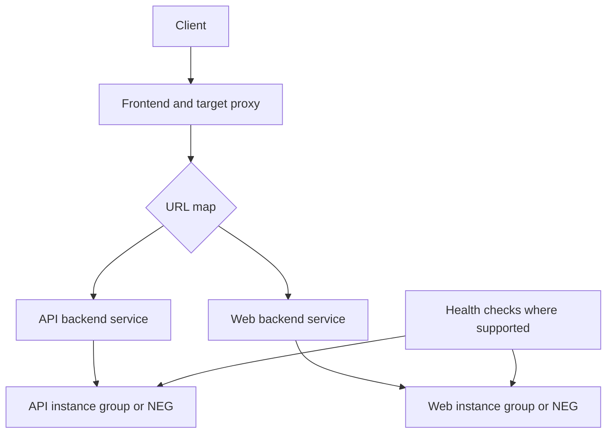

# Module 10 — Load Balancing & Hybrid Connectivity

> 🧠 **ภาพจำก่อนอ่าน:** 🌐 Network → 🛡️ Rules → 🖥️ Backend  
> 🎨 [Visual Guide ของวิชานี้](./VISUAL-STUDY-GUIDE-TH.md) — ภาพช่วยจำ ไม่แทนคำสั่งและเนื้อหาจริง

[สารบัญ](./README.md) · [ก่อนหน้า](./Module-09-Cloud-Run-and-Event-Driven-Services.md) · [ถัดไป](./Module-11-Observability-and-Operations.md)

## 1. Load balancer ทำอะไร

Load balancer เป็น entry point ที่กระจาย traffic ไป backend ตาม configuration/health โดยต้องเลือกจาก protocol, internal/external, global/regional และ proxy/passthrough requirements

ระบบ VM LB → app1/app2 → DB ต้องวัดแต่ละชั้น LB ไม่ได้แก้ DB bottleneck หากทุก app รอ DB นาน backend ทุกตัวก็ช้าได้

## 2. เลือกประเภทจาก requirement

ตาม [Choose a load balancer](https://docs.cloud.google.com/load-balancing/docs/choosing-load-balancer):

| ต้องการ | เริ่มเลือก family |
|---|---|
| HTTP/HTTPS routing ตาม host/path | Application Load Balancer |
| TCP proxy ที่ terminate/proxy connections | Proxy Network Load Balancer ที่รองรับ |
| TCP/UDP และ behavior แบบ passthrough | Passthrough Network Load Balancer ที่รองรับ |
| รับจาก internet | External variant |
| รับจาก private clients | Internal variant |
| หลาย region / global entry | Global หรือ cross-region variant ที่ตรงบริการ |

ชื่อ product บาง variant ต่างตามรุ่น/architecture อย่าจำชื่อ ALB/NLB ของ AWS แล้วสรุป scope/feature ของ Google Cloud ทุกตัวเหมือนกัน

## 3. ส่วนประกอบ HTTP load balancing

| Component | หน้าที่ |
|---|---|
| Forwarding rule / frontend IP | รับ traffic ที่ address/protocol/port |
| Target proxy | จัดการ proxy/TLS ตามชนิด |
| URL map | routing ตาม host/path สำหรับ application LB |
| Backend service | ระบุกลุ่ม backend และ policy |
| Backend | instance group / NEG / serverless backend ตาม support |
| Health check | ตรวจ backend ที่รองรับว่าพร้อมหรือไม่ |

Serverless backends/NEGs บางแบบมี health/traffic behavior ต่างจาก VM groups ต้องอ่าน backend-specific support ไม่บังคับทุกชนิดตั้ง health check แบบ VM

## 4. Health checks และ firewall

Backend อาจรับ traffic จาก test client ได้แต่ health check fail เพราะ firewall ไม่อนุญาต source ของ health checker หรือ named port/target port ไม่ตรง

ก่อนเปิด CIDR กว้าง อ่าน required source ranges/proxy-only subnet ของ LB variant ที่เลือก ไม่คัดลอก range เดียวใช้กับทุก LB

Endpoint `/health` ต้องสะท้อน purpose ที่ใช้ เช่น readiness ของ backend แต่ต้องระวัง endpoint ที่ทำ query หนักทุก health check จนสร้างภาระ DB

## 5. Session และ state

Session affinity อาจช่วยบาง use case แต่ไม่ทำให้ local state กลายเป็น HA เพราะ backend เปลี่ยน/เสียได้ ถ้าข้อมูลสำคัญอยู่เครื่องเดียวต้องย้าย persistent state ไปที่เหมาะสม

Regional/global LB ไม่ได้ทำให้ database replicated ข้าม region อัตโนมัติ ก่อนออกแบบ global traffic ดู write/read consistency, data residency และ failure mode ของ data layer

## 6. Network Service Tiers

Premium และ Standard เป็น network tiers ที่มี routing/feature availability ต่างกัน ไม่ใช่ VM CPU performance tier

เลือกตาม LB variant, geography, network performance และราคา การต้องใช้ global external architecture บางแบบบังคับ tier ที่รองรับ จึงไม่เลือก Standard เพื่อประหยัดโดยไม่ดู compatibility

## 7. Shared VPC

[Shared VPC](https://docs.cloud.google.com/vpc/docs/shared-vpc) ให้ host project จัด network กลาง แล้ว service projects ใช้ subnet ที่ได้รับอนุญาต

| ส่วน | ผู้ดูแล/ทรัพยากร |
|---|---|
| Host project | VPC/subnets/network administration |
| Service project | workload resources และ app administration |
| Network User permissions | ใครใช้ subnet ได้ตาม scope |

ตัวอย่างทีม Infra คุม network แต่ทีมแอปสร้าง VM ใน project ของตนได้ วิธีนี้ไม่ใช่ VPC Peering เพราะ workload ใช้ network ที่ share มา

## 8. VPC Network Peering

[Peering](https://docs.cloud.google.com/vpc/docs/vpc-peering) เชื่อม VPC ที่แยกกันเพื่อแลก routes ตาม configuration และ constraints

จุดสำคัญ:

- IP ranges ต้องไม่ overlap ตามข้อจำกัด
- IAM/firewall ยังแยกดูแล ไม่แชร์สิทธิ์ทุกอย่างกัน
- Peering ไม่ใช่ transitive routing โดยอัตโนมัติ: A↔B และ B↔C ไม่ได้แปลว่า A↔C ใช้ได้
- การแลก custom routes ต้องตั้งและตรวจ support ไม่ถือว่า route ทุกชนิดถูกส่งต่อเสมอ

## 9. VPN vs Interconnect

| ทางเชื่อม | หลักการ | ใช้เมื่อ |
|---|---|---|
| Cloud VPN | encrypted tunnel ตามบริการ | hybrid ที่เหมาะกับ VPN connectivity requirements |
| Dedicated Interconnect | dedicated connection ที่รองรับ | องค์กรต้อง capacity/connection model แบบเฉพาะ |
| Partner Interconnect | เชื่อมผ่าน supported provider | ใช้ partner connectivity model |

HA VPN ต้องออกแบบ tunnels/attachments/routes ให้ตรง availability requirement การมี tunnel เดียวไม่ได้ทำให้ HA เพียงเพราะใช้ชื่อ product ว่า HA VPN

Interconnect ไม่ควรถูกสรุปว่า encrypt ทุก traffic โดยอัตโนมัติ ถ้าต้อง encryption ต้องพิจารณากลไกที่รองรับและ configuration ตาม security requirement

## 10. Cloud Router และ BGP

Cloud Router จัดการ dynamic route exchange กับ peers ตาม product configuration เช่น BGP ใน hybrid connections ไม่ใช่ user-managed Linux router

ตรวจ BGP session state, advertised prefixes, received routes และ dynamic routing mode เมื่อเชื่อม on-prem แล้วบาง region ไปไม่ถึง

| อาการ | แนวตรวจ |
|---|---|
| VPN ขึ้นแต่ app ไปไม่ถึง | routes, selectors/config, firewall, return path |
| ไปได้ทางเดียว | return route, asymmetric routing, firewall |
| บาง subnet ใช้ไม่ได้ | prefix advertisement/overlap และ region scope |
| DNS ไม่เจอชื่อภายใน | DNS forwarding/zone visibility แยกจาก IP connectivity |

## 11. Static routes และ managed routes

Custom static route ระบุ destination/next hop ตามชนิดที่รองรับ เป็นคนละเรื่องกับ firewall ที่อนุญาต traffic

อย่าเพิ่ม static route ที่ซ้อนกันจนบังเส้นทางเดิมโดยไม่ดู effective route selection และ policy-based routes ที่อาจเกี่ยวข้อง ใช้ Connectivity Tests/route inspection ก่อนทดลอง production

## 12. ตัวอย่างเลือก architecture

**องค์กรหลายทีมต้อง network กลาง:** Shared VPC พร้อม host/service project IAM

**สอง VPC อิสระต้อง private connectivity:** พิจารณา Peering เมื่อข้อจำกัด route/IP/scale เหมาะ ไม่ใช้เป็น transit hub โดยสมมติ

**On-prem ต่อ cloud:** เลือก VPN/Interconnect จาก bandwidth, availability, cost, security และ provider/location requirements

**HTTP app มีสอง backend ตาม `/api` และ `/web`:** Application LB ที่รองรับ URL map; ไม่เลือก UDP passthrough LB

## เอกสารประกอบ

- [Choose a load balancer](https://docs.cloud.google.com/load-balancing/docs/choosing-load-balancer)
- [Shared VPC](https://docs.cloud.google.com/vpc/docs/shared-vpc)
- [VPC Peering](https://docs.cloud.google.com/vpc/docs/vpc-peering)
- [Cloud VPN](https://docs.cloud.google.com/network-connectivity/docs/vpn/concepts/overview)
- [Interconnect](https://docs.cloud.google.com/network-connectivity/docs/interconnect/concepts/overview)
- [Network tiers](https://docs.cloud.google.com/network-tiers/docs/overview)
