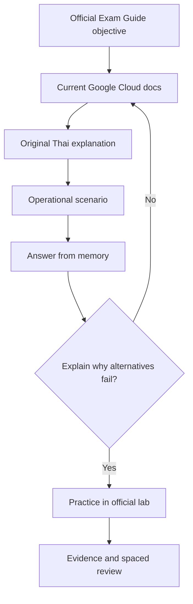

# Activity 02 — Build a Certification Study Guide: ACE Exam Prep

[กลับคู่มืออ่านตาม Path](./LEARNING-PATH-STUDY-GUIDE-TH.md) · [เปิดกิจกรรมบน Google Skills](https://www.skills.google/paths/11/course_templates/77) · [เปิด Exam Map](./LEARNING-PATH.md)

> อ้างอิงรายละเอียดกิจกรรม Google Skills ที่ตรวจ 5 ตุลาคม 2026: กิจกรรมนี้สอนให้รู้จัก Gemini Notebook, สร้าง notebook และใช้ study guide เพื่อฝึกสอบ ACE  
> เอกสารนี้สรุปวิธีเรียนและตรวจความถูกต้อง ไม่รับรองคำตอบที่ AI สร้างแทนเอกสารต้นทาง

## เป้าหมายของบท

เมื่อจบกิจกรรมนี้ เธอจะมี study guide ที่เชื่อมกลับไปยัง source ได้, จัดหัวข้อตามขอบเขตสอบ ACE และใช้ทดสอบความเข้าใจโดยไม่ให้ AI เฉลยทันที

### ก่อนเริ่ม

เตรียม [ACE exam guide ทางการ](https://cloud.google.com/learn/certification/cloud-engineer), Learning Path และโน้ตบทเรียนที่กำลังอ่าน ไม่จำเป็นต้องมี Google Cloud project เพราะการทำ study guide ไม่ได้ provision Cloud resources

### หลังจบบท

- จัดแหล่งเรียนตามหัวข้อสอบได้
- แยกข้อความจาก source, คำอธิบายของ AI และข้อสรุปของตัวเองได้
- สร้างคำถามแบบสถานการณ์พร้อมเหตุผลเฉลย
- บันทึกหัวข้อที่ยังทำไม่ได้ แล้วผูกกลับไปยังบทอ่านหรือ Lab
- ตรวจได้ว่า study guide ไม่ได้เพิ่มข้อเท็จจริงที่ไม่มี source รองรับ

### คำศัพท์ใหม่

| คำ | ความหมายแบบง่าย |
|---|---|
| Notebook | พื้นที่รวบรวม source สำหรับถามและจัดทำคู่มือเรียน |
| Source | เอกสารต้นทางที่ใช้ยืนยันคำตอบ |
| Study guide | แผนอ่านและสรุปความรู้เพื่อเตรียมสอบ |
| Active recall | พยายามดึงคำตอบจากความจำก่อนเปิดดูเฉลย |
| Hallucination | คำตอบที่ฟังดูมั่นใจแต่ไม่มีหลักฐานรองรับหรือผิดจาก source |

---

## 1. เริ่มจากปัญหาการอ่านสอบ

ถ้าอ่านบริการไปทีละชื่อ เช่น Compute Engine, Cloud Storage, IAM แล้วจำอย่างเดียว เวลาเจอโจทย์จริงอาจไม่รู้ว่าข้อจำกัดใดทำให้ต้องเลือกบริการนั้น

Study guide ที่ดีจึงตอบ 3 อย่าง:

1. **ต้องรู้เรื่องอะไร?** — ตาม objective ของข้อสอบและกิจกรรมใน Path
2. **ต้องทำอะไรได้?** — เลือกบริการ, deploy, ตรวจ access, อ่าน log หรือแก้ปัญหา
3. **จะพิสูจน์ความเข้าใจอย่างไร?** — ตอบโจทย์สถานการณ์และอธิบายว่าทำไมตัวเลือกอื่นไม่เหมาะ

Gemini Notebook ช่วยค้นและสังเคราะห์จาก sources ที่นำเข้าได้ แต่ผู้เรียนยังต้องตรวจข้อสรุปกับเอกสารต้นทาง โดยเฉพาะข้อมูลที่เปลี่ยนตามรุ่นหรือ region

---

## 2. เตรียม source ที่เชื่อถือได้

เรียงลำดับความน่าเชื่อถือโดยทั่วไป:

1. ACE exam guide และหน้ารับรองทางการ
2. กิจกรรม/หลักสูตรใน Google Skills Path ที่กำลังเรียน
3. Google Cloud documentation ของบริการนั้น
4. โน้ตที่เรียบเรียงจาก source ข้างต้น พร้อมลิงก์ย้อนกลับ
5. แหล่งชุมชน ใช้ช่วยหาแนวคิดหรือคำถาม แต่ไม่ใช้ยืนยันข้อเท็จจริงแทนเอกสารทางการ

### Source ที่แนะนำสำหรับ ACE

| Source | ใช้ตอบคำถามแบบไหน |
|---|---|
| [ACE Exam Guide](https://cloud.google.com/learn/certification/cloud-engineer) | ขอบเขตสอบและ objective |
| [Associate Cloud Engineer Learning Path](https://www.skills.google/paths/11) | ลำดับกิจกรรมและหลักสูตรที่ต้องเรียน |
| [Google Cloud Documentation](https://cloud.google.com/docs) | พฤติกรรมบริการ, คำสั่ง, ข้อกำหนดและแนวปฏิบัติ |
| โน้ตใน repo | สรุปภาษาไทย, ตัวอย่าง, troubleshooting และคำถามทบทวน |

### สิ่งที่ไม่ควรใส่ใน Notebook

- password, token, API key หรือ credentials ของ lab/องค์กร
- log หรือ configuration ที่มีข้อมูลบุคคลหรือข้อมูลลับ
- เอกสารที่เธอไม่มีสิทธิ์นำไปอัปโหลดหรือแชร์กับบริการ
- ข้อสอบจริงหรือเฉลยที่ได้มาโดยไม่ได้รับอนุญาต

ใช้ public documentation และโน้ตที่เธอมีสิทธิ์ใช้ หากไม่แน่ใจว่าเอกสารนำเข้าได้หรือไม่ ให้ใช้ชื่อ/ลิงก์ของเอกสารแทนการ upload สำเนา

---

## 3. แบ่ง Notebook ตามงานสอบ

ACE Exam Guide ที่ลิงก์จากหน้ารับรองปัจจุบันจัดเนื้อหาเป็น 4 domain น้ำหนักเป็นค่าประมาณ ไม่ใช่จำนวนข้อแน่นอน:

| Domain | น้ำหนักโดยประมาณ | ตัวอย่างความสามารถที่ต้องฝึก |
|---|---:|---|
| Setting up a cloud solution environment | 20% | project/hierarchy, billing, APIs, quota, location, identity |
| Planning and implementing a cloud solution | 30% | เลือกและ deploy compute, network, storage, database และเครื่องมือ |
| Ensuring the successful operation of a cloud solution | 30% | monitoring, logging, backup, recovery, scaling และ troubleshooting |
| Configuring access and security | 20% | IAM, roles, service accounts, federation และ least privilege |

อย่าใช้เปอร์เซ็นต์แทนการอ่าน objective รายข้อ แต่ใช้เพื่อมองภาพรวมว่าควรแบ่งเวลาทบทวนอย่างไร

---

## 4. สร้าง study guide จาก source

หน้าจอผลิตภัณฑ์อาจเปลี่ยนได้ ให้ทำตาม flow ที่กิจกรรมใน Google Skills สอน และตรวจชื่อปุ่มจาก UI ปัจจุบัน:

### ขั้นที่ 1 — สร้าง Notebook สำหรับเป้าหมายเดียว

- สร้าง notebook สำหรับ ACE exam preparation
- ตั้งชื่อที่เข้าใจง่าย เช่น ACE — IAM and Resource Setup
- เริ่มจาก domain หนึ่งก่อน แทนการโยนเอกสารทุกหัวข้อใส่รวมกัน

**ตรวจผล:** เปิด notebook แล้วรู้ได้ทันทีว่ามีไว้ตอบคำถามชุดใด

### ขั้นที่ 2 — เพิ่ม sources และจัดระเบียบ

เพิ่ม exam guide, course material ที่ได้รับอนุญาต และโน้ตภาษาไทยที่มีที่มา แยก notebook หรือกลุ่ม source ตาม domain เมื่อจำนวนเอกสารเริ่มมาก

**ตรวจผล:** แต่ละ source เปิดดูชื่อและต้นทางได้ และไม่มี secret ปน

### ขั้นที่ 3 — สร้าง outline ก่อนสรุป

เริ่มด้วยคำสั่งลักษณะนี้:

> จาก source ที่แนบ สร้าง outline ของ objective สำหรับ ACE แบ่งตาม 4 domain ระบุว่าแต่ละข้ออ้างอิง source ใด ถ้า source ไม่มีข้อมูลให้เขียนว่า “ยังไม่มีหลักฐานในแหล่งที่ให้” ห้ามเติมจากความจำ

**ตรวจผล:** outline มีหัวข้อตาม source และมีช่องว่างให้กลับไปเติม แทนที่จะเดาหัวข้อที่ไม่มีหลักฐาน

### ขั้นที่ 4 — สร้างโน้ตที่ใช้ตัดสินใจได้

ต่อหนึ่งหัวข้อ ให้ขอผลลัพธ์เป็น:

- แนวคิดและปัญหาที่บริการแก้
- เงื่อนไขที่ควรเลือก/ไม่ควรเลือก
- สิ่งที่ต้องตรวจใน Console หรือ CLI
- สัญญาณความผิดพลาดที่พบบ่อย
- source ที่ใช้สนับสนุนแต่ละข้อ

ตัวอย่าง prompt:

> สรุปความต่างระหว่าง Cloud NAT กับ Private Google Access จาก source เท่านั้น ทำตาราง “ใช้เมื่อ / ไม่ได้ทำอะไร / ข้อจำกัด / สิ่งที่ต้องตรวจ” ใส่ชื่อ source หลังทุกข้อ ถ้าข้อมูลไม่พอให้บอกตรง ๆ

### ขั้นที่ 5 — สร้างแบบฝึกก่อนเฉลย

ขอให้สร้างโจทย์สถานการณ์โดยไม่แสดงคำตอบทันที:

> สร้างโจทย์ ACE 5 ข้อจาก source ที่แนบ ข้อสอบต้องมีเงื่อนไขสำคัญ 2–3 ข้อ ให้ฉันตอบก่อน อย่าเฉลยในข้อความเดียวกัน หลังฉันตอบให้ระบุหลักฐาน, เหตุผลที่คำตอบถูก, เหตุผลที่ตัวเลือกอื่นผิด และ source ที่รองรับ

**ตรวจผล:** คำถามบังคับให้เลือกจาก requirement ไม่ใช่เดาคำศัพท์จากชื่อบริการ

---

## 5. วงจรเรียนที่ควรใช้กับทุกหัวข้อ

ใช้วงจรเดิมซ้ำ:

**อ่านโน้ต → ปิดโน้ตและอธิบายเอง → ตอบสถานการณ์ → ทำ Lab หรือ inspection → ตรวจคำตอบกับ source → จดช่องว่าง**

ตัวอย่างบันทึกหลังเรียน:

| รายการ | บันทึก |
|---|---|
| หัวข้อ/กิจกรรม | เช่น Cloud NAT และ private VM |
| อธิบายเองได้ | private VM เริ่ม outbound connection โดยไม่ต้องมี external IP |
| ยังสับสน | NAT ไม่ได้เปิด inbound connection จาก internet |
| หลักฐานที่ลอง | route, firewall, NAT config และ error log |
| ทบทวนต่อ | Module 04 และ Lab 02 |
| ครั้งหน้าจะทดสอบ | เปลี่ยนเงื่อนไขให้ VM ต้องเข้าถึง Google APIs โดยไม่ออก internet ทั่วไป |

ให้จด “สิ่งที่ยังตอบไม่ได้” เป็นหัวข้อเรียน ไม่ใช่เพียงสรุปสิ่งที่อ่านจบแล้ว

---

## 6. ตรวจความน่าเชื่อถือของคำตอบจาก AI

ทุกคำตอบสำคัญให้ถามกลับ:

1. source ใดบอกข้อนี้?
2. เป็นข้อเท็จจริงจากเอกสารหรือเป็นการอนุมาน?
3. มีข้อจำกัดเรื่องรุ่น, region, quota, permission หรือ edition หรือไม่?
4. คำตอบขัดกับโน้ตหรือ source อื่นหรือไม่?
5. ถ้าตัด source ข้อนี้ออก คำตอบยังมีหลักฐานอยู่ไหม?

ถ้า Notebook ตอบเกิน source ให้เก็บเป็น “ข้อสงสัย” แล้วตรวจเอกสารทางการก่อนเพิ่มลงในโน้ตหลัก

---

## 7. Mini Lab: ตรวจ Notebook หนึ่งหัวข้อ

**เวลา:** 15–20 นาที · ไม่ใช้ Cloud resources และไม่เสียค่าใช้จ่ายจากการ provision

1. เลือกหัวข้อหนึ่งจากบทที่กำลังเรียน เช่น IAM role หรือ Cloud Storage lifecycle
2. เพิ่ม official documentation และโน้ตที่อธิบายหัวข้อนั้น
3. ให้ Notebook สร้างตารางเปรียบเทียบ พร้อมขอชื่อ source
4. เลือกคำอธิบาย 2 ข้อแล้วเปิด source ต้นฉบับยืนยัน
5. ขอคำถามสถานการณ์ 3 ข้อแบบซ่อนเฉลย
6. ตอบจากความเข้าใจเอง แล้วแก้โน้ตจุดที่ตอบผิด

**ผ่านเมื่อ:** ข้อเท็จจริงในโน้ตทุกข้อย้อนกลับไปหา source ได้ และมีอย่างน้อยหนึ่งคำถามที่เธออธิบายเหตุผลได้โดยไม่ดูเฉลย

---

## 8. Knowledge Check

ลองตอบก่อนเปิดคำอธิบาย ให้คะแนนข้อละ 1 คะแนน; ผ่านที่ 4/5 และต้องผ่าน Mini Lab ด้วย

### คำถาม

1. ทำไม official exam guide ควรเป็น source หลักของขอบเขตสอบ?
2. ถ้า AI เติมคำตอบที่ source ไม่ได้พูดถึง ควรทำอย่างไร?
3. ทำไมต้องแยก “ข้อมูลจาก source” กับ “ข้อสรุปของ AI”?
4. การให้ AI สร้าง quiz แล้วอ่านเฉลยทันทีฝึก active recall หรือไม่?
5. ควรใส่ lab token หรือ credential ลงใน Notebook ไหม?

เปิดดูคำตอบและเหตุผล

1. เพราะ exam guide เป็นแหล่งทางการที่กำหนด objective; ให้ตรวจวันที่/รุ่นก่อนใช้
2. ทำเครื่องหมายว่าไม่มีหลักฐาน แล้วตรวจเอกสารทางการเพิ่มก่อนสรุป
3. เพื่อรู้ว่าข้อเท็จจริงยืนยันได้แค่ไหนและแก้ข้อผิดพลาดย้อนกลับไปที่ source ได้
4. ไม่เต็มที่; ควรตอบก่อนดูเฉลยและให้ Notebook เฉลยหลังส่งคำตอบ
5. ไม่ควร; credential เป็น secret และไม่จำเป็นต่อการทำ study guide

**ทบทวน:** ข้อ 1–3 → ส่วน 2 และ 6; ข้อ 4 → ส่วน 5; ข้อ 5 → ส่วน 2.

### Practical checkpoint

- [ ] มี Notebook ที่ตั้งชื่อและกำหนดเป้าหมายชัดเจน
- [ ] sources มีแหล่งทางการและตรวจย้อนกลับได้
- [ ] ไม่มี credentials หรือข้อมูลที่ไม่ควรอัปโหลด
- [ ] สร้างคำถามที่ให้ตอบก่อนเห็นเฉลย
- [ ] ตรวจคำตอบอย่างน้อย 2 ข้อกลับไปยัง source ต้นฉบับ

**READY TO CONTINUE** เมื่อครบทั้ง 5 ข้อและได้อย่างน้อย 4/5 คะแนน

---

## แหล่งอ้างอิงทางการ

- [Google Skills — Build a Certification Study Guide: ACE Exam Prep](https://www.skills.google/paths/11/course_templates/77) — จุดประสงค์กิจกรรมและการใช้ Gemini Notebook
- [Google Cloud — Associate Cloud Engineer Certification](https://cloud.google.com/learn/certification/cloud-engineer) — exam guide และข้อมูลรับรองทางการ
- [Google Cloud Documentation](https://cloud.google.com/docs) — ตรวจรายละเอียดบริการและขั้นตอนที่เปลี่ยนแปลงได้
- [ACE Learning Path](https://www.skills.google/paths/11) — ลำดับ course, lab และ skill badge

## 📚 Deep Learning Notes — อ่านเพื่อเข้าใจ ไม่ใช่พึ่งสรุป AI อย่างเดียว (Original Supplement, 2026-10-21)

### เป้าหมายของ Activity 02 คือ “ระบบเรียนรู้” ไม่ใช่ Course สำหรับ Setup Infrastructure

กิจกรรมนี้ต้องแยกจาก Activity เชิงบริการอย่าง Compute Engine หรือ GKE เพราะเน้น **วิธีทำ Study Guide สำหรับ ACE**. ถ้าเติม Lab สร้าง Resource เข้าไปตรงนี้จะยิ่งทำให้ลำดับ Google Skills มั่วกว่าเดิม. จึงใช้ตัวอย่าง **จัดบทเรียนหนึ่งหัวข้อ (IAM)** ให้เข้าใจและจำได้จริงแทน

### ตัวอย่างโน้ตคุณภาพสำหรับ Objective: IAM

**โจทย์จำลอง:** Operator ดูรายการ Cloud Storage Objects ได้ แต่ห้าม Delete Object หรือเปลี่ยน IAM Policy. ต้องเลือก Role และ Scope ที่เหมาะ ไม่ใช้ `roles/owner` เพราะให้สิทธิ์มากเกินไป

| ชั้นของคำถาม | Notes ควรตอบได้ |
|---|---|
| Mental model | Principal ได้รับ Role บน Resource Scope; Role รวม Permissions |
| Decision | ทำไม `roles/storage.objectViewer` จึงเหมาะกว่าบทบาท Admin สำหรับ Read-only Object Access ใน Bucket ที่กำหนด |
| Alternative | ทำไม Project Viewer อย่างเดียวอาจไม่ได้สิทธิ์ Object ที่ต้องการตาม Policy |
| Verify | ตรวจ IAM Binding ที่ Scope ที่ถูกต้องและ Bucket-specific Data Access |
| Failure | 403 Permission Denied บอกไม่ได้โดยตัวมันเองว่า Role ไม่ครบหรือ Account/Project ผิด |
| Security | อย่าเผยแพร่ Personal Email, Account ID, Token หรือ Project IDs ใน Repo Public |

### Source of truth 3 ชั้น

1. **Exam Guide** ระบุว่าข้อสอบวัด Skill ไหน — ใช้เป็น Curriculum Coverage Gate ไม่ใช่คำตอบ API ทุกตัว
2. **Service Documentation** อธิบาย Behavior และ Constraints ปัจจุบัน — ใช้ตรวจ technical correctness
3. **Google Skills Activity** คือที่ฝึกและวัดประสบการณ์จริง — โน้ตภาษาไทยเรา *ประกบ* ไม่ใช่แทนที่ Official Grader หรือ Paid Transcript

ถ้าสร้าง AI-generated Flashcards ให้ถาม `ข้อใดควรใช้และเพราะอะไร` เช่น “ทำไม NAT ไม่เปิด Inbound” ไม่ใช่แค่ “Cloud NAT ย่อมาจากอะไร”. เก็บ Source URL และ Date ของทุกคำตอบที่ขึ้นอยู่กับ Feature/Version

### Retrieval Practice: ทดสอบว่าเข้าใจหรือยัง

ปิดโน้ตแล้วเขียนคำตอบสั้น ๆ สำหรับ 3 ข้อนี้:

- Service Account ของ VM ต้องเรียก Cloud Storage: Identity ที่รัน Code กับ Identity ของคน Deploy แตกต่างกันอย่างไร?
- VPC Routing ให้เส้นทางแล้ว ทำไม Firewall ยังบล็อก Traffic ได้?
- ค่า Service Quota เต็ม แต่ Billing มีเงินเพียงพอ: เพราะเหตุใด 2 เรื่องนี้ไม่เท่ากัน?

ถ้ายังตอบแบบ “เปิด Role Admin แล้วลองใหม่” แปลว่ายังไม่ได้เรียน Root Cause และ Trade-off. กลับไปอ่าน Objective/Docs จากนั้นทำ Lab อีกครั้งแล้วจด Evidence ที่ Redact แล้ว

**Reference:** [Associate Cloud Engineer Exam Guide](https://cloud.google.com/learn/certification/guides/cloud-engineer) · [Google Cloud IAM Introduction](https://cloud.google.com/iam/docs/overview) · [Google Skills Path 11](https://www.skills.google/paths/11).

**Expected output ของบทนี้:** Learning Notebook Structure, Three Source Links, One Scenario Explained, Four Recall Questions — ไม่ใช่การสร้าง Google Cloud Resource หรืออ้างว่าจบคอร์สใน Notebook โดยไม่ฝึกจริง
