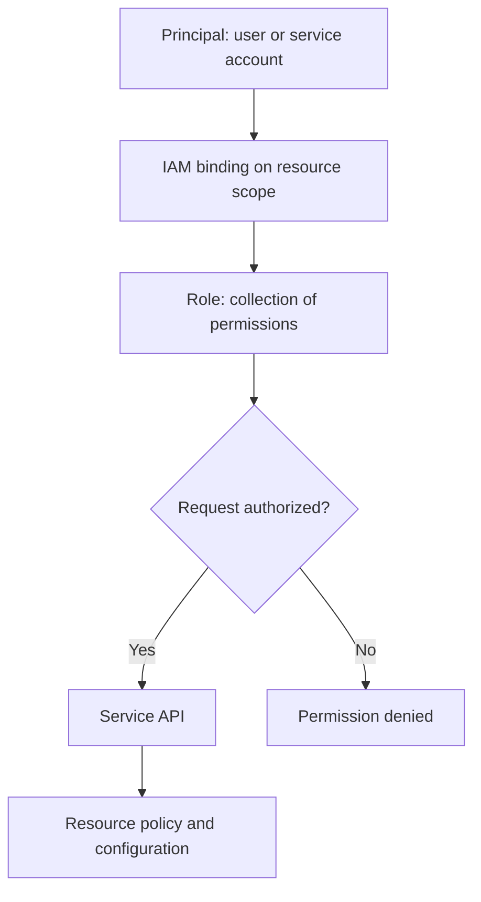

# Activity 04 — Essential Google Cloud Infrastructure: Core Services (ฉบับอ่านเป็นโน้ตภาษาไทย)

[คู่มืออ่านตาม Path](./LEARNING-PATH-STUDY-GUIDE-TH.md) · [Activity 03](./Path-Activity-03-Foundation-TH.md) · [Lab map](./Lab-Guide-TH/LEARNING-PATH-LAB-MAP.md) · [Google Skills course](https://www.skills.google/paths/11/course_templates/49)

> โน้ตนี้ยึด Activity 04 ของ ACE Learning Path โดยตรง อธิบาย IAM, storage/database, resource/billing และ Cloud Observability พร้อมแบบฝึกประกบ Course page กับ syllabus ที่เผยแพร่ระบุ labs ด้าน IAM, Cloud Storage encryption, Cloud SQL, Billing data in BigQuery และ Observability คู่มือนี้เป็นเนื้อหาเรียบเรียงใหม่ ไม่ใช่เฉลย grader ของ Google Skills

## 📖 Textbook Chapter — Core Services: Identity, Data, Cost และ Observability

> **Original Thai Teaching Chapter (2026-10-30).** อธิบายตามหัวข้อ Course Core Services ที่ Google Skills เปิดเผยสาธารณะ; ไม่ใช่ Video Transcript / Paid Student Guide หรือผลจริงจาก Google Cloud Lab. ภาพจำหลักอยู่ใน [Visual Guide](./VISUAL-STUDY-GUIDE-TH.md).

### 🔐 1. IAM: “ใครทำอะไรกับทรัพยากรไหน” ไม่ใช่แค่เลือก Role

เวลาให้ User เข้าถึง Cloud Storage มีอย่างน้อยสามส่วน: **Principal** คือ Identity, **Role** เป็นกลุ่ม Permissions, **Scope** คือ Resource ที่อนุญาต. User/Group/Service Account สามารถได้รับ Role จาก Resource ชั้นบน (Org/Folder/Project) หรือที่ Resource ซึ่งรองรับ IAM Policy โดยตรง. ตัวอย่างให้ App SA อ่าน Objects จาก Bucket หนึ่งอย่างเดียว ไม่ควรให้ Project Owner เพราะทำให้ App ที่ถูกเจาะเข้าถึง Resource อื่นมากเกินความจำเป็น

**IAM Role ≠ Service Account Identity**: Developer ที่ Deploy App, Runtime Service Account ของ App และ Google-managed Service Agent ไม่ใช่คนเดียวกัน. ถ้า Cloud Run App อ่าน Bucket ไม่ได้ ต้องตรวจ Runtime Service Account และ Bucket Access ไม่ใช่เพิ่ม Permissions ให้ Developer ที่กด Deploy โดยอัตโนมัติ

| คำศัพท์ | เหตุผลที่ต้องรู้ | ตัวอย่าง |
|---|---|---|
| Principal | ใครเป็น Caller / Workload Identity | human / Group / Service Account |
| Role | Permission Set ที่ได้รับ | storage.objectViewer |
| Policy Binding | Principal + Role บน Scope | Role บน Bucket |
| Inheritance | Permission จาก Parent Resource | Role บน Project สืบลงบาง Resources |
| Organization Policy | Constraint ว่าอนุญาต Design ไหน | จำกัด External IP / Region |
| Service Agent | Platform-managed Identity | Google-managed access ของ Service |

**403 Scenario:** Developer อ่าน Object ได้แต่ App ไม่ได้ แม้ทั้งสองอยู่ Project เดียวกัน. ถามก่อนว่า *App ใช้ Identity อะไรตอน Runtime?* และ *Bucket Policy ให้ Role ที่ Scope ไหน?* อย่าใช้ Workaround ทำ Bucket Public หรือให้ Editor/Owner. อีกกรณี User เห็น Bucket แต่ไม่เห็น Object อาจเป็นสิทธิ์ List/Read/Object ACL/Uniform Bucket-level Access ที่ต่างกัน — ต้องตรวจ Permission ตาม Operation จริง

### 🔑 2. Cloud Storage Access & Encryption

**Cloud Storage** เก็บ Objects ใน Buckets ไม่ใช่ Block Device ที่ Mount เป็น Disk แบบ Persistent Disk และไม่ใช่ Relational DB. Storage Class (Standard/Nearline/Coldline/Archive) สะท้อน Access Pattern, Minimum Storage Duration และ Retrieval Costs ตาม Class; **Location Type/Region** เกี่ยวข้องกับ Latency, Durability/Availability Design และ Data Residency. เลือก Class จาก *ความถี่ที่เรียกใช้ + ระยะเวลาเก็บ + ค่า Retrieval + SLA* ไม่ใช่จากคำว่า “Archive ถูกที่สุดต่อ GB” อย่างเดียว

**Storage Access** มี IAM, Uniform Bucket-level Access และ Public Access Prevention. ถ้า Bucket ใช้ Uniform Bucket-level Access แล้ว การพยายามแก้ Object ACL แบบเดิมไม่ใช่วิธีให้สิทธิ์ที่เหมาะ. **Lifecycle Rules** ช่วยย้าย Storage Class/Delete Objects ตามเงื่อนไข แต่ต้องตรวจ Retention Policy, Object Versioning และ Recovery/Risk ก่อนให้ Rule ลบข้อมูล

**Encryption at rest** มีให้บริการใน Google Cloud; ถ้าควบคุม Encryption Key ด้วย **CMEK** ต้องจัดการ Cloud KMS Key, Location/Protection Level, Service Agent Permissions และ Key Availability. ปิด/ลบ Key ผิดอาจทำให้ Data ใช้งานไม่ได้ แม้ Bucket ยังอยู่. **CSEK/CMEK/Google-managed keys** เป็นเรื่อง Key Ownership/Control/Operations ที่ต่างกัน — ไม่ใช่เพียงชื่อ Algorithm

### 🗄️ 3. Cloud SQL ไม่ใช่ Oracle บน Managed VM

Cloud SQL เป็นบริการ Managed Relational Database ที่ลดภาระดูแล Infrastructure บางส่วน แต่ผู้ใช้ยังต้องคิด **Schema/Users, Query Performance, Connection Pool, Engine/Version Compatibility, Maintenance, Backup/PITR และ Restore Drill**. การเปิด HA/Read Replica ไม่เท่ากับมี Backup ที่รับมือ Logical Delete ได้; Replica อาจรับการลบ/เขียนผิดตาม Source ด้วย

**Worked incident:** Web App Latency สูง แต่ VM CPU 20% และ DB Connections เต็ม. ถ้าเพิ่ม Web VM อีกสองเครื่องอาจทำให้ DB Connection Limit ยิ่งเต็มเร็ว. ให้ตรวจ Connection Pool Limits, Long-running Transactions, Database Waits/Locks, Slow SQL และ Network Path ก่อน. ตั้ง Alert แค่ CPU ไม่เพียงพอเพราะ User Impact อาจเกิดจาก Saturated Connection Pool

**Comparison:**
- **Cloud SQL:** Traditional Relational OLTP ที่ต้องการ Supported Engine/Management Model
- **BigQuery:** Analytical Warehouse สำหรับ Large Aggregations ไม่ใช้แทน OLTP Transaction ทุกตัว
- **Firestore:** Document/Data Access Patterns ไม่เหมาะทุก Relational Join
- **Spanner:** Distributed Relational Workloads ที่มีข้อกำหนด Scale/Consistency เฉพาะ

### 💰 4. Billing, Quota และ Labels — Cost เป็นส่วนของ Architecture

Project เป็นหนึ่งในขอบเขตหลักของ Billing/Usage Attribution. Billing Account จ่ายให้ Projects ที่เชื่อมอยู่; **Budget Alert** ช่วยแจ้งเตือน แต่ไม่ได้ตัด Cost อย่างอัตโนมัติในค่าเริ่มต้น. **Quota** เป็น Limit ด้าน Resource/Requests และไม่ใช่ตัวจำกัดค่าเงินเดียวกับ Budget

ถ้าค่าใช้จ่ายพุ่งหลังเปิด Compute Engine ให้แยกรายการ: VM Machine Hours, Disks, Static IP, NAT, Cloud Storage Class/Requests/Retention, Network Egress และ License. Labels ใช้จัดกลุ่มต้นทุนตามทีม/Environment แต่ Resource บางประเภทไม่รองรับ Labels แบบเดียวกัน; การมี Label ไม่เท่ากับระบบ Billing Policy ได้ห้ามสร้าง Resource ที่ผิด

**Worked case:** ทีมตั้ง Budget Alert 1,000 บาท แต่ปล่อย VM กับ Disks รันข้ามคืน. ค่าใช้จ่ายจริงเกิน Threshold ได้ เพราะ Alert ≠ Shutdown. วิธีลดความเสี่ยงคือ Lab Time Limit, Project Ownership, TTL/Cleanup Runbook, Scheduled Checks และ Forecast/Actual Billing Review; อย่าแก้ด้วยการลบ Resources แบบไม่ตรวจ Owner

### 📊 5. Cloud Monitoring, Logging และ Audit ช่วยตอบคำถามต่างกัน

**Metrics:** แนวโน้มตัวเลขตามเวลา เช่น CPU, Request Latency, Connections, Error Rate; **Logs:** เหตุการณ์พร้อม Context/Request ID; **Traces:** เวลาใน End-to-end Request Path; **Audit Logs:** ใครทำ Administrative/Data Access Action ตาม Logging/Policy ที่เปิด. ถ้ามีแต่ CPU Metric ก็สรุปไม่ได้ว่า Root Cause คือ CPU เพราะ DB/Network/App Dependency อาจช้าได้

**Incident timeline (สมมติ):** 10:00 Deploy Revision → 10:05 p95 Latency สูง → 10:06 Database Connection Pool เต็ม → 10:08 503 เพิ่ม แต่ VM CPU ต่ำ. สิ่งที่ควรทำคือเก็บ Service/PDB/Instance Scope, Latency Percentile, Time Window, Revision Tag, DB Pool Metrics, Error Logs และ Trace Samples ก่อน Restore/Rollback. หาก Rollback App Revision แล้วหาย ต้องตรวจ Compatibility ของ Schema/Config/Connection Pool ด้วย อย่าพอใจกับการกด Rollback อย่างเดียว

**Monitoring Alert Design:** Alert “CPU 80%” อาจผิดบริบทกับ Batch Jobs; สำหรับ Web App ให้เริ่มจาก User Impact: Error Rate, p95 Latency, Availability/SLO และ Saturation แล้วเลือก Notification/Threshold/Duration ให้ลด Noise. Logs/Traces อาจมี PII ห้ามนำ Original Production Data ใส่ Public Portfolio

### 🧪 6. Read-only practice: ดูตัวตน → Resource → Billing-related Configuration → Logs

```bash
# Run only against your authorized Skills temporary project.
gcloud auth list
gcloud config list
gcloud storage buckets list --project=LAB_PROJECT_ID
gcloud sql instances list --project=LAB_PROJECT_ID
gcloud logging logs list --project=LAB_PROJECT_ID
```

**Expected:** บอกว่ามี Bucket/Cloud SQL Instance/Log Types อะไรใน Authorized Scope ได้ตาม Permissions. **Actual:** ต้องบันทึกผลที่เกิดขึ้นจริงและ Error Code ที่ Redact; Resource ไม่แสดงอาจหมายถึงยังไม่มี Resource หรือ Role ไม่ได้สิทธิ์ List. ไม่แก้ด้วยการเพิ่ม Owner Role โดยไม่ทราบเหตุ

**Safety & Cleanup:** คำสั่งส่วนนี้เป็น Read-only; ห้าม Create Bucket, KMS Key, SQL Instance หรือ Billing Export ใน Personal Project โดยไม่ดู Lab Instructions/Budget. สำหรับ Official Lab ที่กำหนดให้ Create Resource ให้ทำตาม Lab-specific Steps, จด Expected vs Actual และ Cleanup ตาม Grader/Lab End Policy

### 🩺 7. Incident scenario ที่เชื่อม IAM + Storage + Cloud SQL + Logging

Ticket: App บน Cloud Run ใช้ Service Account ของตัวเอง ดาวน์โหลด Report จาก Bucket ไม่ได้ และ Web Requests ขึ้น 503

1. ตรวจว่า Cloud Run Revision ใช้ Runtime SA ไหน; User ที่ Deploy มี Owner ไม่ได้ยืนยันว่า Runtime มี Permission
2. ตรวจ Bucket Location/Uniform Bucket-Level Access/Object Permissions และ Error Code 403/404
3. ตรวจ Cloud Run Logs และ Request/Revision Correlation เพื่อแยก Storage 403, App Timeout หรือ DB Error
4. ตรวจ Downstream Cloud SQL Connection Pool หาก Requests ช้าเพราะ DB Connections เต็ม; อย่า Grant Storage Role เพื่อแก้ DB Error
5. เสนอ Least Privilege Role บน Bucket เฉพาะสำหรับ Runtime SA ผ่าน Change Review, ทดสอบใน Sandbox, ตรวจ Logs และ User-visible Error Rate หลังแก้

**Reasoned verdict:** ถ้า Log บอก Storage Object 403 จะเน้น IAM Identity/Resource Binding; ถ้า Log เป็น SQL Connection Timeout จะเน้น DB Pool/Network/Cloud SQL. Error HTTP 503 บน Frontend เพียงอย่างเดียวไม่มีข้อมูลพอจะเลือก Root Cause

### 🎯 8. Questions with reasoning

1. ทำไม Developer มี Owner แต่ Runtime App อ่าน Bucket ไม่ได้? — **ใช้ Principal คนละตัว; ต้องดู Runtime SA/IAM Scope**
2. ทำไม Storage Class ไม่ใช่ Security Control? — **Class เลือก Cost/Access Pattern; IAM/Encryption/Retention เป็นอีก Layer**
3. Cloud SQL มี HA แล้ว ยังต้อง Backup/PITR หรือไม่? — **ต้องตาม RPO/RTO; HA ไม่ย้อน Logical Corruption/Delete**
4. Budget Alert 1,000 บาท หยุด Charges อัตโนมัติหรือไม่? — **ไม่รับประกัน ต้องใช้ Governance/Automation แยก**
5. Metric CPU ต่ำแปลว่า Application ไม่ช้าใช่ไหม? — **ไม่; DB/Network/Queue/Locks สามารถทำให้ช้า**
6. IAM Denied กับ API Disabled ต่างกันอย่างไร? — **Permission Control กับ Service Enablement แยกคนละชั้น**
7. ทำไม Object List ได้ แต่ Read ไม่ได้? — **Permissions ที่ใช้กับ Operation และ IAM Scope/Policy ต่างกัน**
8. ทำไมการเปิด CMEK เพิ่มความเสี่ยงเชิง Availability? — **Key Location/Permissions/Disable/Deletion กระทบการอ่านข้อมูลแม้ Object ยังอยู่**

**Acceptance evidence:** เขียน IAM Matrix หนึ่งชุด, Storage Class + Security Decision 1 ตาราง, Cloud SQL HA/Backup/Restore Design หนึ่งหน้า และ Incident Timeline ที่ชี้จุดตรวจได้. หากยังอธิบาย Concept เหล่านี้ไม่ได้ให้ทบทวนบทนี้ ไม่ต้องเปิด Module อื่นเพื่อเติม Core Concepts. **ไม่ได้หมายความว่าผ่าน Graded Lab**

**Official references:** [Core Services course](https://www.skills.google/paths/11/course_templates/49), [IAM](https://cloud.google.com/iam/docs/overview), [Cloud Storage](https://cloud.google.com/storage/docs/introduction), [Cloud SQL](https://cloud.google.com/sql/docs/introduction), [Billing](https://docs.cloud.google.com/billing/docs/concepts), [Cloud Monitoring](https://cloud.google.com/monitoring/docs/monitoring-overview).

---

## 📎 ภาคขยาย: โครงเดิมและแบบฝึกเพิ่มเติม (ไม่จำเป็นต้องอ่านซ้ำ)

## เป้าหมายการเรียน

หลังเรียนควรทำได้:

- อธิบายว่า principal ได้สิทธิ์จาก IAM policy ที่ผูกกับ resource อย่างไร และ inheritance ทำงานอย่างไร
- เลือก role อย่างระมัดระวัง พร้อมแยก user identity, service account และ Google-managed service agent
- เลือก Cloud Storage, Filestore หรือ database ตามรูปแบบข้อมูลและการใช้งาน
- อธิบาย encryption at rest, Google-managed keys, CMEK และข้อควรระวังของ key lifecycle
- อ่าน billing account/project/labels/SKU/usage และใช้ BigQuery เพื่อวิเคราะห์ billing export
- ใช้ Metrics, Logs, alert และ audit records เพื่อสังเกตการณ์ระบบ

## Course map

| Course module | ประเด็นที่ต้องจับให้ได้ | Hands-on ที่แสดงใน syllabus |
|---|---|---|
| Identity and Access Management (IAM) | organization, roles, members/principals, service accounts, best practices | Exploring IAM |
| Storage and Database Services | Cloud Storage features/classes, Filestore, Cloud SQL, Spanner, AlloyDB, Firestore, Bigtable, Memorystore | Create and Manage Cloud Storage Buckets and Encryption; Configure Cloud SQL |
| Resource Management | Resource Manager, quotas, labels, billing | Examine Billing Data with BigQuery |
| Resource Monitoring | Cloud Observability, monitoring, logging, error reporting, tracing, profiling | Monitor Resources with Google Cloud Observability |

รายการและชื่อบทเรียนอาจต่างตาม edition; ใช้หน้า Skills ของผู้เรียนเป็นตัวชี้ขาดเรื่องลำดับและ grader

## 1. IAM คือการตัดสินใจว่าใครทำอะไรกับ resource ใด

IAM policy มี **bindings** ที่ผูก principal กับ role บน resource:

`principal + role + resource`

ตัวอย่างเชิงความหมาย: ให้กลุ่มผู้ดูแลระบบมี Compute Instance Admin บน project เฉพาะ ไม่จำเป็นต้องให้สิทธิ์ทั้ง organization

- **Principal**: user, Google Group, service account หรือ federated identity ที่ได้รับอนุญาต
- **Role**: ชุด permissions
- **Resource**: เช่น organization, folder, project หรือ resource ที่รองรับ policy
- **Policy inheritance**: สิทธิ์ที่ให้ใน parent อาจสืบทอดลง child resources; ต้องพิจารณาสิทธิ์รวม ไม่ดูเฉพาะ policy บน resource ปลายทาง

IAM authorization ตอบ “ตัวตนนี้ทำ operation นี้ได้หรือไม่” ส่วน VPC firewall ตอบเรื่อง packet traffic; ทั้งสองเป็นคนละ control plane

### Basic, predefined และ custom roles

| ประเภท role | ความหมาย | ใช้เมื่อ |
|---|---|---|
| Basic (Owner/Editor/Viewer) | กว้างและครอบคลุมหลายบริการ | เข้าใจผลกระทบก่อนใช้; หลีกเลี่ยงเป็น default สำหรับงานจริง |
| Predefined | Google ดูแลชุด permission สำหรับงาน/บริการ | เป็นจุดเริ่มที่เหมาะกับ least privilege |
| Custom | องค์กรเลือก permission ที่จำเป็นเอง | เมื่อ predefined role กว้าง/แคบไม่ตรงงานและมีเจ้าของดูแล role |

เลือก role จาก **งานที่ต้องทำ** และ scope ที่เล็กที่สุด ไม่ใช่จากตำแหน่งงานหรือความสะดวกในขณะนั้น หลีกเลี่ยงการแก้ permission ด้วยการเพิ่ม Owner ทันทีเมื่อเจอ 403; อ่าน permission ที่ขาด, resource scope และ principal ที่กำลังใช้ก่อน

### User, Service Account และ Service Agent

- **User/group principal** แทนคนหรือกลุ่มคน
- **Service account (SA)** เป็น identity สำหรับ workload หรือ automation; application ใช้ SA เพื่อเรียก Google APIs
- **Service agent** เป็น Google-managed service identity ที่บริการสร้างเพื่อทำงานแทนบริการนั้น

อย่าสร้าง key file หากมีวิธี identity แบบไม่ใช้ key ที่เหมาะกว่า และห้ามใส่ key ลง source code, image หรือ Git หากต้องใช้ SA ให้ grant role แก่ principal ที่เหมาะสมและแยกสิทธิ์ deploy ออกจาก runtime access เท่าที่ architecture รองรับ

### แนวทางตรวจ IAM เมื่อ access denied

1. ยืนยัน account/principal ที่ใช้งานจริง
2. ตรวจ project/folder/organization ที่เลือก
3. อ่าน error ว่าขาด permission อะไรและกำลังทำ operation ใด
4. ตรวจ inherited policy, deny policy หรือ organization policy ที่เกี่ยวข้อง
5. เลือก role ที่ให้ permission เฉพาะงานใน scope ที่เหมาะสม
6. ตรวจผลและบันทึกเหตุผล; อย่าปล่อย temporary broad grant ค้างไว้

## 2. Cloud Storage, encryption และ data protection

Cloud Storage เป็น object storage: bucket เป็น container ของ objects; ใช้กับไฟล์, backup, static assets, data ingestion และ object-based datasets

### Storage classes เลือกจาก access pattern

เลือก class ตามความถี่การอ่าน, ระยะเวลาเก็บ, retrieval cost, minimum storage duration, location และ availability requirement ปัจจุบัน ไม่เลือกจากค่าเก็บต่อ GB อย่างเดียว เพราะ operation/retrieval/early deletion charges อาจเปลี่ยนต้นทุนจริง

- **Standard**: access ถี่/คาดเดาไม่ได้
- **Nearline/Coldline/Archive**: access ลดลงและเก็บนานขึ้น แต่ต้องพิจารณา retrieval และ minimum duration
- Location: regional, dual-region หรือ multi-region ตาม latency, residency, durability และราคา
- Lifecycle management ช่วยเปลี่ยน class/delete ตาม rule แต่ต้องทบทวน rule ให้ตรง retention policy

### IAM เทียบกับ ACL และ public access

Bucket/object permissions ควรจัดการด้วย IAM ตามแนวทางปัจจุบัน; uniform bucket-level access ช่วยรวมการควบคุมให้เข้าใจง่ายเมื่อไม่จำเป็นต้องใช้ ACL ราย object ตรวจ public access prevention และอย่าตั้ง object เป็น public เพื่อแก้ permission issue โดยไม่ตั้งใจ

### Encryption

Data ถูกเข้ารหัสขณะจัดเก็บโดยค่าเริ่มต้นตามบริการ แต่ข้อกำหนดอาจต้องใช้:

- **Google-managed encryption keys**: Google จัดการ key lifecycle ให้
- **CMEK (Customer-managed encryption keys)**: ใช้ Cloud KMS key ที่ลูกค้าควบคุม policy, rotation และ disable/destroy lifecycle ได้มากขึ้น
- **CSEK (Customer-supplied encryption keys)**: ลูกค้าเป็นผู้ส่ง key ใน request ตาม feature ที่รองรับ; ต้องจัดเก็บ key อย่างปลอดภัย

CMEK ไม่ได้ทำให้ข้อมูลปลอดภัยโดยอัตโนมัติ หาก key ถูก disable/destroy หรือ service account ขาดสิทธิ์ใช้ key งานอ่าน/เขียนอาจล้มเหลว ควรวาง rotation, backup/availability, audit, separation of duties และ recovery ก่อนบังคับใช้ CMEK

## 3. เลือก storage/database จาก data model

| Service | รูปแบบหลัก | คำถามเลือก |
|---|---|---|
| Cloud Storage | objects/files | ข้อมูลเป็นไฟล์หรือ blob และต้องการ lifecycle/location แบบใด |
| Filestore | managed NFS file system | หลาย clients ต้องใช้ shared filesystem semantics หรือไม่ |
| Cloud SQL | managed relational engines ที่รองรับ | ต้องการ relational schema/SQL และ operational footprint ระดับใด |
| AlloyDB | PostgreSQL-compatible managed database ที่ออกแบบเพื่อ performance/availability | workload PostgreSQL ต้องการคุณสมบัติเพิ่มใด |
| Spanner | relational, horizontal scale และ distributed consistency | ต้องการ scale/availability ระดับ global พร้อม relational model หรือไม่ |
| Firestore | document database | application อ่าน/เขียน document ตาม key/query แบบใด |
| Bigtable | wide-column NoSQL | workload key-value/time-series ที่ throughput สูงและ access pattern ชัดหรือไม่ |
| Memorystore | managed in-memory cache/data store | ต้องการ cache/low-latency ephemeral data หรือไม่ |

การจำชื่อผลิตภัณฑ์ไม่พอ ให้เทียบ schema, query, transaction, consistency, latency, scale, HA/DR, migration path, operations และ cost

### Cloud SQL: managed ไม่ได้แปลว่าไม่มีงาน DBA

ยังต้องเลือก engine/version, region, machine/storage, availability, backup/retention, maintenance, network/private IP, IAM/database auth, connection capacity, query performance และ migration plan ตรวจว่า HA configuration ตอบ availability ไม่ใช่ backup; backup ก็ไม่ใช่ cross-region DR จนกว่าจะตรวจ restore/failover path

อย่าเปิด database public โดยไม่จำเป็น ใช้ private connectivity และ authorized networks/identity ตาม architecture ตรวจ client connections, TLS, credentials และ application retry behavior

## 4. Resource Manager, quota, labels และ billing

- **Resource hierarchy**: Organization → Folder → Project → resources; ใช้จัด policy, scope และ ownership
- **Quota**: จำกัดจำนวนหรือ rate ของ resource/API; quota error แก้ด้วยการลด/จัดสรรใหม่หรือขอเพิ่มตาม workflow ไม่ใช่บังคับ retry ถี่ ๆ
- **Labels**: key/value metadata ใช้จัดกลุ่ม/filter/report ค่าใช้จ่าย; กำหนดมาตรฐาน เช่น `env`, `team`, `service`, หลีกเลี่ยงข้อมูลลับ/PII
- **Billing account**: เป็นการเชื่อม account ที่รับผิดชอบค่าใช้จ่ายกับ project; สิทธิ์ billing แยกจาก Project IAM

### อ่าน billing data ด้วย BigQuery

Billing export ส่งรายละเอียด usage/cost ไป BigQuery dataset เพื่อ query และทำ report ได้ คิดเป็น pipeline:

`Billing account → export configuration → BigQuery dataset/table → SQL query → report/dashboard`

ก่อน query ให้เข้าใจ schema/table type (เช่น standard/detailed export ตามที่เปิด), export start time, currency, usage date, project, service, SKU, credits, labels และ partitioning เพื่อไม่ตีความค่าใช้จ่ายผิด

ตัวอย่าง query สำหรับสำรวจ (ชื่อ project/dataset/table และ field ให้ตรวจ schema จริงก่อน):

```sql
SELECT
  project.id AS project_id,
  service.description AS service,
  sku.description AS sku,
  SUM(cost) AS gross_cost
FROM `BILLING_PROJECT.BILLING_DATASET.gcp_billing_export_v1_ACCOUNT_ID`
WHERE usage_start_time >= TIMESTAMP_SUB(CURRENT_TIMESTAMP(), INTERVAL 30 DAY)
GROUP BY project_id, service, sku
ORDER BY gross_cost DESC
LIMIT 50;
```

Query นี้เป็นจุดเริ่มต้นในการดูยอด cost รวมก่อนเครดิต ไม่ใช่ invoice reconciliation สำเร็จรูป: ถ้าต้องหายอดสุทธิ ต้องคิด credits, adjustments, taxes และ export type/schema ตามรายงานที่ต้องการ

Budget alert เป็นสัญญาณเตือน ไม่ใช่ hard spending cap และ billing export อาจมี delay; อย่าใช้เป็นกลไกหยุด resource โดยอัตโนมัติเพียงตัวเดียว

## 5. Cloud Observability: ใช้สัญญาณหลายแบบร่วมกัน

| สัญญาณ | ตอบคำถาม | ตัวอย่าง |
|---|---|---|
| Metrics | มีค่าตัวเลขเปลี่ยนอย่างไรตามเวลา | CPU, request count, latency |
| Logs | เกิด event/ข้อความอะไร | application error, audit entry |
| Traces | request ผ่าน components ใดและเสียเวลาตรงไหน | distributed request path |
| Error Reporting | error groups/stack traces ใดเกิดซ้ำ | exception grouping |
| Profiles | code ใช้ CPU/memory ตรงไหน | profiling workload ที่รองรับ |

### Cloud Monitoring

- Resource metrics และ service metrics
- Dashboards สำหรับดูภาพรวมและแนวโน้ม
- Alert policies ผูก condition กับ notification channel
- Uptime checks ตรวจ endpoint จากภายนอกตาม configuration
- SLI/SLO ใช้กำหนดระดับ reliability ที่ผู้ใช้สัมผัสได้
- Multi-project monitoring scope ช่วยดู metrics ข้าม projects ตาม permissions/configuration

Alert ควรมี action ผู้รับผิดชอบและ runbook; threshold ที่ alert ถี่แต่ไม่มีผลกระทบผู้ใช้ทำให้ alert fatigue

### Cloud Logging และ Audit Logs

- Application/system logs ใช้ไล่เหตุการณ์
- Admin Activity audit logs บันทึกการเปลี่ยนแปลงการดูแล resource ตามบริการ
- Data Access logs บันทึกการเข้าถึงข้อมูลบางชนิดและอาจต้อง enable/มี cost/volume implications
- Log router, sinks และ log buckets ใช้ route/เก็บ logs ตาม retention และ access needs
- ใช้ Logs Explorer filter ด้วย resource, severity, timestamp, labels และ trace fields

อย่าเก็บ passwords, access tokens หรือ secret payload ใน application logs อย่าคิดว่า “ไม่เห็น log” แปลว่าไม่มีเหตุการณ์: ตรวจ sink/filter/exclusion, retention, permission และ audit-log type ที่เปิดไว้

## 6. แบบฝึกประกบ Labs ของ course

แล็บใน Google Skills ใช้ project/credentials ที่ระบบจัดให้; ทำ checkpoint และ grader ในหน้า lab เอง ห้ามใช้ credentials ชั่วคราวกับ project ส่วนตัว

### Lab A — Exploring IAM

- ตรวจ principal และ project ปัจจุบัน
- ดู policy และแยก predefined role กับ permission
- ให้สิทธิ์ตามโจทย์ course ใน scope ที่ระบุ
- ตรวจผลด้วย account/principal ที่โจทย์กำหนด
- ลบ/คืนสิทธิ์ที่เพิ่มเมื่อ lab instructions สั่ง

ฝึกคิดเพิ่ม: principal เป็น SA ของ VM และต้องอ่าน bucket — role ควรผูกกับ SA ที่ใช้ runtime ที่ bucket/resource scope ใด?

### Lab B — Cloud Storage buckets and encryption

- สร้าง bucket ด้วย location/storage class ตามโจทย์
- ตรวจ object listing, IAM access และ uniform bucket-level access
- ทดลอง encryption option ที่ lab เปิดให้ และตรวจ key resource/permissions
- ตรวจว่า download/upload ทำได้ด้วย principal ถูกตัว
- เปรียบเทียบ Google-managed key กับ customer-managed key และเหตุที่ key access failure ทำให้ object ใช้ไม่ได้

อย่าคัดลอก key หรือ temporary credentials ลงโน้ต/terminal history

### Lab C — Configure Cloud SQL

- สร้าง database instance ด้วย engine/region/availability ที่ lab ระบุ
- ตั้ง database/user และ network access ตามโจทย์
- เชื่อมต่อจาก client ที่อนุญาต ตรวจ connection และ query
- แยก Cloud SQL instance connectivity ออกจาก database-level authentication
- ตรวจ backup/HA setting ที่ทำใน lab โดยไม่ตีความว่าเป็น production DR ครบแล้ว

### Lab D — Examine billing data with BigQuery

- เลือก billing export dataset และ table ที่ lab เตรียม
- ตรวจ schema ก่อน query
- aggregate cost ตาม project/service/SKU/time
- อธิบาย gross cost, credits และการ refresh/export timing ตาม schema
- บันทึก query ที่ไม่เผยข้อมูล account/credentials

### Lab E — Monitor resources with Google Cloud Observability

- สร้าง/เปิดดู dashboard และเลือก metrics ของ resource
- สร้าง uptime check หรือ alert ตามโจทย์
- เปิด Logs Explorer และค้นหา event ตาม resource/severity/time
- แยก metric anomaly, application log และ audit event
- ตรวจ notification channel และเกณฑ์การเตือน

ใน project ส่วนตัว การเปิด resource/เก็บ logs/สร้าง database มีค่าใช้จ่ายได้ ให้ทดลองใน lab project ตาม session ก่อนและตรวจ cleanup

## 7. Troubleshooting: อย่าแก้ permission หรือเพิ่ม monitoring แบบเดาสุ่ม

| อาการ | จุดเริ่มตรวจ |
|---|---|
| IAM 403 | principal, missing permission, resource scope, inherited/deny/org policy |
| SA ใช้ key/API ไม่ได้ | runtime identity, attached SA, IAM grant, API enabled, key use restrictions |
| Object access denied | bucket/object IAM, public access prevention, CMEK permission, principal |
| Cloud SQL connect timeout | IP path, private/public config, authorized network, firewall, DNS |
| Cloud SQL authentication failed | username/password/IAM DB auth, database, TLS/client config |
| Billing table ว่าง | export configuration, correct billing account/dataset, permissions, export delay |
| Dashboard ไม่มี data | monitored project/scope, metric availability, time range, IAM |
| Alert ไม่ส่ง | condition, notification channel, channel verification, policy state, incident timing |
| ไม่เห็น Data Access log | log type/enablement, service support, permission, exclusions, query window |

## 8. เช็กความเข้าใจ

1. IAM binding ประกอบด้วยองค์ประกอบหลักใด และ inheritance ส่งผลอย่างไร?
2. ทำไมการ grant Editor เพื่อแก้ 403 จึงมักเป็นวิธีที่กว้างเกินไป?
3. CMEK เพิ่ม control อะไร และมี operational risk อะไร?
4. Cloud Storage ต่างจาก Filestore อย่างไร?
5. HA ของ Cloud SQL เท่ากับ backup/DR หรือไม่?
6. Billing export กับ budget alert ตอบคำถามคนละแบบอย่างไร?
7. Metrics, logs และ traces ต่างกันอย่างไร?
8. ทำไมการเปิด Data Access audit logs ต้องคิดเรื่อง volume/cost และ access policy?

**เฉลยย่อ:** IAM binding ผูก principal-role-resource; parent policy อาจสืบทอด; ใช้ least privilege/predefined role; CMEK ให้ควบคุม key lifecycle แต่ key outage ทำให้ data access ล้ม; object store vs shared filesystem; HA ไม่ใช่ backup/DR; export ใช้วิเคราะห์ usage/cost ย้อนหลัง ส่วน budget alert เตือน; metrics เป็นตัวเลข, logs เป็น event, traces เป็นเส้นทาง request; data access logs อาจมี volume สูงและข้อมูลอ่อนไหว ต้องกำหนด retention/permissions

## แหล่งอ้างอิง

- [Activity 04 — Core Services ใน ACE Path](https://www.skills.google/paths/11/course_templates/49)
- [Course syllabus by Google Cloud Training](https://www.coursera.org/learn/gcp-infrastructure-core-services)
- [Exploring IAM](https://cloud.google.com/iam/docs/overview)
- [IAM best practices](https://cloud.google.com/iam/docs/using-iam-securely)
- [Cloud Storage encryption](https://cloud.google.com/storage/docs/encryption)
- [Cloud Storage classes](https://cloud.google.com/storage/docs/storage-classes)
- [Cloud SQL overview](https://cloud.google.com/sql/docs/introduction)
- [Cloud Billing export to BigQuery](https://cloud.google.com/billing/docs/how-to/export-data-bigquery)
- [Cloud Monitoring overview](https://cloud.google.com/monitoring/docs/monitoring-overview)
- [Cloud Logging overview](https://cloud.google.com/logging/docs/overview)

## 📚 Deep Learning Notes — สร้าง Environment ที่มีสิทธิ์และข้อมูลปลอดภัย (Original Supplement, 2026-10-21)

### 1. Access ใช้งานได้ ไม่ได้แปลว่า Identity ถูกออกแบบปลอดภัย



กรณี Web App บน Cloud Run ต้องอ่านไฟล์จาก Cloud Storage: แยก **Developer ที่ Deploy**, **Runtime Service Account** ที่ Code ใช้, **Caller** ที่ Invoke Service และ **Service Agent** ที่ Platform ใช้ทำงานอัตโนมัติ. Identity เหล่านี้ไม่ได้ใช้ Role ชุดเดียวกัน. Grant `roles/editor` ให้ Runtime Service Account เพื่อให้ Error หายเป็น Shortcut ที่เพิ่ม Blast Radius หาก App ถูก Exploit

### 2. IAM vs Cloud Storage Access: สถานการณ์ที่คนจำผิด

Bucket `finance-archive` เปิด Uniform Bucket-Level Access แล้ว: ควรคิดจาก IAM/Resource Policy แทนการหวัง Object ACL เฉพาะ Object. หาก Application ต้องอ่าน Object เท่านั้น ให้พิจารณา `roles/storage.objectViewer` บน Scope ที่เหมาะสมและ Conditions เมื่อจำเป็น; อย่าให้ Project Owner เพียงเพื่อทดสอบ Download

**Storage Class ไม่เท่ากับ Encryption:** Standard/Nearline/Coldline/Archive เลือกจาก Access Frequency/Retention/Cost Policy ส่วน Encryption-at-rest ถูกจัดการตาม Service Configuration และ CMEK เพิ่มงานดูแล Key/Service Agent Permissions. Data Encryption กับ IAM Authorization เป็นคนละ Layer

### 3. Cloud SQL: Managed Database ยังต้องมี DBA Decisions

| สิ่งที่ Google ดูแล | สิ่งที่ DBA/App Owner ยังต้องวางแผน |
|---|---|
| Infrastructure of managed instance | Database Users, Roles, Schema และ Application Queries |
| Maintenance automation options | Maintenance Window, Connection Pool และ Compatibility Testing |
| Backup/PITR features (ตามการตั้งค่าและ Edition) | Restore Drill, RPO/RTO, Retention, HA/Replica Design |
| Monitoring integrations | Slow Queries, Query Insights, Capacity และ Alert Runbook |

ตัวอย่าง: App ช้าแต่ CPU VM ต่ำ. ปัญหาอาจเป็น Connection Pool Saturation, Long Transactions, Database Lock หรือ Storage Latency — การเพิ่ม VM Count ไม่แก้ Database Bottleneck

### 4. Monitoring ≠ Logging ≠ Audit

**Metrics** บอกการเปลี่ยนแปลงเชิงตัวเลข, **Logs** บอกเหตุการณ์/Context, **Audit Logs** ช่วยตอบว่าใครพยายามทำอะไรภายใน Scope/Policy ที่กำหนด. Alert ว่า CPU เกิน 80% อย่างเดียวไม่สามารถบอก User Impact; จับคู่ p95 Request Latency, Error Rate, Saturation, Database Connections และ Incident Timeline

### 5. Read-only Inspection (อย่าสั่งแก้ใน Production)

```bash
gcloud auth list
gcloud config list
gcloud storage buckets list --project=LAB_PROJECT_ID
gcloud sql instances list --project=LAB_PROJECT_ID
gcloud logging logs list --project=LAB_PROJECT_ID
```

Resource List อาจได้ Permission Denied ซึ่งเป็นหลักฐานให้วิเคราะห์ IAM ต่อ ไม่ใช่เหตุผลที่ต้อง Grant `Owner` ให้ทุกคน. Cloud Storage Bucket Location, Database Version และ Retention Policy เป็นข้อมูลใน Inventory ที่ต้อง Review ก่อนเปลี่ยนใด ๆ

### 6. Incident walkthrough

ผู้ใช้เปิด Object ไม่ได้หลังย้าย Project: ตรวจ Active Account → Bucket Name/Project → IAM Scope → Uniform Bucket-level Access → Org Policy/Retention/Key Permissions → Audit Log Outcome. ต้องแยก `403 Permission Denied` จาก `404 Not Found` และเหตุที่ Service Account ถูกใช้แทน End User

**Official references:** [IAM Overview](https://cloud.google.com/iam/docs/overview) · [Cloud Storage IAM](https://cloud.google.com/storage/docs/access-control/iam) · [Cloud SQL Overview](https://cloud.google.com/sql/docs/introduction) · [Cloud Monitoring](https://cloud.google.com/monitoring/docs/monitoring-overview).

**Checkpoint:** อธิบายให้ได้ว่าทำไม Grant Role, Enable API, เปิด Network และ Configure Database เป็น 4 ขั้นที่ไม่แทนกัน
