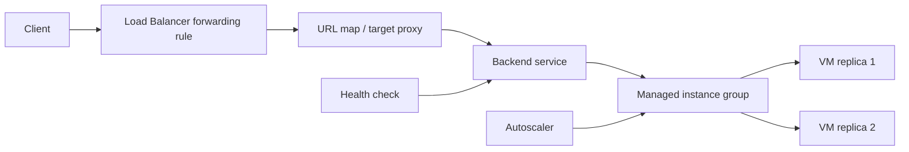
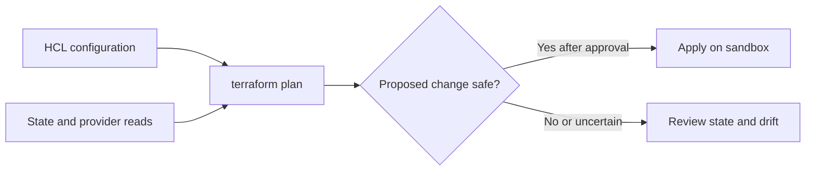

# Activity 05 — Elastic Google Cloud Infrastructure: Scaling and Automation

[คู่มืออ่านตาม Path](./LEARNING-PATH-STUDY-GUIDE-TH.md) · [Activity 04](./Path-Activity-04-Core-Services-TH.md) · [Lab map](./Lab-Guide-TH/LEARNING-PATH-LAB-MAP.md) · [Google Skills course](https://www.skills.google/paths/11/course_templates/178)

> บทนี้ยึด Activity 05 ของ ACE Learning Path โดยตรง: การเชื่อม network, load balancing/autoscaling, Terraform automation และภาพรวม managed services Course syllabus ระบุ hands-on HA VPN, Application Load Balancer with autoscaling, Internal Load Balancer และ Terraform คู่มือนี้เป็นโน้ต/แบบฝึกประกบ ไม่ใช่เฉลย grader

## 📖 บทเรียนเต็ม: ทำให้ระบบรองรับผู้ใช้เพิ่มโดยไม่แลกกับ Downtime

### 1. เริ่มจาก SLO ไม่ใช่จำนวน VM

สมมติ Web App ใช้ Compute Engine VM หนึ่งตัว รับ 100 requests/s, p95 latency 150ms; ช่วงสิ้นเดือน Traffic เพิ่มเป็น 800 requests/s แล้ว p95 กลายเป็น 4s. คำตอบไม่ใช่เพิ่ม CPU ทันที ต้องแยกว่า Bottleneck เป็น CPU, Memory, Disk, Database Pool หรือ Network; เพราะถ้าระบบติด Database Connection Limit การเพิ่ม VM จะทำให้ Connections เพิ่มตามและปัญหาอาจแย่ลง

**Managed Instance Group (MIG)** จัด Desired VM Replicas จาก Instance Template; **autoscaler** ปรับ Target Size ตาม Metric/Policy; **autohealing** สร้าง VM ทดแทนเมื่อ Health Check บอกว่าเสียตามเงื่อนไข. ส่วน **Load Balancer** เลือก Backend ที่พร้อมรับ Traffic. ทั้งสี่แก้คนละปัญหา: LB ไม่เพิ่ม Capacity เอง, Autoscaler ไม่การันตีว่า Application Health Check ผ่าน, และ Autohealing ไม่แก้ Database Shared Failure

### 2. End-to-end HTTP Application Load Balancer

Client → Public/Private Frontend → Target Proxy/URL Map (สำหรับ Application LB) → Backend Service → Healthy MIG/NEG Members → Application. ถ้า Backend Service ไม่มี Healthy Endpoint ผู้ใช้จะได้ 5xx แม้ VM Status RUNNING. HTTP Health Check ต้องตรวจ Path/Port/Response ตามการออกแบบ; ไม่ใช้ Ping VM แทน HTTP Application Health

**Case:** VM สร้างจาก Template ใหม่แล้วตอบ 502. ดูว่า Startup Script เสร็จหรือยัง, App Listen Correct Port หรือไม่, Health Check Firewall Rules ที่เหมาะกับ Load Balancer Type, Backend Protocol/Timeout, Named Port (ถ้าใช้), VM Tags/Service Accounts และ Dependency Database. สรุป Root Cause จาก Evidence ไม่ใช่ Restart ทุก VM พร้อมกัน

### 3. Network Hybrid: HA VPN, Peering และ Interconnect ต่างกัน

| ความต้องการ | เลือกพิจารณา | Trade-off |
|---|---|---|
| On-prem ↔ VPC ผ่าน Encrypted Tunnels | HA VPN + Cloud Router/BGP | Internet Path, Tunnel/BGP Status, Routing Failover |
| สอง VPC เชื่อมกัน | VPC Network Peering | Non-transitive Routes, IAM/Overlapping CIDR |
| Dedicated/Partner Private Connectivity | Interconnect | Circuit Provisioning/Availability/Cost |
| หลาย Projects ใช้ VPC กลาง | Shared VPC | Host/Service Project Governance |

VPN Tunnel UP แต่ App ยังติดต่อไม่ได้อาจเป็น BGP Route, Firewall, DNS หรือ CIDR Conflict. อย่าถือว่า Green Tunnel Status เท่ากับ Application Connectivity

### 4. Autoscaling แบบไม่ทำ Backend พัง

Autoscale Policy ต้องระบุ Minimum/Maximum Replicas, Cooldown/Initialization, Traffic Seasonality, Target Metrics และ Scale-in Risk. **Instance Template เป็น Immutable Blueprint**: การเปลี่ยน Template ไม่อัปเดต VM ทุกตัวในทันทีโดยอัตโนมัติ ต้องมี Rolling Update/Replacement Strategy

**Numeric thought experiment:** Web VM 1 ตัวรองรับ 100 requests/s ที่ p95 ตาม SLO, Peak 650 requests/s, Target utilization 70%. เริ่มคิด Capacity = 650/(100×0.7) ≈ 9.3 จึงต้องมีอย่างน้อย ~10 Replicas **ตามสมมติฐานง่าย ๆ นี้เท่านั้น**; ความจริงต้อง Load Test รวม Cold Start, DB Limits, Regional Capacity และ SLO ระหว่าง Deploy. การใช้เลขหารอย่างเดียวไม่ใช่ Proof of Scale

### 5. Terraform — Desired State มีความเสี่ยงเมื่อ State ไม่ตรง

Terraform HCL บอกสิ่งที่ต้องการ, Provider อ่าน Actual Resources, State จดความสัมพันธ์ระหว่าง Resource Address ↔ Cloud ID และ Plan แสดง Change. `terraform plan` ไม่ได้แปลว่า "ปลอดภัยเสมอ" เพราะอาจ Refresh/Lock/Write State/Plan Artifact; `apply` เปลี่ยนจริง. ถ้า Plan แสดง Destroy 5 Resources ทั้งที่ Change Request แก้ Label เดียว ต้องหยุดตรวจ Drift/Immutable Field/Resource Address/State Ownership ก่อน

### 6. Guided Practice: อ่านอย่างเดียวก่อนตัดสินใจ

```bash
# Approved lab project; queries only.
gcloud compute instance-groups managed list --project=LAB_PROJECT_ID
gcloud compute instance-templates list --project=LAB_PROJECT_ID
gcloud compute backend-services list --project=LAB_PROJECT_ID
gcloud compute health-checks list --project=LAB_PROJECT_ID
```

**Expected:** มี Inventory MIG/Template/Backend/Health Check ตาม Lab Scope. **Actual:** หากไม่มี Resource ไม่ได้แปลว่า LB ใช้ไม่ได้; อาจยังไม่ทำ Lab. เปรียบเทียบ Identity, Region, Backend Type, Members และ Health. หากงานจริงต้อง Create LB/MIG ให้ใช้ Google Skills Instructions และ Cleanup ตาม Grader; อย่าสร้าง Public Frontend ใน Personal Project จาก Tutorial ที่ไม่ระบุ Cost

### 7. Scenario พร้อมคำตอบ

"Load Balancer ส่ง 503 แต่ทุก VM RUNNING": ดู Backend Health/Ports/App Readiness ไม่ดู Status VM อย่างเดียว. "Scale Out แล้ว DB ล้ม": ตรวจ Connection Pool Limits/Retry Storm, ตั้ง Global Max Replicas ต่อ Downstream Capacity. "VPN UP แต่ DB Connect ไม่ได้": ตรวจ BGP/Route, Firewall, DNS, Listening Port. "Terraform Plan Replacement Unexpected": Stop, Inspect State/Immutable Fields. "Healthy check 200 แต่ API 500": Check App and Dependencies, ไม่คิดว่าทุก URL ใช้งานได้. "ต้องรองรับ Zone Failure": ใช้ Regional/Multiple Zones/State Externalization ไม่วางทุก VM ใน Zone เดียว

**Completion evidence:** Draw existing LB/MIG path (ใช้ Diagram ที่มีอยู่ในบท), Explain Health vs Scale, List Read-only Inventory, Propose one Failure Fix with Rollback and Cost Impact. [MIGs](https://cloud.google.com/compute/docs/instance-groups) · [LB Overview](https://cloud.google.com/load-balancing/docs/load-balancing-overview) · [HA VPN](https://cloud.google.com/network-connectivity/docs/vpn/concepts/overview) · [Terraform](https://cloud.google.com/docs/terraform).

---

## 📎 ภาคขยาย: โครงเดิมและแบบฝึกเพิ่มเติม (ไม่จำเป็นต้องอ่านซ้ำ)

## เป้าหมาย

หลังเรียนควรอธิบายได้ว่า:

- เมื่อใดใช้ Cloud VPN, Cloud Interconnect, VPC Peering หรือ Shared VPC
- HA VPN สร้าง resilient encrypted tunnels อย่างไร และ Cloud Router/BGP มีบทบาทอะไร
- ทำไม Managed Instance Group (MIG) ใช้ instance template/health checks/autoscaling
- เลือก Application Load Balancer, Network Load Balancer หรือ Internal Load Balancer จาก protocol, source และ routing need
- Terraform plan/state/dependency ช่วยลด manual drift อย่างไร
- เลือก managed service ที่ลด operational burden โดยยังตรวจ location, IAM, network, quota และ cost

## Course syllabus และ hands-on

| ส่วน | สิ่งที่เรียน | Lab ใน syllabus |
|---|---|---|
| Interconnecting Networks | Cloud VPN, Interconnect, peering, Shared VPC, เลือกวิธีเชื่อม | Configure Google Cloud HA VPN |
| Load Balancing and Autoscaling | MIG, autoscaling, health checks, Application/Network/Internal LB, CDN | Configure an Application Load Balancer with Autoscaling; Configure an Internal Load Balancer |
| Infrastructure Automation | Terraform, Marketplace infrastructure deployment | Automating the Deployment of Infrastructure Using Terraform |
| Managed Services | BigQuery, Dataflow, Dataprep (ชื่อ/สถานะอาจเปลี่ยน), Managed Service for Apache Spark | ภาพรวมและ quiz ตาม course edition |

## 1. เชื่อมเครือข่าย: เลือกบริการจากเงื่อนไขจริง

| วิธี | เชื่อมอะไร | Encryption/route model | เลือกเมื่อ |
|---|---|---|---|
| Cloud VPN (HA VPN) | VPC ↔ peer gateway ผ่าน Internet | IPsec tunnels; Cloud Router แลก dynamic route ด้วย BGP ในรูปแบบที่รองรับ | ต้องการ encrypted connectivity และ deploy เร็วผ่าน Internet |
| Cloud Interconnect | VPC ↔ on-prem/colocation ผ่าน dedicated/partner connection | private connectivity; encryption ไม่ใช่สิ่งที่ควรสมมติว่ามีโดยอัตโนมัติ—ตรวจตัวเลือก/requirements | ต้องการ bandwidth/latency consistency และมี network location/partner |
| VPC Network Peering | VPC ↔ VPC | private internal IP routing ระหว่าง peered networks; ไม่ใช่ transit router | ต้องเชื่อม VPCs โดยไม่ย้าย resource เข้า VPC เดียว |
| Shared VPC | host project ให้ service projects ใช้ VPC/subnets ร่วมกัน | central network control, IAM แยกผู้ดูแล network กับ resource projects | องค์กรหลายทีมต้องแชร์ network แบบ governance กลาง |

### HA VPN ที่ควรจำ

HA VPN ให้ tunnel redundancy ตาม topology/จำนวน interface และ peer capability ที่กำหนด ต้องสร้าง tunnel/config/BGP session ให้ตรงทั้งสองฝั่ง ตรวจ route advertisement, ASN, peer IP, key/IKE settings, selectors และ firewall policy อย่าถือว่าการสร้าง gateway อย่างเดียวทำให้ network สื่อสารได้

BGP ช่วยแลกเปลี่ยน dynamic routes ผ่าน Cloud Router; Cloud Router เป็น control-plane route exchange ไม่ใช่ data plane router ที่ packet ทุกตัววิ่งผ่านตัว appliance นั้น

**HA ไม่เท่ากับ multi-region DR:** HA VPN topology ช่วยทน tunnel/connection failure ตามแบบ แต่ยังต้องคิด VPC/region/application/database availability และ failover test

### Peering ข้อจำกัดเชิงสถาปัตยกรรม

VPC Peering ไม่ใช่ transit: VPC A ที่ peer กับ B แล้ว B peer กับ C ไม่ได้แปลว่า A เข้าถึง C ผ่าน B ได้โดยอัตโนมัติ ตรวจ overlapping CIDRs, custom routes, DNS, firewall, IAM และ export/import custom route options ที่รองรับ

## 2. Managed Instance Groups และ autoscaling

**Instance template** กำหนด VM shape/image/disk/metadata/network/service account ที่จะใช้สร้าง instances; **MIG** รักษากลุ่ม VM จาก template และควบคุมจำนวน/autohealing ตาม policy

| กลไก | หน้าที่ |
|---|---|
| Instance template | spec สำหรับ VM ที่สร้างซ้ำ |
| Regional MIG | กระจาย instances ข้าม zones ภายใน region ตาม config |
| Autoscaler | ปรับจำนวน instance จาก CPU/load balancing capacity/custom metrics หรือ schedule ตาม support |
| Health check | ประเมิน backend/service health ตาม protocol/port/path/threshold |
| Autohealing | สร้าง VM ทดแทน instance ที่ unhealthy ตาม policy |
| Rolling update | เปลี่ยน template ทีละส่วน/ตาม rollout policy |

อย่าสับสน health check ของ load balancer กับ autohealing check: มีเป้าหมายและผลต่อ traffic/lifecycle ต่างกันได้ ต้องอ่านการผูก health check เข้ากับ MIG/LB ให้ชัด

Autoscaling ไม่ได้เพิ่ม capacity ทันทีเสมอไป: initialization time, quota, zone capacity, application startup และ downstream limits ส่งผลต่อ scale-out จริง กำหนด minimum/maximum ให้พอดีและตรวจว่า backend database รับ connection เพิ่มได้

## 3. Load balancing: เลือกตาม traffic contract

| ประเภท | เหมาะกับ | ลักษณะการเลือก |
|---|---|---|
| Application Load Balancer (ALB) | HTTP(S), host/path routing, TLS termination, URL map, web/API | proxy-based; เลือก global/regional/internal variants ตาม scope/architecture |
| Network Load Balancer (NLB) | TCP/UDP หรือ passthrough use cases ตาม product type | packet/network-level behavior; เลือก regional/external/internal variant ให้ตรง |
| Internal Load Balancer | traffic ภายใน VPC หรือเครือข่ายที่เชื่อมต่อ | ไม่ได้เปิด endpoint สู่ Internet โดยตัวมันเอง |
| Cloud CDN | cacheable content ที่เสิร์ฟผ่าน supported external Application LB | ลด origin requests/latency; คิดถึง cache policy, invalidation, auth และ data freshness |

ก่อนเลือกให้ถาม:

1. Client มาจาก Internet หรือภายใน network?
2. Protocol เป็น HTTP(S), TCP หรือ UDP?
3. ต้องการ host/path-based routing หรือ passthrough?
4. Backend เป็น MIG, GKE, serverless หรือ hybrid?
5. ต้องการ global/regional address, cross-region failover หรือ internal-only?
6. TLS terminate ที่ใด, ต้องมี CDN/WAF/security policy หรือไม่?
7. Health check ตรวจ backend ได้ถูก protocol/path/port หรือไม่?

**Health check fail = backend อาจถูกตัดออกจาก serving pool** แม้ VM จะ RUNNING อยู่ ตรวจ firewall source ranges ของ health check ที่จำเป็น, backend service, named ports, instance group, URL map/forwarding rule และ app listener

## 4. Traffic path แบบย่อสำหรับ HTTP load balancer

```text
Client → DNS/IP → forwarding rule → target proxy → URL map
       → backend service → healthy MIG instances → application
```

ทุก hop มี resource/config ที่ต้องสัมพันธ์กัน เช่น certificate, proxy, URL map, backend service, health check, MIG/named port และ firewall path การมี frontend IP อย่างเดียวไม่ได้ยืนยัน backend พร้อมใช้งาน

## 5. Infrastructure as Code ด้วย Terraform

Terraform configuration เป็น desired resource graph ที่อ่าน/ทบทวนก่อน apply ได้:

- **Provider** เชื่อม Terraform กับ Google Cloud API
- **Resource** ประกาศ resource ที่ Terraform จัดการ
- **Variable/output** ทำให้ config นำกลับใช้และแสดงผลที่จำเป็น
- **Dependency graph** สร้าง/เปลี่ยน resource ตามความสัมพันธ์
- **State** ผูก address ใน config กับ remote object จริงและเก็บ metadata ที่ Terraform ต้องใช้
- **Plan** preview การเปลี่ยนก่อน apply
- **Backend** เก็บ state; remote backend ช่วย collaboration/locking เมื่อ configured รองรับ
- **Module** รวม configuration เป็นหน่วยใช้ซ้ำ

วงจรงานทั่วไป:

```text
เขียน config → terraform init → terraform fmt/validate
→ terraform plan → review diff → terraform apply
→ ตรวจของจริงและ state → เปลี่ยน config เมื่อ requirement เปลี่ยน
```

ก่อน apply ให้ถาม: จะ add/change/destroy อะไร? มี force replacement หรือ resource สำคัญถูกลบไหม? ใช้ project/credentials/region ถูกหรือไม่? state เป็นของ environment ไหน? มีคนอื่นแก้ infrastructure พร้อมกันหรือไม่?

อย่าแก้ state file ด้วยมือหรือ commit state ที่อาจมีข้อมูลอ่อนไหวลง public Git อย่ารัน `terraform destroy` โดยไม่อ่าน plan และตรวจว่ากำลังชี้ project/environment ไหน

**Drift** คือของจริงต่างจาก configuration/state ที่คาด Terraform plan ช่วยเห็นบางความต่างได้ แต่ refresh/import/state handling ต้องทำด้วยขั้นตอนและสิทธิ์ที่เหมาะสม

## 6. Managed services เป็นการย้ายภาระ ไม่ใช่ไม่มี operation

- **BigQuery**: managed analytics warehouse; คิดถึง dataset location, access, query cost/bytes scanned, partitioning และ data governance
- **Dataflow**: managed data processing สำหรับ batch/stream; ออกแบบ pipeline, windowing, retries, worker sizing และ cost
- **Managed Service for Apache Spark / Dataproc**: managed cluster/service สำหรับ Spark/Hadoop ecosystems ตาม product edition; เลือกเฉพาะเมื่อ framework/use case ตรง
- **Marketplace solution**: อาจติดตั้ง resources/software รวมกัน ต้องอ่าน deployment plan, identity, network, billing และ support lifecycle

ชื่อผลิตภัณฑ์และสถานะอาจเปลี่ยนตามรุ่นหลักสูตร; แก่นที่ใช้สอบ/ออกแบบคือเลือก managed service จากภาระงานและความต้องการ operation ไม่ใช่ท่องชื่อเพียงอย่างเดียว

## 7. แบบฝึกประกบ Labs

ทำ official course labs ใน Google Skills project/session และกด progress checker ที่นั่น แบบฝึกสรุปเป้าหมายเหล่านี้ช่วยเตรียมความเข้าใจ แต่ไม่แทน grader:

### Lab A — HA VPN topology worksheet

วาด VPC ของ Google Cloud, peer network, HA VPN gateways, interfaces, tunnels และ BGP peers; เขียน ASN/IP/advertised CIDRs ทั้งสองฝั่ง ตรวจว่า tunnel redundancy จริงหรือมี single point of failure และกำหนดวิธีทดสอบ route/failover

### Lab B — Application Load Balancer + autoscaling

กำหนด machine image/startup behavior, instance template, regional MIG, named port, health check, backend service, URL map, proxy/forwarding rule และ firewall สำหรับ health checks/client traffic ตรวจว่า autoscaler signal/min/max/initialization เหมาะกับ app และ quota

### Lab C — Internal Load Balancer

ระบุ client subnet, backend subnet/region, internal frontend IP, protocol, health check และ firewall; ทดสอบจาก client ภายในเส้นทางที่รองรับ อธิบายว่าทำไม user บน Internet ถึงเรียก private frontend ไม่ได้โดยตรง

### Lab D — Terraform deployment

อ่าน starter configuration, ตรวจ project/region/variables, `init`, `validate`, `plan`, review resources ที่จะ create/change/destroy, apply ตาม lab และตรวจ state/ผลลัพธ์ จากนั้น clean up เฉพาะ resource ใน lab ตามโจทย์

ห้ามใช้คำสั่งใน lab กับ production project และอย่าสร้าง VPN, load balancer หรือ VM ใน project ส่วนตัวโดยไม่ตรวจค่าใช้จ่ายและ cleanup

## 8. Runbook เมื่อ backend ใช้งานไม่ได้

1. ตรวจ client DNS และ frontend IP
2. ตรวจ forwarding rule/target proxy/URL map/backend service chain
3. ตรวจ backend health และ health-check logs
4. ตรวจ MIG target size, instance template, named ports และ autoscaling events
5. ตรวจ firewall/network route ถึง backend และ health checker
6. ตรวจ service process/port/app logs บน VM
7. ตรวจ quota, zone capacity และ downstream dependency
8. ถ้าเพิ่งเปลี่ยน Terraform ให้เทียบ plan, apply output และ actual state ก่อนแก้มือซ้ำ

## 9. เช็กความเข้าใจ

1. ต้องการ tunnel เข้ารหัสข้าม Internet ควรพิจารณา Cloud VPN หรือ Interconnect อย่างไร?
2. VPC A peer กับ B และ B peer กับ C — A route ถึง C ผ่าน B ได้อัตโนมัติหรือไม่?
3. VM healthy ตาม Compute Engine status แต่ backend unhealthy อาจเกิดจากอะไร?
4. Autoscaler เพิ่ม VM แล้ว database แย่ลงได้อย่างไร?
5. HTTP host/path routing ควรเริ่มพิจารณา LB กลุ่มใด?
6. Internal LB เปิดให้ public Internet เข้าถึงโดยตรงหรือไม่?
7. Terraform plan มี destroy resource ที่ production ต้องทำอะไร?
8. Regional MIG ช่วยอะไร และไม่ได้รับประกันอะไร?

**เฉลยย่อ:** VPN ใช้ IPsec ผ่าน Internet; Interconnect เป็น private connectivity และ encryption ต้องตรวจ requirement; VPC peering ไม่ใช่ transit; backend health ตรวจ application/port/firewall/health check; scale-out เพิ่ม connection/load; HTTP routing ใช้ Application LB; internal LB เป็น private frontend; หยุดก่อน apply และตรวจ environment/state/approval; Regional MIG กระจาย instances ตาม config แต่ไม่ได้รับประกัน app/data HA เอง

## แหล่งอ้างอิง

- [Activity 05 — Scaling and Automation ใน ACE Path](https://www.skills.google/paths/11/course_templates/178)
- [Course syllabus by Google Cloud Training](https://www.coursera.org/learn/gcp-infrastructure-scaling-automation)
- [Cloud VPN overview](https://cloud.google.com/network-connectivity/docs/vpn/concepts/overview)
- [Cloud Interconnect overview](https://cloud.google.com/network-connectivity/docs/interconnect/concepts/overview)
- [VPC Network Peering](https://cloud.google.com/vpc/docs/vpc-peering)
- [Shared VPC](https://cloud.google.com/vpc/docs/shared-vpc)
- [Managed instance groups](https://cloud.google.com/compute/docs/instance-groups)
- [Autoscaling groups of instances](https://cloud.google.com/compute/docs/autoscaler)
- [Cloud Load Balancing overview](https://cloud.google.com/load-balancing/docs/load-balancing-overview)
- [Terraform on Google Cloud](https://cloud.google.com/docs/terraform)

## 📚 Deep Learning Notes — ออกแบบ Scale แบบ End-to-End (Original Supplement, 2026-10-21)

### 1. Request Flow: Load Balancer กับ MIG ต้องสื่อสารผ่าน Health



**MIG** รับหน้าที่ดูแลสมาชิกจาก Instance Template และรักษาจำนวน Replica ตาม Policy; **Load Balancer** ตัดสินใจกระจาย Request ไปยัง Backend ที่ผ่าน Health Checks. `autoscaling` เพิ่ม/ลด Capacity จาก Metric ส่วน `autohealing` เปลี่ยน VM ที่ Health Check ไม่ผ่าน — อย่าเข้าใจว่าสองอย่างนี้เหมือนกัน

**Instance Template** ไม่ได้แก้ไข Instance เดิมให้เปลี่ยน Machine Type/Startup Script เองเมื่อมี Template ใหม่ ต้องวางแผน Rolling/Canary Update ตาม Deployment Strategy

### 2. Why Health Check is More Than a Green Icon

ถ้าหน้าเว็บยังเปิดได้แต่ `/healthz` ตอบ HTTP 500 เพราะ Database Down: การให้ LB นำ VM ออกจาก Backend ทันทีอาจช่วยป้องกัน Request ล้มเหลว แต่ถ้าทุก VM ใช้ DB เดียวกันที่ล่ม ทุก Backend อาจถูก Mark Unhealthy พร้อมกัน. Health Check จึงต้องออกแบบ **Failure Domain และ Dependency** ไม่ใช่เช็กเพียง Process ยังอยู่

### 3. VPN/Peering/Interconnect — เลือกจากความสัมพันธ์ Network

| Requirement | ตัวเลือกให้พิจารณา | ความเสี่ยงที่ต้องอธิบาย |
|---|---|---|
| On-prem ↔ GCP over encrypted Internet tunnels | HA VPN + Cloud Router/BGP | Dynamic Route, Peer Compatibility, Shared CIDR, Failover |
| เชื่อมสอง VPC ไม่ให้ Traffic วิ่งผ่าน Public Internet | VPC Network Peering | Route Exchange Limits / Non-Transitive, Overlapping IP |
| Private connectivity with dedicated bandwidth | Cloud Interconnect / Partner Interconnect | Dedicated Circuit, Availability SLA และ Cost |
| Multi-project service sharing | Shared VPC | Host/Service Project IAM/Org Scope |

### 4. Terraform ไม่ใช่ Script สั่ง API เฉย ๆ

Terraform Configuration ระบุ Desired State; `terraform plan` เปรียบเทียบ State/Current Resources กับ Config และแสดงสิ่งที่จะเปลี่ยน. ถ้า Terraform State สูญหาย อาจมี Resource อยู่บน Cloud แต่ Tool มองว่าไม่มี; ห้ามรัน `terraform apply` เพื่อเดาแก้ เพราะอาจสร้างซ้ำหรือ Replace Resource ที่ใช้งานจริง



### 5. Incident: Load Balancer คืน 502 หลัง Scale Out

1. ตรวจ `Backend Service` และ MIG Members ตาม Region/Zone พร้อม Health Check Port/Path
2. ดูว่า New VM Boot Image/Startup Script พร้อมเปิด Service จริงหรือยัง
3. ตรวจ Firewall Allow สำหรับ Load Balancer Health Check Ranges/Target Rules (ให้ตรง LB Product Type)
4. เช็ก Instance Group Named Ports/Backend Service Settings ถ้า Applicable
5. เทียบ App Logs และ Timeout กับ Dependency เช่น Database/Pub/Sub ไม่สรุปว่า MIG พังเพียงเพราะเจอ 502

**Mini design:** มี Web Workload ที่ peak สูง 15 นาทีต่อวัน จงอธิบาย Scale-in Cooldown, Minimum Replicas, Stateful Session Risk, Database Connection Pressure และ Budget Guardrail ก่อนเสนอ Autoscaling Policy

**Official references:** [Managed Instance Groups](https://cloud.google.com/compute/docs/instance-groups) · [Cloud Load Balancing](https://cloud.google.com/load-balancing/docs/load-balancing-overview) · [VPC Peering](https://cloud.google.com/vpc/docs/vpc-peering) · [Terraform on Google Cloud](https://cloud.google.com/docs/terraform).

**Status:** Architecture/Tabletop notes only; ไม่ใช่ผล Lab หรือการสร้างทรัพยากรจริง
