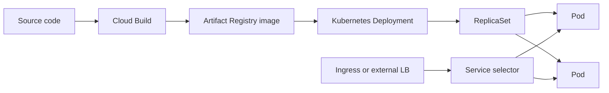

# Activity 06 — Getting Started with Google Kubernetes Engine (GKE)

[คู่มืออ่านตาม Path](./LEARNING-PATH-STUDY-GUIDE-TH.md) · [Activity 05](./Path-Activity-05-Scaling-Automation-TH.md) · [บท GKE ฉบับอธิบาย](./Module-08-GKE-and-Kubernetes.md) · [Lab map](./Lab-Guide-TH/LEARNING-PATH-LAB-MAP.md) · [Google Skills course](https://www.skills.google/paths/11/course_templates/2)

> กิจกรรมนี้มุ่งพื้นฐาน Google Cloud, containers/Cloud Build, Kubernetes/GKE architecture และการใช้ kubectl โดย course syllabus มี labs สำรวจ Console/Cloud Shell, Cloud Build, สร้าง GKE Autopilot cluster ผ่าน Console และ Cloud Shell คู่มือนี้เสริมคำอธิบายและแบบฝึก; ไม่ใช่ official grader ของ course

## 📖 บทเรียนเต็ม: จาก Source Code ไปเป็น Kubernetes Service ที่รับ Traffic ได้

### 1. ทำไม VM Container และ Kubernetes เป็นคนละระดับ

Container Image คือ Artifact ที่เก็บ Runtime/Dependencies; Running Container คือ Process ที่ทำงานจาก Image; Kubernetes **Pod** เป็นหน่วยที่ Scheduler จัดวาง, **Deployment** ระบุ Desired State ของ Replicas/Updates, **Service** เป็น Logical Stable Endpoint ที่เลือก Pods จาก Labels, และ **Ingress/Gateway** จัด Traffic จากภายนอกตาม Implementation ที่รองรับ. GKE จัดการ Control Plane ตาม Mode, ไม่ได้แปลว่า Deployment/Network/Application Security ถูกต้องเอง

เทียบ VMware: Instance Group อาจขยาย VM Replicas ขณะที่ Kubernetes Scheduler จัด Pods ไป Nodes. Node ที่ RUNNING ไม่รับประกันว่า Pod `Ready`; Pod `Running` ไม่ได้แปลว่า Service Selector มี Matching Endpoints. **Failure Domain** ย้ายจาก VM → Node → Pod → Service → Application Dependencies

### 2. Autopilot vs Standard — ไม่ใช้คำว่า "ง่ายกว่า" อย่างเดียว

| คำถาม | Autopilot | Standard |
|---|---|---|
| Node Lifecycle/Provisioning | Google จัดการในขอบเขต Mode และ Guardrails | ทีมรับผิดชอบ Node Pool และ Config มากกว่า |
| Workload Privileges | มี Restrictions/Security Defaults | ปรับได้มากกว่า แต่ Blast Radius สูง |
| Capacity/Cost Model | พิจารณา Workload Requests/Cluster Settings | พิจารณา Nodes, Packing, Idle Capacity |
| ถ้า Workload ใช้ Host-level Privilege | ตรวจ Compatibility ก่อน | อาจเลือก Standard พร้อม Security Review |

**เลือกจาก Requirements:** App Statless ที่ใช้ HTTP และไม่มี Node-level Requirements อาจไม่จำเป็นต้องใช้ GKE เลย; Cloud Run อาจลดภาระ. แต่ถ้าต้องใช้ Kubernetes Operators/StatefulSets/Complex Cluster Scheduling ให้ประเมิน GKE + Platform Team Operations

### 3. Image Build/Push/Run ต่างกันสามสิทธิ์

CI/CD Builder อาจ Push Image ไป Artifact Registry ได้, GKE Cluster ต้อง Pull Image ได้ตาม Node/Runtime Identity Configuration, และ App Runtime Service Account ต้องอ่าน Secret/Cloud API ตามสิทธิ์ของมันเอง. ให้ IAM อย่างกว้างกับ Developer ไม่แก้ ImagePullBackOff ของ Node โดยอัตโนมัติ

**Artifact Tag vs Digest:** Tag เช่น `:latest` เปลี่ยนได้ จึงอาจ Deploy Artifact คนละตัวกับที่ Test; Image Digest ระบุ Content ที่แน่นอนมากกว่า. Production Rollout ต้องตรวจ Registry, Image Provenance, Vulnerability, Versioning และ Rollback

### 4. Deployment → ReplicaSet → Pod → Service: เชื่อม Labels ให้ถูก

Deployment `replicas: 3` ไม่ได้บอกว่าทุก Pod Available. Scheduler อาจติด Taints/Quota/Resources. แม้ Pod `Running`, Readiness Probe อาจ Fail. แม้ Pod `Ready`, Service `selector` ต้อง Match Labels และ `targetPort` ต้องชี้ Container Listener ที่ถูกต้อง. Ingress หรือ LB ต้อง Route ให้ถูก Service/Port. คุณควรไล่เส้นนี้ย้อนจาก Error ที่ Client เห็น

**Worked scenario:** Client Timeout แต่ Deployment Available 3/3, Pod Ready. ตรวจ `kubectl describe service`, Service Selector, EndpointSlice, Container Port, Ingress/LoadBalancer Health/Firewall. ถ้า Service ไม่มี Endpoints ทั้งที่ Pods Ready ให้ดู Labels ก่อนเพิ่ม Node จำนวนมาก

### 5. Read-only guided lab / expected result

```bash
# Only on the approved GKE training cluster; do not alter current context.
kubectl config current-context
kubectl get nodes
kubectl get deployments,pods,services -n APP_NAMESPACE
kubectl get endpointslices -n APP_NAMESPACE
kubectl describe deployment APP_DEPLOYMENT -n APP_NAMESPACE
kubectl get events -n APP_NAMESPACE --sort-by=.lastTimestamp
```

**Expected:** อธิบายได้ว่า Deployment อยากได้ Replicas กี่ตัว, Available กี่ตัว, Pods มี Labels อะไร, Service Endpoints เป็นใคร และ Events ให้เหตุ Error อะไร. **Actual:** ถ้าข้อมูลไม่มีหรือ RBAC ปฏิเสธ ให้จด Context/Namespace/Error อย่าติดตั้ง Cluster หรือ Grant Admin เอง

### 6. Troubleshooting ladder

`Pending` → Scheduling/Quota/Taints/Requests; `ImagePullBackOff` → Registry/Tag/Digest/Identity; `CrashLoopBackOff` → Command, Config, Secrets, Application Exit; `Running but not Ready` → Probe/Dependencies; `Ready but no traffic` → Selector/Ports/Ingress; `5xx after rollout` → Logs/Revision/Image/Downstream. **Rollback Deployment** ไม่ย้อน Database Schema หรือ Data ที่แอปเปลี่ยนไปแล้ว

### 7. คำถามเฉลยเหตุผล

1. ทำไม Service ไม่มี Endpoints ทั้งที่ Pod Ready? — Selector ไม่ Match Labels/Namespace หรือ EndpointSlice ไม่ตรง
2. ทำไม Node Ready แต่ Pod Pending? — Resources/Constraints/Quota เป็นคนละชั้น
3. Image Pull Permission ของ CI เท่ากับ Cluster หรือไม่? — ไม่; identities ต่างกัน
4. Readiness vs Liveness? — Readiness ใช้คุม Traffic, Liveness ใช้พิจารณา Restart
5. Autopilot เหมาะทุก Host-agent ไหม? — ไม่; ต้องดู Node-level Restrictions
6. ทำไม Digest ช่วย Rollout? — ช่วยชี้ Artifact Content ที่ไม่เปลี่ยนตาม Tag
7. ทำไม Pod Running ไม่เท่ากับ App Healthy? — Process ยังอาจ Fail Readiness/Requests
8. ถ้าต้องการ Simple HTTP App ควรใช้ GKE ทุกครั้งไหม? — ไม่; ชั่ง Operations Burden เทียบ Cloud Run

[Official GKE Overview](https://cloud.google.com/kubernetes-engine/docs/concepts/kubernetes-engine-overview) · [Autopilot](https://cloud.google.com/kubernetes-engine/docs/concepts/autopilot-overview) · [Kubernetes Service](https://kubernetes.io/docs/concepts/services-networking/service/).

---

## 📎 ภาคขยาย: โครงเดิมและแบบฝึกเพิ่มเติม (ไม่จำเป็นต้องอ่านซ้ำ)

## ผลการเรียนที่ต้องการ

- แยก container image, container, Pod, node และ cluster ได้
- อธิบายว่า GKE จัดการ Kubernetes ส่วนใด และผู้ใช้ยังรับผิดชอบอะไร
- สร้าง image/build pipeline ขั้นต้นด้วย Cloud Build และเข้าใจ Artifact Registry
- สร้าง Autopilot cluster, deploy sample workload และตรวจสถานะผ่าน Console/kubectl
- อ่าน Pod/Deployment/Service และเริ่ม troubleshoot จาก events/logs
- ตรวจ identity, quota, region, cost และ cleanup ก่อน/หลัง lab

## Course outline ที่ตรวจจาก course page

| หัวข้อ | เนื้อหา | Lab ใน syllabus ที่เปิดเผย |
|---|---|---|
| Introduction to Google Cloud | cloud terms, compute offerings, Google network, resource hierarchy, billing, Console/Cloud Shell | Accessing the Google Cloud Console and Cloud Shell |
| Introduction to Containers and Kubernetes | containers/images, Cloud Build, Kubernetes, GKE | Working with Cloud Build |
| Kubernetes Architecture | control plane/components, GKE, objects, Autopilot vs Standard | Deploying GKE Autopilot Clusters |
| Kubernetes Operations | kubectl, introspection, deploy GKE from Cloud Shell | Deploying GKE Autopilot Clusters from Cloud Shell |

หน้า Google Skills อาจปรับ edition/ชื่อ lab; ให้ถือรายการใน account/course ปัจจุบันเป็นตัวจริง

## 1. Container image คือ package; container คือ process ที่กำลังรัน

Image บรรจุ application, runtime และ dependencies ตาม filesystem/layers/metadata ที่กำหนด การรัน image สร้าง container process แต่ container เองไม่เท่ากับ VM เต็มเครื่อง:

- image เป็น immutable artifact ตาม digest (แม้ tag อาจถูกขยับ)
- container เป็น instance ที่รันจาก image
- container อาจถูกหยุด/เริ่มใหม่; ข้อมูลใน writable layer ไม่ควรถือว่าเป็น durable storage
- external registry เช่น Artifact Registry เก็บ image versions ให้ระบบ deploy ดึงไปใช้
- อย่าบรรจุ password, service account key หรือ private data เข้า image layer

**Tag vs digest:** `web:v1` อ่านง่ายและอาจถูกย้ายให้ชี้ image ใหม่ได้; `web@sha256:...` ระบุ content ที่เฉพาะกว่า ช่วย reproducibility และ audit

## 2. Cloud Build และ Artifact Registry

ภาพรวม build-to-deploy:

```text
Source code → Cloud Build trigger/build config → build container image
→ Artifact Registry → GKE workload references image → Pod runs it
```

Build identity ต้องอ่าน source/build dependencies และ push image ได้; GKE node/runtime identity ต้อง pull image; application workload identity ใช้เรียก Google APIs ระหว่าง runtime เป็นคนละหน้าที่ อย่าแก้ ImagePullBackOff ด้วยการให้ application SA เข้าถึง registry โดยไม่ตรวจว่า node/pull principal ตัวใดถูกใช้จริงใน cluster mode นั้น

ก่อน deploy ตรวจ:

- image URI, project/repository/location และ tag/digest
- repository IAM กับ API enablement
- build logs และ image vulnerability/policy controls ที่องค์กรใช้
- container port/health endpoints/config/secrets
- runtime SA/Workload Identity permissions แยกจาก image pull

## 3. Kubernetes architecture

- **Control plane** รับ API requests, เก็บ desired state และจัด orchestration; GKE บริหาร control plane ตาม cluster mode/offer
- **Node** ให้ compute capacity สำหรับ Pod ใน Standard; Autopilot จัดการ node capacity/infra เพิ่มตาม model
- **Pod** เป็น scheduling unit; container ใน Pod ใช้ network/storage context ร่วมกันตาม design
- **Controller** เทียบ desired state กับ current state แล้วพยายาม reconcile
- **Service** ให้ stable endpoint/select Pods ด้วย labels
- **kubectl** ส่งคำสั่งผ่าน Kubernetes API โดยอาศัย context, credentials และ permissions

`Deployment → ReplicaSet → Pods` เป็นตัวอย่าง controller chain สำหรับ stateless workload; สั่งสร้าง Pod เองได้เพื่อเรียนรู้ แต่ Deployment เหมาะกว่าเมื่ออยากให้จำนวน replica ถูกคุมและ rollout/rollback เป็นระบบ

## 4. GKE: Autopilot กับ Standard

| มิติ | Autopilot | Standard |
|---|---|---|
| โครงสร้าง cluster | managed cluster และ node provisioning/autoscaling ผูกกับ workload model มากขึ้น | เลือกและบริหาร node pools/config ได้ละเอียดกว่า |
| จุดเน้นผู้เรียน | app resources, identity, access, constraints และ cost | cluster/node pools, machine types, autoscaling, upgrades และ app |
| เหมาะกับ | ลดงานดูแล node เมื่อ workload เข้ากับข้อจำกัดที่รองรับ | ต้องการ control/configuration เพิ่ม |
| สิ่งที่ยังต้องทำ | configure workload, IAM, network, storage, security และ operations | เหมือนกัน พร้อมดูแล node-level choices เพิ่ม |

ไม่ควรตอบว่า Autopilot “ไม่มี node/ไม่ต้องกำหนด resource” หรือ Standard “ต้องดูแล Kubernetes control plane เองทั้งหมด” อ่าน product docs/current settings ก่อนสรุปข้อจำกัดของ workload

## 5. GKE cluster planning

ก่อนสร้าง cluster วางแผน:

1. **Project, region/zone, billing/API, quota** — ตรวจ active project, location capacity และ permission
2. **Availability** — zonal/regional control-plane choice; app HA ต้องพิจารณา replicas/topology/dependencies เพิ่ม
3. **Network** — VPC/subnet, Pod/Service ranges, private/public endpoints, routes/firewall, DNS
4. **Access** — Google identity/IAM เพื่อ access cluster, Kubernetes RBAC สำหรับ API objects, cluster endpoint reachability
5. **Node/workload identity** — node/service identities แยกจาก workload identity
6. **Observability/operations** — logging/monitoring, upgrade/release channel, maintenance window และ policy
7. **Cost/cleanup** — cluster/node/resource charges, disks, IPs, load balancers, logs; delete หลัง lab เมื่อปลอดภัย

Private cluster ไม่ใช่คำตอบเดียวเรื่อง security: ต้องตรวจ control-plane endpoint, allowed networks, how-to-access และ control plane/node settings ที่เปิดจริง

## 6. Kubernetes objects ที่ต้องอ่านใน lab

| Resource | บทบาท | สิ่งที่ตรวจ |
|---|---|---|
| Pod | workload instance | phase, readiness, events, logs |
| Deployment | desired replicas/update strategy | desired/available replicas, rollout |
| ReplicaSet | จำนวน Pods ตาม revision | owner Deployment และจำนวน Pods |
| Service | stable networking ไปยัง Pods | selector, endpoints, type |
| ConfigMap | non-secret configuration | key/value และ mount/env reference |
| Secret | sensitive config | RBAC/access/encryption/injection path; base64 ไม่ใช่ encryption |
| Job/CronJob | run-to-completion/scheduled workload | completions, backoff, schedule/time zone semantics |
| StatefulSet | stable identity + storage pattern | ordinal pods, PVC association, rollout order |

Labels เชื่อม selector/controller/service; ถ้า Service selector ไม่ตรง labels ของ Pod ก็ไม่มี endpoints แม้ Pod Running อยู่

## 7. Deploy, inspect, troubleshoot

ใช้ context/project/environment ถูกตัวก่อนทุกครั้ง:

```bash
gcloud config get-value project
gcloud container clusters list
gcloud container clusters get-credentials CLUSTER_NAME --region=REGION
kubectl config current-context
kubectl get nodes
kubectl get pods -A
kubectl get deployments,services -n NAMESPACE
kubectl describe pod POD_NAME -n NAMESPACE
kubectl logs POD_NAME -n NAMESPACE --all-containers
kubectl rollout status deployment/DEPLOYMENT_NAME -n NAMESPACE
```

คำสั่ง get-credentials เพิ่ม/ปรับ kubeconfig context; หลังเรียกต้องตรวจ current-context เพื่อไม่เผลอสั่ง cluster ผิด

| อาการ | จุดเริ่มแกะ |
|---|---|
| Pending | events, requests/quota, node capacity, taints/affinity, PVC |
| ImagePullBackOff | URI/tag, registry/repo location, image pull principal, network |
| CrashLoopBackOff | logs, command/args, configuration, dependency, probes |
| Running แต่ไม่ Ready | readinessProbe, app bind/port, dependency health |
| Service ไม่มี endpoints | selector/labels, namespace, readiness |
| rollout ค้าง | rollout status, ReplicaSet, events, image/config, Pod health |

อย่าเริ่มด้วยการลบ cluster หรือให้สิทธิ์ Owner; ใช้ `describe`, events และ logs ก่อน

## 8. แบบฝึกประกบ course Labs

ให้ทำ official labs ใน Google Skills project ของ session นั้นและตรวจ checkpoint บนหน้า lab แบบฝึกนี้อธิบายแนวคิด ไม่แทนโจทย์หรือคะแนน

### Lab A — Console/Cloud Shell

- ตรวจ account, project ID, region/zone และโครงสร้าง resource
- รันคำสั่ง read-only เพื่อดู clusters/images/services ตามสิทธิ์
- อธิบายว่าคำสั่งใดเพียงอ่าน context และคำสั่งใดสร้าง resources

### Lab B — Cloud Build

- ใช้ source/sample app และ build config ที่ course กำหนด
- อ่าน build steps, build identity, image URI, logs/result
- ตรวจ image ใน registry และ tag/digest
- อธิบายความต่างระหว่าง build failure, push denied และ runtime image pull failure

### Lab C — GKE Autopilot ผ่าน Console

- สร้าง cluster ตาม region/settings ที่ lab ให้
- ตรวจ readiness, version, endpoint/access model
- deploy sample Pod/Deployment ตาม lab และตรวจ objects/events
- ทดสอบ Scale/inspect เฉพาะสิ่งที่ lab ให้ทำ; หลีกเลี่ยงการสร้าง resource เกิน scope

### Lab D — GKE Autopilot จาก Cloud Shell

- ใช้ gcloud CLI สร้าง/เข้าถึง cluster ตาม guide ของ course
- ยืนยัน project/region/cluster context
- ใช้ kubectl ดู nodes, deploy workload, service/endpoints, logs
- เปรียบเทียบการจัดการผ่าน gcloud กับการจัดการ objects ผ่าน kubectl

GKE มีค่าใช้จ่าย และการลบ namespace ไม่จำเป็นต้องลบ cluster/forwarding resources ทั้งหมด ตรวจ lab cleanup instructions ก่อน End Lab; หากใช้ project ส่วนตัวให้ตรวจ billable resources ตามหน้าราคา/Console ก่อนเริ่ม

## 9. Security และ reliability basics

- ให้คน deploy role สำหรับจัดการ GKE เฉพาะงาน; Kubernetes RBAC จำกัด objects/actions ใน cluster
- Workload Identity Federation for GKE ให้ Pod เข้าถึง Google API โดยไม่ฝัง key ใน container
- ปิด public exposure ที่ไม่จำเป็น; ใช้ Service type/Ingress/Gateway ตาม network need
- ใช้ requests/limits และ probes ให้เหมาะ; probe ผิดอาจทำให้ healthy workload ถูก restart/ตัด traffic
- ใช้ image จาก trusted registry, pin immutable version/digest ตาม release process
- Multi-zone nodes อย่างเดียวไม่รับประกัน application HA; ต้องมี replicas, topology spread และ dependency resilience

## 10. เช็กความเข้าใจ

1. Image ต่างจาก container อย่างไร?
2. GKE จัดการอะไร และอะไรยังเป็นความรับผิดชอบของ application team?
3. Image push ได้แต่ Pod ImagePullBackOff ควรตรวจ identity/permission ตัวใด?
4. Deployment มี desired replicas เท่ากับ 3 แต่ available 0 ควรเริ่มจากอะไร?
5. Pod Running แต่ Service ไม่มี endpoints สาเหตุที่เป็นไปได้คืออะไร?
6. ทำไมต้องตรวจ kubectl context ก่อน apply?
7. Autopilot ใช้แล้วไม่ต้องกำหนด CPU/memory requests จริงหรือไม่?

**เฉลยย่อ:** image คือ template/artifact, container คือ process instance; GKE ลดภาระ control plane/infra ตาม mode แต่ app/security/data/operations ยังต้องจัด; ตรวจ pull identity/registry/path/network; เริ่มดู events/status; selector/readiness/namespace; context ผิดทำให้เปลี่ยน cluster ผิด; resources ยังมีผลต่อ scheduling/scaling/cost ตาม mode

## เอกสารอ้างอิง

- [Activity 06 — GKE course ใน ACE Path](https://www.skills.google/paths/11/course_templates/2)
- [Course syllabus โดย Google Cloud Training](https://www.coursera.org/learn/google-kubernetes-engine)
- [Google Skills lab: Deploying GKE Autopilot Clusters](https://www.skills.google/focuses/72686)
- [GKE Autopilot overview](https://cloud.google.com/kubernetes-engine/docs/concepts/autopilot-overview)
- [GKE cluster architecture](https://cloud.google.com/kubernetes-engine/docs/concepts/cluster-architecture)
- [GKE workloads](https://cloud.google.com/kubernetes-engine/docs/concepts/workloads-overview)
- [GKE Workload Identity Federation](https://cloud.google.com/kubernetes-engine/docs/concepts/workload-identity)
- [Artifact Registry overview](https://cloud.google.com/artifact-registry/docs/overview)
- [Cloud Build overview](https://cloud.google.com/build/docs/overview)
- [kubectl reference](https://kubernetes.io/docs/reference/kubectl/)

## 📚 Deep Learning Notes — อ่าน Image → Deployment → Pod → Service แบบครบสาย (Original Supplement, 2026-10-21)

### 1. VM กับ Container ไม่ได้มี Failure Model แบบเดียวกัน



**Image** คือไฟล์และ Layers ที่ Reproduce Runtime ได้, **Container** คือ Process ที่ใช้ Image, **Pod** เป็นหน่วย Scheduling/Networking ของ Kubernetes, **Deployment** ระบุ Desired Replicas และ Rollout Strategy, **Service** เป็น Stable Virtual Endpoint ที่เลือก Pod ตาม Labels. ถ้า `Service selector` ไม่ตรง Labels ของ Pod จะไม่มี Endpoint แม้ Pod RUNNING ทั้งหมด

### 2. GKE Autopilot vs Standard เลือกจากภาระงานจริง

| คำถาม | Autopilot | Standard |
|---|---|---|
| ใครดูแล Node Lifecycle เป็นหลัก | Google จัดการ Node Infrastructure โดยกำหนด Constraints | ทีมเลือกและจัดการ Node Pools มากกว่า |
| ควบคุม Node-level Config | มี Guardrails และข้อจำกัด | ยืดหยุ่นกว่าแต่เพิ่ม Operations Burden |
| Workload ต้องการ Privileged Host Access | ต้องเช็ก Compatibility/Policy | อาจต้องเลือก Standard |
| Billing/Resource Efficiency | พิจารณา Pod resource requests และ mode | พิจารณา Node Capacity, Utilization, Cluster Fees |
| Default เลือกอย่างไร | ดู Required Features และ Security ก่อน | เลือกเมื่อ Config Control จำเป็น |

### 3. Triage: Pod ไม่พร้อมหลัง Deploy

```bash
# Read-only Kubernetes inspections; must use the approved test cluster context.
kubectl config current-context
kubectl get deployments,pods,services -n APP_NAMESPACE
kubectl describe pod POD_NAME -n APP_NAMESPACE
kubectl get endpoints -n APP_NAMESPACE
kubectl get events -n APP_NAMESPACE --sort-by=.lastTimestamp
```

แทนชื่อที่เป็น Placeholder ใน Lab ของตัวเองเท่านั้น. **`CrashLoopBackOff`** คือ Container Restart ต่อเนื่องหลัง Start — ตรวจ Logs, Command/Args, Secrets, Startup Dependencies; **`ImagePullBackOff`** คือไม่ Pull Image — ตรวจ Artifact Registry Location/Permissions/Image Reference. **`Pending`** ต้องดู Node Fit (Requests, Taints, Quota) ไม่ใช่ดู Application Log ก่อน เพราะ Container อาจยังไม่เริ่ม

### 4. Observability และ Security ที่ต้องมองทะลุให้ได้

GKE Workload Identity Federation ผูก Kubernetes Service Account กับ Access ไป Google Cloud APIs ตาม Supported Model; แยก **KSA** และ **Google IAM Service Account** จาก User Account ของคน Deploy. การให้ Node SA มี Owner Role ทำให้ทุก Workload บน Node เสี่ยงเกินความจำเป็น

**Practical decision exercise:** Deployment ตั้ง Desired Replicas 3 แต่ Service ไม่ส่ง Traffic; `kubectl get pods` พบ 3/3 Running. อธิบายว่าต้องตรวจ **Readiness**, **Pod Labels**, **Service Selector**, **EndpointSlice**, **Target Port**, **Ingress/LB** ตามลำดับอย่างไร

**Official:** [GKE Concepts](https://cloud.google.com/kubernetes-engine/docs/concepts/kubernetes-engine-overview) · [GKE Autopilot](https://cloud.google.com/kubernetes-engine/docs/concepts/autopilot-overview) · [Workload Identity](https://cloud.google.com/kubernetes-engine/docs/concepts/workload-identity).

**Scope:** Original lab-companion teaching, not official grader solution; no GKE resources deployed by this note
