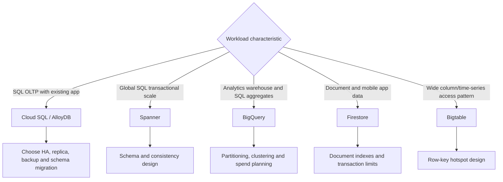

# Activity 09 — Select a Google Cloud Database for Your Applications

[คู่มืออ่านตาม Path](./LEARNING-PATH-STUDY-GUIDE-TH.md) · [Activity 08 — Cloud Run Functions](./Path-Activity-08-Cloud-Run-Functions-TH.md) · [บท Databases](./Module-07-Databases-and-Data-Services.md) · [Lab map](./Lab-Guide-TH/LEARNING-PATH-LAB-MAP.md) · [Google Skills course](https://www.skills.google/course_templates/1234)

> กิจกรรมนี้สอนเลือก Google Cloud database ตาม application pattern และทำความรู้จัก relational/NoSQL, Cloud SQL, AlloyDB, Spanner, Bigtable, Firestore, Memorystore รวมถึง Vector Search และ Database Migration Service (DMS). แบบฝึกนี้อธิบายแนวคิดและช่วยเตรียม lab ไม่ใช่คำตอบของ grader

## 📖 บทเรียนเต็ม: เลือกฐานข้อมูลจาก Workload — มุมคิดแบบ DBA ที่ย้ายขึ้น Cloud

### 1. เริ่มจาก Query Pattern และ Consistency ก่อนชื่อ Product

ฐานข้อมูลไม่ใช่สินค้าที่ใช้แทนกันได้เพียงเพราะ "เก็บข้อมูลได้". ต้องถามว่า App เขียนกี่ Transaction ต่อวินาที, ต้อง Join ตารางไหม, ต้องการ ACID Transaction/Foreign Keys หรือเปล่า, User อยู่ Region ไหน, Query เน้น Single Row หรือ Scan พันล้านแถว, RPO/RTO เท่าไร, ทีมยอมดูแล Operations แค่ไหน และมีข้อจำกัด License/Engine Compatibility อย่างไร

**OLTP** เน้น Transaction สั้น ๆ ที่ต้องสอดคล้องกัน เช่น ตัด Stock/จ่ายเงิน; **OLAP** เน้น Aggregations จากข้อมูลจำนวนมาก. ย้าย Daily Sales Report จาก SQL Server ไป Cloud SQL อาจทำได้ แต่ถ้า Scan 5 Years ทุก 10 นาทีอาจกระทบ OLTP; อาจต้องใช้ BigQuery/Data Pipeline แยก

### 2. Database Family Decision Map

| Workload | ตัวเลือกหลัก | เพราะอะไร/ต้องระวัง |
|---|---|---|
| Existing MySQL/PostgreSQL/SQL Server OLTP | Cloud SQL | Managed relational; ตรวจ Versions, HA/Connections, Features/Extensions |
| PostgreSQL-intensive OLTP | AlloyDB | PostgreSQL-compatible managed DB ที่ต้องเทียบ Feature/Price/Performance จริง |
| Global-scale strongly consistent relational | Spanner | Distributed SQL/Consistency; App Schema/Cost Complexity |
| Large analytical SQL scans | BigQuery | Columnar Analytics; ไม่ใช่ Row-by-row Transaction DB |
| Mobile/web document model | Firestore | Document Data; Index/Query Patterns ต่างจาก RDBMS |
| Massive key-range/time-series | Bigtable | Row-key Design/Hotspots สำคัญ |
| Object/files/backups | Cloud Storage | Object Service ไม่ใช่ RDBMS |

**Avoid false equivalence:** Cloud SQL High Availability ไม่เท่ากับมี Cross-region Disaster Recovery โดยอัตโนมัติ; Read Replica ไม่เท่ากับ Backup เพราะ Bad Writes/Delete อาจถูก Replicate; BigQuery ใช้ SQL แต่ไม่ได้แปลว่าต้องแทน Cloud SQL ทุกที่

### 3. Worked Case: ระบบสินค้าคงคลัง + Dashboard 5 ปี

Requirements: 700 Transactions/s, Relational Joins, Foreign Keys, PostgreSQL Extensions บางตัว, Dashboard ยอดขาย 5 ปีทุกวัน. ให้เลือก Cloud SQL for PostgreSQL หรือ AlloyDB เป็น Candidate ของ Operational DB โดยวัด Feature/Compatibility/Costs; แยก Analytical Queries ผ่าน ETL/Streaming Pipeline ไป BigQuery ถ้าปริมาณ/ราคา/Latency เหมาะ. **ไม่เลือก Spanner เพียงเพราะคำว่า Global** หากไม่มี Global Transaction Scalability Requirement และยอมรับ Migration Complexity ไม่ได้

**Migration Path:** Source Discovery → Schema/Extensions/Data Types → Network/IAM → Initial Load → CDC (หาก Product/Source รองรับ) → Data Validation → Cutover/Backout. DMS ไม่ได้แก้ Stored Procedures/Extension Compatibility อัตโนมัติ; ต้องมี Application Tests

### 4. Backup, HA, PITR — เหตุที่ต้องออกแบบต่างกัน

- **HA** ให้ Service ทน Instance/Zone Failure ตาม Configuration, ไม่คืนข้อมูลก่อน accidental DELETE
- **Read Replica** ช่วย Read Workload/DR ตาม Capability แต่ไม่แทน Rollback ของ Bad Write
- **Backup** เป็น Restore Point; **PITR** อาศัย Engine Logs/Configuration/Retention ที่ต้องเตรียมตั้งแต่ก่อน Incident
- **RPO** คือยอมเสียข้อมูลย้อนหลังได้เท่าไร; **RTO** คือยอมให้บริการหยุดได้นานแค่ไหน
- **Restore Drill** สำคัญกว่าข้อความ "Automatic Backup Enabled" ที่ไม่มีหลักฐานว่ากู้กลับมาใช้งานได้

### 5. Read-only Practice: Database Inventory and Safety

```bash
# Authorized training project. Listing services does not create resources.
gcloud sql instances list --project=LAB_PROJECT_ID
gcloud sql backups list --instance=INSTANCE_NAME --project=LAB_PROJECT_ID
gcloud sql instances describe INSTANCE_NAME --project=LAB_PROJECT_ID
```

**Expected:** บันทึก Engine/Version, Region, HA, Backup/PITR Settings, Network Exposure, Maintenance/Connections; **Actual:** ถ้า Lab ไม่มี SQL Instance ให้ทำ Design Worksheet ไม่ต้อง Create ที่คิดค่าใช้จ่ายเพื่อให้ได้ Screenshot. SQL Query Data จริงอาจมี PII ห้ามเผย Public. อย่าให้ Service Account Admin Roles เพียงเพื่ออ่าน Database

### 6. Troubleshooting และตอบคำถาม

**Incident:** หลัง Migration Web App ช้า ทั้งที่ DB CPU ไม่สูง. ตรวจ Connection Pool, Long Transactions, Locks, Slow Queries, App/DB Region, Private IP/Proxy, Failover, Index/Stats ก่อนเพิ่ม Machine Type. ถ้า DMS Lag สูง ตรวจ Source WAL/Binlog Retention, Network/Replication Slot/Permissions ตาม Engine ไม่เดาจาก Snapshot Size เพียงอย่างเดียว

1. ทำไม BigQuery ไม่เหมาะเป็น OLTP Default? — Latency/Transaction Pattern ต่างกัน
2. ทำไม Replica ไม่ทดแทน PITR? — Bad Writes อาจ Replicate ตามมา
3. Cloud SQL Managed แปลว่า DBA ไม่ต้องทำอะไรไหม? — ไม่, Query/Schema/Users/Restore ยังต้องดู
4. เลือก Firestore จากคำว่า "Serverless" พอไหม? — ไม่, Query/Transaction Model ต้องตรง
5. DMS ทำให้ Schema Compatible อัตโนมัติไหม? — ไม่รับประกัน
6. Latency สูงแต่ CPU ต่ำแปลว่าไม่มีปัญหา DB ไหม? — ไม่, Connection/Locks/Network อาจตัน
7. Global Users ทุกคนต้องใช้ Spanner ไหม? — ไม่, ดู Consistency/Write Pattern/Cost
8. ทำไม Restore Test ต้องมี Actual Result? — Backup Existing ไม่ยืนยัน Recovery

[Cloud SQL](https://cloud.google.com/sql/docs/introduction) · [Spanner](https://cloud.google.com/spanner/docs/overview) · [BigQuery](https://cloud.google.com/bigquery/docs/introduction) · [DMS](https://cloud.google.com/database-migration/docs/overview).

## เป้าหมาย

- แยก OLTP/transaction workloads จาก analytics workloads
- เลือก database ด้วย schema/query/consistency/scale/availability/operations ไม่ใช่ชื่อที่คุ้น
- อธิบาย Cloud SQL, AlloyDB, Spanner, Firestore, Bigtable และ Memorystore
- เข้าใจ vector embeddings/index/query สำหรับ retrieval use cases
- วาง migration workflow และตรวจ source/target compatibility, connectivity, replication/cutover/validation
- ทำ lab อย่างระวัง resource/location/cost และข้อมูลตัวอย่าง

## Course modules และ labs ตาม syllabus

1. Google Cloud database solutions: relational vs non-relational; Cloud SQL, AlloyDB, Spanner, Bigtable, Firestore, Memorystore
2. Which database for your app?: transactional vs analytical, decision factors, GenAI database needs
3. Build gen AI apps with databases: DMS migration to Cloud SQL for PostgreSQL และ Vector Search labs แยกสำหรับ AlloyDB, Cloud SQL for PostgreSQL, Spanner

Course syllabus เปิดเผย 4 app labs: Migrate to Cloud SQL for PostgreSQL using DMS; Configuring Vector Search in AlloyDB; Configuring Vector Search in Cloud SQL for PostgreSQL; Configuring Vector Search in Spanner

## 1. เริ่มจาก workload และ data access

ก่อนเลือก service ให้เก็บ requirement:

- **Data model**: relational tables, documents, wide-column, key/value, files หรือ vector embeddings?
- **Read/write path**: point lookup, range scan, join, aggregation, full-text/vector similarity?
- **Transactions**: atomicity/consistency, isolation, transaction size/contention?
- **Scale**: data size, throughput, burst, growth, hot keys?
- **Latency**: region, user location, synchronous dependencies, tail latency?
- **Availability/DR**: RTO/RPO, zone/region failover, backup/restore tests?
- **Consistency**: strong/session/eventual behavior ที่ application ยอมรับได้?
- **Operations**: patching, replication, capacity planning, schema management, query tuning?
- **Security/compliance**: identity, encryption/key control, private connectivity, residency, audit?
- **Cost**: instance/node capacity, storage, backups, operations, network, query and retrieval?

อย่าเลือก database ก่อนรู้ query patterns เพราะ product ที่ scale ดีสำหรับ key lookups อาจไม่เหมาะกับ relational joins หรือ ad-hoc analytics

## 2. OLTP เทียบกับ OLAP

| Workload | ลักษณะ | ตัวอย่าง |
|---|---|---|
| OLTP | transaction เล็ก/สม่ำเสมอ, concurrent reads/writes, low latency, data integrity | สั่งซื้อ, user profile, account update |
| OLAP | scan/aggregate ข้อมูลปริมาณมาก, analytical queries, reporting | revenue trend, cost analysis, event analytics |

อย่าพยายามใช้ transaction database ก้อนเดียวแทน analytics warehouse โดยไม่คิด query/cost; architecture อาจใช้ operational DB + event/ELT pipeline + BigQuery หรือ analytics service อื่น

## 3. Database decision matrix

| Product | Data model / strength | เริ่มพิจารณาเมื่อ | คำถาม/ข้อจำกัด |
|---|---|---|---|
| Cloud SQL | managed relational engines (เช่น PostgreSQL/MySQL/SQL Server ตาม edition) | ต้องการ SQL/relational และ engine compatibility | version/extensions, instance sizing, connections, HA/backup/maintenance |
| AlloyDB for PostgreSQL | PostgreSQL-compatible relational, performance/availability features | PostgreSQL workload ต้องการ managed platform/performance capabilities | compatibility/extensions, regions/architecture, price, migration |
| Spanner | distributed relational database พร้อม horizontal scale/strong consistency options | ต้องการ relational transactions และ scale/availability สูง | schema/key design, transaction/data model, geographic configuration, cost |
| Firestore | document database | app เข้าถึง document ด้วย key/query pattern และต้องการ serverless scaling | document/index/query limits, transaction semantics, data model |
| Bigtable | wide-column NoSQL | throughput สูงบน key-based/time-series access patterns | row-key design, range scans, schema flexibility, replication |
| Memorystore | in-memory service/cache patterns | low-latency cache/session/ephemeral access | cache invalidation, persistence/HA options, memory sizing |
| BigQuery | analytical warehouse, not primary OLTP | ad-hoc analytics, large scans/aggregation | scan cost, partitioning/clustering, freshness/ingestion |

**Filestore/Cloud Storage** เป็น file/object storage ไม่ใช่ replacement สำหรับ relational DB; เลือกเมื่อ application ต้องการ filesystem/object semantics

## 4. Cloud SQL, AlloyDB, Spanner ให้เลือกจากข้อกำหนด

### Cloud SQL

เหมาะเมื่อ relational SQL engine/compatibility และ managed operational simplicity สำคัญ ให้ประเมิน connection count, HA, backups/PITR, maintenance, private IP, authorized access, engine/version/extensions และ migration options ก่อน sizing

### AlloyDB

เป็น managed PostgreSQL-compatible offering ที่มีคุณสมบัติด้าน performance/availability/data/AI ตาม service architecture ปัจจุบัน ใช้เมื่อ PostgreSQL workload ต้องการ capabilities เหล่านั้นและยอมรับ cost/architecture model อย่าถือว่า PostgreSQL compatibility แปลว่า extensions/behavior ทุกอย่างเหมือน source

### Spanner

เหมาะกับ relational applications ที่ต้อง scale horizontally และต้องการ availability/consistency properties ของ Spanner แต่ schema, primary keys, transaction patterns และ cost ต้องออกแบบตาม distributed database model อย่าย้าย schema จาก MySQL/PostgreSQL โดย copy ตารางอย่างเดียวแล้วคาดว่าจะได้ performance

## 5. NoSQL เลือกตาม access pattern

- **Firestore**: document-oriented; ออกแบบ document/collection/query/index จาก application access patterns
- **Bigtable**: wide-column; row key ควบคุม distribution/scan locality; bad key design ทำ hot spotting
- **Memorystore**: cache/in-memory access; cache miss/eviction/failover ต้องมี source of truth ที่เหมาะ
- **Cloud Storage**: blob/object, lifecycle/versioning/retention; ไม่ใช่ transaction DB

“NoSQL ไม่มี schema” เป็นคำอธิบายหยาบเกินไป: แม้ schema flexible, application ยังต้องมี data contract, validation, index strategy และ migration/versioning

## 6. Vector Search และ GenAI retrieval

Vector Search ช่วยค้น records ที่ embeddings ใกล้ query embedding ตาม similarity metric/index configuration เหมาะกับ semantic retrieval/recommendation บางประเภท:

```text
Documents → chunk/metadata → embedding model → store vector + metadata
User query → query embedding → nearest-neighbor search
→ filter/rerank/context → application response
```

- Embedding model/version ต้องสอดคล้องกับ vectors ที่ index ไว้; เปลี่ยน model อาจต้อง re-embed/reindex
- Chunking, metadata filters, metric, index, recall/latency/cost ล้วนมีผล
- Vector search ไม่แทน relational constraints/keyword search/authorization
- ต้อง apply per-user/document ACL filters ใน retrieval เพื่อไม่ให้ข้อมูลข้าม tenant
- Firestore/Cloud SQL/AlloyDB/Spanner มี feature/extension/edition differences ให้ยืนยัน official support ก่อน design

### Lab Vector Search: เปรียบเทียบ platform

สาม lab ใน course ให้ทำ vector configuration บน AlloyDB, Cloud SQL for PostgreSQL และ Spanner แยกกัน เป้าหมายไม่ใช่สรุปว่าหนึ่ง product ชนะทุกงาน ให้เปรียบเทียบ:

- schema/table/model ของ embeddings
- สร้าง index/configuration ตาม tutorial/lab
- query similarity และดูผล/latency
- metadata filtering และ database access control
- tradeoffs กับ operational/cost requirements

อย่านำข้อมูลจริงหรือ secrets ขององค์กรขึ้น lab account

## 7. Database Migration Service ไป Cloud SQL for PostgreSQL

DMS เป็นเครื่องมือ migration workflow ไม่ใช่แค่ dump/restore command:

1. **Assess source**: engine/version, schema, size, extensions, users/roles, workload/dependencies
2. **Plan connectivity**: source-to-target route, firewall, DNS, credentials, TLS, connectivity method
3. **Prepare target**: project/API, Cloud SQL target config, region, capacity, network, database/users, permissions
4. **Convert/validate schema** ตาม source/target compatibility ที่รองรับ
5. **Create migration job**: choose one-time or continuous approach ตาม scenario/tool support
6. **Initial load/replication**: ดู status/lag/errors และ resource capacity
7. **Test application** บน target: queries, data consistency, performance, access, connection pooling
8. **Plan cutover**: freeze/change control, stop writes or controlled switchover, DNS/config, monitoring
9. **Validate post-cutover**: row counts/checksums/business invariants, errors, latency, backups
10. **Rollback/cleanup plan**: source retention/rollback window, prevent split-brain, delete temporary assets securely

การ replicate data สำเร็จไม่ได้ยืนยันว่า application ใช้ target ได้ครบ; ตรวจ SQL dialect, collation/time zone, sequence/identity, extension, transaction, permissions, connection limits และ application behavior

## 8. DMS lab worksheet

ใน official lab session:

- ระบุ source engine/connection method และ target Cloud SQL for PostgreSQL
- ตรวจ network, firewall, IAM/service account, source credentials
- สร้าง target instance ด้วย settings ตามโจทย์
- สร้าง migration job และติดตามสถานะ
- ตรวจ data ใน target ด้วย query ที่ lab กำหนด
- จดสิ่งที่ต้องทำก่อน production cutover: validation, downtime window, fallback, security, performance
- End Lab/cleanup ตามที่ platform ระบุ

## 9. แบบฝึกเลือกฐานข้อมูล

เลือกคำตอบเบื้องต้นแล้วอธิบายเงื่อนไขที่อาจทำให้เปลี่ยนใจ:

| Use case | จุดเริ่มพิจารณา |
|---|---|
| Order transactions มี relational constraints/joins และ moderate scale | Cloud SQL/AlloyDB; เทียบ engine, performance และ HA |
| Global financial ledger ที่ต้อง scale/consistency สูง | Spanner; verify data model/transaction/cost |
| Mobile app user documents + key/query patterns | Firestore |
| IoT time-series ปริมาณสูง keyed by device/time | Bigtable โดยออกแบบ row key |
| Cache สำหรับ session/read hot data | Memorystore โดย source of truth อยู่ที่อื่น |
| Analytics รวม billing/log/business events หลายแหล่ง | BigQuery |
| Semantic search บน product/document embeddings | DB ที่ course lab ทดลอง vector feature หรือ dedicated search ตาม requirements |

นี่เป็นแนวทางเริ่มต้น ไม่ใช่ service mapping แบบตายตัว ต้องยืนยัน quota, feature, engine version, region และราคา ณ วันที่ deploy

## 10. Troubleshooting/anti-pattern

| อาการ | ตรวจ |
|---|---|
| App ต่อ Cloud SQL timeout | route/private IP, connector/proxy, firewall/DNS, instance status |
| Too many connections | app instances × pool max, connection lifetime, retry storm, proxy/pooling |
| Migration lag สูง | source load, network bandwidth, DMS job state, target capacity |
| Query ช้า | explain/query plan, indexes, key access pattern, scans, lock/contention |
| Vector search ผลไม่ดี | embedding model, chunking, metadata filter, metric/index, recall |
| Data ไม่ครบหลัง migration | job errors/lag, writes during cutover, validation query/sequence |
| ค่าใช้จ่ายสูง | overprovisioned instances, backups/storage, query scans, vector/index resources |
| ข้อมูลรั่ว retrieval | tenant/document-level authorization filter, IAM, application enforcement |

## เช็กความเข้าใจ

1. OLTP กับ OLAP มี workload ต่างกันอย่างไร?
2. เหตุใด Bigtable จึงต้องออกแบบ row key ตาม access pattern?
3. Firestore document model ต่างจาก relational schema อย่างไร?
4. เมื่อใด Spanner อาจเหมาะกว่า Cloud SQL และมี design cost อะไร?
5. Vector similarity search รับประกัน authorization ให้เองหรือไม่?
6. DMS data load สำเร็จแล้ว cutover ได้ทันทีหรือยัง?
7. ทำไมจำนวน Cloud Run instances และ pool size ต้องนำมาคำนวณร่วมกับ DB limits?

**เฉลยย่อ:** transaction เทียบกับ analytics; key สร้าง locality/distribution; document queries/indexes ต่างจาก joins/constraints; Spanner สำหรับ scale/availability/consistency needs แต่มี schema/transaction/cost tradeoffs; retrieval ต้อง enforce ACL; ต้อง validate lag/data/app/cutover; instance × pool ต่อ revision กำหนด connection pressure

## แหล่งอ้างอิง

- [Activity 09 — Select a Google Cloud Database](https://www.skills.google/paths/11/course_templates/1234)
- [Course syllabus by Google Cloud Training](https://www.coursera.org/learn/select-a-google-cloud-database-for-your-applications)
- [Database Migration Service overview](https://cloud.google.com/database-migration/docs)
- [Cloud SQL overview](https://cloud.google.com/sql/docs/introduction)
- [AlloyDB overview](https://cloud.google.com/alloydb/docs/overview)
- [Spanner overview](https://cloud.google.com/spanner/docs/overview)
- [Firestore overview](https://cloud.google.com/firestore/docs/overview)
- [Bigtable overview](https://cloud.google.com/bigtable/docs/overview)
- [Memorystore overview](https://cloud.google.com/memorystore/docs/overview)
- [BigQuery overview](https://cloud.google.com/bigquery/docs/introduction)

## 📚 Deep Learning Notes — เลือก Database จาก Access Pattern ไม่ใช่ชื่อ Service (Original Supplement, 2026-10-21)

### 1. Decision Tree สำหรับ DBA ย้ายจาก On-prem ไป Cloud



**Cloud SQL/AlloyDB** เป็น Relational Database สำหรับ Transactional Workloads แต่แต่ละตัวรองรับ Engine/Features/Management Model แตกต่างกัน; **Spanner** เน้น Distributed Relational Consistency/Scale; **BigQuery** เป็น Analytical Warehouse ไม่ควรใช้แทน High-frequency Row-by-row OLTP; **Firestore** เหมาะ Document Data Models; **Bigtable** ต้องออกแบบ Row-key เพื่อหลีกเลี่ยง Hotspots

### 2. Business Case — ย้าย Database สินค้าคงคลัง

Application มี 600 TPS, SQL Transactions พร้อม Foreign Keys และต้อง Join รายการสินค้า. ถ้า Source เป็น PostgreSQL บน VM ให้เริ่มจาก **Cloud SQL for PostgreSQL vs AlloyDB**, Compatibility, Extensions, HA/Replica, Connection Limits, Storage Growth, Backup/PITR/RTO. ยังไม่ควรเลือก Firestore เพียงเพราะ “Serverless”

ถ้า Dashboard วิเคราะห์ยอดขาย 5 ปี Queries แบบ Scan/Aggregate หลายพันล้านแถวทุกวัน ควรแยก **Operational Database** กับ **Analytical Warehouse** และออกแบบ Data Pipeline/ETL/ELT ไป BigQuery ตาม Data Freshness Requirements

### 3. HA ไม่เท่ากับ Backup และ Replica ไม่เท่ากับ PITR

| Requirement | Design component | เหตุที่แทนกันไม่ได้ |
|---|---|---|
| Instance/Zone failure | HA failover configuration | HA ไม่ย้อนไปก่อนการลบข้อมูลผิด |
| Reporting reads | Read replica (ตาม Engine) | Replica อาจ Copy Bad Writes/Deletes ต่อ |
| Logical corruption / accidental delete | Backups + Point-in-time recovery | ต้องทดสอบ Restore และ Retention จริง |
| Workload latency | Index/query/connection pool tuning | เพิ่ม Replica ไม่แก้ Inefficient Query ทุกกรณี |
| Data migration | Database Migration Service/Export/Import | ต้องตรวจ Change Data Capture, Schema/Charset Compatibility |

### 4. Migration Worksheet (no paid resource creation)

1. บันทึก Source Engine/Version, Charset, Extension, Table Size/Row Growth, Peak TPS, Long-running Transactions และ PII Classification
2. Mapping Target Features และ Downtime/RPO/RTO; Plan for Schema Validation, Identity/Network, CDC Lag and Cutover
3. สร้าง Test Matrix: Row Counts, Financial Sum/Checksums, Foreign Keys, Unicode/Thai Sample, Sequence Values และ Application Smoke Test
4. กำหนด Rollback Boundary, Backup Restore Drill และ Read-only Validation Privileges

**Exam exercise:** ระบบ Ticketing ต้องการ Strong Transactional Consistency และ Complex Joins, อีกส่วนมี Analytical Dashboard รายปี: อธิบายว่าทำไมไม่ใช่ Database เดียวตอบโจทย์ทุกอย่างโดยอัตโนมัติ

**Official:** [Cloud SQL Overview](https://cloud.google.com/sql/docs/introduction) · [Spanner Overview](https://cloud.google.com/spanner/docs/overview) · [BigQuery Introduction](https://cloud.google.com/bigquery/docs/introduction) · [Database Migration Service](https://cloud.google.com/database-migration/docs/overview).

**Status:** Original deep-dive mapping to Activity 09; ไม่ใช่ผลจริงของ DMS/Database Lab
