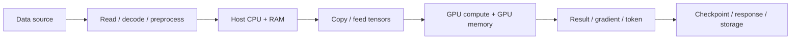
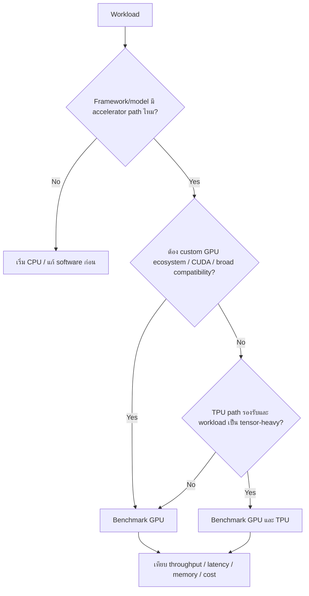
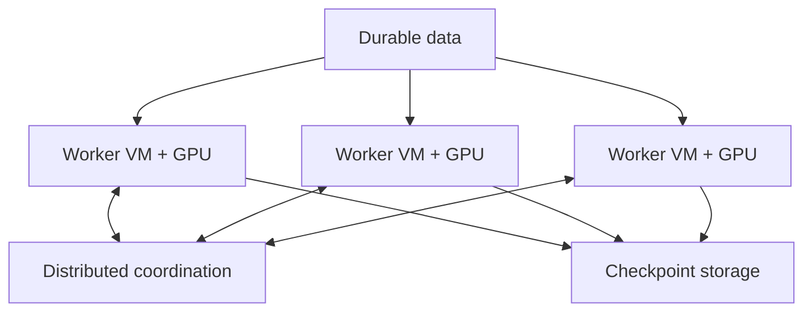
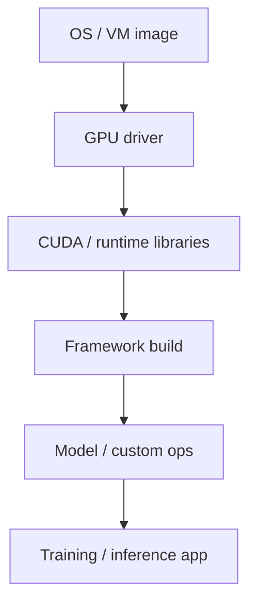
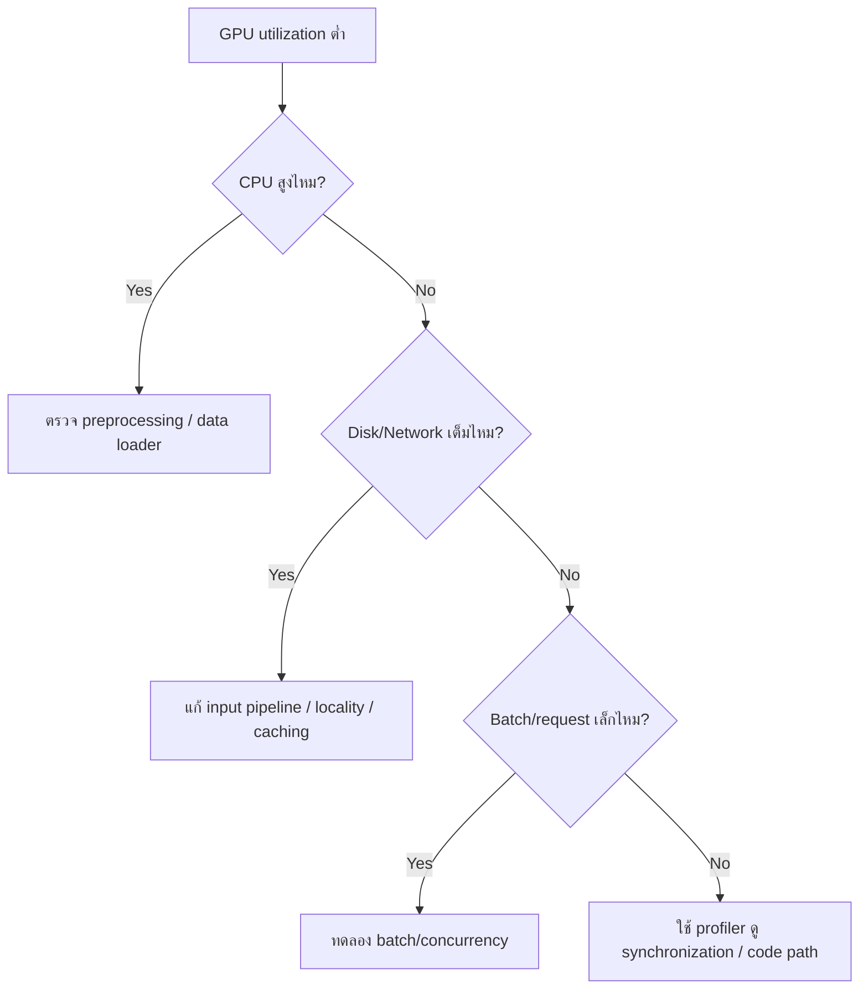
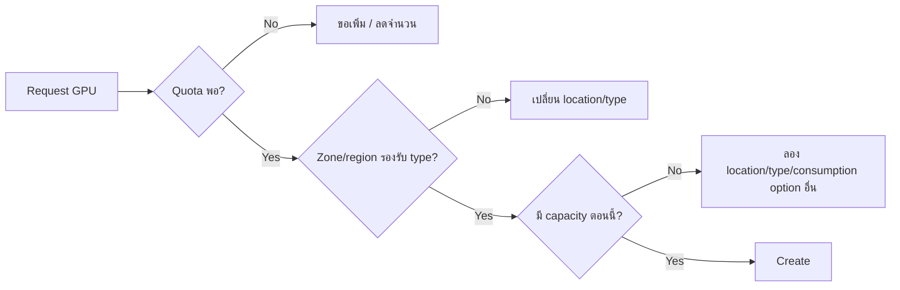

# Activity 10 — AI Infrastructure: Cloud GPUs

[คู่มืออ่านตาม Path](./LEARNING-PATH-STUDY-GUIDE-TH.md) · [Visual Guide](./VISUAL-STUDY-GUIDE-TH.md#13-ai-infrastructure--modern-operations) · [Module 13](./Module-13-AI-Tooling-and-Modern-Services.md) · [Google Skills course](https://www.skills.google/paths/11/course_templates/1403)

> โน้ตภาษาไทยสำหรับเรียนให้เข้าใจ **เหตุผลในการเลือก GPU, data path, deployment, monitoring และ failure modes** ไม่ใช่แค่จำชื่อรุ่น accelerator และไม่ใช่ transcript/เฉลย grader ของ Google Skills

## เป้าหมายการเรียนรู้

อ่านจบแล้วควรทำได้:

1. อธิบายได้ว่า GPU ช่วยส่วนไหนของ AI workload และส่วนไหนที่ GPU ไม่ได้ช่วย
2. แยก training, batch inference และ online inference ก่อน sizing
3. เลือกระหว่าง CPU, single GPU, multi-GPU, multi-VM และ GKE ได้จาก requirement
4. ตรวจ software stack: OS/image → driver → CUDA/runtime → framework → model
5. วาง data/checkpoint path โดยไม่ให้ GPU รอ input ตลอดเวลา
6. อ่าน metrics เพื่อแยก compute bottleneck ออกจาก CPU/disk/network bottleneck
7. อธิบาย quota, capacity, location และต้นทุนแบบไม่เหมารวมว่า quota ผ่าน = สร้างได้แน่
8. วางแผน rollback/cleanup และ troubleshooting ก่อน provision resource ราคาแพง

---

## 1. Mental model: GPU อยู่ตรงไหนของ workload



GPU เร่งเฉพาะงานที่ framework ส่งเข้า accelerator ได้ดี ถ้า `LOAD`, `CPU`, `COPY` หรือ `SAVE` ช้ากว่า GPU ทั้งระบบก็ยังช้าได้

**ตัวอย่าง:** GPU utilization 20% แต่ CPU 95% และ input queue ว่างบ่อย ไม่ควรรีบเพิ่ม GPU ก่อนตรวจ preprocessing/data loader

---

## 2. เริ่มจาก workload ไม่ใช่จากชื่อ GPU

| Workload | สิ่งที่ต้องถามก่อน |
|---|---|
| Training | model size, batch, precision, training time target, checkpoint cadence |
| Batch inference | จำนวนงาน, deadline, throughput, queue/retry, idle time |
| Online inference | p95/p99 latency, concurrency, request size, warm-up, scale-out |
| Dev/Experiment | ต้อง interactive แค่ไหน, dataset/model ใหญ่เท่าไร, budget ต่อวัน |

ก่อนเลือก accelerator ให้จด requirement เป็นตัวเลข เช่น:

- p95 latency < 300 ms
- 100 requests/s
- model ต้องใช้ GPU memory อย่างน้อย 20 GB
- training ต้องจบภายใน 8 ชั่วโมง
- checkpoint ทุก 15 นาที

คำว่า “เร็ว” อย่างเดียวใช้ sizing ไม่ได้

---

## 3. CPU vs GPU vs TPU — อย่าตอบจากความรู้สึก



**หลักคิด ACE:** เลือกบริการจาก compatibility + operation + cost ไม่ใช่เพราะ accelerator หนึ่ง “แรงกว่า” อีกตัวในทุกกรณี

---

## 4. รูปแบบ deployment ของ GPU

### 4.1 Single VM + GPU

เหมาะกับ:
- ทดลอง/benchmark
- workload เครื่องเดียว
- ต้องควบคุม OS/driver/runtime ลึก

ต้องดูแล:
- OS/image
- driver/runtime
- process health
- disk/checkpoint
- startup/recovery

### 4.2 Multi-GPU VM

เหมาะเมื่อ model/framework ใช้หลาย device ในเครื่องเดียวได้ แต่ต้องดู:
- GPU memory ต่อ device
- interconnect/topology ที่รุ่นรองรับ
- data/model parallelism
- synchronization overhead

GPU เพิ่ม 2 เท่าไม่ได้แปลว่า throughput เพิ่ม 2 เท่าเสมอ

### 4.3 Multi-VM distributed workload



สิ่งที่เพิ่มขึ้นทันทีคือ network, coordination, failure handling และ checkpoint/restart complexity

### 4.4 GKE + GPU

เลือกเมื่อ workload ต้องการ Kubernetes orchestration เช่นหลาย services/jobs, scheduling, rollout, policy หรือ shared platform

ต้องเข้าใจเพิ่ม:
- GPU node pools / accelerator nodes
- resource requests
- taints/tolerations หรือ scheduling constraints ที่เกี่ยวข้อง
- image pull
- Workload Identity
- autoscaling
- Pod Pending เมื่อไม่มี accelerator capacity

อย่าเลือก GKE เพียงเพราะ “มัน scale ได้” ถ้าทีมไม่ต้องการ Kubernetes semantics

---

## 5. Software stack: จุดพังยอดนิยม



ถ้าชั้นใดไม่เข้ากัน อาจเห็น device ไม่เจอ, library load error, kernel unsupported หรือ performance แย่

**ก่อน deploy:**
- pin image/runtime/framework versions
- ใช้ image/container ที่รองรับตาม workload
- ตรวจ device visibility
- ทำ smoke test ขนาดเล็ก
- benchmark ก่อนขยายหลายเครื่อง

---

## 6. Data path และ GPU starvation

GPU แพงแต่รอข้อมูล = เสียทั้ง performance และเงิน

อาการที่พบบ่อย:
- GPU utilization ต่ำเป็นช่วง ๆ
- CPU สูง
- disk throughput เต็ม
- network input ช้า
- preprocessing ใช้ single thread
- batch เล็กเกิน



---

## 7. Memory: GPU OOM ไม่เหมือน host RAM เต็มเสมอ

GPU memory ถูกใช้โดย model parameters, activations, KV cache, optimizer state, buffers และ batch/request state ตาม workload

ถ้า OOM:
1. ดู GPU memory จริง
2. ลด batch/concurrency
3. ตรวจ precision/model loading
4. ตรวจ memory leak/cache behavior
5. พิจารณา model/data parallelism หรือ accelerator memory ที่มากขึ้น

การเพิ่ม host RAM ไม่ได้แก้ GPU memory OOM โดยอัตโนมัติ

---

## 8. Quota vs Capacity vs Availability



จำให้แม่น:
- **Quota** = สิทธิ์ใช้สูงสุด
- **Product availability** = รุ่นนั้นเปิดใน location ไหน
- **Capacity** = ตอนนี้มี hardware ให้ provision หรือไม่

สามอย่างนี้ไม่ใช่เรื่องเดียวกัน

---

## 9. Metrics ที่ควรดูเป็นชุด

| Signal | ช่วยตอบอะไร |
|---|---|
| GPU utilization | accelerator ถูกใช้จริงแค่ไหน |
| GPU memory | model/batch/concurrency กิน memory เท่าไร |
| CPU utilization | preprocessing/host bottleneck หรือไม่ |
| Host RAM | memory pressure ฝั่งระบบ |
| Disk throughput/latency | input/checkpoint ช้าหรือไม่ |
| Network throughput | distributed/data path ตันหรือไม่ |
| Queue age/depth | request รอมากแค่ไหน |
| p95/p99 latency | user-facing tail latency |
| Throughput | งานสำเร็จต่อเวลา |
| Error/OOM/restart | reliability |

Metric เดียวไม่พอ ต้องมองเป็นระบบ

---

## 10. Cost model แบบ Cloud Engineer

ต้นทุนไม่ได้มีแค่ราคา GPU/ชั่วโมง:

`total cost ≈ accelerator + VM/CPU/RAM + disk + data transfer + idle time + orchestration + retained checkpoints/logs`

สิ่งที่ควรวัดคือ **cost ต่อ useful unit** เช่น:
- บาท/1,000 inference requests
- cost/training run
- cost/epoch
- cost/1M tokens ตาม workload

GPU เร็วขึ้น 2 เท่าแต่แพงขึ้น 4 เท่าอาจไม่ใช่ตัวเลือกที่ดีที่สุด

---

## 11. Security baseline

- ใช้ runtime service account แบบ least privilege
- ไม่ใส่ service account key ใน image
- ใช้ Secret Manager integration แทน hard-code secret
- จำกัด network ingress/egress ตาม architecture
- แยก training/dev/prod project เมื่อเหมาะสม
- ระวัง model/data ที่มีข้อมูลอ่อนไหวใน logs/checkpoints
- ตั้ง owner/cleanup policy ของ accelerator resources

---

## 12. Runbook: GPU workload ช้า

1. ระบุ workload และช่วงเวลาที่ช้า
2. ดู GPU utilization + GPU memory
3. เทียบ CPU/RAM
4. ดู input disk/network
5. ดู queue/batch/concurrency
6. แยก warm-up/compile ออกจาก steady state
7. ตรวจ framework/runtime/device visibility
8. ถ้า distributed ให้ดู communication/synchronization
9. เปลี่ยนทีละตัวแปรแล้ว benchmark ซ้ำ
10. เปรียบเทียบ performance **และ cost** ก่อนตัดสินใจ

---

## 13. Mini Lab แบบไม่ต้องเผาเงินก่อน

### Lab A — Architecture worksheet

เขียน design สำหรับ online inference:

```text
Client
  -> HTTPS endpoint
  -> inference service
  -> GPU worker(s)
  -> model artifact storage
  -> logging/monitoring
```

กำหนด:
- latency target
- concurrency
- GPU memory requirement
- runtime SA
- model storage
- scale signal
- max capacity
- rollback

### Lab B — Failure analysis

ให้สมมติว่า:
- GPU utilization = 25%
- CPU = 95%
- disk = 20%
- network = 30%

**คำตอบที่ควรคิด:** bottleneck มีแนวโน้มอยู่ preprocessing/host CPU มากกว่าขาด GPU

### Lab C — Quota scenario

มี quota 4 GPUs แต่ create 2 GPUs ใน zone A ไม่ได้ด้วย capacity error

**ห้ามตอบ:** ขอ quota เพิ่มอย่างเดียว

**ควรตอบ:** quota พอแล้ว ต้องดู capacity/location/type/availability

---

## 14. Exam-style scenarios

**Scenario:** ทีมต้องรัน AI workload ที่ใช้ custom CUDA library และต้องควบคุม driver version มาก ควรเริ่มจากอะไร?

**แนวคิด:** Compute Engine + GPU เป็นจุดเริ่มที่ตรง requirement กว่า managed path ที่จำกัด software stack

**Scenario:** GPU utilization ต่ำ แต่ CPU เต็มตลอด เพิ่ม GPU อีกตัวดีไหม?

**แนวคิด:** ยังไม่ควรสรุป ให้แก้ input/preprocessing bottleneck ก่อน

**Scenario:** Quota ผ่าน แต่ create GPU ไม่ได้ใน zone เดิม

**แนวคิด:** ตรวจ capacity และ availability ไม่ใช่ IAM/Quota อย่างเดียว

---

## เช็กความเข้าใจ

1. GPU ช่วย preprocessing บน CPU อัตโนมัติหรือไม่?
2. Quota กับ capacity ต่างกันอย่างไร?
3. ทำไม GPU utilization ต่ำจึงไม่ได้แปลว่า GPU ช้า?
4. Online inference ควรวัด average latency อย่างเดียวพอไหม?
5. GKE + GPU เพิ่มความสามารถอะไร และเพิ่มภาระอะไร?
6. GPU OOM ควรเริ่มตรวจ host RAM หรือ GPU memory ก่อน?
7. ทำไม checkpoint ต้องอยู่ durable storage?
8. Cost ต่อชั่วโมงกับ cost ต่อ request ต่างกันอย่างไร?

## แหล่งอ้างอิง

- [Google Skills — AI Infrastructure: Cloud GPUs](https://www.skills.google/paths/11/course_templates/1403)
- [Compute Engine GPUs](https://cloud.google.com/compute/docs/gpus)
- [Compute Engine metrics](https://cloud.google.com/monitoring/api/metrics_gcp#gcp-compute)
- [GKE GPU workloads](https://cloud.google.com/kubernetes-engine/docs/how-to/gpus)

## 📚 Deep Learning Notes — GPU Capacity Incident จากมุม Cloud Engineer (Original Supplement, 2026-10-21)

### 1. GPU Utilization ต่ำ ไม่ได้แปลว่า Accelerator ไม่แรงพอ

สมมติ Batch Inference ทำงานช้า แม้ GPU Memory Usage เพียง 30%. ต้องแยกว่าเวลาหมดไปกับ **Data Read**, **CPU Preprocessing**, **PCIe/Interconnect Transfer**, **Model Compute** หรือ **Output Writing**. GPU Utilization ไม่ใช่ End-to-end Throughput. อย่าเพิ่ม GPU หรือเปลี่ยน Accelerator รุ่นทันทีจนกว่าจะเจอ Bottleneck

~~~mermaid
flowchart LR
 S[Cloud Storage dataset] --> D[Data loader]
 D --> C[CPU preprocess]
 C --> T[Memory transfer]
 T --> G[GPU compute]
 G --> W[Output checkpoint]
 C -->|bottleneck| E[GPU idle despite high cost]
~~~

### 2. แยก Quota, Capacity, Software Compatibility

| อาการ | ชั้นที่ต้องตรวจ | วิธีคิด |
|---|---|---|
| VM Create แล้ว Quota Error | Quota Region/Zone/Family และ Account Limit | Request Quota หรือเปลี่ยน Design แบบอนุมัติ |
| GPU Quota ยังเหลือ แต่ Provision ไม่ได้ | Physical Availability/Capacity | ห้ามสรุปว่า Quota คือ Stock |
| CUDA Import Error | Driver/Runtime CUDA/cuDNN/Framework Compatibility | Pin tested versions in Image |
| CUDA Out of Memory | GPU Device Memory กับ Batch Size/Model Footprint | ลด Batch หรือใช้ Sharding ตาม Model |
| GPU Utilization ต่ำ | Data Pipeline/CPU/Network | Profile Pipeline ก่อน Scale |

### 3. Trade-off ที่ต้องคำนวณก่อน Run

ค่าใช้จ่ายการฝึกไม่ได้มีแค่ GPU Per Hour: รวม CPU/RAM, Persistent Storage, Network Egress, Artifact Registry, Checkpoint Transfer, Idle Time และ Reserved/Spot Availability. ถ้าใช้ Spot GPU, Training Loop ต้องออกแบบ Checkpoint/Retry เพราะ Instance อาจถูก Preempt. การวัด Cost/Goodput ต่อ Completed Job ดีกว่าดู Hourly Price เพียงอย่างเดียว

### 4. Decision Exercise

Model A ใช้ GPU 80% แต่ Training Loss ไม่ลดลง; Model B ใช้ GPU 25% แต่ผ่าน Accuracy Objective ก่อน. จะเลือกอะไร? ควรเปรียบเทียบ End-to-end Completion, Model Quality, Deadline, Reproducibility และ Total Cost; Utilization อย่างเดียวตัดสินไม่ได้

**Reference:** [Google Cloud GPUs](https://cloud.google.com/compute/docs/gpus) · [Compute Quotas](https://cloud.google.com/compute/resource-usage) · [Spot VMs](https://cloud.google.com/compute/docs/instances/spot).

**Status:** Architecture analysis only; no GPU provisioned or billed
