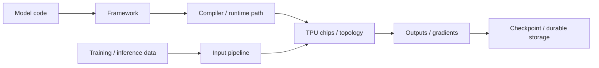
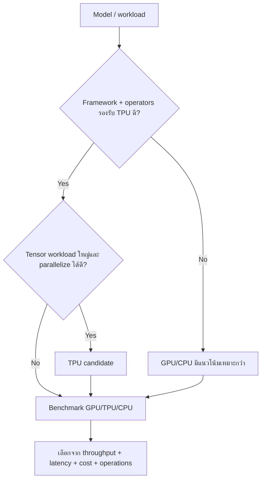
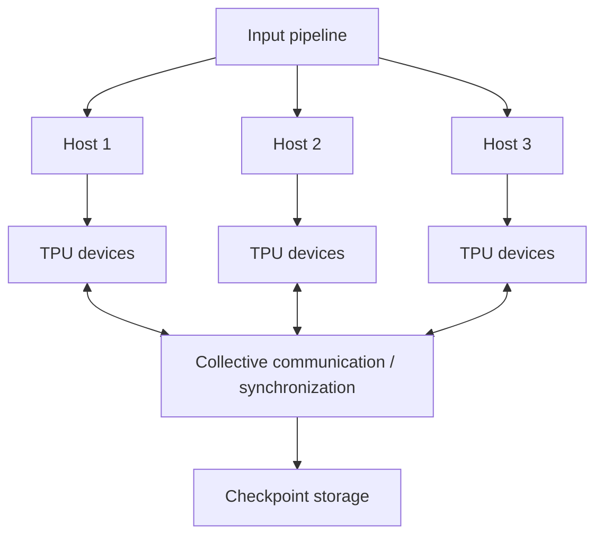
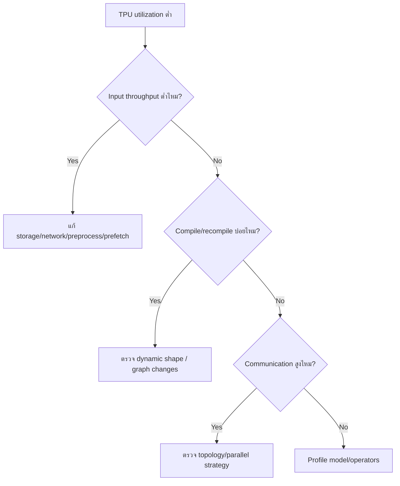
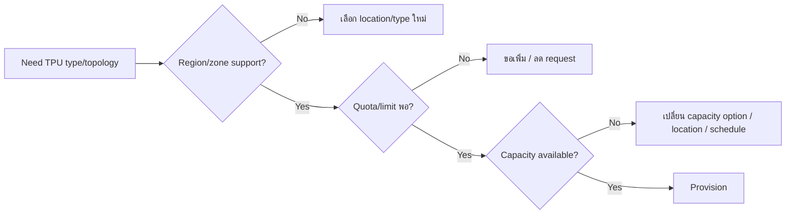
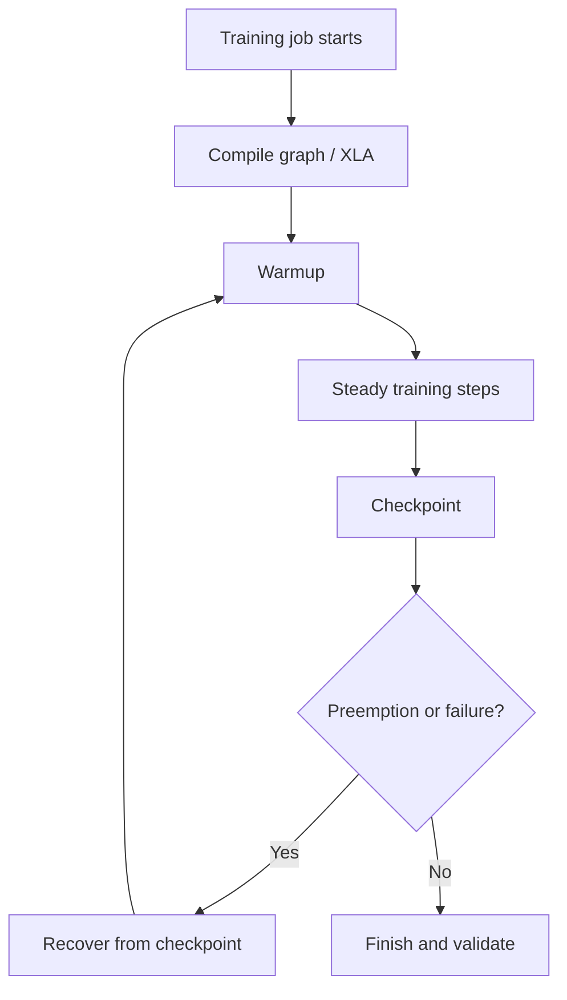

# Activity 11 — AI Infrastructure: Cloud TPUs

[คู่มืออ่านตาม Path](./LEARNING-PATH-STUDY-GUIDE-TH.md) · [Visual Guide](./VISUAL-STUDY-GUIDE-TH.md#13-ai-infrastructure--modern-operations) · [Activity 10 — GPUs](./Path-Activity-10-AI-Cloud-GPUs-TH.md) · [Module 13](./Module-13-AI-Tooling-and-Modern-Services.md) · [Google Skills course](https://www.skills.google/paths/11/course_templates/1405)

> เป้าหมายคือเข้าใจว่า TPU เหมาะกับ workload แบบใด, software/runtime ต้องเข้ากันอย่างไร, topology มีผลอย่างไร และจะวัดว่า “คุ้มกว่า GPU จริงไหม” อย่างไร ไม่ใช่จำว่า TPU = AI เร็วกว่าเสมอ

## 📖 บทเรียนเต็ม: TPU และ Distributed ML — ตัดสินใจจาก Compile และ Data Pipeline

### 1. TPU ไม่ได้แทน GPU ได้ทุก Model

Cloud TPU เป็น Hardware Accelerator ที่ออกแบบมาเพื่อ Workloads ML ตาม Supported Framework/Operations/Shapes. เครื่องมือ Compiler (เช่น XLA ใน Ecosystem ที่รองรับ) สามารถแปลง Computation ให้เหมาะกับ Accelerator. ต่างจากการรัน Python ธรรมดาบน CPU ซึ่งมักเห็น Output ได้ทันทีบางขั้น, TPU Workloads อาจมี **Compile/Warm-up** ก่อนเริ่ม Steady-state Compute. ถ้า Job สั้น การ Compile อาจกินเวลาสัดส่วนใหญ่จน Scaling Chips เพิ่มไม่ได้คุ้มกว่าเดิม

### 2. เวลาทั้งงาน = Setup + Compile + Input + Compute + Checkpoint

สมมติ Job ใช้เวลา 12 นาที: Compile 5 นาที, Dataset Input 3 นาที, Training Compute 3 นาที, Checkpoint 1 นาที. ถ้าเพิ่ม Chips สองเท่าและ Compute เร็วขึ้น 2× แบบอุดมคติ จะประหยัดเพียง ~1.5 นาทีจาก 12 นาที; Total Time ยัง ~10.5 นาที และ Price อาจสูงขึ้น. นี่คือเหตุผลที่ต้อง Profile **End-to-end Cost per Completed Training Job** ไม่ดู Chips/TFLOPS เพียงอย่างเดียว

**Amdahl intuition:** ส่วนที่ Scale ไม่ได้ (Compile/Input/Sync) จะจำกัด Speedup; ยิ่งเพิ่ม Chips ยิ่งเห็น Interconnect, Synchronization, Stragglers และ Data Skew. TPU Topology/Slices/Regions มีข้อจำกัดของ Supported Setup ต้องเช็ก Compatibility ของ Model/Framework ก่อน

### 3. GPU vs TPU Decision Matrix

| ความต้องการ | GPU | TPU |
|---|---|---|
| Custom Kernel / Heterogeneous Software | มักมี Tooling/Library Choices มาก | ต้องตรวจ Ops/Compiler Support |
| Large Supported Tensor Workloads | เหมาะได้ | เหมาะได้มากใน Supported Shape/Workflow |
| Distributed Scale | Multi-GPU/Multi-node communication | TPU Topology/Collective Requirements |
| Short Iterative Experiment | Tooling/Startup อาจยืดหยุ่น | Compile Overhead อาจมีนัย |
| Team Familiarity | CUDA/Framework Tooling | JAX/PyTorch/XLA Ecosystem ตาม Support |
| Availability/Cost | Quota, Zone, GPU Family | Quota, TPU Type, Slice Capacity |

ไม่ตัดสินจาก Marketing ว่า "TPU เร็วกว่า GPU" แบบสากล. Benchmark ต้องใช้ Model, Input, Precision, Batch, Framework Version และ Quality Target เดียวกันก่อนเปรียบเทียบ

### 4. Case: Distributed Training 8 Workers แต่ Performance ไม่ Scale

Workers 7 ตัวจบ Step ภายใน 5 วินาที, Worker สุดท้ายใช้ 13 วินาทีเพราะ Data Shard ช้า. Collective Sync ต้องรอ Worker ที่ช้า → Throughput ทั้ง Cluster ตก. เพิ่ม TPU อีก 8 ตัวอาจทำให้ Cost เพิ่มแต่ไม่ได้แก้ Root Cause. ตรวจ Worker Input Wait, Data Sharding/Local Cache, Host CPU, Network Interconnect, Synchronization, Compile Cache, Checkpoint I/O

**Failure Handling:** Spot/Preemptible Capacity/Planned Maintenance ทำให้ Job ถูกขัดจังหวะได้ตาม Product. Checkpoints ต้องบันทึก Model/Optimizer State และ Training Step เพื่อ Resume ให้สอดคล้องกับ Run. Snapshot File ที่ไม่มี Consistent State ไม่รับประกันว่ากู้กลับมา Train ต่อถูกต้อง

### 5. Practical design workshop

คุณได้ Model Training ที่ต้องเสร็จภายใน 2 ชั่วโมง, Dataset 2TB อยู่ Cloud Storage, Framework Version ยังไม่พิสูจน์ Support TPU. ขั้น 1 ตรวจ Supported Ops/Version, ขั้น 2 ทำ Small Representative Benchmark ใน Approved Sandbox, ขั้น 3 วัด Compile/Input/Step/Checkpoint, ขั้น 4 ประเมิน Cost/Capacity, ขั้น 5 สร้าง Retry and Checkpoint Plan. **Expected:** มี Decision Record ว่าจะใช้ GPU, TPU หรือ CPU พร้อม Evidence; ไม่ใช่รัน TPU จริงโดยไม่มี Budget

### 6. Review พร้อมเฉลย

1. TPU หลาย Chips เร็วขึ้น 2× แน่นอน? — ไม่, Compile/Input/Sync จำกัด
2. Compile นานคือ GPU/TPU Hardware เสียไหม? — ไม่; อาจเป็น Model Graph/Shape
3. Quota มีแล้ว Capacity พร้อมไหม? — ไม่แน่
4. ทำไมต้อง Benchmark Dataset Pipeline? — Device Idle ระหว่างรอข้อมูล
5. Model ใช้ Unsupported Ops ควรทำอะไร? — ตรวจ Alternative Framework/Accelerator
6. Checkpoint ช่วยอะไร? — Recovery จาก Failure/Preemption
7. ใช้ TPU ทำ REST API ง่าย ๆ ทุกครั้งคุ้มไหม? — ไม่, Requirement/Cost/Workload Fit ต้องชัด
8. Training Loss ดีแต่ Job 10× Cost เหมาะไหม? — ดู Deadline/Quality/Economics รวม

[TPU Overview](https://cloud.google.com/tpu/docs/intro-to-tpu) · [Performance Guide](https://cloud.google.com/tpu/docs/performance-guide).

---

## 📎 ภาคขยาย: โครงเดิมและแบบฝึกเพิ่มเติม (ไม่จำเป็นต้องอ่านซ้ำ)

## เป้าหมายการเรียนรู้

อ่านจบแล้วควรทำได้:

1. อธิบาย TPU ในฐานะ accelerator สำหรับ tensor workload ไม่ใช่ VM ทั่วไป
2. แยก workload fit จาก marketing/spec sheet
3. เข้าใจความสัมพันธ์ model → framework/compiler/runtime → TPU topology
4. รู้ว่าการ scale หลาย chips/hosts เพิ่ม communication overhead
5. วาง data/checkpoint path และ recovery สำหรับ training
6. วิเคราะห์ compile/warm-up vs steady-state
7. เปรียบเทียบ TPU กับ GPU จาก throughput, latency, compatibility และ cost
8. อ่านปัญหา quota/capacity/location แบบเดียวกับ accelerator อื่นอย่างมีระบบ

---

## 1. Mental model

ถ้า framework/operator บางส่วนไม่รองรับดี งานอาจ fallback, compile ไม่ผ่าน หรือได้ performance ต่ำ แม้ TPU hardware แรงมาก

---

## 2. TPU เหมาะเมื่อไร

เหมาะเมื่อ:
- workload เป็น tensor-heavy
- framework/model รองรับ TPU path ดี
- batch/shape/parallelism ใช้ accelerator ได้คุ้ม
- scale-out มีประโยชน์จริง
- ทีมรับ migration/benchmark cost ได้

อาจไม่เหมาะเมื่อ:
- มี custom CUDA/GPU kernels
- operator สำคัญไม่รองรับ
- workload เล็กมากจน compile/warm-up/transfer กินสัดส่วนสูง
- latency target ไม่เข้ากับ deployment pattern
- migration cost สูงกว่า performance gain

---

## 3. GPU vs TPU decision flow

อย่าตัดสินจาก FLOPS อย่างเดียว เพราะ input pipeline, communication และ compiler behavior มีผลมาก

---

## 4. Topology และ scale

คิด TPU scale เป็น “ระบบหลาย accelerator” ไม่ใช่แค่เพิ่มชิป

เมื่อ scale เพิ่ม:
- compute capacity เพิ่ม
- communication เพิ่ม
- synchronization cost เพิ่ม
- input pipeline ต้องเร็วขึ้น
- failure domain ใหญ่ขึ้น

ดังนั้น 8 chips ไม่จำเป็นต้องเร็วกว่า 4 chips เท่าตัว

---

## 5. Compile / warm-up / steady state

Benchmark ที่ดีต้องแยกช่วง:

1. environment startup
2. model load
3. compile
4. warm-up
5. steady-state execution

ถ้ารวม compile time เข้า request latency ของ steady-state อาจสรุปผิดว่าระบบช้า แต่ถ้า workload สั้นมาก compile overhead ก็เป็นต้นทุนจริงที่ต้องนับ

---

## 6. Data pipeline สำคัญพอ ๆ กับ accelerator

TPU ว่างเพราะรอ data ก็เสีย utilization เหมือน GPU

ตรวจ:
- dataset location
- storage/network throughput
- decode/preprocessing
- sharding
- prefetch/cache
- batch construction

---

## 7. Checkpoint และ recovery

Training หลายชั่วโมง/หลายวันต้องออกแบบ checkpoint ก่อนเกิด incident

**Checkpoint ที่ดีต้องตอบได้:**
- เก็บที่ไหน
- ทุกกี่นาที/steps
- ใครมีสิทธิ์เขียน/อ่าน
- ขนาดเท่าไร
- restore ใช้เวลานานแค่ไหน
- framework/version เดิมโหลดได้ไหม

Checkpoint ที่มีแต่ “ไฟล์อยู่” แต่ไม่เคย restore test ยังไม่ถือว่า recovery พร้อม

---

## 8. Software compatibility checklist

ก่อน provision จำนวนมาก:

- framework version
- TPU runtime/compiler support
- supported operators
- precision/data types
- model shapes
- input pipeline
- checkpoint format
- container/image
- libraries/extensions
- distributed strategy

ควรทำ smoke test และ benchmark ขนาดเล็กก่อน scale

---

## 9. Training vs Serving

| ประเด็น | Training | Serving |
|---|---|---|
| เป้าหมาย | throughput / time-to-train | latency + throughput |
| batch | มักใหญ่กว่า | ต้อง balance latency |
| failure | checkpoint/restart | availability/retry/traffic |
| scaling | distributed compute | replicas/concurrency/batching |
| metric | step time, samples/s | p95/p99, requests/s |

Serving ที่ throughput ดีแต่ p99 สูงมากอาจไม่ผ่าน SLO แม้ accelerator utilization สวย

---

## 10. Quota / location / capacity

TPU ก็ต้องแยกสามเรื่อง:

---

## 11. Metrics ที่ควรดู

- accelerator utilization
- memory utilization
- step time
- samples/tokens per second
- input throughput
- host CPU/RAM
- network throughput
- communication time
- compile time/recompiles
- failure/restart
- checkpoint duration
- cost per training unit/request

อย่าดู utilization เพียงค่าเดียวแล้วสรุป performance

---

## 12. Cost และ economics

เปรียบเทียบจาก **งานที่เสร็จจริง**:

`cost per useful work = total runtime cost / useful outputs`

ตัวอย่าง:
- Model A ใช้ GPU 10 ชม. ราคา X
- Model A ใช้ TPU 6 ชม. ราคา Y

ต้องรวม setup/idle/storage/network และ engineering complexity ด้วย ไม่ใช่เทียบ hourly price อย่างเดียว

---

## 13. Runbook: TPU workload ช้า/scale ไม่ขึ้น

1. ตรวจ model/framework/operator support
2. แยก compile/warm-up/steady state
3. ดู accelerator utilization
4. ดู input throughput
5. ดู host CPU/network
6. ตรวจ communication/synchronization
7. ตรวจ topology/parallel strategy
8. ตรวจ memory pressure
9. benchmark ขนาดเล็กเทียบ baseline
10. scale ทีละระดับและวัด efficiency

---

## 14. Mini Labs / Exercises

### Lab A — Workload fit

Workload ใช้ custom CUDA extension จำนวนมากและทีมไม่มีแผน rewrite

**แนวคิด:** GPU มีแนวโน้มเหมาะกว่า TPU เพราะ compatibility เป็น requirement สำคัญ

### Lab B — Scaling efficiency

4 chips = 1000 samples/s
8 chips = 1400 samples/s

เพิ่ม hardware 100% แต่ throughput เพิ่ม 40% → ต้องตรวจ communication/input bottleneck ก่อน scale ต่อ

### Lab C — Compile trap

job สั้น 2 นาที แต่ compile 1 นาทีทุก run

**แนวคิด:** compile overhead เป็นส่วนใหญ่ของ runtime ต้องปรับ workflow/caching/shape หรือเลือก execution model อื่น ไม่ดู steady-state อย่างเดียว

---

## 15. Exam-style scenarios

**Scenario:** ทีมบอก “TPU ต้องเร็วกว่า GPU เพราะสร้างมาสำหรับ AI” ถูกไหม?

**ตอบ:** ไม่พอ ต้องตรวจ framework/model/operator/topology/benchmark/cost

**Scenario:** TPU utilization ต่ำ แต่ input throughput เต็มเพดาน storage

**ตอบ:** แก้ input/data path ก่อนเพิ่ม TPU

**Scenario:** Scale chips เพิ่มแล้ว throughput แทบไม่เพิ่ม

**ตอบ:** ตรวจ communication, synchronization และ input pipeline

---

## เช็กความเข้าใจ

1. TPU เหมาะกับทุก AI workload หรือไม่?
2. Compile time ควรแยกจาก steady-state เพราะอะไร?
3. ทำไม topology มีผลต่อ scale efficiency?
4. Checkpoint ช่วยเรื่องอะไรและอะไรคือ restore test?
5. Quota ผ่านแต่ capacity ไม่มี หมายถึงอะไร?
6. Serving กับ training ควรใช้ metric ชุดเดียวกันทั้งหมดไหม?
7. Custom CUDA extension เป็นสัญญาณให้คิดอะไร?
8. ทำไม cost/hour ไม่พอสำหรับเลือก accelerator?

## แหล่งอ้างอิง

- [Google Skills — AI Infrastructure: Cloud TPUs](https://www.skills.google/paths/11/course_templates/1405)
- [Cloud TPU documentation](https://cloud.google.com/tpu/docs)
- [TPU system architecture](https://cloud.google.com/tpu/docs/system-architecture-tpu-vm)

## 📚 Deep Learning Notes — TPU Compile Trap และ Distributed Training (Original Supplement, 2026-10-21)

### 1. TPU Training บางงานช้าเพราะ Compile ไม่ใช่ Compute

หาก Benchmark ใช้เวลา 90 วินาที แต่ 70 วินาทีหมดกับ Compile, การ Scale TPU ให้ใหญ่ขึ้นอาจไม่เพิ่ม Job Throughput เลย. ต้องวัด Separately: Compile Time, Step Time, Input Wait, Device Utilization, Cross-host Synchronization และ Checkpoint Overhead

### 2. Model Fit สำคัญกว่า Accelerator Marketing

- TPU เหมาะกับ Workloads ที่ Framework/Operations รองรับและ Shape/Compute Pattern คุ้มกับการ Compile
- GPU มักยืดหยุ่นในแง่ Framework Ecosystem, Custom Kernels และ Application Integration แต่ยังต้องตรวจ Driver/Runtime
- TPU Slices/Pods ต้องวาง Topology, Network/Collective Communication และ Checkpoint; เพิ่ม Chips ไม่รับประกัน Linear Speedup
- Dataset Pipeline, Host CPU และ Remote Object Reads เป็น Bottleneck ได้ทั้ง GPU และ TPU

### 3. Example — Training Job 8 Workers มี Worker เดียวช้า

ถ้า Workers ส่วนใหญ่ Compute จบภายใน 5 วินาที แต่ Worker หนึ่งใช้ 15 วินาที, Collective Synchronization จะรอ Slow Worker. เพิ่ม Device Count โดยไม่แก้ Straggler/Data Skew อาจทำให้ค่าใช้จ่ายสูงขึ้นพร้อม Performance แย่ลง. ต้องตรวจ Input Pipeline Per Worker, Data Shards, Network Interconnect และ Checkpoint Serialization

### 4. Pre-flight Worksheet

ระบุ Framework/Version, TPU Runtime/Supported Operations, Model Shape, Batch Size/Precision, Dataset Throughput, Topology/Region, Quotas/Availability, Failure/Recovery และ Estimated Training Cost. ถ้า Model ใช้ Operations ไม่รองรับให้เลือก Alternative Deployment แทนการ Force TPU

**Official:** [Cloud TPU Overview](https://cloud.google.com/tpu/docs/intro-to-tpu) · [TPU Performance Guide](https://cloud.google.com/tpu/docs/performance-guide).

**Status:** No paid TPU run; detailed decision example is original companion material
