# Activity 12 — AI Infrastructure: Deployment Types

[คู่มืออ่านตาม Path](./LEARNING-PATH-STUDY-GUIDE-TH.md) · [Visual Guide](./VISUAL-STUDY-GUIDE-TH.md#13-ai-infrastructure--modern-operations) · [Module 05 — Compute](./Module-05-Compute-Engine-and-Instance-Groups.md) · [Module 08 — GKE](./Module-08-GKE-and-Kubernetes.md) · [Module 13](./Module-13-AI-Tooling-and-Modern-Services.md) · [Google Skills course](https://www.skills.google/paths/11/course_templates/1554)

> บทนี้เน้น **เลือก deployment model ให้ตรง workload** ไม่ใช่จำว่า AI ต้องใช้ GKE หรือ GPU เสมอ ให้เริ่มจาก latency, control, accelerator, scaling, availability, security และ operational burden

## 📖 บทเรียนเต็ม: เลือก Deployment Type จาก SLO, Control และ Model Lifecycle

### 1. Training Job, Batch Inference และ Online Inference ไม่ใช่สิ่งเดียวกัน

**Training** คำนวณ Model Parameters จาก Dataset อาจเป็นงาน Batch หลายชั่วโมงและต้องมี Checkpoint/Recovery. **Batch Inference** ประมวลผลข้อมูลเป็นชุดในเวลาที่กำหนด เช่น ประเมิน 1 ล้าน Records ตอนกลางคืน. **Online Inference** ต้องรับ Requests และส่งคำตอบภายใน Latency SLO ที่กำหนด. การเลือก Runtime จากคำว่า "ต้องใช้ AI" โดยไม่ระบุชนิดงานทำให้ Cost/Scaling/Security ผิดเป้า

โจทย์: Service แนะนำสินค้า p95 Latency ไม่เกิน 400ms, 500 Requests/sec Peak, Model Size 8GB, Database Features/Vector Search ต้องเข้าถึง Private. เราต้องคิดแยก Container Startup/Model Load, Memory Footprint, Concurrency, Network/Hops, Caching, Autoscale, Security/Auth และ Downstream Connection Limit

### 2. Compute Engine vs GKE vs Cloud Run vs Managed AI Platform

| Option | ความได้เปรียบ | ภาระ/ข้อจำกัดที่ต้องตรวจ |
|---|---|---|
| Compute Engine | OS/Driver/Process Control สูง | VM, Patch, Scale, Load Balancer, HA Ops |
| GKE | Complex Kubernetes Workload/Accelerator Scheduling | Cluster/Node/Workload Platform Operations |
| Cloud Run | Managed HTTP/Event-driven Container/Scale | Runtime Contract, Supported GPU/Resources/Quota และ Stateless Design |
| Managed Vertex AI Serving/Training | ML-specific Workflow/Model Management | Product Features, Price, Region, Quota, Integration/Model Lifecycle |

บริการที่มี Managed GPU Support อาจเปลี่ยนตาม Product/Region/Version; ตรวจเอกสารการรองรับล่าสุดก่อนเลือก ไม่ยึด Assumption จากบันทึกเก่า

### 3. ทำไม Cold Start และ Model Warm-up สำคัญ

Service Scale from Zero → Container Start → Load Model Weights → Allocate CPU/GPU Memory → Connect Feature Store/Database → Ready for Requests. ถ้า Model 8GB Load ใช้ 20s แต่ User SLO 400ms, ทุก Scale-to-zero Cold Start อาจผิด SLO. วิธีแก้เช่น Minimum Instances/Provisioned Resources/Caching/Warmup ตาม Service แต่ต้องชั่งค่าใช้จ่ายของ Idle Capacity

**Readiness vs Liveness:** Readiness บอกว่ารับ Requests แล้วได้; Liveness บอกว่า Process ยังควร Restart หรือไม่. ไม่ควรให้ Startup/Liveness Probe ฆ่า Process ระหว่าง Warm-up ที่ยังไม่ทันเสร็จ. สำหรับ GKE อ่าน Startup Probe, Readiness Probe, Resource Requests และ Quota; สำหรับ Cloud Run ตรวจ Revision Condition/Container Contract

### 4. Retry Storm และ Idempotency

สมมติ Client Timeout ที่ 2s ทั้งที่ Backend ใช้ 4s ประมวลผล. Client Retry 3 ครั้ง และ API Gateway Retry อีก 2 ครั้ง. Backend อาจถูกเรียกซ้ำหลายรอบและเพิ่ม Queue/Cost. ถ้ามี Write Side Effects จะยิ่งรุนแรง. แก้ด้วย Retry Budgets, Exponential Backoff, Circuit Breaker, Queue Limits, Idempotency Key, Deadline Propagation และ Cancellations ตาม Architecture ไม่เพิ่ม Timeout อย่างเดียว

### 5. Inference Accuracy ≠ HTTP 200

HTTP 200 แปลว่า Transport/Application Responded, **ไม่ได้แปลว่า Model Prediction ถูกต้อง**. ต้อง Monitoring ทั้ง Service Reliability (Errors, Latency, CPU/GPU Memory, Capacity), Data Quality/Drift, Model Output Quality และ Audit/Privacy. Release ใหม่ควร Canary Model Version และ Feature Schema Compatibility; Rollback Image อย่างเดียวไม่ย้อน Feature Store/Data Changes

### 6. Guided design without paid resources

เขียน Deployment Proposal สำหรับ Model 8GB, Peak 500 RPS, p95 400ms: ระบุ Allowed Regions, Security Classification, Compute/Memory/GPU Need, Max Concurrency/Instances, Cost Ceiling, Prewarming, Database Pool Limit, Retry Policy และ Alert Criteria. **Expected:** Architecture Decision + measurable SLO + Test Plan. **Actual:** ยังไม่ผ่าน until load test on approved platform. ห้ามเริ่ม GPU/Endpoint Billable Runtime เพื่อให้ได้ Screenshot โดยไม่ Budget Approval

### 7. QA with reasons

1. Training กับ Online Inference ต่างกัน? — Time/Latency/Checkpoint/Availability Contracts
2. Cloud Run เหมาะทุก GPU Workload ไหม? — ตรวจ Supported Runtime/Region/Quota
3. Model Load 20s แก้ด้วย CPU เพิ่มเสมอ? — ไม่; Startup/Storage/Memory/Profile
4. Retry ช่วย Reliability เสมอไหม? — ไม่, อาจสร้าง Storm/Duplicates
5. p95 ดีแต่ Accuracy ลดถือว่าผ่านไหม? — ไม่; Model Quality เป็นอีก SLO
6. GKE ต่างจาก VM ที่ต้องดูแลเองอย่างไร? — Scheduler/Controllers แต่ยังมี Platform Ops
7. Canary เฉพาะ Container Image เพียงพอไหม? — ไม่เสมอ; Model Artifact/Schema ต้องเข้ากัน
8. ทำไม Dataset Location กระทบ Cost? — Network Egress/Latency/Data Residency

[Cloud Run](https://cloud.google.com/run/docs/overview/what-is-cloud-run) · [GKE](https://cloud.google.com/kubernetes-engine/docs/concepts/kubernetes-engine-overview) · [Vertex AI](https://cloud.google.com/vertex-ai/docs/start/introduction-unified-platform).

---

## 📎 ภาคขยาย: โครงเดิมและแบบฝึกเพิ่มเติม (ไม่จำเป็นต้องอ่านซ้ำ)

## เป้าหมายการเรียนรู้

อ่านจบแล้วควรทำได้:

1. แยก training, batch inference และ online inference
2. เลือก GCE, MIG, GKE, batch หรือ managed runtime จาก requirement
3. อธิบาย control vs operational burden ของแต่ละรูปแบบ
4. วาง model/data/image path ให้ deploy ซ้ำได้
5. ออกแบบ online inference ตั้งแต่ client → gateway → model replica
6. วาง readiness, autoscaling, queue, timeout, retry และ rollback
7. แยก infrastructure scaling ออกจาก application/data bottleneck
8. วาง observability/security/cost controls ก่อน production

---

## 1. เริ่มจากชนิดงาน

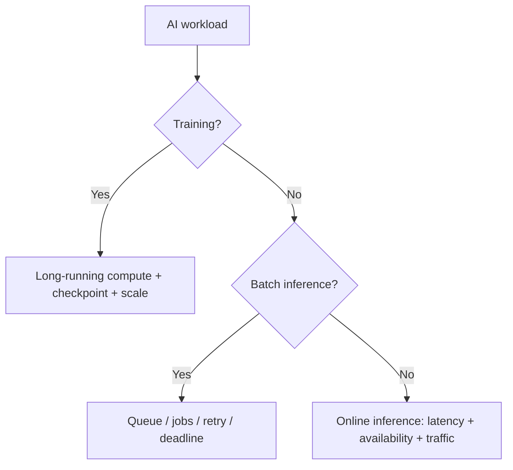

ถ้ายังตอบไม่ได้ว่างานเป็นชนิดไหน อย่ารีบเลือก platform

---

## 2. Deployment decision map

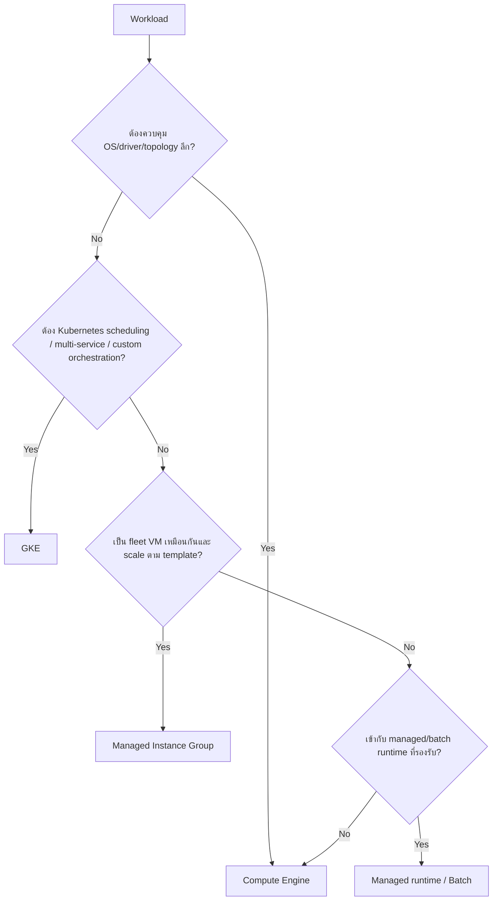

### ตารางเปรียบเทียบ

| รูปแบบ | ได้อะไร | เราต้องดูแลอะไร |
|---|---|---|
| Compute Engine | control สูง, OS/driver/custom stack | patch, process, health, scaling, recovery |
| MIG | template, autohealing, autoscaling, LB integration | immutable-ish template, rollout, external state |
| GKE | scheduling, declarative rollout, ecosystem | cluster/node/resource/policy/networking |
| Batch | job lifecycle/retry ตาม service | job design, idempotency, artifacts, quota |
| Managed inference/runtime | operation ต่ำลง | platform limits, identity, traffic, cost, compatibility |

---

## 3. Control vs operational burden

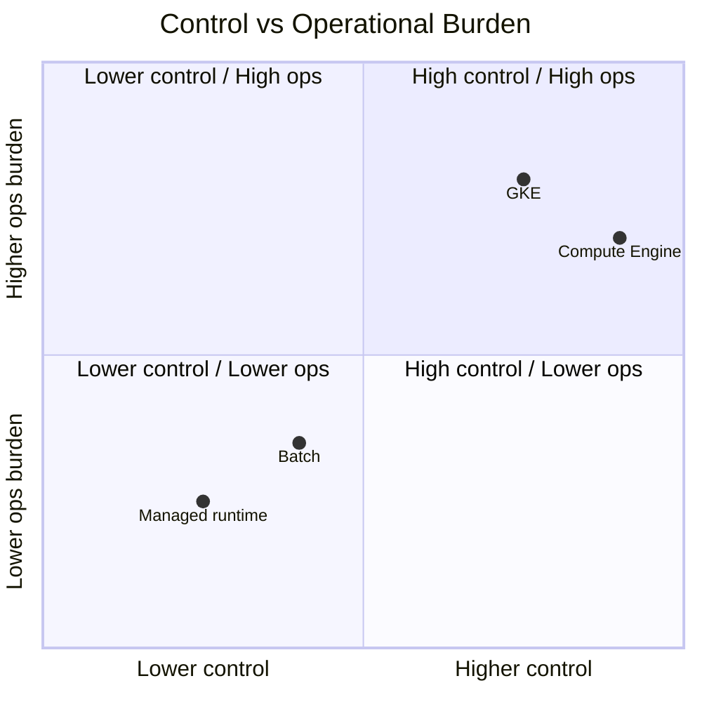

ภาพเป็น mental model ไม่ใช่คะแนน product อย่างเป็นทางการ จุดสำคัญคือ **control เพิ่มมักมาพร้อมภาระ operation เพิ่ม**

---

## 4. Image, model artifact และ configuration

ไม่ควร build ทุกอย่างเป็นก้อนเดียวโดยไม่มีเหตุผล

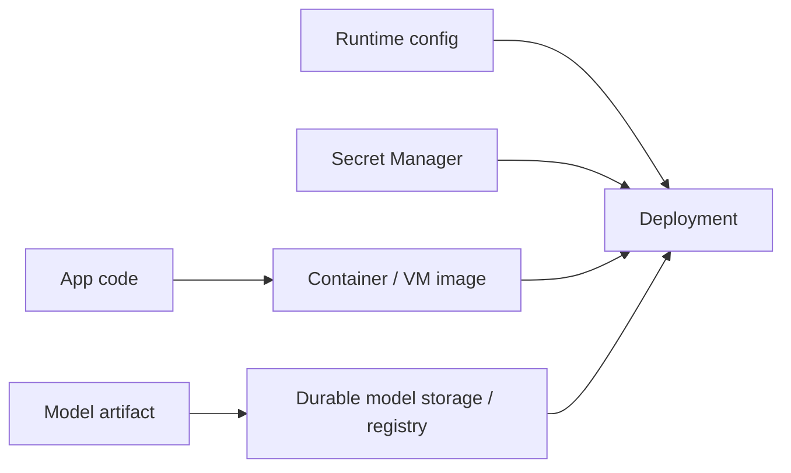

ข้อดีของการแยก model artifact เมื่อเหมาะสม:
- app image ไม่ต้อง rebuild ทุก model version
- rollback model/app แยกกันได้
- download/cache model ตาม lifecycle

แต่ต้อง version ให้ชัด เช่น image digest + model version

---

## 5. Online inference architecture

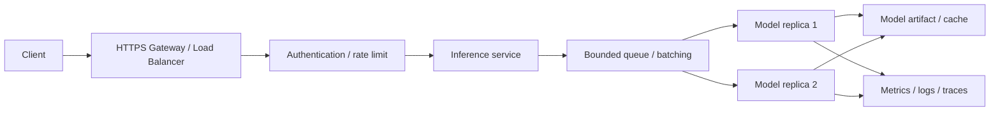

ต้องกำหนด:
- sync หรือ async
- request timeout/deadline
- retry policy
- maximum queue
- batching
- concurrency
- warm-up
- min/max replicas
- canary/rollback

---

## 6. Retry: ระวังทำระบบแย่กว่าเดิม

ถ้า inference service overload แล้ว client ทุกตัว retry ทันที อาจเกิด retry storm

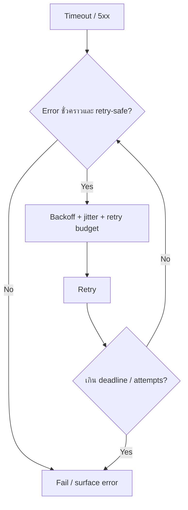

Online inference มักต้องใช้ deadline ทั้ง end-to-end ไม่ใช่ timeout แยก service แบบไม่สัมพันธ์กัน

---

## 7. Readiness / liveness / model warm-up

Model server process “รันอยู่” ไม่ได้แปลว่า “พร้อมตอบ”

- **Startup:** process/model loading ยังไม่เสร็จ
- **Readiness:** พร้อมรับ traffic จริง
- **Liveness:** process stuck จนควร restart หรือไม่

Readiness ควรรอ model/load dependencies สำคัญ แต่ liveness ไม่ควรผูกกับ dependency shared แบบที่ทำให้ทุก replica restart พร้อมกันเมื่อ DB/storage outage

---

## 8. GKE accelerator scheduling

บน GKE ต้องจับคู่ Pod กับ node/accelerator ที่ถูกต้อง

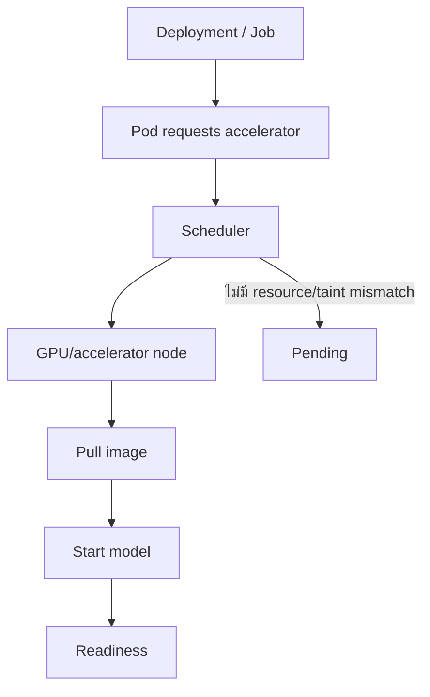

Pod Pending ไม่ได้แปลว่า Kubernetes เสีย อาจเป็น:
- quota
- accelerator capacity
- requests สูงเกิน
- taints/tolerations
- affinity/location
- node pool scale limit

---

## 9. Scaling ต้องดู downstream ด้วย

สมมติ inference replicas เพิ่มจาก 5 → 50 แต่ทุก replica ต้องอ่าน DB เดียวกัน

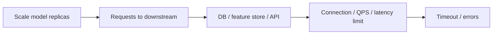

Autoscaling ไม่ได้สร้าง capacity ให้ downstream อัตโนมัติ

---

## 10. Scale signals

อย่าใช้ CPU อย่างเดียวกับ accelerator workload

พิจารณา:
- request concurrency
- queue depth/age
- p95/p99 latency
- requests/s
- accelerator utilization/memory
- model-specific throughput
- downstream saturation

Scale signal ต้องสัมพันธ์กับ user impact

---

## 11. Security architecture

- runtime service account least privilege
- Workload Identity บน GKE
- secret แยกจาก image
- private networking เมื่อ requirement ต้องการ
- จำกัด ingress/egress
- artifact/model access แยกจาก deployer
- audit deployment/change
- sanitize logs ไม่ใส่ prompt/data ที่ sensitive โดยไม่จำเป็น

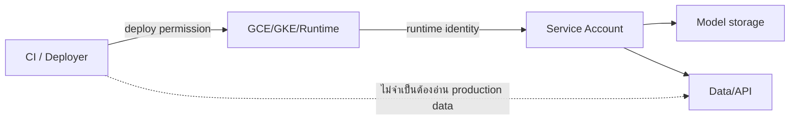

---

## 12. Observability

### Online inference
- p50/p95/p99 latency
- request rate
- error rate
- queue depth/age
- accelerator utilization/memory
- cold-start/warm-up
- downstream latency
- cost/request

### Training
- step time
- throughput
- accelerator utilization
- input throughput
- checkpoint duration
- failure/restart
- cost/run

---

## 13. Deployment rollout

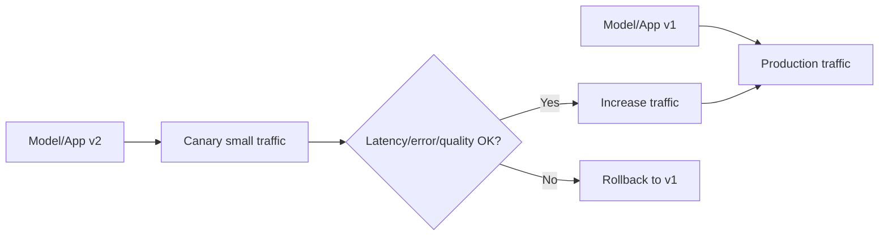

AI rollout ต้องดูทั้ง system metrics และ model/business quality metric ถ้ามี ไม่ใช่ HTTP 200 อย่างเดียว

---

## 14. Runbook: inference latency สูง

1. ระบุ p95/p99 และช่วงเวลา
2. แยก gateway/queue/model/downstream latency
3. ดู concurrency/queue
4. ดู accelerator utilization/memory
5. ดู CPU/input path
6. ดู replica count/scale events
7. ดู model version/revision change
8. ดู downstream DB/API
9. rollback ถ้า regression มาจาก release
10. benchmark ก่อนปรับ capacity ถาวร

---

## 15. Mini Labs

### Lab A — เลือก platform

**Requirement:** custom driver, single model, 1 GPU, ทีมไม่ใช้ Kubernetes

**คำตอบเริ่มต้น:** Compute Engine เหมาะกว่า GKE เพราะ control ตรงและ operational burden ต่ำกว่าในบริบทนี้

### Lab B — GKE Pending

Pod request GPU แต่ Pending ทั้งหมด

ตรวจเป็นลำดับ:
1. describe Pod/events
2. GPU node pool มีไหม
3. request ตรงชนิดไหม
4. taint/toleration
5. quota/capacity
6. autoscaler limit

### Lab C — Retry storm

service timeout → client retry 5 ครั้งพร้อมกัน → load เพิ่ม 5 เท่า

ออกแบบใหม่ด้วย deadline + exponential backoff + jitter + retry budget

---

## 16. Exam-style scenarios

**Scenario:** ทีมต้อง deploy model server จำนวนมาก หลาย service และต้องใช้ Kubernetes policy/rollout อยู่แล้ว

**แนวคิด:** GKE เป็น candidate ที่สมเหตุผล

**Scenario:** service scale replicas เพิ่ม แต่ DB connection เต็ม

**แนวคิด:** bottleneck downstream; ลด/จำกัด scale หรือแก้ connection/data layer ไม่ใช่เพิ่ม replica ต่อ

**Scenario:** model process started แต่ request แรกใช้ 90 วินาทีโหลด model

**แนวคิด:** readiness/warm-up ต้องสะท้อนว่า service ยังไม่พร้อมรับ traffic

---

## เช็กความเข้าใจ

1. Compute Engine กับ GKE ต่างกันหลัก ๆ ที่ control/operations อย่างไร?
2. Batch inference กับ online inference ใช้ metric สำคัญเหมือนกันไหม?
3. Readiness กับ liveness ใช้แทนกันได้ไหม?
4. ทำไม autoscale model replicas อาจทำ DB ล่ม?
5. Retry แบบไม่มี backoff มีความเสี่ยงอะไร?
6. GKE Pod Pending อาจเกิดจากอะไรนอกจาก CPU/RAM?
7. Rollback app version ย้อน model/data state อัตโนมัติไหม?
8. ทำไม image version และ model version ควร trace ได้?

## แหล่งอ้างอิง

- [Google Skills — AI Infrastructure: Deployment Types](https://www.skills.google/paths/11/course_templates/1554)
- [GKE documentation](https://cloud.google.com/kubernetes-engine/docs)
- [Compute Engine GPUs](https://cloud.google.com/compute/docs/gpus)
- [GKE Inference Gateway](https://cloud.google.com/kubernetes-engine/docs/concepts/inference-gateway)

## 📚 Deep Learning Notes — Production Inference: HTTP Success ไม่เท่ากับผล AI ถูกต้อง (Original Supplement, 2026-10-21)

### 1. แยก Reliability และ Model Quality

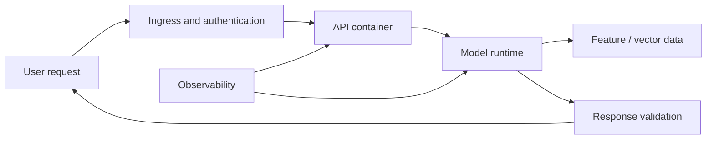

**SLA/SLO ของ API** อาจผ่านเมื่อ p95 Latency ดี แต่ Model Accuracy แย่ลงเพราะ Feature Drift; หรือ Quality ดีแต่ Service Timeout เพราะ Cold Start/Model Load. ดังนั้นวัดทั้ง Transport Success, Request Latency, GPU/CPU/Memory, Model Quality/Drift และ Data Lineage

### 2. Choose Platform by Constraints

| Constraint | Cloud Run | GKE | Compute Engine |
|---|---|---|---|
| Managed container runtime with simple autoscale | เหมาะหลาย HTTP workloads ตาม Resource/Accelerator Support | ต้องดู Cluster/Nodelifecycle | ต้องดูแล VM/Scaling เอง |
| Node-level scheduling/control | จำกัด | ยืดหยุ่นสำหรับ Complex Cluster/Accelerator Scheduling | Full VM control |
| Stable long-running special driver stack | ตรวจ supported workload/runtime | เหมาะเมื่อทีมรับ Cluster Operations ได้ | เหมาะหากต้อง control OS/GPU stack |
| Retry/surge handling | ต้องประเมิน Concurrency/Max Instances | HPA + Queue/Backend Load | LB + MIG/Manual capacity |

### 3. Retry Storm

Request ตัวหนึ่ง Timeout ที่ 2 วินาที แต่ Backend ยังประมวลผลอยู่. Client Retry อีก 3 ครั้ง, Proxy Retry อีก 2 ครั้ง → Backend อาจได้รับหลาย Copies. วิธีแก้ไม่ได้มีแค่ Increase Timeout: ต้องมี **Idempotency Key**, Retry Budget, Exponential Backoff, Queue/Rate Limit และ Cancellation Semantics ที่เหมาะกับ API

### 4. Change Rollout

Deploy Model Version ใหม่ 10% Traffic แล้วเปรียบเทียบ Error Rate, p95 Latency, Memory OOM, Response Quality กับ Baseline; หาก Fail ต้อง Rollback **Model Artifact, Serving Image และ Feature Schema** อย่างสอดคล้อง ไม่ใช่ Rollback Container อย่างเดียว

**Official:** [Cloud Run Overview](https://cloud.google.com/run/docs/overview/what-is-cloud-run) · [GKE Overview](https://cloud.google.com/kubernetes-engine/docs/concepts/kubernetes-engine-overview) · [Vertex AI Model Monitoring](https://cloud.google.com/vertex-ai/docs/model-monitoring/overview).

**Checkpoint:** เมื่อ Inference 503 แต่ CPU ต่ำ จะตรวจ Cold Start, Memory/Model Loading, Dependency, Ingress/Auth, Quota หรือ Downstream Saturation อย่างไร?
