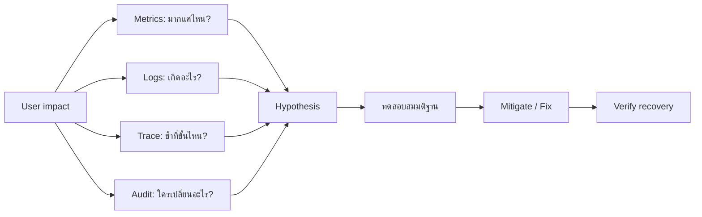
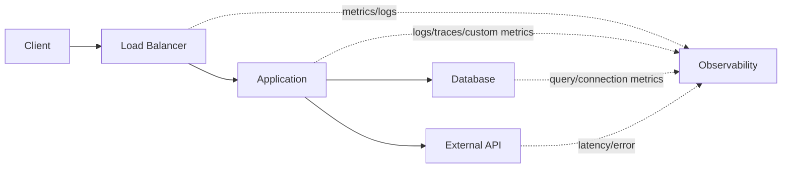
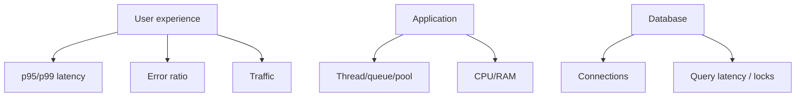
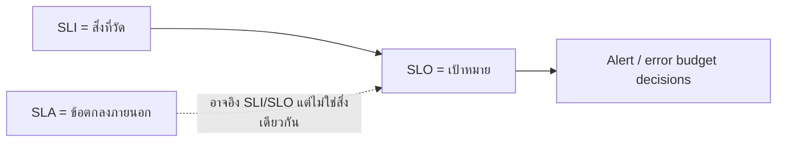
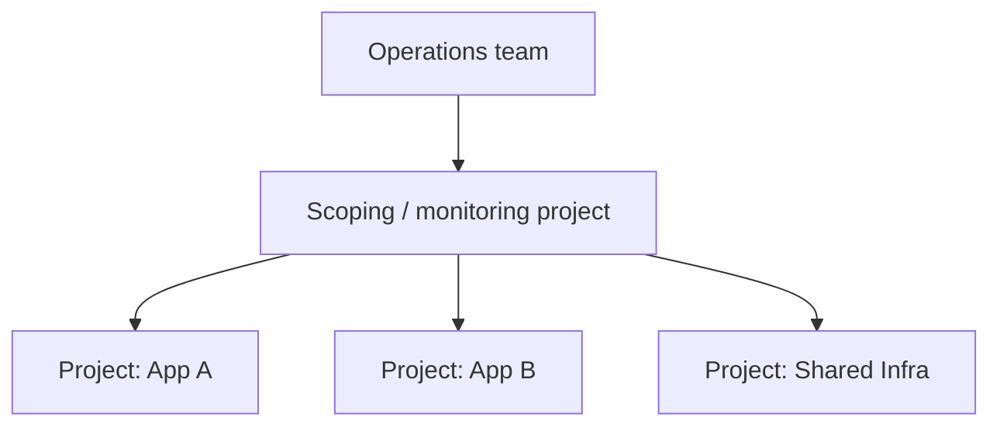
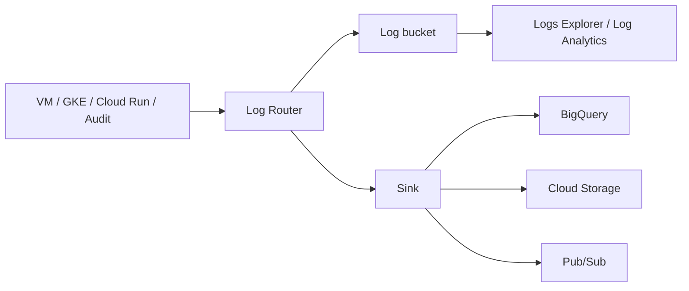
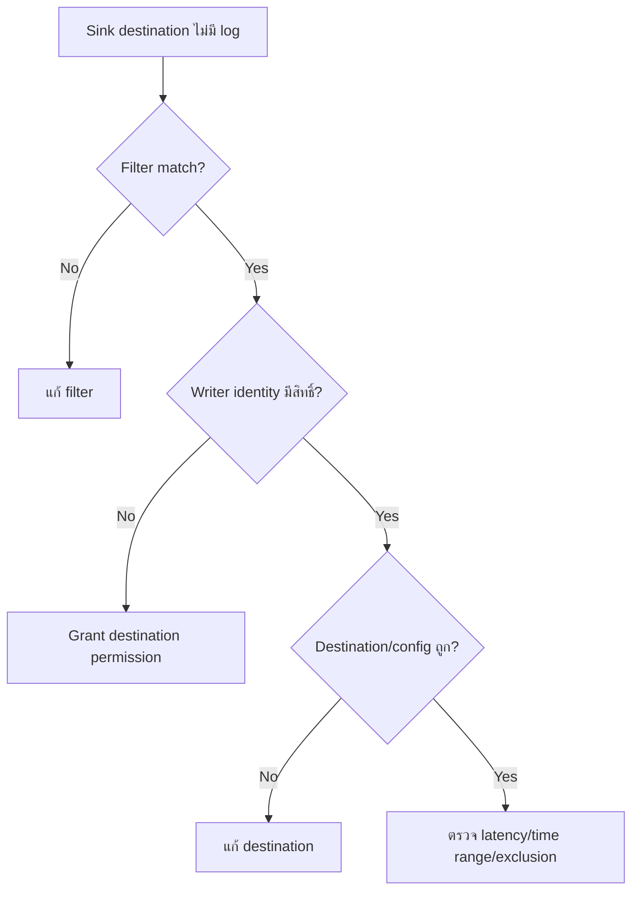
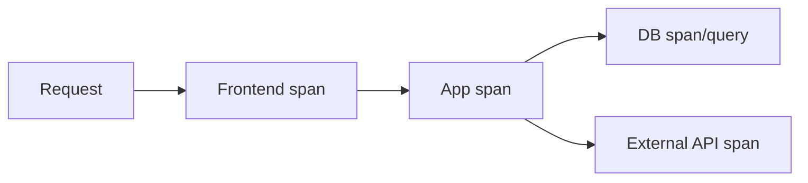
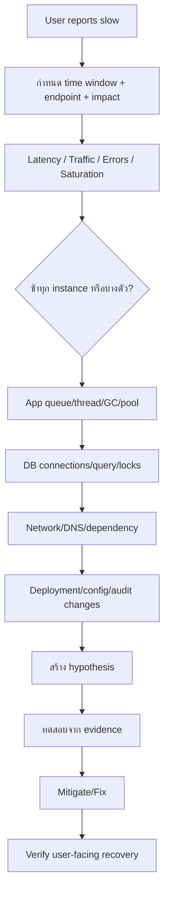
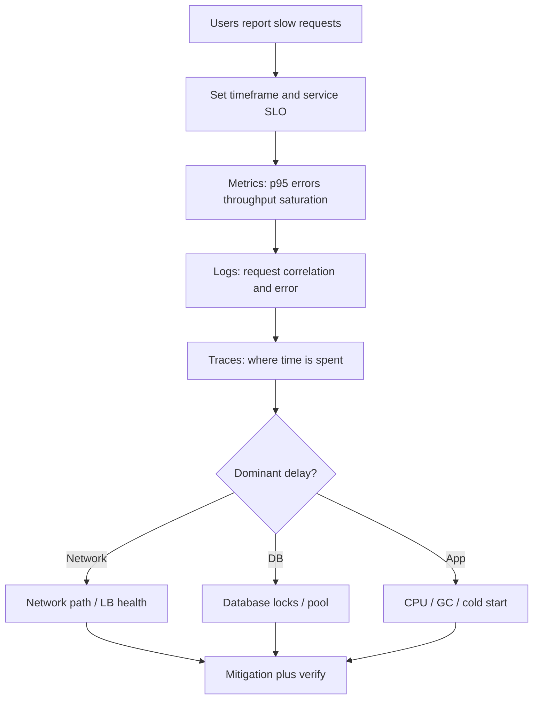

# Activity 13 — Logging and Monitoring in Google Cloud

[คู่มืออ่านตาม Path](./LEARNING-PATH-STUDY-GUIDE-TH.md) · [Visual Guide](./VISUAL-STUDY-GUIDE-TH.md#11-observability-signal--hypothesis--evidence) · [Module 11 — Observability](./Module-11-Observability-and-Operations.md) · [Google Skills course](https://www.skills.google/paths/11/course_templates/99)

> บทนี้ยกระดับจาก “รู้จัก Monitoring/Logging” ไปเป็น **ใช้ telemetry เพื่อหาสาเหตุจริง** ตั้งแต่ user impact → metrics/logs/traces → hypothesis → alert/runbook → verification

## 📖 บทเรียนเต็ม: Observability แบบแยกสัญญาณจนเจอ Root Cause

### 1. Monitoring ไม่ใช่การเปิด Dashboard ให้สวย

ระบบ Web Application มี 5xx สูงขึ้น ผู้ใช้บ่นว่าช้า แต่ CPU VM ใช้เพียง 25%. ถ้ามีแค่ CPU Graph จะสรุปผิดว่า "Server ปกติ". **Monitoring Metrics** ชี้แนวโน้ม/ขนาดของปัญหา, **Logging** ให้ Event/Request Context, **Tracing** แยก Latency ตาม Call Chain และ **Audit Logs** ให้หลักฐาน Control/Data Access ภายใต้นโยบายที่เปิดใช้. แต่ละชนิดตอบคนละคำถามและมี Cost/Retention/Permission ต่างกัน

**Four Golden Signals:** Latency, Traffic, Errors, Saturation. สำหรับเว็บ ให้ระบุ SLI เช่น "สัดส่วน HTTP Requests 2xx/3xx ภายใน 500ms" และตั้ง SLO ที่ผูก User Experience. ค่าเฉลี่ย Latency อาจซ่อน Tail Latency: 95% ของ Requests 100ms แต่ 5% ของ Requests 10s จะทำให้ User กลุ่มหนึ่งเจอปัญหาหนัก. ดู p95/p99 พร้อม Sample Size ไม่ใช้ Average อย่างเดียว

### 2. Metric, Logs, Traces ไม่ใช่ผลรันเดียวกัน

| แหล่ง | คำถามที่ตอบ | จุดที่มักเข้าใจผิด |
|---|---|---|
| Cloud Monitoring | Error Rate, p95, CPU/Memory, Quota Trends | Metric Sampling/Labels/Time Window อาจไม่ตรง Incident |
| Cloud Logging | Error Message, Request ID, Version/Revision | Log Missing อาจเกิด Exclusion/Agent/Permission |
| Cloud Trace | Request ใช้เวลาใน Hop ไหน | Sampling/Instrumentation ไม่ครอบทุก Request |
| Audit Logs | ใครเปลี่ยน Resource/IAM | ไม่ใช่ Application Runtime Trace |
| Cloud Status / Service Health | มี Service Provider Incident ไหม | Global Status ไม่ชี้ทุก Local Root Cause |

**Logs Router/Sink:** Routing Log Entries จาก Source ไป Destination ไม่ได้ทำให้ Writer Identity เขียน Destination ได้เอง. ถ้า Sink สร้างแล้วไม่มี Logs ให้ตรวจ Log Filter, Writer IAM, Destination Resource, Region, Data Retention/Exclusion และ Delay ก่อนสรุปว่า Cloud Logging หยุดทำงาน

### 3. Worked Incident: Connection Pool Exhaustion

สมมติ Timeline: 10:00 Deploy Revision B → 10:05 Requests/s เท่าเดิมแต่ p95 จาก 200ms เป็น 2.5s → 10:06 Database Connection Pool เต็ม → 10:07 HTTP 503 เพิ่ม → CPU ของ App 30%. มีความสัมพันธ์ทางเวลา แต่ **ยังไม่พิสูจน์ Causation**. ต้องตรวจ Revision B เพิ่ม Pool Size/Connections Per Instance หรือเปล่า, SQL Query Duration/DB Limits, Traffic Split และ Changes ก่อน Incident

ขั้นตอนตรวจ: กำหนด Time Range → ดู Error Rate+p95+Throughput → Filter Logs ด้วย Service/Revision/Request ID → หา Trace ของ Slow Requests → เปรียบ DB Pool/Locks/Waits → เสนอ Mitigation → Validate SLO After Change. ถ้าลด Traffic Revision B แล้วหายเป็นหลักฐานช่วย Hypothesis แต่ยังต้องดู Shared Dependencies/Workload

### 4. Alert ที่ดีต้อง Actionable และลด Noise

Alert CPU > 80% ทุก 1 นาทีอาจเตือนตอน Batch Job ที่สุขภาพดี. Alert ที่ผูก Error Budget / p95 Latency ต่อเนื่อง และมี Minimum Request Count มักช่วยชี้ User Impact มากขึ้น. ต้องกำหนด Severity, Time Window, Alert Routing, Escalation, Acknowledge และ Runbook. Incident Response ที่ดีต้องรู้ Owner/Business Impact มากกว่ามี Dashboard จำนวนมาก

**SLA ≠ SLO ≠ SLI:** SLI เป็นค่าที่วัดได้, SLO เป็นเป้าหมายภายในที่ใช้บริหาร Reliability, SLA เป็นข้อตกลงที่อาจมีผลเชิงสัญญา. "Availability 99.9%" ต้องระบุ Window, User Journey และ Measurement Method มิฉะนั้นตัวเลขไม่มีความหมาย

### 5. Read-only Guided Investigation

```bash
# Authorized Google Skills project only.
gcloud logging logs list --project=LAB_PROJECT_ID
gcloud monitoring policies list --project=LAB_PROJECT_ID
gcloud compute instances list --project=LAB_PROJECT_ID
```

**Expected:** บอกได้ว่ามี Log/Policy/VM อะไรที่ Relevant, Scope ไหน, Error/Labels เป็นอะไร. **Actual:** บันทึกเท่าที่ IAM อนุญาต; อย่าสร้าง Alert/Sink ใหม่หรือเปิด Data Access Audit Logs เพิ่มโดยไม่ดู Permission, Cost และ Data Policy. สำหรับ App Logs ต้อง Redact Token, User IDs, SQL Text/PII ก่อนใช้เป็น Portfolio

### 6. Troubleshooting Matrix และคำถามเหตุผล

**Log Sink ไม่มี Data:** Filter ไม่ Match, Writer Identity ไม่มีสิทธิ์ Destination, Exclusion/Time Range, Destination/Region/Delay. **Metrics ดูปกติแต่ผู้ใช้ช้า:** p95, Sampling, Synthetic/Uptime Check, Client Region, Downstream Traces. **Alert Storm:** Threshold/Duration/Grouping/Noisy Labels และ Suppression Policy. **Audit Log มีช่องว่าง:** Log Type Enablement, Resource Scope, Privileges, Retention ไม่ใช่ต้องเปิด Full Logging ทุกอย่างทันที

1. CPU ต่ำแปลว่า User ไม่ช้า? — ไม่, DB/Network/Queue อาจตัน
2. Logs กับ Traces ต่างกัน? — Events vs Request Call-chain Time
3. ทำไม p95 สำคัญ? — เห็น Tail Impact ที่ Average ซ่อน
4. Sink Created แปลว่า Logs ส่งถึง BigQuery แล้ว? — ไม่, Writer IAM/Filter ยังสำคัญ
5. SLI/SLO/SLA เหมือนกันไหม? — ไม่, Measurement/Target/Contract
6. จะแก้ 503 ด้วย Alert เพิ่มได้ไหม? — Alert ไม่แก้ Root Cause
7. ทำไมต้อง Redact Logs? — อาจมี PII, Keys, App Secrets
8. ทำไมต้องเก็บ Timeline? — แยก Correlation, Prior Changes และ Evidence

[Cloud Monitoring](https://cloud.google.com/monitoring/docs/monitoring-overview) · [Cloud Logging](https://cloud.google.com/logging/docs/overview) · [Service Monitoring](https://cloud.google.com/stackdriver/docs/solutions/slo-monitoring).

---

## 📎 ภาคขยาย: โครงเดิมและแบบฝึกเพิ่มเติม (ไม่จำเป็นต้องอ่านซ้ำ)

## เป้าหมายการเรียนรู้

อ่านจบแล้วควรทำได้:

1. แยก Metrics, Logs, Traces และ Audit Logs ได้
2. อธิบาย monitored resource, metric labels และ aggregation ได้ระดับใช้งาน
3. สร้าง mental model ของ dashboard, uptime check, alert, SLI/SLO
4. เข้าใจ Log Router, log bucket, sink, retention และ destination permission
5. ใช้ logs/metrics แยก app issue, infra issue และ dependency issue
6. รู้ว่า Ops Agent จำเป็นเมื่อไร และ platform metrics มีอะไรโดยไม่ต้อง agent
7. อ่าน multi-project monitoring/scoping project ได้
8. ทำ incident workflow โดยไม่เริ่มจาก restart หรือเพิ่ม CPU แบบเดา

---

## 1. Observability ไม่ใช่ Dashboard



Observability ที่ดีตอบคำถามได้ ไม่ใช่มีกราฟเยอะที่สุด

---

## 2. Metrics, Logs, Traces ต่างกันอย่างไร

| Signal | ตอบคำถาม | ตัวอย่าง |
|---|---|---|
| Metrics | ปริมาณ/แนวโน้มเท่าไร | request rate, p95 latency, CPU, connections |
| Logs | event/request เกิดอะไร | stack trace, auth denied, startup error |
| Traces | request ใช้เวลาตรงไหน | frontend → app → DB |
| Audit logs | ใครเรียก/เปลี่ยน control plane/data | IAM change, resource create/delete |

### ตัวอย่างระบบช้า



CPU ต่ำไม่ได้พิสูจน์ว่าระบบเร็ว เพราะ app อาจกำลังรอ DB/network/lock/connection pool

---

## 3. Four Golden Signals

1. **Latency** — request ใช้เวลานานแค่ไหน โดยเฉพาะ p95/p99
2. **Traffic** — requests/throughput เท่าไร
3. **Errors** — error ratio ไม่ใช่ดูจำนวน raw อย่างเดียว
4. **Saturation** — resource/pool/queue ใกล้เพดานไหม

### ทำไม average latency หลอกได้

ถ้า 95 requests = 100 ms แต่ 5 requests = 10 s

Average ยังอาจดูไม่แย่มาก แต่ user กลุ่มหนึ่งเจอปัญหารุนแรง จึงต้องดู percentile

---

## 4. Monitored resource + metric + labels

Metric ไม่ได้อยู่ลอย ๆ ต้องรู้ว่าอ้างถึง resource อะไร

ตัวอย่างแนวคิด:

```text
resource.type = gce_instance
metric = CPU utilization
resource.labels.instance_id = ...
resource.labels.zone = ...
```

เวลา query ต้องเลือก:
- resource type
- metric
- time range
- alignment period
- reducer/aggregation
- labels/grouping

เปรียบเทียบค่าแบบคนละ aggregation อาจทำให้สรุปผิด

---

## 5. Dashboard ควรตอบคำถาม

Dashboard สำหรับ web service ที่มี LB + app + DB ควรเห็นอย่างน้อย:



ถ้า dashboard มีแต่ VM CPU แต่ user complaint คือ API ช้า แปลว่า coverage ยังไม่ตรง service

---

## 6. Uptime checks

Uptime check ตรวจ endpoint จาก probe location ตาม configuration

ใช้ตอบว่า:
- endpoint reachable ไหม
- HTTP status ถูกไหม
- response content ตรง expectation ไหม (ตาม feature)

แต่ uptime check ไม่ได้พิสูจน์ว่า business transaction ทุกอย่างทำงาน เช่น `/health` 200 แต่ checkout query DB ไม่ได้

ควรแยก:
- shallow health
- dependency-aware health
- synthetic business check ตามความจำเป็น

---

## 7. SLI / SLO / SLA



ตัวอย่าง:
- SLI = % requests ที่ latency < 500 ms
- SLO = 99.9% ต่อ 30 วัน
- SLA = ข้อตกลงกับลูกค้าพร้อมเงื่อนไข/เครดิต

SLO ที่วัดไม่ได้จริงไม่มีประโยชน์

---

## 8. Alert ที่ดี

Alert ต้องมี action ที่คนรับรู้ว่าทำอะไรต่อ

| Alert แย่ | Alert ดีกว่า |
|---|---|
| CPU > 70% 10 วินาที | 5xx ratio สูงต่อเนื่อง + user impact |
| disk usage สูง | disk free ต่ำกว่าระดับที่มีเวลาแก้ + runbook |
| service down | endpoint/SLO burn พร้อม service/project/owner |

คิดก่อนสร้าง:
- threshold
- duration/window
- missing data
- notification channel
- owner
- severity
- runbook

---

## 9. Multi-project monitoring

องค์กรอาจมี monitoring view กลาง โดยมี **scoping project** สำหรับมอง metrics/resources จาก monitored projects ตาม relationship/IAM ที่รองรับ



ข้อสำคัญ:
- visibility ไม่เท่ากับ admin permission ทุก project
- alert ownership/notification ต้องชัด
- naming/labels สำคัญเมื่อหลาย project

---

## 10. Ops Agent

บน VM platform อาจมี host metrics บางตัวอยู่แล้ว แต่ guest/application telemetry บางอย่างต้อง Ops Agent หรือ instrumentation

**ตัวอย่าง:**
- VM CPU เห็นได้จาก platform metric
- guest memory/process/app log อาจต้อง agent/config

ก่อนติด agent ตรวจ:
- supported OS
- VM service account/IAM
- egress/API access
- config
- ingestion/cost

Cloud Run/GKE มี managed telemetry model ของตัวเอง ไม่ติด VM agent แบบเดียวกันทุก platform

---

## 11. Cloud Logging flow



### สิ่งที่ต้องแยก

- **Log Router** ประเมิน route/filter
- **Log bucket** เก็บ logs
- **Sink** ส่งไป destination
- **Retention** กำหนดระยะเก็บ
- **View** จำกัด/จัดมุมมองตาม feature
- **Log Analytics** ใช้ query/analysis ตาม capabilities

---

## 12. Sink สร้างแล้วข้อมูลไม่เข้า destination

ตรวจเป็นลำดับ:

1. filter match จริงไหม
2. log entry เข้า router ไหม
3. destination ถูกไหม
4. writer identity ของ sink มี permission ไหม
5. destination location/config รองรับไหม
6. exclusion มีผลไหม
7. time range ถูกไหม



---

## 13. Audit Logs

ใช้ตอบคำถามด้าน control/security เช่น:
- ใครแก้ IAM
- ใครลบ VM
- ใครสร้าง firewall rule
- ใครอ่าน/เขียน data ตามประเภท log/บริการที่รองรับ

แยกประเภทสำคัญ:
- Admin Activity
- Data Access
- System Event
- Policy Denied

Data Access มี enablement/cost/coverage ที่ต้องตรวจตาม service ไม่สมมติว่าเปิดเหมือนกันทุกตัว

---

## 14. Network logs

| Log | ใช้ดู |
|---|---|
| VPC Flow Logs | network flow telemetry แบบ sampling/aggregation |
| Firewall rule logging | traffic ที่ match rule ที่เปิด log |
| Audit logs | API/control operation |

VPC Flow Logs ไม่ใช่ packet capture และไม่ใช่ Audit Logs

---

## 15. Log-based metrics vs Custom metrics

### Log-based metric
สร้าง metric จาก log pattern เช่น count ของ specific error

### Custom metric
application ส่ง signal โดยตรง เช่น:
- `db_pool_active`
- `db_pool_waiting`
- `queue_depth`
- `order_processing_seconds`

Custom metrics มักดีกว่า parsing log สำหรับ signal ที่ application รู้เป็นตัวเลขอยู่แล้ว

ระวัง high-cardinality labels เช่น request_id/user_id

---

## 16. Trace / Profiler / Query Insights



- **Trace** หาเวลาที่เสียใน request path
- **Profiler** หา CPU/memory hot path ใน runtime ที่รองรับ
- **Query Insights** หา query/database performance ตาม product

ไม่ใช่ทุก legacy app จะมี trace อัตโนมัติ ต้อง instrumentation/support

---

## 17. Incident workflow: ระบบช้า



ห้ามใช้ “CPU/RAM ไม่เต็ม” เป็นข้อสรุปว่า infra ปกติทั้งหมด

---

## 18. ตัวอย่าง Connection Pool Incident

อาการ:
- app 500 เป็นช่วง ๆ
- restart app แล้วหายชั่วคราว
- DB connections เพิ่มเรื่อย ๆ
- CPU DB ไม่สูง

สิ่งที่ควรเพิ่มใน telemetry:
- pool active
- pool idle
- pool waiting
- acquire time
- DB sessions
- query latency
- app instance count

จากนั้นดูความสัมพันธ์ก่อนแก้ด้วยการเพิ่ม DB max connections

---

## 19. Personalized Service Health / Active Assist / Cloud Hub

ใช้เป็นข้อมูลประกอบ:
- provider incident/health
- recommendations
- fleet/operations insights

แต่ recommendation ไม่ใช่คำสั่งให้ apply ทันที ต้องตรวจ workload pattern, peak, SLO และ business context

---

## 20. Mini Labs

### Lab A — Logs Explorer

กำหนดโจทย์: หา Cloud Run errors 1 ชั่วโมงล่าสุด

แนว query:

```text
resource.type="cloud_run_revision"
severity>=ERROR
```

จากนั้นเพิ่ม service/project/time filter ให้แคบ

### Lab B — Alert design

ออกแบบ alert สำหรับ API:
- signal: 5xx ratio
- threshold/window
- owner
- notification
- runbook link
- recovery condition

### Lab C — Sink failure

Sink ไป BigQuery ไม่ส่งข้อมูล

ให้ตรวจ filter → writer identity → destination permission → dataset/location → exclusion

### Lab D — Slow system

วาด flow:

```text
Client -> LB -> App -> DB
```

เขียน metric/log ที่ต้องการอย่างน้อยชั้นละ 2 ตัวก่อนเข้าเครื่อง production

---

## 21. Exam-style scenarios

**Scenario:** ต้องรู้ว่าใครแก้ firewall rule เมื่อ 10:35

**แนวคิด:** Audit Logs ไม่ใช่ CPU metric

**Scenario:** VM CPU ต่ำ แต่ request p99 สูงและ connection pool waiting สูง

**แนวคิด:** ตรวจ app/DB pool/query ไม่เพิ่ม VM CPU โดยอัตโนมัติ

**Scenario:** สร้าง log sink แล้ว destination ว่าง

**แนวคิด:** ตรวจ writer identity permission และ filter/destination ก่อน

**Scenario:** ต้อง monitor หลาย projects จากทีมกลาง

**แนวคิด:** multi-project monitoring/scoping project + IAM/ownership

---

## เช็กความเข้าใจ

1. Metrics กับ Logs ตอบคนละคำถามอย่างไร?
2. p95/p99 สำคัญกว่า average ในกรณีใด?
3. Uptime check 200 ยืนยันว่า checkout ใช้งานได้ไหม?
4. SLI/SLO/SLA ต่างกันอย่างไร?
5. Sink writer identity ใช้ทำอะไร?
6. VPC Flow Logs กับ Audit Logs ต่างกันอย่างไร?
7. VM RAM metric หายควรตรวจอะไร?
8. CPU ต่ำพิสูจน์ว่า app ไม่ช้าหรือไม่?
9. Custom metric แบบใดช่วย connection-pool incident?
10. Alert ที่ดีควรมี runbook/owner เพราะอะไร?

## แหล่งอ้างอิง

- [Google Skills — Logging and Monitoring in Google Cloud](https://www.skills.google/paths/11/course_templates/99)
- [Cloud Monitoring](https://cloud.google.com/monitoring/docs)
- [Cloud Logging](https://cloud.google.com/logging/docs)
- [Cloud Audit Logs](https://cloud.google.com/logging/docs/audit)
- [Ops Agent](https://cloud.google.com/stackdriver/docs/solutions/agents/ops-agent)

## 📚 Deep Learning Notes — Incident Timeline สำหรับ App ช้า (Original Supplement, 2026-10-21)

### 1. Dashboard เป็นจุดเริ่ม ไม่ใช่คำวินิจฉัย



**Example timeline:** 10:05 Error Rate เพิ่ม, 10:07 p95 จาก 120ms → 3s, 10:08 Database Connections เต็ม, 10:10 CPU VM เพียง 30%. การ Restart App อาจลดอาการชั่วคราว แต่ยังต้องถามว่า DB Connection Pool Leak, Long Queries หรือ Deadline Misconfiguration ทำให้ Connection ไม่คืน Pool หรือไม่

### 2. Logs vs Metrics vs Traces vs Audit

| Data | ตอบอะไรได้ | ข้อจำกัด |
|---|---|---|
| Metrics | เวลาไหนแย่ ปริมาณเท่าไร | ไม่บอกสาเหตุ Root Cause ทั้งหมด |
| Logs | Event/Error Context และ Request ID | ไม่เห็น Latency ทุก Hop หากไม่มี Correlation |
| Traces | Request ใช้เวลาใน Service/Dependency ไหน | Sampling / Instrumentation สำคัญ |
| Audit Logs | ใครทำ Control/Data Access ตาม Logs ที่ Enable | ไม่ใช่ Application Runtime Log |

### 3. Alert Design

Alert `CPU > 80%` ต่อเนื่อง 5 นาทีอาจแจ้งทั้งตอน Batch ที่ปกติ. Alert `p95 latency > SLO threshold` ร่วมกับ Error Budget Consumption ช่วยผูก Monitoring กับ User Impact มากกว่า แต่ต้องกำหนด Traffic Volume/Minimum Samples ไม่ให้ False Positive

### 4. Read-only investigation

```bash
# Access controls required. Query only the assigned lab project.
gcloud logging logs list --project=LAB_PROJECT_ID
gcloud monitoring policies list --project=LAB_PROJECT_ID
```

หาก Query ไม่ได้เพราะ IAM ให้บันทึก Permission Error ไม่ยกระดับสิทธิ์แบบสุ่ม. ถ้าทำ Log Sink ไป BigQuery/Storage ต้องตรวจ Writer Identity ของ Sink และ Destination IAM อีกชั้น

**Official:** [Cloud Monitoring](https://cloud.google.com/monitoring/docs/monitoring-overview) · [Cloud Logging](https://cloud.google.com/logging/docs/overview) · [Troubleshooting Monitoring](https://cloud.google.com/monitoring/support/troubleshooting).

**Scope:** Fictional incident, not a live monitoring finding
