# Activity 14 — Getting Started with Terraform for Google Cloud

[คู่มืออ่านตาม Path](./LEARNING-PATH-STUDY-GUIDE-TH.md) · [Visual Guide](./VISUAL-STUDY-GUIDE-TH.md#12-terraform-config--state--real-world) · [Module 12 — Terraform](./Module-12-Terraform-and-Infrastructure-as-Code.md) · [Lab 05](./Lab-Guide-TH/Lab-05-Terraform-VPC-and-State.md) · [Google Skills course](https://www.skills.google/paths/11/course_templates/443)

> จุดประสงค์คือให้มอง Terraform เป็นระบบ **Configuration + State + Provider + Real Resources** ไม่ใช่จำคำสั่ง `init/plan/apply` อย่างเดียว

## 📖 บทเรียนเต็ม: Terraform เป็น State-based Change Management ไม่ใช่ Shell Script

### 1. Declarative Infrastructure ต่างจาก Imperative Commands อย่างไร

Imperative Script บอก "เรียก API A แล้ว B" ตามลำดับที่เขียน; Terraform HCL ระบุ Desired Resource Configuration แล้ว Provider/Dependency Graph จัด Plan ของ Change. **State** เก็บ Mapping ระหว่าง Resource Address ใน Code กับ Object ID จริงใน Cloud; ถ้าขาด State แต่ Resource ยังอยู่ Terraform อาจพยายาม Create ใหม่, เปลี่ยน Owner หรือ Plan Replacement ไม่คาดคิด. คำว่า `terraform plan` จึงมีค่าต่อ Change Review มากกว่าการพิมพ์ `apply` ให้เร็ว

**Provider** เป็น Plugin ติดต่อ Google Cloud APIs. Authentication ใน Terraform อาจใช้ Application Default Credentials/Workload Identity/Service Account ตาม Environment; ไม่ควร Commit Service Account JSON Keys ลง Git. CI Runner กับ Developer Local ต้องใช้ Identity ที่กำหนด Scope เหมาะสม

### 2. HCL Model: Resource, Variable, Output, Module

ตัวอย่างที่ประกอบภาพการคิด (Syntax สั้น ใช้ใน Approved Sandbox เท่านั้น):

```hcl
variable "project_id" { type = string }
variable "region" { type = string }
provider "google" {
  project = var.project_id
  region  = var.region
}
resource "google_compute_network" "lab" {
  name                    = "example-vpc"
  auto_create_subnetworks = false
}
output "vpc_name" {
  value = google_compute_network.lab.name
}
```

**Resource Address** ใน State คือ `google_compute_network.lab`; `name = "example-vpc"` เป็น Provider-side Name. การ Rename HCL Label `lab` → `main` โดยไม่ใช้ Refactor/Moved Strategy อาจทำให้ Terraform Plan มองเป็น Old Resource ที่ต้อง Destroy กับ New Resource ที่ต้อง Create แม้ Remote Name ไม่เปลี่ยน. **Module** ช่วย Reuse Config แต่แต่ละ Module Instantiation มี Resource Addresses ของตัวเองและต้องจัด Version/Inputs/Outputs

### 3. State/Backend/Lock และ Secrets

State ไม่ใช่ File ที่ควรแนบไป Public Portfolio. อาจมี Resource Metadata และ Sensitive Values (แม้ Output ถูก Mark Sensitive ก็ไม่ควรถือว่า State ปลอด Secret เสมอ). **Remote Backend** เช่น Cloud Storage Backend ช่วย Share State/Locking/Versioning ตาม Configuration, แต่ต้องตั้ง IAM, Encryption, Access Audit, Retention และ Recovery. หลายทีมเขียน State เดียวกันพร้อมกันโดยไม่มี Lock หรือแยก Ownership ไม่ชัดเสี่ยง Plan/Apply ทับกัน

**Drift:** คนแก้ Resource ใน Console แล้ว Terraform Config/State ไม่ตรง Actual. บางครั้ง Drift สมควรย้อนให้ตรง IaC; บางครั้งต้อง Update Config ให้รับ Incident Mitigation — ต้องตัดสินจาก Change Record ไม่ใช่ Force Apply ให้ Drift หาย

### 4. IAM Resource Ownership Trap

Google Provider มี IAM Policy, Binding, Member Resources ที่มี Authoritative/Additive Semantics ต่างกัน. ถ้าเอา `google_project_iam_policy` ที่ Authoritative ไปใช้ผิด Scope อาจแทนที่ Policy เดิมและลบ Access ของ Service Agents/Production Users. ถ้า `google_project_iam_binding` คุม Role เดียวกับทีมอื่นอาจเกิด Collision; `..._iam_member` เพิ่ม Member แบบ Incremental แต่ยังต้องจัด Role Scope/Ownership

### 5. Worked Change Review: Terraform Plan บอก Replace VM 8 ตัว

สมมติ Requirement เปลี่ยน Label ของ Subnet แต่ Plan แสดง `-/+` (Destroy/Create) VM ที่เป็น Dependencies จำนวนมาก. **Stop** ก่อน: เปิด Plan Detail ดู Force Replacement Attribute, Compare Provider State/Remote Configuration, ตรวจ Resource Address/Moved Blocks, State Backend, Immutable Fields, Snapshot/Backup/Rollback และ Downtime. อย่าพยายาม `terraform state rm` เพื่อซ่อน Plan ที่ดูน่ากลัว

**Approvals:** Plan Artifact, Impact Summary, Human Reviewer, Maintenance Window/Backup/Restore, Rollback Strategy, Post-apply Verification. GitHub Actions CI Green ไม่อนุมัติ Production Change ให้โดยอัตโนมัติ

### 6. Safe Practice (state/plan caveat)

```bash
# Run in a disposable approved Terraform sandbox directory.
terraform fmt -check
terraform validate
terraform plan -input=false
```

**ข้อจำกัด:** `terraform validate` ต้อง Init Provider/Modules ตาม Setup, `plan` อาจ Refresh Provider, Lock/Update State Metadata หรือ Write Artifacts — ไม่ใช่ Pure Read-only Guarantee. ห้ามรันกับ Production Backend โดยไม่ Approval; ไม่คัดลอก State ไป Public Repo. **Expected:** เห็น Proposed Resource Changes and Dependencies; **Actual:** ต้องจด Output เฉพาะที่ปลอดข้อมูลลับ

### 7. คำถามพร้อมเฉลยเหตุผล

1. Terraform Import สร้าง Configuration อัตโนมัติครบไหม? — ไม่เสมอ; Config ต้อง Match Real Resource
2. State ลบแล้ว Cloud Resource หายไหม? — ไม่ทันที แต่ Tool อาจ Track ไม่ได้
3. Plan มี Replace Unexpected ควร Apply ให้จบไหม? — ไม่, Review Immutable/State/Address
4. Module Version Upgrade ปลอดภัยเสมอไหม? — ไม่, Interface/Resources เปลี่ยนได้
5. IAM Binding กับ Member แทนกันได้ทุกกรณี? — ไม่, Ownership Semantics ต่างกัน
6. Sensitive Output แปลว่า State ไม่มี Secret? — ไม่, State ยัง Sensitive
7. Plan เป็น Read-only 100% ไหม? — ไม่รับประกัน Backend/Provider Side Effects
8. จะบอกว่า IaC Change สำเร็จต้องมีอะไร? — Approved Plan, Actual, Validation, Rollback Plan

[Google Cloud Terraform](https://cloud.google.com/docs/terraform) · [Terraform State](https://developer.hashicorp.com/terraform/language/state) · [Plan](https://developer.hashicorp.com/terraform/cli/commands/plan) · [Google Provider IAM](https://registry.terraform.io/providers/hashicorp/google/latest/docs/guides/using_iam).


### 8. Google Cloud IAM + Terraform Ownership ต้องตรวจสองแหล่ง

Provider Configuration ของ Terraform ใช้ Credential เพื่อเรียก Google APIs และ Resource บางตัวจัดการ **IAM Permissions** บน Project/Service Account/Bucket. ต้องตรวจทั้ง [Google Cloud Terraform Documentation](https://cloud.google.com/docs/terraform) เพื่อเข้าใจ Integration และ [Google Cloud IAM Overview](https://cloud.google.com/iam/docs/overview) เพื่อเข้าใจ Principal/Role/Scope ที่ Resource จะเปลี่ยน. ถ้าสร้าง Terraform Plan ที่ Replace IAM Policy แบบ Authoritative, การมี HCL Syntax ผ่านไม่รับรองว่า Existing Service Agents/Production Principals ยังมีสิทธิ์ครบ. Review Intended Owner, Policy Change Diff และ Approval ก่อนใช้ Apply
---

## 📎 ภาคขยาย: โครงเดิมและแบบฝึกเพิ่มเติม (ไม่จำเป็นต้องอ่านซ้ำ)

## เป้าหมายการเรียนรู้

อ่านจบแล้วควรทำได้:

1. อธิบาย HCL, provider, resource, data source, variable, local และ output
2. เข้าใจ dependency graph จาก references
3. อ่าน plan ว่า create/update/replace/destroy อะไร
4. แยก configuration, state และ real cloud resources
5. ใช้ module โดยเข้าใจ input/output/version
6. อธิบาย remote state, access control, locking และ recovery
7. เข้าใจ drift และเหตุผลที่ manual Console change มีผลต่อ plan
8. ทำ workflow ที่ปลอดภัยก่อน apply/destroy

---

## 1. Terraform mental model

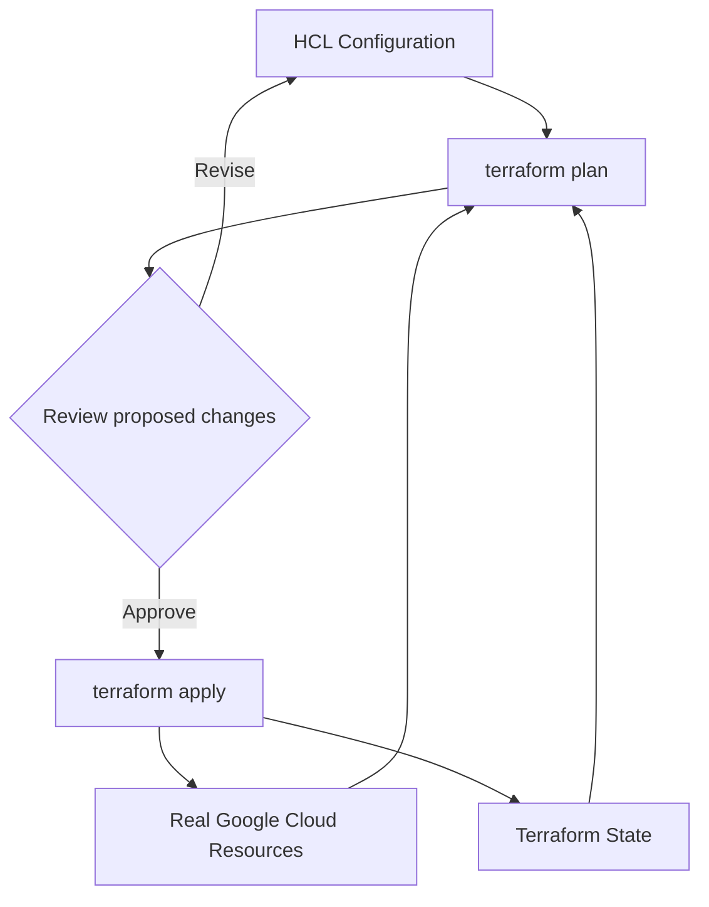

จำประโยคนี้:

> **Code บอก intent, State บอก mapping, Provider คุยกับ API, Plan บอกความต่างที่ Terraform คิดว่าจะทำ**

---

## 2. Script กับ Terraform ต่างกันอย่างไร

Shell script:

```bash
gcloud compute networks create ace-vpc
```

บอก “ทำ action นี้”

Terraform:

```hcl
resource "google_compute_network" "ace" {
  name                    = "ace-vpc"
  auto_create_subnetworks = false
}
```

บอก “ต้องการให้ resource นี้อยู่ใน state แบบนี้”

Terraform ไม่ได้ magic: ถ้า config ผิด มันสามารถสร้าง/ลบผิดได้อย่างสม่ำเสมอเหมือนกัน จึงต้อง review plan

---

## 3. Provider และ authentication

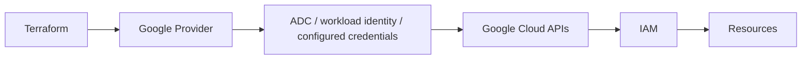

Terraform ผ่าน IAM/API/quota เหมือน gcloud ไม่ใช่ช่องทาง bypass permission

ถ้า `gcloud` ใช้ได้แต่ Terraform denied ให้ตรวจ identity/ADC ที่ Terraform ใช้จริง

---

## 4. HCL building blocks

| Block | ใช้ทำอะไร |
|---|---|
| `terraform` | required providers/backend/version constraints |
| `provider` | config ของ provider |
| `resource` | object ที่ Terraform จัดการ |
| `data` | อ่าน object/data ที่มีอยู่ |
| `variable` | input |
| `locals` | คำนวณ/reuse ค่าใน config |
| `output` | ส่งค่าหลัง apply |
| `module` | เรียก reusable configuration |

ตัวอย่าง:

```hcl
variable "project_id" {
  type = string
}

provider "google" {
  project = var.project_id
  region  = "asia-southeast1"
}

resource "google_compute_network" "main" {
  name                    = "ace-vpc"
  auto_create_subnetworks = false
}

output "network_id" {
  value = google_compute_network.main.id
}
```

---

## 5. Dependency graph

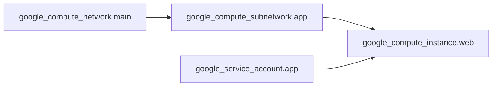

Reference เช่น `network = google_compute_network.main.id` ทำให้ Terraform เห็น dependency โดยไม่ต้องเขียน `sleep 30`

`depends_on` ใช้เมื่อ dependency จริงไม่ถูกแสดงผ่าน reference ตามธรรมชาติ อย่าใส่ทุก resource เพราะทำ graph หยาบและอ่านยาก

---

## 6. Workflow ที่ควรจำ

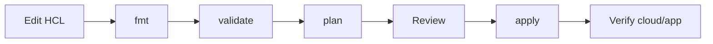

คำสั่งหลัก:

```bash
terraform init
terraform fmt -check
terraform validate
terraform plan -out=ace.tfplan
terraform apply ace.tfplan
```

**สำคัญ:** saved plan อาจมี sensitive information อย่า commit เข้า public repo

---

## 7. อ่าน Plan ให้เป็น

สัญลักษณ์โดยทั่วไป:

- `+` create
- `~` update in-place
- `-` destroy
- replacement indicators = resource ต้องถูกแทน

ก่อน apply ให้ถาม:

1. จำนวน add/change/destroy ตรงที่คาดไหม
2. มี production resource ถูก replace ไหม
3. IAM bindings จะถอนของคนอื่นไหม
4. network/database field ไหน immutable
5. ชื่อ/project/region ถูกไหม

อย่ากด apply เพียงเพราะ plan command exit 0

---

## 8. Replacement และ downtime

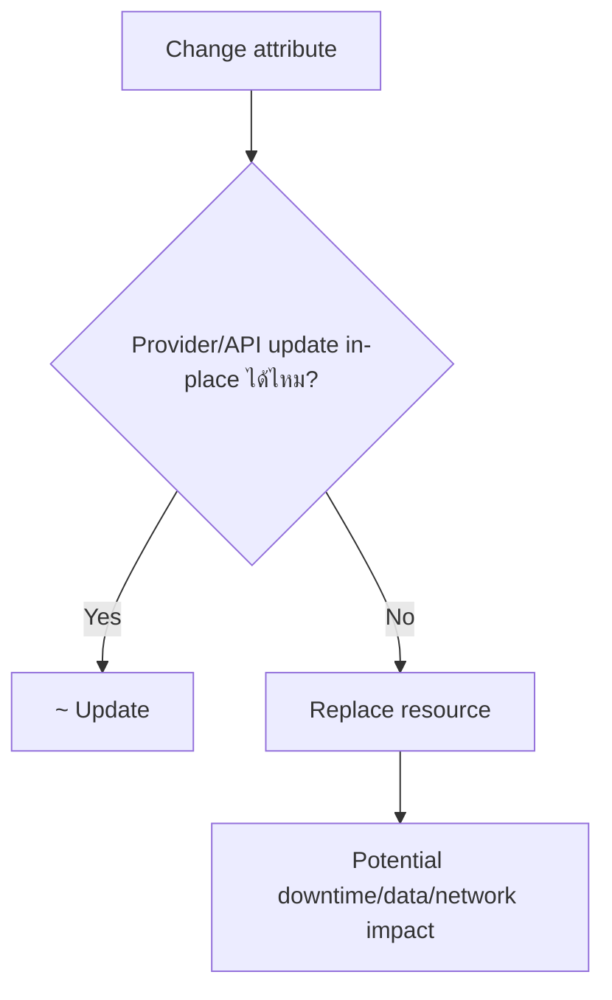

IaC ทำซ้ำได้ไม่ได้แปลว่า zero downtime

---

## 9. State คืออะไร

State เก็บ mapping เช่น:

```text
google_compute_network.main
  -> projects/xxx/global/networks/ace-vpc
```

ถ้า state หาย resource cloud อาจยังอยู่ แต่ Terraform ไม่รู้ ownership/mapping เดิม

**State ไม่ใช่:**
- VM disk backup
- database backup
- Git source code replacement

---

## 10. Remote State

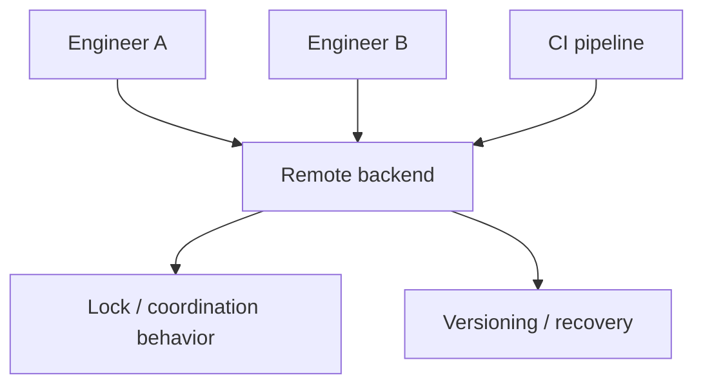

ออกแบบ:
- bucket/backend แยกจาก resource ที่ destroy ได้
- IAM แคบ
- recovery/versioning
- encryption/retention ตาม requirement
- CI concurrency

State อาจมี sensitive data จึงต้องป้องกันเหมือน artifact สำคัญ

---

## 11. Drift

Drift เกิดเมื่อ real resource ต่างจาก desired config/state เช่นคนเปิด public IP ผ่าน Console

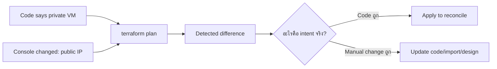

อย่า apply เพื่อลบ drift โดยไม่รู้ว่า manual change เป็น emergency fix หรือ requirement ใหม่

---

## 12. Modules

Module ควรเป็น reusable unit ที่มี interface ชัดเจน

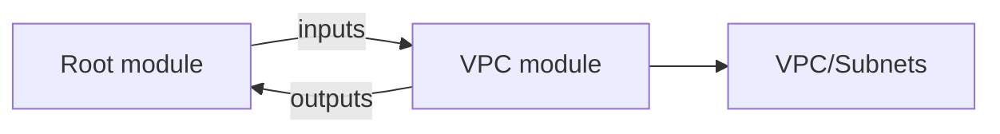

ควรมี:
- input types/descriptions
- outputs ที่จำเป็น
- provider/version constraints
- naming conventions
- documentation/examples

ไม่ hard-code secret ใน module

---

## 13. `count` vs `for_each`

แนวคิดสำคัญ:
- `count` ใช้ index
- `for_each` ใช้ keys

การเปลี่ยน list order กับ `count` อาจทำ resource addresses shift ได้ จึงต้องคิด identity ของ resource ไม่ใช่แค่ syntax

---

## 14. Lifecycle meta-arguments

ตัวอย่าง concept:
- prevent accidental destroy
- create-before-destroy ตาม resource support/design
- ignore selected changes เมื่อมี owner อื่นจริง

อย่าใช้ `ignore_changes` เพื่อซ่อน drift ทุกอย่าง เพราะจะทำให้ code ไม่สะท้อน reality

---

## 15. IAM resources: จุดเสี่ยง

Google provider มี resources แบบ member/binding/policy ที่ semantics ต่างกัน บางตัว additive บางตัว authoritative ต่อ scope/role

ถ้าเลือกผิด plan อาจถอนสมาชิกทีมอื่น

**กฎ:** IAM change ต้องอ่าน plan ราย binding/member เสมอ

---

## 16. Import

Import = เอา existing resource มาเชื่อม state ไม่ใช่สร้าง design/config ที่ดีให้อัตโนมัติ

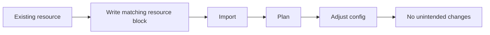

หลัง import ต้อง plan ซ้ำ

---

## 17. CI/CD for Terraform

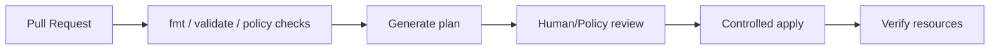

ใช้ short-lived/federated identity เมื่อรองรับ แทนเก็บ SA key ยาว ๆ ใน CI

---

## 18. Policy validation

Syntax valid ไม่ได้แปลว่า architecture/compliance ถูก

ตัวอย่าง policy:
- ห้าม public IP
- จำกัด regions
- บังคับ labels/tags
- ห้าม broad IAM

Policy-as-code ช่วยจับก่อน apply แต่ไม่แทน plan review/test

---

## 19. Runbook: Plan จะลบของที่ไม่คาด

1. ห้าม apply
2. อ่าน resource address
3. ตรวจ project/workspace/backend
4. ตรวจ state list/mapping
5. ตรวจ config refactor/rename
6. ตรวจ manual change/import
7. ตรวจ module version
8. backup/recover state ถ้าจำเป็น
9. plan ใหม่จนเข้าใจทุก destructive change

---

## 20. Mini Labs

### Lab A — VPC + Subnet

สร้าง config ที่มี:
- custom VPC
- regional subnet
- variable `project_id`
- output network id

จากนั้น `fmt → validate → plan`

### Lab B — Drift

สมมติคนเปลี่ยน resource ผ่าน Console ให้ทำนายว่า plan จะแสดงอะไร แล้วตัดสินว่า code หรือ manual change คือ intent

### Lab C — Remote state design

เขียน checklist:
- backend location
- IAM
- versioning
- recovery
- CI locking/concurrency

---

## 21. Exam-style scenarios

**Scenario:** State หายแต่ VM ยังอยู่

**แนวคิด:** กู้ state/import อย่างระมัดระวัง ไม่ create VM ซ้ำทันที

**Scenario:** Plan จะ remove IAM user ที่ไม่ได้อยู่ใน code

**แนวคิด:** ตรวจว่า resource แบบ authoritative หรือ additive

**Scenario:** สองคน apply พร้อมกัน

**แนวคิด:** shared backend + locking/controlled deployment workflow

---

## เช็กความเข้าใจ

1. Configuration, State และ Real Resource ต่างกันอย่างไร?
2. `terraform validate` รับประกัน IAM/quota/cost ไหม?
3. ทำไม plan ต้อง review destructive changes?
4. State เป็น backup ของ VM disk ไหม?
5. Drift เกิดจากอะไร?
6. Module ที่ดีควร expose อะไร?
7. Import แล้วจบเลยได้ไหม?
8. ทำไม IAM Terraform resources ต้องระวัง authoritative behavior?
9. Lock state ป้องกันคนแก้ Console ไหม?
10. IaC = zero downtime หรือไม่?

## แหล่งอ้างอิง

- [Google Skills — Getting Started with Terraform for Google Cloud](https://www.skills.google/paths/11/course_templates/443)
- [Terraform on Google Cloud](https://cloud.google.com/docs/terraform)
- [Terraform language/state](https://developer.hashicorp.com/terraform/language/state)
- [Terraform import](https://developer.hashicorp.com/terraform/cli/import)

## 📚 Deep Learning Notes — Terraform Plan ที่อาจ Replace Production Resources (Original Supplement, 2026-10-21)

### 1. อ่าน Terraform Plan เหมือน Change Request

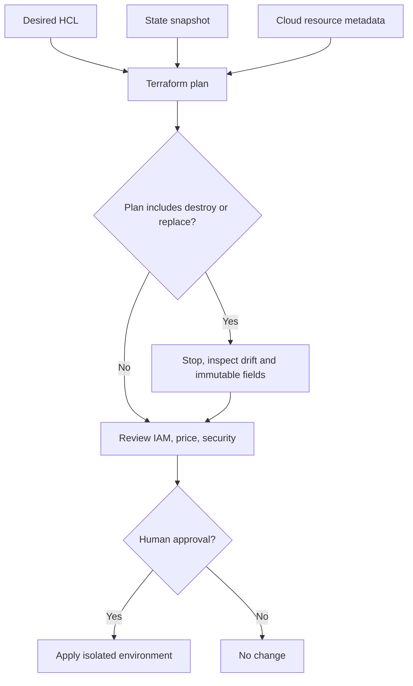

Terraform State บันทึก Resource Address ↔ Provider Object IDs และ Metadata ของ Management. ถ้าลบ State หรือเปลี่ยน Name/Address ของ Resource, Plan อาจเสนอ Create/Destroy ใหม่ทั้งที่ Cloud Resource เดิมยังมีอยู่

### 2. Example: IAM แบบ Authoritative vs Additive

ใน Google Provider Resource ที่จัดการ IAM มี Semantics ต่างกัน: **IAM Policy** อาจแทนที่ Policy ของ Scope ทั้งชุด, **IAM Binding** บริหาร Members ของ Role, **IAM Member** เพิ่ม Member แบบ Incremental ตาม Type. หากทีมไม่เข้าใจและใช้ Authoritative Resource ผิด Scope อาจลบ Access ของ Service Accounts ที่ใช้งานอยู่

### 3. ทำไม Terraform Import ไม่ได้แปลว่า Safe

Import ทำให้ State รู้จัก Existing Resource แต่ **Configuration ต้องสะท้อน Real World**; ถ้า HCL ไม่ตรง Immutable Properties, Plan ถัดไปอาจเสนอ Replacement. ต้อง Review Identifiers, Resource Addresses, Moved Blocks และ Backups of State, ห้ามใช้ `terraform state rm` เพื่อซ่อน Drift ในระบบจริง

```bash
# Read-only or local inspection; do not terraform apply on production.
terraform fmt -check
terraform validate
terraform plan -input=false
```

**Caution:** `terraform plan` ติดต่อ Provider และอาจ Refresh State Metadata หรือเขียน Local Artifacts/Lock State ในบาง Workflow. ไม่จัดเป็น “No-side-effect” แบบ Absolute — ใช้กับ Isolated Approved Sandbox เท่านั้น และตรวจ Backend ก่อนรัน

### 4. Recovery Drill

`plan` แสดงว่าแก้ Subnet Range จะ Replace Resource และ Destroy Instances อีก 8 ตัว; ให้ตอบว่า Root Resource, Immutable Field, Affected Dependencies, Migration Alternative, Planned Downtime/Approval และ Rollback Validation คืออะไร ก่อนกด Apply

**Official:** [Terraform on Google Cloud](https://cloud.google.com/docs/terraform) · [Terraform Google Provider IAM](https://registry.terraform.io/providers/hashicorp/google/latest/docs/guides/using_iam) · [Terraform Plan](https://developer.hashicorp.com/terraform/cli/commands/plan).

**Status:** Design/Static learning only; no Terraform plan/apply run
