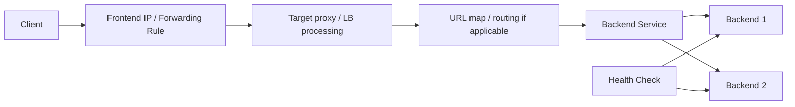
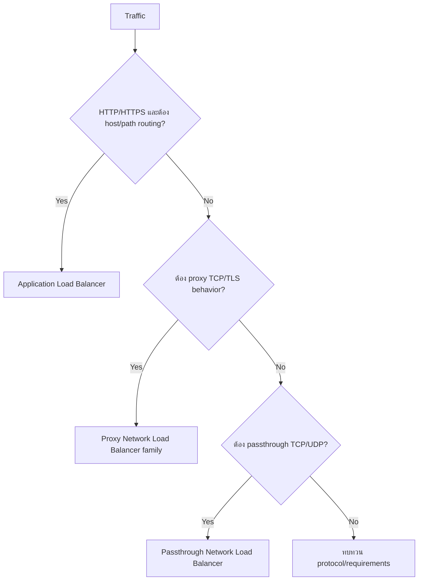
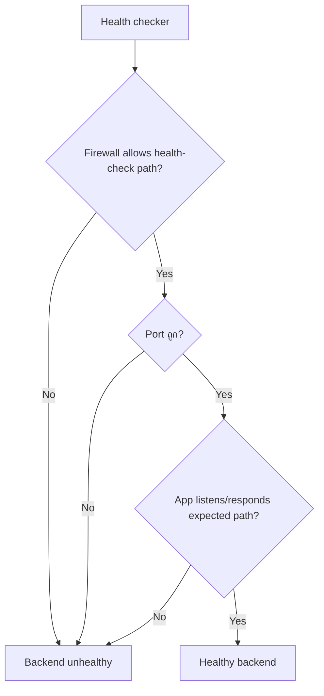
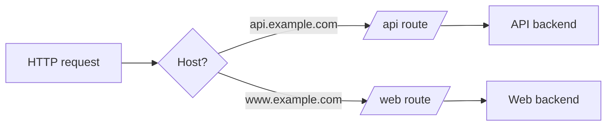
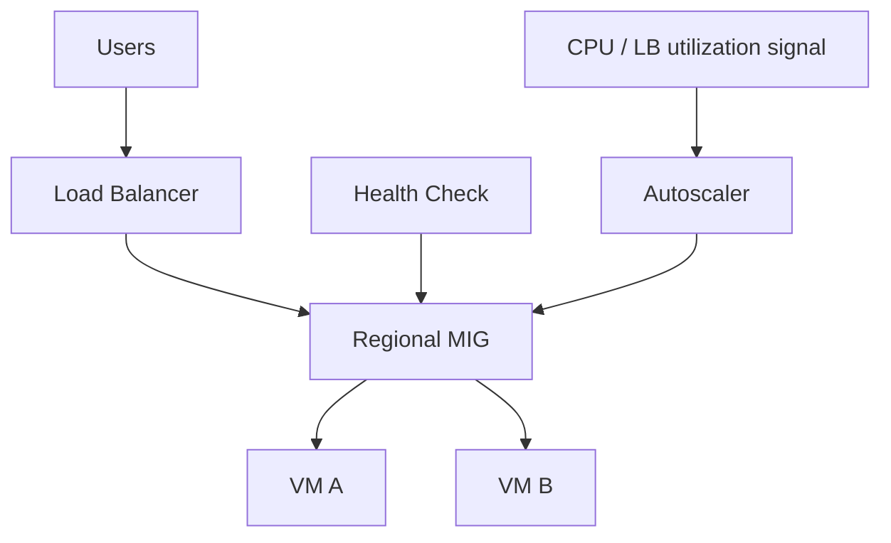
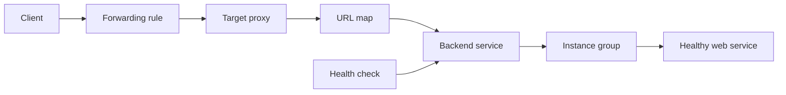

# Activity 15 — Implementing Cloud Load Balancing for Compute Engine (Skill Badge)

[คู่มืออ่านตาม Path](./LEARNING-PATH-STUDY-GUIDE-TH.md) · [Visual Guide](./VISUAL-STUDY-GUIDE-TH.md#10-load-balancer--hybrid-connectivity) · [Module 10 — Load Balancing](./Module-10-Load-Balancing-and-Hybrid-Networking.md) · [Activity 05](./Path-Activity-05-Scaling-Automation-TH.md) · [Google Skills course](https://www.skills.google/paths/11/course_templates/648)

> Skill Badge นี้ควรทำให้เรา “ต่อ chain ของ load balancer ได้เอง” และ debug ได้ว่าพังที่ frontend, forwarding, proxy/URL map, backend service, health check, firewall หรือ application ไม่ใช่จำชื่อ LB อย่างเดียว

## เป้าหมายการเรียนรู้

อ่านจบแล้วควรทำได้:

1. เลือก Application vs Network Load Balancer จาก protocol/behavior
2. แยก external/internal และ global/regional requirement
3. อธิบาย frontend → proxy/URL map → backend service → backend chain
4. สร้าง health check ที่ port/path ตรง app
5. รู้ว่าทำไม firewall ทำให้ backend unhealthy ได้
6. แยก VM ตอบตรงได้ออกจาก LB health ผ่าน
7. อ่าน 404/502/timeout/unhealthy backend แบบมีลำดับ
8. วาง challenge-lab workflow โดยไม่พึ่งจำคลิกใน Console

---

## 1. Load Balancer mental model



ไม่ใช่ LB ทุกชนิดมี component chain เหมือนกัน 100% แต่ภาพนี้ช่วยให้เข้าใจ Application LB ได้ดีมาก

---

## 2. เลือกชนิดจาก requirement



จากนั้นถามต่อ:
- client มาจาก Internet หรือ private network?
- global entry หรือ regional?
- backend อยู่ VM/MIG/NEG/serverless แบบใด?

---

## 3. Application LB component chain

| Component | คำถามที่ต้องตอบ |
|---|---|
| Frontend IP | client ต่อ IP ไหน? external/internal? |
| Forwarding rule | protocol/port/scope ถูกไหม? |
| Target proxy | TLS/proxy config ถูกไหม? |
| URL map | host/path route ไป backend ไหน? |
| Backend service | backend/health/load policy อะไร? |
| Backend | instance group/NEG ที่ถูกต้องไหม? |
| Health check | app พร้อมจริงที่ port/path นี้ไหม? |

เวลาพังให้เดิน chain นี้แทนเปิด firewall กว้าง ๆ ก่อน

---

## 4. Health Check: จุดที่ทำให้หลายคนงง



VM ที่ `curl localhost` ผ่าน อาจยัง unhealthy เพราะ:
- firewall source ไม่อนุญาต health checker
- named port/port mismatch
- app bind localhost อย่างเดียว
- path `/health` ไม่ตอบ expected status

---

## 5. Backend Service vs Instance Group

Instance group คือกลุ่ม compute backends ส่วน backend service เก็บ policy/health/backend attachment สำหรับ LB

อย่าสับสนว่า “สร้าง MIG แล้ว = มี load balancer” ยังต้องเชื่อม frontend/routing/backend service ตาม architecture

---

## 6. URL Map



**404 จาก LB/app** ต้องแยกว่า:
- URL map ไม่มี route
- backend app ตอบ 404
- host header/path ไม่ตรง

ไม่ใช่ทุก 404 เป็น firewall problem

---

## 7. Internal vs External

### External
client จาก Internet ตาม LB variant/architecture

### Internal
client ต้องอยู่ network/path ที่รองรับ เช่น VPC/connected network ตามชนิด LB

Internal LB มี IP private ไม่ได้แปลว่า client ทุก project/on-prem จะ route ถึงโดยอัตโนมัติ ต้องมี connectivity + DNS + firewall/IAM ตาม architecture

---

## 8. Global vs Regional

อย่าจำว่า Application LB = global เสมอ หรือ Network LB = regional เสมอ เพราะ Google Cloud มีหลาย variants

ให้ถาม:
1. frontend scope
2. backend scope
3. client geography
4. failover requirement
5. network tier/feature compatibility

---

## 9. Firewall กับ LB

มี traffic อย่างน้อยสองชนิดที่ต้องคิด:
- client/proxy data traffic
- health-check traffic

บาง LB ใช้ proxy infrastructure/proxy-only subnet ตาม variant จึงต้องอ่าน architecture ของชนิดที่เลือก ไม่ copy CIDR จาก tutorial อื่นมาใช้ทุก LB

---

## 10. MIG + LB + Autoscaling



สามกลไกทำคนละอย่าง:
- LB = distribute traffic
- health check = backend readiness/health
- autoscaler = จำนวน instances

---

## 11. Common failure matrix

| อาการ | เริ่มตรวจ |
|---|---|
| Frontend timeout | forwarding rule, client path, backend health |
| Backends unhealthy | health check, firewall, port/path/listener |
| 404 | URL map/host/path/app route |
| 502/503 | backend unhealthy/app error/capacity |
| บาง backend ตอบ บางตัวไม่ตอบ | instance app/config/version/health |
| Internal LB เข้าไม่ได้ | source network/route/firewall/scope |
| VM ตรงตอบได้ แต่ LB ไม่ได้ | LB chain/health/config ไม่ใช่ VM อย่างเดียว |

---

## 12. Read-only commands ที่ช่วย debug

ตัวอย่างแนวคิด (ชื่อ command/flags ให้ตรวจตาม resource type ปัจจุบัน):

```bash
gcloud compute forwarding-rules list
gcloud compute backend-services list
gcloud compute health-checks list
gcloud compute instance-groups list
gcloud compute firewall-rules list
```

ก่อน challenge lab ใช้ Console ก็ได้ แต่ต้องรู้ว่าแต่ละหน้าจอเทียบกับ component ใด

---

## 13. Challenge Lab Strategy

1. อ่าน requirement ทั้งหมดก่อนสร้าง
2. จด resource names/region/zone ที่ grader ต้องการ
3. วาด architecture 1 รูป
4. สร้าง backend app ให้ตอบได้ก่อน
5. ตรวจ health check
6. ต่อ backend service
7. ต่อ frontend/routing
8. ทดสอบจาก client path ที่ถูกต้อง
9. ตรวจ grader หลังแต่ละกลุ่มงานถ้าระบบอนุญาต
10. ห้าม rename resource ตามใจถ้า grader ระบุชื่อ

---

## 14. Mini Lab — วาด chain ก่อนทำจริง

```text
Client
 -> Frontend IP
 -> Forwarding Rule
 -> Target Proxy
 -> URL Map
 -> Backend Service
 -> MIG
 -> VM web server
```

ข้าง ๆ เขียน:
- protocol/port
- scope
- health check
- firewall sources
- expected HTTP response

ถ้าวาดไม่ได้ แปลว่ายังไม่พร้อม challenge lab

---

## 15. Troubleshooting walkthrough

**อาการ:** backend unhealthy

1. instance running?
2. app process running?
3. app bind `0.0.0.0`/expected interface?
4. health path/port ถูก?
5. firewall allow source ที่ต้องการ?
6. named port/backend setting ตรง?
7. health check response status ตรง?

**อาการ:** backend healthy แต่ user 404

→ ดู URL map/host/path/application route ไม่กลับไปแก้ health check ก่อน

---

## 16. Exam-style scenarios

**Scenario:** ต้อง route `/api` กับ `/static` ไปคนละ backend

**แนวคิด:** Application Load Balancer + URL map/path routing

**Scenario:** VM web เปิดตรง IP ได้ แต่ LB บอก unhealthy

**แนวคิด:** ตรวจ health check path/port/firewall/backend attachment

**Scenario:** Internal LB จาก on-prem เข้าไม่ได้ แต่ VM ใน VPC เข้าได้

**แนวคิด:** ตรวจ hybrid route/DNS/firewall/source connectivity ไม่ใช่เปลี่ยนเป็น external LB ทันที

---

## เช็กความเข้าใจ

1. Forwarding rule กับ backend service ทำหน้าที่ต่างกันอย่างไร?
2. Health check fail ได้ทั้งที่ app process running เพราะอะไร?
3. 404 ควรเริ่มตรวจ firewall หรือ URL map?
4. MIG = Load Balancer หรือไม่?
5. Internal LB ต้องมี network path จาก client หรือไม่?
6. Global/regional ควรเลือกจาก requirement อะไร?
7. VM ตอบตรงได้พิสูจน์ว่า LB chain ถูกไหม?
8. Challenge lab ทำไมควรวาด architecture ก่อน?

## แหล่งอ้างอิง

- [Google Skills — Implementing Cloud Load Balancing for Compute Engine](https://www.skills.google/paths/11/course_templates/648)
- [Cloud Load Balancing overview](https://cloud.google.com/load-balancing/docs/load-balancing-overview)
- [Choose a load balancer](https://cloud.google.com/load-balancing/docs/choosing-load-balancer)

## 📚 Deep Learning Notes — Load Balancer 502/503 จาก Health-Check Failure (Original Supplement, 2026-10-21)

### 1. อ่าน Component Chain แทนจำ Click ใน Console



ความผิดปกติต้องระบุเส้นที่ขาด: ถ้า DNS/Frontend ผิด Client อาจต่อไม่ได้เลย; ถ้า URL Map Rule ผิด Path เฉพาะบางเส้นทางอาจไป Backend ผิด; ถ้า Backend Health Unhealthy อาจเกิด 5xx แม้ VM Ping ได้

### 2. ลำดับ Troubleshooting ที่ใช้จริง

1. ตรวจ Type/Scope ของ Load Balancer (External/Internal, Global/Regional, Application/Network) ก่อนอ่าน Docs ไม่ใช้ Firewall Rule ชุดเดียวกับ LB ทุก Type
2. ตรวจ Forwarding Rule + Frontend Protocol/Port; Target Proxy/URL Map เหมาะกับ HTTP(S) LB
3. ตรวจ Backend Service, Health Check Port/Path และ Associated MIG/NEGs
4. ตรวจ Firewall Allow ที่จำเป็นสำหรับ Health Probe/Data Path ตาม LB Type
5. ตรวจ App Startup, Listening Port, Host Firewall และ Logs. Backend ที่รับ Request ได้ใน VM เองอาจยัง Fail Health Check
6. แยก `Autoscaling` จาก `Autohealing` และอย่า Force Health Check ให้กลับเขียวโดยปิด Security Controls

### 3. Example: /healthz ตอบ 200 แต่ /api สร้าง 502

ถ้า Health Path `/healthz` ผ่าน แต่ User API 502 ต้องตรวจ Timeout/Protocol Mismatch, App Handler, Downstream Database, TLS/Backend Configuration และ Header/Host Routing. Health Check ไม่ตรวจทุก Behavior ของ Application

### 4. Exam-style architecture decision

Traffic เป็น HTTPS Public ปริมาณสูง กระจายหลาย Regions — ต้องตอบว่า Global External Application Load Balancer เหมาะหรือไม่ จาก Global Routing, TLS, Backend Regions, CDN/Cloud Armor Needs; แทนการเลือกจากคำว่า “มี VM สองตัว”. สำหรับ Internal TCP Service อย่าเลือก HTTP URL Map โดยอัตโนมัติ

**Official:** [Load Balancing Overview](https://cloud.google.com/load-balancing/docs/load-balancing-overview) · [Health Checks](https://cloud.google.com/load-balancing/docs/health-check-concepts).

**Lab scope:** Original diagnostics and decision support; not challenge-lab grader or live LB result
