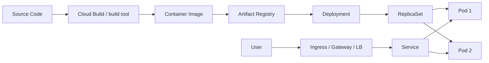
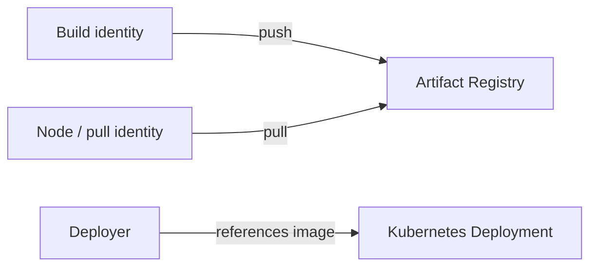
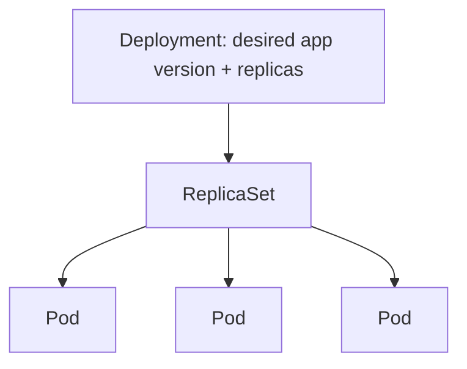
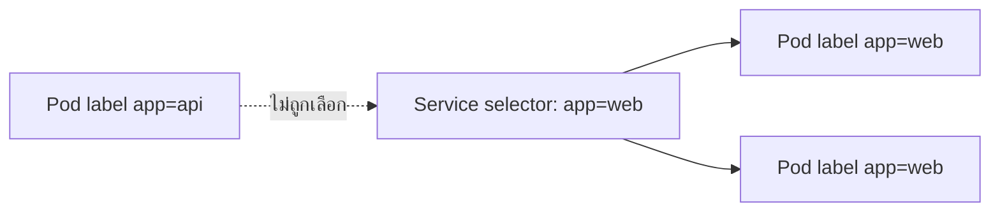
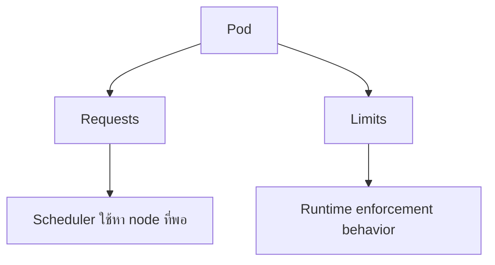
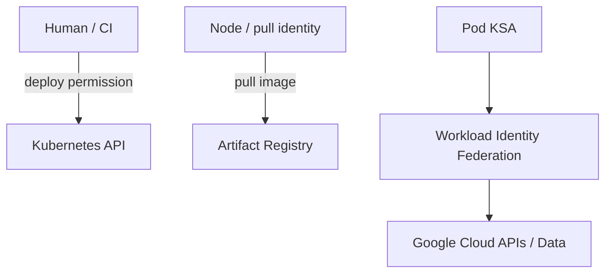
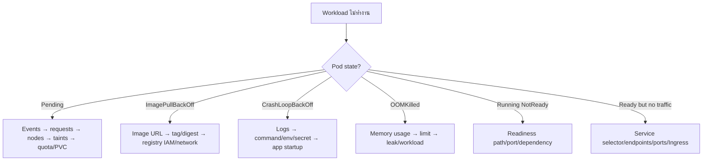
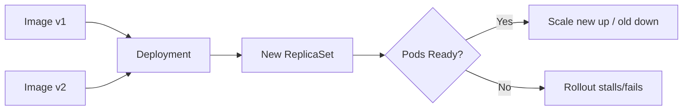
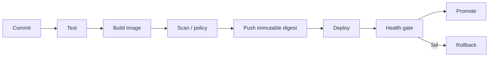
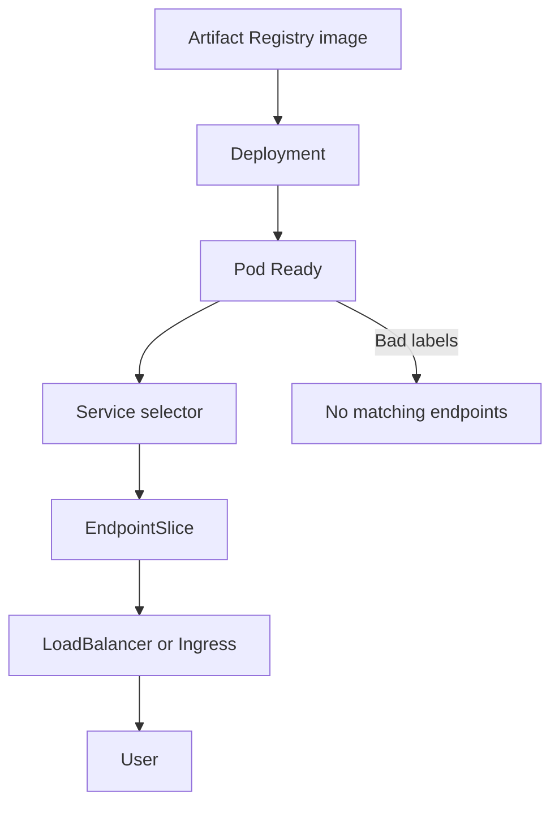

# Activity 16 — Deploy Kubernetes Applications on Google Cloud (Skill Badge)

[คู่มืออ่านตาม Path](./LEARNING-PATH-STUDY-GUIDE-TH.md) · [Visual Guide](./VISUAL-STUDY-GUIDE-TH.md#8-gke-จาก-image-ไปถึง-user) · [Module 08 — GKE](./Module-08-GKE-and-Kubernetes.md) · [Activity 06](./Path-Activity-06-GKE-TH.md) · [Google Skills course](https://www.skills.google/paths/11/course_templates/663)

> Skill Badge นี้ไม่ควรจบที่ “kubectl apply ผ่าน” แต่ต้องเข้าใจเส้นทาง Source → Image → Registry → Deployment → Pod → Service → User และ debug ได้ว่าพังที่ stage ไหน

## 📖 บทเรียนเต็ม: Deploy Kubernetes App ที่ใช้งานได้ ไม่ใช่แค่ YAML Apply ผ่าน

### 1. Workflow ของ Artifact และ Runtime

Source → Build → Container Image → Artifact Registry → Kubernetes Deployment → ReplicaSet → Pods → Service → Ingress/LB → User. แต่ละขั้นมี Exit Criteria ต่างกัน: Image Build Success ไม่เท่ากับ Pull Permission Success, Pod Running ไม่เท่ากับ Readiness Passed, Service Created ไม่เท่ากับมี Endpoints, Ingress IP มีอยู่ไม่เท่ากับ External Traffic Routing

**Image Tag** เช่น `latest` เปลี่ยนไปตาม Push, **Digest** ชี้ Immutable Content มากกว่า. ถ้า Test Image A แล้ว Deploy Tag เดิมแต่ Registry เปลี่ยนเป็น Image B, Results อาจไม่ตรง; Review Pipeline/Attestation/Digest ก่อน Production Rollout

### 2. อ่าน YAML ให้รู้ว่ามันส่งผลอะไร

```yaml
apiVersion: apps/v1
kind: Deployment
metadata:
  name: demo-web
spec:
  replicas: 2
  selector:
    matchLabels:
      app: demo-web
  template:
    metadata:
      labels:
        app: demo-web
    spec:
      containers:
        - name: web
          image: us-docker.pkg.dev/example/project/demo@sha256:REPLACE_WITH_REAL_DIGEST
          ports:
            - containerPort: 8080
```

นี่คือ **Teaching Skeleton** ไม่ใช่ Manifest พร้อม Deploy: Digest เป็น Placeholder, Registry/Project แตกต่างตาม Lab, ยังไม่ใส่ Resource Requests/Limits/Probes/IAM/Service/Network. `spec.selector.matchLabels` ต้อง Match `template.metadata.labels` ไม่เช่นนั้น Deployment Invalid/Pods ไม่ได้รับ Traffic; Deployment Replicas เป็น Desired, ไม่รับประกัน Actual Available

### 3. Probes และ Resource Management

**Readiness Probe** บอก Traffic Routing Readiness, **Liveness** บอกว่า Container ควรถูก Restart หรือไม่, **Startup Probe** ให้ App ที่ Boot ช้าเสร็จก่อน Liveness ตัดสิน. ถ้า Request CPU 100m แต่ใช้เกินและ Node มี Pressure, Performance อาจแย่; Memory Limit ต่ำกว่าที่ Process ต้องใช้จะเกิด OOMKilled. การเพิ่ม Replicas ไม่แก้ Pod Crash เพราะ Missing Secret

**Service Selector:** Service เลือก Pods ตาม Labels และส่งผ่าน TargetPort. ถ้า Service `targetPort: 80` แต่ App Listen 8080, ทราฟฟิกผิด Port แม้ Pod Ready. ต้องตรวจ EndpointSlice/Port Mapping; ไม่เปิด Network Policies แบบ All Allow เพื่อแก้โดยไม่ทราบ Root Cause

### 4. Identity สามชั้น

Developer/CI Push Image Permission, Cluster Node/Workload Pull Image Permission และ Application Runtime Cloud API IAM ต่างกัน. GKE Workload Identity Federation ช่วย Bind Kubernetes Workload Identity ให้เรียก Google APIs แบบไม่พึ่ง Long-lived Service Account Keys ในรูปแบบที่รองรับ; ต้องตรวจ KSA, Namespace, IAM Binding/Principal, Runtime SA และ Kubernetes RBAC ตาม Architecture

### 5. Read-only Lab on approved cluster

```bash
kubectl config current-context
kubectl get deployments,pods,services -n APP_NAMESPACE
kubectl get endpointslices -n APP_NAMESPACE
kubectl describe deployment demo-web -n APP_NAMESPACE
kubectl get events -n APP_NAMESPACE --sort-by=.lastTimestamp
```

**Expected:** ระบุ Deployment Desired/Available, Image/Digest, Pod Status, Service Selector/Port, EndpointSlice, Warnings/Events ได้. **Actual:** จาก Skills Lab เท่านั้น; อย่า Apply Skeleton YAML ด้านบน หรือแก้ Namespace/Cluster ของ Production เพราะเป็นตัวอย่างประกอบ. เมื่อทำ Graded Task ให้ใช้ Lab-provided Images/Names/Quotas และลบ Resource ตาม Instructions

### 6. วิเคราะห์ Incident

`ImagePullBackOff`: Registry Path/Digest/Node Pull Identity. `CrashLoopBackOff`: Command, Env, Secret, Exit Code. `Pending`: Scheduling/Quota/Requests/Taints/Node Capacity. `Pod Ready But No Traffic`: Service Selector, Endpoints, Ports, Ingress/LB. `Rollout Failed`: Deployment Revision/Probes, Image/Config, Dependency. ทำแผนลำดับตรวจทุกครั้งก่อน Restart/Scale

### 7. Question set พร้อมเฉลย

1. Build PASS แต่ Pull Fail? — CI Push Identity ต่างจาก Cluster Pull Identity
2. Pod Running แต่ Not Ready? — Readiness Probe/Dependency/Port
3. Service ไม่มี Endpoints? — Labels/Selector/Namespace/EndpointSlice
4. Pod OOMKilled แก้ด้วย CPU เพิ่มไหม? — ต้องดู Memory Limit/Usage
5. ทำไม Image Digest สำคัญ? — Reproducibility
6. Rollback Deployment ย้อน Database Data ไหม? — ไม่
7. Ingress Created แล้ว HTTPS ใช้ได้แน่ไหม? — ไม่, Certificate/Backend/Health/Port/IAM
8. Skill Badge จากการอ่าน Note ถือว่าผ่านไหม? — ไม่, ต้องทำ Grader จริง

[Kubernetes Deployments](https://kubernetes.io/docs/concepts/workloads/controllers/deployment/) · [Services](https://kubernetes.io/docs/concepts/services-networking/service/) · [GKE](https://cloud.google.com/kubernetes-engine/docs/concepts/kubernetes-engine-overview).

---

## 📎 ภาคขยาย: โครงเดิมและแบบฝึกเพิ่มเติม (ไม่จำเป็นต้องอ่านซ้ำ)

## เป้าหมายการเรียนรู้

อ่านจบแล้วควรทำได้:

1. อธิบาย image lifecycle ตั้งแต่ source ถึง Artifact Registry
2. แยก Deployment, ReplicaSet, Pod, Service และ Ingress/Gateway
3. อ่าน manifest พื้นฐานและรู้ว่า selector/labels ต้องสัมพันธ์กัน
4. ใช้ `kubectl get/describe/logs/events` แก้ปัญหา
5. แยก ImagePullBackOff, Pending, CrashLoopBackOff, OOMKilled และ NotReady
6. เข้าใจ probes, requests/limits และ rollout/rollback
7. แยก image-pull identity, deploy identity และ runtime identity
8. วาง continuous delivery แบบ reproducible และ rollback ได้

---

## 1. End-to-end mental model



ถ้า endpoint ใช้ไม่ได้ ให้ชี้ก่อนว่าพังที่ image, Pod, Service หรือ traffic entry

---

## 2. Image lifecycle

### Dockerfile mental model

```text
Base image
 + dependencies
 + application files
 + startup command
 = immutable-ish image artifact
```

แนวทางที่ดี:
- pin base/dependency version ตาม workflow
- ไม่ใส่ secrets ใน image layers
- build ซ้ำได้
- scan/test ก่อน deploy
- ใช้ immutable tag/digest สำหรับ release

`latest` สะดวกแต่ trace/rollback ยาก ถ้า release production ควรรู้ว่า Pod รัน digest ไหน

---

## 3. Artifact Registry



สาม identity อาจไม่ใช่คนเดียวกัน

ถ้า build push ได้แต่ Pod ดึงไม่ได้ ต้องตรวจ image-pull path ไม่เพิ่ม runtime data permissions มั่ว ๆ

---

## 4. Deployment → ReplicaSet → Pod



Deployment ดูแล rollout ของ ReplicaSets; Pod เป็นหน่วยรันจริงและเปลี่ยน IP/lifecycle ได้

อย่าผูก user/client เข้ากับ Pod IP ตรง ๆ ถ้าต้อง stable endpoint ให้ใช้ Service

---

## 5. Service selector



Service ไม่มี endpoints ทั้งที่ Pods Running → ตรวจ selector/labels/readiness ก่อน

---

## 6. Manifest ที่ต้องอ่านออก

```yaml
apiVersion: apps/v1
kind: Deployment
metadata:
  name: web
spec:
  replicas: 2
  selector:
    matchLabels:
      app: web
  template:
    metadata:
      labels:
        app: web
    spec:
      containers:
        - name: web
          image: REGION-docker.pkg.dev/PROJECT/REPO/web:1.0.0
          ports:
            - containerPort: 8080
          resources:
            requests:
              cpu: 100m
              memory: 128Mi
            limits:
              memory: 256Mi
          readinessProbe:
            httpGet:
              path: /health
              port: 8080
```

ต้องมองออกว่า:
- replicas = desired Pods
- selector ต้องตรง template labels
- image อยู่ registry ไหน
- request/limit มีผล scheduling/runtime
- readiness มีผล traffic eligibility

---

## 7. Requests vs Limits



Pod Pending แม้ node CPU ใช้จริงต่ำ อาจเพราะ **requested resources** รวมไม่พอ

Memory limit ต่ำเกิน → OOMKilled ได้

---

## 8. Probes

| Probe | ใช้ถาม | ผล |
|---|---|---|
| Startup | app start เสร็จหรือยัง | ช่วย workload start ช้า |
| Readiness | พร้อมรับ traffic ไหม | เอาเข้า/ออก endpoints |
| Liveness | stuck จนควร restart ไหม | restart container เมื่อ fail ตาม config |

อย่าใช้ DB dependency เป็น liveness แบบไม่คิด ถ้า DB ล่มทุก Pod อาจ restart พร้อมกัน

---

## 9. Service types

| Type | ใช้เมื่อ |
|---|---|
| ClusterIP | internal service ใน cluster |
| NodePort | expose node port ตาม config/use case |
| LoadBalancer | ขอ cloud LB integration ตาม support |

Ingress/Gateway ใช้ HTTP routing/entry model ตาม controller ไม่ใช่ Pod อีกชนิด

---

## 10. Identity 3 ชั้น



จำให้แม่น:
- deployer จัด Kubernetes objects
- node/runtime ดึง image
- Pod runtime access data/API

grant ให้คน deploy อ่าน bucket ไม่ได้ทำให้ Pod อ่าน bucket

---

## 11. Debugging tree



นี่คือ flow ที่ควรจำก่อน challenge lab

---

## 12. kubectl toolkit

```bash
kubectl config current-context
kubectl get nodes
kubectl get pods -A
kubectl get deployment,service
kubectl describe pod POD_NAME
kubectl logs POD_NAME --all-containers
kubectl get events --sort-by=.lastTimestamp
kubectl rollout status deployment/DEPLOYMENT_NAME
kubectl rollout history deployment/DEPLOYMENT_NAME
```

Context ผิด = อาจกำลังทำ cluster ผิด เหมือน gcloud project ผิด

---

## 13. Rollout



ตรวจ `rollout status` ไม่ใช่ apply เสร็จแล้วคิดว่าจบ

---

## 14. Rollback

Rollback workload image/config ไม่ได้ rollback database schema/data อัตโนมัติ

ถ้า release เปลี่ยน schema ต้องมี backward compatibility/migration plan

---

## 15. Continuous Delivery



Promotion ควรใช้ image digest เดิม ไม่ rebuild ใหม่แล้วหวังว่าเหมือนเดิม

---

## 16. Common failure matrix

| อาการ | ตรวจ |
|---|---|
| ImagePullBackOff | image path/tag/digest, Artifact Registry IAM, network |
| Pending | requests, node capacity, taints/affinity, PVC, quota |
| CrashLoopBackOff | logs, command, env, secret, app startup |
| OOMKilled | memory profile/limit/leak |
| Running NotReady | readiness probe/path/port/dependency |
| Service no endpoints | labels/selectors/readiness/namespace |
| Endpoint timeout | Service ports, LB/Ingress, firewall/network, app |

---

## 17. Challenge Lab Strategy

1. อ่านโจทย์ทั้งหมด
2. จด project/region/zone/cluster/repo names
3. ตรวจ current context
4. build/push image ให้สำเร็จก่อน
5. inspect image artifact
6. deploy workload
7. รอ rollout
8. inspect Pod readiness/logs
9. expose Service ตามโจทย์
10. test endpoint
11. ทำ grader หลังแต่ละ milestone หากทำได้

อย่าเปลี่ยน resource names ถ้า grader ผูก exact value

---

## 18. Mini Labs

### Lab A — Broken selector

Deployment labels `app=web` แต่ Service selector `app=api`

ผล: Pods Running แต่ Service endpoints ว่าง

### Lab B — OOM

Pod ใช้ memory 400Mi แต่ limit 256Mi

ผล: OOMKilled / restart pattern

### Lab C — Wrong image

Artifact Registry มี `web:1.0.0` แต่ manifest ใช้ `web:1.0`

ผล: ImagePullBackOff ถ้า tag ไม่มี

---

## 19. Exam-style scenarios

**Scenario:** Pod Running แต่ user เข้าไม่ได้ และ Service endpoints = 0

**แนวคิด:** selector/readiness ก่อน firewall

**Scenario:** Pods Pending หลังเพิ่ม replicas ทั้งที่ CPU utilization node 20%

**แนวคิด:** ดู requests/allocatable/taints/quota ไม่ดู utilization อย่างเดียว

**Scenario:** CI deploy ได้แต่ Pod อ่าน bucket ไม่ได้

**แนวคิด:** runtime identity/Workload Identity ไม่ใช่ deployer IAM

---

## เช็กความเข้าใจ

1. Deployment กับ Pod ต่างกันอย่างไร?
2. Service selector ต้อง match อะไร?
3. Requests มีผล scheduling อย่างไร?
4. Readiness กับ liveness ต่างกันอย่างไร?
5. ImagePullBackOff เริ่มดูอะไร?
6. Pod runtime identity กับ deployer identity เหมือนกันไหม?
7. Rollback image ย้อน DB schema ไหม?
8. ทำไมใช้ digest ช่วย reproducibility?
9. Pods Running พิสูจน์ว่า Service ใช้งานได้ไหม?
10. Context ผิดอันตรายอย่างไร?

## แหล่งอ้างอิง

- [Google Skills — Deploy Kubernetes Applications on Google Cloud](https://www.skills.google/paths/11/course_templates/663)
- [GKE documentation](https://cloud.google.com/kubernetes-engine/docs)
- [Artifact Registry](https://cloud.google.com/artifact-registry/docs)
- [Kubernetes Deployments](https://kubernetes.io/docs/concepts/workloads/controllers/deployment/)

## 📚 Deep Learning Notes — ทำไม Pod READY แต่ User เข้า Service ไม่ได้ (Original Supplement, 2026-10-21)

### 1. Kubernetes Failure Chain



**Pod READY** หมายถึง Kubelet/Probe บอกว่าพร้อมตาม Configuration แต่ไม่ได้ยืนยันว่า Service Selector, EndpointSlice, Service Port → TargetPort หรือ Ingress Routing ถูกต้อง. Debug ต้องอ่าน Graph ทั้งเส้น

### 2. 3 Identities ที่ห้ามปน

- **Human/CI Deployer** ต้องมี Permission Deploy และ Pull/Push Image ตาม Workflow
- **Kubernetes Service Account** เป็น Pod-level Identity ใน Cluster
- **Google Cloud Runtime Identity** ได้รับ IAM Permissions ตาม Workload Identity Federation หรือ Supported Binding

ให้สิทธิ์ Artifact Registry Reader ที่ Node/Runtime Pull Identity ให้ถูก Scope ก่อนเสนอ “เปิด Artifact Registry เป็น Public”

### 3. Triage แบบไม่ทำการเปลี่ยนแปลง

```bash
# Run in authorized GKE test cluster only.
kubectl config current-context
kubectl get deployment,replicaset,pod,service -n APP_NAMESPACE
kubectl describe service SERVICE_NAME -n APP_NAMESPACE
kubectl get endpointslice -n APP_NAMESPACE
kubectl get events -n APP_NAMESPACE --sort-by=.lastTimestamp
```

ถ้า Pod `CrashLoopBackOff` ให้เช็ก Container Logs, Probes, Startup Dependencies; ถ้า `ImagePullBackOff` ให้ตรวจ Image Path/Digest และ Pull Permission; ถ้า `Pending` ให้ตรวจ Scheduling, Resource Requests/Quotas/Taints. อย่าใช้ Restart Deployment ทั้งหมดเป็น Debug ขั้นแรก

### 4. Mini-case

Service ตอบ Timeout หลัง Rollout ใหม่, แต่ `kubectl get pods` แสดง READY 3/3. วิเคราะห์อย่างน้อย 5 จุด: Service Selector, EndpointSlice IPs, ContainerPort/TargetPort, Readiness Target, Ingress/LB/Firewall, Application Request Log. คำตอบต้องอธิบายว่าแต่ละ Layer ส่งต่อ Request อย่างไร

**Official:** [Kubernetes Services](https://kubernetes.io/docs/concepts/services-networking/service/) · [GKE Troubleshooting](https://cloud.google.com/kubernetes-engine/docs/troubleshooting) · [Artifact Registry](https://cloud.google.com/artifact-registry/docs).

**Status:** Original scenario and CLI only; no user cluster accessed
