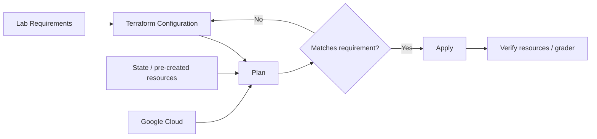
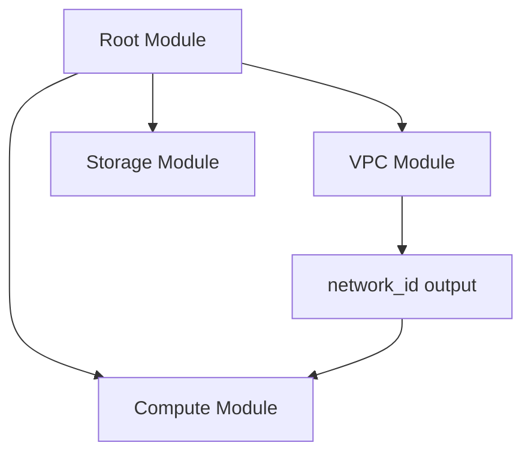
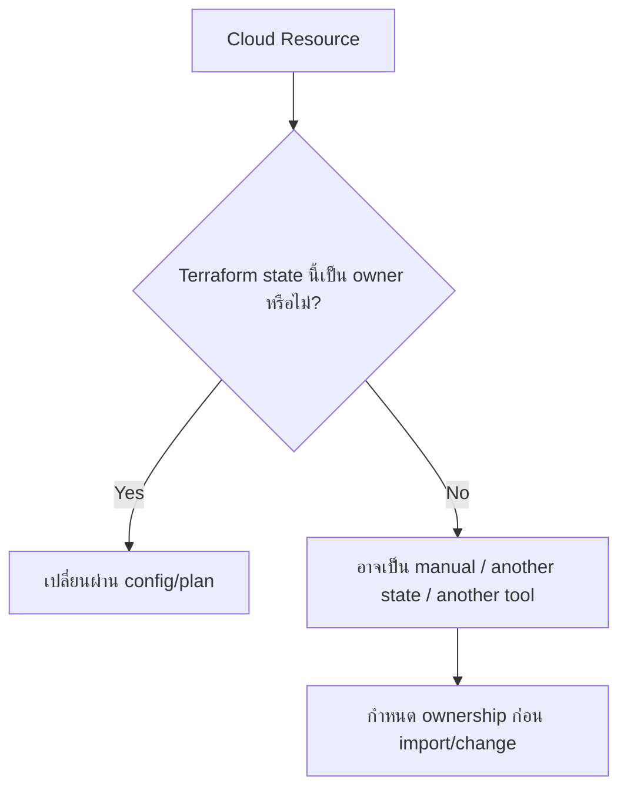
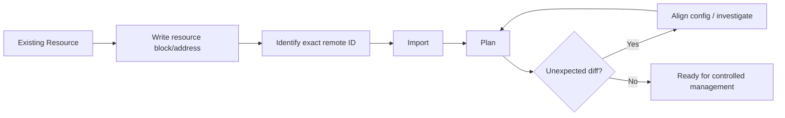
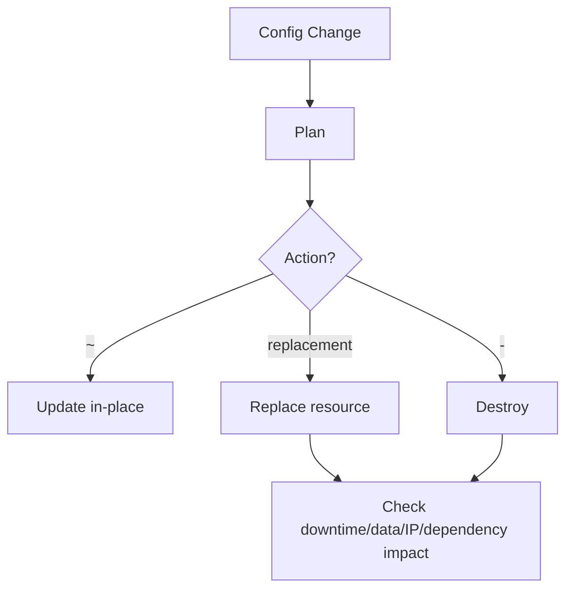
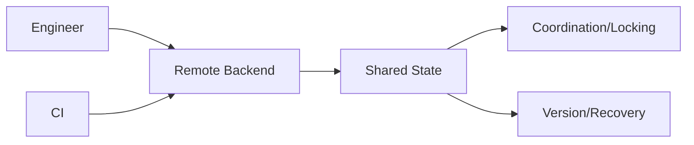
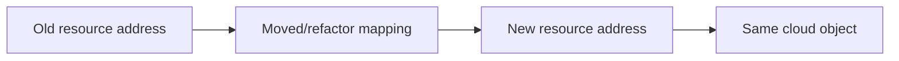
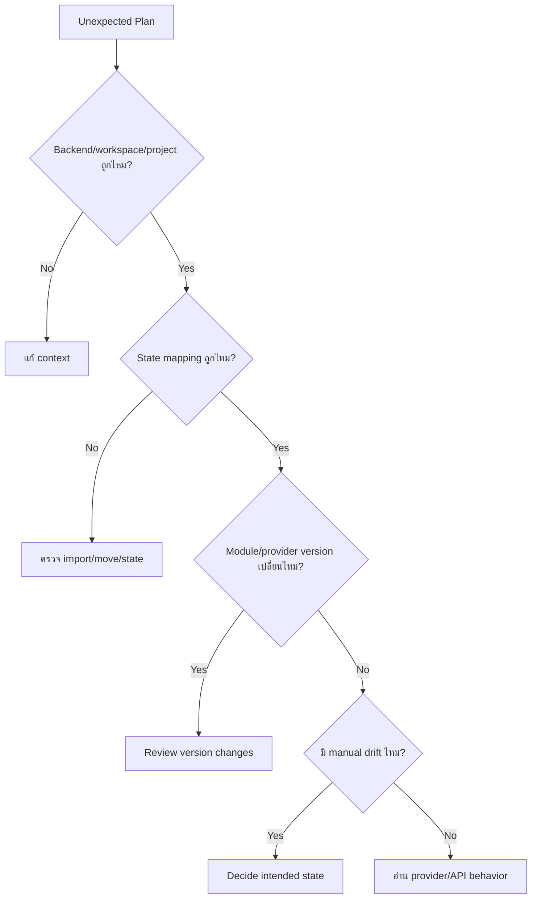
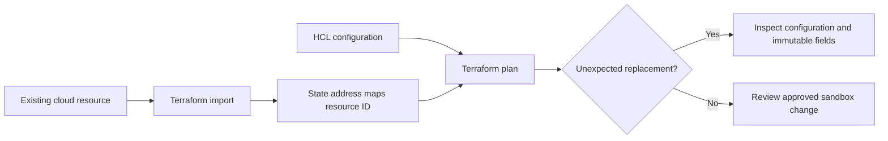

# Activity 17 — Build Infrastructure with Terraform on Google Cloud (Skill Badge)

[คู่มืออ่านตาม Path](./LEARNING-PATH-STUDY-GUIDE-TH.md) · [Visual Guide](./VISUAL-STUDY-GUIDE-TH.md#12-terraform-config--state--real-world) · [Module 12 — Terraform](./Module-12-Terraform-and-Infrastructure-as-Code.md) · [Activity 14](./Path-Activity-14-Terraform-Getting-Started-TH.md) · [Google Skills course](https://www.skills.google/paths/11/course_templates/636)

> Activity 14 สอนพื้นฐาน Terraform ส่วน Skill Badge นี้ต้องทำให้เรา **ประกอบ infrastructure จาก module/state/import/change workflow ได้เองภายใต้โจทย์** และอ่าน plan เพื่อป้องกันการเปลี่ยนที่ไม่ตั้งใจ

## 📖 บทเรียนเต็ม: Terraform Challenge Lab — เปลี่ยน Infrastructure โดยไม่ทำลาย State

### 1. ทำไม Skill Badge Terraform ยากกว่าพิมพ์ HCL ถูก

การสร้าง Resource ใหม่ด้วย Terraform อาจตรงไปตรงมา แต่สถานการณ์จริงต้อง **Import Existing Resources, Maintain State Ownership, Change Configuration without Destroy, Use Modules, Manage Backends and Verify Plan**. Terraform State คือ Source of Resource Mapping ไม่ใช่เพียง Cache; ถ้า Remote Resource มีแต่ State ไม่มี Terraform อาจเสนอ Create ซ้ำ, ถ้า State ชี้ Resource ผิดก็อาจ Modify/Delete ของคนอื่นได้

### 2. Root Module, Child Module และ Addresses

`module.network.google_compute_network.main` กับ `google_compute_network.main` เป็นคนละ Resource Address แม้ชี้ Network Name เดียวกันได้. การย้าย Resource เข้า Module โดยไม่ใช้ Refactoring Strategy/Moved Block จะทำให้ Plan เห็น Destroy/Create ที่ไม่จำเป็น. ก่อน Change ต้องบันทึก Old Address, New Address, Provider ID, State Backend และ Approval. `terraform state mv` หรือ `import` เป็น State-changing Actions จึงไม่อยู่ใน Read-only Lab

**Variables** กำหนด Inputs ที่ตรวจ Type/Validation ได้, **Outputs** เปิดเผย Resource Identifiers ให้ Component อื่น (อย่าแสดง Secrets), **Modules** จัดชุด Resource ที่ใช้ซ้ำ, **State** เก็บ Mapping และ Metadata, **Provider** ติดต่อ Google Cloud APIs. Configuration ที่ดูเหมือนเรียบร้อยแต่ใช้ Provider/Module Version ใหม่อาจมี Behavior ต่างจากเวอร์ชันเดิม จึงต้อง Lock Versions และ Review Upgrade

### 3. Case: Import VPC เดิมเข้ามาจัดการด้วย IaC

ทีมมี VPC `existing-vpc` ใน Google Cloud ถูกสร้างผ่าน Console. ต้องการให้ Terraform เป็น Owner. ก่อน Import ต้องตอบ: Existing Resource ID/Project, IAM Owner, Network Mode, Subnets, Routes, Firewall Policies, Dependencies, State Backend/Lock, Who Else Manages This Resource และ Rollback. Import บอก Terraform ว่า Remote Object นี้ตรงกับ Address ไหน แต่ **ไม่ได้รับประกัน HCL Config Match ทุก Property**. Plan หลัง Import อาจเสนอ Replace/Delete ถ้า Config ไม่ถูกต้อง

**Danger:** ถ้าสอง Repositories ต่างคิดว่าตน Own IAM Policy ของ Project เดียวกัน, Applying Authoritative IAM Binding/Policy จากทีมหนึ่งอาจ Remove Access ของอีกทีม. ต้องมี Ownership/Change Governance ไม่ใช่แข่งกัน Apply

### 4. Interpret Plan before Changes

| Plan Signal | สิ่งที่ควรทำ | ไม่ควรทำ |
|---|---|---|
| Create only | Verify Quota, Cost, Region, Naming/Policy | Blind Apply on Prod |
| In-place Update | ตรวจ Security/Dependencies/User Impact | สมมติว่า 0 Downtime เสมอ |
| Replace (Destroy/Create) | ตรวจ ForceNew/Immutable Fields, Backup/Availability | ใช้ `state rm` ซ่อนปัญหา |
| No Changes | ยืนยัน Resource Ownership และ Drift Window | อ้างว่าทุกอย่าง Secure/Compliant |
| Unexpected Drift | หา Console/Ops Changes และ Merge Config | Force Revert โดยไม่คุย Operator |

### 5. Practical Review — แยก Code Quality จาก Cloud Impact

```bash
# Only in an approved isolated Terraform directory/backend.
terraform fmt -check
terraform validate
terraform plan -input=false
```

`terraform validate` ตรวจ Syntax/Provider Schema หลัง Init, ไม่พิสูจน์ Quota/Policy/Network Reality. `terraform plan` ติดต่อ Provider/Backend และอาจ Lock/Update State Metadata/Local Files; **ไม่จัดเป็น Pure Read-only**. ถ้ายังไม่มี Lab Credentials ให้ Review Example Plan เป็นกระดาษแทน เพื่อเลี่ยง Side Effects/Costs. `terraform apply`, `import`, `state mv` ต้องทำเฉพาะ Official Lab Project ภายใต้ Instructions/Approval

### 6. Worked Scenario — Subnet CIDR Change จะ Destroy 8 VMs

Change Request แค่ขยาย CIDR แต่ Plan บอก Replace VM/Subnet. ต้องตรวจว่าขยาย Range ผ่าน Supported In-place Operation ได้หรือไม่, Terraform Resource/Provider Limitation, Dependent NIC/Resources, State Address/Backend, Network IPAM, Downtime/Backout และ Manual Changes. **ไม่ควรกด Apply เพียงเพราะ Lab Timer กำลังหมด**; ถ้า Official Challenge ต้องตาม Grader โดยไม่ทำลาย Project ภายนอกที่ไม่ได้รับอนุญาต

### 7. เข้าใจจริงหรือยัง? (Reasoned Answers)

1. Terraform Import คือการสร้าง VPC ไหม? — ไม่; เป็น State/Resource Mapping
2. HCL Rename ทำไม Plan Destroy/Create? — Resource Address เปลี่ยนโดยไม่มี Move Strategy
3. State มี Secrets ได้ไหม? — ได้, ต้อง Protect Backend/IAM/Encryption
4. Module Version Update ปลอดภัยเสมอ? — ไม่, Interface/Resource Changes
5. IAM Policy กับ Member ใช้แทนกันได้ไหม? — ไม่, Authoritative/Additive Semantics
6. Plan No Changes หมายถึง Infra Secure แน่นอน? — ไม่, Plan ไม่ใช่ Security Assessment
7. ทำไม State Lock สำคัญ? — ป้องกัน Concurrent State Writes
8. Skill Badge PASS ต้องมีหลักฐานอะไร? — Official Grader/Actual Steps and Cleanup, ไม่ใช่ Static CI Green

**Exit criteria:** Explain State Ownership, Review Plan/Replacement Risks, Sketch Import/Refactor Steps (do not execute), Name Backup/Rollback/Evidence and Costs. [Terraform on Google Cloud](https://cloud.google.com/docs/terraform) · [Import](https://developer.hashicorp.com/terraform/cli/import) · [Moved Blocks](https://developer.hashicorp.com/terraform/language/moved).

---

## 📎 ภาคขยาย: โครงเดิมและแบบฝึกเพิ่มเติม (ไม่จำเป็นต้องอ่านซ้ำ)

## เป้าหมายการเรียนรู้

อ่านจบแล้วควรทำได้:

1. วาง structure ของ root module และ child modules
2. ใช้ variables/outputs เชื่อม modules โดยไม่ hard-code ทุกค่า
3. อ่าน state ownership และ resource address
4. import existing resource อย่างปลอดภัย
5. เปลี่ยน resource โดยรู้ว่า update-in-place หรือ replace
6. แก้ drift/state mismatch โดยไม่ destroy มั่ว
7. ใช้ remote state/locking ตาม workflow ทีม
8. ทำ challenge lab ด้วย plan-driven workflow แทนเดาคำสั่ง

---

## 1. Mental model ของ Skill Badge



Skill Badge ไม่ได้วัดว่า “จำ syntax ได้ทั้งหมด” แต่ดูว่าเราสามารถแปลง requirement เป็น desired state และตรวจผลได้หรือไม่

---

## 2. Root module และ child modules



Module ที่ดีควรมี:
- inputs ชัด
- outputs เท่าที่จำเป็น
- provider/version requirements
- naming conventions
- documentation

อย่าให้ module ซ่อน resource สำคัญจนคนใช้ไม่รู้ว่าจะเกิดอะไร

---

## 3. Resource Address

Terraform address ใช้อ้าง resource ใน config/state เช่น:

```text
google_compute_network.main
module.vpc.google_compute_subnetwork.app
```

เวลา import/move/state operation ต้องระบุ address ถูกตัว ถ้าผิดอาจ map resource จริงเข้ากับ logical resource ผิด

---

## 4. State ownership



อย่าให้สอง Terraform states หรือ Terraform + controller อื่นคุม field เดียวกันโดยไม่มี design

---

## 5. Import workflow



### สิ่งที่ Import ไม่ทำให้เอง

- ไม่สร้าง architecture ที่ดี
- ไม่ตั้ง variable/module structure ให้เหมาะ
- ไม่พิสูจน์ว่าทุก attributes ใน config ตรง intent
- ไม่รับประกันว่า plan หลัง import จะ no-op

จึงต้อง `plan` หลัง import เสมอ

---

## 6. Import block / CLI import

Terraform version ใหม่มี workflow ที่อาจใช้ import blocks ตามความสามารถของ version ส่วน labs บางชุดอาจยังใช้ CLI `terraform import`

หลักที่ต้องจำไม่ขึ้นกับ syntax:

1. config address ต้องมี
2. remote ID ต้องถูก
3. state จะถูกเชื่อม
4. plan หลัง import ต้องถูก review

อย่าจำ command อย่างเดียวจนไม่เข้าใจ state mapping

---

## 7. Change infrastructure



ก่อน apply replacement ให้ดูว่า resource มี state/data/IP dependency หรือไม่

---

## 8. Immutable field trap

บาง field เปลี่ยนไม่ได้ผ่าน API และ provider ต้อง replace resource

ตัวอย่างแนวคิด:
- location/scope บางชนิด
- resource identity/naming บางกรณี
- network attachment/config บางชนิด

อย่าคาดว่า Terraform จะ migrate data/application ให้อัตโนมัติเมื่อ replacement เกิด

---

## 9. Remote State



Security:
- IAM แคบ
- ไม่ public
- ป้องกัน deletion ตาม requirement
- state อาจมี sensitive data
- backup/version/recovery test

---

## 10. State commands: ใช้เมื่อเข้าใจจริง

คำสั่ง state/move/remove สามารถเปลี่ยน mapping โดยไม่แก้ resource จริงทันที จึงอันตรายถ้าใช้มั่ว

กฎ:
- backup state ก่อน operation สำคัญ
- ตรวจ address
- plan หลัง operation
- หลีกเลี่ยง manual JSON editing

---

## 11. Refactor โดยไม่สร้างใหม่

ถ้าแค่ย้าย resource เข้า module/rename address แต่ remote object เดิมต้องคงอยู่ ต้องใช้ state/moved-block/refactor workflow ที่ version รองรับ

ถ้า rename config เฉย ๆ Terraform อาจมองว่า old resource ถูกลบและ new resource ต้องสร้าง



---

## 12. Variables และ outputs

### Variables
ใช้รับค่าที่เปลี่ยนตาม environment เช่น:
- project_id
- region
- network CIDR
- machine type

### Outputs
ใช้ส่งค่าที่ module อื่น/ผู้ใช้ต้องใช้ เช่น:
- network ID
- subnet self link
- service URL

อย่า output secrets โดยไม่จำเป็น

---

## 13. Module versioning

ถ้า source มาจาก registry/Git:
- pin version/ref ตาม workflow
- review changelog
- update version แล้ว plan

การเปลี่ยน module versionอาจเปลี่ยน resources จำนวนมากแม้ root config เปลี่ยนบรรทัดเดียว

---

## 14. Challenge Lab Strategy

1. อ่าน requirement ทั้งหมด
2. ตรวจ project/auth/context
3. inspect existing resources ก่อน import
4. วาด resource dependency
5. สร้าง file structure
6. `terraform init`
7. `fmt` + `validate`
8. import pre-created resource ถ้าโจทย์กำหนด
9. `plan`
10. แก้จน plan ตรง requirement
11. `apply`
12. verify ด้วย gcloud/Console/grader

อย่าเริ่มด้วย `destroy` หรือ recreate pre-created resources เพราะง่ายกว่า

---

## 15. Example structure

```text
terraform/
├── main.tf
├── variables.tf
├── outputs.tf
├── versions.tf
└── modules/
    └── network/
        ├── main.tf
        ├── variables.tf
        └── outputs.tf
```

โครงสร้างไม่ใช่กฎตายตัว แต่ช่วยให้คิด ownership/interface ชัด

---

## 16. Debugging: Plan แปลก



---

## 17. Failure scenarios

### State ถูกลบ
resource cloud ยังอยู่

**ห้าม:** apply config ใหม่แบบไม่ตรวจ เพราะอาจ create duplicate/conflict

**ควร:** recover state หรือ import อย่างมีขอบเขต

### Import แล้ว plan จะ replace

ตรวจ:
- resource ID/address
- immutable attributes
- location
- defaults
- config mismatch

### Module update จะ destroy 10 resources

หยุดและ review version/changelog/config/state ก่อน

---

## 18. Mini Labs

### Lab A — Import thought exercise

มี VPC `legacy-vpc` อยู่ก่อน Terraform

เขียนขั้นตอน:
1. resource block
2. exact resource ID
3. import
4. plan
5. align config

### Lab B — Refactor

ย้าย `google_compute_network.main` ไป `module.network.google_compute_network.main`

ถาม: ถ้าเปลี่ยน code อย่างเดียว Terraform จะคิดว่า resource identity เปลี่ยนไหม? ต้องใช้ refactor/moved-state workflow อย่างไร?

### Lab C — Destructive plan

Plan:

```text
Plan: 1 to add, 0 to change, 3 to destroy
```

ห้ามมองแต่ “1 to add” ต้อง inspect 3 destroys ก่อน apply

---

## 19. Exam-style scenarios

**Scenario:** ต้องเอา network เดิมเข้ามาจัดการ Terraform โดยไม่ recreate

**แนวคิด:** import + matching config + plan review

**Scenario:** เปลี่ยน module versionแล้ว plan replace resources จำนวนมาก

**แนวคิด:** หยุด review module changes/provider behavior ไม่ apply อัตโนมัติ

**Scenario:** resource อยู่ cloud แต่ state ไม่มี

**แนวคิด:** state recovery/import ไม่ใช่สร้างซ้ำ

---

## เช็กความเข้าใจ

1. Import เปลี่ยน resource จริงทันทีไหม?
2. Import ทำให้ HCL ถูกต้องครบเองไหม?
3. Resource address สำคัญอย่างไร?
4. Remote state มีข้อมูล sensitive ได้ไหม?
5. เปลี่ยน module versionควร plan ใหม่ไหม?
6. ทำไม rename resource block อาจทำให้ Terraform มองเป็น destroy/create?
7. State remove = delete cloud resource หรือไม่?
8. Plan `to destroy` ต้องตรวจเพราะอะไร?
9. Terraform state สองชุดควรคุม resource เดียวกันไหม?
10. Challenge lab ทำไมควร inspect pre-created resources ก่อน?

## แหล่งอ้างอิง

- [Google Skills — Build Infrastructure with Terraform on Google Cloud](https://www.skills.google/paths/11/course_templates/636)
- [Terraform on Google Cloud](https://cloud.google.com/docs/terraform)
- [Terraform Import](https://developer.hashicorp.com/terraform/cli/import)
- [Terraform State](https://developer.hashicorp.com/terraform/language/state)

## 📚 Deep Learning Notes — Terraform State Ownership และ Import Existing GCP Resources (Original Supplement, 2026-10-21)

### 1. State ไม่ใช่แค่ Cache



ถ้า Resource มีอยู่จริงแต่ Terraform State ไม่รู้จัก Terraform อาจพยายามสร้าง Duplicate; Import ทำให้ State ผูก ID แต่ไม่ได้เขียน Configuration ทั้งหมดให้ตรงเสมอ. `terraform import` เป็น **State-changing Operation** ต้องผ่าน Approval แม้อยู่ใน Sandbox

### 2. Worked Example: VPC ถูกสร้างด้วย Console

มี VPC เดิม `corp-vpc` อยู่ใน Project Sandbox แต่ทีมต้องการให้ Terraform จัดการ. ข้อมูลต้องบันทึก: Project/Network ID, Current Subnets/Routes, Existing Firewall Policies, IAM, Dependencies, Terraform Provider Version, Backend State, Access Rights และ Desired Lifecycle. แล้วเขียน HCL ที่ตรง Config และ Review Import Plan ใน Isolated Environment ก่อน Action

**อย่า** ทดลอง Import Production Resource ไป State ใหม่มั่ว ๆ เพราะอาจมีสองทีมคิดว่าตัวเองเป็น Owner ของ Resource เดียวกัน ส่งผลให้ Apply ของทีมหนึ่ง Drift/Destroy ของอีกทีม

### 3. IAM Authoritative vs Additive

IAM Policy/Binding/Member Provider Resources มี Scope of Ownership ต่างกัน. เลือก Type ผิดอาจลบ IAM Members ของทีมอื่นใน Project. ก่อน Apply ต้องตอบว่า “Resource ไหนเป็น Source of Truth ของ Policy/Role สมาชิกชุดนี้?” และตรวจ `terraform plan` ให้แน่ใจว่าจะไม่ Remove Existing Authorized Principals

### 4. Three-state Incident

Resource ถูก Rename ใน HCL แต่ไม่ได้ใช้ `moved` Block; Plan แสดง Destroy + Create. ขั้นตอนที่ปลอดภัย: ตรวจ Resource Addresses ก่อน-หลัง, Provider IDs, Lifecycle, Move Strategy, Backend Lock และ State Backup. อย่าผ่าน Challenge Lab ด้วยการ Force Apply Plan ที่จะลบ Resource ไม่คาดคิด

**Official:** [Terraform on Google Cloud](https://cloud.google.com/docs/terraform) · [Import](https://developer.hashicorp.com/terraform/cli/import) · [Refactoring Resources](https://developer.hashicorp.com/terraform/language/modules/develop/refactoring).

**Status:** Worksheet only, not an executed official Skill Badge task
