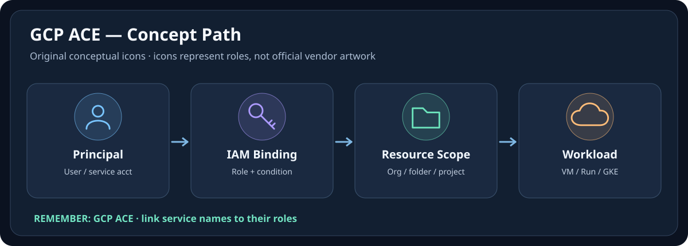
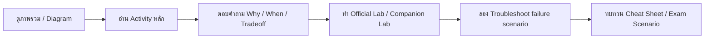

# Google Cloud Associate Cloud Engineer — Study Notes ภาษาไทย 📘

[← Repository root](../README.md)

## 🌤️ Visual Memory — ดูภาพก่อนอ่านบทเต็ม

**🧠 👤 Principal → 🔐 IAM → 🗂️ Project → ⚙️ Workload** — 📌 GCP ต้องรู้ active Project, Identity, API, IAM และ Quota ก่อนแก้ Resource; Cloud NAT เป็นทางออก ไม่ได้เปิด Inbound

[📘 เปิด Visual Guide แบบ Icon-First (Concept + Troubleshooting)](./VISUAL-STUDY-GUIDE-TH.md) · [🎨 มาตรฐาน Visual ร่วม](../docs/ICON-FIRST-LEARNING-STANDARD.md)

> **Status:** **17-Activity historical snapshot, TEXTBOOK_AUTHORED 17/17; current official Path count requires reconciliation**  
> **Path recheck:** 2026-10-30 — public canonical URL displayed 13 Activities, while prior archived/parameterized views displayed 17; see below  
> **Source manifest:** [SOURCE-MANIFEST.md](./SOURCE-MANIFEST.md)  
> **QA evidence:** [ACE-100-PERCENT-QA-MATRIX.md](./ACE-100-PERCENT-QA-MATRIX.md)  
> โน้ตสำหรับคนที่ชอบอ่าน: อธิบายเหตุผล วิธีทำงาน ตัวอย่างงาน System Admin และวิธีเลือกบริการ ไม่ใช่รายการคำศัพท์ให้ท่องอย่างเดียว

## 📘 มาตรฐานใหม่: บทเรียนเต็มที่อ่านแทนวิดีโอได้ (2026-10-30)

ยืนยันการเปลี่ยนเป็น **Textbook-first**: แต่ละ Activity ต้องสอน First Principles → Mechanism → Decision/Trade-off → Worked Example → Guided Practice → Troubleshooting → Reasoned Q&A จนผู้อ่านเข้าใจ Concept หลักได้ในหน้าเดียว; Modules มีไว้เปิดเจาะลึกเสริมเท่านั้น ไม่ใช่สถานที่ซ่อน Core Explanation

[📖 มาตรฐานบทเรียนเต็ม](./TEXTBOOK-QUALITY-STANDARD.md) · [📋 Editorial Progress 17 Snapshot Activities](./TEXTBOOK-PROGRESS.md)

**งานเขียนครบแล้ว:** บทเรียนหลัก **17/17** ของ Historical Google Skills Snapshot ได้รับส่วน `TEXTBOOK_AUTHORED` อยู่ตอนต้นหน้าทุก Activity และเก็บโน้ตเดิมใต้ภาคขยาย แทนการโยนไป Module อื่นเพื่อเข้าใจ Concepts. มี Worked Cases, การตรวจสอบ, Failure Scenarios และเฉลยเชิงเหตุผล. **สถานะไม่ใช่ EDITORIAL_REVIEWED หรือ LAB_EXECUTED** เพราะยังไม่มีการทดสอบความเข้าใจกับผู้อ่านอิสระหรือทำ Official Grader จริง

**ข้อควรระวังจาก Google Skills:** หน้า Canonical [Path #11](https://www.skills.google/paths/11) ที่เปิดแบบ Public วันที่ 30 ต.ค. 2026 ระบุ 13 Activities แต่ Cached/Parameterized Versions บางชุดระบุ 17. เรารักษา 17 Study Notes เดิมและ Progress IDs ไว้ก่อน โดยยังไม่ประกาศว่า Order/Count นี้ตรงกับ Current Official Path 100%.

## 📖 ฐานโน้ต Activity V3 เดิม (21 ตุลาคม 2026)

ปรับปรุง **17 Activities ทุกบท** ด้วย `Deep Learning Notes` แยกตามหัวข้อจริงของกิจกรรมนั้น โดยมี Original Mermaid Diagram ในแต่ละ Activity, กรณีตัวอย่างที่ใช้แก้ปัญหาได้, Decision / Trade-off และคำถามทบทวน. **ไม่จำเป็นต้องเปิด Module เพิ่มจึงจะเข้าใจ Concept หลัก**.

[📚 คลังอ้างอิงและภาพรวมทุก Module/Lab (Optional)](./REFERENCE-LIBRARY.md) เป็นที่รวม Modules 13 ชุด, Companion Labs 6 ชุด และ Visual Guide เดิมโดยยังไม่ลบเนื้อหา. Website sidebar แสดง 17 Activities เป็นเส้นทางหลัก และมีทางเข้า Reference Library เพียงจุดเดียว

**ข้อจำกัด:** เป็นการขยาย Original Thai Teaching Notes ไม่ใช่การอ้างว่าถอดความคอร์สหรือ Lab ทางการทุกหน้าครบ 100%; Activity Source ล่าสุดควรตรวจอีกครั้งเมื่อ Google Skills ปรับหลักสูตร

## 🧭 เรียนแบบไม่วนซ้ำ

**17 Activities = บทเรียนหลักที่ต้องอ่านตามลำดับ** ส่วน 13 Modules เป็นเนื้อหาเจาะลึก และ 6 Companion Labs เป็นแบบฝึกเสริม ไม่ต้องอ่าน/ทำทั้งหมดหลังแต่ละ Activity หากเข้าใจอยู่แล้ว

[🔬 ตารางจับคู่ 17 Activities → 13 Modules → 6 Companion Labs](./ACTIVITY-TO-MODULE-MAP-TH.md) — เลือกอ่าน Module เฉพาะจุดที่อยากเจาะลึก แล้วกลับไป Activity ถัดไปได้ทันที

## เริ่มอ่านตรงนี้

1. เริ่มที่ [คู่มืออ่าน 17 กิจกรรมตาม Learning Path](./LEARNING-PATH-STUDY-GUIDE-TH.md) และทำตามลำดับทางการ
2. ก่อนอ่านบทที่เป็น text ยาว ให้เปิด [ACE Visual Study Guide](./VISUAL-STUDY-GUIDE-TH.md) เพื่อเห็น architecture, flow, decision tree และ troubleshooting map ก่อน
3. สำหรับหัวข้อใหม่ใน Exam Guide ที่ Learning Path รุ่นเก่ามักไม่ครอบคลุมลึก ให้เปิด [ACE Modern Objectives Deep Dive](./ACE-MODERN-OBJECTIVES-DEEP-DIVE-TH.md)
4. เปิด [โน้ตแยกรายกิจกรรมครบ 01–17](./LEARNING-PATH-STUDY-GUIDE-TH.md#ลำดับกิจกรรม) จากคู่มืออ่านตาม Path
5. เปิด [สารบัญหัวข้อใหญ่/ย่อยตามหลักสูตร Google Skills](./GOOGLE-SKILLS-CURRICULUM.md) เพื่อเชื่อมกับบทโน้ตเชิงหัวข้อ
6. ใช้ [Lab Guide ภาษาไทย](./Lab-Guide-TH/README.md) และ [ตารางเทียบแล็บกับ Path](./Lab-Guide-TH/LEARNING-PATH-LAB-MAP.md); แล็บเสริมใน repo ไม่แทน Google Skills grader
7. ทบทวนด้วย [Cheat Sheet](./CHEAT-SHEET.md), [Glossary](./GLOSSARY.md) และ [สถานการณ์พร้อมคำอธิบาย](./EXAM-SCENARIOS.md)
8. ถ้าต้องการตรวจที่มา/วันที่/ขอบเขตที่ใช้ประกาศความครบ ให้เปิด [Source Manifest](./SOURCE-MANIFEST.md) และ [100% QA Matrix](./ACE-100-PERCENT-QA-MATRIX.md)

## วิธีเรียนที่แนะนำ: Visual → Concept → Practice → Troubleshoot

เป้าหมายไม่ใช่จำชื่อบริการ แต่ต้องตอบให้ได้ว่า:

- ของนี้แก้ปัญหาอะไร
- request/data ไหลผ่านอะไรบ้าง
- identity ไหนเป็นคนทำงานจริง
- จะเลือกบริการนี้เมื่อไร และไม่เลือกเมื่อไร
- ถ้าพังจะเริ่มดูจากตรงไหน
- scaling/HA/backup/security/cost เปลี่ยนอย่างไรเมื่อเลือก architecture นี้

## 🎯 ขอบเขตที่ฉันใช้เรียน

โน้ต GCP ACE นี้จัดไว้ให้อ่านเป็นลำดับ ทั้งบทพื้นฐาน, 13 Modules, 17 กิจกรรมฝึกเรียน และ Lab ภาษาไทย พร้อมหัวข้อสมัยใหม่สำหรับการทำงานจริงและการเตรียมสอบ

อ่านตาม Learning Path ด้านบนก่อน แล้วใช้ Cheat Sheet และ Exam Scenarios สำหรับทบทวน ความรู้ที่เปลี่ยนตามเวอร์ชันหรือ Exam Guide จะตรวจสอบจากเอกสารทางการตามความจำเป็น โดยไม่ต้องเปิดหลายแหล่งเพื่อเริ่มเรียน

## 🔬 Modules เจาะลึก 13 บท (เลือกอ่าน ไม่ใช่เส้นทางหลัก)

ถ้าบท Activity ตอบคำถามได้แล้ว ไม่จำเป็นต้องอ่าน Modules ทั้งหมดซ้ำ รายการด้านล่างเป็นคู่มืออ้างอิงเมื่ออยากดูข้อมูลเชิงลึก/ปัญหาที่เกิดขึ้นจริง

| บท | อ่านอะไร | เมื่ออ่านจบควรทำอะไรได้ |
|---:|---|---|
| 01 | [Foundations & Resource Hierarchy](./Module-01-Foundations-and-Resource-Hierarchy.md) | แยก Organization, Folder, Project และ scope ของ resource |
| 02 | [IAM, Service Accounts & Security](./Module-02-IAM-Service-Accounts-and-Security.md) | ให้สิทธิ์ตามงาน แยกการใช้ SA กับการเข้าถึง SA |
| 03 | [Cloud Shell, gcloud, Billing & Quotas](./Module-03-Tools-Billing-and-Quotas.md) | ตรวจตัวตน/project/API และควบคุมค่าใช้จ่าย |
| 04 | [VPC, Firewall, Routes, NAT & DNS](./Module-04-VPC-Firewall-NAT-and-DNS.md) | ไล่เส้นทาง network และวิเคราะห์ VM ที่ต่อออกไม่ได้ |
| 05 | [Compute Engine, Disks, MIG & Recovery](./Module-05-Compute-Engine-and-Instance-Groups.md) | สร้าง VM เลือก disk และแยก autoscaling/autohealing |
| 06 | [Cloud Storage & File Storage](./Module-06-Storage-and-Data-Protection.md) | เลือก storage class และแยก lifecycle/retention/backup |
| 07 | [Databases, Analytics & Data Services](./Module-07-Databases-and-Data-Services.md) | แยก OLTP/OLAP, HA/replica/backup และเลือกฐานข้อมูล |
| 08 | [GKE & Kubernetes Operations](./Module-08-GKE-and-Kubernetes.md) | อ่าน Deployment/Service และแก้ Pod ไม่ Ready |
| 09 | [Cloud Run, Functions & Events](./Module-09-Cloud-Run-and-Event-Driven-Services.md) | เข้าใจ revision/traffic/concurrency และ event retries |
| 10 | [Load Balancing & Hybrid Connectivity](./Module-10-Load-Balancing-and-Hybrid-Networking.md) | เลือก LB, Shared VPC, Peering, VPN, Interconnect |
| 11 | [Monitoring, Logging & Troubleshooting](./Module-11-Observability-and-Operations.md) | สืบเหตุระบบช้าโดยใช้ metrics/logs/traces และ audit |
| 12 | [Terraform & Infrastructure as Code](./Module-12-Terraform-and-Infrastructure-as-Code.md) | อ่าน plan เข้าใจ state/drift และทำงานร่วมทีม |
| 13 | [AI Tooling & Modern Operations](./Module-13-AI-Tooling-and-Modern-Services.md) | รู้บทบาท AI tools, GPUs/TPUs, CMEK และบริการใหม่ |

## Visual Map ที่มีให้

[ACE Visual Study Guide](./VISUAL-STUDY-GUIDE-TH.md) รวมภาพจำของทั้งหลักสูตร เช่น:

- Resource Hierarchy และ IAM decision flow
- Console/gcloud/API/Billing/Quota troubleshooting flow
- Packet path: DNS → Route → Firewall → Listener → Application
- MIG / Autoscaling / Autohealing / Load Balancer
- Object vs Block vs File storage decision tree
- Database selection map และ HA vs Backup
- GKE image → registry → deployment → service → user
- Cloud Run/Eventarc/Pub/Sub retry + idempotency
- Load Balancer component chain และ Hybrid connectivity decision map
- Metrics/Logs/Traces/Audit + slow-system troubleshooting
- Terraform config/state/real-resource/import map
- GPU vs TPU และ AI deployment decision tree

ใช้ Visual Guide เป็นภาพรวมก่อนอ่านรายละเอียด ไม่ใช้แทน Module เพราะ diagram จงใจลดรายละเอียดเพื่อให้เห็น mental model

## รูปแบบของแต่ละบท

- อธิบายแนวคิดด้วยภาษาไทย คงชื่อบริการ เมนู และคำสั่งเป็น English
- ใช้ตารางเปรียบเทียบ, Mermaid, flow, decision tree และ architecture map เมื่อภาพช่วยให้เข้าใจเร็วกว่า text
- เชื่อมกับงาน VM, Windows/Linux, database, network และ monitoring
- มีตัวอย่างคำสั่ง พร้อมเหตุผลว่าตรวจอะไร ไม่สั่งให้รันทุกคำสั่งใน production
- มี failure pattern, troubleshooting flow และจุดที่มักเข้าใจผิดในหัวข้อที่เหมาะสม
- มีกิจกรรม/คำถามทบทวนเพื่อเช็กว่าเข้าใจ ไม่ใช่แค่อ่านผ่าน
- มีลิงก์เอกสารทางการสำหรับตรวจรายละเอียดที่เปลี่ยนได้

## วิธีทำ Lab

Labs เป็น **แล็บที่ออกแบบประกอบโน้ต** ไม่ใช่เฉลย Challenge Lab หรือสำเนา Google Skills Lab แต่ละไฟล์ระบุ prerequisite, expected result, troubleshooting และ cleanup

ใช้ project สำหรับฝึกโดยเฉพาะ หากอยู่ใน Google Skills ให้ใช้ account/project/region ของแล็บนั้น และทำตามคำสั่งแล็บจริงเมื่อค่าต่างกัน ไม่ใช้ credential ของบัญชีส่วนตัวใน session ของแล็บ

คำสั่งออกแบบสำหรับ **Bash ใน Cloud Shell** ไม่ใช่ PowerShell โดยตรง Labs ที่สร้างทรัพยากรมีค่าใช้จ่ายได้ และยังไม่ได้รันกับ cloud account จริงในงานจัดทำโน้ตนี้ ไม่มีการรับรองว่าทุก region/quota/organization policy จะอนุญาตเหมือนกัน

## วิธีเช็กว่า “เข้าใจจริง” หรือยัง

ก่อนถือว่าจบบท ให้ลองทำ 4 อย่าง:

1. วาด architecture/flow จากความจำโดยไม่เปิดโน้ต
2. อธิบายว่า identity ไหนเรียกอะไรและ network path ผ่านอะไร
3. เปรียบเทียบอย่างน้อย 2 ตัวเลือกและบอก tradeoff
4. รับ failure scenario หนึ่งข้อแล้วบอกลำดับตรวจโดยไม่เริ่มจาก restart/open-all-firewall

ถ้ายังทำไม่ได้ ให้กลับไป Visual Guide → Module → Lab แล้วลองใหม่

## ประเมินว่าพร้อมสอบหรือยัง

ตอบให้ได้ทั้ง “ใช้บริการอะไร” และ “ทำไมอีกบริการหนึ่งจึงไม่เหมาะ” จากนั้นทำงานพื้นฐานโดยไม่ copy ทุกบรรทัด เช่น สร้าง VM ส่วนตัว ตรวจ IAM, deploy Cloud Run, อ่าน logs และลบทรัพยากรที่ตนสร้าง

สำหรับ skill badges ให้ฝึกทำจาก requirement โดยไม่พึ่ง step-by-step ทุกบรรทัด เพราะ challenge lab วัดความสามารถประกอบ solution เองมากกว่าการจำตำแหน่งเมนู

รายละเอียดสมัครสอบให้ดู [หน้ารับรองทางการ](https://cloud.google.com/learn/certification/cloud-engineer) ก่อนจองเสมอ โน้ตนี้ไม่รับประกันการสอบผ่านและไม่ใช่ข้อสอบจริง
