# ACE Visual Study Guide — แผนภาพจำแบบเห็นภาพก่อนอ่านยาว

[กลับสารบัญ ACE](./README.md) · [คู่มืออ่านตาม Learning Path](./LEARNING-PATH-STUDY-GUIDE-TH.md) · [Exam Map](./LEARNING-PATH.md)

> เป้าหมายของไฟล์นี้คือทำให้หัวข้อที่อ่านเป็นข้อความยาว ๆ กลายเป็นภาพจำก่อน แล้วค่อยกลับไปอ่าน Module/Activity แบบละเอียด แผนภาพเป็น **mental model** เพื่อช่วยเรียน ไม่ใช่ representation ของ internal implementation ทุก service แบบ 1:1

---

## 1) ภาพใหญ่ของ Google Cloud: Resource Hierarchy → Workload

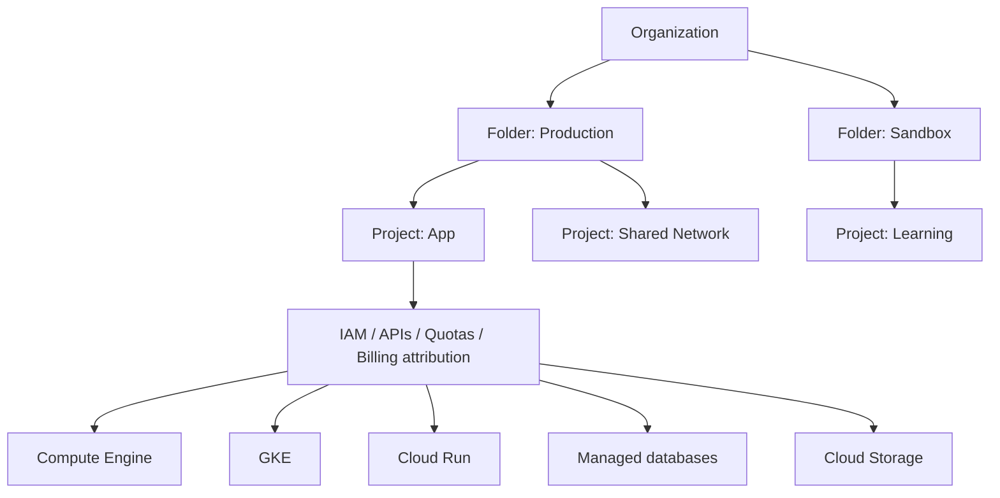

**จำสั้น ๆ:** ก่อนแก้ workload ให้ถามก่อนว่า *อยู่ project ไหน → identity อะไร → API เปิดไหม → quota/billing พร้อมไหม → network ไปถึงไหม* แล้วค่อยดูตัว service

อ่านต่อ: [Module 01](./Module-01-Foundations-and-Resource-Hierarchy.md)

---

## 2) IAM: ใคร ทำอะไร ที่ไหน ด้วย identity ไหน

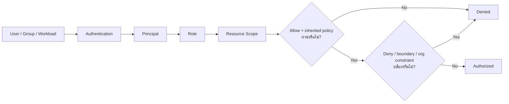

### Deployer กับ Runtime Identity ต้องแยกกัน

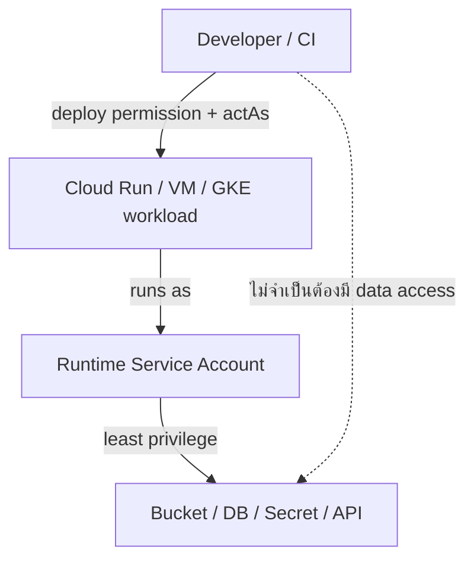

อ่านต่อ: [Module 02](./Module-02-IAM-Service-Accounts-and-Security.md)

---

## 3) Console / gcloud / API / Billing / Quota

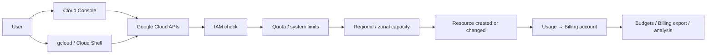

### Create ไม่ได้ ให้ไล่จากซ้ายไปขวา

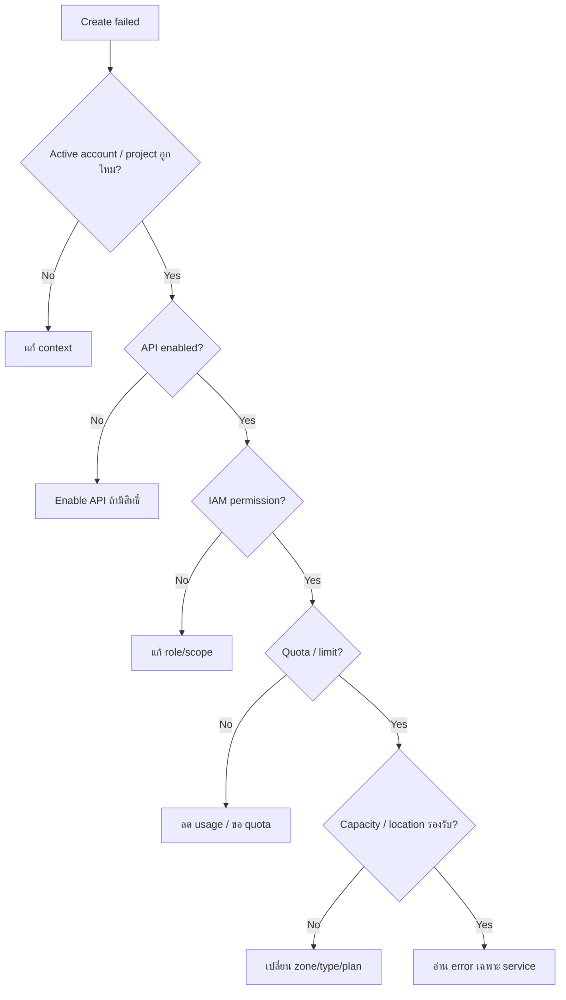

อ่านต่อ: [Module 03](./Module-03-Tools-Billing-and-Quotas.md)

---

## 4) Network: Packet ต้องผ่านอะไรบ้าง

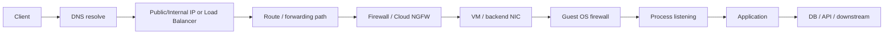

### Private VM ออกไปไหนใช้เครื่องมือคนละตัว

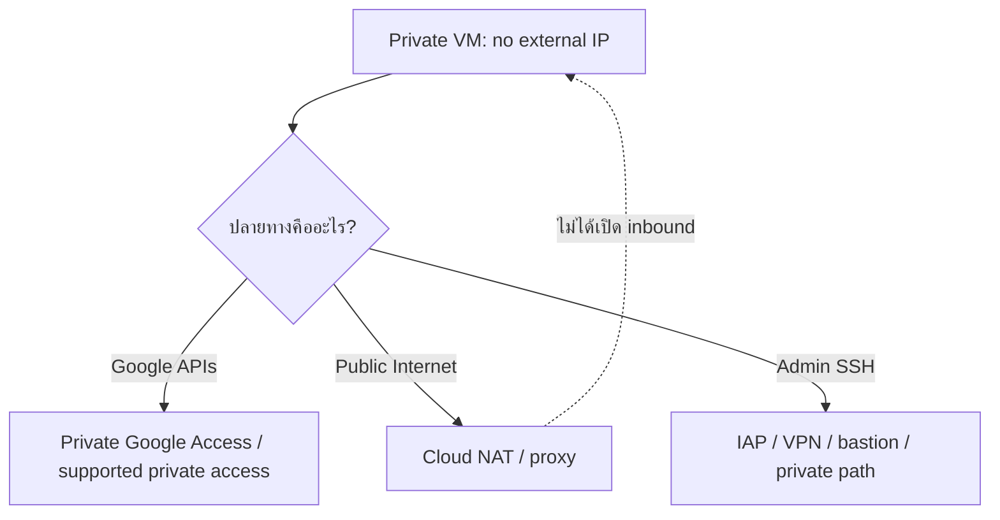

อ่านต่อ: [Module 04](./Module-04-VPC-Firewall-NAT-and-DNS.md)

---

## 5) Compute Engine: VM เดี่ยว → Template → MIG → Load Balancer

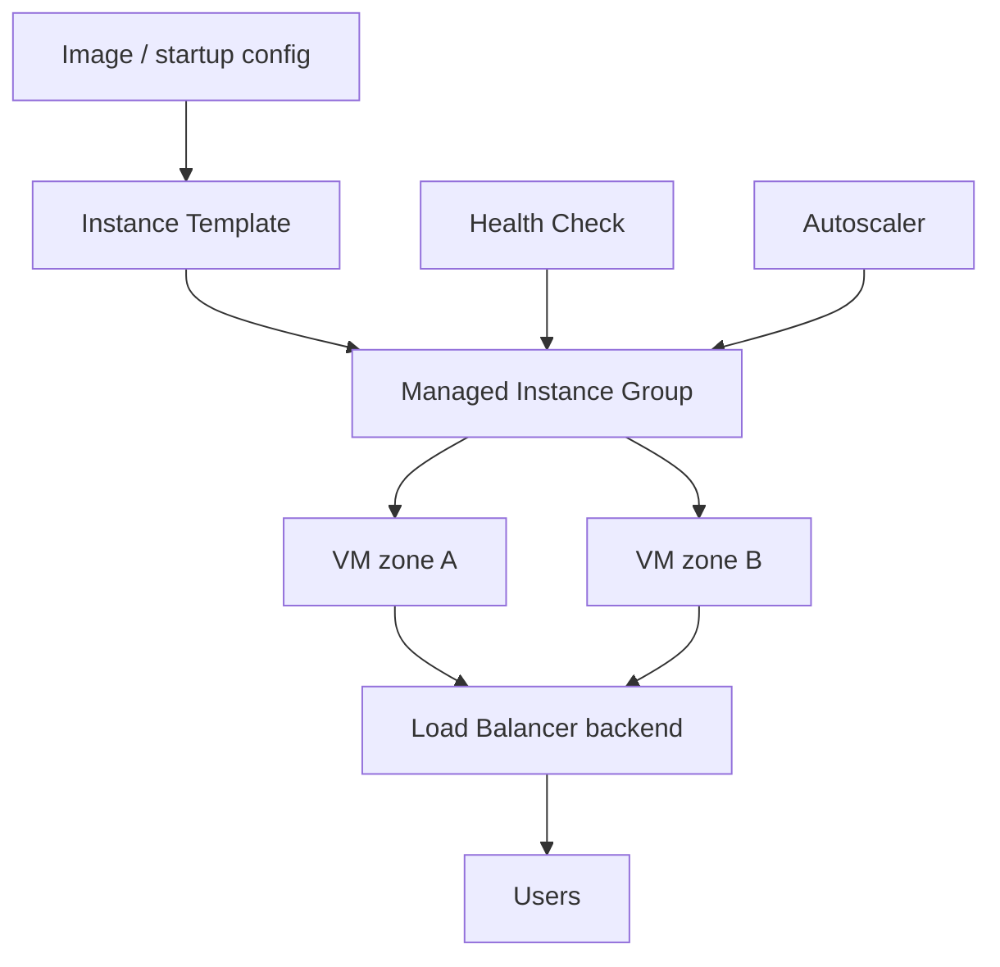

### สามคำที่ชอบสับสน

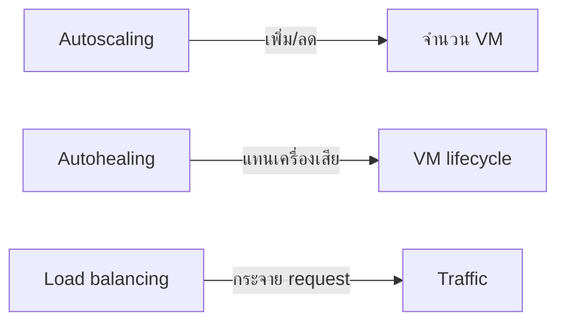

อ่านต่อ: [Module 05](./Module-05-Compute-Engine-and-Instance-Groups.md)

---

## 6) Storage: Object vs Block vs File

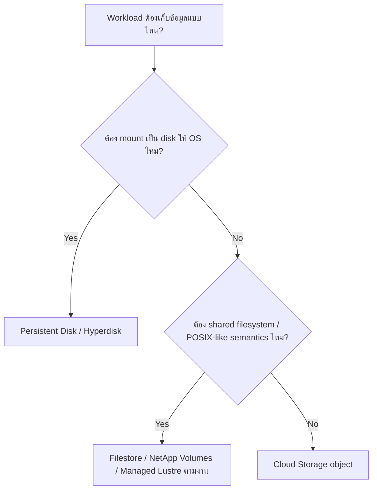

### Data protection ไม่ใช่คำเดียว

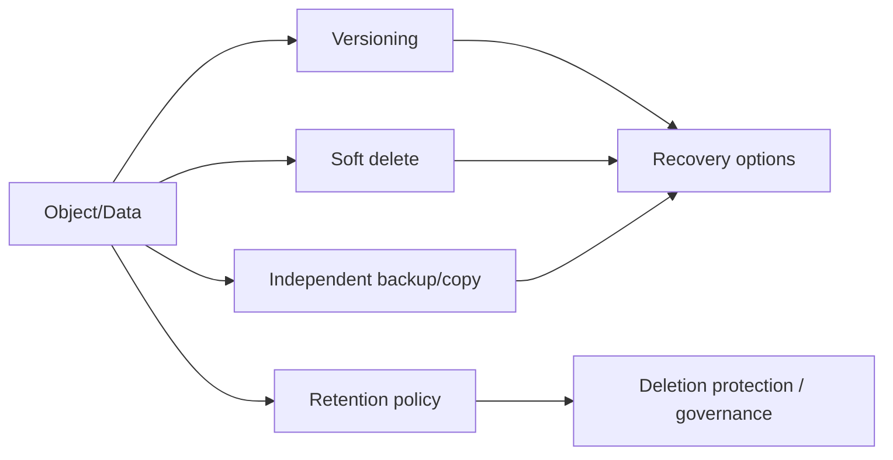

**จำ:** Lifecycle = จัดอายุข้อมูล, Retention = จำกัดการลบ, Versioning/Soft delete = ช่วยกู้บางเหตุการณ์, Backup = สำเนา/วิธีกู้ที่ออกแบบแยก

อ่านต่อ: [Module 06](./Module-06-Storage-and-Data-Protection.md)

---

## 7) Database Decision Map

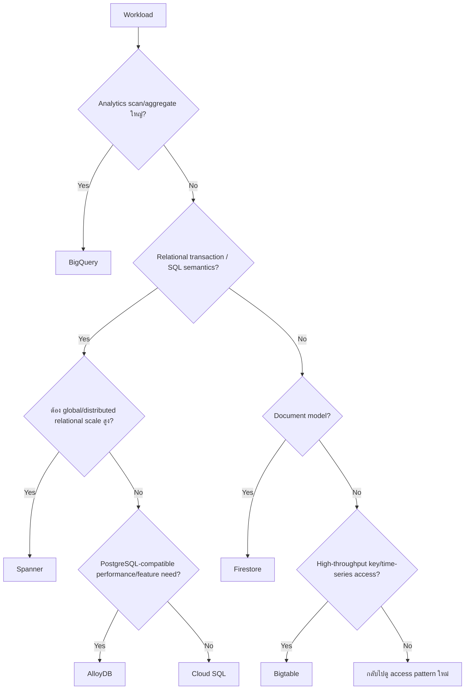

### HA ≠ Backup

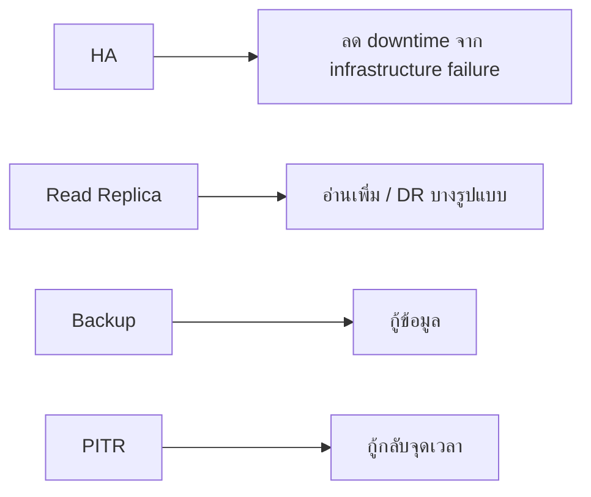

อ่านต่อ: [Module 07](./Module-07-Databases-and-Data-Services.md)

---

## 8) GKE: จาก Image ไปถึง User

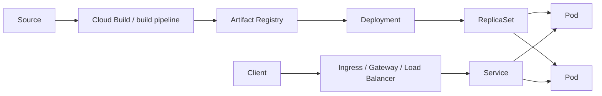

### Pod เรียก Google API ใช้ identity อีกเส้นหนึ่ง

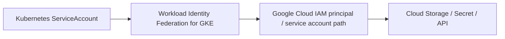

อ่านต่อ: [Module 08](./Module-08-GKE-and-Kubernetes.md)

---

## 9) Cloud Run / Functions / Event-driven

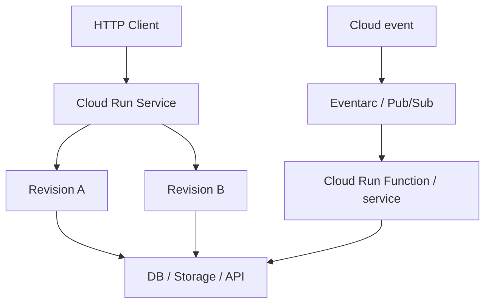

### Event ต้องคิด Retry + Idempotency

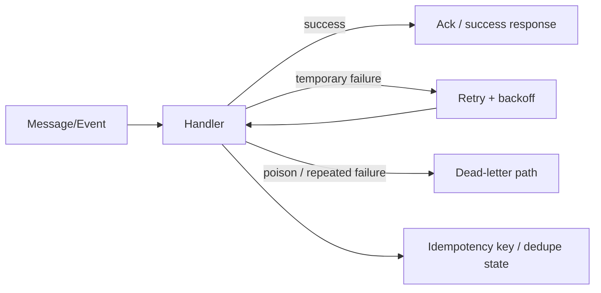

อ่านต่อ: [Module 09](./Module-09-Cloud-Run-and-Event-Driven-Services.md)

---

## 10) Load Balancer + Hybrid Connectivity

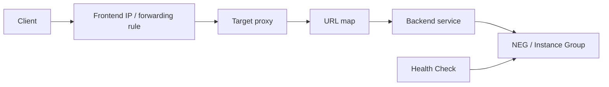

### เชื่อม network เลือกอะไร

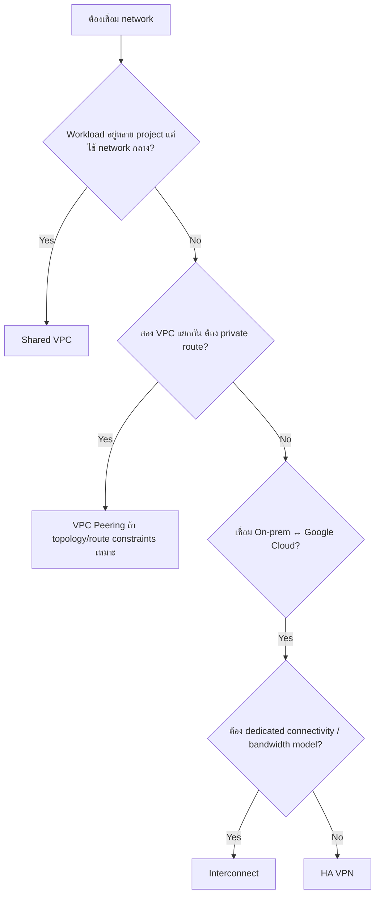

อ่านต่อ: [Module 10](./Module-10-Load-Balancing-and-Hybrid-Networking.md)

---

## 11) Observability: Signal → Hypothesis → Evidence

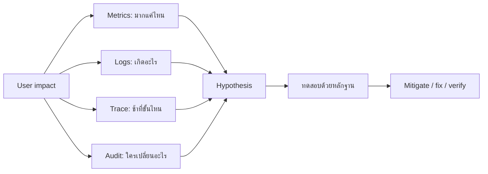

### ระบบช้าแต่ CPU ไม่เต็ม

```mermaid
flowchart TB
    SLOW[User says slow] --> EDGE[LB / frontend latency]
    EDGE --> APP[App threads / queue / GC]
    APP --> POOL[DB connection pool]
    POOL --> DB[Query / locks / storage]
    APP --> DNS[DNS / network RTT]
    APP --> DOWN[External dependency]
```

อ่านต่อ: [Module 11](./Module-11-Observability-and-Operations.md)

---

## 12) Terraform: Config + State + Real World

```mermaid
flowchart TB
    GIT[HCL in Git] --> PLAN[terraform plan]
    STATE[Terraform state] --> PLAN
    REAL[Real Google Cloud resources] --> PLAN
    PLAN --> REVIEW{Review}
    REVIEW -- approve --> APPLY[terraform apply]
    REVIEW -- change code --> GIT
    APPLY --> REAL
    APPLY --> STATE
```

### Import ไม่ใช่สร้าง HCL ให้อัตโนมัติ

```mermaid
flowchart LR
    EXIST[Existing resource] --> CFG[เขียน resource address/config]
    CFG --> IMPORT[Import into state]
    IMPORT --> PLAN[Plan]
    PLAN --> ALIGN[ปรับ config จนตรง intent]
    ALIGN --> SAFE[Apply เมื่อไม่มี replace ที่ไม่ตั้งใจ]
```

อ่านต่อ: [Module 12](./Module-12-Terraform-and-Infrastructure-as-Code.md)

---

## 13) AI Infrastructure / Modern Operations

### GPU vs TPU เริ่มจาก workload ไม่ใช่ชื่อ accelerator

```mermaid
flowchart TD
    AI[Training / Inference workload] --> FW{Framework/model รองรับ TPU path ดีหรือไม่?}
    FW -- Yes --> SCALE{Tensor workload ใหญ่และ scale ได้ดี?}
    SCALE -- Yes --> TPU[Benchmark TPU]
    SCALE -- No --> GPU[Benchmark GPU/CPU ด้วย]
    FW -- No --> GPU
    GPU --> BENCH[เทียบ latency / throughput / memory / cost]
    TPU --> BENCH
```

### จะรัน AI workload ที่ไหน

```mermaid
flowchart TD
    W[AI workload] --> C{ต้องควบคุม OS/driver/topology ลึก?}
    C -- Yes --> GCE[Compute Engine]
    C -- No --> K{ต้อง Kubernetes scheduling / multi-service platform?}
    K -- Yes --> GKE[GKE]
    K -- No --> M{เข้ากับ managed runtime / inference service ไหม?}
    M -- Yes --> MANAGED[Managed runtime / service]
    M -- No --> REQ[ทบทวน requirement]
```

### AI-assisted operations ต้องตรวจผลจริง

```mermaid
flowchart LR
    Q[Question / incident context] --> AI2[Gemini Cloud Assist / AI tooling]
    AI2 --> OBS[Observation / recommendation]
    OBS --> VERIFY[Verify metrics, logs, IAM, resource state]
    VERIFY --> CHANGE[Proposed change]
    CHANGE --> TEST2[Lab / staging / controlled rollout]
    TEST2 --> PROD[Verify production result]
```

อ่านต่อ: [Module 13](./Module-13-AI-Tooling-and-Modern-Services.md)

---

# One-page troubleshooting map

```mermaid
flowchart TD
    X[มีปัญหา] --> C1{สร้าง resource ไม่ได้?}
    C1 -- Yes --> CP[Context → API → IAM → Quota → Capacity → Org Policy]
    C1 -- No --> C2{เข้า service ไม่ได้?}
    C2 -- Yes --> NET[DNS → Route → Firewall → Listener → Auth → App]
    C2 -- No --> C3{ระบบช้า/500?}
    C3 -- Yes --> OBS2[Latency/Error → App queue/pool → DB → Network → Dependency]
    C3 -- No --> C4{Deploy แล้วพัง?}
    C4 -- Yes --> DEP2[Revision/Image/Manifest → Config/Secret → Identity → Health → Rollback]
    C4 -- No --> C5{IaC plan แปลก?}
    C5 -- Yes --> TF[Config → State → Drift → Replacement → Ownership]
```

## วิธีใช้ไฟล์นี้ให้คุ้ม

1. ก่อนเริ่ม Activity ให้เปิด diagram ของหัวข้อนั้น 2–3 นาที
2. อ่าน Module/Activity แล้วกลับมาวาด flow จากความจำ
3. ก่อนทำ lab ให้บอกตัวเองว่า request/data จะไหลผ่านองค์ประกอบใดบ้าง
4. เวลาเจอ error ให้ชี้ตำแหน่งบน flow ก่อนแก้ อย่าเริ่มจาก restart หรือเปิดสิทธิ์กว้าง ๆ
5. ถ้าอธิบาย diagram ได้โดยไม่อ่านข้อความ แปลว่า mental model เริ่มติดแล้ว
