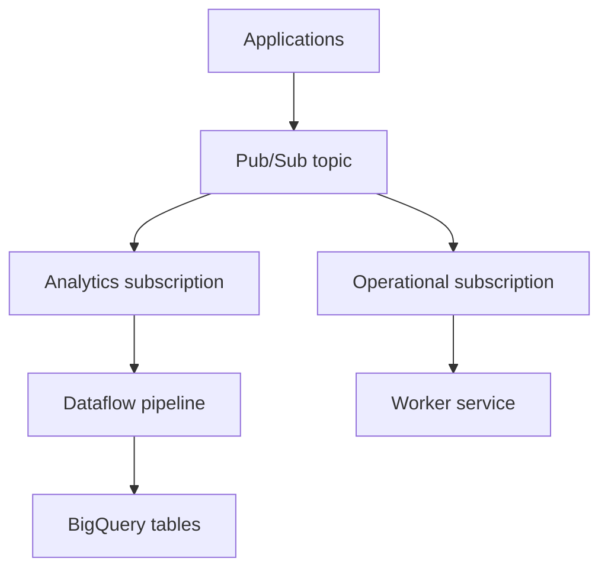

# Module 07 — Databases, Analytics & Data Services

[สารบัญ](./README.md) · [ก่อนหน้า](./Module-06-Storage-and-Data-Protection.md) · [ถัดไป](./Module-08-GKE-and-Kubernetes.md)

## 1. เริ่มจากงาน ไม่เริ่มจากชื่อบริการ

**OLTP** เช่นสร้าง order, update stock, commit transaction ต้องตอบสนอง application requests ที่มี transaction semantics

**OLAP** เช่นวิเคราะห์ยอดขายหลายปี มักอ่านข้อมูลจำนวนมาก/aggregate โดยไม่ควรไปแย่งทรัพยากรกับ transaction workload

ตัวอย่าง app inventory เก็บ asset/service relationships บน relational DB ส่วน dashboard วิเคราะห์ event หลายล้านรายการอาจใช้ data warehouse แยก

## 2. ตารางเลือกบริการ

| บริการ | ประเภท/จุดเด่นหลัก | ตัวอย่างการเลือก |
|---|---|---|
| Cloud SQL | managed MySQL/PostgreSQL/SQL Server | relational app ที่ใช้ engine เหล่านี้ |
| AlloyDB | PostgreSQL-compatible managed database | PostgreSQL workload ที่ตรง feature/performance requirements |
| Spanner | scalable relational/distributed database | transactional relational workload ที่ต้อง scale/availability แบบที่ Spanner ให้ |
| Firestore | document database | application documents, mobile/web data models |
| Bigtable | wide-column NoSQL | high-throughput key-based/time-series workloads |
| BigQuery | analytics/data warehouse | SQL analytics บนข้อมูลขนาดใหญ่ |
| Memorystore | managed in-memory services ตามผลิตภัณฑ์ | cache/session store ที่ตรง compatibility |

ตารางเป็นจุดเริ่มเลือก ไม่ใช่บอกว่าบริการทำงานได้เพียงแบบเดียว ต้องตรวจ engine/edition/location และข้อจำกัดจริงด้วย

**ข้อสำคัญสำหรับคนใช้ Oracle:** Cloud SQL ไม่ใช่ managed Oracle database และไม่มีการเปลี่ยน Oracle app เป็น PostgreSQL ได้โดยแค่ import data ต้องประเมิน SQL dialect, types, stored procedures และ dependencies

## 3. Cloud SQL

[Cloud SQL](https://docs.cloud.google.com/sql/docs/introduction) ลดงาน provision/patch/backup infrastructure ของ relational engines ที่รองรับ แต่เรายังดูแล schema/query/index/access/connection behavior และ capacity

สิ่งที่ต้องตัดสินใจ:

1. Engine/version/edition ที่ application รองรับ
2. Region และความใกล้กับ app
3. CPU/RAM/storage และ growth
4. Private/public connection model
5. DB authentication และ workload identity
6. HA, backup, point-in-time recovery และ DR
7. Connection limits/pooling และ monitoring

Cloud SQL Auth Proxy/connector ช่วย connection/authentication model ตาม configuration แต่ไม่ได้ทำ connection pool แทน application และไม่ใช่ทางลัดที่ทำให้ private network path เกิดขึ้นเองทุกกรณี

## 4. HA, read replica, backup และ PITR

| กลไก | จุดประสงค์ | สิ่งที่ยังต้องมี |
|---|---|---|
| High availability | failover ใน deployment ที่ตั้งไว้ | app reconnect/retry และความเข้าใจ failure scope |
| Read replica | แยก read workload / ใช้ใน DR model ที่รองรับ | routing ของ reads และเข้าใจ replication lag |
| Backup | กู้ข้อมูลจาก backup state | restore test และเวลาการกู้ |
| Point-in-time recovery | กู้ไปเวลาที่ต้องการตาม log/history ที่มี | feature/config/retention prerequisites |

[Cloud SQL HA](https://docs.cloud.google.com/sql/docs/mysql/high-availability) ไม่ทำให้ connection เดิมของ application ไม่เคยหลุด ทุกระบบต้องออกแบบ reconnect/backoff และไม่ถือว่า HA แก้ user ลบ table เพราะการเปลี่ยนข้อมูลสามารถ replicate ได้

Replica ไม่เท่ากับ backup และมี replica ก็ไม่ได้แปลว่า promotion/failover อัตโนมัติทุก configuration

## 5. ตัวอย่างปัญหาที่คล้าย Oracle/Tomcat

App เปิด DB connection มากขึ้นเรื่อย ๆ แต่ไม่คืน pool เมื่อ restart app connection ลดลง แล้วกลับมาเต็มอีก

การเพิ่ม instance size อาจเลื่อนเวลาที่เต็ม แต่ไม่พิสูจน์ว่าแก้ root cause ควรตรวจ:

- Pool maximum/minimum และจำนวน app instances
- Leak/timeout/validation settings ของ pool
- Query latency และ transaction ที่ค้าง
- Session active vs idle และ pattern ของ clients
- DB maximum connections และ headroom สำหรับ admin
- Retry storm หลัง DB/route outage

**ตัวอย่างคำนวณเอง:** มี app 10 instances แต่ละตัวตั้ง pool max 100 หมายถึงอาจขอ connection 1,000 ตัวก่อนรวม admin/background jobs ถ้า DB รับได้ 400 ต้องจำกัดหรือออกแบบ pool/scaling ให้สอดคล้อง

## 6. BigQuery

[BigQuery](https://docs.cloud.google.com/bigquery/docs/introduction) เป็น analytics platform/data warehouse ใช้ dataset/table/jobs เป็นโครงสร้างสำคัญ ไม่เลือกเป็น transaction DB ของ app เพียงเพราะใช้ SQL เหมือนกัน

| ส่วน | หน้าที่ |
|---|---|
| Dataset | กลุ่ม tables/views และ location/access settings |
| Table | ข้อมูลหรือ schema ตามชนิด table |
| Job | query/load/copy/extract operation |
| Partition | แบ่งข้อมูลเพื่อช่วย scope การอ่าน |
| Clustering | จัดข้อมูลตาม columns เพื่อช่วย query patterns |

ตัวอย่าง query ที่เขียนเอง:

```sql
SELECT service_name, COUNT(*) AS errors
FROM `PROJECT_ID.operations.http_logs`
WHERE event_date = DATE '2026-10-03'
  AND status_code >= 500
GROUP BY service_name
ORDER BY errors DESC;
```

Table นี้เป็น schema สมมติ ไม่ใช่ table ที่มีให้ใน account ทุกคน ต้องสร้าง/load data ก่อน Query ต้องสอดคล้องกับ dataset location และ permissions

ใช้ partition filter และเลือกเฉพาะ columns ที่ต้องใช้เพื่อลดข้อมูลที่อ่านใน pricing model ที่อิงการสแกน ตรวจ estimate/dry run และ query pricing ปัจจุบัน ไม่สรุปว่า `LIMIT 10` ลด bytes scanned ทุกกรณี

## 7. Firestore, Bigtable และ Spanner

[Firestore](https://docs.cloud.google.com/firestore/native/docs/overview): คิดเป็น documents/collections และออกแบบ queries/indexes ตามข้อจำกัด ไม่ใช่ relational join ตามใจเหมือน SQL engine ทั่วไป

[Bigtable](https://docs.cloud.google.com/bigtable/docs/overview): row key design สำคัญมาก ถ้า write ไป key range เดียวหนัก ๆ อาจเกิด hotspot; เหมาะ high-throughput keyed access แต่ไม่ใช่ drop-in replacement ของ relational transaction app

[Spanner](https://cloud.google.com/spanner): เลือกเมื่อ requirement ของ distributed relational workload เหมาะ ไม่ใช่คำตอบว่า “ข้อมูลใหญ่” เพียงอย่างเดียว ต้องคิด schema/keys/query/cost และ instance configuration

## 8. Messaging กับ processing

| บริการ | หน้าที่ | ตัวอย่าง |
|---|---|---|
| Pub/Sub | รับ/ส่ง messages ระหว่าง producers/consumers | order event → workers |
| Managed Service for Apache Kafka | managed Kafka ecosystem ตาม feature ที่รองรับ | workload ที่ต้อง Kafka APIs/tooling |
| Dataflow | managed data processing pipelines | transform stream/batch ก่อนลง storage/analytics |
| BigQuery | query/analyze data | รายงานยอด/วิเคราะห์ logs |

Queue/stream service ไม่ได้วิเคราะห์ข้อมูลแทน pipeline ทั้งหมด [Pub/Sub](https://docs.cloud.google.com/pubsub/docs/overview) แยก topic/subscription และต้องวาง retry/idempotency ตาม semantics; Dataflow อ่าน events แล้ว transform ก่อนเขียน sink



Subscription แยกทำให้ consumers แต่ละกลุ่มมี delivery state ของตน ไม่ได้หมายความว่า workers ใน subscription เดียวทุกตัวจะได้รับทุก message

## 9. Data operation ที่ต้องทำได้

การดู resource ขึ้นไม่ได้เพียงพอ ต้องรู้ว่าจะ:

- โหลดข้อมูลจาก Cloud Storage หรือ upload ตามชนิดบริการอย่างไร
- Query โดย identity ที่มี data access จริง
- ดู load/query/pipeline job status และ error
- ตั้ง backup/retention และลอง restore ไป isolated instance
- ตรวจ replication lag/region redundancy
- ตรวจ storage growth และ performance/cost recommendations

สำหรับ SQL ใช้ DB-native client ตาม engine; สำหรับ BigQuery มี `bq` CLI; Firestore/Bigtable/Spanner มี data access APIs และ tooling ของตนเอง `gcloud ... list` มักเป็น control plane ไม่ได้อ่าน row ทุกระบบ

## 10. Database Center

Database Center ช่วยมอง fleet ของ database resources และ signals/recommendations ตาม support ของบริการ ไม่ได้แปลว่าจัดการ Oracle on-prem ทั้งหมดให้โดยไม่มีการเชื่อมต่อหรือข้อจำกัด

ใช้ช่วยหา instances ที่ต้องดูแล แต่ยังต้องตรวจ metric/query/logs และ remediation ที่เหมาะกับ engine จริง

## ทบทวน

**รายงานวิเคราะห์ข้อมูลหลาย TB:** เริ่ม BigQuery ตาม analytics requirements ไม่เริ่ม Cloud SQL โดยอัตโนมัติ

**App เดิมใช้ MySQL และต้อง managed relational DB:** เริ่ม Cloud SQL พร้อม compatibility test

**HA แล้ว table ถูกลบ:** ต้องใช้ recovery strategy ที่เหมาะ เช่น backup/PITR ไม่คาดว่า standby เก็บ table เดิมไว้

## เอกสารประกอบ

- [Cloud SQL](https://docs.cloud.google.com/sql/docs/introduction)
- [Cloud SQL HA](https://docs.cloud.google.com/sql/docs/mysql/high-availability)
- [BigQuery](https://docs.cloud.google.com/bigquery/docs/introduction)
- [Firestore](https://docs.cloud.google.com/firestore/native/docs/overview)
- [Bigtable](https://docs.cloud.google.com/bigtable/docs/overview)
- [Pub/Sub](https://docs.cloud.google.com/pubsub/docs/overview)
- [Dataflow](https://docs.cloud.google.com/dataflow/docs/overview)
