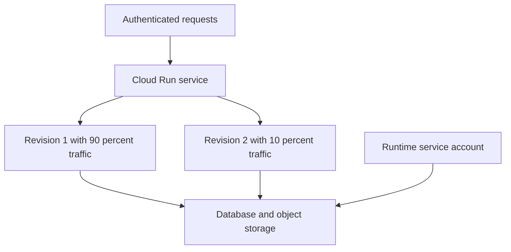

# Module 09 — Cloud Run, Functions & Event-Driven Services

[สารบัญ](./README.md) · [ก่อนหน้า](./Module-08-GKE-and-Kubernetes.md) · [ถัดไป](./Module-10-Load-Balancing-and-Hybrid-Networking.md)

## 1. Cloud Run เหมาะกับอะไร

[Cloud Run](https://docs.cloud.google.com/run/docs/overview/what-is-cloud-run) ให้รัน application workloads บน managed platform เช่น service สำหรับ requests และ jobs สำหรับ task ที่ทำจนจบ ส่วน worker-oriented capabilities ให้ตรวจ product mode ปัจจุบัน

สำหรับ ACE เน้น service/revision/traffic/identity/scaling และ event-driven workloads ไม่ต้องดูแล OS nodes แบบ VM แต่ยังต้องจัด image/code, config, access, data และ dependency

| โจทย์ | ตัวเลือกเริ่มต้น |
|---|---|
| Stateless HTTP API | Cloud Run service |
| Batch task ทำจบแล้ว exit | Cloud Run job |
| Function ตาม event | Cloud Run functions + trigger ที่เหมาะ |
| ต้อง Kubernetes APIs/custom cluster behavior | GKE |
| ต้อง Windows/OS control เต็ม | Compute Engine |

## 2. Container contract

HTTP service container ต้อง listen บน address/port ตาม runtime contract โดยทั่วไปใช้ environment `PORT` และ bind `0.0.0.0` ไม่ใช่ localhost อย่างเดียว

Local filesystem ของ instance ไม่ใช่ฐานข้อมูลถาวรที่ share กับ instance อื่น เก็บ business data ใน external storage/database ที่เหมาะและออกแบบ app ให้ restart/scale ได้

Process เริ่มช้า, image ใหญ่, initialization หนัก และ dependency ช้า มีผลต่อ startup latency/cold start; minimum instances ช่วยบางด้านแต่มี cost และไม่ได้แก้ทุก latency cause

## 3. Service กับ revision

**Service** เป็นชื่อ workload/endpoint **Revision** เป็น snapshot ของ release configuration ที่เปลี่ยนแล้วสร้าง version ใหม่

แก้ image หรือ configuration ที่ทำให้สร้าง revision จะมี version ใหม่ ไม่ควรคิดว่าแก้ VM เดิมด้วย ssh แล้วทุก request เห็น code ใหม่เหมือนกัน



## 4. Rollout, canary และ rollback

ตาม [Traffic migration](https://docs.cloud.google.com/run/docs/rollouts-rollbacks-traffic-migration) สามารถ deploy revision โดยยังไม่ส่ง traffic แล้วปรับ traffic ไปตาม version

ตัวอย่างรูปแบบคำสั่ง:

```bash
gcloud run deploy SERVICE_NAME \
  --image=IMAGE_URL \
  --region=REGION_NAME \
  --no-traffic

gcloud run revisions list \
  --service=SERVICE_NAME --region=REGION_NAME

gcloud run services update-traffic SERVICE_NAME \
  --region=REGION_NAME \
  --to-revisions=OLD_REVISION=90,NEW_REVISION=10
```

ตรวจ error rate/latency ก่อนขยาย traffic ถ้ารุ่นใหม่เสีย rollback traffic ไป revision เดิม แต่ถ้า DB schema migration ทำลาย backward compatibility การ rollback app อย่างเดียวอาจไม่พอ

Traffic percent ไม่รับประกันว่าผู้ใช้คนใดจะได้รับ version เดิมตลอดโดยไม่คิด session behavior เพิ่ม

## 5. IAM invocation กับ ingress

**Invoker permission** คุมว่า identity ใดเรียก service ได้ **Ingress** คุมแหล่ง/network path ที่ platform ยอมรับ request

ตั้ง ingress แคบไม่ได้แปลว่าไม่ต้อง authenticate และมี Invoker ก็ไม่ได้ข้าม ingress restriction ได้เสมอ

สำหรับ service private caller ใช้ ID token ที่มี audience ตรง service ตาม invocation model ไม่เอา access token ของ gcloud ใช้แทนทุกกรณี

ตัวอย่าง caller ที่มีสิทธิ์:

```bash
curl -H "Authorization: Bearer $(gcloud auth print-identity-token)" \
  "SERVICE_URL"
```

ใช้ใน interactive lab ที่ credentials/token audience ตรงเงื่อนไข ห้ามพิมพ์ token ลง log/repo สำหรับ production workload ใช้ library/platform identity ตามคู่มือ

## 6. Runtime SA vs deployment identity

คน deploy ใช้ permission จัดการ service และ attach runtime SA ส่วน app รันเป็น runtime SA ที่เลือก สิทธิ์อ่าน secret/bucket/database ต้องให้ identity ที่ app ใช้จริง

Cloud Build/source deployment มี build identity ของตนด้วย เมื่อ build ดึง artifact ไม่ได้ ให้ตรวจ build identity ไม่เพิ่ม runtime data permissions อย่างไม่มีเหตุผล

## 7. Concurrency และ scaling

| Setting | ทำอะไร | Tradeoff |
|---|---|---|
| Concurrency | จำนวน requests ที่ instance รับพร้อมกันตาม config | สูงขึ้นอาจใช้ resource ร่วมและ latency เพิ่ม |
| Minimum instances | จำนวนที่คงไว้ตาม mode/config | ลดบาง startup delay แต่มี cost |
| Maximum instances | จำกัดการขยายตาม config/semantics | ช่วยจำกัด load ที่ downstream แต่ไม่ใช่ financial hard cap |
| CPU/memory | resource ของแต่ละ instance | ต้องตรง workload และ pricing mode |

Maximum instances ไม่ใช่กลไกที่รับประกัน database connection ไม่เกินเลขหนึ่งแน่นอนทุก deployment/revision condition จึงต้องออกแบบ pool/connection strategy ด้วย

**ตัวอย่างเอง:** 20 instances × pool max 20 = 400 possible app connections ถ้า DB รองรับ 150 ต้องลด pool จำกัด scaling หรือใช้ architecture ที่เหมาะ ไม่ตั้ง max instances 100 โดยไม่คำนวณ

## 8. Cloud Run functions

ใช้เขียน function handler แล้ว deploy ใน platform model ที่รองรับ เหมาะ reaction ต่อ event/HTTP ที่ logic ไม่ต้องจัด app server เต็มรูปแบบ

ชื่อ Cloud Functions ในเนื้อหาเก่าอาจปรากฏต่อเนื่องกับ Cloud Run functions อ่าน generation/product/version ให้ตรง ไม่ถือว่า console label เก่าหมายถึงมี feature เหมือนกันทุกด้าน

Event trigger อาจใช้ Pub/Sub, Cloud Storage object events และ Eventarc ตาม support; identity ของ trigger/caller/runtime อาจเป็นคนละตัว

## 9. Pub/Sub และ Eventarc

**Pub/Sub** เป็น messaging system **Eventarc** ใช้ route events จาก providers ไป event consumers ที่รองรับ ไม่ใช่ database หรือ load balancer

Event-driven flow ต้องคิดว่า events/messages อาจถูกส่งซ้ำตาม delivery/retry semantics การประมวลผลจึงควร idempotent

ตัวอย่าง payment event เดิมเข้าซ้ำ ถ้า handler หักเงินทุกครั้งโดยไม่มี idempotency key จะเกิด duplicate transaction แม้ infrastructure ทำงานตามที่ออกแบบ

## 10. Retry, acknowledgement และ dead letter

| กลไก | จุดประสงค์ |
|---|---|
| Acknowledge/success response | บอกว่าประมวลผลตาม delivery contract สำเร็จ |
| Retry/backoff | รอลองใหม่เมื่อ error ชั่วคราว |
| Idempotency key | ลดผลซ้ำจาก event เดิม |
| Dead-letter handling | แยก messages ที่ประมวลผลไม่ได้ตาม policy/ข้อจำกัด |

ไม่ควรตอบ success ก่อนทำงานสำคัญเสร็จแล้วหวังว่าจะ retry ให้ และไม่ควร retry ทุก error ไม่มี limit เพราะ configuration/data error อาจไม่หายเอง

## 11. Runbook: deploy แล้วไม่ขึ้น

1. ดู build/deployment status และ image URL
2. ดู container startup logs และ `PORT`/bind address
3. ตรวจ runtime SA, secret/config และ outbound connectivity
4. ตรวจ memory/startup/request timeout settings ตาม workload
5. ถ้า 401/403 ตรวจ caller identity, invoker และ ingress
6. ถ้า 5xx ตรวจ app/dependency ไม่ถือว่า platform ต้องเสียเสมอ
7. ตรวจ revision traffic ว่า request เข้ารุ่นที่คาดหรือไม่
8. Rollback เมื่อมี release regression พร้อมวิเคราะห์ data compatibility

## ทบทวน

**API เล็ก ทีมไม่มีคนดูแล Kubernetes:** Cloud Run มักตรงภาระ operation ถ้า workload contract รองรับ

**Deploy ใหม่แต่ user ยังเห็นรุ่นเดิม:** ตรวจ traffic allocation/tagged URL ไม่สรุปว่า cache เสมอ

**Event เดิมทำงานสองครั้ง:** ออกแบบ idempotency และดู retry/delivery contract ไม่ปิด retry เพื่อกลบปัญหาโดยไม่มีเหตุผล

## เอกสารประกอบ

- [Cloud Run overview](https://docs.cloud.google.com/run/docs/overview/what-is-cloud-run)
- [Container runtime contract](https://docs.cloud.google.com/run/docs/container-contract)
- [Traffic migration](https://docs.cloud.google.com/run/docs/rollouts-rollbacks-traffic-migration)
- [Service authentication](https://docs.cloud.google.com/run/docs/authenticating/service-to-service)
- [Eventarc](https://docs.cloud.google.com/eventarc/docs/overview)
