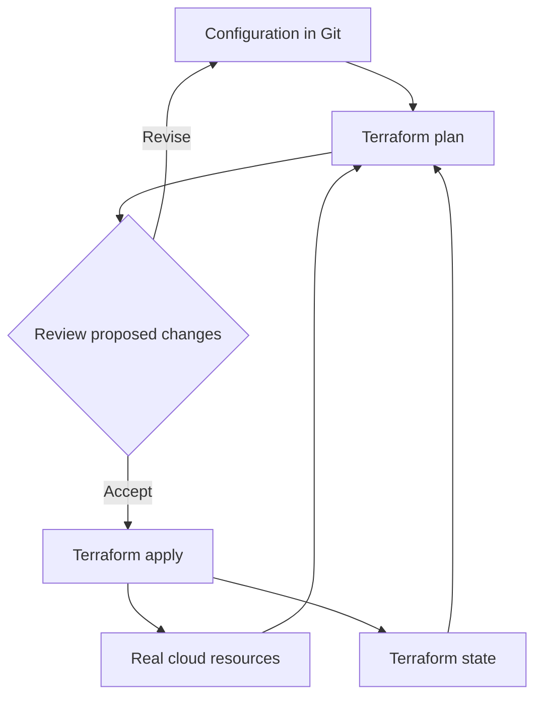

# Module 12 — Terraform & Infrastructure as Code

[สารบัญ](./README.md) · [ก่อนหน้า](./Module-11-Observability-and-Operations.md) · [ถัดไป](./Module-13-AI-Tooling-and-Modern-Services.md)

## 1. ทำไม CLI script อย่างเดียวอาจไม่พอ

Script เช่น `gcloud create` อธิบายขั้นตอนที่จะทำ แต่ถ้ารันซ้ำแล้ว resource มีอยู่ อาจ error หรือสร้างซ้ำ ต้องเขียนการตรวจ state เอง

[Terraform](https://docs.cloud.google.com/docs/terraform/terraform-overview) เน้น desired configuration แล้วใช้ providers/state/plan ช่วยเทียบกับ resources ที่จัดการ ไม่ใช่ guarantee ว่าการ apply ไม่มีผลลบ จึงต้อง review plan

## 2. Configuration, state และ real resources



**Configuration** บอกสิ่งที่ต้องการ **State** ผูก resource addresses กับ resources จริง **Refresh/plan** อ่าน provider data เพื่อประเมินสิ่งที่จะเปลี่ยนตาม workflow

State ไม่ใช่ backup ของ disk/database หาก state หาย infra อาจยังอยู่ แต่ Terraform ไม่รู้ mapping เดิม ต้อง recovery/import ตามกรณี ไม่เริ่ม apply blindly

## 3. HCL example

```hcl
terraform {
  required_providers {
    google = {
      source = "hashicorp/google"
    }
  }
}

variable "project_id" {
  type = string
}

provider "google" {
  project = var.project_id
  region  = "us-central1"
}

resource "google_compute_network" "lab" {
  name                    = "ace-tf-vpc"
  auto_create_subnetworks  = false
}

resource "google_compute_subnetwork" "lab" {
  name          = "ace-tf-subnet"
  ip_cidr_range = "10.40.0.0/24"
  region        = "us-central1"
  network       = google_compute_network.lab.id
}
```

ตัวอย่างนี้เพื่ออธิบาย dependency ผ่าน reference ไม่ใช่ production module ที่ครบทุก policy `google_compute_network.lab.id` ทำให้ Terraform รู้ dependency โดยไม่ต้องวาง sleep รอแบบเดา

Provider version constraints ให้กำหนดตามเวอร์ชันที่เลือกและผ่าน review จริง แล้ว commit dependency lock file อย่าคัดลอกเลขเก่ามาอ้างว่า latest

## 4. Workflow

| Command | ทำอะไร | จุดระวัง |
|---|---|---|
| `terraform init` | ติดตั้ง provider/module และตั้ง backend | ไม่ใช่ deploy resources |
| `terraform fmt` | จัดรูปแบบ HCL | ไม่พิสูจน์ correctness |
| `terraform validate` | ตรวจ config consistency ในขอบเขตที่เครื่องมือทำได้ | ไม่พิสูจน์ permission/quota/cost |
| `terraform plan` | แสดง proposed changes | ต้องอ่าน destroy/replace และ scope |
| `terraform apply` | ทำ changes ตาม config/plan | มีผลต่อ cloud resources |
| `terraform destroy` | ลบ managed resources ตามแผน | ไม่ใช้กับ production เพื่อทดลอง |

```bash
terraform init
terraform fmt -check
terraform validate
terraform plan -out=lab.tfplan
terraform apply lab.tfplan
```

Saved plan เป็น artifact ที่อาจมี sensitive data ต้องป้องกันเหมือน state และไม่ commit ลง repo สาธารณะ

## 5. อ่าน plan ให้เป็น

- `+` สร้าง
- `~` เปลี่ยน in-place ตาม provider support
- `-` ลบ
- `-/+` หรือ replacement indicators: สร้างแทน/ลบแทนตาม plan

ตัวอย่างเปลี่ยน field ที่ immutable อาจต้อง replace resource แทนแก้สด การอ่านแค่ `Plan: 1 to add` โดยไม่ดู `to destroy` และ nested changes ไม่พอ

คำว่า idempotent ใน IaC ไม่ได้แปลว่า immutable change ไม่มี downtime ให้ดู lifecycle/update semantics ของ resource จริง

## 6. Remote state และ locking

[Cloud Storage backend](https://docs.cloud.google.com/docs/terraform/resource-management/store-state) ช่วยให้ทีมใช้ shared state พร้อม backend behavior เช่น locking ที่รองรับ ต้องคุม access และป้องกัน accidental deletion/version changes ตามที่ออกแบบ

| งานที่ต้องออกแบบ | เหตุผล |
|---|---|
| Backend bucket แยกจาก lab resources | destroy lab ไม่ควรลบที่เก็บ state ของตนเอง |
| IAM แคบ | state อาจมี sensitive configuration |
| Versioning/recovery | กู้ state version เมื่อมีข้อผิดพลาด |
| Locking/workflow | ป้องกัน concurrent applies ที่ชนกัน |
| Encryption/retention | ตรง security/recovery requirements |

Lock state ไม่ได้ล็อก Console ไม่ให้คนแก้ cloud resources ถ้ามีคนแก้สดก็เกิด drift ได้

## 7. Drift, import และ ownership

**Drift** คือ resource จริงต่างจาก configuration/state assumptions เช่นคนเปิด public IP ผ่าน Console นอก workflow

Plan ช่วยเห็นความแตกต่างที่ provider/model ตรวจได้ แต่ไม่แทน continuous security/compliance monitoring ทุก resource/field

**Import** เชื่อม resource เดิมเข้ากับ Terraform state ตาม workflow ต้องเตรียม configuration ให้ตรงและ review next plan ไม่ถือว่า import แล้วสร้าง HCL production ที่เหมาะสมครบทั้งหมดเสมอ

กำหนดว่าทรัพยากรไหนถูกจัดการโดย IaC ใด อย่าให้ Terraform กับ controller อีกตัวคุม field เดียวกันโดยไม่มี design เพราะจะสลับแก้กลับไปมา

## 8. IAM resources: additive vs authoritative

ใน Terraform Google provider resource ที่ชื่อ policy/binding/member มี behavior ต่างกันตาม documentation เช่น policy อาจแทนทั้ง policy, binding authoritative ต่อ role, member additive ต่อ membership

ถ้าใช้ผิด อาจถอนสิทธิ์ทีมอื่นโดยไม่ได้ตั้งใจ ตรวจ provider docs ของ resource ที่ใช้ ไม่เลือกจากชื่อใกล้กันแล้ว assume ว่าเพิ่มอย่างเดียว

นี่เป็นเหตุผลที่ต้องอ่าน plan ของ IAM changes และไม่ copy example ลง production project ทันที

## 9. CI/CD สำหรับ IaC

ตัวอย่าง workflow ที่ออกแบบเอง:

1. Branch/PR แก้ configuration
2. `fmt`/`validate` และ policy checks
3. สร้าง plan ด้วย identity ที่จำกัด scope
4. Review proposed actions และผลกระทบ
5. Apply ตาม deployment policy ของทีม
6. ตรวจผล/metrics และบันทึก change

ใช้ federation/short-lived identity เมื่อรองรับแทน SA key ใน CI Secrets ไม่เก็บ password/token/state/plan ลง source control

## 10. Tooling อื่นใน Exam Guide

| เครื่องมือ | บทบาท |
|---|---|
| Config Connector | Kubernetes-style controllers จัด Google Cloud resources ผ่าน CRDs |
| Helm | package/templates สำหรับ Kubernetes manifests |
| Fabric FAST | opinionated foundation/IaC approach จาก Cloud Foundation Fabric |
| Infrastructure Manager | managed Terraform deployment workflow ของ Google Cloud |

Helm ไม่ใช่ remote state backend และ Config Connector ไม่ใช่ gcloud CLI ทั้งหมดใช้ identity/permissions และต้องกำหนด ownership

เนื้อหาเก่าอาจพูดถึง Deployment Manager เป็นตัวเลือกหลัก แต่สำหรับการเรียนใหม่ให้ตรวจ lifecycle ปัจจุบันและใช้ tooling ที่ exam guide ปัจจุบันระบุ

## ทบทวน

**คนแก้ VM ผ่าน Console แล้ว plan จะ replace:** อ่าน field/lifecycle และตัดสินใจ reconcile/import/update code ตาม intent ไม่ apply เพียงเพราะ command ผ่าน

**state ถูกลบแต่ resources ยังอยู่:** กู้ state/import อย่างมีขอบเขต ไม่สร้างซ้ำเพื่อ “ให้กลับมามี state”

**สองคน apply พร้อมกัน:** shared backend/locking และ deployment coordination ไม่แก้ด้วย state file คนละชุดที่คุม resource เดียวกัน

## เอกสารประกอบ

- [Terraform overview](https://docs.cloud.google.com/docs/terraform/terraform-overview)
- [Store state](https://docs.cloud.google.com/docs/terraform/resource-management/store-state)
- [Import](https://docs.cloud.google.com/docs/terraform/resource-management/import)
- [Security practices](https://docs.cloud.google.com/docs/terraform/best-practices/security)
- [Config Connector](https://docs.cloud.google.com/config-connector/docs/overview)
- [HashiCorp workflow](https://developer.hashicorp.com/terraform/intro/core-workflow)
