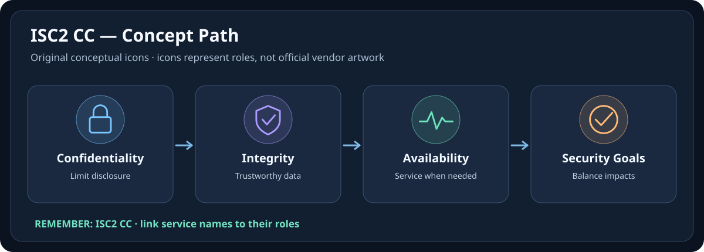
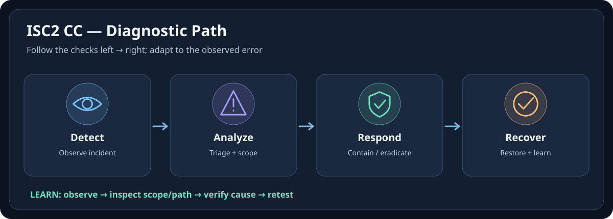

# 🛡️ ISC2 CC — Icon-First Visual Memory Guide

[← กลับหน้าเรียน ISC2 CC](./README.md) · [มาตรฐานการใช้ภาพร่วมกัน](../docs/ICON-FIRST-LEARNING-STANDARD.md)

> **ขอบเขต:** Visual Memory สำหรับทบทวนแนวคิด; ไม่แทน Module, Lab, Official Documentation หรือการยืนยัน Configuration จริง  
> **Icon provenance:** SVG นี้วาดไอคอนเชิงแนวคิดขึ้นใหม่ ไม่ใช่ Official Service Logo  
> **สถานะ:** Companion Visual Layer (เพิ่ม 2026-10-10); ไม่เปลี่ยนสถานะ Verified ของเนื้อหาเดิม

ทำให้ Security Concepts เป็นภาพจำ เช่น CIA Triad, IAM และ Incident Response ใช้สูตร **จำภาพ → รู้ชื่อ → เข้าใจหน้าที่ → อ่านเนื้อหาเต็ม → ลงมือ Lab**

## 🧠 ภาพจำใน 10 วินาที

**🔒 Confidentiality · 🧾 Integrity · 🟢 Availability**

**จำให้ขึ้นใจ:** 📌 CIA คือผลลัพธ์ที่ต้องปกป้อง ไม่ใช่รายชื่อเครื่องมือ; หนึ่ง Control อาจช่วยมากกว่าหนึ่งด้าน

## 🩺 Troubleshooting ผ่าน Icon

**สถานการณ์ตัวอย่าง:** ลองจำลองเหตุการณ์: ถ้าข้อมูลรั่วให้เริ่มที่ Confidentiality; ข้อมูลถูกแก้โดยไม่ได้รับอนุญาตให้เริ่มที่ Integrity; ระบบใช้งานไม่ได้ให้เริ่มที่ Availability — เหตุการณ์จริงอาจกระทบหลายด้าน

> [!IMPORTANT]
> แผนภาพเป็นเพียง mental model แสดงจุดตรวจหลัก ไม่ใช่ implementation diagram ของทุกบริการ และการตรวจจริงต้องอ้างอิงเวอร์ชัน/ขอบเขต/ความเสี่ยงที่ใช้งาน

## 🎯 Icon / Emoji Legend

| ภาพจำ | คำศัพท์หลัก | ใช้แยกเรื่องอะไร |
|---|---|---|
| 🌐 | Network / Entry | Request, DNS, Endpoint, Connectivity |
| 👤 | Identity | User, Group, Service Identity, Principal |
| 🔑 | Permission | Role, Scope, Authentication/Authorization |
| 🖥️ | Compute | Server, Instance, Container, Workload |
| 🗄️ | Storage / DB | Persistent Data, Files, Database |
| 🩺 | Health / Evidence | Status, Logs, Metrics, Verification |
| 🚨 | Incident | Symptom, Fault, Failed State |
| ✅ | Validation | Verify outcome and expected behavior |

## 📚 ไปอ่านเนื้อหาเต็ม (หลักฐานและ Lab ยังอยู่ใน Note)

- [01-Security-Principles](./01-Security-Principles.md)
- [03-Identity-Access-Management](./03-Identity-Access-Management.md)
- [5.3-Incident-Response](./05-Security-Operations-Incident-Response/5.3-Incident-Response.md)

## ❓ ลองทดสอบความจำ

คำถาม: ถ้าเห็นภาพจำแล้ว จะเริ่มตรวจสอบอะไร และอะไรที่ยังยืนยันไม่ได้?

ลองจำลองเหตุการณ์: ถ้าข้อมูลรั่วให้เริ่มที่ Confidentiality; ข้อมูลถูกแก้โดยไม่ได้รับอนุญาตให้เริ่มที่ Integrity; ระบบใช้งานไม่ได้ให้เริ่มที่ Availability — เหตุการณ์จริงอาจกระทบหลายด้าน ภาพบอกลำดับคิดเท่านั้น; ต้องเก็บหลักฐานก่อนสรุปสาเหตุ

## 🏷️ โลโก้และไอคอนทางการ

บทเรียนใช้ **Original Pictogram** เพื่ออธิบาย Role; หากต้องการจำรูปร่าง Logo/Service Icon ของผู้ผลิต ให้ศึกษา [ISC2 CC Overview](https://www.isc2.org/certifications/cc) และปฏิบัติตามเงื่อนไขสิทธิ์/เครื่องหมายการค้าของเจ้าของ Logo ห้ามเรียกไอคอนที่วาดขึ้นใหม่ว่าโลโก้ทางการ
