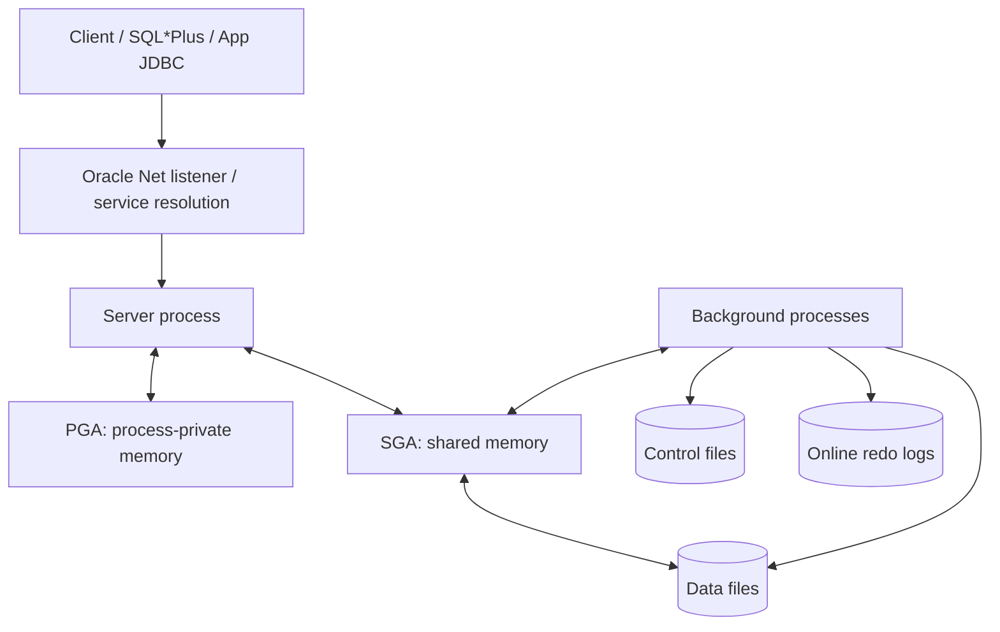

# Lesson 01 — Oracle Database Architecture (ภาษาไทย)

[Oracle Database](../README.md) · [Core Architecture](./README.md) · [Lesson 01 Read-only Lab](../10-Labs/Lab-01-Architecture-Inspection.md)

> **Curriculum mapping:** Oracle University 19c Administration Workshop — Lesson 1: Introduction to Oracle Database  
> **Authoring status:** Original Thai teaching reconstruction, based on registered lesson topic + public Oracle technical documentation; **NOT source-faithful to every private Student Guide page yet**.  
> **Version boundary:** Core concepts are applicable to 19c; 26ai-specific additions explicitly marked.

## 1. สิ่งที่ต้องอธิบายได้ก่อนจบบท

1. แยก **database** (ไฟล์ถาวร) ออกจาก **instance** (SGA + background processes)
2. ติดตามเส้นทางจาก client connection ไปยัง server process, memory และ database files
3. บอกหน้าที่ของ data files, control files, online redo logs และแยก redo ออกจาก backup
4. อธิบาย SGA และ PGA แบบไม่สับสน พร้อมยก workload ที่ใช้แต่ละพื้นที่
5. เช็ก instance/database/container จาก dynamic performance views โดยไม่เปลี่ยนค่า production
6. อธิบายเหตุใด listener พร้อมใช้งาน ไม่เท่ากับ database พร้อมรับ transaction

## 2. Mental model: Oracle มีสองส่วนหลัก

**Database = ข้อมูลที่อยู่บน storage:** data files เก็บ data blocks, control files บันทึก metadata ทางกายภาพของฐานข้อมูล, online redo log files เก็บ redo สำหรับ recovery ส่วน archived redo logs เป็นสำเนา redo ที่ผ่านการ archive ตาม configuration

**Instance = ตัวที่เปิดและทำงานกับ database:** ชุด SGA และ background processes ที่โหลดขึ้นเมื่อ start instance. Client โดยทั่วไปไม่ได้คุยกับ data files โดยตรง แต่ส่ง SQL ผ่าน server process

> เปรียบเทียบกับ System Admin: Database files เหมือน virtual disks ที่เก็บ state; instance เหมือน running services/processes + working memory. เครื่องมี disk ไม่ได้หมายความว่า application service online.

ภาพเป็น **conceptual model**: การอ่าน/เขียนจริงผ่าน background/foreground processes และ caching ตาม operation; listener มีบทบาทสร้าง connection ไม่ได้เป็น proxy ค้างอยู่บนทุก SQL statement

## 3. สี่กลุ่มไฟล์ที่ต้องรู้

| Component | ทำอะไร | ถ้าผิดปกติมักส่งผลอย่างไร |
|---|---|---|
| Data files | เก็บ data blocks ของ tables, indexes และ segments | อ่าน/เขียนข้อมูลล้มเหลว, tablespace unavailable |
| Control files | ระบุโครงสร้างและสถานะสำคัญของ database | mount/open มีปัญหา |
| Online redo logs | บันทึกการเปลี่ยนแปลงเพื่อรองรับ instance recovery | กระทบ transaction/recovery/log switching |
| Archived redo logs | redo ที่ archive แล้ว ใช้ร่วมกับ backup ในการ recovery ตาม mode | พื้นที่ archive เต็ม หรือ recovery point จำกัด |

**ข้อควรจำ:** redo เป็นกลไกบันทึกการเปลี่ยนแปลง ไม่ใช่ระบบ backup ของ data files. ต้องเข้าใจ backup/recovery และ ARCHIVELOG แยกกัน

## 4. Memory: SGA และ PGA

- **SGA (System Global Area):** shared memory ของ instance; ตัวอย่างคือ Database Buffer Cache, Shared Pool, Redo Log Buffer
- **Database Buffer Cache:** cache copies ของ data blocks; read ไม่จำเป็นต้องไป storage ทุกครั้ง
- **Shared Pool:** ส่วนสำคัญสำหรับ shared SQL areas, library cache และ metadata cache
- **Redo Log Buffer:** เก็บ redo entries ก่อนกระบวนการเขียนออก online redo logs
- **PGA (Program Global Area):** private memory ของ Oracle process ใช้สำหรับ work areas เช่น sort/hash; ไม่ใช่ shared pool

**ข้อแตกต่างสำคัญ:** SGA ไม่ใช่ “RAM ทั้งหมดของ Oracle”; PGA เป็นของ process และรวมกันอาจใช้ RAM มาก. UGA เป็น session memory และที่จัดเก็บขึ้นกับ server architecture

### 26ai extension — อย่าสับสนกับ 19c

เอกสาร **Oracle AI Database 26ai** กล่าวถึง **Managed Global Area (MGA)** เพิ่มเติม ซึ่งเป็น semi-shared memory framework สำหรับ trusted processes และยังมี memory-management options ปัจจุบันเพิ่มเติม เรียน SGA/PGA ให้เข้าใจก่อนแล้วค่อยอ่าน current-version extension; **อย่าสมมติว่า 19c มีโครงสร้าง/parameter ใหม่เหมือนกัน**

## 5. Background process overview

| Process | Mental model |
|---|---|
| DBWn | เขียน modified buffers จาก buffer cache ลง data files |
| LGWR | เขียน redo จาก redo log buffer ลง online redo log |
| CKPT | ช่วยประสาน checkpoint และอัปเดต headers/control-file metadata |
| SMON | System-level housekeeping / recovery-related tasks |
| PMON | Process cleanup และ registration-related functions ขึ้นกับเวอร์ชัน/architecture |
| ARCn | archive filled redo logs เมื่อ database ตั้งค่ารองรับ |

ไม่ใช่ทุก process จะมีจำนวนหนึ่งเดียว และชื่อ/ความรับผิดชอบเปลี่ยนไปตามรุ่น/โหมด; ดูเอกสารเวอร์ชันที่ติดตั้งก่อนใช้เพื่อวินิจฉัย

## 6. Instance lifecycle ต้องแยกให้ชัด

- **NOMOUNT:** instance started แต่ยังไม่ได้ mount database
- **MOUNT:** control file ถูกเข้าถึงแล้ว แต่ data files ยังไม่พร้อมให้ใช้งานทั่วไป
- **OPEN:** database opened; การเชื่อมต่อของ user ยังขึ้นกับ service, privileges, container และข้อจำกัดอื่น

ใน CDB อย่าดูเพียง `V$INSTANCE.STATUS = OPEN`; ต้องตรวจ `V$PDBS.OPEN_MODE` สำหรับ PDB เป้าหมายด้วย

## 7. Use case: JDBC ติดต่อไม่ได้ — จะโทษชั้นไหน?

กรณี application แจ้ง connection refused / ORA-125xx:
1. ตรวจ network path, hostname, port, listener
2. ตรวจ SERVICE_NAME ที่ client ขอและ listener services ที่ register
3. ตรวจ instance status และ database open mode
4. ตรวจ PDB target เปิด READ WRITE หรือไม่
5. ตรวจ process/session capacity และ login errors

กรณี SQL ช้าทั้งที่ connection สำเร็จ ให้เริ่มจาก session/waits/SQL execution plan ก่อน อย่าสรุปว่า listener เป็นเหตุ และ **ไม่ restart production เพื่อพิสูจน์ข้อสงสัยโดยไม่มีแผน**

## 8. ความเข้าใจผิดที่พบบ่อย

- Listener up ≠ database open
- Database open ≠ ทุก PDB open
- SID ≠ SERVICE_NAME ≠ SCHEMA
- SGA ≠ RAM ทั้งหมดที่ Oracle ใช้
- Data file ≠ redo log ≠ backup
- 19c feature list ≠ current 26ai feature list

## 9. Self-check

1. ถ้า control file หาย แต่ data files ยังอยู่ จะกระทบ startup phase ไหน?
2. ถ้า listener แสดง service แต่ target PDB ไม่เปิด จะตรวจอะไรเพิ่ม?
3. เหตุใดเพิ่ม SGA แล้ว SQL อาจยังช้า หากปัญหาอยู่ที่ execution plan หรือ I/O?
4. PGA กับ SGA แตกต่างกันในด้าน process ownership อย่างไร?
5. อธิบายเส้นทาง JDBC request จาก app ไปถึง data blocks แบบ 1 นาที

## 10. References and provenance

- Registered course: Oracle University 19c Administration Workshop D106546GC10, Lesson 1 (private; source-fidelity review still pending)
- [Oracle 26ai — Introduction to Database and Instance](https://docs.oracle.com/en/database/oracle/oracle-database/26/cncpt/introduction-to-oracle-database.html)
- [Oracle 26ai — Memory Architecture](https://docs.oracle.com/en/database/oracle/oracle-database/26/cncpt/memory-architecture.html)
- [Oracle 26ai — V$INSTANCE](https://docs.oracle.com/en/database/oracle/oracle-database/26/refrn/V-INSTANCE.html)

## Source-objective deepening — Oracle Sharding (19c)

นอกจาก memory/process/storage และ Multitenant แล้ว Lesson 01 ต้นฉบับยังให้รู้จัก **Database Sharding**. Sharding คือการกระจายข้อมูลตาม sharding key ไปยังหลายฐานข้อมูล (shards) เพื่อ scale horizontally; แต่ละ shard เป็นฐานข้อมูลที่จัดการข้อมูลส่วนหนึ่งของ logical sharded database. **Sharding ไม่เท่ากับ PDB**: PDB หลายตัวอาจ share CDB instance เดียว ในขณะที่ shard กระจายความรับผิดชอบด้านข้อมูลและ workload ข้ามฐานข้อมูล/hosts. งาน DBA ต้องวาง sharding key, query routing, cross-shard queries, distributed operations, HA/backup และ placement ของ shards. ใน Oracle ecosystem ต้องแยก shard catalog, shard directors และ shards ตาม implementation.

**ฝึกคิด:** ข้อมูลลูกค้า 10 ล้านรายต้อง query ตาม customer_id บ่อยมาก จะเลือก sharding key อย่างไรเพื่อเลี่ยง hotspot และ cross-shard joins? เพราะเหตุใดการย้าย application ไป CDB ที่มี 5 PDB ไม่ใช่ sharding โดยอัตโนมัติ?

เอกสารอ้างอิงเพิ่มเติม: [Oracle 19c Sharding Guide](https://docs.oracle.com/en/database/oracle/oracle-database/19/shard/).

## Source-page review (19c Lesson 01, slides 1-2 ถึง 1-9) — Architecture เชิงเปรียบเทียบ

ตรวจเนื้อหาแบบข้อความจาก PDF ต้นฉบับครอบคลุมภาพรวม database/instance, multitenant, instance configurations และ sharding; **ภาพประกอบต้นฉบับยังไม่ได้ตรวจความเที่ยงตรงแบบภาพต่อภาพ**.

### Database vs Instance vs Shard vs PDB

| ส่วน | เป็นอะไร | Sharing / isolation | ข้อควรจำ |
|---|---|---|---|
| Oracle Instance | SGA กับ background processes ขณะ database ทำงาน | instance อยู่บน host; RAC อาจมีหลาย instances เปิดฐานข้อมูลเดียวกัน | Restart instance ไม่เหมือน DROP database |
| Database | datafiles, control files, online redo logs และ logical structures | persistent data and recovery boundary | DB files มีอยู่ได้แม้ instance หยุด |
| CDB | database model ที่บรรจุ root, seed และ user PDBs | แบ่ง background processes/SGA ใน instance เดียว | แต่ละ PDB มี application data dictionary บางส่วน |
| PDB | tenant namespace/portable application database ภายใน CDB | shares CDB resources แต่มี container-local objects/users | PDB OPEN state ตรวจแยกจาก CDB |
| RAC | หลาย instances เปิด shared database ร่วมกัน | cluster/instance failover and shared storage | RAC ไม่ใช่ sharding |
| Sharded database | logical data กระจายหลาย distinct shards | แยก workload/ข้อมูลข้าม database targets | Sharding key, routing และ cross-shard query เป็น design concern |

### Diagnostic mental exercise

กรณีระบบหนึ่งมี CDB เดียว PDB สองตัว แต่รายงานว่าลูกค้ากลุ่ม A และ B ต้องใช้ทรัพยากรแยกกัน: อธิบายว่าแยก PDB อย่างเดียวเพียงพอด้าน CPU/IO หรือไม่; ต่างจากการใช้ RAC เพื่อ HA และ Sharding เพื่อกระจาย data อย่างไร. ระบุ failure domain ของ storage, CDB root และแต่ละ application service.

**Original diagram:** ผู้เรียนสร้าง diagram ใหม่จากตารางข้างบนเอง ห้ามคัดลอก interactive architecture artwork ของ Oracle ลง public repo.

Source reference: [Oracle Database 19c Concepts](https://docs.oracle.com/en/database/oracle/oracle-database/19/cncpt/).
