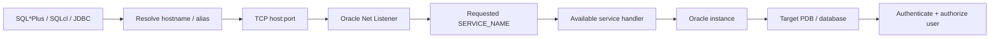

# Lesson 02 — Accessing an Oracle Database (ภาษาไทย)

> 🧠 **ภาพจำก่อนอ่าน:** 🗄️ Data → ⚙️ Process → 🩺 Health  
> 🎨 [Visual Guide ของวิชานี้](../VISUAL-MEMORY-GUIDE-TH.md) — ภาพช่วยจำ ไม่แทนคำสั่งและเนื้อหาจริง

[Oracle Database](../README.md) · [Core Architecture](./README.md) · [Lab 02](../10-Labs/Lab-02-Connection-and-Identity-Inspection.md)

> **Source mapping:** Oracle Database 19c Administration Workshop (D106546GC10), Lesson 2  
> **Status:** Original Thai teaching material; mapped by lesson topic and verified against public 19c/26ai documentation. **Not yet a page-by-page fidelity review of the private Student Guide.**  
> **Scope:** Oracle 19c foundation + explicitly noted 26ai/current guidance. All example names are placeholders.

## เป้าหมายของบทนี้

เมื่อเรียนจบ เธอควรจะ (1) บอกความต่างระหว่าง database, instance, SID, service, schema และ PDB; (2) ต่อ SQL*Plus/SQLcl ด้วย Easy Connect หรือ TNS alias; (3) อธิบาย local OS-authenticated SYSDBA vs remote password-authenticated session; (4) ตรวจว่ากำลังต่อ project/database/container/user ใด; (5) วินิจฉัยจุดเสียตาม network → listener → service → database/PDB → authentication.

## 1. เส้นทางการเชื่อมต่อ



ภาพเป็น mental model โดยย่อ การตรวจ authentication เกิดในกระบวนการ connect และรายละเอียด exact handler/server process แตกต่างกันตาม configuration; listener ไม่ได้ประมวลผลทุก SQL statement ให้ client ภายหลังเชื่อมต่อสำเร็จ

## 2. SID, Service Name, Instance, Schema, PDB ไม่ใช่สิ่งเดียวกัน

| คำ | หมายถึง | ตัวอย่าง (สมมติ) |
|---|---|---|
| SID | System Identifier ที่ระบุ instance สำหรับ OS/environment | `ORCL` |
| Instance name | ชื่อ instance ที่ running | `orcl` |
| DB_NAME | ชื่อ database จาก initialization parameter | `ORCL` |
| SERVICE_NAME | ชื่อ logical database service ที่ client ขอจาก listener | `salespdb.example.test` |
| CDB | Multitenant container database | `ORCL` |
| PDB | Pluggable database ที่เปิด application/schema | `SALESPDB` |
| Schema | namespace ของ objects ที่ user เป็นเจ้าของ | `APPUSER` |
| TNS alias | ชื่อ shortcut ฝั่ง client ที่ชี้ connect descriptor | `SALESDB` |

**ตัวอย่าง:** User `APPUSER` สามารถ log in ด้วย service `salespdb.example.test` ที่พาไป PDB `SALESPDB` ซึ่งอยู่ใน CDB `ORCL`. การสร้าง schema ไม่ใช่การสร้าง database instance หรือ service แยกใหม่โดยอัตโนมัติ

## 3. วิธีต่อด้วย SQL*Plus

บนเครื่องที่ติดตั้ง client:

```bash
# เชื่อมต่อ remote: ระบบจะถามรหัสผ่าน ไม่พิมพ์ password ใน command line
sqlplus 'appuser@//db.example.test:1521/salespdb.example.test'

# ใช้ TNS alias จาก tnsnames.ora
sqlplus 'appuser@SALESDB'
```

ใน SQL*Plus:

```sql
CONNECT appuser@//db.example.test:1521/salespdb.example.test
SHOW USER
SHOW CON_NAME
SELECT sys_context('USERENV','SERVICE_NAME') AS service_name FROM dual;
```

**Security:** ไม่ใช้ `user/password@...` ใน shell commands เพราะอาจไปอยู่ใน history/process listings; อย่าบันทึก credentials ใน GitHub. SQL*Plus Instant Client เป็น remote client ต้องระบุ connection identifier เช่น Easy Connect หรือ alias. SQLcl ใช้แนวทางเชื่อมต่อที่คล้ายกันแต่ให้ตรวจ syntax ของรุ่นที่ติดตั้ง

### tnsnames.ora (ตัวอย่างฝั่ง client)

```text
SALESDB =
  (DESCRIPTION =
    (ADDRESS = (PROTOCOL = TCP)(HOST = db.example.test)(PORT = 1521))
    (CONNECT_DATA = (SERVICE_NAME = salespdb.example.test))
  )
```

กำหนด `TNS_ADMIN` ให้ชี้ directory ของ `tnsnames.ora` หาก client ไม่พบไฟล์. ระวัง Oracle homes หลายชุดบนเครื่องเดียว เพราะอ่าน config คนละไฟล์ได้

## 4. SYSDBA กับ OS authentication

บน database server ที่ติดตั้ง database home และ user เป็นสมาชิก OSDBA group **ตามนโยบายที่อนุญาต**:

```bash
# เฉพาะเครื่อง database server / lab และบัญชีที่ได้รับอนุญาต
sqlplus / as sysdba
```

นี่เป็น privileged administrative session ซึ่งใช้สิทธิ์สูงมาก **ไม่ใช่การ login application schema ธรรมดา** และไม่ควรใช้กับโปรแกรม application. Remote privileged authentication ต้องตั้งค่าความปลอดภัยและ password file/identity ตามสภาพแวดล้อม ไม่ได้ใช้ local OS authentication อย่างเดียวเสมอไป

บน Linux/Unix ให้ตรวจ `ORACLE_SID` และ `ORACLE_HOME` ให้ตรง instance เมื่อต่อ local; Windows เป็นอีกวิธีจัดการ environment/service. อย่าคาดว่าตัวแปรเหล่านี้จำเป็นสำหรับการเชื่อม Easy Connect ผ่าน Instant Client

## 5. ตรวจตัวตนและ Container เมื่อเชื่อมต่อแล้ว

```sql
SHOW USER
SHOW CON_NAME

SELECT
  sys_context('USERENV','DB_NAME') AS database_name,
  sys_context('USERENV','INSTANCE_NAME') AS instance_name,
  sys_context('USERENV','SERVICE_NAME') AS service_name,
  sys_context('USERENV','CON_NAME') AS container_name,
  sys_context('USERENV','SESSION_USER') AS session_user
FROM dual;
```

สำหรับ account ที่มีสิทธิ์อ่าน dynamic performance views ตามที่ DBA อนุญาต:

```sql
SELECT instance_name, status FROM v$instance;
SELECT name, open_mode, cdb FROM v$database;
SELECT name, open_mode FROM v$pdbs ORDER BY name;
```

ไม่สมมติว่าทุก user มีสิทธิ์ `V$` views. การที่ `SHOW CON_NAME` ระบุ PDB ถูกต้อง ไม่ได้หมายความว่า user นั้นสามารถเห็นทุก table ของ schema อื่น

## 6. Listener / Service Registration

- Listener เป็น process รับ connection request ผ่าน configured address (นิยม TCP 1521 แต่ไม่บังคับ)
- LREG ทำ dynamic registration ของ service, instance และ service handlers เพื่อให้ listener route connection
- `lsnrctl status` ดู listener state; `lsnrctl services` ดูรายละเอียด registered services/handlers (ต้องใช้บน host หรือ environment ที่มีการเข้าถึงเหมาะสม)
- `LOCAL_LISTENER` เกี่ยวกับ endpoint ของ local listener. **ไม่เปลี่ยนค่าเพียงเพื่อแก้ error โดยยังไม่รู้ topology**
- ตั้งแต่ 19c Oracle **deprecated customer use of SERVICE_NAMES initialization parameter** สำหรับการบริหาร services: ใช้ `SRVCTL`, `GDSCTL` หรือ `DBMS_SERVICE` ตาม deployment; ห้ามสรุปว่าค่า `SERVICE_NAMES` ดูไม่ได้หรือ database ใช้ไม่ได้

## 7. Troubleshooting decision table

| อาการ | ตรวจต้นทาง | อย่าเพิ่งทำ |
|---|---|---|
| ORA-12154 | connect identifier / `tnsnames.ora` / `TNS_ADMIN` | สั่ง restart listener |
| ORA-12541 | DNS/hostname, TCP port, listener up, firewall | เปิด firewall ทุก port |
| ORA-12514 | service name สะกดถูก? registration? PDB open? | แก้ `SERVICE_NAMES` แบบสุ่ม |
| ORA-12519 / ORA-12516 | handler availability, resource constraints, processes/sessions, load | สรุปว่า network เสียอย่างเดียว |
| ORA-01017 | username/password/authentication method, target PDB | grant DBA |
| ORA-28000 | user account locked; ตรวจ policy/owner | unlock production user โดยไม่อนุมัติ |
| ORA-01034 | instance unavailable / wrong local SID / database startup state | restart production ทันที |

**เชื่อมกับ incident จริง:** ถ้า Tomcat restart แล้วใช้งานได้ชั่วคราว ต้องตรวจ application connection pool, JDBC resource handling และฝั่ง Oracle ควบคู่กัน. การพบหลาย INACTIVE sessions อย่างเดียว **ยังสรุปไม่ได้ว่า leak**; ต้องดู trend, pool sizing, process limits และ error ช่วงเกิดเหตุ

## 8. แบบฝึกคิด

1. Application ใช้ `//dbhost:1521/SALESPDB` แต่ PDB ชื่อ `SALESPDB` ไม่ได้แปลว่า service name ต้องเท่ากันเสมอ — ทำไม?
2. `tnsping SALESDB` ผ่าน แต่ `sqlplus appuser@SALESDB` ไม่ผ่าน พิสูจน์อะไรได้และไม่ได้?
3. เครื่องมี Oracle Client หลาย home จะพิสูจน์ได้อย่างไรว่าใช้ `tnsnames.ora` ตัวไหน?
4. `SHOW USER` เป็น `APPUSER` แต่ `SHOW CON_NAME` เป็น `CDB$ROOT` — มีความเสี่ยงต่อคำสั่งอะไร?
5. ทำไม application ไม่ควร connect เป็น `SYS AS SYSDBA`?

## 9. Source and version notes

- Private source mapping: Oracle University 19c Administration Workshop Lesson 2; **full Student Guide/Activity Guide fidelity review pending**
- [SQL*Plus 19c — Starting SQL*Plus](https://docs.oracle.com/en/database/oracle/oracle-database/19/sqpug/starting-SQL-Plus.html)
- [SQL*Plus 26ai — CONNECT](https://docs.oracle.com/en/database/oracle/oracle-database/26/sqpug/CONNECT.html)
- [Oracle Net 26ai — Overview of Listener](https://docs.oracle.com/en/database/oracle/oracle-database/26/netag/overview-oracle-net-listener.html)
- [Oracle Net 26ai — Connecting to Database Service](https://docs.oracle.com/en/database/oracle/oracle-database/26/netag/connecting-database-service.html)

## Source-page review (19c Lesson 02, slides 2-2 ถึง 2-21) — DBA Tools และ Connection/Sessions

PDF ต้นฉบับไม่ได้ครอบคลุมแค่ SQL*Plus/SQLcl แต่ยังแนะนำ GUI tools, Oracle Enterprise Manager architecture และการเลือกว่าเครื่องมือใดเหมาะกับงานไหน. เนื้อหานี้เขียนใหม่เป็นแผนเลือกใช้:

| Tool / interface | ทำงานแบบไหน | ข้อจำกัดหลัก |
|---|---|---|
| SQL*Plus | command line SQL, PL/SQL และ DBA connection | ระวัง shell/history passwords; OS authentication เฉพาะ trusted host |
| SQLcl | command-line script automation/interactive SQL | feature/version ใช้ตาม SQLcl build; ตรวจ connection wallet |
| SQL Developer | GUI แสดง tables, schemas, queries และ DBA navigator | DBA operations ต้องมีสิทธิ์จริง ไม่ใช่แค่เปิด DBA tab ได้ |
| DBCA | wizard/silent database creation and templates | รันจาก host ที่มี Oracle software และ access rights; ไม่ใช่ generic remote SQL client |
| EM Database Express (EM Express) | browser-based DB management ตาม 19c installation/config | single-target focus; security, HTTPS and support varies by edition/version |
| Enterprise Manager Cloud Control | central monitoring/management หลาย targets | มี OMR (repository), OMS, management agents และ console; lifecycle/config features อาจมี pack licenses |
| Other utilities | `lsnrctl`, `adrci`, Data Pump, RMAN | ใช้กับงานเฉพาะ; execution context และ privilege boundary ต่างกัน |

**หมายเหตุเวอร์ชัน:** ชื่อผลิตภัณฑ์ `OMX`, `EM Express` และ UI บางรายการเป็นบริบทจากหลักสูตร Oracle 19c; ไม่ควรสรุปว่า Oracle AI Database 26ai มี GUI ชุดเดียวกันทั้งหมด ให้ตรวจ current documentation/target edition ก่อน.

### Connection, session, privilege — ต้องไม่สับสน

- **Connection** คือ communication path ของ client process ไป Oracle server; **session** คือ authenticated logical state. Application pool อาจสร้าง physical connections ที่ถือ session อยู่ โดยยังไม่มี SQL execution ณ วินาทีนั้น.
- **Authentication** ยืนยันตัวตนว่าเป็นใคร; **authorization** ตัดสินว่า SQL/DBA operation ทำได้หรือไม่. การเชื่อมต่อผ่านไม่ได้อาจเกิดที่ network, listener, service, authentication หรือ resource capacity.
- **Local OS SYSDBA authentication** (`sqlplus / as sysdba`) อาศัย OS groups/permissions และ Oracle Home บน server; ไม่ใช่ทางลัด remote login และไม่ควรใช้กับ application account.
- **DBA navigator** แสดงเมนูไม่ได้หมายความว่า user มีสิทธิ์ ALTER/VIEW ทุกประเภท. วาง dedicated least-privilege monitoring identity สำหรับ read-only inspection.

```text
Client / tool
  → connect descriptor (host:port/service)
  → listener/service handler
  → authenticated user session in specific PDB
  → authorized SQL/DBA operation
```

### Lab thought experiment

แอป connect ผ่าน SQL Developer GUI ได้แต่คำสั่ง ALTER SYSTEM ถูกปฏิเสธ: จะตรวจ service/container และ privilege อย่างไรโดยไม่เพิ่ม DBA? จากนั้นเปรียบเทียบว่าการตรวจฐานข้อมูล 50 targets ใช้ Cloud Control กับการเขียน SQL*Plus script มีต้นทุนการติดตั้ง ความปลอดภัย และ license ต่างกันอย่างไร.

Source reference: [Oracle 19c Database Administrator's Guide](https://docs.oracle.com/en/database/oracle/oracle-database/19/admin/).
