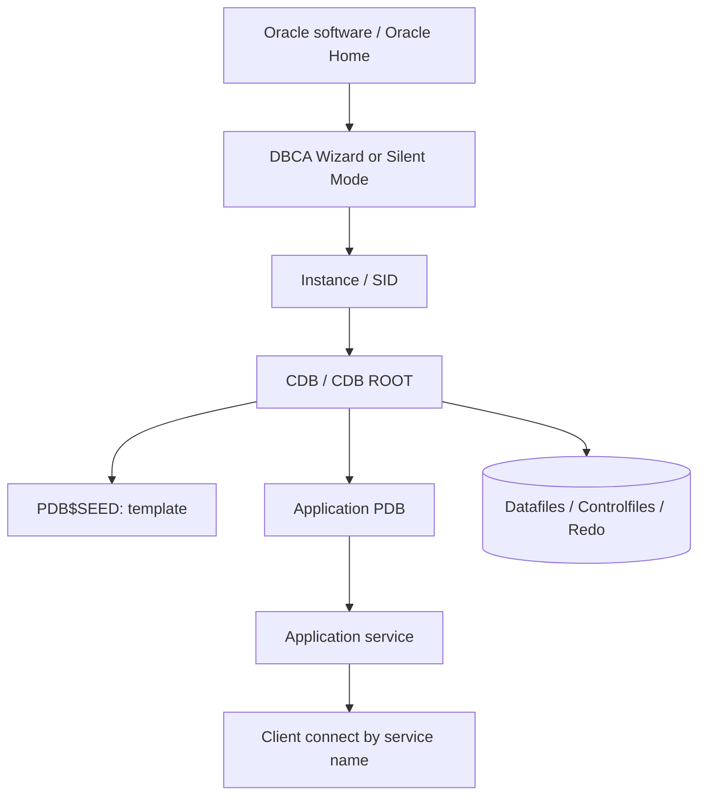

# Lesson 03 — Creating an Oracle Database Using DBCA (ภาษาไทย)

> 🧠 **ภาพจำก่อนอ่าน:** 🗄️ Data → ⚙️ Process → 🩺 Health  
> 🎨 [Visual Guide ของวิชานี้](../VISUAL-MEMORY-GUIDE-TH.md) — ภาพช่วยจำ ไม่แทนคำสั่งและเนื้อหาจริง

[Oracle Database](../README.md) · [Instance Administration](./README.md) · [Lab 03](../10-Labs/Lab-03-DBCA-Planning-and-Verification.md)

> **Source map:** Oracle University 19c Administration Workshop D106546GC10 — Lesson 3. **Original Thai reconstruction**, ไม่ได้ถอดทุกหน้าของ private Student Guide; source-fidelity review pending.  
> **Version policy:** 19c = foundation; Oracle AI Database 26ai = current verification layer. ชื่อเมนู, template, option และ CLI flags ต้องตรวจ help ของ DBCA ที่ติดตั้งจริง  
> **Safety:** การสร้าง database เป็นงานเปลี่ยนแปลงขนาดใหญ่และกินพื้นที่/ทรัพยากร; ตัวอย่างในบทเป็น **plan / dry review** ก่อนลงมือใน isolated sandbox เท่านั้น.

## Learning outcomes

เมื่อจบบทนี้ เธอควรจะอธิบายได้ว่า:
1. DBCA คืออะไรและต่างจากการสร้าง database ด้วย SQL scripts อย่างไร
2. ต้องเตรียม OS, Oracle software, listener/network, storage, memory และ identity อะไรบ้าง
3. เลือก CDB + PDB, SID, DB_NAME และ service name โดยไม่ปนกันได้
4. วางแผน character set, storage, recovery, passwords และ redo/backup ก่อนสร้าง
5. ตรวจผลหลัง DBCA สร้างเสร็จ โดยไม่เชื่อคำว่า “success” อย่างเดียว
6. รู้หลักฐานที่ต้องเก็บและวิธี rollback/cleanup เมื่อสร้างผิด

## 1. DBCA ทำหน้าที่อะไร?

**Database Configuration Assistant (DBCA)** เป็นเครื่องมือที่ช่วยสร้างและกำหนดค่าฐานข้อมูล Oracle ด้วย wizard หรือ silent mode แทนการเขียน CREATE DATABASE และ scripts ประกอบทั้งหมดเอง

DBCA **ไม่ได้เท่ากับการติดตั้ง Oracle Database software**: โดยทั่วไปต้องมี Oracle home/software พร้อมก่อน แล้วจึงสร้าง database ตามระบบปฏิบัติการและการติดตั้งที่รองรับ

| สิ่งที่ต้องตัดสินใจ | ความหมาย |
|---|---|
| Oracle Home / version | Binary และ feature/option ที่ DBCA ใช้ |
| Database name / DB unique name | Database identity; ต่างจาก instance SID |
| SID | ระบุตัว instance โดยเฉพาะใน single-instance |
| CDB / PDB | โครงสร้าง multitenant และ user workload แยกตาม container |
| Character set | ความเข้ากันได้ของข้อมูล/application; เปลี่ยนภายหลังอาจยุ่งยาก |
| Memory / processes | SGA/PGA และ concurrent workload sizing |
| Storage location / ASM / file system | ที่เก็บ data files, control files, redo logs |
| Recovery / FRA / ARCHIVELOG | ความสามารถ backup/recovery กับพื้นที่ archive |
| Administrative passwords | ต้องจัดการเป็น secret ไม่ใส่ใน script หรือ Git |

> **สำคัญสำหรับงาน migration:** Character set ต้องเทียบกับ source data และ application อย่างตั้งใจ เช่น legacy TH8TISASCII ไม่ควรถูกเปลี่ยนเป็น AL32UTF8 แบบเดาว่าเหมือนกัน — ต้องมี migration/validation plan.

## 2. Architecture หลังสร้าง CDB/PDB



ภาพเป็น logic flow: service ใช้เข้าถึง workload แต่ไม่ใช่ storage object; instance/service/database/schema/PDB เป็นคนละแนวคิด.

## 3. Preflight checklist (ก่อนเปิด DBCA)

1. **Environment** — ตรวจ Oracle version/patch level, OS, Oracle Home, kernel/OS limits และ installation account
2. **Capacity** — RAM, CPU, disks, mount points, free space; ไม่ใช้พื้นที่ production shared โดยไม่ตรวจ ownership
3. **Naming** — วาง DB_NAME, DB_UNIQUE_NAME, SID, PDB name, service name และ host/domain ให้ไม่ชนระบบอื่น
4. **Network** — กำหนด listener endpoint, name resolution, client access, TLS/security ตามนโยบาย
5. **Security** — secret store, admin credentials, least privilege, TDE/license/edition requirements ตาม policy
6. **Data** — เลือก character set, national character set, timezone expectations ที่เหมาะกับข้อมูล/แอป
7. **Recovery** — backup destination, FRA, ARCHIVELOG strategy, retention และทดสอบ restore ภายหลัง
8. **Operations** — monitoring, alert/ADR, backup automation, patch window, CMDB/runbook และ cleanup plan

## 4. GUI workflow — DBCA (แนวทางฝึก)

### ทำบนเครื่อง Lab ที่อนุญาตเท่านั้น
1. เปิด `dbca` จาก Oracle Home ที่ตั้งใจใช้; ตรวจ version และ selected Oracle Home
2. เลือก Create Database; ตรวจชนิด template และ configuration type ที่ UI นั้นรองรับ
3. กรอกชื่อ database, SID, CDB/PDB ตามโจทย์ sandbox; ตรวจชื่ออีกครั้งก่อน Next
4. เลือก storage type/path และ recovery locations; ยืนยันว่าพื้นที่เป็นของ sandbox จริง
5. ตั้ง memory/process sizing และ character set โดยเทียบ requirements
6. กำหนด administrative passwords ผ่านหน้าจอแบบไม่เปิดเผย secret; อย่าเก็บ screenshot ที่มีรหัสผ่าน
7. เปิด summary page: **บันทึกข้อกำหนดเป็น worksheet** ก่อนกดสร้าง
8. หลังดำเนินการ ให้ตรวจ instance, database, PDB, listener service, logs และ filesystem

**ข้อควรระวัง:** DBCA สามารถ create, configure และ delete database ได้ — ระวังไม่เลือก delete โดยผิดเครื่อง/ผิด Oracle Home. ไม่มีข้อกำหนดว่าทุก environment ต้องมี wizard screen เหมือนกัน.

## 5. Silent mode / automation

DBCA รองรับ command-line/silent operations แต่ **อย่า copy parameter ชุดเดียวไปรันข้าม 19c/26ai** หรือข้าม OS โดยไม่ตรวจ: defaults, requirements และ template แตกต่างกัน

คำสั่ง **อ่านข้อมูล ไม่สร้าง resource**:

```bash
# ใช้บน host ที่ติดตั้ง Oracle และกำหนด Oracle Home ถูกต้อง
dbca -help
# ให้ตรวจตัวเลือก -createDatabase ของรุ่นที่ใช้งานจริงก่อนเขียน automation
```

สำหรับ production, secret ต้องส่งผ่าน mechanism ที่องค์กรอนุญาต ไม่ใส่ plain-text password ใน command arguments (process list, shell history, CI logs อาจเปิดเผยข้อมูลได้). Silent creation จะเป็นหัวข้อ sandbox-only แยกหลังจากมี environment ยืนยัน.

## 6. Post-create validation (SQL read-only)

เชื่อมต่อ sandbox ด้วย account ที่ **ได้รับสิทธิ์ตรวจ dynamic views อย่างถูกต้อง** แล้วรัน:

```sql
SELECT instance_name, status, version FROM v$instance;
SELECT name, open_mode, log_mode, cdb, database_role FROM v$database;
SELECT con_id, name, open_mode FROM v$pdbs ORDER BY con_id;
SELECT name, value FROM v$parameter
WHERE name IN ('db_name','db_unique_name','service_names','compatible','db_recovery_file_dest');
SELECT name, value FROM v$diag_info WHERE name IN ('Diag Trace','Diag Alert');
```

กรณีไม่มีสิทธิ์ `V$` ไม่ใช่หลักฐานว่า database เสีย: ขอผู้ดูแลให้ read-only view grants เท่าที่จำเป็น อย่า grant DBA / SELECT ANY DICTIONARY แบบเหมารวม

ตรวจทาง network เพิ่ม:
- `lsnrctl status` และ `lsnrctl services` บน host ที่ได้รับอนุญาต
- ทดลอง `sqlplus user@//host:port/service` โดย **ให้ password prompt** และตรวจ `SHOW CON_NAME`
- ตรวจ client connect เข้าถูก PDB, ไม่ใช่ CDB$ROOT
- ทดสอบ RMAN/restore plan ภายหลัง; **ARCHIVELOG enabled ไม่เท่ากับ backup สำเร็จ**

## 7. Troubleshooting checklist

| อาการ | เริ่มตรวจอะไร |
|---|---|
| DBCA เปิดไม่ได้ | Oracle Home, DISPLAY/GUI/headless mode, privileges, installation logs |
| Disk space ไม่พอ | data/recovery locations, free space, ASM diskgroup, ownership |
| ชื่อ database/SID ซ้ำ | current instances, naming worksheet, listener/services |
| Listener up แต่ client ต่อไม่ได้ | host/port → registered service → PDB state → auth |
| PDB เป็น MOUNTED | PDB lifecycle และการตั้ง open/save state อย่างปลอดภัย (แยก Lab) |
| เปิดแล้ว charset ไม่ตรง | หยุดก่อน import data; ทบทวน migration plan อย่าแก้ด้วย ALTER แบบเดา |
| Backup ไม่พร้อม | FRA/archiving/RMAN plan, backup destination, restore test |

## 8. Scenario / decision exercise

**โจทย์:** เครื่อง Lab 16 GB RAM มี database legacy application หนึ่งตัว จะสร้าง Oracle 19c sandbox เพื่อทดสอบการ migrate ก่อนย้ายไปแพลตฟอร์มใหม่.

ให้เขียน worksheet ระบุ:
- DB name/SID/PDB/service: ชื่อและหน้าที่ต่างกันอย่างไร
- Data character set เดิมและเป้าหมาย; มีการเปลี่ยน encoding หรือไม่
- Storage รวม expected DB data, redo, FRA และ backup แบบแยกกัน
- Memory/CPU budget; software edition/licensing ที่ใช้ได้
- วิธีพิสูจน์ PDB READY, client login, backup และ cleanup
- เหตุผลว่าทำไม DBCA template ที่เลือกเหมาะสม

## 9. Self-check

1. ทำไมมี Oracle Home แล้วจึงยังไม่หมายความว่ามี database ให้ใช้งาน?
2. ถ้า instance OPEN แต่ PDB MOUNTED แอปจะใช้งาน PDB ได้หรือไม่?
3. ทำไมการเลือก AL32UTF8 ไม่ใช่การแก้ปัญหา encoding ของ legacy app โดยอัตโนมัติ?
4. `SID` กับ `SERVICE_NAME` ใน connect string ต่างกันอย่างไร?
5. ควรเก็บหลักฐานใดเพื่อพิสูจน์ว่า provisioning สำเร็จและ backup ใช้งานได้?

## Source & version traceability

- Private Oracle University 19c Administration Workshop, Lesson 3 — topic mapping only; page-level check pending
- [Oracle 19c Database Configuration Assistant](https://docs.oracle.com/en/database/oracle/oracle-database/19/ntdbi/creating-and-configuring-an-oracle-database.html)
- [Oracle AI Database 26ai Administration documentation](https://docs.oracle.com/en/database/oracle/oracle-database/26/admin/)
- [Oracle AI Database 26ai Reference](https://docs.oracle.com/en/database/oracle/oracle-database/26/refrn/)

## Source-objective deepening — Generate Database Creation Scripts by DBCA

Lesson 03 ต้นฉบับไม่ได้สอนแค่ wizard เพื่อ create database แต่ยังมีวัตถุประสงค์ **Generate Database Creation Scripts**. DBCA สามารถเตรียม scripts/configuration สำหรับ DBA review โดยไม่ให้ wizard สร้าง database ทันที (screen/labels แตกต่างตาม release). ก่อนนำ scripts ไปใช้ต้องตรวจ:
1. ชื่อ CDB/PDB/SID/DB_UNIQUE_NAME, file placement, storage, memory และ character set
2. script ordering, SQL file references, Oracle Home และ parameter file defaults
3. credentials/passwords/keystores — ห้าม commit secrets หรือ local credential files ลง repository
4. permissions/ownership ของ target directories และ free-space requirements
5. post-create scripts, service registration, recovery setup และ completion evidence

**Lab tabletop:** เปิด DBCA ใน isolated lab → review summary → เลือก generate scripts ตาม UI/version ที่รองรับ → ตรวจชุดไฟล์และทำ secret sanitization → ปิดโดยไม่ execute creation. ต้องแยกสถานะ **scripts generated** ออกจาก **database created**. Syntax ของ silent-mode generation ตรวจด้วย `dbca -help` บน Oracle Home ที่ติดตั้งจริง.

Reference: [19c Database Configuration Assistant](https://docs.oracle.com/en/database/oracle/oracle-database/19/admin/creating-and-configuring-an-oracle-database.html).

## Source-page review (19c Lesson 03, slides 3-2 ถึง 3-11) — Templates, Charset และ Client Conversion

เนื้อหาจาก PDF ต้นฉบับชี้ให้เห็นว่า **การเลือก character set เป็น design decision ก่อนสร้าง database** เช่นเดียวกับ storage และ template ไม่ใช่ option ที่กลับมาแก้ได้ง่ายหลัง production เริ่มเก็บข้อมูล.

### DBCA planning: workload template

| Template/approach | ตัวอย่าง workload | DBA ต้องพิจารณา |
|---|---|---|
| General Purpose / Transaction Processing | OLTP, service APIs, many small transactions | memory sizing, redo, undo, connection capacity, backup |
| Data Warehouse | analytical scans/batch processing | parallelism, I/O throughput, temp space, compression license |
| Custom Database | mixed workload, special compliance/storage | manually review files, initialization params, features and storage topology |

ชื่อ template และ default values แตกต่างได้ตาม Oracle release/installer. อย่ารับค่า default เพียงเพราะ wizard ตอบว่า creation successful.

### Charset and NLS_LANG — ปัญหาข้อมูลไทยจริง

- **Database character set** กำหนดการเก็บข้อความชนิด `CHAR`/`VARCHAR2`/`CLOB`. `AL32UTF8` รองรับ Unicode; `TH8TISASCII` เป็น character set เก่าที่มีความเสี่ยงในการแลกเปลี่ยนข้อความข้ามระบบ.
- **Client character set** เป็นชุดอักขระของ bytes ที่ Oracle client มองเห็น; `NLS_LANG` ของ OCI/SQL*Plus บางประเภทต้องตรงกับการเข้ารหัส **ข้อมูลฝั่ง client จริง** ไม่ใช่ตั้ง `AL32UTF8` ตาม server โดยอัตโนมัติ. SQL Developer/JDBC และ drivers อื่นอาจจัดการ charset ต่างจาก OCI.
- การตั้งค่า `NLS_LANG` ผิดบน legacy client อาจทำให้ Oracle Net *ไม่แปลง* bytes ที่ควรแปลง กลายเป็น mojibake/ข้อมูลเสีย ทั้งที่ insert ไม่มี error.
- การย้าย 19c ที่ใช้ `TH8TISASCII` ไป 26ai ที่ใช้ `AL32UTF8` ต้องทำ **test data migration, charset scanner/DMU readiness, Thai representative rows, length expansion, byte-vs-char semantics, verification and rollback** ก่อน cutover.
- อย่าแก้ charset ของ production database ด้วยคำสั่งตัวเดียวหรือ `ALTER DATABASE CHARACTER SET` แบบฝืน conversion.

```sql
-- Read-only: confirm actual database character set and NLS context
SELECT parameter,value FROM nls_database_parameters
WHERE parameter IN ('NLS_CHARACTERSET','NLS_NCHAR_CHARACTERSET');
SELECT parameter,value FROM nls_session_parameters
WHERE parameter IN ('NLS_LANGUAGE','NLS_TERRITORY','NLS_DATE_FORMAT');
```

### DBCA scripts generation and validation

1. เลือก template และ CDB/PDB strategy
2. ตั้ง approved filesystem/ASM destinations, memory sizing, admin credential handling, charset และ backup requirements
3. เลือกสร้าง **database creation scripts** แทน execute database create ตาม options ของ installed DBCA; inspect SQL/sh files before execution
4. ตรวจ scripts ระบุ OS path, target SID, init params, root/seed datafiles, post-create data dictionary initialization และ error handling ครบ
5. เก็บ script copies ใน private vault ที่ไม่มี credentials; เผยแพร่เฉพาะ sanitized examples

**Expected evidence:** screenshot DBCA summary (sanitized), hashes of generated scripts, planned CDB/PDB services, separate code review, DBCA log path and original rollback plan.

Sources: [19c Database Character Set Considerations](https://docs.oracle.com/en/database/oracle/oracle-database/19/nlspg/), [Oracle Database Installation Guide](https://docs.oracle.com/en/database/oracle/oracle-database/19/).
